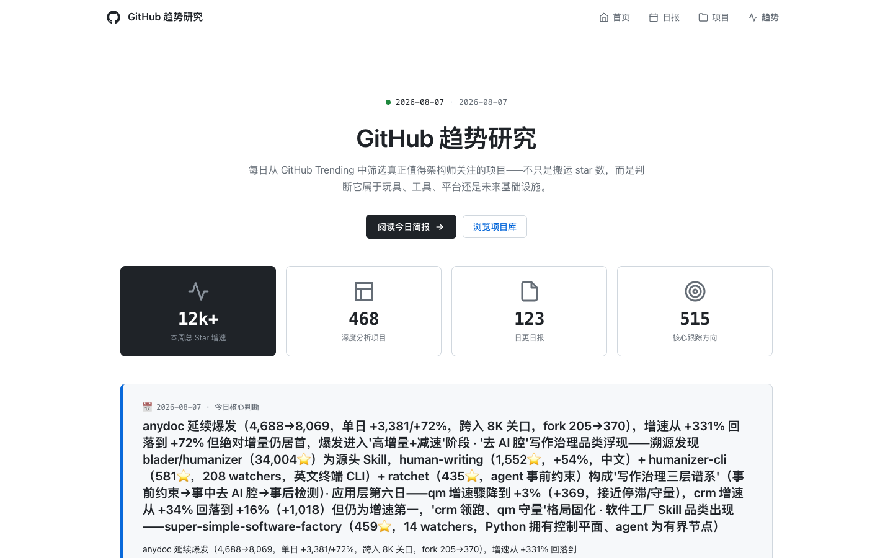
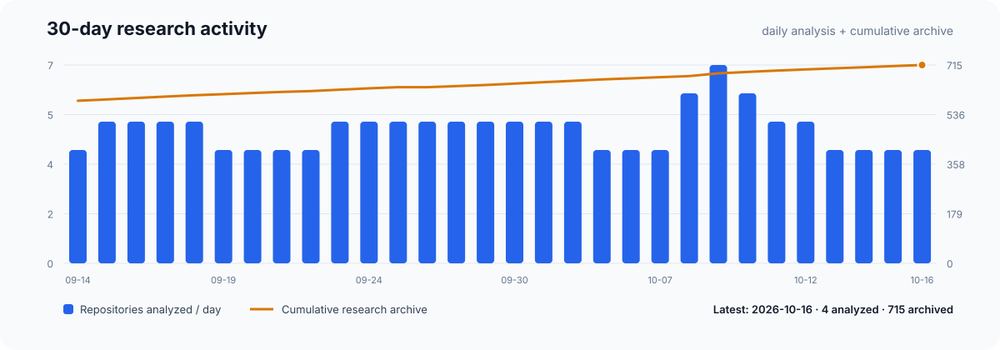
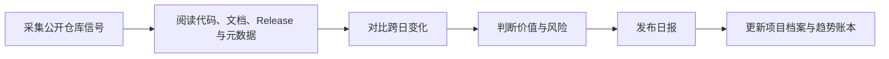

# GitHub 趋势研究

<h3 align="center">每日追踪快速增长的开源项目，用可核验事实解释变化、趋势、价值与风险。</h3>

<p align="center">
  不只搬运 Star 排名：记录发生了什么、为什么可能重要、信号有多强，以及哪些结论仍未验证。
</p>

<p align="center">
  <a href="README.md">English</a> ·
  <a href="https://github-research.aiutil.com">在线研究站</a> ·
  <a href="daily/2026-10-15.md">最新日报</a> ·
  <a href="https://aiutil.com">AIUtil</a>
</p>

<p align="center">
  <a href="https://github.com/aiutil/github-researcher/actions/workflows/ci.yml"></a>
  <a href="LICENSE"></a>
  
</p>



## 最新研究 · 2026-10-15

| 今日深度分析 | 项目档案 | 核心趋势方向 | 本周 Star 变化 |
| ---: | ---: | ---: | ---: |
| 4 | 711 | 4 | 1800k+ |

**今日核心判断：** outcrawlai/scout 2 天 636⭐ 把「AI browser agent」从「playwright + stealth + LLM 串联调」推到「Tell it the task. It opens a browser and gets it done + 一行 npm i @outcrawl/scout + 4 个模型角色（hands/brain/eyes/extract）+ 任意 chat completions API + Scout runs best on Outcrawl's cloud（residential + captcha solving + natural input + replays）+ 自己的 machine 可走 `browser: { launch }` 或 `browser: { cdpUrl }` + monorepo（packages/scout/runtime/model/scout-core/scout-cdp/agenthands）+ Browser Use 80-site 基准 92.5% + your own JSON schema → structured answer + Apache-2.0（agenthands 自带 MIT）」严肃工程化形态 · deeplethe/solid-glass 3 天 590⭐ 把「AI 应用设计系统」从「shadcn/ui 默认 flat + Apple liquid glass 商用许可 + 各家 design system 半成品」推到「A refined glass-inspired aesthetic that feels solid from afar and reveals its subtle materiality up close + stands between flat design and liquid glass + one stylesheet finds shadcn/ui 的 data-slot 不改组件 + 13 items registry + React 19 + Tailwind CSS 4 + Base UI + Material/Create 页面 + Light/Dark + blocks（agent workspace 等完整屏）+ built by DeepLethe + MIT」严肃工程化形态 · HeyPuter/everything 2 天 731⭐ 把「开源软件替代闭源应用」从「各自独立的 FOSS 替代（LibreOffice/GIMP/Inkscape/FreeCAD）+ 单组织维护单 app」推到「mono-repository containing all the applications and tools developed under the project + Office 8 + Collaboration 6 + Creative 6 + Engineering 4 + Productivity + Finance + Business + Developer Tools + Games 9 大类 + 34+ apps （Spreadsheet/Documents/Presentation/Whiteboard/PDF/Notes/Records/Meetings/Teamchat/Email/Contacts/Calendar/Signatures/Photo Studio/Video Studio/Vector Studio/Audio Studio/Music Studio/3D/CAD/Parametric/Circuits/...）+ 全部 MIT-licensed + 每个 app 都有替代关系映射（Photoshop/CapCut/Illustrator/AutoCAD/SolidWorks/Excel/Word/Zoom/Slack/DocuSign 等）+ 每个 app 都有 try-it / source 双入口 + HeyPuter 同一组织维护」严肃工程化形态 · CoolkHz/gptibo 2 天 722⭐ 把「数字商品商城自托管」从「Shopify 闭源 + WooCommerce/WordPress 全套包袱 + Gumroad 收费抽成 + Lemon Squeezy 抽成」推到「Self-hosted 数字商品商城 + 商品展示/下单支付/订单交付/售后 + 管理后台 + 代理工作台（前/后/代理三端）+ 两套后端任选（Go + PostgreSQL / Cloudflare Workers + D1）+ 原站点已停止运营重开 MIT + React 19 + TypeScript + Vite + Tailwind + React Email + Node.js 24 + Docker Compose + GitHub Actions + Gitleaks + 自动测试 + CI verify workflow + 中英界面 + 深浅主题 + 双语 README（中文主文档）」严肃工程化形态 · 延续跟踪 liseami/CCBaga → 4 天 2244⭐ ⑂222 fork/star 9.9%（Tauri 2 + .baga 容器 + Fingerprint Chromium 148 + Agent Skills 协议 + Debian 12/13 Xray/Reality）+ onehumanbeing/esp32-iphone-agent → 4 天 2063⭐ ⑂276 fork/star 13.4%（ESP32-S3 USB HID + UxPlay + GStreamer）+ jhaizhou-ops/d2r-mobile → 3 天 2061⭐ ⑂678 fork/star 32.9%（iOS aarch64 + Metal + shader 翻译）+ shaongitbd/doory → 5 天 1187⭐ ⑂68 fork/star 5.7%（React 19 + Django 5 + Docker）+ opengeos/RustGIS → 5 天 1036⭐ ⑂140 fork/star 13.5%（pure-Rust + WASM + plugins）+ rociiu/talorys → 5 天 997⭐ ⑂90 fork/star 9.0%（Cloudflare AI agent）+ zhuyansen/new-term-radar → 3 天 947⭐ ⑂381 fork/star 40.2%（AI 新词发现）+ HeyPuter/everything → 2 天 731⭐ ⑂107 fork/star 14.6%（mono-repo 开源软件）+ CoolkHz/gptibo → 2 天 722⭐ ⑂438 fork/star 60.7%（Self-hosted 商城）+ 5 个延续项目同时进入 top trending，反映了 Anthropic Skills 协议 + Apple 平台原生 Mach-O 严肃工程化 + AI browser/agent 真实基础设施 + 开源软件生态严肃工程化 + 严肃工程化自托管 SaaS 五大方向的强需求

| 项目 | 当日快照 | 分类 |
| --- | --- | --- |
| [outcrawlai/scout](projects/scout.md) | 636 stars | 工具型 |
| [deeplethe/solid-glass](projects/solid-glass.md) | 590 stars | 工具型 |
| [HeyPuter/everything](projects/everything.md) | 731 stars | 观察型 |
| [CoolkHz/gptibo](projects/gptibo.md) | 722 stars | 工具型 |



## 当前趋势信号

1. **outcrawlai/scout 2 天 636⭐ 把「AI browser agent」从「playwright + stealth + LLM 串联调」推到「Tell it the task. It opens a browser and gets it done + 一行 npm i @outcrawl/scout + 4 个模型角色（hands/brain/eyes/extract）+ 任意 chat completions API + Scout runs best on Outcrawl's cloud（residential + captcha solving + natural input + replays）+ 自己的 machine 可走 `browser: { launch }` 或 `browser: { cdpUrl }` + monorepo（packages/scout/runtime/model/scout-core/scout-cdp/agenthands）+ Browser Use 80-site 基准 92.5% + your own JSON schema → structured answer + Apache-2.0（agenthands 自带 MIT）」严肃工程化形态** · 相关项目：outcrawlai/scout · 强度：92
2. **deeplethe/solid-glass 3 天 590⭐ 把「AI 应用设计系统」从「shadcn/ui 默认 flat + Apple liquid glass 商用许可 + 各家 design system 半成品」推到「A refined glass-inspired aesthetic that feels solid from afar and reveals its subtle materiality up close + stands between flat design and liquid glass + one stylesheet finds shadcn/ui 的 data-slot 不改组件 + 13 items registry + React 19 + Tailwind CSS 4 + Base UI + Material/Create 页面 + Light/Dark + blocks（agent workspace 等完整屏）+ built by DeepLethe + MIT」严肃工程化形态** · 相关项目：deeplethe/solid-glass · 强度：84
3. **HeyPuter/everything 2 天 731⭐ 把「开源软件替代闭源应用」从「各自独立的 FOSS 替代（LibreOffice/GIMP/Inkscape/FreeCAD）+ 单组织维护单 app」推到「mono-repository containing all the applications and tools developed under the project + Office 8 + Collaboration 6 + Creative 6 + Engineering 4 + Productivity + Finance + Business + Developer Tools + Games 9 大类 + 34+ apps （Spreadsheet/Documents/Presentation/Whiteboard/PDF/Notes/Records/Meetings/Teamchat/Email/Contacts/Calendar/Signatures/Photo Studio/Video Studio/Vector Studio/Audio Studio/Music Studio/3D/CAD/Parametric/Circuits/...）+ 全部 MIT-licensed + 每个 app 都有替代关系映射（Photoshop/CapCut/Illustrator/AutoCAD/SolidWorks/Excel/Word/Zoom/Slack/DocuSign 等）+ 每个 app 都有 try-it / source 双入口 + HeyPuter 同一组织维护」严肃工程化形态** · 相关项目：HeyPuter/everything · 强度：88
4. **CoolkHz/gptibo 2 天 722⭐ 把「数字商品商城自托管」从「Shopify 闭源 + WooCommerce/WordPress 全套包袱 + Gumroad 收费抽成 + Lemon Squeezy 抽成」推到「Self-hosted 数字商品商城 + 商品展示/下单支付/订单交付/售后 + 管理后台 + 代理工作台（前/后/代理三端）+ 两套后端任选（Go + PostgreSQL / Cloudflare Workers + D1）+ 原站点已停止运营重开 MIT + React 19 + TypeScript + Vite + Tailwind + React Email + Node.js 24 + Docker Compose + GitHub Actions + Gitleaks + 自动测试 + CI verify workflow + 中英界面 + 深浅主题 + 双语 README（中文主文档）」严肃工程化形态** · 相关项目：CoolkHz/gptibo · 强度：82

## 最近 7 期更新量

| 日期 | 深度分析项目 | 核心趋势方向 |
| --- | ---: | ---: |
| [2026-10-15](daily/2026-10-15.md) | 4 | 4 |
| [2026-10-14](daily/2026-10-14.md) | 4 | 4 |
| [2026-10-13](daily/2026-10-13.md) | 4 | 4 |
| [2026-10-12](daily/2026-10-12.md) | 5 | 5 |
| [2026-10-11](daily/2026-10-11.md) | 5 | 5 |
| [2026-10-10](daily/2026-10-10.md) | 6 | 5 |
| [2026-10-09](daily/2026-10-09.md) | 7 | 5 |

## 为什么做这个项目

GitHub Trending 展示注意力，不等于长期价值。本项目记录带日期的仓库事实，阅读代码、文档和 Release，对比跨日变化，区分事实与推断，并保留 Benchmark 未复现、许可证变化或异常 Star 等风险。

## 研究工作流



- `daily/`：带来源快照的每日研究报告。
- `projects/`：可持续修订的项目档案。
- `indexes/`：跨项目、跨日期的趋势记录。
- `docs/`：生成后的公开站点。
- `scripts/generate_readme.py`：从已提交数据生成双语 README 和活动图表。

## 证据边界

Star、Fork、Release、许可证、语言与时间戳属于采集时可观察的 GitHub 事实；产品质量、架构意义、市场方向和疑似刷星属于研究判断。作者自述在独立复现前会明确标注，后续修正保留在带日期的记录里。

## 生成与验证

```bash
python3 -m pip install pyyaml
python3 scripts/generate_readme.py
git diff --exit-code -- README.md README.zh-CN.md docs/images/research-activity.svg
```

定时研究任务运行在 AIUtil 私有自动化环境中，Token、私有运行记忆和运营状态不进入仓库。

## 安全

请勿提交访问令牌、私有仓库内容、用户级活动数据或未经脱敏的运营记忆。安全问题请通过 [GitHub Security Advisories](https://github.com/aiutil/github-researcher/security/advisories/new) 私下报告。

## 开源协议

Apache License 2.0，详见 [NOTICE](NOTICE)。
