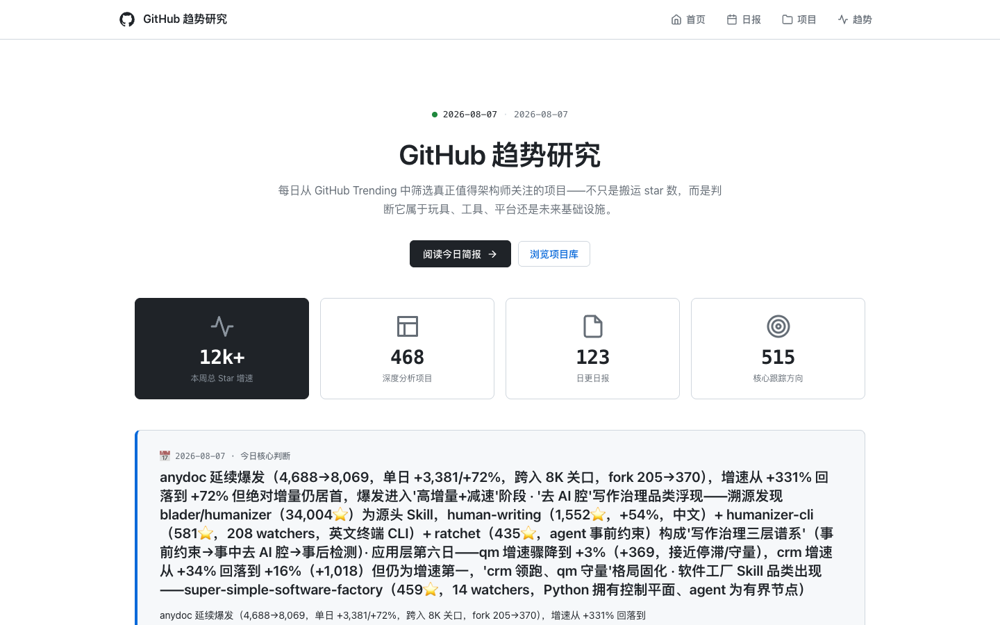
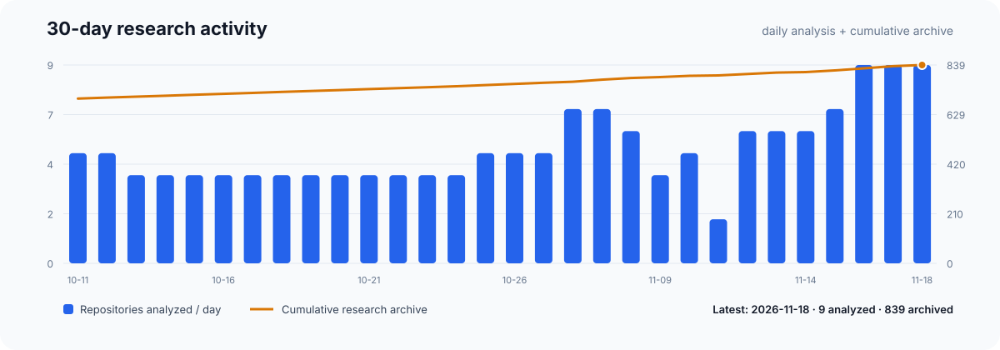

# GitHub 趋势研究

<h3 align="center">每日追踪快速增长的开源项目，用可核验事实解释变化、趋势、价值与风险。</h3>

<p align="center">
  不只搬运 Star 排名：记录发生了什么、为什么可能重要、信号有多强，以及哪些结论仍未验证。
</p>

<p align="center">
  <a href="README.md">English</a> ·
  <a href="https://github-research.aiutil.com">在线研究站</a> ·
  <a href="daily/2026-11-15.md">最新日报</a> ·
  <a href="https://aiutil.com">AIUtil</a>
</p>

<p align="center">
  <a href="https://github.com/aiutil/github-researcher/actions/workflows/ci.yml"></a>
  <a href="LICENSE"></a>
  
</p>



## 最新研究 · 2026-11-15

| 今日深度分析 | 项目档案 | 核心趋势方向 | 本周 Star 变化 |
| ---: | ---: | ---: | ---: |
| 7 | 816 | 5 | 118k+ |

**今日核心判断：** 本日最值得记的判据修正，是把「投放体」从一个**静态形态**升级成一个**可运行的自动化流水线** —— ⭐⭐⭐⭐⭐ 在 `created:2026-11-14` 的 300 个候选里，**286 个（95.3%）共享同一批 README 全文 md5**，被拆成三个族群（`ai--manus2.0` 114 个 / `IPTV_Player_2.0` 111 个 / `GitHub-Copilot-app` 61 个），且**每个族群内部的所有仓库都指向同一条 Dropbox 链接**（`ManusStudio2.0.rar`、`IPTVPlayer2.0.rar`、`GitHub_Copilot_app.rar`）—— ⭐⭐⭐⭐⭐ **即「md5 相同」这一判据在本日被证伪了一半：真正稳定的指纹不是 README 的字节，而是 README 里那一条下载链接**。⭐⭐⭐⭐⭐ 而与这三族同框的 `-desktop` 族（本日 5 个：Malware Defender / Topaz Video AI / iZotope RX 11 / Adobe Acrobat PDF / Leonardo AI）**暴露了更硬的一层：它们的「活跃度」是自动生成的** —— 每个仓库都有一个随机名的 GitHub Actions 工作流（`SP7LDgUHone.yml` / `mmZDs9dJzawUKR.yml` / `hi6b2Xefut.yml` / `F1fAks7Y8Hdu0.yml` / `J5zzALI4By.yml`），工作流名是随机串（`YAqWuDoGTdQ` / `P015SrpLujreU` …），内容是 `actions/github-script@v7` 里一段**随机词组合 + 随机数**的提交消息生成器，往 `.github/<随机名>` 文件里追加一行时间戳；⭐⭐⭐⭐⭐ **实测该仓库的提交历史是 `optimize revert sync (5102)` / `monitor docs enhance (3709)` / `improve validate retry (4810)`，时间戳每次都变** —— ⭐⭐⭐⭐⭐ **即「push 频率」与「commit 数量」这两个最常用的活跃度判据，在本日被证实可以由一个 30 行的定时脚本凭空制造**。⭐⭐⭐⭐⭐ 与之并列的第三个发现是**一批「零代码但高订阅」的仓库**：本日 7 个仓库（`rob-run-private-cheat` 68 subs / `wallet-security-checker` 50 subs / `sims4-updater` 24 / `TradePilot` 24 / `Wallet-Hunter` 24 / `crypto-panic` 24 / `Fragment-Sniper` 24）**整棵树只有 `LICENSE` + `README.md` 两个文件、0 个代码文件**，⭐⭐⭐⭐⭐ 而它们的 **7 个 owner 账号中有 6 个创建于 2026-09-21T17:23:39Z–17:25:16Z 的 97 秒窗口内**、每个账号各有一个随机名 + 0⭐ + ~1KB 的占位仓库 —— **即「subs 高」在本日第一次被证明可以是纯订阅农场的手动产物，且它与「star 高」完全正交**。⭐⭐⭐⭐⭐ 而与这三批同框的四个真项目，恰好给出四种**互不重叠**的诚实形态：`hikaku-io/hikaku-extension`（283⭐ · 87 files · Apache-2.0 · v0.1.0）**把模型的真实失败率直接写进文档**（Reddit 弱标签基准：AI 图捕获 65%、真图误报 6%、AI 视频仅捕获 22%），并用 `docs/ARCHITECTURE.md` + `docs/MODELS.md` 把「声明（declaration）」与「模型估计（estimate）」在数据结构上分开；`opencoredev/islandcn`（658⭐ · 310 blobs · 组织账号 · MIT）**把 `AGENTS.md` 写成给 coding agent 的合同**，并用 `/r/island-core.json` 这个 shadcn registry 端点分发引擎；`faizfahmi77/ScanDot`（532⭐ · 55 files · v0.3.0-preview.1）**在 README 第二段就用加粗声明「The Android app does not reconstruct ordinary video with photogrammetry on the phone」**，并同时给出「手机端 ARCore 深度」与「工作站端 COLMAP」两条互不混淆的路径；`quer3q/kraken-mount`（321⭐ · 19 open issues · GPL-3.0）**用 `DESIGN.md` 明确写出「支持的来源只有三种」并逐条列出「不支持什么」**。⭐⭐⭐⭐⭐ **本日报据此给出本日最重要的判据修正：11-13 记录的「仓库名可被伪装」和 11-08 记录的「账号注册聚集度」都只描述了投放体的「静态指纹」，而本日证实投放体已经具备「运行时」—— 即任何基于 README 文本、commit 数量、push 频率、subs 数量的单点判据，都必须先问「这个信号能否被一个自动化脚本单独制造？」**

| 项目 | 当日快照 | 分类 |
| --- | --- | --- |
| [brisk-thrush-husky/malware-defender-desktop](projects/malware-defender-desktop.md) | 300 stars | 观察型（反例样本） |
| [WarriorRemember/IPTV_Player_2.0](projects/iptv-player-2-0.md) | 672 stars | 观察型（反例样本） |
| [hikaku-io/hikaku-extension](projects/hikaku-extension.md) | 283 stars | 工具型 |
| [opencoredev/islandcn](projects/islandcn.md) | 658 stars | 基础设施候选 |
| [faizfahmi77/ScanDot](projects/scandot.md) | 532 stars | 工具型 |
| [quer3q/kraken-mount](projects/kraken-mount.md) | 321 stars | 工具型 |
| [duwqijlk/muse-protocol](projects/muse-protocol.md) | 513 stars | 观察型（反例样本） |



## 当前趋势信号

1. **投放体第一次被证实拥有「运行时」：-desktop 族的活跃度由随机名 GitHub Actions 工作流凭空制造。5 个仓库（Malware Defender / Topaz Video AI / iZotope RX 11 / Adobe Acrobat PDF / Leonardo AI）各带一个随机名工作流（SP7LDgUHone.yml / mmZDs9dJzawUKR.yml / hi6b2Xefut.yml / F1fAks7Y8Hdu0.yml / J5zzALI4By.yml，工作流名 YAqWuDoGTdQ / P015SrpLujreU 等为随机串），内容是 actions/github-script@v7 里一段「随机词组合 + 随机数」的提交消息生成器，向 .github/<随机名> 追加时间戳。⭐⭐⭐⭐⭐ 实测提交历史为 `optimize revert sync (5102)` / `monitor docs enhance (3709)` / `improve validate retry (4810)` —— 即「push 频率」与「commit 数量」这两个最常用的活跃度判据可被 30 行定时脚本单独制造** · 相关项目：brisk-thrush-husky/malware-defender-desktop, bradburns2001/topaz-video-ai-desktop, brave-shell-07/izotope-rx-11-desktop · 强度：97
2. **「md5 相同」判据被证伪一半：286/300（95.3%）候选共享同一批 README 全文 md5，拆成三个族群（ai--manus2.0 114 / IPTV_Player_2.0 111 / GitHub-Copilot-app 61），但每个族群内部所有仓库指向的是同一条 Dropbox 链接（ManusStudio2.0.rar / IPTVPlayer2.0.rar / GitHub_Copilot_app.rar）。⭐⭐⭐⭐⭐ 真正稳定的指纹不是 README 的字节，而是 README 里那一条下载链接。⭐⭐⭐⭐⭐ 三个族群的 owner 账号全部创建于 2026-10-14T00:43Z–03:03Z 的约 2 小时 20 分窗口内、每个账号 12–17 个公开仓库，且三个族群共享同一个仓库名词根（ai--manus / IPTV_Player / GitHub-Copilot-app）—— 即「命名族 + md5 + 载荷链接 + 账号窗口」四判据同时有效，而「star 值」判据已完全失效（67 个不同取值）** · 相关项目：Topkiflare74/ai--manus2.0, WarriorRemember/IPTV_Player_2.0, trackboatwrightplan/GitHub-Copilot-app · 强度：96
3. **「subs 高」第一次被证明可以是纯手动订阅农场：7 个高订阅仓库（rob-run-private-cheat 68 subs / wallet-security-checker 50 / sims4-updater 24 / TradePilot 24 / Wallet-Hunter 24 / crypto-panic 24 / Fragment-Sniper 24）整棵树只有 LICENSE + README.md 两个文件、0 个代码文件，⭐⭐⭐⭐⭐ 而它们的 7 个 owner 账号中有 6 个创建于 2026-09-21T17:23:39Z–17:25:16Z 的 97 秒窗口内、每个账号各带一个随机名 + 0⭐ + ~1KB 的占位仓库 —— 即「subs」与「star」在本日完全正交：一个 68 subs / 202⭐ 的仓库可以没有任何代码。⭐⭐⭐⭐⭐ 这给 11-08 的「subs 只能同作者族内比较」补上前提：subs 必须先与「该仓库是否存在任何代码」一起看** · 相关项目：DimensionRobin/rob-run-private-cheat, Crateryeexpiate/TradePilot, Beachfromgate/Wallet-Hunter · 强度：95
4. **四个真项目给出四种互不重叠的诚实形态，它们的共同点是「把不确定性写进产物」：hikaku-extension（283⭐ · 87 files · v0.1.0）把模型真实失败率写进 docs/MODELS.md（Reddit 弱标签：AI 图捕获 65%、真图误报 6%、AI 视频仅 22%）并在架构上把「声明」与「模型估计」分成两条独立路径；islandcn（658⭐ · 310 blobs · 组织账号 · MIT）把 AGENTS.md 写成给 coding agent 的路径归属合同，并用 /r/island-core.json 这个 shadcn registry 端点分发引擎；ScanDot（532⭐ · 55 files · v0.3.0-preview.1）在 README 第二段加粗声明「The Android app does not reconstruct ordinary video with photogrammetry on the phone」并把手机端 ARCore 与工作站端 COLMAP 分成两条路径；kraken-mount（321⭐ · 19 oi · GPL-3.0）用 DESIGN.md 明确写出「支持的来源只有三种」并逐条列出不支持什么。⭐⭐⭐⭐⭐ 本日报据此修正判据：任何单点信号（README 文本 / commit 数 / push 频率 / subs 数）都必须先问「它能否被一个自动化脚本单独制造？」** · 相关项目：hikaku-io/hikaku-extension, opencoredev/islandcn, faizfahmi77/ScanDot · 强度：93

## 最近 7 期更新量

| 日期 | 深度分析项目 | 核心趋势方向 |
| --- | ---: | ---: |
| [2026-11-15](daily/2026-11-15.md) | 7 | 5 |
| [2026-11-14](daily/2026-11-14.md) | 6 | 5 |
| [2026-11-13](daily/2026-11-13.md) | 6 | 4 |
| [2026-11-12](daily/2026-11-12.md) | 6 | 4 |
| [2026-11-11](daily/2026-11-11.md) | 2 | 2 |
| [2026-11-10](daily/2026-11-10.md) | 5 | 3 |
| [2026-11-09](daily/2026-11-09.md) | 4 | 2 |

## 为什么做这个项目

GitHub Trending 展示注意力，不等于长期价值。本项目记录带日期的仓库事实，阅读代码、文档和 Release，对比跨日变化，区分事实与推断，并保留 Benchmark 未复现、许可证变化或异常 Star 等风险。

## 研究工作流


- `daily/`：带来源快照的每日研究报告。
- `projects/`：可持续修订的项目档案。
- `indexes/`：跨项目、跨日期的趋势记录。
- `docs/`：生成后的公开站点。
- `scripts/generate_readme.py`：从已提交数据生成双语 README 和活动图表。

## 证据边界

Star、Fork、Release、许可证、语言与时间戳属于采集时可观察的 GitHub 事实；产品质量、架构意义、市场方向和疑似刷星属于研究判断。作者自述在独立复现前会明确标注，后续修正保留在带日期的记录里。

## 生成与验证

```bash
python3 -m pip install pyyaml
python3 scripts/generate_readme.py
git diff --exit-code -- README.md README.zh-CN.md docs/images/research-activity.svg
```

定时研究任务运行在 AIUtil 私有自动化环境中，Token、私有运行记忆和运营状态不进入仓库。

## 安全

请勿提交访问令牌、私有仓库内容、用户级活动数据或未经脱敏的运营记忆。安全问题请通过 [GitHub Security Advisories](https://github.com/aiutil/github-researcher/security/advisories/new) 私下报告。

## 开源协议

Apache License 2.0，详见 [NOTICE](NOTICE)。
