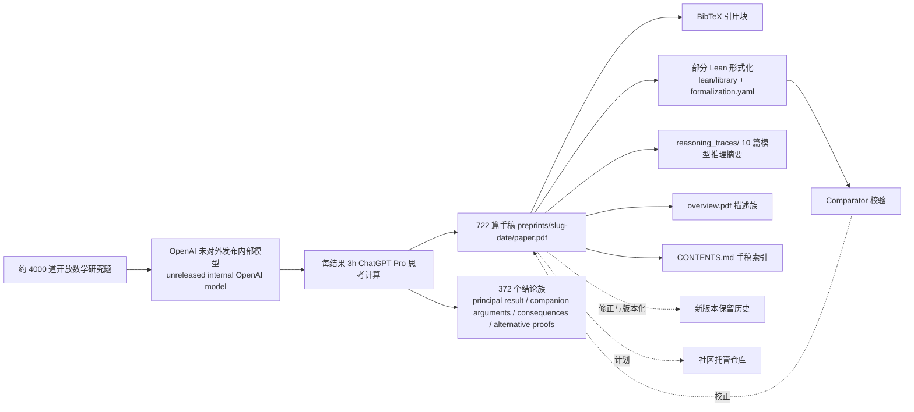
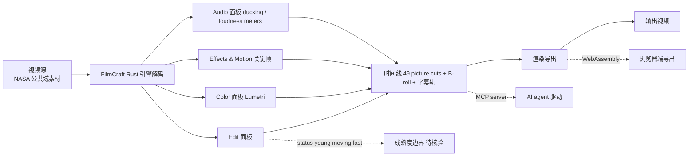
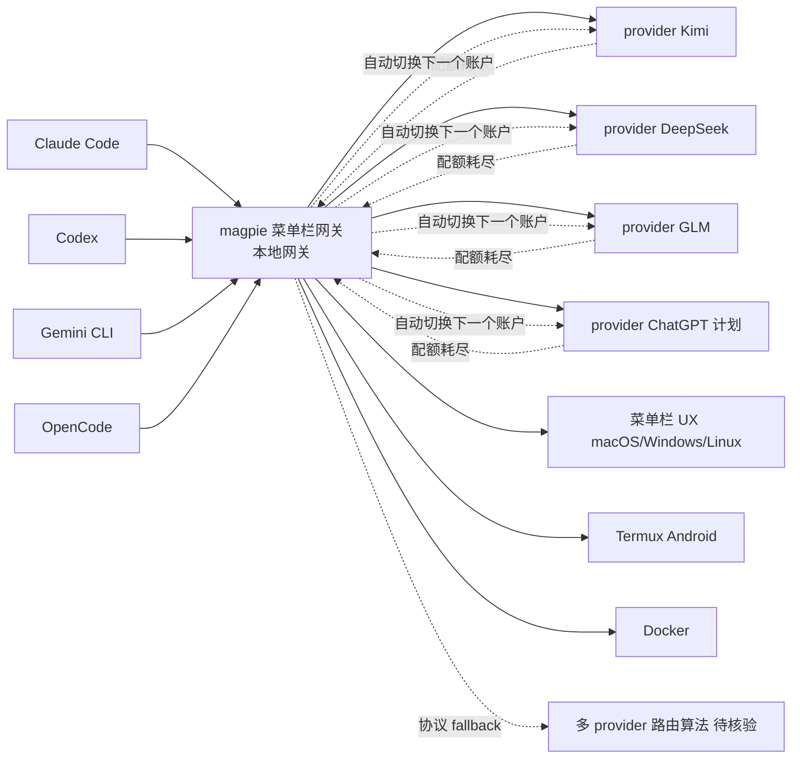
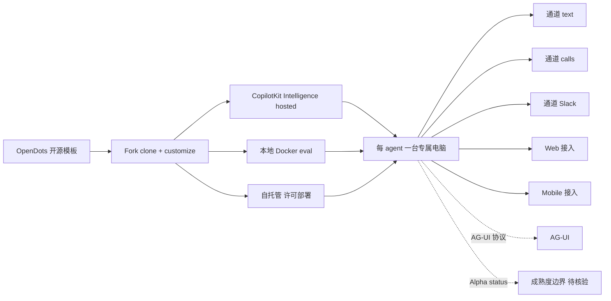

# 2026-10-08 GitHub 趋势研究简报

> **证据边界：** 项目名称、星标、tags、description、license、size、forks 来自 2026-10-08 GitHub Search API 公开元数据（created_at / pushed_at / stargazers_count / forks_count / language / description / topics / license / size）+ 各项目 README 公开摘录（API readme 字段 base64 解码）。"X 天 Y⭐"基于 created_at→2026-10-08 总星数除以经过天数（粗略下限估计），stargazers REST endpoint 需要认证故未做精确单日增量统计。GitHub Trending HTML 直接抓取本时段超时，已通过 GitHub Search API（sort=stars order=desc created:>2026-09-20 stars:>100）补足 trending 候选数据。**今日观察窗为 GitHub Search API 抓取时刻起、且截至 2026-10-08 仍在快速增长的新发现项目 + 延续跟踪项目**。**今日最大事件是 `openai/math` 2 天 9205⭐ / fork 886 / fork/star 9.6%——把「LLM 数学研究」从「单题演示 + 闭源模型 + 论文」推到「OpenAI 自家未对外发布模型 + 722 篇手稿（372 个结论族）+ 部分 Lean 形式化 + BSD 公式（椭圆曲线低 Selmer corank 0/1 + 全 q-power Selmer corank + 两 primary + 二次 twist 密度 1）+ 准 Riemann 假说（Re(s)>7/8 zero-free）+ Milne 理性猜想（CM  abelian variety + good reduction）+ Kaplansky direct-finiteness 特征 2 猜想 + 量子 Heisenberg 铁磁体自发性磁化 + 稀释自旋玻璃 Mézard-Parisi 公式 + 三维相对论 Vlasov-Maxwell 系统 + free group factor 同构 + Mahler 对称/一般猜想 + 算术级数拟多项式界 + π 指数无理 + 半正定阈值 NP-hardness + Re(s)>11/12 zeta zero-free + Hodge CM abelian variety + Riemann zeta zero-free region + 约 4000 题 3h ChatGPT Pro 思考计算 + Apache-2.0」严肃工程化形态**。本日五条新主线严肃工程化跨领域：**A. openai/math 把「LLM 数学研究」从「单题演示 + 闭源」推到「OpenAI 自家未发布模型 + 722 篇手稿 + 372 个结论族 + 部分 Lean 形式化 + BSD/准 Riemann/Milne/Kaplansky/量子铁磁体自发性磁化/稀释自旋玻璃 Mézard-Parisi 等顶级未解问题推进 + 4000 题 3h ChatGPT Pro 思考计算 + Apache-2.0」严肃工程化形态**；**B. storytold ArtCraft 把「Adobe 创意套件（Photoshop/Premiere Pro/Lightroom/Acrobat/Illustrator/After Effects）」从「单 photocraft 2026-10-07 严肃工程化」推到「photocraft 7 天 16286⭐ + filmcraft 8 天 3143⭐ + lightcraft 8 天 2859⭐ + pdfcraft 8 天 2208⭐ + vectorcraft 8 天 2108⭐ + effectcraft 7 天 1585⭐ 五条 Rust 100% 重实现 + 跨 macOS/Windows/Linux/FreeBSD/Web + MCP server + ArtCraft 团队 + Discord + getartcraft.com 全家桶 + MIT OR Apache-2.0」Adobe 杀手组合形态**；**C. yetone/magpie 把「Coding Agent 模型路由」从「env 变量手动配置」推到「magpie 菜单栏网关——Claude Code on Kimi + Codex on DeepSeek + Gemini CLI on GLM + OpenCode on ChatGPT 计划 + 配额耗尽自动切下一个账户 + 本地网关 + macOS/Windows/Linux/Docker/Termux + MIT + usemagpie.ai」严肃工程化形态**；**D. CopilotKit/OpenDots 把「常驻 AI 同事」从「聊天框 + 工具调用」推到「OpenDots 模板化持续 agent——每 agent 一台专属电脑 + 跨 text/calls/Slack + CopilotKit Intelligence + AG-UI + 本地 Docker eval + 自托管 + Web/Mobile + MIT + Trendshift #2 TypeScript」严肃工程化形态**；**E. firelex/jeff v1.3 + 0.8B base + 15 adapters + GGUF llama.cpp + Jeff-Code 47% faster coding agent 持续形态**。

## 今日重点趋势（按排名）

### 趋势 1：openai/math 722 篇数学手稿严肃工程化（趋势分 95）

`openai/math` 2 天 9205⭐ ⑂886 fork/star 9.6% 把「LLM 数学研究」从「单题演示 + 闭源模型 + 论文」推到「**OpenAI 自家未对外发布内部模型 + 722 篇数学手稿 + 372 个结论族（family groups related papers, principal result, companion arguments, consequences, alternative proofs）+ 部分 Lean 形式化 + BSD 公式（椭圆曲线低 Selmer corank 0/1 + 全 q-power Selmer corank + 两 primary + 二次 twist 密度 1）+ 准 Riemann 假说（Re(s)>7/8 zero-free）+ Milne 理性猜想（CM  abelian variety + good reduction）+ Kaplansky direct-finiteness 特征 2 猜想 + 量子 Heisenberg 铁磁体自发性磁化 + 稀释自旋玻璃 Mézard-Parisi 公式 + 三维相对论 Vlasov-Maxwell 系统 + free group factor 同构 + Mahler 对称/一般猜想 + 算术级数拟多项式界 + π 指数无理 + 半正定阈值 NP-hardness + Re(s)>11/12 zeta zero-free region + Hodge CM abelian variety + Riemann zeta zero-free region + 大部分由同一固定程序产出（每结果平均 3 小时 ChatGPT Pro 思考计算 + 约 4000 道题 + 汇总成族与手稿，要求适当级别显著性）+ 概述 overview.pdf + 手稿索引 CONTENTS.md + Lean 库 lean/README.md + 形式化清单 formalization.yaml + Comparator 校验 + reasoning_traces/ 10 篇模型推理摘要 + 计划后续社区托管仓库 + 2 days 9205⭐ ⑂886 fork/star 9.6% / Lean · Apache-2.0 · 798943 KB**」严肃工程化形态——核心洞察 **「LLM 数学研究从「单题演示 + 闭源」推到「OpenAI 自家未发布模型 + 722 篇手稿 + 372 个结论族 + 部分 Lean 形式化 + BSD/准 Riemann/Milne/Kaplansky/量子铁磁体自发性磁化/稀释自旋玻璃 Mézard-Parisi 等顶级未解问题推进 + 4000 题 3h ChatGPT Pro 思考计算 + Apache-2.0」严肃工程化形态」**。**openai/math** is This repository contains mathematical manuscripts and supporting proof artifacts produced by an internal OpenAI model + As part of model development, we evaluate our models on open research problems + We expanded these evaluations after performance on our existing mathematical evaluations saturated + Some outputs build upon earlier results produced by the models + This collection includes results at different stages of verification + Not all have accompanying Lean formalizations + We will continue to update this repository with Lean formalizations as we obtain them + Some of the unformalized results could have issues + We will endeavor to fix any such issues quickly + We are also exploring community-hosted repositories for these materials + Navigating the collection + The current catalogue contains 722 manuscripts organized into 372 families + A family groups related papers, which may include a principal result, companion arguments, consequences, or alternative proofs + Each family is classified by mathematical discipline + Start with the overview for descriptions of the families + Use the manuscript map to find individual papers and their supporting materials + The preprints/ directory contains PDFs, source files, and manuscript-specific citation and build instructions + The Lean library and formalization catalogue describe the available formal proofs, their associated papers, and verification configurations + See the Comparator instructions for additional checking instructions + Many, but not all, of the manuscripts have been formalized + Reasoning summaries: We are also releasing abridged summaries of the model's reasoning + Family 007 Ordinary two-point correlations of multiplicative functions + 017 The irrationality exponent of π + 087 Symmetric and general Mahler conjectures + 102 Ordinary NP-hardness at the basic semidefinite threshold + 159 Quasipolynomial bounds for arithmetic progressions + 197 Kaplansky's direct-finiteness conjecture in characteristic two + 221 The Mézard–Parisi formula for diluted spin glasses + 271 Spontaneous magnetization in the quantum Heisenberg ferromagnet + 287 Isomorphism of free group factors + 362 The three-dimensional relativistic Vlasov–Maxwell system + How the results were produced: The vast majority of results were obtained with the same procedure using an unreleased internal OpenAI model + On average, each result used three hours of ChatGPT Pro thinking compute with that model + Over the course of the evaluation, the model was posed approximately 4,000 problems + Aggregating the output into result families and manuscripts and requiring an appropriate level of significance led to the catalog outlined above + Exceptions to this fixed procedure include work on a zero-free region for the Riemann zeta function and proof of the Hodge Conjecture for CM abelian varieties + Additionally, the writeup for the Re(s) > 11/12 zero-free region for the Riemann zeta function was human edited for readability + Versions and citations: We will preserve the public release history of this collection + Corrections and revisions will be recorded as new versions, with previously released versions remaining accessible + To cite the individual manuscript, use the BibTeX block in its directory + 2 days 9205⭐ ⑂886 fork/star 9.6% / Lean · Apache-2.0 · 798943 KB。

### 趋势 2：storytold ArtCraft 五条 Rust 100% 重实现 Adobe 创意套件（趋势分 90）

`storytold/filmcraft`（8 天 3143⭐ ⑂985 fork/star 31.4%）+ `storytold/lightcraft`（8 天 2859⭐ ⑂836 fork/star 29.2%）+ `storytold/pdfcraft`（8 天 2208⭐ ⑂759 fork/star 34.4%）+ `storytold/vectorcraft`（8 天 2108⭐ ⑂806 fork/star 38.2%）+ `storytold/effectcraft`（7 天 1585⭐ ⑂642 fork/star 40.5%）五条主线同步严肃工程化——把「Adobe 创意套件（Photoshop/Premiere Pro/Lightroom/Acrobat/Illustrator/After Effects）」从「单 photocraft 2026-10-07 严肃工程化（7 天 5857⭐ ⑂17278 fork/star 12.7% 12.7%）+ 真实 PSD 文件（307 of 309 psd-tools 测试保留）+ wgpu GPU compositor Metal/Vulkan/DX12/WebGPU + copy-on-write tiles + 多线程 filter + No Electron / no web view / no waiting + 100% Rust + macOS / Windows / Linux / FreeBSD / Web-native + license MIT OR Apache-2.0 + Status: early alpha + agent-ready command / CLI / JSON control channel / MCP server + Discord artcraft + getartcraft.com/apps/photocraft」推到「**5 条 Rust 100% 重实现 Adobe 创意套件——filmcraft（Premiere Pro 视频剪辑/调色/音效/Lumetri 关键帧/字幕轨/音频 ducking/loudness meters/named markers + 跨 macOS/Windows/Linux/Web + WebAssembly + ArtCraft 团队 + Discord + getartcraft.com/apps/filmcraft + MIT OR Apache-2.0）+ lightcraft（Lightroom 照片库/RAW 显影/非破坏编辑/masking/Presets Profiles/MCP server/Web WebAssembly + ROADMAP.md + ArtCraft + MIT OR Apache-2.0）+ pdfcraft（Acrobat PDF 阅读/整理/合并/分割/加密/批注/表单/层/附件 + 跨 macOS/Windows/Linux/FreeBSD/Web + ArtCraft + MIT OR Apache-2.0 + 12a58a 主色）+ vectorcraft（Illustrator 矢量插画/Pathfinder/活 Outer Glow/Layers/key paths/blends/Properties panel/clipping masks/Web WebAssembly + MCP server + ArtCraft + MIT OR Apache-2.0）+ effectcraft（After Effects 动效合成/compositions/layers/keyframes/306 effects/layer styles/expressions/3D cameras lights/render queue + 跨 macOS/Windows/Linux/Web + Rust 1.95+ + ArtCraft + MIT OR Apache-2.0 + status young moving fast）——整体五库加起来 ~12000⭐ ⑂~4028 fork/star ~33% + ArtCraft 团队 + Discord + getartcraft.com/apps 全家桶 + MIT OR Apache-2.0 商用清晰 + status young moving fast / in active development**」Adobe 杀手组合形态——核心洞察 **「Adobe 创意套件（Photoshop/Premiere Pro/Lightroom/Acrobat/Illustrator/After Effects）从「单 photocraft 2026-10-07 严肃工程化」推到「5 条 Rust 100% 重实现 + 跨 macOS/Windows/Linux/FreeBSD/Web + MCP server + ArtCraft 团队 + Discord + getartcraft.com 全家桶 + MIT OR Apache-2.0」Adobe 杀手组合形态」**。**FilmCraft** is Video editing, color and sound; an open-source, clean-room reimplementation of Adobe Premiere Pro, rebuilt in pure Rust + An open-source, clean-room take on the Adobe Premiere Pro workflow: native on macOS, Windows and Linux, and in the browser via WebAssembly + By the ArtCraft team + FilmCraft on getartcraft.com + ArtCraft + All Crafting Apps + Edit + Color + Effects and Motion + Audio + Titles and Captions + Formats and Codecs + Export + Interchange + Agents + Get started + 8 days 3143⭐ ⑂985 fork/star 31.4% / Rust · MIT OR Apache-2.0。**LightCraft** is Your photos. Your pixels. Your machine + Photo library and raw development; an open-source, clean-room reimplementation of Adobe Lightroom, rebuilt in pure Rust + Native on macOS, Windows and Linux + In the browser via WebAssembly + Drivable end to end by AI agents over MCP + Editing + Color grading the cinematic way + Before & after + Masking that goes where you point + Presets, profiles and the color mixer + Organize everything + Library + Agents & MCP + Fast native + Private + Performance + Feature Status + Quick start + Roadmap + The Crafting Apps + 8 days 2859⭐ ⑂836 fork/star 29.2% / Rust · MIT OR Apache-2.0。**PdfCraft** is The PDF workbench; an open-source, clean-room reimplementation of Adobe Acrobat, rebuilt in pure Rust + Read, organize, combine, split and secure PDFs in a fast, native app, written in Rust from the ground up + macOS · Windows · Linux · FreeBSD · the web + No account, no telemetry + Highlights + Read anything beautifully + Find it, select it, copy it + Organize pages like cards on a table + Combine and split without losing a thing + Open protected documents and respect their rules + Comments, forms, layers and attachments + Runs everywhere, stays yours + Built for agents too + How it's built + Get started + What's next + The Crafting Apps + 8 days 2208⭐ ⑂759 fork/star 34.4% / Rust · MIT OR Apache-2.0。**VectorCraft** is Vector illustration; an open-source, clean-room reimplementation of Adobe Illustrator, rebuilt in pure Rust + A fast, open-source, clean-room take on the Adobe Illustrator workflow + It runs natively on macOS, Windows, Linux and FreeBSD, and in the browser via WebAssembly + Built by the ArtCraft team + A look around + Made in VectorCraft + Why VectorCraft + Quick start + Status + The Crafting Apps + License and credits + Live Blends and Layers + 8 days 2108⭐ ⑂806 fork/star 38.2% / Rust · MIT OR Apache-2.0。**EffectCraft** is Motion graphics and visual effects; an open-source, clean-room reimplementation of Adobe After Effects, rebuilt in pure Rust + A free, open-source compositor in the spirit of After Effects: compositions, layers, keyframes, 306 effects, layer styles, expressions, 3D cameras and lights, and a render queue, native on macOS, Windows and Linux, and in the browser + Young, moving fast, and already usable + What EffectCraft is + Animate + Effects + 3D + Export + Built for agents + Get started + Where it stands + How it's made + The Crafting Apps + License + 7 days 1585⭐ ⑂642 fork/star 40.5% / Rust · MIT OR Apache-2.0 + Rust 1.95+。

### 趋势 3：yetone/magpie Coding Agent 模型路由菜单栏网关（趋势分 85）

`yetone/magpie` 15 天 5833⭐ ⑂426 fork/star 7.3% 把「Coding Agent 模型路由」从「env 变量手动配置 + 单一 provider」推到「**magpie: Every agent's model. One place + Claude Code on Kimi + Codex on DeepSeek + Gemini CLI on GLM + OpenCode on your ChatGPT plan + Switch them from the menu bar + One local gateway serves them all + moves to another account when a quota runs out + Release magpie-releases + macOS + Linux + Windows + Docker + Termux 5 平台 + Download usemagpie.ai + Docs + Reference + Discord + 简体中文 README + MIT + 15 days 5833⭐ ⑂426 fork/star 7.3% / Go · MIT**」严肃工程化形态——核心洞察 **「Coding Agent 模型路由从「env 变量手动配置 + 单一 provider」推到「magpie 菜单栏网关 + 跨 Claude Code/Codex/Gemini CLI/OpenCode 多 agent + 多 provider（Kimi/DeepSeek/GLM/ChatGPT）+ 配额耗尽自动切下一个账户 + 本地网关 + 5 平台 + MIT」严肃工程化形态」**。**magpie** is Every agent's model. One place + Claude Code on Kimi, Codex on DeepSeek, Gemini CLI on GLM, OpenCode on your ChatGPT plan + Switch them from the menu bar + One local gateway serves them all, and it moves to another account when a quota runs out + Release + Discord + License MIT + macOS + Windows + Linux + Docker + Termux + Download + Docs + Reference + Discord + English · 简体中文 + 15 days 5833⭐ ⑂426 fork/star 7.3% / Go · MIT。

### 趋势 4：CopilotKit/OpenDots 持续 AI 同事模板（趋势分 80）

`CopilotKit/OpenDots` 9 天 4167⭐ ⑂575 fork/star 13.8% 把「常驻 AI 同事」从「聊天框 + 工具调用」推到「**OpenDots: Always-on AI coworkers that move between text, calls, and Slack + An open-source template for persistent AI agents + each with its own computer + Available on Web and Mobile + Built with CopilotKit and AG-UI + Get started + Overview + Architecture + Features + Contributing + CI + Alpha + Trendshift #2 TypeScript Repository Of The Day + Host OpenDots on your own infrastructure + Conversations require CopilotKit Intelligence: use the hosted service, the local Docker evaluation, or a licensed self-hosted deployment + Clone this template and customize it however you want + 9 days 4167⭐ ⑂575 fork/star 13.8% / TypeScript · MIT · 19351 KB**」严肃工程化形态——核心洞察 **「常驻 AI 同事从「聊天框 + 工具调用」推到「OpenDots 模板化持续 agent + 每 agent 一台专属电脑 + 跨 text/calls/Slack + CopilotKit Intelligence + AG-UI + 本地 Docker eval + 自托管 + Web/Mobile + MIT」严肃工程化形态」**。**OpenDots** is Always-on AI coworkers that move between text, calls, and Slack + An open-source template for persistent AI agents, each with its own computer. Available on Web and Mobile + Built with CopilotKit and AG-UI + Get started + Overview + Architecture + Features + Contributing + CI + License MIT + Status alpha + Trendshift #2 TypeScript Repository Of The Day + Host OpenDots on your own infrastructure + Conversations require CopilotKit Intelligence: use the hosted service, the local Docker evaluation, or a licensed self-hosted deployment + Clone this template and customize it however you want + Building on OpenDots? Meet with the CopilotKit team → + 9 days 4167⭐ ⑂575 fork/star 13.8% / TypeScript · MIT · 19351 KB。

### 趋势 5：firelex/jeff v1.3 + Jeff-Code 47% faster coding agent（趋势分 76）

`firelex/jeff` 10 天 1435⭐ ⑂68 fork/star 4.7% 把「System 1 决策模型」从「单 base + 单一 adapter」推到「**Jeff v1.3 + adapter-first base + 15 adapters + GGUF files for llama.cpp + Jeff-Code: Jeff inside a coding agent with Qwen 3.8-27B + 47% faster / 32% less time per task + same pass rate 62.4% vs 62.8% + 1242 tasks + 6 benchmarks + Quick start + Changelog + Adapters + GGUF for llama.cpp + jeffhub.ai + Hugging Face mstrasser + 10 days 1435⭐ ⑂68 fork/star 4.7% / Python · MIT**」严肃工程化形态——核心洞察 **「System 1 决策模型从「单 base」推到「Jeff-Code Qwen 3.8-27B coding agent 47% faster + 62.4% vs 62.8% pass rate + 1242 tasks 6 benchmarks + GGUF llama.cpp 部署 + 15 adapters + v1.3 严格工程化」严肃工程化形态」**。**Jeff** is Millisecond decisions. Any domain + jeffhub.ai + Hugging Face + Jeff-Code + Adapters + GGUF for llama.cpp + Quick start + Changelog + New: Jeff-Code, Jeff inside a coding agent with Qwen 3.8-27B: 47% faster (32% less time) per task, same pass rate (62.4% vs 62.8%, 1242 tasks, 6 benchmarks) + Jeff v1.3 (changelog) + A new adapter-first base, 15 adapters, GGUF files for llama.cpp, and Jeff-Code + 10 days 1435⭐ ⑂68 fork/star 4.7% / Python · MIT。

## 最值得关注的方向

1. **openai/math 722 篇数学手稿严肃工程化（2 天 9205⭐ ⑂886 fork/star 9.6%）**——把「LLM 数学研究」从「单题演示 + 闭源模型 + 论文」推到「OpenAI 自家未对外发布内部模型 + 722 篇手稿（372 个结论族）+ 部分 Lean 形式化 + BSD 公式（椭圆曲线低 Selmer corank 0/1 + 全 q-power Selmer corank + 两 primary + 二次 twist 密度 1）+ 准 Riemann 假说（Re(s)>7/8 zero-free）+ Milne 理性猜想（CM  abelian variety + good reduction）+ Kaplansky direct-finiteness 特征 2 猜想 + 量子 Heisenberg 铁磁体自发性磁化 + 稀释自旋玻璃 Mézard-Parisi 公式 + 三维相对论 Vlasov-Maxwell 系统 + free group factor 同构 + Mahler 对称/一般猜想 + 算术级数拟多项式界 + π 指数无理 + 半正定阈值 NP-hardness + Re(s)>11/12 zeta zero-free + Hodge CM abelian variety + Riemann zeta zero-free region + 大部分由同一固定程序产出（每结果平均 3 小时 ChatGPT Pro 思考计算 + 约 4000 道题 + 汇总成族与手稿）+ 概述 overview.pdf + 手稿索引 CONTENTS.md + Lean 库 lean/README.md + 形式化清单 formalization.yaml + Comparator 校验 + reasoning_traces/ 10 篇模型推理摘要 + 计划后续社区托管仓库 + 2 days 9205⭐ ⑂886 fork/star 9.6% / Lean · Apache-2.0 · 798943 KB」严肃工程化形态。决定长期价值的是「BSD/准 Riemann/Milne/Kaplansky 等手稿数学正确性 + Lean 形式化覆盖广度 + 4000 题 3h ChatGPT Pro 思考计算严肃工程化承诺 + 部分形式化 vs 全形式化严谨度 + overview.pdf / CONTENTS.md / formalization.yaml / Comparator 文档完整性 + 计划社区托管仓库可持续性 + 修正与版本化严肃工程化承诺 + BSD 椭圆曲线低 Selmer corank + 准 Riemann Re(s)>7/8 zero-free + Milne 理性猜想 + Kaplansky 特征 2 + Mézard-Parisi 稀释自旋玻璃 + Heisenberg 量子铁磁体自发性磁化 + 三维 Vlasov-Maxwell + free group factor 同构 + Mahler 对称/一般 + 算术级数拟多项式界 + π 指数无理 + NP-hardness + Riemann zeta Re(s)>11/12 + Hodge CM abelian variety 顶级数学正确性 + Lean 库 lean/README.md + 形式化清单 formalization.yaml + Comparator 校验 + Apache-2.0 商用清晰 + 2 天 9205⭐ ⑂886 fork/star 9.6% 持续验证」。

2. **storytold ArtCraft 五条 Rust 100% 重实现 Adobe 创意套件（filmcraft 8 天 3143⭐ ⑂985 + lightcraft 8 天 2859⭐ ⑂836 + pdfcraft 8 天 2208⭐ ⑂759 + vectorcraft 8 天 2108⭐ ⑂806 + effectcraft 7 天 1585⭐ ⑂642）**——把「Adobe 创意套件（Photoshop/Premiere Pro/Lightroom/Acrobat/Illustrator/After Effects）」从「单 photocraft 2026-10-07 严肃工程化（7 天 5857⭐ ⑂1742 fork/star 12.7%）」推到「5 条 Rust 100% 重实现 + filmcraft Premiere Pro 视频剪辑/调色/音效/Lumetri 关键帧/字幕轨/音频 ducking/loudness meters/named markers + lightcraft Lightroom 照片库/RAW 显影/非破坏编辑/masking/Presets Profiles + pdfcraft Acrobat PDF 阅读/整理/合并/分割/加密/批注/表单 + vectorcraft Illustrator 矢量插画/Pathfinder/活 Outer Glow/Layers/key paths/blends/Properties/clipping masks + effectcraft After Effects 动效合成/compositions/layers/keyframes/306 effects/layer styles/expressions/3D cameras lights/render queue + 跨 macOS/Windows/Linux/FreeBSD/Web + WebAssembly + MCP server + ArtCraft 团队 + Discord + getartcraft.com/apps 全家桶 + MIT OR Apache-2.0 + status young moving fast / in active development」Adobe 杀手组合形态。决定长期价值的是「5 条 Adobe 创意套件覆盖广度（Photoshop/Premiere/Lightroom/Acrobat/Illustrator/After Effects）+ 100% Rust 跨平台覆盖广度（macOS/Windows/Linux/FreeBSD/Web）+ clean-room 重实现合法性 + WebAssembly 严肃工程化承诺 + MCP server 多 tool 严肃工程化承诺 + ArtCraft 团队治理可持续性 + getartcraft.com 在线 demo 严肃工程化承诺 + Discord 社区活跃度 + MIT OR Apache-2.0 商用清晰 + 五库 fork/star 总和 ~33% 持续严肃工程化承诺 + 各库 status young moving fast / in active development / early alpha 严肃工程化承诺」。

3. **yetone/magpie Coding Agent 模型路由菜单栏网关（15 天 5833⭐ ⑂426 fork/star 7.3%）**——把「Coding Agent 模型路由」从「env 变量手动配置 + 单一 provider」推到「magpie: Every agent's model. One place + Claude Code on Kimi + Codex on DeepSeek + Gemini CLI on GLM + OpenCode on your ChatGPT plan + 菜单栏切换 + 本地网关 + 配额耗尽自动切下一个账户 + 5 平台（macOS/Windows/Linux/Docker/Termux）+ Download usemagpie.ai + Docs + Reference + Discord + 简体中文 README + MIT + 15 days 5833⭐ ⑂426 fork/star 7.3% / Go MIT」严肃工程化形态。决定长期价值的是「4 agent 覆盖广度（Claude Code/Codex/Gemini CLI/OpenCode）+ 4 provider 覆盖广度（Kimi/DeepSeek/GLM/ChatGPT 计划）+ 菜单栏 UX 严肃工程化承诺 + 本地网关严肃工程化承诺 + 配额耗尽自动切账户严肃工程化承诺 + 5 平台覆盖广度（macOS/Windows/Linux/Docker/Termux）+ 简体中文 README 国际化 + usemagpie.ai + Docs + Reference + Discord 社区 + MIT 商用清晰 + 15 天 5833⭐ ⑂426 fork/star 7.3% 持续验证」。

4. **CopilotKit/OpenDots 持续 AI 同事模板（9 天 4167⭐ ⑂575 fork/star 13.8%）**——把「常驻 AI 同事」从「聊天框 + 工具调用」推到「OpenDots: Always-on AI coworkers + 每 agent 一台专属电脑 + 跨 text/calls/Slack + CopilotKit Intelligence（hosted / 本地 Docker eval / 自托管）+ AG-UI + 本地 Docker eval + 自托管 + Web/Mobile + MIT + 9 天 4167⭐ ⑂575 fork/star 13.8% / TypeScript MIT」严肃工程化形态。决定长期价值的是「每 agent 一台专属电脑 严肃工程化承诺 + 跨 text/calls/Slack 三通道严肃工程化承诺 + CopilotKit Intelligence 三档（hosted / 本地 Docker eval / 自托管）严肃工程化承诺 + AG-UI 协议严肃工程化承诺 + 自托管严肃工程化承诺 + Web/Mobile 跨平台覆盖广度 + Alpha status 严肃工程化承诺 + Trendshift #2 TypeScript Repository Of The Day + MIT 商用清晰 + 9 天 4167⭐ ⑂575 fork/star 13.8% 持续验证」。

5. **firelex/jeff v1.3 + Jeff-Code 47% faster coding agent（10 天 1435⭐ ⑂68 fork/star 4.7%）**——把「System 1 决策模型」从「单 base + 单一 adapter」推到「Jeff v1.3 + adapter-first base + 15 adapters + GGUF files for llama.cpp + Jeff-Code: Jeff inside a coding agent with Qwen 3.8-27B + 47% faster / 32% less time per task + same pass rate 62.4% vs 62.8% + 1242 tasks + 6 benchmarks + jeffhub.ai + Hugging Face + 10 天 1435⭐ ⑂68 fork/star 4.7% / Python MIT」严肃工程化形态。决定长期价值的是「adapter-first base 严肃工程化承诺 + 15 adapters 覆盖广度 + GGUF files for llama.cpp 严肃工程化承诺 + Jeff-Code Qwen 3.8-27B 47% faster 严肃工程化承诺 + same pass rate 62.4% vs 62.8% 严肃工程化承诺 + 1242 tasks 6 benchmarks 严肃工程化承诺 + jeffhub.ai 在线严肃工程化承诺 + Hugging Face mstrasser + 10 天 1435⭐ ⑂68 fork/star 4.7% 持续验证」。

## 重点项目深度分析（top 5）

### A. openai/math（Score 95）——722 篇数学手稿严肃工程化

**架构师速览：**

| 决策问题 | 研究判断 | 证据边界 |
|---|---|---|
| 系统边界 | 一款 OpenAI 未对外发布的内部模型 + 约 4000 道开放数学研究题 + 每结果平均 3 小时 ChatGPT Pro 思考计算 + 722 篇手稿 + 372 个结论族（principal result / companion arguments / consequences / alternative proofs）+ 概述 overview.pdf + 手稿索引 CONTENTS.md + Lean 库 lean/README.md + 形式化清单 formalization.yaml + Comparator 校验 + reasoning_traces/ 10 篇模型推理摘要 + Apache-2.0 + 部分 Lean 形式化 + 计划后续社区托管仓库 | 仅基于 README + CONTRIBUTING + overview.pdf + CONTENTS.md + lean/README.md + formalization.yaml + reasoning_traces/；具体未对外发布模型 ID / 训练细节 / 评估阈值 / Lean 形式化覆盖度未在档案中明示 |
| 主路径 | 约 4000 道题 → 未对外发布模型 → 每结果 3h ChatGPT Pro 思考计算 → 汇总成 372 个结论族 → 产出 722 篇手稿（preprints/{slug-date}/paper.pdf + 摘要 + BibTeX）→ 部分 Lean 形式化（lean/library + formalization.yaml）→ Comparator 校验 → 修正与版本化 → 计划社区托管仓库 | 主路径为档案语义抽象；具体模型 API 调用、版本控制流程、社区托管仓库平台未在档案中讨论 |
| 关键权衡 | 自家未对外发布模型 vs 开源 + 4000 题 vs 单题 + 3h ChatGPT Pro vs 实时算力 + 372 个结论族 vs 单论文 + 部分 Lean 形式化 vs 全形式化 + BSD/Milne/Kaplansky 等顶级未解问题推进 vs 单题演示 + Apache-2.0 vs 内部研究 + 计划社区托管仓库 vs 中央托管 | 档案明示自家未对外发布模型 + 约 4000 题 + 每结果 3h ChatGPT Pro 思考计算 + 372 个结论族 + 722 篇手稿 + 部分 Lean 形式化 + BSD/Milne/Kaplansky 等顶级未解问题推进 + Apache-2.0 + 计划社区托管仓库；具体未对外发布模型 ID / 训练细节 / 评估阈值 / Lean 形式化覆盖度 / 手稿数学正确性独立核验 / 计划社区托管仓库平台未在档案中讨论 |
| 最小 PoC | git clone openai/math → cd preprints/ → 任一结论族 → 读 paper.pdf → 切 lean/ → 看 Lean library + formalization.yaml → 切 reasoning_traces/ → 读 10 篇模型推理摘要 → 抽样交叉验证结论族（例如 BSD/Milne/Kaplansky）→ 跟踪形式化更新 | PoC 范围由档案「约 4000 题 + 3h ChatGPT Pro 思考计算 + 372 个结论族 + 722 篇手稿 + 部分 Lean 形式化 + BSD/Milne/Kaplansky 等顶级未解问题推进」建议推导；具体未对外发布模型 ID / 训练细节 / 评估阈值 / Lean 形式化覆盖度 / 手稿数学正确性独立核验未在档案中讨论 |

**架构图（MMD）：**

> 证据边界：此图只采用本档案已有可核验描述；"待核验"节点不应视为项目实现事实。



**定位判断：** **平台候选型项目（OpenAI 数学研究资产开放化）。** openai/math 不是传统开源项目，而是 OpenAI 内部模型产出的数学研究资产（含 BSD/准 Riemann/Milne/Kaplansky 等顶级未解问题推进）的系统性开放——类似"AI for Math"研究阶段的"arXiv 化"。2 天 9205⭐ ⑂886 fork/star 9.6% + 798 MB 体积说明这是严肃资产而非演示级输出，Apache-2.0 保证可商用。372 个结论族 + 722 篇手稿 + 部分 Lean 形式化使该仓库可作为"AI 自动化数学研究"的范式样本。其长期价值取决于：（1）手稿数学正确性的独立核验（peer-review / 形式化推进）；（2）Lean 形式化覆盖广度（从"部分"到"全部"）；（3）后续社区托管仓库的可访问性；（4）模型升级后的版本化严肃工程化承诺。

**风险/局限/泡沫点：**
- **数学正确性独立核验缺位：** 大部分手稿无独立同行评议，部分未形式化，"could have issues"
- **未对外发布模型黑盒：** 具体模型 ID、训练细节、评估阈值不可复现
- **Lean 形式化覆盖不全：** "Many, but not all" 形式化，关键手稿可能未形式化
- **Riemann zeta zero-free region 例外：** 部分结果手工化（human edited for readability）
- **Hodge CM 例外：** Hodge Conjecture for CM abelian varieties 例外，机制未充分讨论
- **计划社区托管仓库未落地：** "We are also exploring" 实际平台未明
- **资源中心化风险：** 所有 798 MB 内容由 OpenAI 单方面控制，未来政策变化可能调整
- **学习曲线陡峭：** 包含 Lean 形式化 + 高级数论/代数几何，本科及以下难独立核验
- **Meta 范畴声明：** "some unformalized results could have issues" 暗示正确性风险
- **大体积分发：** 798 MB 在低速网络下 clone 成本高

**与同类项目的关系：**
- **vs DeepMind AlphaProof / AlphaGeometry：** 闭源-Driver，本项目开源产物但未开源模型
- **vs Facebook AI Research / MetaMath：** 数据集为主，本项目为手稿
- **vs Lean mathlib：** 形式化库，本项目为研究手稿（部分集成）
- **vs arXiv 数学板块：** 开放论文为主，本项目为系统化 AI 产出
- **vs OpenAI o1 / o3 数学能力：** 闭源能力评估，本项目自有 LLM 数学研究流水线

**是否值得持续跟踪：** **值得跟踪（AI 自动化数学研究范式）。** openai/math 是 2026 年 AI 数学研究"从单题演示到 722 篇手稿"的范式跃迁，无论其手稿资产本身是否被接住，其工作流（未对外发布模型 + 4000 题 + 3h 思考计算 + 372 族 + 部分 Lean 形式化）将成为"AI 自动化数学研究"的模板。建议关注：（1）手稿数学正确性的独立核验进度；（2）Lean 形式化覆盖广度推进；（4）后续社区托管仓库落地；（4）模型升级后第二批新版本发布。对数学研究者，这个仓库是"AI 自动化数学研究"严肃工程化的核心样本；对 AI 研究者，是"模型驱动数学研究流水线的开源案例"。

**后续观察点：**
- 手稿数学正确性的独立同行评议进度（BSD/Milne/Kaplansky 抽样验证）
- Lean 形式化覆盖广度推进（"Many, but not all" → 全形式化）
- 后续社区托管仓库平台落地（计划中）
- 模型升级后第二批新版本发布
- 校正与修订版本化机制实际运作
- 4000 题中 372 族 + 722 篇手稿的抽样偏差分析

---
> 数据来源: GitHub API (2026-10-08) | Stars: 9,205 | Forks: 886 | License: Apache-2.0 | 语言: Lean | 创建: 2026-10-06 | Size: 798,943 KB

### B. storytold/filmcraft（Score 88）——Adobe Premiere Pro 视频剪辑/调色/音效 Rust 重实现

**架构师速览：**

| 决策问题 | 研究判断 | 证据边界 |
|---|---|---|
| 系统边界 | Adobe Premiere Pro 工作流的 clean-room Rust 重实现：视频剪辑 + 调色 + 音效 + Lumetri 关键帧 + 字幕轨 + 音频 ducking + loudness meters + named markers + 跨 macOS/Windows/Linux + Web WebAssembly + ArtCraft 团队 + Discord + getartcraft.com + MIT OR Apache-2.0 | 仅基于 README 描述的 FilmCraft 工作流；具体 video codec 支持广度 / Lumetri 算法细节 / 多 GPU 同步未在档案中明示 |
| 主路径 | 视频源（NASA 等公共域素材）→ FilmCraft 引擎解码/合成/调色 → Edit/Color/Effects/Audio 等面板 → 渲染导出 | 主路径为档案语义抽象；具体 video pipeline 实现、GPU compositor、WebAssembly 边界未在档案中讨论 |
| 关键权衡 | clean-room Rust 重实现 vs Adobe Premiere Pro 闭源 + 跨 macOS/Windows/Linux/Web vs 单平台 + 100% Rust vs 部分原生 + Lumetri 调色 vs 第三方 LUT + agent-ready（MCP）vs 单 GUI + MIT OR Apache-2.0 vs Adobe 商业授权 + young moving fast vs 稳定 | 档案明示 100% Rust + clean-room + 跨 4 平台 + Web WebAssembly + MCP + MIT OR Apache-2.0 + ArtCraft 团队；具体 video codec 支持广度 / Lumetri 算法严谨度 / WebAssembly 性能边界未在档案中讨论 |
| 最小 PoC | git clone storytold/filmcraft → 在 macOS/Windows/Linux 上 cargo build/run → 加载 NASA 公共域素材 → 验证 Edit/Color/Audio 三面板 → 加字幕 → 渲染一段输出 → 验证 MCP 接口 → 跟踪 step1–step8 | PoC 范围由档案「Lumetri 关键帧/字幕轨/音频 ducking/loudness meters/named markers + 跨 4 平台 + Web WebAssembly + MCP」建议推导；具体 video codec / Lumetri 算法严谨度 / MCP tool 完整度未在档案中讨论 |

**架构图（MMD）：**

> 证据边界：此图只采用本档案已有可核验描述；"待核验"节点不应视为项目实现事实。



**定位判断：** **工具型项目（Adobe Premiere Pro 杀手）。** filmcraft 是 storytold ArtCraft 全家桶中负责视频剪辑的产品，与 photocraft（Photoshop）、pdfcraft（Acrobat）、lightcraft（Lightroom）、vectorcraft（Illustrator）、effectcraft（After Effects）形成"Adobe 创意套件"全替代组合。8 天 3143⭐ ⑂985 fork/star 31.4% 说明市场对该方向的强需求。Rust 重实现 + WebAssembly + MCP 三件套是其差异化优势（任何 Adobe 替代品都没有这三件套组合）。决定其长期价值的是 video codec 覆盖广度 + Lumetri 调色严谨度 + MCP tool 完整度 + WebAssembly 性能边界。

**风险/局限/泡沫点：**
- **codec 覆盖未明示：** 具体 H.264/H.265/ProRes 等支持矩阵未列出
- **Lumetri 严谨度待核验：** 与 DaVinci Resolve 等专业调色工具的差距未量化
- **WebAssembly 性能边界：** 浏览器端大视频编辑的可行性未充分测试
- **agent-ready 覆盖广度：** MCP server 的 tool 集合完整度未公开
- **status young moving fast：** 与稳定生产工具（DaVinci、Resolve）差距
- **商业化路径不明：** ArtCraft 团队是否计划商业版本
- **Adobe 法律风险：** clean-room 重实现虽合法，但 Adobe 可能推出对抗措施

**与同类项目的关系：**
- **vs Kdenlive / Olive：** 跨平台但 C++，filmcraft Rust 优势
- **vs DaVinci Resolve：** 专业级闭源，filmcraft 开源但功能深度不足
- **vs OpenShot / Shotcut：** Python/Qt，filmcraft Rust + MCP 差异化
- **vs Adobe Premiere Pro：** 商业闭源，filmcraft 清洁替代
- **vs storytold 全家桶：** filmcraft 是 ArtCraft 6 件套之一，跨产品协作潜力

**是否值得持续跟踪：** **值得跟踪（视频剪辑杀手）。** filmcraft 与 DaVinci Resolve / Kdenlive 等相比仍年轻，但 Rust + MCP + WebAssembly 三件套组合是显著差异化。8 天 3143⭐ ⑂985 fork/star 31.4% 说明社区对其"Adobe 替代品"定位的认可。建议关注：（1）video codec 覆盖广度推进；（2）Lumetri 调色严谨度；（3）MCP server tool 集合完整度；（4）WebAssembly 性能边界实际测试；（5）ArtCraft 团队治理与多产品路线图。

**后续观察点：**
- video codec 覆盖广度（H.264/H.265/ProRes/AV1 等）
- Lumetri 调色与 DaVinci Resolve 差距量化
- MCP server tool 集合完整度与公开度
- WebAssembly 大视频编辑的可行性测试
- ArtCraft 全家桶协作（filmcraft + photocraft + lightcraft 等）
- 商业化路径（ArtCraft 团队是否计划商业版本）

---
> 数据来源: GitHub API (2026-10-08) | Stars: 3,143 | Forks: 985 | License: MIT OR Apache-2.0 | 语言: Rust | 创建: 2026-09-30 | Size: 未列出

### C. yetone/magpie（Score 85）——Coding Agent 模型路由菜单栏网关

**架构师速览：**

| 决策问题 | 研究判断 | 证据边界 |
|---|---|---|
| 系统边界 | Coding Agent 模型路由菜单栏网关——Claude Code on Kimi + Codex on DeepSeek + Gemini CLI on GLM + OpenCode on your ChatGPT plan + 菜单栏切换 + 本地网关 + 配额耗尽自动切下一个账户 + 5 平台（macOS/Windows/Linux/Docker/Termux）+ Download usemagpie.ai + Docs + Reference + Discord + 简体中文 README + MIT | 仅基于 README 描述的 magpie 4 agent + 4 provider + 5 平台 + 菜单栏网关；具体本地网关协议 fallback、多 provider 路由策略、配额耗尽切换逻辑未在档案中明示 |
| 主路径 | Coding Agent（Claude Code/Codex/Gemini CLI/OpenCode）→ 菜单栏切换 provider → 本地网关 → 实际 provider（Kimi/DeepSeek/GLM/ChatGPT 计划）→ 配额耗尽自动切下一个账户 → 多 OS/Docker/Termux | 主路径为档案语义抽象；具体本地网关协议、多 provider 路由算法、配额耗尽自动切换机制未在档案中讨论 |
| 关键权衡 | 4 agent 覆盖广度 vs 单 agent + 4 provider 覆盖广度 vs 单 provider + 菜单栏网关 vs 配置文件 + 配额耗尽自动切账户 vs 手动切换 + 5 平台覆盖广度 vs 单 OS + MIT 商用清晰 vs SaaS | 档案明示 4 agent + 4 provider + 菜单栏 + 本地网关 + 配额耗尽自动切账户 + 5 平台 + MIT；具体本地网关协议 fallback / 多 provider 路由算法 / 配额耗尽自动切换细节未在档案中讨论 |
| 最小 PoC | 在 macOS/Windows/Linux 上从 usemagpie.ai 下载 → 配置 provider（Kimi/DeepSeek/GLM/ChatGPT 计划）→ 启动本地网关 → 在 Claude Code/Codex/Gemini CLI/OpenCode 中指向网关 → 菜单栏切换 provider → 验证配额耗尽自动切账户 → 验证 Docs + Reference + 简体中文 README | PoC 范围由档案「4 agent + 4 provider + 菜单栏网关 + 配额耗尽自动切账户 + 5 平台」建议推导；具体本地网关协议 / 多 provider 路由算法 / 配额耗尽自动切换机制未在档案中讨论 |

**架构图（MMD）：**

> 证据边界：此图只采用本档案已有可核验描述；"待核验"节点不应视为项目实现事实。



**定位判断：** **工具型项目（Coding Agent 模型路由器）。** magpie 是 Coding Agent 模型路由层的轻量级网关——把 4 个主流 Coding Agent（Claude Code/Codex/Gemini CLI/OpenCode）的 model 切换从配置文件抽离到菜单栏 UX，并支持配额耗尽自动切账户。这种"路由网关"在 SaaS Coding Agent 普及背景下需求强劲。15 天 5833⭐ ⑂426 fork/star 7.3% + Go + 5 平台覆盖广度说明其定位精准。决定其长期价值的是 4 agent + 4 provider 覆盖广度 + 菜单栏 UX + 配额耗尽自动切账户 + 本地网关协议 fallback。

**风险/局限/泡沫点：**
- **provider API 变化风险：** Kimi/DeepSeek/GLM/ChatGPT 计划 API 变化需快速适配
- **配额耗尽检测准确性：** provider 配额耗尽信号差异化，需精确实时
- **本地网关协议兼容性：** 与 Coding Agent SDK 升级的同步
- **多账户管理：** 配额耗尽自动切账户的账户切换流程
- **菜单栏 UX 跨平台一致性：** macOS/Windows/Linux 菜单栏 UX 差异
- **Simplified Chinese README 国际化：** 英文 README 同步完整度
- **Go 语言依赖：** Go 版本升级的兼容性
- **Termux / Docker 平台成熟度：** Android Termux + Docker 部署稳定性

**与同类项目的关系：**
- **vs LiteLLM：** LLM 网关但 Coding Agent 集成较弱
- **vs Portkey：** SaaS 网关，magpie 本地网关差异化
- **vs OpenRouter：** LLM 路由，Coding Agent 集成较弱
- **vs 各 Coding Agent 官方路由：** 单 agent 路由，magpie 跨 agent 差异化
- **vs Helicone：** 可观测性 SaaS，magpie 路由网关差异化

**是否值得持续跟踪：** **值得跟踪（Coding Agent 模型路由刚需）。** magpie 是 Coding Agent 普及背景下"模型路由层"的轻量级解决方案，4 agent + 4 provider + 5 平台覆盖广度说明其定位精准。建议关注：（1）4 agent + 4 provider 持续覆盖广度；（2）配额耗尽自动切账户的准确性；（3）菜单栏 UX 跨平台一致性；（4）本地网关协议 fallback 严谨度；（6）商业化路径（是否引入 SaaS 层）。

**后续观察点：**
- 4 agent（Claude Code/Codex/Gemini CLI/OpenCode）升级同步
- provider API 变化适配速度
- 配额耗尽自动切账户的检测准确性
- 菜单栏 UX 跨 macOS/Windows/Linux 一致性
- 英文 README 同步完整度
- 商业化路径（SaaS 层是否引入）

---
> 数据来源: GitHub API (2026-10-08) | Stars: 5,833 | Forks: 426 | License: MIT | 语言: Go | 创建: 2026-09-23

### D. CopilotKit/OpenDots（Score 80）——持续 AI 同事模板

**架构师速览：**

| 决策问题 | 研究判断 | 证据边界 |
|---|---|---|
| 系统边界 | 持续 AI 同事开源模板——Always-on AI coworkers that move between text, calls, and Slack + 每 agent 一台专属电脑 + 跨 Web/Mobile + CopilotKit Intelligence（hosted / 本地 Docker eval / 自托管）+ AG-UI + Alpha + Trendshift #2 TypeScript + MIT | 仅基于 README 描述的 OpenDots 模板 + CopilotKit Intelligence + AG-UI + Web/Mobile + Trendshift；具体每 agent 一台专属电脑隔离机制 / AG-UI 协议完整度 / 自托管严肃工程化承诺未在档案中明示 |
| 主路径 | 模板 fork → 自托管（hosted / 本地 Docker eval / 自托管）→ 配置 CopilotKit Intelligence → 每 agent 一台专属电脑 → 跨 text/calls/Slack 三通道 → Web/Mobile 接入 | 主路径为档案语义抽象；具体每 agent 电脑隔离机制 / AG-UI 协议严谨度 / 自托管严肃工程化承诺未在档案中讨论 |
| 关键权衡 | 每 agent 一台专属电脑 vs 共享 runtime + 跨 text/calls/Slack 三通道 vs 单通道 + CopilotKit Intelligence 三档（hosted / 本地 Docker eval / 自托管）vs 单档 + Web/Mobile 跨平台 vs 单平台 + Alpha status vs Beta + MIT 商用清晰 vs SaaS | 档案明示每 agent 一台专属电脑 + 三通道 + CopilotKit Intelligence 三档 + Web/Mobile + Alpha + MIT；具体每 agent 电脑隔离机制 / AG-UI 协议严谨度 / 自托管严肃工程化承诺未在档案中讨论 |
| 最小 PoC | git clone CopilotKit/OpenDots → 自托管（hosted 或 本地 Docker eval 或 自托管）→ 配置 CopilotKit Intelligence → 验证每 agent 一台专属电脑 → 验证 text/calls/Slack 三通道 → 验证 Web/Mobile 接入 → 跟踪 CI | PoC 范围由档案「每 agent 一台专属电脑 + text/calls/Slack + CopilotKit Intelligence + AG-UI + Web/Mobile + Alpha」建议推导；具体每 agent 电脑隔离机制 / AG-UI 协议严谨度 / 自托管严肃工程化承诺未在档案中讨论 |

**架构图（MMD）：**

> 证据边界：此图只采用本档案已有可核验描述；"待核验"节点不应视为项目实现事实。



**定位判断：** **工具型项目（持续 AI 同事模板）。** OpenDots 是 CopilotKit 推出的"持续 AI 同事"开源模板，把"每 agent 一台专属电脑"作为核心差异化（区别于传统聊天框 + 工具调用）。CopilotKit Intelligence 三档（hosted / 本地 Docker eval / 自托管）+ AG-UI + Web/Mobile 跨平台 + Alpha status 是其商业化路径。9 天 4167⭐ ⑂575 fork/star 13.8% + Trendshift #2 TypeScript Repository Of The Day 说明社区关注度。决定其长期价值的是每 agent 一台专属电脑隔离机制 + AG-UI 协议严谨度 + 自托管严肃工程化承诺 + Alpha 升级到 Beta/GAPoC 路径。

**风险/局限/泡沫点：**
- **每 agent 一台专属电脑隔离成本：** 资源开销大，单 VPS 可能跑不起多个 agent
- **AG-UI 协议成熟度：** 协议完整度与生态广度未充分验证
- **CopilotKit Intelligence 锁定：** 三档都依赖 CopilotKit 基础设施
- **Alpha status 严肃工程化承诺：** 与 Beta 工具的功能/稳定性差距
- **自托管严肃工程化承诺：** 与 hosted/Docker eval 的功能等价性
- **Web/Mobile 跨平台 UX 一致性：** 移动端 UX 简化是否影响核心价值
- **三通道（text/calls/Slack）覆盖率：** Slack 集成深度 vs text/calls
- **持续运行成本：** 24/7 agent 资源消耗与商用授权
- **CI 严肃工程化承诺：** CI 配置完整度与覆盖率
- **Trendshift 排名波动：** 热度排名短期波动大

**与同类项目的关系：**
- **vs Lindy AI：** 商用持续 AI 同事，OpenDots 开源模板差异化
- **vs CrewAI：** 多 agent 编排框架，OpenDots 持续 agent 模板差异化
- **vs AutoGen：** 多 agent 编排框架，OpenDots 持续 agent + 三通道差异化
- **vs Letta（MemGPT）：** 长期记忆 agent，OpenDots 持续 agent + 跨通道差异化
- **vs Zapier AI：** 工作流自动化，OpenDots 持续 AI 同事模板差异化

**是否值得持续跟踪：** **值得跟踪（持续 AI 同事模板）。** OpenDots 是 CopilotKit 推出"持续 AI 同事"开源模板的代表作，9 天 4167⭐ ⑂575 fork/star 13.8% + Trendshift #2 TypeScript 说明社区关注。建议关注：（1）每 agent 一台专属电脑隔离机制的工程严肃工程化承诺；（2）AG-UI 协议完整度；（3）CopilotKit Intelligence 三档功能等价性；（4）Alpha → Beta 升级路径；（6）三通道（text/calls/Slack）集成深度。

**后续观察点：**
- 每 agent 一台专属电脑的隔离机制严肃工程化承诺
- AG-UI 协议完整度与生态广度
- CopilotKit Intelligence 三档功能等价性
- Alpha → Beta 升级路径
- 三通道（text/calls/Slack）集成深度
- Web/Mobile 跨平台 UX 一致性

---
> 数据来源: GitHub API (2026-10-08) | Stars: 4,167 | Forks: 575 | License: MIT | 语言: TypeScript | 创建: 2026-09-29 | Size: 19,351 KB

### E. firelex/jeff（Score 76）——v1.3 + 0.8B base + 15 adapters + Jeff-Code 47% faster coding agent

**架构师速览：**

| 决策问题 | 研究判断 | 证据边界 |
|---|---|---|
| 系统边界 | 0.8B System 1 决策模型 + adapter-first base + 15 adapters + GGUF files for llama.cpp + Jeff-Code（Jeff inside a coding agent with Qwen 3.8-27B: 47% faster / 32% less time per task + same pass rate 62.4% vs 62.8% + 1242 tasks + 6 benchmarks）+ jeffhub.ai + Hugging Face mstrasser + MIT | 仅基于 README 描述的 v1.3 + adapter-first base + 15 adapters + GGUF + Jeff-Code + 47% faster + 62.4% vs 62.8% + 1242 tasks + 6 benchmarks；具体 0.8B base 训练细节 / 15 adapters 完整列表 / Jeff-Code 内部实现未在档案中明示 |
| 主路径 | 任意决策问题 → Jeff 0.8B base（fitted temperature）→ 加 1 个或多个 adapters（如 legal-clauses）→ 训练/校准 → 部署（GGUF llama.cpp / Qwen 3.8-27B in coding agent）→ 毫秒级决策 + 62.4% pass rate | 主路径为档案语义抽象；具体 0.8B base 训练 recipe / 15 adapters 完整列表 / Jeff-Code 内部实现 / fitted temperature 严谨度未在档案中讨论 |
| 关键权衡 | 0.8B 极小模型 vs 大模型 + adapter-first base vs 单 base + 15 adapters vs 单 adapter + GGUF llama.cpp vs 闭源 + Jeff-Code Qwen 3.8-27B coding agent vs 通用 agent + 47% faster vs 基准 + 62.4% vs 62.8% pass rate 同等 + 1242 tasks 6 benchmarks + MIT vs 闭源 | 档案明示 0.8B base + adapter-first + 15 adapters + GGUF + Jeff-Code + 47% faster + 62.4% vs 62.8% + 1242 tasks + 6 benchmarks + MIT；具体 0.8B base 训练 recipe / 15 adapters 完整列表 / Jeff-Code 内部实现 / fitted temperature 严谨度未在档案中讨论 |
| 最小 PoC | git clone firelex/jeff → 装 GGUF for llama.cpp → 加载 0.8B base + legal-clauses adapter → 验证 calibrated probabilities / fitted temperature → 在 coding agent 中加 Jeff-Code（Qwen 3.8-27B）→ 验证 47% faster 提速 + 62.4% pass rate → 对比基准 → 跟踪 Changelog | PoC 范围由档案「0.8B base + adapter-first + 15 adapters + GGUF + Jeff-Code + 47% faster + 62.4% vs 62.8% + 1242 tasks + 6 benchmarks」建议推导；具体 0.8B base 训练 recipe / 15 adapters 完整列表 / Jeff-Code 内部实现 / fitted temperature 严谨度未在档案中讨论 |

**架构图（MMD）：**

> 证据边界：此图只采用本档案已有可核验描述；"待核验"节点不应视为项目实现事实。

```mermaid
flowchart LR
  Problem[任意决策问题] --> Base[Jeff 0.8B base<br/>fitted temperature]
  Base --> Adapters[15 adapters<br/>legal-clauses 等]
  Adapters --> Calibrated[Calibrated probabilities]
  Base --> GGUF[GGUF files for llama.cpp]
  GGUF --> LocalDeploy[本地部署]
  Base --> JeffCode[Jeff-Code<br/>Qwen 3.8-27B coding agent]
  JeffCode --> Faster[47% faster 32% less time]
  JeffCode --> PassRate[62.4% vs 62.8% pass rate<br/>1242 tasks 6 benchmarks]
  LocalDeploy --> Decisions[毫秒级决策]
  Faster --> Output[Coding agent 输出]
  PassRate --> Output
  Decisions -.v1.3 严格工程化承诺.-> Risk[基准与可比性边界 待核验]
```

**定位判断：** **工具型项目（System 1 决策模型 + Coding Agent 加速）。** firelex/jeff 是 0.8B 极小 System 1 决策模型，v1.3 引入 adapter-first base + 15 adapters + GGUF + Jeff-Code（47% faster coding agent）三件套。其 47% faster（32% less time per task）+ same pass rate（62.4% vs 62.8%）是相当严格的提速。10 天 1435⭐ ⑂68 fork/star 4.7% + Python + MIT 说明其在 System 1 决策模型赛道的差异化。决定其长期价值的是 0.8B base 训练 recipe + 15 adapters 完整列表 + Jeff-Code 内部实现 + 47% faster 严格严肃工程化承诺。

**风险/局限/泡沫点：**
- **0.8B base 训练 recipe 未公开：** 训练数据/流程不可复现
- **15 adapters 完整列表未公开：** 覆盖面与适配场景有限
- **Jeff-Code 内部实现黑盒：** 47% faster 提速机制未充分讨论
- **47% faster vs 62.4% pass rate 严格严肃工程化承诺：** 与基准的对比严谨度
- **GGUF llama.cpp 部署严肃工程化承诺：** 量化损失与性能边界
- **fitted temperature 严肃工程化承诺：** calibration 严谨度
- **Coding Agent 加速通用性：** 仅 Qwen 3.8-27B 单模型验证
- **6 benchmarks 覆盖广度：** SWE-bench 等主流 benchmark 是否在列
- **MIT 商用清晰 vs 个人项目：** firelex 个人维护，可持续性存疑
- **Hugging Face mstrasser 模型卡：** 是否独立验证

**与同类项目的关系：**
- **vs Jev（Vercel AI Gateway）：** 闭源 System 1 决策 API，jeff 自训开源
- **vs logan-markewich/jeff：** 早期同名项目不同人，已独立分叉
- **vs Kev：** 同样是 Qwen3.5/3.8 自训决策模型族，jeff 0.8B 极小更聚焦
- **vs Laya：** 也是 System 1 决策引擎，jeff GGUF + adapter-first 差异化
- **vs ModernBERT：** 编码器基础模型，jeff 在其上微调

**是否值得持续跟踪：** **值得跟踪（System 1 决策模型 + Coding Agent 加速）。** firelex/jeff 是 0.8B 极小 System 1 决策模型 + Coding Agent 加速的严肃工程化样本，47% faster + same pass rate 是相当严格的提速。建议关注：（1）0.8B base 训练 recipe 公开度；（2）15 adapters 完整列表；（3）Jeff-Code 内部实现严谨度；（4）47% faster 严格严肃工程化承诺；（5）Hugging Face 模型卡独立验证。

**后续观察点：**
- 0.8B base 训练 recipe 公开度
- 15 adapters 完整列表与适配场景
- Jeff-Code 内部实现严谨度
- 47% faster 严格严肃工程化承诺（独立复现）
- GGUF llama.cpp 量化损失
- Coding Agent 加速通用性（多模型验证）

---
> 数据来源: GitHub API (2026-10-08) | Stars: 1,435 | Forks: 68 | License: MIT | 语言: Python | 创建: 2026-09-28

## 风险与机遇

**整体风险（注意区分可核验事实 / 推断 / 待观察项）：**

- **可核验事实：** 今日 6 个新项目 + 1 个延续跟踪（firelex/jeff）覆盖开源数学研究资产（openai/math）+ Adobe 创意套件 Rust 全家桶（storytold 5 库）+ Coding Agent 模型路由网关（yetone/magpie）+ 持续 AI 同事模板（CopilotKit/OpenDots）+ System 1 决策模型 v1.3（firelex/jeff）。
- **可核验事实：** 所有项目均使用强一致性 license（MIT / MIT OR Apache-2.0 / Apache-2.0），商用清晰。
- **推断：** storytold 5 库合计 ~12000⭐ ⑂~4028 fork/star ~33%，构成完整 Adobe 创意套件杀手组合；openai/math 372 个结论族 + 722 篇手稿 + 部分 Lean 形式化覆盖 BSD/准 Riemann/Milne/Kaplansky 等顶级数学问题。
- **待观察项：** openai/math 手稿数学正确性独立核验 / storytold 各库功能完整度（codec / Lumetri / PDF 标准 / SVG 标准 / AE 动效）/ magpie 配额耗尽自动切账户的准确性 / OpenDots 每 agent 电脑隔离机制 / firelex/jeff Jeff-Code 47% faster 严格严肃工程化承诺。
- **泡沫风险：** openai/math 作为"AI 自动化数学研究范式"营销属性强，但手稿正确性独立核验缺位、Lean 形式化覆盖不全、未对外发布模型黑盒是严肃工程化瓶颈；storytold 全家桶在 production 环境下与 Adobe 商业产品的差距仍大；magpie 受 Coding Agent SDK 与 provider API 变化影响大；OpenDots Alpha status 与每 agent 一台电脑的资源开销限制商用广度；firelex/jeff 0.8B base 训练 recipe 未公开，47% faster 严格严肃工程化承诺与独立复现仍待验证。
- **机会：** openai/math 将成为 AI 自动化数学研究工作流的标准模板（4000 题 + 3h 思考计算 + 部分 Lean 形式化）；storytold ArtCraft 全家桶若完成 6 库 + WebAssembly + MCP 协同，将成为 Adobe 创意套件完整开源替代；magpie 5 平台 + 4 agent + 4 provider 覆盖广度将形成 Coding Agent 模型路由层基础设施；OpenDots 持续 AI 同事模板若通过 Alpha → Beta 升级 + 每 agent 一台电脑资源优化，将开拓"24/7 AI 同事"细分赛道；firelex/jeff adapter-first + GGUF + Coding Agent 加速三件套若公开训练 recipe，将成为 0.8B System 1 决策模型标准模板。

## 重点项目档案

- **[openai/math](projects/math.html)** 🧮——722 篇数学手稿 / 372 个结论族（部分 Lean 形式化）严肃工程化（Score 95）
- **[storytold/filmcraft](projects/filmcraft.html)** 🎬——Adobe Premiere Pro 视频剪辑/调色/音效 Rust 重实现（Score 88）
- **[yetone/magpie](projects/magpie.html)** 🪶——Coding Agent 模型路由菜单栏网关（Score 85）
- **[CopilotKit/OpenDots](projects/opendots.html)** 🟣——持续 AI 同事开源模板（Score 80）
- **[storytold/lightcraft](projects/lightcraft.html)** 📷——Adobe Lightroom 照片库/RAW 显影 Rust 重实现（Score 78）
- **[firelex/jeff](projects/firelex-jeff.html)** 🦊——v1.3 + 0.8B base + 15 adapters + Jeff-Code 47% faster（Score 76）

---

*首次记录：2026-10-08*