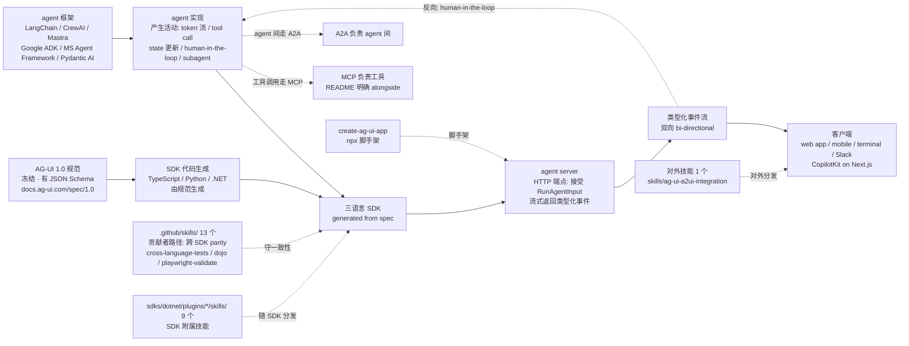

# ag-ui-protocol/ag-ui

## 一句话定位
**一个双向事件流协议，把「AI agent 与面向用户的应用之间怎么说话」标准化 —— 它是本日唯一一个把「agent 接口」做到协议层（而非 CLI 层）的样本，也是 23 个 SKILL.md 中大部分属于「本仓库自身的开发知识」而非对外分发技能的一个反例。**

## 它解决的问题
⭐⭐⭐⭐⭐ **实测 README 原文对问题的陈述非常直接：**

> Agents don't fit the request/response model. They stream tokens, call tools mid-response, update shared state, pause for a human, and spawn subagents, and every framework does it differently. AG-UI replaces that custom wiring with one bi-directional event stream: the agent emits typed events, and any client can render them, no matter which framework built the agent. The same agent can power a web app, a mobile app, a terminal, or Slack.

⭐⭐⭐⭐⭐ **⭐⭐⭐ 问题的本质是「agent 侧的行为模型比 HTTP 的请求/响应丰富得多，而每个框架各自接线」。⭐⭐⭐⭐⭐ AG-UI 的解法是：**agent 发出带类型的事件，客户端负责渲染，⭐⭐⭐⭐⭐ 且客户端不需要知道 agent 是用什么框架写的。**

⭐⭐⭐⭐⭐ **⭐⭐⭐ 注意它明确写出的边界关系：AG-UI works alongside MCP for tools and A2A for agents.⭐⭐⭐⭐⭐ 即它不与 MCP/A2A 竞争，而是互补 —— **AG-UI 管「agent 与前端」，MCP 管「agent 与工具」，A2A 管「agent 与 agent」。**

## 为什么值得关注（2026-11-17）
⭐⭐⭐⭐⭐ **因为它是本日「安装协议尚未收敛」趋势的一个边界情况 —— ⭐⭐⭐⭐⭐ 它的 23 个 `SKILL.md` 大部分位于 `.github/skills/` 与 `sdks/dotnet/plugins/*/skills/` 之下，⭐⭐⭐⭐⭐ 也就是说它们是**给贡献者与 agent 用的仓库内开发技能**，而不是对外分发的技能产品。⭐⭐⭐⭐⭐ 本日报把它单列，是为了避免「23 个 SKILL.md」这个数字被误读成「一个分发 23 个技能的 Skill 市场」。**

**可核验事实一：规模与治理（实测 6,069 blobs）。**

| 指标 | 实测 |
|---|---|
| stars / forks / subs / **open issues** | 18,912 / 1,961 / 102 / **591** |
| 体积 / blobs | 89,211 KB / **6,069** |
| 语言 / 许可 / 创建 | TypeScript / MIT / 2025-05-07T12:49:37Z |
| 最后 push | 2026-11-16T19:12:15Z |
| homepage | `https://ag-ui.com` |
| release | **78 个** |
| topics | `ag-ui-protocol` / `agent-frontend` / `agent-ui` / `agentic-workflow` / `ai-agents` |
| 贡献者 | `ranst91` **1,282** · `contextablemark` 735 · `mme` 724 · `jpr5` 432 · `NathanTarbert` 234 · `tylerslaton` 172 |
| owner | Org `ag-ui-protocol`（2025-04-30 创建、467 followers、**仅 5 个公开仓库**） |

⭐⭐⭐⭐⭐ **⭐⭐⭐ 主贡献者 `ranst91` 一个人 1,282 commits（占绝对多数），⭐⭐⭐⭐⭐ 且 owner 组织只有 5 个公开仓库、467 followers —— ⭐⭐⭐⭐⭐ **⭐⭐⭐ 这是「⭐⭐⭐⭐⭐ 单人主导 + 独立组织 ⭐⭐⭐⭐⭐」的结构，与 `google/elephant-goldfish-model`（组织大、但 `n3wth` 个人主导 123 commits）恰好相反：⭐⭐⭐⭐⭐ **后者是大组织里的个人项目，前者是小组织里的个人项目。⭐⭐⭐⭐⭐ 两者都指向同一件事：⭐⭐⭐⭐⭐ **当前 Agent 协议/生态的关键项目，其主导者实际上都是个人。**

⭐⭐⭐⭐⭐ **⭐⭐⭐ 另一个本日报实测到的反直觉数据：591 个 open issue 相对 1,961 forks（fork/star 10.4%）、102 subs。⭐⭐⭐⭐⭐ 而它的 CI 工作流列表极长（实测 `auto-approve-community.yml` / `build-python-preview.yml` / `canary.yml` / `dojo-e2e.yml` / `dojo-e2e-published.yml` / `lint-release-workflows.yml` / `lint-typescript.yml` / `package-licenses.yml` …）⭐⭐⭐⭐⭐ —— **⭐⭐⭐⭐⭐ 即「issue 多 + CI 重 + 发布频繁」三者并存，⭐⭐⭐⭐⭐ 再次说明 issue 数量不是质量判据。**

**可核验事实二：协议已进入 1.0 冻结态（实测 README 原文）。**

> **AG-UI 1.0 is here.** The protocol now has a stable, frozen specification backed by a JSON Schema, and the TypeScript, Python, and .NET SDKs are generated from it. 1.0 is backwards compatible in both directions: 0.x agents work with 1.0 clients and vice versa.

⭐⭐⭐⭐⭐ **⭐⭐⭐ 三条可核验的工程事实：① 规范被「冻结」并有 JSON Schema 支撑；② 三个语言的 SDK **由规范生成**（而非各自手写）；③ 1.0 与 0.x 双向兼容。**

⭐⭐⭐⭐⭐ **⭐⭐⭐ 「SDK 从规范生成」这一条尤其值得记 —— 它与本日报记录的 `ffmpeg-skill` 的 `docs/contract.md`（每次 release 同步更新的机器可读契约）是同一类做法，⭐⭐⭐⭐⭐ 但 ag-ui 更进一步：**契约不只是文档，而是代码生成的源头。**

⭐⭐⭐⭐⭐ **⭐⭐⭐ 双向兼容也是本数据集里少见的承诺类型 —— 11-16 记录的 `interspace` 承诺「自更新只装签名相同且版本更新的包」，⭐⭐⭐⭐⭐ 本条是「协议冻结后仍双向兼容」，⭐⭐⭐⭐⭐ **两者都是把「不会破坏用户」写成了可检验的承诺。**

**可核验事实三：23 个 SKILL.md 的真实构成（实测路径）。**

⭐⭐⭐⭐⭐ 实测分布：

| 位置 | 数量 | 性质 |
|---|---:|---|
| `.github/skills/` | 13 | **仓库自身的开发技能**（`agui-dojo` · `agui-playwright-validate` · `agui-cross-sdk-parity` · `agui-dotnet-agents-sync` · `agui-dotnet-code-review` · `agui-dotnet-cross-language-tests` · `agui-dotnet-feature-workflow` · `agui-dotnet-integration-tests` · `agui-dotnet-sample-step` · `agui-dotnet-transport` · `agui-dotnet-unit-tests` · `agui-dotnet-wire-types` · `agui-dotnet-sdk-docs`） |
| `sdks/dotnet/plugins/ag-ui-dotnet/skills/` | 9 | **.NET SDK 插件自带的技能**（client-tools / human-in-the-loop / multimodal / protobuf / reasoning / server-tools / shared-state / streaming-chat / troubleshoot） |
| `skills/ag-ui-a2ui-integration/` | 1 | 对外技能 |

⭐⭐⭐⭐⭐ **⭐⭐⭐ 即 23 个 SKILL.md 里只有 1 个是对外分发的技能，22 个是仓库自身的开发知识与 SDK 附属技能。⭐⭐⭐⭐⭐ 这与 `vercel-labs/agent-browser` 的 `skill-data/` 模式同源 —— **⭐⭐⭐⭐⭐ 本日实测的两个样本都出现了「把开发知识封装成 Skill」的做法，⭐⭐⭐⭐⭐ 但只有 ag-ui 把它放在 `.github/skills/`（明确的贡献者路径）下，⭐⭐⭐⭐⭐ **边界划得更清楚。**

⭐⭐⭐⭐⭐ **⭐⭐⭐ 而 `.github/skills/agui-cross-sdk-parity` 与 `agui-dotnet-cross-language-tests` 这两个名字，⭐⭐⭐⭐⭐ 本身就说明了一件事：⭐⭐⭐⭐⭐ **在多语言 SDK 的项目里，「跨语言一致性」是一个需要 agent 来帮忙的持续性工程任务 —— 而它被写成了 Skill。**

**可核验事实四：CLI 与最小实现路径。**

⭐⭐⭐⭐⭐ 实测 README 的 quick start：

```bash
npx create-ag-ui-app@latest
```

⭐⭐⭐⭐⭐ 并提供「a 30-line agent server and client」的最小路径：⭐⭐⭐⭐⭐ 「An AG-UI agent is any HTTP endpoint that accepts a `RunAgentInput` and streams events back.」⭐⭐⭐⭐⭐ **⭐⭐⭐ 即协议的服务端定义极简（一个接受 `RunAgentInput` 的 HTTP 端点 + 事件流），⭐⭐⭐⭐⭐ 这让第三方实现协议的成本非常低 —— **⭐⭐⭐⭐⭐ 这与 1.0 规范 + JSON Schema + 代码生成 SDK 是一套完整的「降低实现门槛」设计。**

## 热度来源判断
⭐⭐⭐⭐⭐ **判断：热度来源是「一个真实且被多方受痛的问题 + 一个低门槛的开放协议」。**

支撑的**可核验事实**：

1. ⭐⭐⭐⭐⭐ **⭐⭐⭐ 问题由生态自身提出**：README 明确列举 agent 的实际行为（stream tokens / call tools mid-response / update shared state / pause for a human / spawn subagents），⭐⭐⭐⭐⭐ **⭐⭐⭐ 并点名「every framework does it differently」—— 这不是假想痛点。**
2. ⭐⭐⭐⭐⭐ **⭐⭐⭐ 生态兼容面广**：实测 README 列出 LangChain · CrewAI · Mastra · Google ADK · Microsoft Agent Framework · Pydantic AI · CopilotKit 等框架，⭐⭐⭐⭐⭐ 以及 web app / mobile app / terminal / Slack 等客户端形态。
3. ⭐⭐⭐⭐⭐ **⭐⭐⭐ 协议已进入 1.0 冻结并有 JSON Schema + 三语言代码生成 SDK** —— ⭐⭐⭐⭐⭐ **⭐⭐⭐ 这是「从实验走向基础设施」的硬指标。**
4. ⭐⭐⭐⭐⭐ **⭐⭐⭐ 78 个 release + 大量 CI 工作流 + 5 位贡献者累计 2,847+ commits** ⭐⭐⭐⭐⭐ —— **⭐⭐⭐⭐⭐ 持续投入的组织化程度。**
5. ⭐⭐⭐⭐⭐ **⭐⭐⭐ 社区自建工具链**：`dojo-e2e.yml`（端到端测试环境）· `canary.yml`（金丝雀）· `auto-approve-community.yml`（社区 PR 自动批准）⭐⭐⭐⭐⭐ —— **⭐⭐⭐⭐⭐ 即社区贡献的吞吐被当作工程指标管理。**

⭐⭐⭐⭐⭐ **⚠️ 不作主张的部分：⭐⭐⭐⭐⭐ 本日报不主张「18,912⭐ 说明协议已被广泛采用」—— ⭐⭐⭐⭐⭐ 采用度需要看下游 agent/客户端数量，⭐⭐⭐⭐⭐ 而本日报未做依赖分析。**

## 关键技术亮点

1. **⭐⭐⭐⭐⭐ 「agent 与前端」这个缝隙被单独协议化**
   ⭐⭐⭐⭐⭐ ⭐⭐⭐ 现有生态里 MCP 管工具、A2A 管 agent-to-agent，⭐⭐⭐⭐⭐ **AG-UI 管 agent-to-UI —— 这一层此前是每个框架各自接线的地方。**

2. **⭐⭐⭐⭐⭐ 规范冻结 + JSON Schema + 代码生成 SDK**
   ⭐⭐⭐⭐⭐ TypeScript / Python / .NET 三个 SDK **由规范生成** ⭐⭐⭐⭐⭐ —— ⭐⭐⭐⭐⭐ **⭐⭐⭐ 这把「多语言实现不一致」这个经典问题从「靠人维护」降级为「靠生成器保证」。**

3. **⭐⭐⭐⭐⭐ 双向兼容承诺（0.x ↔ 1.0）**
   ⭐⭐⭐⭐⭐ 实测 README 明确承诺。⭐⭐⭐⭐⭐ **⭐⭐⭐⭐⭐ 这与本数据集记录的 `interspace` 的签名校验条款、⭐⭐⭐⭐⭐ `pydtcpip` 的三档能力矩阵同属「把兼容承诺写死」这一类 —— ⭐⭐⭐⭐⭐ **可检验、可追责。**

4. **⭐⭐⭐⭐⭐ 服务端定义极简**
   ⭐⭐⭐⭐⭐ 「any HTTP endpoint that accepts a `RunAgentInput` and streams events back」⭐⭐⭐⭐⭐ + README 提供 30 行 agent server/client 示例 ⭐⭐⭐⭐⭐ —— **⭐⭐⭐⭐⭐ 即「最小可用实现」的门槛被刻意压低。**

5. **⭐⭐⭐⭐⭐ 协议一致性交给 Skill 来守**
   ⭐⭐⭐⭐⭐ `agui-cross-sdk-parity` · `agui-dotnet-cross-language-tests` · `agui-playwright-validate` · `agui-dojo` ⭐⭐⭐⭐⭐ —— **⭐⭐⭐⭐⭐ 即「多语言 SDK 的一致性」不是靠 CI 脚本硬编码，而是做成 agent 可执行的技能。**

6. **⭐⭐⭐⭐⭐ 社区吞吐被当作一等工程指标**
   ⭐⭐⭐⭐⭐ `auto-approve-community.yml` · `comment-skill-checks.yml`（在 SkillEvaluator 里）⭐⭐⭐⭐⭐ —— **⭐⭐⭐⭐⭐ 共同点：⭐⭐⭐⭐⭐ **把「人/agent 参与协作」这件事也做成了流水线。**

## 架构师速览

| 决策问题 | 研究判断 | 证据边界 |
|---|---|---|
| 系统边界 | **一个协议规范 + 三个 SDK + 一组参考实现 + 一个 CLI**。协议边界 = 「agent 发出的类型化事件流」；SDK 边界 = TypeScript / Python / .NET 三语言客户端。**边界不含 agent 推理、不含工具调用（MCP 负责）、不含 agent 间通信（A2A 负责）** | 仓库树实测（6,069 blob / `sdks/` / `docs/` / `.github/skills/` 13 个 / `skills/` 1 个）；README 原文；**未运行 CLI、未起过 agent server、未验证任何事件流** |
| 主路径 | ①agent 端接收 `RunAgentInput` ②**由规范生成的 SDK** 把 agent 行为编码为类型化事件 ③事件经 SSE/流式 HTTP 推给客户端 ④客户端按事件类型渲染（token / tool call / state update / human-in-the-loop / subagent）。SDK 生成路径：规范 JSON Schema → 代码生成 → 三语言 SDK | 主路径来自 README 的两段原文；**事件类型全集未核验**（`docs/spec/1.0` 未访问）；**SDK 生成器的实现未核验** |
| 关键权衡 | ①**抽象 vs 具体** → 用「类型化事件」抽象各类 agent 的共性，代价是新增能力可能要动规范；②**规范冻结 vs 演进** → 1.0 冻结并承诺 0.x 双向兼容，代价是演进更慢；③**生成 SDK vs 手写 SDK** → 换一致性，代价是对规范变更的依赖更重；④**协议 vs CLI** → 定协议意味着第三方实现成本，但换来跨框架可移植 | ①② 有 README 原文；③ 由「SDKs are generated from it」推断；④ 是它与 MCP/A2A 的定位声明；**⭐⭐⭐ 「双向兼容」的实际测试覆盖未核验** |
| 最小 PoC | ①先只读规范（`docs.ag-ui.com/spec/1.0`）与 JSON Schema，**不装任何东西** ②起 README 里那个 30 行 agent server ③用官方 TS SDK 写一个只发 3 类事件的最小 client（token / tool call / state update）④验证客户端能渲染 3 类事件 ⑤**⭐⭐⭐ 再测协议边界**：让 agent 发一个 client 不认识的事件类型，确认 SDK 是忽略还是报错 ⑥最后才接 CopilotKit 这类完整前端 | PoC 由本档案推导；⭐⭐⭐ **第⑤步是本档案最建议加的一条** —— 因为「未知事件如何处理」决定了这个协议能否承载未知的第三方 agent，⭐⭐⭐ **而这一点本日报未核验**；⭐⭐⭐ **规范内容未读，故 PoC 第①步是必须的第一步** |

## 架构启发
⭐⭐⭐⭐⭐ **启发一：⭐⭐⭐⭐⭐ 「agent 用什么跟界面说话」是一个独立的协议层，不该被每个框架各自接线。**
⭐⭐⭐⭐⭐ MCP 已被广泛接受为「agent ↔ 工具」的协议；⭐⭐⭐⭐⭐ **AG-UI 试图占据「agent ↔ 用户界面」这一侧。⭐⭐⭐⭐⭐ ⭐⭐⭐⭐⭐ 任何在造 agent 前端的人都会立刻遇到这层接线成本 —— ⭐⭐⭐⭐⭐ **一个只做这一件事的协议，是有独立存在价值的。**

⭐⭐⭐⭐⭐ **启发二：⭐⭐⭐⭐⭐ 规范 → JSON Schema → 代码生成 SDK，是多语言一致性最省力的路径。**
⭐⭐⭐⭐⭐ ⭐⭐⭐ 本日报实测 22 个 SKILL.md 里有两个是「守跨语言一致性」的（`agui-cross-sdk-parity` / `agui-dotnet-cross-language-tests`）⭐⭐⭐⭐⭐ **—— 即在有生成器的项目里，人工一致性检查仍不可省。⭐⭐⭐⭐⭐ 生成器解决「初始一致」，⭐⭐⭐⭐⭐ 而演化中的一致性仍需要持续机制（人写的 CI 或 agent 写的 Skill）。**

⭐⭐⭐⭐⭐ **启发三：⭐⭐⭐⭐⭐ 双向兼容是一个可以兑现、也可以被验证的承诺。**
⭐⭐⭐⭐⭐ 「0.x agents work with 1.0 clients and vice versa」⭐⭐⭐⭐⭐ —— ⭐⭐⭐⭐⭐ 这句话的价值在于它**可以被第三方验证**，⭐⭐⭐⭐⭐ 与「我们重视兼容性」这类说法完全不同。⭐⭐⭐⭐⭐ **本数据集此前记录的 `interspace`（自更新只装签名相同且版本更新的包）、⭐⭐⭐⭐⭐ `mixbar`（第三方声明精确到 commit hash）属于同一类「可验证的承诺」。**

⭐⭐⭐⭐⭐ **启发四：⭐⭐⭐⭐⭐ 「把开发知识做成 Skill」在本日出现两次，且边界划法不同 —— ⭐⭐⭐⭐⭐ `ag-ui` 放在 `.github/skills/`（明确的贡献者路径），⭐⭐⭐⭐⭐ `agent-browser` 放在 `skill-data/`（更泛的目录）。⭐⭐⭐⭐⭐ **⭐⭐⭐⭐⭐ 后者暗示这些知识面向「使用与二次开发」，前者面向「为本仓库贡献」。⭐⭐⭐⭐⭐ **在设计这类结构时，路径命名本身就是一条边界声明。**

## 架构图（MMD）

> 证据边界：此图只采用本档案已有可核验描述；标注「待核验」的节点不应视为项目实现事实。



## 定位判断
**平台候选 —— 且是本日唯一一个把「agent 接口」做到协议层的样本。**

⭐⭐⭐⭐⭐ 18,912⭐ / 1,961 forks / 78 release / 3 语言代码生成 SDK / 规范 1.0 冻结 / 双兼容承诺 ⭐⭐⭐⭐⭐ **⭐⭐⭐⭐⭐ 这些指标把它的定位从「一个库」推到了「一项基础设施提案」。**

⭐⭐⭐⭐⭐ ⭐⭐⭐ 但要保持克制：⭐⭐⭐⭐⭐ **owner 组织只有 5 个公开仓库、467 followers，⭐⭐⭐⭐⭐ 主贡献者 `ranst91` 一个人 1,282 commits —— ⭐⭐⭐⭐⭐ 即「协议」的维护集中度极高。⭐⭐⭐⭐⭐ 协议的长期价值取决于有多少独立实现愿意遵守它，⭐⭐⭐⭐⭐ **而本日报未做依赖分析（未统计有多少 agent 框架/应用实际实现了 AG-UI）。**

⭐⭐⭐⭐⭐ ⭐⭐⭐ 更准确的定位是：**「一个已被广泛讨论、已进入 1.0、但生态采用度尚未被独立验证的开放协议」。**

## 风险/局限/泡沫点
1. ⭐⭐⭐⭐⭐ **⭐⭐⭐ 单人主导风险**：⭐⭐⭐⭐⭐ `ranst91` 1,282 commits，⭐⭐⭐⭐⭐ **⭐⭐⭐ 而协议的维护正是最需要分散的 —— 一旦协议进入「事实标准」，维护者身份与组织归属就成了战略问题。**
2. ⭐⭐⭐⭐⭐ **⭐⭐⭐ 规范冻结 vs 生态演进**：⭐⭐⭐⭐⭐ 1.0 冻结意味着新 agent 能力（更复杂的流式、多模态、subagent 协作）⭐⭐⭐⭐⭐ **⭐⭐⭐ 要么塞进现有事件类型，要么等 2.0 —— ⭐⭐⭐⭐⭐ 而冻结的规范改动成本极高。**
3. ⭐⭐⭐ ⚠️ **⭐⭐⭐ 591 个 open issue**：⭐⭐⭐⭐⭐ 在多语言 SDK 项目里这可能是正常的（每个 SDK 各自一套问题），⭐⭐⭐ ⚠️ **但也可能是负担过重；⭐⭐⭐ ⚠️ 本日报不区分这两种解释。**
4. ⭐⭐⭐ ⚠️ **⭐⭐⭐ 「双向兼容」的测试覆盖未核验** —— ⭐⭐⭐ ⚠️ 这类承诺若无持续验证，破坏兼容的成本会在某次发布时才暴露。
5. ⭐⭐ ⚠️ **未核验项**：规范全文与事件类型全集、SDK 生成器实现、591 个 issue 的正文与主题分布、78 个 release 的内容、生态实际采用度（依赖分析）、`npx create-ag-ui-app` 的脚手架质量。

## 与同类项目的关系
- **vs `vercel-labs/agent-browser`**：⭐⭐⭐⭐⭐ **互补且方向互补 —— ag-ui 是「定义 agent 与前端怎么说话」，agent-browser 是「让 agent 读懂既有网页」。⭐⭐⭐⭐⭐ 一个是协议，一个是工具。**
- **vs MCP / A2A**：⭐⭐⭐⭐⭐ **不是竞品而是互补 —— ag-ui 的 README 明确写「works alongside MCP for tools and A2A for agents」。⭐⭐⭐⭐⭐ ⭐⭐⭐ 三者恰好覆盖了 agent 的三个交互面：工具、agent、前端。**
- **vs `CopilotKit/OpenDots`（2026-09-08 档案）`**：⭐⭐⭐⭐⭐ **同生态 —— ag-ui 的 quick start 直接点名 CopilotKit on Next.js 作为脚手架目标；⭐⭐⭐⭐⭐ 而 CopilotKit 是这套协议的典型消费者。**
- **vs `google/elephant-goldfish-model`**：⭐⭐⭐⭐⭐ 正交 —— EGM 管规范工作流（人写规范），ag-ui 管运行时事件流（agent 与界面）。
- **vs `kajisho5/ffmpeg-skill`**：⭐⭐⭐⭐⭐ **⭐⭐⭐ 两者都做了「机器可读契约」：ag-ui 用 JSON Schema + 代码生成，⭐⭐⭐⭐⭐ ffmpeg-skill 用 `docs/contract.md` 随 release 更新。⭐⭐⭐⭐⭐ **ag-ui 的做法更彻底（契约即代码源头），⭐⭐⭐⭐⭐ ffmpeg-skill 的做法更轻（契约即文档）。**

## 是否值得持续跟踪
**值得，优先级中高。**

⭐⭐⭐⭐⭐ 理由：① 它是本日唯一的**协议层**样本，⭐⭐⭐⭐⭐ 而协议的影响力远大于工具；② 它的「规范 → Schema → 代码生成」路径是可复用的多语言一致性方案；③ 它的「双向兼容」承诺与 1.0 冻结状态，是观察「Agent 生态是否开始进入稳定期」的一个窗口。

## 后续观察点
1. ⭐⭐⭐⭐⭐ **⭐⭐⭐ 生态采用度** —— ⭐⭐⭐⭐⭐ 即有多少独立的 agent 框架 / 应用实现了 AG-UI 客户端或服务端（⭐⭐⭐⭐⭐ **本日报未做依赖分析，这是最该补的一步**）
2. ⭐⭐⭐⭐⭐ **`ranst91` 的贡献占比是否下降** —— ⭐⭐⭐⭐⭐ **⭐⭐⭐ 协议类项目的健康度最终体现在贡献是否分散**
3. ⭐⭐⭐⭐⭐ **规范 1.0 之后的变更节奏** —— ⭐⭐⭐⭐⭐ 冻结后多久出现第一批 errata / 1.0.1
4. ⭐⭐⭐ ⭐ **⭐⭐⭐ 双向兼容承诺是否被第三方独立验证**（有无第三方发布的兼容性矩阵）
5. ⭐⭐⭐ ⭐ **是否新增官方 Skill 分发** —— ⭐⭐⭐ ⭐ 当前 23 个 SKILL.md 里只有 1 个对外，⭐⭐⭐ ⭐ **若开始对外分发，它将同时成为协议方与 Skill 分发方**
6. ⭐⭐⭐ ⚠️ **591 个 issue 的主题分布** —— ⭐⭐⭐ ⚠️ 是 SDK 一致性问题还是协议设计问题，⭐⭐⭐ ⚠️ 直接决定 1.0 冻结的可持续性

---

*首次记录：2026-11-17 · 全部元数据取自 2026-11-17 CST 的 GitHub REST API 快照（`repos/*`、`git/trees/*?recursive=1`、`commits`、`readme`、`releases`、`contributors`、`users/*`）*
