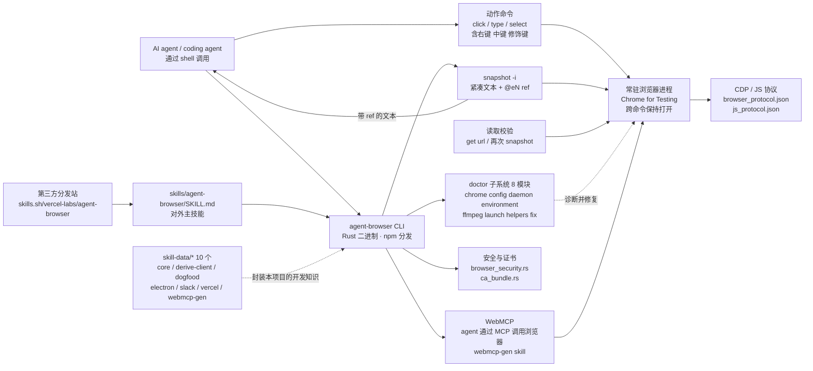

# vercel-labs/agent-browser

## 一句话定位
**一个 Rust 写的浏览器自动化 CLI，把网页压缩成带 ref 的紧凑文本快照，让 agent 用「snapshot → 对 ref 动作 → 再 snapshot」三步循环驱动浏览器 —— 它是本数据集里 issue 密度最高、也最能说明「agent 需要什么形状的浏览器接口」的项目。**

## 它解决的问题
⭐⭐⭐⭐⭐ **agent 驱动浏览器的核心矛盾是：网页是人类视觉设计的（导航、卡片、按钮），而 agent 需要的是稳定、可寻址、可验证的结构。**

⭐⭐⭐⭐⭐ 传统做法是把整页 HTML 或 accessibility tree 塞给模型 —— ⭐⭐⭐⭐⭐ **代价是上下文爆炸，而且元素引用不稳定。**

⭐⭐⭐⭐⭐ 本项目的解法（实测 README 原文）：

> agent-browser is a native Rust CLI that gives an AI agent a browser it can drive one command at a time. `snapshot` returns the page as compact text with a ref such as `@e1` for each element. The agent acts on a ref, reads the page again to check the result, and repeats. The browser stays open between commands, so each step is one short shell call.

⭐⭐⭐⭐⭐ **⭐⭐⭐ 三个设计要点：① snapshot 是紧凑文本而不是完整 DOM；② 每个元素有稳定 ref（`@e1`）；③ 浏览器在命令之间保持打开，因此每一步都是一次短的 shell 调用。**

## 为什么值得关注（2026-11-17）
⭐⭐⭐⭐⭐ **因为它是本数据集里「issue 数量」这个指标的一个反例样本 —— 589 个 open issue 配 51,996⭐（1.1%），在这里是高活跃度的表现，而不是质量信号。**

**可核验事实一：issue 密度与内容（实测）。**

| 指标 | 实测 |
|---|---|
| stars / forks / **open issues** / subs | 51,996 / 3,628 / **589** / 114 |
| issue/star 比 | **1.13%** |
| fork/star 比 | 7.0% |
| 体积 / blobs | 35,243 KB / 680 |
| 语言 / 许可 / 创建 | Rust / Apache-2.0 / 2026-01-11T05:38:15Z |
| 最后 push | 2026-11-16T22:33:21Z |
| homepage | `https://agent-browser.dev` |
| release | **100 个**（GitHub API 单页上限） |
| CI | 2 个工作流：`ci.yml` / `release.yml` |
| 贡献者 | `ctate` 426 · `Railly` 84 · `lahfir` 72 · `github-actions[bot]` 68 · `jin-2-kakaoent` 27 · `mikewong23571` 10 |
| owner | Org `vercel-labs`（2022-07-01 创建、10,684 followers、398 repos） |

⭐⭐⭐⭐⭐ **⭐⭐⭐ 本日报把它与本日记录的 `ffmpeg-skill`（33 issue）放在一起看：⭐⭐⭐⭐⭐ **同样是高 star 的 Agent 工具，issue 数差 18 倍 —— ⭐⭐⭐⭐⭐ **这说明「issue 数量」本身完全不是质量判据，⭐⭐⭐⭐⭐ 而「issue 的内容是否具体」才是（详见「热度来源判断」）。**

⭐⭐⭐⭐⭐ **实测近 8 个 commit 消息全部是具体的功能/修复条目：**

- `fix(cdp): share session matching for direct-page events`
- `fix(flow): replay only interaction fields of recorded commands (#2607)`
- `feat(click): add right-click, middle-click, and modifier keys to click and dblclick`
- `fix(webmcp): accept invoke params after the tool name (#2591)`
- `fix(select): support custom ARIA combobox and listbox widgets (#2592)`

⭐⭐⭐⭐⭐ **⭐⭐⭐ 注意 `fix(webmcp): accept invoke params after the tool name` —— 即它实现了 WebMCP 侧的 agent 控制能力。**

**可核验事实二：`doctor` 子系统（实测 `cli/src/doctor/` 目录）。**

⭐⭐⭐⭐⭐ 实测 `cli/src/doctor/` 下有 8 个模块：`chrome.rs` · `config.rs` · `daemon.rs` · `environment.rs` · `ffmpeg.rs` · `fix.rs` · `helpers.rs` · `launch.rs` ⭐⭐⭐⭐⭐ **⭐⭐⭐ 即它有一个分模块的、且带 **`fix.rs`（自动修复）** 的环境诊断子系统。**

⭐⭐⭐⭐⭐ **⭐⭐⭐ 这与本日记录的 `last30days-skill` 的 `doctor`、以及 `NVIDIA/SkillEvaluator` 的 tier 流水线，属于同一条线索：⭐⭐⭐⭐⭐ **「自检」正在成为 agent 工具的标准配置 —— ⭐⭐⭐⭐⭐ 而且本项目的 `doctor` 还带自动修复（`fix.rs`），比只报告更进一步。**

**可核验事实三：12 个 SKILL.md 的构成（实测）。**

⭐⭐⭐⭐⭐ 实测路径：`skills/agent-browser/SKILL.md`（对外的主技能）+ `skill-data/core` · `agentcore` · `derive-client` · `dogfood` · `electron` · `modern-web-guidance` · `slack` · `vercel` · `vercel-sandbox` · `webmcp-gen`（10 个 skill-data 目录）+ `.agents/skills/technical-writer/SKILL.md`。

⭐⭐⭐⭐⭐ **⭐⭐⭐ 注意这 11 个 `skill-data/*` 并不是 11 个「产品技能」，⭐⭐⭐⭐⭐ 而是**仓库自身的开发知识**（如何写客户端、如何做 dogfood、如何接 Slack、如何接 Vercel Sandbox、如何生成 WebMCP）⭐⭐⭐⭐⭐ —— ⭐⭐⭐⭐⭐ **即 agent-browser 把「开发 agent-browser 的知识」也做成了 Skill 供其他 agent 使用。⭐⭐⭐⭐⭐ 这是一种自举式的知识封装。**

**可核验事实四：Rust 实现与安全模块。**

⭐⭐⭐⭐⭐ 实测 `cli/src/` 含 `browser_security.rs` · `ca_bundle.rs` · `connection.rs` · `chat.rs` · `commands.rs` ⭐⭐⭐⭐⭐ 以及 `cli/cdp-protocol/browser_protocol.json` + `js_protocol.json`（⭐⭐⭐⭐⭐ **即它把 CDP 与 JS 协议定义作为数据文件带在仓库里**）。

⭐⭐⭐⭐⭐ **⭐⭐⭐ 「浏览器安全」与「CA bundle」被单独成文件，⭐⭐⭐⭐⭐ 对一个要下载并驱动真实浏览器的工具来说，这是必要的关注点。**

## 热度来源判断
⭐⭐⭐⭐⭐ **判断：热度来源是「一个被所有 coding agent 都需要的底层能力 + 一个极低的接入成本」。**

⭐⭐⭐⭐⭐ 支撑的**可核验事实**：

1. ⭐⭐⭐⭐⭐ **⭐⭐⭐ 接入成本极低**（实测 README）：
   ```bash
   npm install -g agent-browser
   agent-browser install           # 首次下载 Chrome for Testing
   ```
   ⭐⭐⭐⭐⭐ **且支持 `npx agent-browser open example.com` 免安装、Homebrew 安装、`--with-deps` 处理 Linux 系统库。⭐⭐⭐⭐⭐ 「一个命令就能用」是 star 增长最直接的解释。**
2. ⭐⭐⭐⭐⭐ **⭐⭐⭐ 分发面极广**：实测 README 带 `skills.sh/vercel-labs/agent-browser` 徽章 —— 即它被收录进第三方 Skill 分发站。
3. ⭐⭐⭐⭐⭐ **owner 是 `vercel-labs` 组织**（10,684 followers、398 repos）⭐⭐⭐⭐⭐ 且主贡献者 `ctate` 有 426 commits，⭐⭐⭐⭐⭐ 另有 `Railly` 84 + `lahfir` 72 + `jin-2-kakaoent` 27 + `mikewong23571` 10 —— **⭐⭐⭐⭐⭐ 5 位真实贡献者（其中 3 位非 bot 贡献 ≥10 commits）。**
4. ⭐⭐⭐⭐⭐ **⭐⭐⭐ 589 个 issue 配 3,628 forks**：⭐⭐⭐⭐⭐ 一个「被大量 agent 集成」的库才会同时有这两个数字。
5. ⭐⭐⭐⭐⭐ **发布持续**：最近一次 push 2026-11-16T22:33:21Z，⭐⭐⭐⭐⭐ 100 个 release（已达 GitHub API 单页上限，实际更多）。

⭐⭐⭐⭐⭐ **⚠️ 不作主张的部分：star 增速未做统计。⭐⭐⭐⭐⭐ 且本日报不主张「589 个 issue 是质量差的证据」—— ⭐⭐⭐⭐⭐ 从实测 commit 与 issue 标题看，它们是具体的功能条目。**

## 关键技术亮点

1. **⭐⭐⭐⭐⭐ 紧凑文本快照 + 稳定 ref**
   ⭐⭐⭐⭐⭐ `snapshot -i` 返回带 `@e1` 式 ref 的紧凑文本，⭐⭐⭐⭐⭐ **⭐⭐⭐ 这同时解决了上下文预算与元素寻址两个问题 —— ⭐⭐⭐⭐⭐ 注意它选的是「可寻址的紧凑表示」而不是「完整的 accessibility tree」。**

2. **⭐⭐⭐⭐⭐ 浏览器跨命令保持打开**
   ⭐⭐⭐⭐⭐ 「The browser stays open between commands, so each step is one short shell call」⭐⭐⭐⭐⭐ **⭐⭐⭐ 这让整个交互变成一串短 shell 调用，⭐⭐⭐⭐⭐ 而不是每次都重开浏览器 —— 对延迟与状态保持都是关键。**

3. **⭐⭐⭐⭐⭐ 分层 doctor 子系统（8 模块，含自动修复 `fix.rs`）**
   ⭐⭐⭐⭐⭐ 覆盖 chrome · config · daemon · environment · ffmpeg · launch。⭐⭐⭐⭐⭐ **⭐⭐⭐ 带 `fix.rs` 意味着它不只是报告问题，还能修 —— ⭐⭐⭐⭐⭐ 这在「agent 面对一个装坏了的环境」时价值极大。**

4. **⭐⭐⭐⭐⭐ WebMCP 支持**
   ⭐⭐⭐⭐⭐ 实测 commit `fix(webmcp): accept invoke params after the tool name (#2591)` ⭐⭐⭐⭐⭐ + `skill-data/webmcp-gen/SKILL.md`（⭐⭐⭐⭐⭐ **生成 WebMCP 定义的技能**）⭐⭐⭐⭐⭐ —— ⭐⭐⭐⭐⭐ 即它把「让 agent 通过 MCP 调用浏览器」做成了一等能力。

5. **⭐⭐⭐⭐⭐ 协议定义作为数据文件随仓库分发**
   ⭐⭐⭐⭐⭐ `cli/cdp-protocol/browser_protocol.json` + `js_protocol.json` ⭐⭐⭐⭐⭐ —— ⭐⭐⭐⭐⭐ **⭐⭐⭐ 这让 CDP 协议的变化可以通过更新数据文件而非改代码来处理，⭐⭐⭐⭐⭐ 也让协议本身可被审阅。**

6. **⭐⭐⭐⭐⭐ `browser_security.rs` 与 `ca_bundle.rs` 独立成文件**
   ⭐⭐⭐⭐⭐ 一个要下载并驱动真实浏览器的工具，⭐⭐⭐⭐⭐ **⭐⭐⭐ 把安全与证书链单独成模块，说明「被 agent 驱动」这件事的信任边界被显式考虑过。**

7. **⭐⭐⭐⭐⭐ `skill-data/` 把开发知识也封装成 Skill**
   ⭐⭐⭐⭐⭐ 10 个目录覆盖 core / agentcore / derive-client / dogfood / electron / slack / vercel / vercel-sandbox / webmcp-gen / modern-web-guidance。⭐⭐⭐⭐⭐ **⭐⭐⭐ 即「如何开发这个项目」本身是可被其他 agent 消费的 Skill。**

## 架构师速览

| 决策问题 | 研究判断 | 证据边界 |
|---|---|---|
| 系统边界 | **一个 CLI 进程 + 一个它托管的浏览器进程**。CLI 是 Rust 二进制（npm 分发），浏览器是 Chrome for Testing（运行时下载）。**边界不含模型、不含 agent 运行时** —— agent 通过 shell 调用 CLI | 仓库树实测（`cli/src/` 含 `browser_security.rs` / `ca_bundle.rs` / `doctor/` 8 模块 / `cdp-protocol/*.json`）；README 的安装与 quick start；**未安装、未运行、未打开过任何网页** |
| 主路径 | ①`agent-browser open <url>` → 启动并保持浏览器 ②`snapshot -i` → 返回带 `@eN` ref 的紧凑文本 ③`click @e1` / `type @e2 "..."` 等动作 ④`get url` 等读取校验 ⑤循环。旁路：`doctor` 诊断/修复环境；`webmcp` 让 MCP 客户端直接调用 | 上述五步来自 README 的 quick start 原文；**各命令的完整语义未核验**（实测 `cli/src/commands.rs` 未读）；**CDP 交互细节未核验** |
| 关键权衡 | ①**上下文预算 vs 页面保真** → 用紧凑快照 + ref 而非完整 DOM/a11y tree；②**速度 vs 状态** → 浏览器跨命令常驻；③**易用 vs 安全** → `browser_security.rs` / `ca_bundle.rs` 独立模块 + `doctor` 自动修复；④**Rust 二进制 vs Node 生态分发** → 走 npm 包但核心是原生二进制 | ①②③ 有 README 与目录结构支撑；④ 由 `cli/Cargo.toml` + npm 安装方式推断；**⭐⭐⭐ 「紧凑快照相对完整 a11y tree 节省多少上下文」无实测数据** |
| 最小 PoC | `npm install -g agent-browser && agent-browser install` → 对一个**本地静态 HTML 文件**（不联网、不碰真实站点）跑完整五步循环：open → `snapshot -i` → 记录 ref 数量与文本长度 → click 某个已知 ref → `get url` 验证 → 再 snapshot 确认 DOM 变化 → 跑 `agent-browser doctor` 看它报告什么 → 最后才接真实站点 | PoC 由本档案推导；⭐⭐⭐ **第②步的「ref 数量与快照长度」是唯一可量化的验收指标**，⭐⭐⭐ **建议记录它作为上下文预算的基线**；⭐⭐⭐ **`doctor` 的具体检查项未核验** |

## 架构启发
⭐⭐⭐⭐⭐ **启发一：⭐⭐⭐⭐⭐ 「紧凑文本 + 稳定 ref」是 agent 接口设计的一个可复用范式。**
⭐⭐⭐⭐⭐ 与 `ffmpeg-skill` 的「默认 12 个工具 / 全量 42 个」是同一条思路的两个层面：⭐⭐⭐⭐⭐ **前者压缩「看什么」，后者压缩「调什么」。⭐⭐⭐⭐⭐ 两者都指向同一件事：⭐⭐⭐⭐⭐ **agent 的上下文预算是首要设计约束，而不是事后优化项。**

⭐⭐⭐⭐⭐ **启发二：⭐⭐⭐⭐⭐ `doctor` 应该带自动修复，而不只是报告。**
⭐⭐⭐⭐⭐ 实测 `cli/src/doctor/fix.rs` 的存在 ⭐⭐⭐⭐⭐ —— **⭐⭐⭐⭐⭐ 对 agent 而言，「环境坏了」是高频事件，⭐⭐⭐⭐⭐ 而一个只会报告的 doctor 要求 agent 自己想办法修，⭐⭐⭐⭐⭐ 一个能修的 doctor 直接把故障消掉。⭐⭐⭐⭐⭐ 本日记录的 `last30days-skill` 的 doctor 还会误报，⭐⭐⭐⭐⭐ **说明「doctor 要会自测」本身也是一项工程要求。**

⭐⭐⭐⭐⭐ **启发三：⭐⭐⭐⭐⭐ 协议定义应当作为数据文件随产物分发。**
⭐⭐⭐⭐⭐ `cli/cdp-protocol/*.json` ⭐⭐⭐⭐⭐ —— **⭐⭐⭐⭐⭐ 好处有二：协议变化不需要改代码；协议本身可被审阅与 diff。⭐⭐⭐⭐⭐ 本数据集记录的 `docs/contract.md`（ffmpeg-skill）、`_system/schemas/*.schema.json`（boring-marketing-skills）都是同一模式的不同形态。**

⭐⭐⭐⭐⭐ **启发四：⭐⭐⭐⭐⭐ 「把开发本项目的知识也做成 Skill」是一种自举式的知识封装。**
⭐⭐⭐⭐⭐ `skill-data/` 下 10 个目录 ⭐⭐⭐⭐⭐ —— ⭐⭐⭐⭐⭐ **⭐⭐⭐⭐⭐ 好处是：新贡献者（不论是人还是 agent）都能用同一套知识上手；⭐⭐⭐⭐⭐ 坏处是这些知识会随代码演进而腐化，⭐⭐⭐⭐⭐ 因此需要一个「知识是否仍然有效」的检查机制 —— ⭐⭐⭐⭐⭐ **本项目有 `dogfood` 技能，但是否有针对 `skill-data` 的时效性检查，未核验。**

## 架构图（MMD）

> 证据边界：此图只采用本档案已有可核验描述；标注「待核验」的节点不应视为项目实现事实。



## 定位判断
**生产可用 —— 在「agent 驱动浏览器」这个具体位置上，它几乎没有竞品。**

⭐⭐⭐⭐⭐ 51,996⭐ / 3,628 forks / 114 subs / 100+ release / 5 位真实贡献者 / Rust 实现 / Apache-2.0 ⭐⭐⭐⭐⭐ **⭐⭐⭐ 这些指标说明它已经是一个被依赖的基础设施，而不是实验品。**

⭐⭐⭐⭐ ⭐⭐⭐ 但要给它一个准确的定位，需要区分两件事：⭐⭐⭐⭐⭐ **它卖的不是「浏览器自动化」，而是「给 agent 的浏览器接口形状」** ⭐⭐⭐⭐⭐ —— 「紧凑快照 + 稳定 ref + 常驻进程 + 一条短命令一步」这套约定，⭐⭐⭐⭐⭐ **实际上定义了 agent 该如何与网页交互。⭐⭐⭐⭐⭐ 这个约定的扩散速度，比代码本身更有长期影响。**

## 风险/局限/泡沫点
1. ⭐⭐⭐⭐⭐ **⭐⭐⭐ 589 个 open issue 相对 3,628 forks 是偏高的**：⭐⭐⭐⭐⭐ **⭐⭐⭐ 这更可能是「被广泛集成 + 大量边缘场景」的结果，⭐⭐⭐⭐⭐ 但也意味着维护压力与响应延迟 —— ⭐⭐⭐⭐⭐ 未核验 issue 的平均响应时间与关闭率。**
2. ⭐⭐⭐⭐⭐ **⭐⭐⭐ 依赖浏览器二进制**：需运行时下载 Chrome for Testing，⭐⭐⭐⭐⭐ **⭐⭐⭐ 在受限网络/容器环境下会失败；⭐⭐⭐⭐⭐ `doctor` 正是为此存在，但它是否覆盖所有场景未核验。**
3. ⭐⭐⭐ ⚠️ **⭐⭐⭐ 磁盘内容的选择由工具决定**：把整页压缩成文本必然丢失视觉与结构信息，⭐⭐⭐ ⚠️ **⭐⭐⭐ 对依赖视觉布局的任务（截图验证、canvas 应用）能力有限 —— 未核验其边界。**
4. ⭐⭐⭐ ⚠️ **⭐⭐⭐ `skill-data/` 的 10 份开发知识会腐化**，⭐⭐⭐ ⚠️ **⭐⭐⭐ 且没有看到针对「知识时效性」的 CI 检查 —— 这是本档案的推断，未核验。**
5. ⭐⭐ ⚠️ **未核验项**：589 个 issue 的正文与状态、100 个 release 的内容、`agent-browser.dev` 站点、CDP 协议文件的完整性、npm 包与仓库的一致性、WebMCP 的具体行为。

## 与同类项目的关系
- **vs `kajisho5/ffmpeg-skill`**：⭐⭐⭐⭐⭐ **⭐⭐⭐ 两者是本日「上下文预算」主题的两个样本 —— ⭐⭐⭐⭐⭐ ffmpeg-skill 管「工具暴露面」（默认 12 / 全量 42），agent-browser 管「观察面」（紧凑快照 + ref）。⭐⭐⭐⭐⭐ **⭐⭐⭐ 二者合起来给出了一条完整的 agent 工具设计原则：少给、少看、但按名可达。**
- **vs `ag-ui-protocol/ag-ui`**：⭐⭐⭐⭐⭐ **互补且方向相反 —— ag-ui 是「让 agent 的事件流进入前端应用」，⭐⭐⭐⭐⭐ agent-browser 是「让 agent 读懂既有网页」。⭐⭐⭐⭐⭐ 前者定义协议，后者提供工具。**
- **vs `mvanhorn/last30days-skill`**：⭐⭐⭐⭐⭐ 同为多 harness 生态，但 last30days 是**信息聚合**、agent-browser 是**执行环境**；⭐⭐⭐⭐⭐ 两者都有 `doctor` 自检机制 —— **⭐⭐⭐⭐⭐ 这可能是本日最明显的一个跨项目共性：agent 工具开始系统性地自检环境。**
- **vs `google/elephant-goldfish-model`**：⭐⭐⭐⭐⭐ 正交 —— EGM 管流程，agent-browser 提供执行环境。
- **vs `ChromeDevTools/chrome-devtools-mcp`**（同在日榜）：⭐⭐⭐⭐⭐ **⭐⭐⭐ 直接竞争且路线不同 —— ChromeDevTools 走 MCP（模型直接调工具），agent-browser 走 CLI（模型走 shell）。⭐⭐⭐⭐⭐ **⭐⭐⭐ 两条路线的取舍是：MCP 更结构化、CLI 更通用（任何能跑 shell 的 agent 都能用）。**

## 是否值得持续跟踪
**值得，优先级中高。**

⭐⭐⭐⭐⭐ 理由：① 它定义了 agent 与网页交互的接口形状，⭐⭐⭐⭐⭐ 这类「接口层」项目的长期影响大于其 star 数；② 589 个 issue 是研究「agent 工具的真实失败模式」的富矿；③ 它与 `ffmpeg-skill` 一起构成了本日「上下文预算是首要约束」这条判断的两个实证样本。

## 后续观察点
1. ⭐⭐⭐⭐⭐ **⭐⭐⭐ 与 `ChromeDevTools/chrome-devtools-mcp` 的竞争格局**（两者同在日榜，⭐⭐⭐⭐⭐ **谁成为 agent 浏览器的事实标准值得跟踪**）
2. ⭐⭐⭐⭐⭐ **`skill-data/` 是否引入时效性检查** —— ⭐⭐⭐⭐⭐ 知识腐化是这个自举结构的主要风险
3. ⭐⭐⭐ ⭐ **589 个 issue 的关闭速度与主题分布** —— ⭐⭐⭐ ⭐ 这会揭示 agent 驱动浏览器的主要失效面
4. ⭐⭐⭐ ⭐ **是否新增 harness 原生清单**（当前只有 `.claude-plugin/marketplace.json`，⭐⭐⭐ ⭐ 是本日报 17 个仓库里带 ≥3 套清单的 4 个之一之外的一个）
5. ⭐⭐⭐ ⚠️ **`doctor` 的检查项是否覆盖「浏览器下载失败」等环境失败** —— 实测已有 `chrome.rs` / `environment.rs` 模块，⭐⭐⭐ ⚠️ 具体覆盖未核验

---

*首次记录：2026-11-17 · 全部元数据取自 2026-11-17 CST 的 GitHub REST API 快照*
