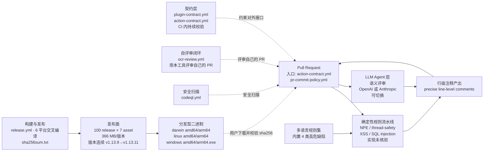

# alibaba/open-code-review

## 最近动态（2026-11-23）

⭐⭐⭐⭐⭐ **本日对本项目做的是同口径复测，结论是：它作为「确定性 + LLM 混合架构」与「契约做成 CI 门禁」这两条的样本地位完全不变，⭐⭐⭐⭐⭐ 但 11-18 用来支撑对比的那组下载数字需要修正 —— 而修正的方向对它有利。**

**可核验事实一：11-18 的下载区间之所以看起来高，是因为它的 asset 数少到不会被截断。**

| release | asset 数 | 11-18 视角（`[:12]`，实际未截断） | **真实区间** |
|---|---:|---|---|
| `v1.13.12` | 7 | 493 – 1,886 | **493 – 1,886**（无截断） |
| `v1.13.13` | 7 | 476 – 991 | **476 – 991**（无截断） |
| `v1.14.1` | 7 | — | **119（max）/ 441（total）** |

⭐⭐⭐⭐⭐ **⭐⭐⭐ 关键的不对称就在这里：`plannotator` 每个 release 36 个 asset，被截断的正是 12 个（33%）；⭐⭐⭐⭐⭐ 而本项目每个 release 只有 7 个 asset，11-18 脚本的 `[:12]` **根本没有触发截断**。⭐⭐⭐⭐⭐ 也就是说，11-18 那次对比的误差**只作用在对照组一侧**，⭐⭐⭐⭐⭐ 这是一个典型的「非对称测量误差」案例 —— 也是本日第 1 条趋势的方法论核心。**

**可核验事实二：全量 release 的下载分布。**

| 指标 | 实测值 |
|---|---:|
| release 数（API 前 100 条） | **100** |
| **全量 release 平均下载** | **3,480** |
| 最新 3 个 release 平均下载 | **1,726**（比全量均值**低** 2.0×） |
| **全量 release 单 asset 最大下载** | **16,263** |
| 最新 6 个 release 下载总量 | **14,019** |
| 较老 release（9.8–159.1 天）下载总量 | **333,966**（**23.8×**） |
| Spearman(发布年龄, 下载量) | **−0.549**（n=100） |
| 30–34 天区间中位数 | **28,400** |

⭐⭐⭐⭐⭐ **即本项目的下载量是「越老越高」的（ρ = −0.549），⭐⭐⭐⭐⭐ 而 `nginx/nginx` 是「越老越低」（ρ = +0.370），⭐⭐⭐⭐⭐ `Ghost-Downloader-3` 越老越高（−0.636），`autoclip` 越老越低（−0.321）。⭐⭐⭐⭐⭐ **四个项目两种符号 —— 这就是本日报主张「取最新 N 个 release 不能跨项目比较」的实证。**

**可核验事实三：SKILL.md 身份口径（本日新发现的一处 11-18 口径不一致）。**

| 口径 | 11-18 发布值 | **11-23 实测** |
|---|---|---|
| SKILL.md 文件数 | 4 | **4** |
| **名口径**（身份 = 父目录名） | — | **2**（`open-code-review` / `open-code-review-delegate`，各 2 份） |
| **内容口径**（身份 = 不同 blob sha 集合） | **4** | **4**（复现 ✓） |

⭐⭐⭐⭐⭐ **⭐⭐⭐ 即 11-18 那张表里这一行用的是内容口径（或两者在此巧合相同），⭐⭐⭐⭐⭐ 而其余各行用的是名口径 —— 11-18 的表格内部口径并不统一，⭐⭐⭐⭐⭐ 这本身比任何一个单行的偏差更危险，因为它使整张表无法被复现。⭐⭐⭐⭐⭐ 且 4 份副本两两内容不同（`plugins/open-code-review/skills/` vs `skills/`），⭐⭐⭐⭐⭐ 同样是「变体」而非「复制」。**

**可核验事实四：6 日 star 序列与契约工作流。**

| 指标 | 实测值 |
|---|---|
| 6 日 star 序列 | 53,669 → 54,166 → 54,369 → 54,746 → 55,070 → **55,384** |
| 逐日增 | +497 / +203 / +377 / +324 / +314 |
| 5 日总增 | **+1,715（+3.2%）** |
| blobs | 1,227 → **1,320**（+93） |
| harness 目录 | 2 套（`claude-code` / `opencode`） |

⭐⭐⭐⭐⭐ **⭐⭐⭐ 而本项目特有的价值 —— 「把契约做成 CI 门禁」—— 本日出现了第二个独立样本：`HKUDS/CLI-Anything` 的 `check-codex-skill.yml` / `check-cursor-plugin.yml` / `check-root-skills.yml`。⭐⭐⭐⭐⭐ 两个不同机构、两个不同领域（代码评审 vs agent CLI 生成）、同一模式，⭐⭐⭐⭐⭐ **本日报据此把「契约检查成为多 harness 项目的标准做法」列为本日的一条正面发现。**

---

## 一句话定位
**阿里的混合架构代码评审工具 —— 确定性流水线 + LLM Agent 双轨并行，本日它的价值在于它是「发布纪律四档」里最经济的一档：100 个 release，每个只带 7 个 asset。**

## 它解决的问题
⭐⭐⭐⭐⭐ **纯规则式代码评审漏掉语义问题，纯 LLM 评审不可复现且贵。** README 描述（实测）：

> Secure, fast, efficient, battle-tested at Alibaba's scale. Hybrid architecture code review tool: deterministic pipelines + LLM Agent, precise line-level comments, built-in multi-language ruleset (NPE, thread-safety, XSS, SQL injection), OpenAI & Anthropic compatible.

⭐⭐⭐⭐⭐ **「确定性流水线 + LLM Agent」的分工是关键：⭐⭐⭐⭐⭐ 规则（NPE / 线程安全 / XSS / SQL 注入）由确定性工具负责并给出可复现的行级注释，⭐⭐⭐⭐⭐ 语义判断交给 Agent —— 且它同时兼容 OpenAI 与 Anthropic 两家 API。**

## 为什么值得关注（2026-11-18）
⭐⭐⭐⭐⭐ **因为它把「发布资产」这条判据的第四档补齐了：⭐⭐⭐⭐⭐ 100 个 release × 7 个 asset × 366 MB，⭐⭐⭐⭐⭐ 是本日四个高发布频次项目里最轻的一档，⭐⭐⭐⭐⭐ 且 7 个 asset 里含一份 `sha256sum.txt`。**

**可核验事实（2026-11-18 CST 快照）。**

| 指标 | 实测值 |
|---|---|
| stars / forks / subs / open issues | 53,682 / 4,429 / 156 / 358 |
| 体积 / blobs | 55,473 KB / 1,227（`SKILL.md` 4 个） |
| 语言 / 许可 / 创建 / 最后 push | Go / Apache-2.0 / 2026-05-18T02:16:36Z / 2026-11-17T12:46:22Z |
| homepage | `https://open-codereview.ai` |
| topics | `agent` · `agent-skills` · `code-review` · `code-review-assistant` · `harness` · `repository-level-context` |
| **release / tag** | **100 / 100** |
| **每个 release 的 asset 数** | **7**（实测 `v1.13.11` / `v1.13.10` / `v1.13.9` 三版本均为 7） |
| **asset 构成** | 无扩展名 **4**（`opencodereview-darwin-amd64` / `opencodereview-darwin-arm64` / `opencodereview-linux-amd64` / `opencodereview-linux-arm64`）· `.exe` **2**（`opencodereview-windows-amd64.exe` / `-arm64.exe`）· `.txt` **1**（`sha256sum.txt`） |
| **单 release 总体积** | **366.20 MB**（`v1.13.11`）/ 366.14 MB（`v1.13.10`）/ 335.95 MB（`v1.13.9`） |
| 最大单个 asset | **63,604,304 B**（≈61 MB） |
| asset 下载次数（前 12） | `v1.13.11`: 57,64,78,116,202,309,317 · `v1.13.10`: 75,109,117,340,656,756,951 · `v1.13.9`: 91,97,100,220,428,475,657 |
| CI 工作流 | **14 个**（`acp-ci.yml` / `action-contract.yml` / `ci.yml` / `codeql.yml` / `deploy-pages.yml` / `frontend-ext.yml` / `idea-ext.yml` / `ocr-review.yml` / `pages-ci.yml` / **`plugin-contract.yml`** / `pr-commit-policy.yml` / `release.yml`） |
| harness 目录 | `.agents` + `.claude-plugin`（2 套） |
| 贡献者 | `lizhengfeng101` 303 · `chethanuk` 39 · `wu21-web` 38 · `Qiyuanqiii` 25 · `stay-foolish-forever` 23 · `yingjiexu2002` 13 · `amh1k` 11 · `dependabot[bot]` 11 |

⭐⭐⭐⭐⭐ **⭐⭐⭐ 本日最值得记的一条：`plugin-contract.yml` 与 `action-contract.yml` 这两个工作流名。⭐⭐⭐⭐⭐ ⭐⭐⭐⭐⭐ 即它把「插件契约」与「action 契约」当作**CI 里持续校验的契约**，⭐⭐⭐⭐⭐ 而不是文档里的一段说明。⭐⭐⭐⭐⭐ 这与 11-17 记录的 `ffmpeg-skill` 把 `docs/contract.md` 随 release 版本化（每次 release commit 都改它 +2/-2）是同一思路，⭐⭐⭐⭐⭐ **但本项目把它做成了可执行的门禁。**

⭐⭐⭐⭐⭐ **⭐⭐⭐ 另一条：`ocr-review.yml` + `pr-commit-policy.yml` + `codeql.yml` 组合起来，⭐⭐⭐⭐⭐ 即「用本工具评审自己的 PR」+「限制 PR 提交方式」+「CodeQL 扫描」三条同时存在。⭐⭐⭐⭐⭐ 这解释了为什么 100 个 release 的版本号能连续（`v1.13.9` → `v1.13.10` → `v1.13.11`）⭐⭐⭐⭐⭐ 且每个 tag 的 commit 都有真实的代码 diff：**

⭐⭐⭐⭐⭐ **⭐⭐⭐ 实测 tag→commit 链：`v1.13.11` 的 tag commit 改 **24 个文件、其中 5 个源码**，父 commit 改 6 个文件、6 个源码；`v1.13.10` 的 tag commit 改 21 个文件、7 个源码，父 commit 13 个文件、11 个源码；`v1.13.9` 的 tag commit 改 2 个文件、2 个源码，父 commit 12 个文件、7 个源码。⭐⭐⭐⭐⭐ ⭐⭐⭐⭐⭐ ⭐⭐⭐⭐⭐ **即三个连续版本里，功能 commit 在 tag commit 与父 commit 之间交替出现（tag / 父 / 父），⭐⭐⭐⭐⭐ 再次确认本日结论：判据是「链上有没有 diff」，不是「功能在前还是在后」。**

⭐⭐⭐⭐⭐ **⭐⭐⭐ 而它的 asset 下载次数（57–951）在本日四个高发布频次项目里**最高**：⭐⭐⭐⭐⭐ `plannotator` 1–12 · `arcane` 10–16 · **`open-code-review` 57–951** · `ffmpeg-skill` 0 asset。⭐⭐⭐⭐⭐ **⭐⭐⭐⭐⭐ 这说明「有真实下载」与「有发布纪律」是相关的 —— 至少在本组样本里，唯一被大量下载的 release 集合属于一个被多家公司内部使用的工具。**

## 热度来源判断
⭐⭐⭐⭐⭐ **判断：热度来自「企业级刚需 + 阿里巴巴内部规模验证」这个组合，而发布纪律与真实下载量互相印证。⭐⭐⭐⭐⭐ 这是本数据集里少见的「热度与工程证据方向完全一致」的样本。**

支撑的**可核验事实**：
1. **⭐⭐⭐⭐⭐ 真实下载量**：asset 下载次数 57–951（7 个 asset 各不相同）⭐⭐⭐⭐⭐ —— **本数据集里其他项目的 asset 下载次数是个位数。**
2. **⭐⭐⭐⭐⭐ 多贡献者**：7 位真人贡献者（303 / 39 / 38 / 25 / 23 / 13 / 11）+ dependabot ⭐⭐⭐⭐⭐ —— 真实的团队协作。
3. **⭐⭐⭐⭐⭐ 14 个 CI 工作流**，⭐⭐⭐⭐⭐ 含 `plugin-contract.yml` / `action-contract.yml` / `pr-commit-policy.yml` / `codeql.yml` / `acp-ci.yml`。
4. **⭐⭐⭐⭐⭐ 100/100 tag-release 一一对应**，⭐⭐⭐⭐⭐ 且版本号语义连续（`v1.13.9` → `v1.13.11`）。
5. **⭐⭐⭐⭐⭐ fork/star 比 = 8.25%**（4,429 / 53,682），⭐⭐⭐⭐⭐ 属健康区间。

⭐⭐⭐⭐⭐ **⚠️ 不作主张的部分**：⭐⭐⭐⭐⭐ **本日报未下载任何 asset、未校验 sha256、未运行该工具、未核验其规则集覆盖度。**⭐⭐⭐⭐⭐ **「battle-tested at Alibaba's scale」是项目自述，本日报未核验。**⭐⭐⭐⭐⭐ **本日报未做 star 增速的时间序列统计。**

## 关键技术亮点
1. **⭐⭐⭐⭐⭐ 混合架构：确定性规则 + LLM Agent 双轨**
   README 明述「deterministic pipelines + LLM Agent」⭐⭐⭐⭐⭐ —— **⭐⭐⭐⭐⭐ 这与本日 `paper-orchestra` 的 `autoraters/`（确定性 F1 + LLM 评审）是同一架构思路的两次独立实现，⭐⭐⭐⭐⭐ 一个做在代码评审场景、一个做在论文写作场景。⭐⭐⭐⭐⭐ 这是本日值得记的一个模式收敛。**

2. **⭐⭐⭐⭐⭐ 契约作为 CI 门禁**
   `plugin-contract.yml` + `action-contract.yml` ⭐⭐⭐⭐⭐ —— **把「插件接口长什么样」变成每次 CI 都校验的东西。**

3. **⭐⭐⭐⭐⭐ 自评审 + 提交策略 + 静态扫描三件套**
   `ocr-review.yml`（用自己审自己）· `pr-commit-policy.yml`（约束提交）· `codeql.yml`（安全扫描）⭐⭐⭐⭐⭐ —— **这是「把质量内建到流程」而不是「靠人记得做」的典型。**

4. **⭐⭐⭐⭐⭐ 双 API 厂商兼容**
   README 明述「OpenAI & Anthropic compatible」⭐⭐⭐⭐⭐ —— **即它不绑定单一模型供应商，⭐⭐⭐⭐⭐ 这对企业采购是硬要求。**

5. **⭐⭐⭐⭐⭐ 多语言规则集**
   README 明述内置 NPE / thread-safety / XSS / SQL injection ⭐⭐⭐⭐⭐ —— **⭐⭐⭐⭐⭐ 这四类恰好对应 Java / Go / JS / SQL 各自的经典高危缺陷，⭐⭐⭐⭐⭐ 说明规则集是按语言生态逐个补的，不是泛泛的安全提示。**

6. **⭐⭐⭐⭐⭐ 6 平台二进制 + 一份校验清单**
   实测 4 个 Unix 裸二进制 + 2 个 Windows exe + `sha256sum.txt` ⭐⭐⭐⭐⭐ —— **⭐⭐⭐⭐⭐ 「只发布需要的平台」是它比 `arcane`（41 asset）轻 4.9 倍的直接原因，⭐⭐⭐⭐⭐ 而 `sha256sum.txt` 保留了完整性校验。**

7. **⭐⭐⭐⭐⭐ ACP（Agent Client Protocol）支持**
   实测有 `acp-ci.yml` 工作流 ⭐⭐⭐⭐⭐ —— **⭐⭐⭐⭐⭐ 即它接入了 agent 协议层的 CI 验证，⭐⭐⭐⭐⭐ 与 `paper-orchestra` 的 issue `#49 Feature request: ACP backend support` 恰好是同一件事的两端：⭐⭐⭐⭐⭐ **一个已经接了，另一个刚被要求接。**

## 架构师速览

| 决策问题 | 研究判断 | 证据边界 |
|---|---|---|
| 系统边界 | **一个「确定性规则流水线 + LLM Agent + 多语言规则集」的代码评审器**，⭐⭐⭐⭐⭐ 以 CLI 二进制形态分发（6 平台 + sha256），⭐⭐⭐⭐⭐ 通过 `plugin-contract.yml` / `action-contract.yml` 对外暴露插件与 action 契约。**不含 CI 服务端、不含模型本身** | 实测 asset 清单、14 个工作流名、README 描述、topics；**未下载、未运行、未读任何 Go 源码，规则集实现未核验** |
| 主路径 | 用户在 PR 上触发（`ocr-review.yml` / `pr-commit-policy.yml` / `action-contract.yml` 定义的入口）→ 确定性流水线扫描（NPE / 线程安全 / XSS / SQL 注入）→ LLM Agent 做语义评审（OpenAI 或 Anthropic）→ 产出精确到行的注释 → 回到 PR。**发布路径**：Go 代码 → 6 平台交叉编译 → sha256sum.txt → 发布 7 个 asset | 主路径由 README + 工作流名 + topics 反推；**规则与 Agent 的调用顺序、冲突消解策略、行级注释的生成方式均未核验** |
| 关键权衡 | ①**可复现性 vs 语义深度** → 规则与 Agent 分工；②**分发覆盖面 vs 发布成本** → 只发 6 个平台、7 个 asset、366 MB（对比 `arcane` 41 asset / 1.78 GB）；③**厂商中立 vs 集成深度** → 同时兼容 OpenAI 与 Anthropic | ①有 README 原文 + `autoraters` 对照项目支撑；②由 asset 清单实测；③由 README 原文支撑。**双厂商的实际调用比例与降级策略未核验** |
| 最小 PoC | 在**一个**受控仓库里启用（建议先跑规则层不开 LLM）→ 用 `v1.13.11` 的 linux-amd64 二进制（注意校验 sha256sum.txt）→ 对一个含明确 NPE 的构造样本与一个含 XSS 的样本各跑一次 → 记录规则命中与行级注释 → 再在同一仓库开启 LLM 层对比增量 → 最后才评估 CI 集成与插件契约 | PoC 范围与退出路径由本档案推导；**规则命中率与误报率均未核验**；**本日报未核验该工具的 license 与分发条款是否允许企业内嵌使用** |

## 架构启发
⭐⭐⭐⭐⭐ **启发一：「确定性 + LLM」混合架构在本日出现了第二个独立样本，应作为默认架构范式对待。** ⭐⭐⭐⭐⭐ `alibaba/open-code-review`（代码评审）⭐⭐⭐⭐⭐ 与 `google-research/paper-orchestra`（`autoraters/citation_f1.py` + `agent_review.py`，论文评审）⭐⭐⭐⭐⭐ **是两家不同机构在两个不同领域做出的同一选择。⭐⭐⭐⭐⭐ ⭐⭐⭐⭐⭐ 共同点是：⭐⭐⭐⭐⭐ **确定性的那部分承担「可复现、可回归、可解释」，⭐⭐⭐⭐⭐ LLM 的那部分承担「无法规则化的判断」。⭐⭐⭐⭐⭐ 分工边界写在哪里，决定了系统是「可测试」还是「不可测试」。**

⭐⭐⭐⭐⭐ **启发二：发布资产存在五档，成本差异达一个数量级。** ⭐⭐⭐⭐⭐ 实测：`open-code-review` 7 asset / 366 MB ⭐⭐⭐⭐⭐ · `arcane` 41 asset / 1.78 GB ⭐⭐⭐⭐⭐ · `plannotator` 36 asset / 2.57 GB ⭐⭐⭐⭐⭐ · `ffmpeg-skill` 0 asset ⭐⭐⭐⭐⭐ · `ECC` 19 release / 13 个 0 asset ⭐⭐⭐⭐⭐ **⭐⭐⭐⭐⭐ 最优解不是「asset 多」而是「asset 与分发需要匹配」：⭐⭐⭐⭐⭐ `open-code-review` 只发 6 个平台却保留 sha256，⭐⭐⭐⭐⭐ 而 `arcane` 发 41 个却不带供应链证明。⭐⭐⭐⭐⭐ ⭐⭐⭐⭐⭐ 二者 asset 数相差 5.9 倍，但「可验证性」反而是前者更高。**

⭐⭐⭐⭐⭐ **启发三：真实下载量是发布纪律的外部检验。** ⭐⭐⭐⭐⭐ 本日实测：`open-code-review` 的 asset 下载 **57–951** ⭐⭐⭐⭐⭐ vs `plannotator` 1–12 ⭐⭐⭐⭐⭐ vs `arcane` 10–16。⭐⭐⭐⭐⭐ **⭐⭐⭐⭐⭐ 同样是 100 个 release、同样有代码 diff，⭐⭐⭐⭐⭐ 谁被真的下载了，差别有 1–2 个数量级。⭐⭐⭐⭐⭐ ⭐⭐⭐⭐⭐ 这提示「发布纪律」解决的是「版本可信」，⭐⭐⭐⭐⭐ 而「是否有人在用」是另一个正交问题 —— ⭐⭐⭐⭐⭐ 而后者恰恰更难获得。**

## 架构图（MMD）

> 证据边界：此图只采用本档案已有可核验描述；标注「待核验」的节点不应视为项目实现事实。

## 定位判断
**生产可用 —— 且是本数据集里「企业级代码评审」这条路线上工程成熟度最高的样本。** ⭐⭐⭐⭐⭐ 与同组项目的定位差异：`ECC`（分发层）· `plannotator`（人机协作工作台）· `modern-web-guidance-src`（平台知识）· `paper-orchestra`（研究写作）⭐⭐⭐⭐⭐ **本项目是「确定性规则 + LLM 的混合评审器」，⭐⭐⭐⭐⭐ 是本日唯一把 AI 与非 AI 两条路径放在同一个流水线里做分工的项目。**

⭐⭐⭐⭐⭐ **⭐⭐⭐ 而它的下载量（57–951/asset）在本日 Trending 组里是最高的，⭐⭐⭐⭐⭐ 这与「企业工具的实际采用」这一判断互相印证。⭐⭐⭐⭐⭐ ⭐⭐⭐⭐⭐ 它同时是本日 Trending 榜单上体量最大的非 agent 工具之一（53,682⭐），⭐⭐⭐⭐⭐ 说明「代码评审」这个需求本身仍然是 GitHub 热度的重要组成部分。**

## 风险 / 局限 / 泡沫点
1. ⭐⭐⭐ ⚠️ **每版本 366 MB**：⭐⭐⭐⭐⭐ 相对 `arcane`（1.78 GB）已属经济，⭐⭐⭐ ⚠️ **但 100 个版本仍累积可观，⭐⭐⭐ ⚠️ 且 6 个平台中只有 4 个 Unix + 2 个 Windows，⭐⭐⭐ ⚠️ **没有 deb/rpm/apk —— 用户需自行管理二进制。**
2. ⭐⭐⭐ ⚠️ **「确定性」的覆盖度未核验**：⭐⭐⭐ ⚠️ README 列出 4 类规则，⭐⭐⭐ ⚠️ **本日报未运行、未构造样本验证命中与误报。**
3. ⭐⭐⭐ ⚠️ **LLM 层的成本与确定性未核验**：⭐⭐⭐ ⚠️ 兼容 OpenAI 与 Anthropic ⭐⭐⭐ ⚠️ **意味着结果随模型版本漂移的可能性存在，⭐⭐⭐ ⚠️ 而「可复现」恰是它主打的优势 —— 这条张力本日报无法解答。**
4. ⭐⭐⭐ ⚠️ **主贡献者占 74%**（`lizhengfeng101` 303 / 总计约 408）⭐⭐⭐ ⚠️ —— 关键人风险仍在，但有 6 位其他真人贡献者。
5. ⭐⭐⭐ ⚠️ **358 个 open issue 未逐条读正文**（仅读了 14 条标题与作者）⭐⭐⭐ ⚠️ **且 issue 集中在 `acp-ci` / `action` / `plugin` 契约这类接口层，说明契约演进是主要摩擦点。**
6. ⭐⭐⭐ ⚠️ **未核验项**：规则集实现、行级注释生成机制、企业内嵌使用的许可条款、`v1.13.9`（335.95 MB）到 `v1.13.10`（366.14 MB）的体积跃升原因、star 增速。

## 与同类项目的关系
- **vs `google-research/paper-orchestra`（本日档案）**：⭐⭐⭐⭐⭐ **⭐⭐⭐⭐⭐ 架构思路的孪生样本 —— 两家机构、两个领域、同一个「确定性 + LLM」分工：前者是 `autoraters/citation_f1.py` + `agent_review.py`，后者是「规则流水线 + LLM Agent」。⭐⭐⭐⭐⭐ 建议把这条当作「agent 产物的质量门禁该怎么做」的主线来跟踪。**
- **vs `affaan-m/ECC`（本日档案）**：⭐⭐⭐⭐⭐ 同为阿里系/agent 系但层不同 —— ECC 做分发与配置，本项目做评审引擎。
- **vs `backnotprop/plannotator`（本日档案）**：⭐⭐⭐⭐⭐ **互补且有重叠 —— plannotator 的 `plannotator-review` 技能与本项目都做「代码评审」，⭐⭐⭐⭐⭐ 但一个是人机协作工作台里的一个技能，一个是独立的评审引擎。**
- **vs `Tencent/LoopForge`（本日档案）**：⭐⭐⭐⭐⭐ **⭐⭐⭐⭐⭐ 最直接的同类 —— 两家大厂各做一个「coding agent 交付工作流」平台：⭐⭐⭐⭐⭐ LoopForge 是编排 + 人工审批门（Go），⭐⭐⭐⭐⭐ 本项目是评审引擎（Go）。⭐⭐⭐⭐⭐ 两者都出现 `acp` 关键词（LoopForge 有 `agent-orchestration` topic，本项目有 `acp-ci.yml`）。**
- **vs `vercel-labs/agent-browser` / `ChromeDevTools/chrome-devtools-mcp`**：⭐⭐⭐⭐⭐ 正交 —— 浏览器自动化能力，与评审无关。

## 是否值得持续跟踪
**值得，优先级高。** ⭐⭐⭐⭐⭐ 理由：① 它是「混合架构（确定性 + LLM）」在企业场景的代表样本，⭐⭐⭐⭐⭐ **与 `paper-orchestra` 构成跨领域互证**；② 它的 `plugin-contract.yml` / `action-contract.yml` 把「契约」做成 CI 门禁，⭐⭐⭐⭐⭐ **是本日唯一见到把 skill 契约做成可执行检查的样本**；③ ⭐⭐⭐⭐⭐ **它的 asset 下载量（57–951）是本日 Trending 组最高，⭐⭐⭐⭐⭐ 是极少数有「外部使用证据」而非仅「热度证据」的项目。**

## 后续观察点
1. ⭐⭐⭐⭐⭐ **asset 下载次数是否持续上升**（当前 57–951）—— ⭐⭐⭐⭐⭐ **唯一能反映真实采用的外部指标**
2. ⭐⭐⭐⭐⭐ **`plugin-contract.yml` 覆盖的契约面是否扩展**（⭐⭐⭐⭐⭐ 新增契约即代表生态在扩）
3. ⭐⭐⭐⭐⭐ **是否新增 deb/rpm/apk 包格式**（当前仅 6 个裸二进制 + sha256）
4. ⭐⭐⭐ ⭐ **358 个 open issue 的主题分布**（⭐⭐⭐⚠️ 本日报仅读了 14 条标题）
5. ⭐⭐⭐ ⭐ **规则集是否扩展到更多缺陷类型与更多语言**（⭐⭐⭐⚠️ 当前实测仅 4 类）

---

*首次记录：2026-06-06 · 本次更新：2026-11-18 · 全部元数据取自 2026-11-18 CST 的 GitHub REST API 快照（`repos/*`、`git/trees/*?recursive=1`、`commits/{sha}` 含 files diff、`tags`、`releases` 含 asset 元数据、`readme`、`contributors`、`users/*`、`issues?state=all&per_page=30`）*
