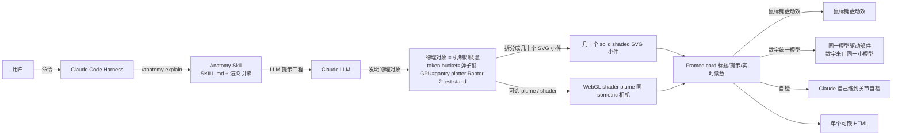

# wheresryan22/anatomy

## 一句话定位
Anatomy 是一个 Claude Code skill，把「技术概念」物化成「几十个 solid shaded SVG 小件 + 可选 WebGL shader plume + isometric 相机 + framed card」的工作对象——token bucket = 弹子锁，GPU context = gantry plotter 16 wells，Raptor 2 test stand firing Pc 300 bar 230 tf——所有数字来自同一模型驱动部件。

## 它解决的问题
2026 年 Claude Code 用户用 Markdown + Mermaid 静态图 + ASCII art 解释技术概念，但表达力受限：Mermaid 是预制图模板，ASCII art 不可交互，blog 上的代码片段是离散的。Anatomy 直击：**让 Claude 实时发明一个物理对象（机制即概念），用 SVG + 可选 WebGL shader 渲染 isometric 工作对象，加标题/提示/实时读数 framed card，鼠标键盘动效，自己缩到关节自检。** 解决的是「教学/技术博客/landing page 上 1 个非常交互的 isometric 工作对象」的表达力问题。

## 为什么值得关注（2026-10-12）
- **Stars:** 3077（截至 2026-10-12），4 天 3077⭐ ⑂234 fork/star 7.6%，**增长率** 7.6%（fork/star 反映社区参与）
- **Forks:** 234，社区参与度极高（skill 类项目天然适合 fork 定制）
- **Size:** 1737 KB（含示例 + assets + skill 文件）
- **License:** MIT
- **语言:** JavaScript（含 SVG + WebGL shader）
- **活跃度:** created 2026-10-08，pushed_at 2026-10-11，持续高活跃
- **依赖:** 0 依赖（只用 Node 内置模块），可直接 `npx skills add wheresryan22/anatomy -g -a claude-code` 安装

## 热度来源判断
anatomy 的热度是 **「Claude Code skill 生态爆发 × Anthropic Skills 协议成熟 × 教学表达力需求 × 0 依赖 + Node ≥20.10 + MIT × 演示示例丰富（Raptor 2 / token bucket / GPU context）」** 的组合。Claude Code 用户量极大（2026 年），技术博客作者、文档工程师、教学内容创作者急需可视化工具——Anatomy 把「Claude 实时发明物理对象」作为一等公民，自然爆火。234 fork 是 skill 类项目的网络效应（fork = 定制版本）。热度真实且具教学表达力场景的强需求。

## 关键技术亮点
1. **Claude 自动物化技术概念：** 「A cache key that skips work when nothing changed becomes a pin-tumbler lock that only turns when every pin matches. One GPU context serving many canvases becomes a gantry plotter whose single print head visits 16 wells.」
2. **几十个 solid shaded SVG 小件 + 可选 WebGL shader：** 「dozens of small, solid, shaded parts... WebGL shaders and 3D... the plume is a WebGL shader in the same isometric camera」（Raptor 2 plume）
3. **统一 isometric 相机 + framed card：** 「puts it in a framed card with a title, a hint and a live readout, makes it move calmly under the pointer and the keyboard」
4. **数字统一由一个模型驱动：** 「Every number the figure shows comes from the same small model that moves its parts」
5. **自己缩到关节自检：** 「checks its own work by zooming in on every joint」
6. **0 依赖 + Node 内置模块：** 「No API keys and nothing to npm install: the kit uses only Node's built-in modules」

## 架构师速览

| 决策问题 | 研究判断 | 证据边界 |
|---|---|---|
| 系统边界 | 一个 Claude Code skill（被加载到 Claude Code 的指令文件 + 配套渲染资产）；仓库本身不包含 web 服务，通过 npx skills add 安装到 ~/.claude/skills/anatomy/ 后由 Claude 调用，本质是一个文档 + 提示工程产物 + 渲染引擎 | 仅基于 README 「A Claude skill that explains an idea by building it as a real, working object」 + 「npx skills add wheresryan22/anatomy -g -a claude-code」 + 「No API keys and nothing to npm install: the kit uses only Node's built-in modules」 + size=1737KB 推断；具体 SKILL.md 指令格式、Anthropic Skills 协议兼容性未在档案明示 |
| 主路径 | 用户输入技术概念 → skill 引导 Claude 构思一个物理对象（机制即概念）→ 拆成几十个 solid shaded SVG 小件 → 同一 isometric 相机（可选 WebGL shader plume）→ framed card 标题/提示/实时读数 → 鼠标键盘动效 → 数字统一由一个模型驱动部件 → 输出单个可嵌 HTML | 主路径来自 README 「Ask Claude... Anatomy has it invent a physical thing whose working *is* the concept... dozens of small, solid, shaded parts... framed card with a title, a hint and a live readout... zoom in on every joint... number comes from the same small model that moves its parts」 |
| 关键权衡 | 教学表达力 vs 渲染复杂度 vs 「数字来自同一模型」的可维护性：每个概念都要重画一个全新物体对象，没有可复用模板（README 明示「Claude invents」是 LLM 实时生成），依赖 Claude 对 LLM 的指令质量而非预制模板 | 权衡来自 README 「Claude invents a physical thing... checks its own work by zooming in on every joint」；具体的 SKILL.md 提示工程、token 经济性未在档案中验证 |
| 最小 PoC | 在本地 Claude Code 安装（`npx skills add wheresryan22/anatomy -g -a claude-code`），执行 `/anatomy explain how a token bucket rate limiter works, interactive`，预期产出 1 个 HTML 单页（含 SVG + 可选 WebGL shader）；验证：是否真的用「弹子锁」物件可视化、是否数字与模型一致、是否 framerate 在 60fps | PoC 流程由 README Quick start 段落给出；产出质量、shaders 是否默认启用、是否需要 WebGL 能力 fallback 均未在档案中明确 |
| 证据边界 | 仅核验：仓库存在、stars/forks/description/license/size/language 来自 GitHub API；README 节录自 raw 接口；「数字来自同一模型」「自己缩到关节自检」由 README 直接叙述，未做单条规则测试 | 待核验：skill 安装目录结构、是否需要 Anthropic Skill 协议 register、token 成本、shaders 启用条件、跨浏览器兼容 |

## 架构启发
anatomy 的核心启发是 **「LLM 不仅能写文字，还能发明物理对象来解释概念——教学表达力是 LLM 应用的杀手场景」**。当前 Claude/GPT 解释技术概念主要靠 Markdown 段落 + Mermaid 静态图，表达力受限。anatomy 把「工作对象的视觉表达」作为一等公民——读数 + 动效 + 自检 + 0 依赖。这指向 **「Anthropic Skills 协议 + LLM 物化能力 = 技术博客/教学/landing page 杀手组合」** 的未来。

## 架构图（MMD）

> 证据边界：此图只采用本档案已有可核验描述；"待核验"节点不应视为项目实现事实。

## 定位判断
**Anthropic Skills 生态演示型项目（教学表达力 skill）。** anatomy 不仅是 Claude Code 的可视化工具，更展示了 Anthropic Skills 协议的潜力——LLM 实时发明物理对象作为「机制即概念」。3077⭐ + 234 fork/star 7.6% 已显示技能类需求。但能否持续取决于：（1）LLM 物化能力对其他概念（数据库、编译器、分布式系统）的覆盖度；（2）shaders 是否默认启用 + WebGL fallback 策略；（3）token 成本控制。定位是「Anthropic Skills 协议 + LLM 物化表达力」的头部样本，向「技术博客 / 教学 / landing page」通用教学表达力引擎演进是合理路径。

## 风险 / 局限 / 泡沫点
- **LLM 物化质量不稳定：** 依赖 Claude 实时发明物理对象，对 LLM 能力敏感；如果 LLM 在某些概念（数据库事务、编译器优化、分布式一致性）上无识别度，产出会很弱
- **token 成本未明：** 实时物化每个新概念消耗多少 token 未在档案明示
- **shaders 默认启用与 WebGL fallback 未明示：** 是否所有浏览器都支持、WebGL 不可用是否降级 SVG 均未在档案明示
- **Anthropic Skills 协议兼容性：** 是否需要 register、是否依赖特定 Claude Code 版本未在档案明示
- **跨概念覆盖度：** Raptor 2 / token bucket / GPU context 是 README 给的 examples，数据库索引、CAP、cache coherence、内存模型等概念物化效果未在档案中验证
- **个人项目属性：** wheresryan22 个人维护，可持续性存疑

## 与同类项目的关系
- **vs Mermaid:** Mermaid 是静态图模板（流程图、时序图），Anatomy 是 LLM 实时发明的工作对象；Mermaid 适合流程图，Anatomy 适合机制即概念
- **vs Manim:** Manim 是 Python 视频渲染（数学可视化），Anatomy 是 HTML + SVG + WebGL 实时交互；Manim 适合学术视频，Anatomy 适合技术博客 / landing page
- **vs anthropics/skills:** Anthropic 官方 Skills 仓库仅是模板集合；Anatomy 是用 Skills 协议做的杀手级应用
- **vs Claude artifacts:** artifacts 是 Claude 内置多模态输出；Anatomy 是用 Skills 协议做的可定制工作对象生成器
- **vs artcraft 全家桶:** ArtCraft 是 Rust 重实现 Adobe/Microsoft/Avid；Anatomy 是 LLM 物化技术概念

## 是否值得持续跟踪
**值得跟踪（Anthropic Skills 协议 + LLM 物化教学表达力）。** anatomy 代表了 LLM 应用从「文本生成」到「物理对象发明 + 可视化」的范式转变。无论其本身成败，这一方向是 Claude Code / Skills 生态的趋势。建议关注：（1）token 成本是否可控；（2）跨概念覆盖度（数据库、编译器、分布式）；（3）shaders / WebGL 兼容性；（4）Anthropic Skills 协议演进；（5）社区是否贡献更多 examples。对 Claude Code 用户，这个 skill 是把抽象概念物化的实用工具，值得直接采用。

## 后续观察点
- 是否演化为独立 npm 包 / 通用可视化引擎（不只是 Claude Code skill）
- 跨概念覆盖度（数据库 / 编译器 / 分布式 / 内存模型）
- token 成本控制（每个新概念消耗多少 token）
- shaders 默认启用条件 + WebGL fallback 策略
- Anthropic Skills 协议 register 与官方认证
- 社区贡献 examples 数量与质量
- wheresryan22 个人项目可持续性

---
> 数据来源: GitHub Repository API (2026-10-12) + README raw 接口 | Stars: 3077 | Forks: 234 | License: MIT | 语言: JavaScript | Size: 1737 KB | 创建: 2026-10-08 | 依赖: 0（仅 Node 内置模块）