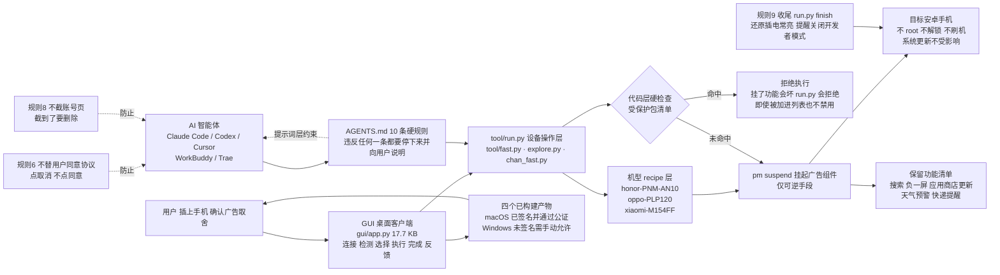

# rddmwmddr/android-ad-cleaner

## 一句话定位
关掉国产安卓手机里的广告、热搜、资讯推荐和营销推送——**不 root、不解锁、不刷机，系统更新不受影响**；**⭐⭐ 而它真正的资产是一份写给「能在用户电脑上执行命令的 AI 智能体」的 10 条硬规则，其中最后一条是「工具本身会拒绝」而不是「提示 agent 别做」**。

## 它解决的问题
两个问题，一个面向人，一个面向 agent：

1. **面向人**：国产安卓系统（ColorOS / HyperOS / MagicOS / OriginOS 等定制系统）的广告与推荐位散落在系统设置、各 App 自己的设置、以及某些只能靠 adb 挂起（`pm suspend`）的组件里。**手动关一遍要几十个开关，且容易误伤。**
2. **⭐⭐ 面向 agent**：一个能执行命令的 AI 智能体（Claude Code、Codex、Cursor、WorkBuddy 等）在帮用户关广告时，**它的失效模式与人类完全不同**——人类会犹豫，agent 不会。**agent 会一口气执行完 30 个命令、在错误的设备上执行、把用户的协议同意掉、顺手截一张含手机号的图。**

## 为什么值得关注（2026-10-25）
**⭐⭐ 因为它的 `AGENTS.md` 是本日报见过的唯一一份把「agent 替用户操作设备」的失效模式逐条写成硬规则的文件——而且其中三条处理的是本批其他项目都没碰过的问题。**

它的 `AGENTS.md` 开篇写明读者是「**能在用户电脑上执行命令的 AI 智能体（WorkBuddy、Claude Code、Codex、Trae、Cursor 等）**」，然后是 10 条硬规则，每条都标注「**违反任何一条都要停下来，向用户说明**」。逐条对照它的失效模式：

| # | 规则 | 对应的失效模式 |
|---|---|---|
| 1 | **每条 adb 命令都带 `-s <序列号>`**（「电脑上可能连着多台设备（电视、模拟器）」） | **设备选错** |
| 2 | **正常功能不能坏**（下拉搜索、负一屏卡片、应用商店的安装和更新、浏览器、天气预警、快递和更新通知要保留） | **过度执行** |
| 3 | **优先用 App 内的开关；动包只用 `pm suspend` 且要用户同意；不用 `pm uninstall`，不用 `pm disable-user`** | **使用不可逆操作** |
| 4 | **不碰系统更新；不 root，不解 BL，不刷模块，不改 system 分区** | **越过授权边界** |
| 5 | **改之前说清楚，改完能还原** | **静默变更** |
| 6 | ⭐ **不替用户同意协议**——遇到用户协议、隐私政策、权限申请，点「取消」「以后再说」「不允许」「禁止」，**不点「同意」「允许」** | **代替用户做决定** |
| 7 | **不绕过锁屏**（`run.py check` 显示锁屏时请用户解锁） | **绕过用户在场的前提** |
| 8 | ⭐ **不截账号页**——「我的」页、账号页、手机号页不截图；**截到了要删除** | **隐私外泄** |
| 9 | **收尾还原插电常亮、提醒关闭开发者模式**（跑 `run.py finish`） | **留下系统状态残留** |
| 10 | ⭐ **不挂 `com.heytap.quicksearchbox`（下拉搜索）、`com.coloros.assistantscreen`（负一屏）、各品牌应用商店**——**「挂了功能会坏，`run.py` 会拒绝」** | **破坏系统功能** |

**⭐⭐⭐ 而规则 10 是本批最值得学的一句：它不是靠提示词约束 agent 不做坏事，而是让工具本身在代码层拒绝做坏事。**

**⭐⭐ 这与 10-24 记录的 `xevrion/hatchzip`（「Anything that can be refused is refused before the archive is touched」）是同一条原则在设备操作领域的再现**——**本日报连续第二天观察到「拒绝优于补救」这条工程原则。**

**⭐ 而规则 1 与本日同期的 `xMazaki/unbloat-android-tv` 的 Identity lock 异曲同工**：两者都在解决「adb 默认连第一台设备」这个真实误操作风险，**只是一个用工具内部的序列号校验实现，一个用 agent 指令里的 `-s` 参数实现。**

## 热度来源判断
**热度来自「Android 去广告」这个持续多年的刚需 + 「不需要 root」这个关键减负 + 已构建的桌面客户端。**

**⭐ 它与其他 Android 去广告项目的关键差别是分发形态。** README 给出了**四个已构建产物**：Mac Apple 芯片 `.dmg`、Mac Intel `.dmg`、Windows 安装版 `.exe`、Windows 免安装版 `.zip`——**且 macOS 版「已签名、通过苹果公证，双击就能打开」**（Windows 版需点「更多信息 → 仍要运行」，**即 Windows 侧未签名**）。

**⭐ 它的 README 第一屏就是「插上手机，点几下按钮。不需要 Python，也不需要 AI 工具。」——**⭐ 这句话精准命中了本赛道的核心摩擦：**大多数 Android 去广告脚本要求用户装 Python、配 adb 环境。** 它把这件事做成了双击。

**推断（不构成事实）**：8.6% 的 fork 比例对应「fork 去改 per-机型 recipe」——**因为新增一款机型只需加一个 recipe 文件，这是本批 fork 成本最低的结构之一**（对照 xss-audit 的 25.8%：改一段 26 KB 的 Markdown；对照 raven 的 2.4%：接手 653 个 commit 的兼容层）。

**⚠️ 但热度与成熟度脱节：** subs 1、contributors API 返回 1 人、25 个 commit、oi 6。**且 oi 6 相对 140⭐ 是偏高的 open issue 比例**，**这可能意味着有用户遇到了它未处理的机型问题**（本窗口未逐条核验 issue 内容）。

## 关键技术亮点
1. **⭐⭐⭐ 工具层拒绝而非提示词约束。** 规则 10 明说「挂了功能会坏，**`run.py` 会拒绝**」——**即受保护包清单被实现为代码里的硬检查，而不是指望 agent 读懂提示词。**
2. **⭐⭐⭐ 「不替用户同意协议」是一条独立规则。** 它给了具体的可执行动作（点「取消」「以后再说」「不允许」「禁止」，**不点「同意」「允许」**），而不是「谨慎处理权限请求」。**⭐ 这直接处理了 agent 时代一个新型事故：agent 为了完成任务而代替用户做出了授权决定。**
3. **⭐⭐ 「不截账号页」是本批唯一一条针对数据外泄的规则。** 它不仅规定不截，还规定「**截到了要删除**」——**即它为已经发生的事故也留了补救路径**。
4. **⭐⭐ 只用可逆操作。** 规则 3 把手段限定为「优先用 App 内的开关；动包只用 `pm suspend` 且要用户同意；**不用 `pm uninstall`，不用 `pm disable-user`**」。**⭐ 这三条手段按「可逆性」排序，且明确排除了两个被大量同类脚本使用的命令。**
5. **⭐⭐ 设备序列绑定。** 规则 1 要求每条 adb 命令带 `-s <序列号>`，**这与 unbloat 的 Identity lock 是同一个风险的两种防御**。
6. **⭐⭐ 不 root、不解锁、不刷机，系统更新不受影响。** 这是它与需要解锁 bootloader 的方案的根本区别，**也是它能在「日常换机」场景里被采用的前提。**
7. **⭐⭐ per-机型 recipe 结构。** `recipes/honor-PNM-AN10/recipe.py`（8,659 字节）、`recipes/oppo-PLP120/recipe.py`（5,705）、`recipes/xiaomi-M154FF/recipe.py`（4,061）——**机型差异被隔离在 recipe 里，而不是散落在主流程的 if 分支中。** **⭐ 这也直接解释了它的 fork 比例来源：新增一款机型 = 新增一个文件。**
8. **⭐⭐ 四平台已构建产物，macOS 侧已签名并通过苹果公证。** 「**已签名、通过苹果公证，双击就能打开**」——**在 macOS 上「双击就能打开」是分发质量的硬指标**（未公证的 app 会被 Gatekeeper 拦）。
9. **⭐ 端到端的 GUI 流程与诊断反馈闭环。** 连接 → 检测（型号、系统版本、机型脚本、快应用、广告组件）→ 选择（**营销通知按渠道勾选，服务类默认不勾**）→ 执行（进度条 + 实时日志）→ 完成（每一步的结果 + 提醒关闭开发者模式）→ 反馈（**自动附诊断信息，一键提交 GitHub Issue**）。
10. **⭐ 保留功能清单明确。** 搜索、负一屏卡片、应用商店的安装和更新、天气预警、快递提醒——**「这些功能保留」被写进 README 首屏。**
11. **⭐ 多宿主 agent 的指针文件。** `CLAUDE.md`（91 字节）、`CODEBUDDY.md`（94 字节）、`AGENTS.md`（7,687 字节）并存——**说明它明确面向多个 agent 宿主，而不只是某一个。**

## 架构师速览

| 决策问题 | 研究判断 | 证据边界 |
|---|---|---|
| 系统边界 | 五个可分离的部分：① **GUI 桌面客户端**（`gui/app.py` 17,696 字节 + `gui/shots.py` 3,550 + `gui/standalone.py` 1,183 + `gui/version.py` 240 + `gui/smoke_test.py` 854）② **设备操作层**（`tool/run.py` 18,141 + `tool/fast.py` 19,649 + `tool/explore.py` 4,779 + `tool/chan_fast.py` 4,846）③ **机型 recipe 层**（`recipes/{honor-PNM-AN10,oppo-PLP120,xiaomi-M154FF}/recipe.py`）④ **规则层**（`AGENTS.md` 10 条 + `CLAUDE.md`/`CODEBUDDY.md` 指针 + `docs/00-`~`08-` 中文文档）⑤ **分发层**（4 个已构建产物 + `.github/workflows/build-windows.yml` 2,430 字节）。**边界划在「只操作 App 与包状态，不碰用户数据与系统分区」**——规则 3 禁用卸载与 disable-user，规则 4 禁用 root/解锁/刷模块/改 system | `git/trees/HEAD?recursive=1` 的目录清单与文件体积、README 的五步流程与保留功能清单、`AGENTS.md` 的 10 条与 §3 标准流程；**⚠️ `tool/run.py` 的 `pm suspend` 路径与「拒绝挂载受保护包」的实际实现本窗口未逐行取，待核验** |
| 主路径 | **人类路径**：桌面客户端插线自动识别手机 → 「检测」读型号/系统版本/机型脚本/快应用/广告组件 → 「选择」按渠道勾选营销通知（**服务类默认不勾**）→ 「执行」带进度条与实时日志 → 「完成」逐步结果 + 提醒关闭开发者模式 → 「反馈」自动附诊断信息一键提 Issue。**⭐ Agent 路径**：由 `AGENTS.md` 规定起步为 `python3 tool/run.py devices`（**列表为空 → 引导检查数据线与 USB 调试；状态 `unauthorized` → 引导用户在弹窗勾「始终允许」并点「允许」；有多台设备 → 问用户处理哪一台**），再按 §3 的 11 步标准流程执行 | README 的五步 GUI 流程与「处理哪些东西」表、`AGENTS.md` §2 环境准备与 §3 标准流程；**⭐ 电视端/手机端 adb 协议细节（是否走网络 adb、如何处理授权弹窗）本窗口未取** |
| 关键权衡 | **⭐ 禁用 vs 卸载**（选 `pm suspend`，因为它可恢复）· **⭐ 用户选择 vs 受保护清单**（**清单优先——即使 agent 把 Play Store 加进列表也会被拒绝**）· **⭐ 提示词约束 vs 工具层拒绝**（⭐ 两者都做：AGENTS.md 告诉 agent 规则，`run.py` 保证规则）· **GUI vs 脚本**（GUI 面向普通用户，脚本面向 agent 与高级用户，**双轨**）· **per-机型 recipe vs 通用检测**（recipe 更准但需要每款机型维护一份）· **系统更新保持启用 vs 更新后重新精简**（选前者——安全优先于省事）· **自动附诊断信息 vs 隐私**（诊断信息一键提 Issue，**但这要求用户知情**）· **不 root vs 更彻底**（不 root 换来了「换手机不用重做」与「不会变砖」） | README 的五步流程与四类处理对象表、`AGENTS.md` 的 10 条与「违反任何一条都要停下来」的开篇、`tool/` 与 `recipes/` 的文件构成；**未明示：诊断信息里包含什么、是否包含设备标识** |
| 最小 PoC | 1. **⭐ 先有一台可被牺牲的测试手机**（且是 Honor/OPPO/Xiaomi 三家之一，否则 recipe 不覆盖）→ 2. 装桌面客户端（macOS 双击即可；Windows 需点「更多信息 → 仍要运行」）→ 3. 连接并「检测」，**确认它正确读出了型号、系统版本与机型脚本**（**这一步是 recipe 是否生效的第一个信号**）→ 4. 「选择」时**确认「服务类默认不勾」真的生效**（这是「不误伤」的关键）→ 5. 「执行」并**在实时日志里逐条确认用的是 `pm suspend` 而非 `pm uninstall` / `pm disable-user`** → 6. **⭐⭐ 验证「保留功能清单」真的保留了**：下拉搜索、负一屏卡片、应用商店的安装和更新、天气预警、快递提醒**逐项确认可用** → 7. **⭐⭐ 让一个 AI 智能体按 `AGENTS.md` 在真机上执行一遍，重点看三件事——(a) 遇到协议弹窗时是否按规则 6 点了「取消」而不是「同意」；(b) 是否按规则 8 没有截「我的」/账号页；(c) 是否按规则 3 没有用 `pm uninstall` 或 `pm disable-user`** → 8. **⭐ 故意把一个受保护包加进「要关的」列表，确认 `run.py` 真的拒绝了**（**这一步是本 PoC 唯一能证伪其核心主张的步骤——一个只会提示、不会拒绝的工具不构成证据**）→ 9. 跑 `run.py finish`，确认插电常亮被还原并收到关闭开发者模式的提醒 | **第 7 步与第 8 步是本 PoC 的核心**（提示词不构成证据，行为才构成）· **第 6 步验证的是「不误伤」这条主张** · **第 1 步是硬前提（机型不在 recipe 覆盖内则整个 PoC 不成立）** · 本 PoC **不覆盖** Windows 未签名侧与未在 recipe 内的机型 |
| 最小 PoC（判定简化版） | **⭐ 若只能做一件事**：让一个 AI 智能体按 AGENTS.md 在真机上执行一遍，然后只检查三件事——**(a) 它有没有在协议弹窗点「同意」；(b) 它有没有截账号页；(c) 它有没有用 `pm uninstall` 或 `pm disable-user`。** 这三件事任何一件出错，都说明「写给 agent 的硬规则」不够——**需要把规则下沉到工具里** | **这是本 PoC 与上一条 PoC 的区别：上一条验证工具，这一条验证规则** · 三件事都是二值判定，无需解释 |

## 架构启发
**⭐⭐ 最值得迁移的是它对「提示词约束」与「工具层约束」的分层判断——它两个都做了，而且知道哪个是哪个。**

`AGENTS.md` 的 10 条是**提示词层**的约束：它们告诉 agent「不要做什么」「遇到 X 就停下来」「报告里要写什么」。**这类约束的特点是：可读、可教、但不可保证执行。**

而规则 10 背后那句「**`run.py` 会拒绝**」是**工具层**的约束：它不指望 agent 记住，而是让代码在那一刻直接失败。**⭐ 这两层的区别是本日报连续记录的「把边界写进可核验的位置」这条主线在 agent 时代的具体形态——前者是文档，后者是可执行断言。**

**⭐⭐ 而规则 6 与规则 8 揭示了两个此前很少被写进 agent 规范的问题类别：**

- **规则 6 属于「代理决策」类**：agent 代替用户点「同意」——这在人类操作里几乎不存在（人类点同意时知道自己在同意什么），但在 agent 里非常容易发生，**因为 agent 的目标函数是「完成任务」**。
- **规则 8 属于「副产物外泄」类**：agent 为了汇报进展而截图，而截图会把账号页、手机号页一起带走。**⭐ 这条规则的补救设计（「截到了要删除」）尤其好——它承认事故会发生，并给出清理动作。**

**⭐⭐ 第三点关于 fork 比例，它与 unbloat 和 xss-audit 一起给出了本日最完整的一条校准：**

| 项目 | fork/star | fork 之后要做什么 | 单位成本 |
|---|---:|---|---|
| `songjianyang/xss-audit` | 25.8% | 改写 14 层清单 | 改一段 26 KB 的 Markdown |
| `rddmwmddr/android-ad-cleaner` | 8.6% | 新增一款机型的 recipe | **加一个文件** |
| `xMazaki/unbloat-android-tv` | 8.0% | 改机型清单与受保护应用表 | 改一份清单 |
| `mirkobrombin/raven` | 2.4% | 加一个新 Win32 API 域 | **接手 653 个 commit** |

**⭐⭐ 结论：fork 比例在跨项目比较时几乎无意义，只有在「改造单位成本」相近的项目之间才有意义。** 本日报连续五日观察到的「可改造型 vs 不可改造型」分界线，到本日推进成了「**改造单位成本的连续谱**」。

## 架构图（MMD）

> 证据边界：此图只采用本档案已有可核验描述；标注「待核验」的节点不应视为项目实现事实。

## 定位判断
**「面向国产安卓的免 root 去广告工具 + 一份面向 agent 的操作规范」——它在本批里的定位是唯一一份把 agent 安全规范当成一等公民的产品。**

**⭐ 而它与同赛道项目（`Gathin23/cleanyourtv` 31,537⭐、`pengchujin/aerial-tv` 4,352⭐、`humblemuzzu/dumbtv` 1,472⭐ 等）真正的差别不是功能，而是两点：**

1. **⭐ 分发形态：已构建、已签名、免安装的双击客户端。** 赛道里的多数项目是「clone + 跑脚本 + 自己装 adb」，而它把这件事做成了产品。
2. **⭐⭐ 规则层：`AGENTS.md` 与 `CLAUDE.md`/`CODEBUDDY.md` 并存，且 10 条规则全部对应一种具体失效模式。** **⭐ 在 2026 年，一个要替用户操作设备的应用，把「AI 智能体该怎么操作」写成规范文件，本身就是一种产品定位的转变——它不再假设用户是唯一的操作者。**

**⭐ 这条定位判断的可检验推论是：如果 agent 操作设备成为主流，那么「把规则写进文档」会变成「把规则写进代码」，而今天已经做后者的人会占据默认入口。**

## 风险 / 局限 / 泡沫点
- **⚠️ 单作者**（contributors API 返回 1 人）、**subs 1**、25 个 commit、**oi 6（相对 140⭐ 偏高）**——**可能意味着有用户遇到了未处理的机型问题（本窗口未逐条核验 issue 内容）**。
- **⚠️ Windows 侧未签名**（需点「更多信息 → 仍要运行」）——**在企业环境这是实际部署障碍**；macOS 侧已签名并通过公证，情况相反。
- **⚠️ 机型覆盖有限。** recipe 只有 Honor / OPPO / Xiaomi 三家，**且每家的清单只覆盖当时的主流版本**——**新的系统版本发布后，广告组件位置会变，而项目没有版本化机制记录适配了哪个版本。**
- **⚠️ 精简本身会改变设备行为。** 关掉遥测与推荐可能影响厂商功能；**关掉系统更新相关的任何东西都不在其范围内（规则 4 明确禁止），但系统更新本身也可能重新启用某些组件**（这一点在 unbloat 的 README 里被明确写出，而本项目未核验）。
- **⚠️ `AGENTS.md` 的规则依赖 agent 遵守。** **⭐ 规则 1–9 全部是提示词层**——**只有规则 10 有代码层保证**。**因此「10 条硬规则」这个标题在严格意义上是 1 条硬规则 + 9 条软规则**，README 与 AGENTS.md 的措辞没有做出这个区分。
- **⚠️ `tool/run.py` 的 `pm suspend` 路径与「拒绝挂载受保护包」的实际实现本窗口未逐行核验**——**即它的核心安全主张目前只有 AGENTS.md 的一句转述作为证据。**
- **⚠️ 「自动附诊断信息，一键提交 GitHub Issue」** 意味着诊断数据会离开本机，**而 README 未说明诊断信息里包含什么**（是否含设备标识、账号信息）。
- **⚠️ `pm suspend` 的副作用**：**被挂起的 App 可能影响后台推送、账号登录态与通知**——这与规则 2「快递和更新通知要保留」之间存在张力，**其判定边界本窗口未核验**。

## 与同类项目的关系
- **⭐ vs `xMazaki/unbloat-android-tv`（本日同期）：同一纪律线的两端。** unbloat 管**电视**、用**设备身份锁 + 受保护应用清单 + 单一桌面禁用边界**；它管**手机**、用**10 条 agent 硬规则 + 工具层拒绝 + 不代用户点同意**。**⭐ 共同结构：把「不可逆的操作」从执行方的可达范围里拿走，而不是靠提示词请求执行方克制。** ⭐ **差异也值得记：unbloat 的安全机制全部在工具内（身份锁、白名单），而本项目的安全机制大部分在文档里（只有受保护包清单在代码内）——这直接决定了两者的实际防护强度。**
- **vs `Gathin23/cleanyourtv`（31,537⭐ ⑂3,662）：赛道头部，形态是 adb 脚本集合而非 GUI 产品。** **⭐ 差别在门槛：一个要用户配环境，一个给已构建的双击应用。**
- **vs `pengchujin/aerial-tv`（4,352⭐）：做 Apple TV 风格 Android TV 桌面**——**与 unbloat 的 Zen Home 属于同一诉求的不同实现**（本项目不做桌面，只做精简）。
- **vs `humblemuzzu/dumbtv` / `Ansub/tv-detox` / `nthnclrk/CleanFrame` / `simbasjungles/free-my-tv`：同一赛道。** 本项目**是其中唯一把「给 agent 的操作规范」写成一等文件的项目**。
- **vs `songjianyang/xss-audit`（本日同期）：两者合起来才是一份完整的 agent 规程。** xss-audit 是**检查表**（14 层该查什么、怎么判、报告写什么），本项目是**禁令表**（10 条不该做什么、遇到什么要停、什么不能碰）。**⭐ 检查表回答「要找什么」，禁令表回答「不能做什么」——这两者缺一不可，而本日报本日第一次在同一批项目里同时看到了两者。**

## 是否值得持续跟踪
**值得，且在本日「可立即采用」类别中的优先级最高——它有已构建产物、macOS 侧免安装、且核心机制写得比多数同类清楚。**

**⭐ 但它的采用门槛是机型**：**没有一台 Honor / OPPO / Xiaomi 的手机，它的 recipe 就没有用武之地。** 因此跟踪方式应是「recipe 覆盖的机型数是否增长」，而不是 star 数。

**⭐ 而作为方法论样本，它的价值更高**：**它是本日报第一个把「agent 会替用户做决定」和「agent 会顺手泄露数据」这两类事故写进操作规范的项目**——**这两类事故在人类操作里几乎不存在，是 agent 时代新增的，而目前几乎没有项目在防它们。**

## 后续观察点
1. **⭐⭐ recipe 覆盖的机型数是否增长**（目前 3 家；这是它从「个人工具」走向「可用产品」的唯一指标）
2. **⭐⭐ `run.py` 的拒绝逻辑是否被扩展**（目前只有受保护包清单在代码层；⭐ 若规则 3（不用 uninstall / disable-user）与规则 4（不碰 system 分区）也被下沉为代码检查，它的「10 条硬规则」才名副其实）
3. **⭐ 是否出现其他 agent 宿主的指针文件**（现在有 `AGENTS.md` / `CLAUDE.md` / `CODEBUDDY.md`，**说明它明确面向多宿主**）
4. **是否发布签名与公证覆盖的 Windows 版本**（当前 Windows 侧未签名，是企业落地的实际障碍）
5. **「自动附诊断信息」的诊断内容边界**（是否含设备标识、账号信息，以及用户是否知情）
6. **⭐ `pm suspend` 与「保留快递/更新通知」之间的判定边界**（规则 2 与手段 3 之间的张力如何解决）
7. **oi 6 的 issue 内容**（是机型不支持、功能 bug 还是文档问题——本窗口未逐条核验）
8. **是否引入版本化机制**（记录适配了哪个系统版本——**这在国产系统快速迭代的前提下是必需的**）

## 最近动态（2026-10-26）

**2026-10-26：** ⭐⭐⭐ **140 → 726（+418%）**，⑂ 12 → **54**，subs 1 → **5**，**oi 6 → 22**，`pushed_at` 2026-10-25T16:46:03Z（**距快照约 6 小时**），体积 4,043 → **4,310 KB**。⭐⭐⭐ **而本日报本日最硬的采用信号不是 star，是那 22 个 issue**——已核验的 5 条全部是**具体的中文用户故障描述**：`#35 无法打开exe主程序` / `#34 [问题] 跳出弹窗就会卡住` / `#33 [问题] 如果是第一次进入app会卡住` / `#32 feat: 新增小米/Redmi/POCO 专属优化与遥测管理模块 (miui-opt)` / `#31 [问题] 操控手机时操控不对`。⭐⭐⭐ **`#32` 是一条功能请求（miui-opt 模块），即已有人在实际使用中提出增量需求——这是本日报本日所有跟踪项中最强的采用证据**（提 issue 的人必须先跑起来）。⭐ 账号 `rddmwmddr` 创建于 2013-07-30（13 年历史）、2 个公开仓库、29 followers，仓库 25 commits 与 4 个已构建分发产物——**⭐ 与本日同期出现的 17 个「2 文件 / 2–3 KB」同构农场仓库形成最强对比。**

**⭐⭐ 而本日报同时记录了它的反面读法：+418% 的 star 中有多少来自真实用户，本日报无法核验**（`stargazers` 端点对该 token 返回 404，逐日星标时间分布不可得）。**⭐⭐ 因此本档案的立场是：`oi 6 → 22` 与 `pushed_at` 距快照 6 小时这两个信号是可信的，而 star 的绝对量与增量都不是。**

---
> 数据来源: GitHub API (2026-10-25) | Stars: 140 | Forks: 11 | Subscribers: 1 | Open Issues: 6 | License: MIT | 语言: Python | 创建: 2026-10-24T05:35:47Z | 25 commits | contributors 1 人 | 仓库 4,043 KB | releases: v0.1.0 (2026-10-24T07:27:54Z, 1 asset) / v0.2.0 (2026-10-24T07:52:08Z, 4 assets)
> 附：topics 8（adb / ai-agent / android / coloros / debloat / hyperos / magicos / originos）；`AGENTS.md` 7,687 字节；`CLAUDE.md` 91 字节；`CODEBUDDY.md` 94 字节
