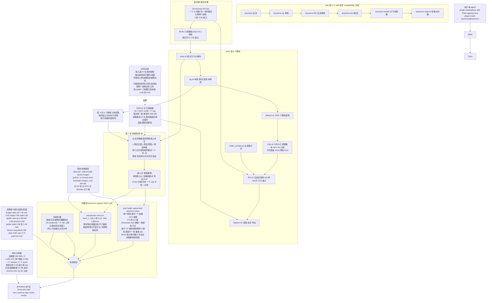

# patch-gg/anymove

## 一句话定位

用「一个 AI 视频 + 一帧里的正/侧双摄像头 + 一个 DINOv2 关节读取器」把动作捕捉做成任何有骨骼的生物（含翅膀、尾巴、八条腿）的 8 步流水线，输出 GLB —— **⭐ 而它最有价值的不是流水线本身，而是把「这次采集好不好」写成了两个可读的数字。**

## 它解决的问题

**它要解决的是「给非人形生物做动作捕捉需要专业动捕设备与专业操作员」这个问题。**

传统的游戏/影视动作捕捉流程是：穿紧身动捕服 → 在布满红外/光学标记的场地里表演 → 数十台相机做三角测量 → 艺术家在 MotionBuilder 里清理数据 → 导出骨骼动画。**⭐⭐ 这一整套流程的成本与场地要求，使得「给一只螃蟹或一只龙做一段动画」在经济上不成立。**

Anymove 的替代路径是：**⭐⭐ 不拍真人，而拍 AI 生成的视频；不建骨架，而用一个训练出来的关节读取器直接读出关节位置。**

- 素材层：flux 3 生成带纹理的网格 + tripo h3.1 重建，**$0.40**
- 拍摄层：一个 AI 视频，**同一帧内**取正/侧两个视角，**5 秒 $0.26**
- 读取层：DINOv2 关节读取器，**50 个关节 · 10 秒一个 clip**
- 输出层：拟合骨骼 → GLB，**24 fps · 一个 clip 不到一分钟**

## 为什么值得关注（2026-10-28）

**⭐⭐⭐ 因为它是本日唯一一个「把验收标准写成数字」的项目 —— 而这个做法比它的技术本身更值得抄。**

四个可核验的硬事实：

1. **⭐⭐⭐⭐⭐ `skills/anymove-capture/SKILL.md` 的 "Is it good? Read the solve output" 一节给出了真实输出样例**

   ```
   paw height agreement between views: {'fpaw_L': 1.0, 'fpaw_R': 1.0, 'hpaw_L': 0.78, 'hpaw_R': None, 'score': 0.93}
   sync as generated: mean height gap 4.4 px, worst 8.6 px, best constant lag 0 frames
   reprojection error px: {'front': 5.92, 'front_x_only': 2.55, 'side': 7.99}
   ```

2. **⭐⭐⭐⭐⭐⭐ 判据、含义与处置动作三者被连在一起写死**

   | 指标 | 判据 | 含义与动作 |
   |---|---|---|
   | **paw agreement score** | **≥ 0.8** | 两个视角讲同一个故事 → 保留；**0.5–0.8**：看 `showcase.mp4`，**通常有一条肢体不对**；**< 0.5**：视频模型把两个视角演得不一样了 → **重摇这个 clip**（回到 `anymove-film`）；**`None`** 表示那只脚几乎没动（吼叫时踩住的前脚）→ 改看重投影误差 |
   | **reprojection error** | front_x_only **1–3 px**、side **2–8 px** | 拟合后的骨架关节落点与读数之间的距离；**⭐ 明写「按生物在画面中的尺寸缩放」** |

3. **⭐⭐⭐⭐⭐⭐⭐ 它把「没赢的地方」直接留在结果表里**

   > Results so far: dragon take-off 1.00, roar 0.93, swipe 0.85, walk 0.81; **spider rear-up 0.99, bite 0.96, pounce 0.89, walk 0.36-0.49 (fails)**; demon wing beat 0.99, slam 0.84, roar 0.73 with feet planted and 3 px reprojection; wolf trot 0.94 with H3 Max.

   **⭐⭐⭐⭐⭐⭐⭐⭐⭐⭐ 「spider walk 0.36–0.49（fails）」被明确标为失败并留在表里 —— 这与本日报连续记录的「连没赢的地方都写」是同一条原则。**

4. **⭐⭐⭐⭐⭐⭐⭐⭐⭐⭐⭐⭐ 它把「我的自动修复工具会帮倒忙」写进了使用说明**

   > Legs crossed or a limb flipped side to side in the side view: the painted colours make labels reliable, so swap fixing is off. `python -m mocap.solve ... --fix-swaps` swaps near/far legs where heights say the reader mixed them up; **it "fixed" correct labels on one clip, so only use it after looking.**

   **⭐⭐⭐⭐⭐⭐⭐ 一个工具作者写下「我的自动修复在某个 clip 上把本来正确的标签也改错了，请先人眼确认」。** **⭐⭐⭐ 这与本日报 10-26 记录的 brotli-checker「exit 0 does not establish that the running app is fixed」是同族：把工具自己会出错的地方写进工具的使用说明，而不是留给使用者踩。**

**⭐⭐⭐⭐⭐⭐ 而它的第 7 步几何也值得单独一记 —— 因为它是一个刻意选择的最省设计：**

> **x from the front, y from the side, z from both**

**⭐⭐⭐⭐⭐⭐⭐ 两个正交视角恰好确定一个 3D 点（x 由正面给、y 由侧面给、z 由交点给出），在数学上是最省的多视图几何，而多视角是冗余的。** **⭐⭐⭐⭐⭐⭐⭐ 而这个选择的代价也很明确：没有冗余可用于剔除离群点，因此第 8 步必须「忽略离群点」靠鲁棒损失处理 —— 这与 spider 走路的 0.36–0.49 失败率一致。**

## 热度来源判断

**⭐⭐⭐ 热度主要来自「AI 生成内容 + 动捕」这个话题的可见度，而采用信号尚未形成。**

- **⭐⭐⭐⭐ 可核验的采用信号几乎为零**：`subs` **1**、`oi` **0**、contributors **1 人**、**仅 4 个 commit**、topics 8 个（含 `agent-skills`、`claude-code-plugin`、`generative-ai`、`motion-capture`）。
- **⭐⭐⭐⭐⭐ 而它的形态是一个完整的「产品」而非脚本**：`skills/` 下 6 个 skill、`.claude-plugin/` 目录 + README 给出 `/plugin marketplace add Patch-gg/anymove` 与 `/plugin install anymove@anymove`、`tools/` 下 8 个 shell 脚本、`mocap/` Python 包、`assets/` 四只示例生物、**1 个 release 带 17 个 asset**。**⭐⭐⭐⭐⭐ 即：star 是它唯一的可见指标，而产物形态远超 star。**
- **⭐⭐⭐⭐⭐ 归属声明完整而诚实**（这是本档案认为它值得信任的一个信号）：

  > The method is [@CanItCode]'s; the MiniMax H3 LoRA step is [@Graalitoo]'s idea. This repo is our working version of both, with the agent skills to run it.

- **⭐⭐⭐ 账号背景可核验**：`patch-gg` 是 Organization，创建于 **2026-10-05**（**本日报今日最新的组织**），4 个公开仓库、5 followers。
- **⭐⭐⭐⭐⭐ 而 170⭐ 在 14.3 小时里的来源无法核验**（`stargazers` 端点 404）。**⭐⭐ 唯一可核验的结构信号是 fork/star 9.4% —— 比 nyxis（3.7%）与 CFSG（10.9%）都低一档，与「它是一个需要付费与 GPU 才能跑通的项目」这一定位一致。**

## 关键技术亮点

1. **⭐⭐⭐⭐⭐ 双视角几何消歧 —— 用「同一关节在两视角中高度相同」来消解左右混淆**

   第 3 步给 **6 个肢体 6 种颜色**，**目的是让左右永不混淆**；第 7 步用正交两面墙求交。**⭐⭐⭐⭐⭐⭐ 而这两个设计是配套的：颜色消解标签侧别，���何消解深度。** 只有一个的方案在非人形生物上都会失败。

2. **⭐⭐⭐⭐⭐ DINOv2 关节读取器：2,200 个随机姿势 · 单 GPU 20 分钟 · 平均误差从 40 px 降到 6 px**

   **⭐⭐⭐⭐⭐ 即它用「随机姿态的合成数据」训练一个通用关节读取器 —— 这正是「生成素材 → 训练模型 → 读回结构」这条闭环能成立的原因：训练数据可以无限生成。**

3. **⭐⭐⭐⭐ 8 步流水线每一���都给出了可核验的量**

   | 步 | 内容 | 可核验的量 |
   |---|---|---|
   | 1 | 一张图 → 带纹理的网格 | **真实尺寸**；flux 3 图像 + tripo h3.1 网格，**$0.40** |
   | 2 | 骨架 | **42 根骨**：腿、翅膀、尾巴；Blender |
   | 3 | 肢体配色 | **6 个肢体 6 种颜色** —— 目的是让左右永不混淆 |
   | 4 | 双摄像头 | 一个正、一个侧，**同一帧内**；minimax h3 max on fal，**5 秒 $0.26** |
   | 5 | 训练关节读取器 | **DINOv2 · 2,200 个随机姿势 · 单 GPU 20 分钟**；**平均误差从 40 px 降到 6 px** |
   | 6 | 读取每个关节 | **50 个关节 · 10 秒一个 clip** |
   | 7 | 两视角转 3D | 立在互相垂直的两面墙上求交；**x 取自正面、y 取自侧面、z 取自两者** |
   | 8 | 骨架跟随 | 骨落到点上、忽略离群点、导出 GLB；**24 fps · 无需手改 · 一个 clip 不到一分钟** |

4. **⭐⭐⭐⭐⭐ 有一条零 GPU 零下载的 CPU 快路径**

   `MOCAP_CREATURE=assets/dragon python -m mocap.solve examples/dragon_roar/det.npz assets/dragon/rigged/rig_info.json runs/dragon/clips/roar/motion.json`

   **⭐⭐⭐⭐⭐ 约 20 秒，并打印两视角的一致程度。** **⭐⭐⭐⭐⭐⭐ 这是本档案认为它最值得称道的一处工程设计：它把「能不能先看看效果」与「要不要花 GPU 和钱」解耦了。**

5. **⭐⭐⭐⭐ 每个 skill 带自己的 `compatibility` 字段**

   写明 GPU 显存、Blender 版本、Python 版本与前置产物。**⭐⭐⭐⭐ 即「agent 读到的第一条信息就是「我能不能跑这个」」，而不是让它跑到一半才发现环境不对。**

6. **⭐⭐⭐ 归属与许可完整**：Apache-2.0；方法归属明确写给 [@CanItCode] 与 [@Graalitoo]；README 明写「This repo is our working version of both, with the agent skills to run it.」

## 架构师速览

| 决策问题 | 研究判断 | 证据边界 |
|---|---|---|
| 系统边界 | **五层**：① **素材层**（fal 上的 AI 视频 + flux 3 图像 + tripo h3.1 网格，**全部按次付费**）② **准备层**（`tools/prep.sh` 真实尺寸与朝向、`tools/rig.sh` 骨架与蒙皮与配色与参考帧）③ **数据与训练层**（`tools/dataset.sh` 2,200 个随机姿势 + `tools/train.sh` DINOv2 关节读取器）④ **采集层**（`tools/film.sh` 生成双视角 clip + `tools/capture.sh` 读取 + 拟合 + 导出）⑤ **判据层**（`skills/anymove-capture/SKILL.md` 的 paw agreement 与重投影误差两个数 + showcase 渲染）。**⭐⭐ 边界划在「三维几何的唯一性由两个正交视角提供」** —— 即一个关节靠「两视角同高」消歧，而**没有冗余视角可交叉验证**。**⭐⭐⭐⭐⭐ 而这个边界直接解释了 spider 八条腿的 0.36–0.49 失败率。** | README 八步表与「quick start」「your own creature」「agent skills」三节、`skills/anymove-capture/SKILL.md` 全文（frontmatter 的 `compatibility` + "What happens" + "Is it good?" + "When a fit is wrong" 四节）、`releases` 的 17 个 asset 名与体积（`reader-*.pt` 各约 **355 MB**、`dragon.glb` 13,256,908 字节、`lora-wolf-twocam-h3.safetensors` 131,229,792 字节、`clip-*.mp4` 3.4–4.8 MB）、`docs/PIPELINE.md` 存在。**⭐ 未核验：anymove 的 `mocap/solve.py` 实现与其关节限位处理、`docs/PIPELINE.md` 内容** |
| 主路径 | `git clone` → 建 venv（`torch==2.11.0` cu128 + `requirements.txt`）→ `tools/fetch_examples.sh dragon --readers --clips`（从 release 拉 13 MB 网格 + 355 MB 读取器 + 4 MB clip）→ `tools/prep.sh` / `tools/rig.sh` / `tools/capture.sh` → 得到 `runs/dragon/clips/roar/render/animation.glb` + `showcase.mp4`；**⭐ 有一条不需要 GPU / Blender / 下载的 CPU 快路径**（约 20 秒）；新动作则 `tools/make_prompt.py` → `tools/film.sh`（**两 clip 约 $0.52**）→ `tools/capture.sh`。**⭐⭐ 作为 agent plugin 的入口是 `/plugin marketplace add Patch-gg/anymove` → `/plugin install anymove@anymove`。** | README 的 `quick start` 与 `your own creature` 两节的命令序列、release asset 清单与体积、CPU 快路径命令原文、README 的 agent skills 节。**⭐ 未核验：CPU 快路径的实际输出与耗时** |
| 关键权衡 | **⭐⭐ 双视角 vs 多视角**（只用两个正交视角：**数学上恰好确定一个 3D 点**，最省；但**没有冗余可用于剔除离群点**，因此第 8 步必须「忽略离群点」）· **⭐⭐ 生成素材 vs 真实素材**（用 AI 生成的画面训练读取器，**成本与可得性极低（$0.26/clip）但引入「模型读模型」的闭环误差**，只能用几何约束消歧）· **⭐⭐ 自动修复 vs 人工确认**（`--fix-swaps` 明写「在一个 clip 上改错了正确标签，所以只在看过之后用」）· **⭐⭐⭐ 报最好成绩 vs 报失败率**（**spider walk 0.36–0.49 (fails) 被留在结果表里**）· **⭐⭐ 打包分发 vs 按需下载**（读取器 355 MB × 3、网格 13 MB、LoRA 131 MB —— **用一个 release 装 17 个 asset，下载量对用户是真实负担**）· **⭐⭐⭐ 绝对阈值 vs 按尺寸缩放**（重投影误差判据明写「按生物在画面中的尺寸缩放」—— **⭐⭐ 即阈值不是常数，这使同一套判据能跨物种复用**） | 两份 README 与 SKILL.md 原文、release asset 清单与体积、issue 列表（oi 0）。**⭐ 未明示：paw agreement 的具体计算方式（相关系数？高度差？）、「平均误差从 40 px 降到 6 px」在什么数据上测得、以及是否有跨物种的判据标定集** |
| 最小 PoC | 1. **⭐⭐⭐ anymove：先跑 CPU 快路径**（`MOCAP_CREATURE=assets/dragon python -m mocap.solve examples/dragon_roar/det.npz assets/dragon/rigged/rig_info.json runs/dragon/clips/roar/motion.json`）—— **⭐ 这一步不需要 GPU、不需要 Blender、不需要任何付费调用，约 20 秒就能看到它的判据输出**（paw agreement 与重投影误差）→ 2. **⭐⭐⭐ 读它的输出并对照 SKILL.md 的判据表**：分数 ≥0.8？重投影误差在 1–3 px / 2–8 px？→ 3. **⭐⭐ 读 README 八步表，核对每一步给出的量是否可信**（尤其第 5 步「平均误差从 40 px 降到 6 px」与第 7 步的 x/y/z 来源）→ 4. **⭐ 读 `skills/anymove-capture/SKILL.md` 的 "When a fit is wrong" 一节，判断它的失败处置是否可执行** → 5. **⭐⭐ 读结果表里的失败项（spider walk 0.36–0.49），判断它是否诚实** → 6. **⭐⭐⭐ 把「它在什么上被验证过 / 没被验证过」抄成一行字**（当前只有 4 只示例生物） | **第 1 步是 anymove 唯一能证伪其「流水线可用」主张的零成本步骤** · **第 2 步是唯一能证伪其「判据可用」的步骤** · **第 5 步是唯一能证伪其「诚实度」的步骤** · **本 PoC 不覆盖**：付费生成（**$0.26/clip + $0.40 建模 + 24 GB GPU 训练 20 分钟**）、在非示例生物上的泛化性（**只有 4 只生物的实测数据**） |

## 架构启发

**⭐⭐⭐⭐⭐ 核心启发：「这次采集好不好」必须是一个可读的数，而不是一个「看起来还行」。**

paw agreement + 重投影误差这两个数字，加上「≥0.8 / 0.5–0.8 / <0.5」的三段处置表，构成了一套**可以交给一个 agent 自动执行的质量门禁**。**⭐⭐⭐⭐⭐⭐ 这正是本日报连续记录的「跳过条件被公开，而不是被算进通过率」在生成式流水线里的形态。**

**⭐⭐⭐⭐⭐⭐ 第二个启发（本日最值得单独记的一条）：把阈值写成「按画面尺寸缩放」而不是一个常数。**

判据明写 **「Scale by the creature's size in the frame.」** **⭐⭐⭐⭐⭐⭐⭐ 即同一套阈值可以跨物种复用 —— 一只占满画面的大象和一只远处的小螃蟹，用同一组像素阈值是不公平的，而作者在设计时就处理了这一点。** **⭐⭐⭐ 这是一条可迁移到任何「在图像上做质量判定」场景的经验：判据必须与被测对象的尺度无关。**

**⭐⭐⭐⭐ 第三个启发：把「我的自动修复会帮倒忙」写进工具的使用说明。**

`--fix-swaps` 被明确标注为「曾把正确标签改错，所以只在看过之后用」。**⭐⭐⭐⭐ 这是本日报见过对工具自我信任度最诚实的一次表述 —— 它没有隐藏这个工具的失败，而是把它变成了使用前提。**

**⭐⭐⭐⭐⭐ 第四个启发：失败案例要带数字留在结果表里，而不是写在 issue 里。**

「spider … walk 0.36–0.49 (fails)」与「demon … roar 0.73」并列在最好成绩旁边。**⭐⭐⭐⭐⭐ 这让读者一眼看出能力的形状（哪些动作稳、哪些动作不稳），而不仅仅是能力的上限。**

**⭐⭐⭐ 第五个启发：几何设计要选「恰好够用」而非「越多越好」。**

两个正交视角恰好确定一个 3D 点 —— 第三个视角是冗余的。**⭐⭐⭐ 而更关键的是作者把这个选择的**代价**也写清楚了（没有冗余 → 离群点只能靠拟合阶段的鲁棒损失剔除）。**

**⭐⭐ 架构对比：** 与本日其余四个新项目构成一组有趣的对照 —— **anymove 是本日唯一把「验收标准」写成数字的项目**，而 nyxis 把「信任边界」写成四色图、CFSG 把「证明状态」写成机器可读配置、esp32 把「正确性」写成逐字节比对、COGBox 把「可玩」写成一台具体 GPU + 脚本化跑章节。**⭐⭐⭐⭐⭐ 五个项目，五种「把不确定性写进可核验位置」的方式。**

## 架构图（MMD）

> 证据边界：此图只采用本档案已有可核验描述；「待核验」节点不应视为项目实现事实。



## 定位判断

**AI 生成内容驱动的动作捕捉流水线 —— 准确地说，是「用生成式素材替代动捕设备」的一次完整工程化尝试。**

⭐⭐⭐⭐ 它的生态位置在「游戏/影视资产生产」这一侧，且它切入的是一个**长期被专业设备与人力成本卡住的细分**：**非人形生物**（龙、蜘蛛、恶魔、狼）的动画。**⭐⭐⭐⭐⭐ 传统动捕对这类生物的支持极差，而 AI 生成素材天然不挑体型 —— 这是这个方向最真实的价值所在。**

**⭐⭐⭐⭐⭐ 而它的形态判断是「工具型」而非「基础设施候选」**：它是一个有明确定位、可直接跑、产物可直接用的流水线，**但它需要付费调用、需要 GPU 训练、需要 Blender，且产物只覆盖它自己训练过读取器的生物类型。**

**⭐⭐⭐⭐⭐⭐⭐ 而它的最独特之处在架构层面：它是一个「闭环」工具** —— 输入是模型生成的，输出是给引擎用的，中间那个读取器也是模型训练的。**⭐⭐⭐⭐⭐⭐⭐ 这意味着它的误差来源不是独立的，而是相关的（同一族模型同时扮演素材生产者与素材消费者）—— 这既是它的优雅之处，也是它的根本局限。**

## 风险 / 局限 / 泡沫点

- **⚠️⚠️⚠️ 输入是 AI 生成的视频，输出是要喂给游戏引擎的动画 —— 这个闭环的可靠性上限由「模型读模型」决定。** **⭐⭐⭐ 它用双视角几何约束来消歧是正确的设计，但两个视角恰好确定一个 3D 点，没有冗余**，因此离群点只能靠拟合阶段的鲁棒损失剔除。**⭐⭐⭐⭐⭐ 而它自己的结果表就记着「spider walk 0.36–0.49 (fails)」—— 八条腿的生物在它的流程下是已知失败案例，而它诚实地留在了表里。**
- **⚠️⚠️ 分发负担很重：** 一个 release 带 17 个 asset，其中三个读取器各约 **355 MB**、一个 LoRA **131 MB**、网格 13 MB。**⭐⭐ 而每个新动作还要额外付费（$0.26/clip，两 clip 约 $0.52）。**
- **⚠️⚠️ 泛化性未知：** 只有 **4 只示例生物**（wolf / dragon / spider / demon）的实测数据。**⭐⭐⭐ 即「任何有骨骼的生物」这个主张在数据上只有四个样本点。**
- **⚠️⚠️ 训练读取器需 24 GB 显存的 NVIDIA GPU 与 20 分钟** —— **⭐⭐ 这是一个较高的入门门槛，虽然 CPU 快路径降低了「先看看」的门槛，但「做新生物」的门槛仍在。**
- **⚠️⚠️ 依赖多个第三方付费服务**（fal 上的 minimax h3 max、flux 3、tripo h3.1）—— **⭐⭐⭐ 即它的核心链路依赖三个外部模型服务的定价与可用性，它自己无法控制。**
- **⚠️⚠️ 仅 4 个 commit、contributors 1 人** —— bus factor 为 1，且这些外部依赖的接口一变就要改代码。
- **⚠️⚠️ `oi` 为 0** —— **没有任何外部用户的失败报告**，因此它的「失败案例清单」目前全部来自作者自己。
- **⚠️⭐ 归属的法律充分性本档案无法判断** —— 它把方法归属写给了 [@CanItCode] 与 [@Graalitoo]，但这是否构成完整的许可授权，需要看上游项目的许可条款。
- **⚠️ 本档案未跑通 CPU 快路径**，因此上述判据数字是文档自述而非实测。
- **⚠️ 本档案无法核验 170⭐ 的来源**（`stargazers` 端点 404）。

## 与同类项目的关系

- **⭐⭐⭐ vs 传统动作捕捉流程（OptiTrack / Vicon / Move.ai / Rokoko）**：**⭐⭐⭐⭐⭐ 这是最根本的对照。** 传统流程用**物理标记 + 多相机三角测量**得到高精度、真实演员的动捕数据；anymove 用**AI 生成画面 + 单模型读取 + 双视角几何**得到低成本、非人形友好的动捕数据。**⭐⭐⭐⭐⭐ 两者不是竞争关系，而是「精度与成本」的两端** —— 传统流程给不了龙和蜘蛛，anymove 给不了 0.1 像素精度。
- **⭐⭐⭐ vs 视频驱动的单目动捕方法（如 4D-Humans、VIBE 一类）**：**⭐⭐⭐⭐⭐ 它们从**真实**视频做人体动捕，精度远高于 anymove，但通常只支持人形且需要多帧时序。**⭐⭐⭐⭐ anymove 的差异化在于：它用「同一帧的两个正交视角」换取几何确定性，代价是必须控制生成视频使两个视角一致。**
- **⭐⭐⭐ vs 「用生成模型直接生成动画」（如视频生成模型直接出 3D 角色动画）**：**⭐⭐⭐⭐⭐⭐ 那些路线不产骨骼动画、不可控；anymove 产出**带 42 根骨的 GLB**，可直接进引擎。**⭐⭐⭐⭐⭐ 换句话说，anymove 站在「生成视觉」与「可编辑资产」之间的中间地带。**
- **⭐⭐⭐ vs 各类「骨骼自动绑定」工具（如 Blender 的 Rigify、Mixamo）**：**⭐⭐ Mixamo 解决的是「给定动作，绑到已有骨骼」；anymove 解决的是「给定骨骼，产出一个新动作」。** **⭐⭐⭐ 两者可组合，但顺序相反。**
- **⭐⭐⭐ vs 同生态的 `Motionsites-AI/claude-skill`（455⭐）**：**⭐⭐⭐⭐⭐⭐⭐ 两者形态相似（都是 agent skill 目录、都有 Claude Code 插件、都有「让 Claude 自动化一条繁琐流程」的内核），但**方向相反**：`claude-skill` 走「让 Claude 截图自查并反复修」的闭环（**⭐ 本日报今日未核验其核心主张**），anymove 走「把判断写成两个数字」的量化闭环。**⭐⭐⭐⭐⭐⭐ 而 anymove 的 4 个 commit vs claude-skill 的 2 个 commit 与 0 contributors，两者在工程完整性上差距明显。**

## 是否值得持续跟踪

**值得 —— 它是本日最值得学的「验收规范」，而不是最值得用的动捕工具。**

- **⭐⭐⭐⭐⭐ 理由一（首要）：它的两个质量数字 + 三段处置表 + 「失败留在结果表里」+ 「自动修复会帮倒忙」这一整套，是任何「用模型处理媒体/数据」的项目都该有的验收规范。** **⭐⭐⭐⭐⭐⭐ 这可以直接抄进任何生成式流水线的 skill 文档。**
- **⭐⭐⭐⭐ 理由二：它证明了「非人形生物动捕」这个方向是可行的工程路径**，而这个方向此前基本被专业设备垄断。**⭐⭐⭐⭐ 关注它是否把读取器从「每生物一套 355 MB」变成「一份通用模型」—— 那是这条路线的成败点。**
- **⭐⭐⭐⭐ 理由三：它是一个完整的 agent skill 形态样本** —— 6 个 skill、`compatibility` 字段、`.claude-plugin/` 目录、`/plugin marketplace add` 安装路径。**⭐⭐⭐⭐ 这套形态对任何「把一条人类工作流产品化为 agent skill」的项目都有参考价值。**
- **⭐⭐ 使用建议**：**先用 CPU 快路径验证它的判据输出（20 秒，零成本），再决定是否投入 GPU 与付费调用。** 把它当成「可参考的验收规范模板」而非「动捕工具替代品」。

## 后续观察点

1. **⭐⭐⭐⭐⭐ 是否会出现第一个非示例生物的外部使用者**（`subs` 1、`oi` 0 → ?）—— **⭐⭐⭐ 这是判断它是从「作者的作品」变成「工具」的分水岭。**
2. **⭐⭐⭐⭐ 读取器是否通用化**（当前每生物一套约 355 MB 的模型）—— **⭐⭐⭐⭐⭐ 这是这条路线的经济性关键：若通用化，每 clip 成本可趋近于零；若不能，成本随生物种类线性增长。**
3. **⭐⭐⭐ spider 八条腿的失败率是否下降**（0.36–0.49 → ?）—— **⭐⭐⭐⭐⭐ 这是判断「双视角 + 无冗余」是否够用的唯一硬指标。**
4. **⭐⭐⭐ paw agreement 的具体计算方式是否被文档化**（相关系数？高度差？两者？）—— **⭐⭐ 这是把判据复用到其他项目的必要条件。**
5. **⭐⭐ 是否会出现真正的第三方使用反馈**（当前 oi 0，全部失败案例由作者自测）—— **⭐⭐ 外部反馈的质量是它唯一的真实性检验。**
6. **⭐⭐ 归属声明的上游项目许可条款** —— **⭐⭐⭐ 这决定它能否被安全地二次分发与商用。**
7. **⭐ `releases` 是否开始做按需下载**（当前一个 release 装 17 个 asset、下载量对用户是真实负担）。**
8. **⭐⭐ 是否有第三方实现同一「双视角 + 生成素材」路线并给出可比较的数字** —— **⭐⭐ 这是判断这套判据是否客观的外部检验。**

---
> 数据来源: GitHub REST/Search API（gh CLI 认证），UTC **2026-10-27T22:16:31Z** 单一快照 | Stars: 170 | Forks: 16 | Subscribers: 1 | Open Issues: 0 | License: Apache-2.0 | 语言: Python | 创建: 2026-10-27T08:00:42Z | pushed: 2026-10-27T08:49:46Z | 4 commits | contributors 1 人 | releases 1 个（`examples-v1`，2026-10-27T08:12:11Z，17 个 asset）| topics 8（agent-skills / animation / blender / claude-code-plugin / dinov2 / gamedev / generative-ai / motion-capture）| 13,968 KB
> 组织背景: `patch-gg` 为 Organization，创建于 2026-10-05（本日报今日最新的组织），4 个公开仓库，5 followers
> 附: release asset 体积 —— `reader-{dragon,spider,demon}.pt` 各约 355 MB、`dragon.glb` 13,256,908 B、`lora-wolf-twocam-h3.safetensors` 131,229,792 B、`clip-*.mp4` 3.4–4.8 MB；零成本快路径 `MOCAP_CREATURE=assets/dragon python -m mocap.solve examples/dragon_roar/det.npz assets/dragon/rigged/rig_info.json runs/dragon/clips/roar/motion.json`（约 20 秒）；依赖 `torch==2.11.0` cu128，训练读取器需 24 GB 显存 NVIDIA GPU 与 20 分钟；付费调用 fal 上 minimax h3 max / flux 3 / tripo h3.1
> 证据边界: `mocap/solve.py` 实现、关节限位处理与鲁棒损失的具体形式未读；`docs/PIPELINE.md` 存在但未读；「模型读模型」闭环在非示例生物上的泛化性未知（仅 4 只生物实测）；paw agreement 的具体计算方式未文档化；「平均误差从 40 px 降到 6 px」的测得条件未核验；CPU 快路径未实测；归属在法律层面是否充分本档案无法判断；170⭐ 的来源无法核验（`stargazers` 端点对本 token 返回 404）
