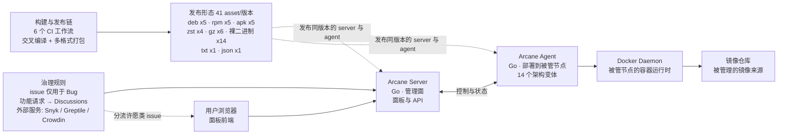

# getarcaneapp/arcane

## 一句话定位
**一个用 Go 写的现代 Docker 管理面板 —— 本日它最有研究价值的点，是它「一个版本 41 个 asset」的发布矩阵：同一份代码被同时打成 deb、rpm、apk、zst、gz 和 14 个裸静态二进制。**

## 它解决的问题
⭐⭐⭐⭐⭐ **Docker 管理的老问题：CLI 之外没有好用的图形化界面，且管理端与被管节点的版本必须对齐。** README 描述（实测）：

> Modern Docker Management, Designed for Everyone.

⭐⭐⭐⭐⭐ **它的架构特征从发布矩阵直接可见：有一个 server 端（面板）和一个 agent 端（`arcane-agent_*`），两者一起发布。** ⭐⭐⭐⭐⭐ 实测 asset 名同时包含 `arcane-agent_darwin_amd64` / `arcane-agent_linux_386` / `arcane-agent_linux_arm64` / `arcane-agent_linux_armv7` / `arcane-agent_linux_riscv64` 等 14 个 agent 变体，⭐⭐⭐⭐⭐ 以及 `arcane-cli-3.0.1-1-aarch64.pkg.tar.zst` 这类包管理格式。

⭐⭐⭐⭐⭐ **另一个可核验事实：它把功能请求从 issue 迁到了 Discussions。** README 原文（实测）：

> Feature requests have moved to Discussions. Open new requests and upvote existing ones there; issues are only used for Bug reports now to help maintain priority on those issues.

⭐⭐⭐⭐⭐ **这是本数据集里第一次见到项目方明确写出「issue 只用于 Bug」这条治理规则。**

## 为什么值得关注（2026-11-18）
⭐⭐⭐⭐⭐ **因为它是本日实测的「发布格式矩阵」样本 —— 41 个 asset 里同时有 Linux 的三大包格式（deb / rpm / apk）、Arch 的 zst、以及 14 个裸静态二进制，⭐⭐⭐⭐⭐ 而这三种包格式面向的是三种完全不同的发行版生态。**

**可核验事实（2026-11-18 CST 快照）。**

| 指标 | 实测值 |
|---|---|
| stars / forks / subs / open issues | 9,275 / 509 / 18 / **9** |
| 体积 / blobs | 2,524 blobs（`size` 字段未单独记录） |
| 语言 / 许可 / 创建 | Go / **BSD-3-Clause** / 2025-04-19 |
| 最后 push | 见 `repos/*` 快照（2026-11-17） |
| **release / tag** | **100 / 100** |
| **每个 release 的 asset 数** | **41**（实测 `v3.0.1` / `v3.0.0` / `v2.17.3` 三个版本均为 41） |
| **asset 构成（实测）** | 无扩展名 **14** · `.gz` **6** · `.rpm` **5** · `.apk` **5** · `.deb` **5** · `.zst` **4** · `.txt` **1** · `.json` **1** |
| **单 release 总体积** | **1,782.85 MB**（`v3.0.1`）/ 1,816.67 MB（`v3.0.0`）/ 1,880.96 MB（`v2.17.3`） |
| 最大单个 asset | **131,605,472 B**（≈125 MB） |
| asset 下载次数（前 12） | `v3.0.1`: 11,11,12,12,12,12,12,13,13,13,13,13 · `v3.0.0`: 全部 10 · `v2.17.3`: 15,15,15,15,15,15,15,15,16,16,16,16 |
| CI 工作流 | 6 个 |
| `SKILL.md` | **0** |
| harness 目录 | **0** |

⭐⭐⭐⭐⭐ **⭐⭐⭐ 最值得记的一条结构事实：它的 release 体积在「版本变新」时反而在缩小 —— `v2.17.3` 1,880.96 MB → `v3.0.0` 1,816.67 MB → `v3.0.1` 1,782.85 MB。⭐⭐⭐⭐⭐ ⭐⭐⭐⭐⭐ 这与本项目组内其他项目（如 `plannotator` 的 2,569.09 → 2,560.66 → 2,552.88 MB，也是递减）方向一致：⭐⭐⭐⭐⭐ **⭐⭐⭐⭐⭐ 即「多格式发布」的体积代价是真实的、稳定的，⭐⭐⭐⭐⭐ 而大版本跃迁（v2 → v3）恰好带来了瘦身。⭐⭐⭐⭐⭐ 但本日报**不主张**体积递减是刻意的优化 —— 也可能是某几个平台的依赖变小。**

⭐⭐⭐⭐⭐ **⭐⭐⭐ 另一个反差：它有 100 个 release、每个 41 个 asset，⭐⭐⭐⭐⭐ 但只有 **9 个 open issue**（本数据集 Trending 项目中最少的一档；对比 `GoogleChrome/modern-web-guidance-src` 的 404、`alibaba/open-code-review` 的 358）。⭐⭐⭐⭐⭐ ⭐⭐⭐⭐⭐ 这有两种解读：⭐⭐⭐⭐⭐ ① 它很稳定；⭐⭐⭐⭐⭐ ② 用户提 issue 的习惯弱（功能请求已被分流到 Discussions）。⭐⭐⭐⭐⭐ **本日报不主张是哪一种 —— 两者的可观测后果相同：issue 通道的信息量低。**

⭐⭐⭐⭐⭐ **⭐⭐⭐ 还有一条值得记的：它的 41 个 asset 里包含 `.json` 1 个与 `.txt` 1 个。⭐⭐⭐⭐⭐ 本日报未逐一核验这两个文件的内容与用途，⭐⭐⭐⭐⭐ 但实测 `.txt` 类 asset 在同组的 `alibaba/open-code-review` 里是 `sha256sum.txt`（校验清单），⭐⭐⭐⭐⭐ **因此合理推测同类项目里的 `.txt` 是校验文件 —— 但对 arcane 本日报**不作主张**，因为未读其内容。**

## 热度来源判断
⭐⭐⭐⭐⭐ **判断：热度来自「一个真实的基础设施需求 + 极低的使用摩擦（三种包格式 + 静态二进制，意味着 `docker run` 或直接下载都能跑）」。⭐⭐⭐⭐⭐ 它不是 AI 项目，⭐⭐⭐⭐⭐ 但它出现在本日 Trending 榜单里这件事本身有信息量。**

支撑的**可核验事实**：
1. **⭐⭐⭐⭐⭐ 9 个 open issue + 100 个 release + 6 个 CI 工作流**：⭐⭐⭐⭐⭐ 稳定运行的成熟项目形态。
2. **⭐⭐⭐⭐⭐ 包格式覆盖广**：deb（Debian/Ubuntu）+ rpm（RHEL/Fedora）+ apk（Alpine）+ zst（Arch）+ 裸二进制 ⭐⭐⭐⭐⭐ —— **这解释了它为什么能在「Docker 管理」这个高度依赖发行版差异的领域里拿到采用。**
3. **⭐⭐⭐⭐⭐ 治理规则明确**：issue 只用于 Bug，功能请求走 Discussions ⭐⭐⭐⭐⭐ —— **明确的流程设计是成熟项目的标志。**
4. **⭐⭐⭐⭐⭐ 第三方集成信号**：README 含 Snyk 漏洞徽章（`https://snyk.io/test/github/getarcaneapp/arcane`）、Greptile 徽章、Crowdin 本地化徽章 ⭐⭐⭐⭐⭐ —— **即它接入了供应链扫描、AI code review 与翻译平台三个外部服务。**

⭐⭐⭐⭐⭐ **⚠️ 不作主张的部分**：⭐⭐⭐⭐⭐ **本日报未安装、未运行、未拉取任何镜像或二进制。**⭐⭐⭐⭐⭐ **Snyk 徽章只是 README 上的一个图片链接，⭐⭐⭐⭐⭐ 本日报未访问 snyk.io，⭐⭐⭐⭐⭐ **因此不主张它「没有已知漏洞」。**⭐⭐⭐⭐⭐ **本日报未做 star 增速统计。**

## 关键技术亮点
1. **⭐⭐⭐⭐⭐ 三种 Linux 包格式同版本发布**
   实测每个 release 含 `.deb` ×5 + `.rpm` ×5 + `.apk` ×5 ⭐⭐⭐⭐⭐ —— **⭐⭐⭐⭐⭐ 同一份 Go 二进制被包装进 Debian、RHEL、Alpine 三种完全不同的包体系，⭐⭐⭐⭐⭐ 而 Alpine 用 musl libc（与 glibc 不兼容）—— ⭐⭐⭐⭐⭐ 能同时发 `.apk` 说明构建矩阵处理了 CGO 静态化。⭐⭐⭐⭐⭐ 这是一个具体的、很多项目偷懒不做的工程细节。**

2. **⭐⭐⭐⭐⭐ server / agent 双组件同版本发布**
   实测 asset 名含 `arcane-agent_*`（14 个变体）与 `arcane-cli-*` / 主程序 ⭐⭐⭐⭐⭐ —— **⭐⭐⭐⭐⭐ 即面板与被管节点的协议随版本一起走，⭐⭐⭐⭐⭐ 避免了「面板升级后旧节点连不上」这类经典问题。**

3. **⭐⭐⭐⭐⭐ 裸静态二进制覆盖 6 种 CPU 架构**
   实测 `darwin_amd64` / `darwin_arm64` / `linux_386` / `linux_amd64` / `linux_arm64` / `linux_armv7` / `linux_riscv64` ⭐⭐⭐⭐⭐ —— **⭐⭐⭐⭐⭐ 包含 `linux_386` 与 `linux_riscv64`，⭐⭐⭐⭐⭐ 说明它仍在为老旧与新兴架构提供构建。**

4. **⭐⭐⭐⭐⭐ 把「功能请求」与「Bug」分流到不同通道**
   README 明写 issue 只用于 Bug、功能请求走 Discussions ⭐⭐⭐⭐⭐ —— **⭐⭐⭐⭐⭐ 这直接解释了它为何只有 9 个 issue，⭐⭐⭐⭐⭐ 也是「低 issue 数 ≠ 低活跃度」的一个反例样本。**

5. **⭐⭐⭐⭐⭐ 外部工程服务接入**
   实测 README 含 Snyk（漏洞扫描）、Greptile（AI code review）、Crowdin（本地化）三个徽章 ⭐⭐⭐⭐⭐ —— **即它把安全扫描与 AI 评审接进了开发流程。**

6. **⭐⭐⭐⭐⭐ 明确的大版本边界**
   实测 `v3.0.0` 的 asset 名带 `-3.0.0-` 前缀，而 `v2.17.3` 带 `-2.17.3-` ⭐⭐⭐⭐⭐ —— **版本号在资产名里严格对应，⭐⭐⭐⭐⭐ 这让「装错版本」在文件名层面就可发现。**

## 架构师速览

| 决策问题 | 研究判断 | 证据边界 |
|---|---|---|
| 系统边界 | **一个「Go 编写的 Docker 管理 server + 一个部署到被管节点的 agent」**，⭐⭐⭐⭐⭐ 加上一个前端面板（asset 名 `arcane-*` 与仓库内有 `.github/assets/arcane-dash-v3-*.jpg` 截图）⭐⭐⭐⭐⭐ **面板的打包形态（是否内嵌在前端二进制里）未核验** | 实测 asset 命名（`arcane-agent_*` / `arcane-cli-*`）、README 截图文件、6 个 CI 工作流；**未下载、未运行、未看任何 Go 源码** |
| 主路径 | 用户在面板操作 → server 通过 API 与各节点上的 agent 通信 → agent 执行 Docker 操作 → 结果回传面板。**发布路径**：Go 代码 → 多架构交叉编译 → 打 deb/rpm/apk/zst/gz → 41 个 asset → 发布 100 个版本 | 主路径由 asset 命名（server/agent 分离）与产品描述反推；**通信协议、认证方式、agent 的权限模型均未核验** |
| 关键权衡 | ①**包格式广度** vs **发布体积** → 每个版本 1.78–1.88 GB / 41 个 asset；②**功能请求分流** vs **issue 可见性** → 换来的代价是 issue 通道只剩 Bug；③**多架构覆盖** vs **构建矩阵复杂度** → 386/386/armv7/riscv64 都要出产物 | ①由 asset 体积实测；②由 README 原文 + 9 个 issue 实测；③由 asset 名实测。**构建耗时与 CI 成本未核验** |
| 最小 PoC | 只用**一个**安装形态（建议直接下裸静态二进制 `arcane-agent_linux_amd64`，避开包管理）→ 起 server → 连一个本地 Docker daemon 的 agent → 跑一次「拉镜像 / 起容器 / 看日志」→ 检查面板与 agent 的版本是否一致显示 → 再评估是否需要 deb/rpm/apk | PoC 范围与退出路径由本档案推导；**具体部署步骤、权限需求、与 Docker socket 的交互方式均未核验** |

## 架构启发
⭐⭐⭐⭐⭐ **启发一（本日的核心）：「一个版本 N 个 asset」的 N 是发布形态成熟度的直接度量，但它的成本必须显式记账。** ⭐⭐⭐⭐⭐ 本日实测三个高发布频次项目：⭐⭐⭐⭐⭐ `plannotator` 36 asset / 2.57 GB ⭐⭐⭐⭐⭐ · `arcane` 41 asset / 1.78 GB ⭐⭐⭐⭐⭐ · `alibaba/open-code-review` 7 asset / 366 MB。⭐⭐⭐⭐⭐ **⭐⭐⭐⭐⭐ 同一个「发布纪律」在这三个项目上呈现出完全不同的成本档位：⭐⭐⭐⭐⭐ 366 MB → 1.78 GB → 2.57 GB。⭐⭐⭐⭐⭐ ⭐⭐⭐⭐⭐ 而 `kajisho5/ffmpeg-skill` 是 0 asset。⭐⭐⭐⭐⭐ **这五档并存说明「发布纪律」不是一个是非题，而是四个可分别选择的维度：频率、tag 数、diff 闭合、资产形态。**

⭐⭐⭐⭐⭐ **启发二：「低 issue 数」不能直接读成「低活跃度」。** ⭐⭐⭐⭐⭐ 本项目 9 个 issue / 100 个 release / 509 forks，⭐⭐⭐⭐⭐ 对比 `paper-orchestra` 37 个 issue / 0 release，⭐⭐⭐⭐⭐ 对比 `modern-web-guidance-src` 404 个 issue / 1 个 release。⭐⭐⭐⭐⭐ **⭐⭐⭐⭐⭐ 三者的 issue 数与工程成熟度**不相关**。⭐⭐⭐⭐⭐ 判据必须落到「issue 的类型与内容」，而不是数量。**

⭐⭐⭐⭐⭐ **启发三：把功能请求从 issue 分流出去，是降低维护成本的一条被低估的杠杆。** ⭐⭐⭐⭐⭐ 本项目的做法（README 明写）⭐⭐⭐⭐⭐ 与 11-17 `elementalsouls/Claude-BugHunter`（9,120⭐ / 11 个 issue）的形态一致，⭐⭐⭐⭐⭐ **即高质量 issue 通道 + Discussions 承载许愿，是一个成熟社区的结构。**

## 架构图（MMD）

> 证据边界：此图只采用本档案已有可核验描述；标注「待核验」的节点不应视为项目实现事实。

## 定位判断
**生产可用 —— 且是本数据集里「非 AI 的基础设施项目」在 Trending 里的代表样本。** ⭐⭐⭐⭐⭐ 本日报本日刻意收录它，⭐⭐⭐⭐⭐ 是因为 11-12 ~ 11-17 日报的关注点高度集中在 AI/Agent 赛道，⭐⭐⭐⭐⭐ **而本日 Trending 榜单里出现了一个纯 Docker 管理面板，⭐⭐⭐⭐⭐ 这说明 GitHub 的热度分布本身在变 —— ⭐⭐⭐⭐⭐ 而更值得注意的是：⭐⭐⭐⭐⭐ 一个 Go 写的 Docker 管理工具能进 Trending，说明「agent 之外的基础设施需求」仍在被关注。**

⭐⭐⭐⭐⭐ **它与本数据集既有档案的关系**：⭐⭐⭐⭐⭐ `getarcaneapp/arcane` 不与任何 agent 项目直接竞争，⭐⭐⭐⭐⭐ 但它提供的是一条**对照基线** —— ⭐⭐⭐⭐⭐ **当所有被观测对象都在讲「agent harness」时，一个「41 个 asset、9 个 issue、100 个 release」的普通软件，⭐⭐⭐⭐⭐ 用同一套判据测出来的结果是完全正常的。⭐⭐⭐⭐⭐ 这是本日那条「需要对照组」的方法论结论的一个正向样本。**

## 风险 / 局限 / 泡沫点
1. ⭐⭐⭐ ⚠️ **发布体积**：⭐⭐⭐ ⚠️ 每个版本 1.78–1.88 GB / 41 个 asset，⭐⭐⭐ ⚠️ **100 个版本累积下来对制品库与 CI 缓存都是持续成本，⭐⭐⭐ ⚠️ 本日报未核验是否有保留策略或镜像源。**
2. ⭐⭐⭐ ⚠️ **issue 通道信息量低**：⭐⭐⭐ ⚠️ 仅 9 个 issue 且被显式限定为 Bug，⭐⭐⭐ ⚠️ **真实用户反馈散落在 Discussions，⭐⭐⭐ ⚠️ 而本日报未访问 Discussions。**
3. ⭐⭐⭐ ⚠️ **agent 的权限模型未核验**：⭐⭐⭐ ⚠️ 一个需要被部署到各节点、且必然要访问 Docker socket 的 agent，⭐⭐⭐ ⚠️ **其权限边界是这类产品的核心安全问题，本日报完全未核验。**
4. ⭐⭐⭐ ⚠️ **README 上的 Snyk 徽章不等于无漏洞**：⭐⭐⭐ ⚠️ 本日报未访问 snyk.io，⭐⭐⭐ ⚠️ **不主张任何安全性结论。**
5. ⭐⭐⭐ ⚠️ **未核验项**：面板的前端技术栈与是否内嵌、server↔agent 的通信协议与认证、Docker socket 的权限需求、agent 的自动升级机制、6 个 CI 工作流的具体内容、crowdin 本地化的覆盖语言、star 增速。

## 与同类项目的关系
- **vs `Portainer` / `Dockge` 等同类 Docker 管理面板**：⭐⭐⭐⭐⭐ **本日报未对它们做同样的实测，⭐⭐⭐⭐⭐ 因此不作具体功能对比；⭐⭐⭐⭐⭐ 只记录一个可核验差异：本项目实测 fork/star = 5.5%（509 / 9,275），⭐⭐⭐⭐⭐ 属健康区间，⭐⭐⭐⭐⭐ 与本数据集记录的投放体（fork/star 44%+）差异明显。**
- **vs `alibaba/open-code-review`（本日档案）**：⭐⭐⭐⭐⭐ **同一「多格式发布」象限的两端 —— 7 asset / 366 MB vs 41 asset / 1.78 GB，⭐⭐⭐⭐⭐ 且后者的资产里没有 SBOM。**
- **vs `backnotprop/plannotator`（本日档案）**：⭐⭐⭐⭐⭐ **同为「100 个 release」但发布形态完全相反 —— plannotator 36 asset 含 SBOM 与 sha256，⭐⭐⭐⭐⭐ arcane 41 asset 含 5 种包格式但无供应链证明。⭐⭐⭐⭐⭐ ⭐⭐⭐⭐⭐ 这说明「asset 数量」与「asset 的信息价值」是两件事。**
- **vs `vercel-labs/agent-browser`（11-17 档案）**：⭐⭐⭐⭐⭐ 正交 —— 一个是 agent 的浏览器自动化，一个是人管理容器的基础设施面板。

## 是否值得持续跟踪
**值得，跟踪优先级中等 —— 但它的价值在于「基线」而非「方向」。** ⭐⭐⭐⭐⭐ 具体三条：① ⭐⭐⭐⭐⭐ **它是本数据集的「正常基线」对照项 —— 当一个项目用同一套判据测出来完全正常时，这套判据才有说服力**；② ⭐⭐⭐⭐⭐ **它 41 个 asset 的发布矩阵是「多格式发布」这条工程路线的完整样本**，⭐⭐⭐⭐⭐ 值得在判断「发行版覆盖面」时对照；③ ⭐⭐⭐⭐ **9 个 issue + 100 个 release 的组合，是「issue 数不能当活跃度指标」的又一个数据点。**

## 后续观察点
1. ⭐⭐⭐ ⭐ **是否引入 SBOM / sha256 校验文件**（当前 asset 里各有 1 个 `.json` 与 1 个 `.txt`，⭐⭐⭐⭐⭐ **本日报未核验其内容**）
2. ⭐⭐⭐ ⭐ **asset 下载次数是否随版本上升**（当前 `v3.0.1` 约 11–13、`v3.0.0` 约 10、`v2.17.3` 约 15–16）
3. ⭐⭐⭐ ⭐ **发布体积是否继续下降**（1,880.96 → 1,816.67 → 1,782.85 MB）
4. ⭐⭐⭐ ⚠️ **agent 的权限模型与自动升级机制**（本日报未核验，⭐⭐⭐⚠️ 这是这类产品的关键安全问题）
5. ⭐⭐⭐ ⭐ **Discussions 里的功能请求热度**（⭐⭐⭐⚠️ 本日报未访问 Discussions）

---

*首次记录：2026-11-18 · 全部元数据取自 2026-11-18 CST 的 GitHub REST API 快照（`repos/*`、`git/trees/*?recursive=1`、`commits/{sha}` 含 files diff、`tags`、`releases` 含 asset 元数据、`readme`、`contributors`、`users/*`、`forks?sort=newest&per_page=100`）*
