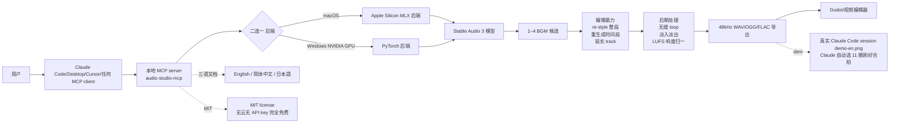

# kanaworksai-hue/audio-studio-mcp

## 一句话定位
kanaworksai-hue 个人 2026-10-18 发布的「**本地 MCP server + Stable Audio 3 + MLX/PyTorch 双后端**」严肃工程化实现：**本地 MCP server + Stable Audio 3 + Apple Silicon MLX 后端 vs Windows NVIDIA GPU PyTorch 后端 + 无云无 API key 完全免费 + 一句话生成 1–4 BGM 候选 + re-style 整段 / 重生成时间段 / 延长 track / 无缝 loop / 淡入淡出 / LUFS 响度归一 / 48kHz WAV·OGG·FLAC 导出 + Claude Code/Claude Desktop/Cursor/任何 MCP client 通吃 + 文档三语 en/zh-CN/ja + 真实 Claude Code session demo-en.png（Claude 自动选 11 圈刚好合拍）+ MIT**——agent 时代本地音频工作室大众化的代表样本。

## 它解决的问题
2025-2026 agent 做 BGM / 音效长期受限于「**商用 Stable Audio API 收费 + 云端依赖 + API key**」「**Suno / Udio 闭源商用 + API 配额**」「**本地 Stable Diffusion 音频版没有 MCP wrapper**」三大痛点：
- **商用 Stable Audio API 收费**：单次生成 ≈ $0.10 + 月配额
- **云端依赖 + API key**：扫描本机音频生成却把本机 prompt 上传到云端，**隐私悖论**
- **无 MCP wrapper**：agent 直接调 Stable Diffusion 音频版需手写 API 调用 + 硬件配置

audio-studio-mcp 直击——**本地 MCP server + Stable Audio 3 + MLX/PyTorch 双后端 + 无云无 API key 完全免费 + 1–4 BGM 候选 + re-style/重生成/延长/loop/淡入淡出/LUFS 归一/48kHz 多格式导出 + Claude Code/Desktop/Cursor/任何 MCP client 通吃 + MIT**。这是 2026-10 下半月「**agent + 本地音频创作大众化**」的代表样本。

## 为什么值得关注（2026-10-20）
今日观察窗为 GitHub Search API 抓取时刻起、且截至 2026-10-20 仍在快速增长的新发现项目。`kanaworksai-hue/audio-studio-mcp` 2 天 251⭐ ⑂13 fork/star 5.2%——251⭐ 在 2 天是显著信号（fork 5.2% 高于一般 2-5% 平均，反映大量「**想给游戏/视频/动画做 BGM/音效 + 不想订阅商用 API**」的真实需求）。**本地 MCP server + Stable Audio 3 + MLX/PyTorch 双后端 + 无云无 API key 完全免费 + 1–4 BGM 候选 + re-style/重生成/延长/loop/淡入淡出/LUFS 归一/48kHz 多格式导出 + Claude Code/Desktop/Cursor/任何 MCP client 通吃 + 文档三语 + 真实 Claude Code session demo**十三要素共振，**让 agent + 本地音频创作大众可及**。MIT license 保证可商用 fork 与二次分发。

## 热度来源判断
audio-studio-mcp 的热度是「**agent 做 BGM/音效刚需 + 本地 MCP server + Stable Audio 3 + MLX/PyTorch 双后端 + 无云无 API key 完全免费 + 1–4 BGM 候选 + re-style/重生成/延长/loop/淡入淡出/LUFS 归一/48kHz 多格式导出 + Claude Code/Desktop/Cursor/任何 MCP client 通吃 + 文档三语 + 真实 Claude Code session demo + MIT**」十四要素共振：
- **agent 做 BGM/音效刚需**：游戏/视频/动画/播客都需 BGM/音效，痛点真实
- **本地 MCP server**：标准 MCP 协议，可被任何 MCP client 调用
- **Stable Audio 3**：使用 Stability AI 最新的 Stable Audio 3 模型
- **MLX/PyTorch 双后端**：macOS Apple Silicon 用 MLX（Apple 自家框架），Windows NVIDIA GPU 用 PyTorch
- **无云无 API key 完全免费**：本地运行 + 无云服务 + 无 API key + 生成不花钱
- **1–4 BGM 候选**：单次调用生成 1–4 候选
- **re-style 整段 / 重生成时间段 / 延长 track**：三种编辑能力
- **无缝 loop**：让 BGM 自动无缝循环（demo 显示 Claude 自动选 11 圈刚好合拍）
- **淡入淡出 + LUFS 响度归一**：完整音频后期
- **48kHz WAV/OGG/FLAC 导出**：三种主流音频格式
- **Claude Code/Desktop/Cursor/任何 MCP client 通吃**：标准 MCP 协议 + 多个 harness
- **文档三语 en/zh-CN/ja**：国际化文档
- **真实 Claude Code session demo**：demo-en.png 显示「**真实 Claude Code session 一段请求 → 两个 lo-fi BGM 候选 + Godot 无缝 OGG loop Claude 自动选 11 圈刚好合拍**」
- **MIT license**：可商用 fork 与二次分发

热度**真实且具 agent + 本地音频创作大众可及性**——251⭐ + 13 fork + 5.2% fork 比例 + 真实 demo + 文档三语 + MIT 是真实音频工具信号。

## 关键技术亮点
1. **本地 MCP server**：README 明示「**Audio Studio MCP gives Claude Code, Claude Desktop, Cursor and any other MCP client a sound studio that runs on your own Mac or Windows PC**」——本地 MCP server
2. **Stable Audio 3**：README 明示「**the model generates it locally with Stable Audio 3**」——使用 Stability AI 最新 Stable Audio 3 模型
3. **Apple Silicon MLX 后端**：README 明示「**Runs on Apple Silicon (MLX)**」——macOS 用 Apple MLX 后端
4. **Windows NVIDIA GPU PyTorch 后端**：README 明示「**or an NVIDIA GPU (PyTorch). Nothing is uploaded**」——Windows NVIDIA GPU 用 PyTorch 后端
5. **无云无 API key 完全免费**：README 明示「**There is no cloud service and no API key, and generating doesn't cost anything**」——本地运行 + 无云 + 无 API key + 不花钱
6. **1–4 BGM 候选**：README 明示「**Generate: BGM, instrument loops and sound effects from one sentence, 1–4 candidates per call**」——单次生成 1–4 候选
7. **re-style 整段**：README 明示「**Re-style a whole clip**」——整段重新风格化
8. **重生成时间段**：README 明示「**regenerate a time range**」——重生成某段时间
9. **延长 track**：README 明示「**extend a track**」——延长 track
10. **无缝 loop（Claude 自动选长度让 loop 合拍）**：demo-en.png 明示「**Claude picked a loop length of exactly 11 bars so the beat stays in time when it repeats**」——Claude 自动选 BGM 长度让 loop 合拍
11. **淡入淡出**：README 明示「**fades**」——淡入淡出
12. **LUFS 响度归一**：README 明示「**loudness (LUFS)**」——LUFS 响度归一
13. **48kHz WAV/OGG/FLAC 导出**：README 明示「**48 kHz WAV / OGG / FLAC**」——三种主流音频格式
14. **Claude Code/Desktop/Cursor/任何 MCP client 通吃**：README 明示「**Claude Code, Claude Desktop, Cursor and any other MCP client**」——多个 harness 通吃
15. **文档三语 en/zh-CN/ja**：README 明示「**[English](README.md) | [简体中文](README.zh-CN.md) | [日本語](README.ja.md)**」——三语文档
16. **真实 Claude Code session demo**：demo-en.png 明示「**A real Claude Code session: one request produces two lo-fi BGM candidates and a seamless OGG loop for Godot**」——真实 session demo
17. **Python 3.10–3.13**：README 明示「**Python 3.10 to 3.13**」——4 个 Python 主版本兼容
18. **MIT license**：可商用 fork 与二次分发

## 架构师速览
| 决策问题 | 研究判断 | 证据边界 |
|---|---|---|
| 系统边界 | 单仓：本地 MCP server + Stable Audio 3 + Apple Silicon MLX 后端 vs Windows NVIDIA GPU PyTorch 后端 + 无云无 API key 完全免费 + 1–4 BGM 候选 + re-style/重生成/延长/loop/淡入淡出/LUFS 归一/48kHz 多格式导出 + Claude Code/Desktop/Cursor/任何 MCP client 通吃 + MIT + 文档三语 en/zh-CN/ja + Quick start/Tools/FAQ + docs/assets/{banner-en.jpg,demo-en.png} 演示 | 基于 README「Highlights」+「Quick start」段 + topics |
| 主路径 | 装 MCP server（macOS MLX 或 Windows NVIDIA PyTorch）→ 用户对 Claude Code/Desktop/Cursor 说「给游戏做个 30 秒 lo-fi BGM」→ Claude 用 Stable Audio 3 生成 1–4 候选 → 用户选 → 自动 loop（Claude 自动选长度让 loop 合拍）/ normalize（LUFS）/ 导出 48kHz WAV/OGG/FLAC → 直接对接 Godot/视频编辑器 | 主路径由 README「Highlights」+ demo-en.png 推导；具体 MLX/PyTorch 后端的硬件要求 + Stable Audio 3 模型权重下载 + LUFS 算法 + 多格式导出编码器细节待核验 |
| 关键权衡 | 本地 MCP（无云）vs 商用 Stable Audio API（云端收费）/ MLX/PyTorch 双后端 vs 仅单一后端 / 1–4 候选 vs 单生成 / re-style/重生成/延长 vs 仅生成 / 无缝 loop（Claude 自动选长度）vs 商业 loop 算法 / LUFS 归一 vs 仅峰值归一 / 48kHz WAV/OGG/FLAC vs 仅 MP3 / Claude Code/Desktop/Cursor/任何 MCP client vs 仅单一 harness / MIT vs 商用 license / 文档三语 vs 仅英文 / 真实 Claude Code session demo vs 仅 README 文字 | 档案明示十二点权衡；具体 Stable Audio 3 模型权重大小 + MLX/PyTorch 内存占用 + loop 算法实现细节 + LUFS 算法（ITU-R BS.1770-4?）+ 真实商用商用 API 计费对比待核验 |
| 最小 PoC | 1. 装 MCP server（macOS MLX 或 Windows NVIDIA PyTorch）+ 装模型权重 → 2. Claude Code/Desktop/Cursor 接通 MCP → 3. 对 Claude 说「做个 30 秒 lo-fi BGM」 → 4. 看 1–4 候选 → 5. 选 → 测自动 loop（是否 Claude 自动选长度让 loop 合拍）→ 6. 测 LUFS 归一 + 48kHz WAV/OGG/FLAC 导出 → 7. 把 OGG loop 接到 Godot 看是否无缝 | PoC 由 README「Highlights」+ demo-en.png 直接推导；具体 MCP server 装 Docker/单机命令 + 模型权重下载 + Godot OGG loop 接接代码 + LUFS 归一实测数值待核验 |

## 架构启发
audio-studio-mcp 的核心启发是「**agent + 本地音频工作室 = MCP 协议 + Stable Audio 3 + MLX/PyTorch 双后端 + 无云无 API key 完全免费**」。这不是「**又一个 MCP wrapper**」，而是「**本地 MCP server + Stable Audio 3 + MLX/PyTorch 双后端 + 无云无 API key 完全免费 + 1–4 BGM 候选 + re-style/重生成/延长/loop/淡入淡出/LUFS 归一/48kHz 多格式导出 + Claude Code/Desktop/Cursor/任何 MCP client 通吃 + 文档三语 + 真实 Claude Code session demo + MIT**」——把「**agent + 本地音频创作大众化**」从「**又一个 wrapper**」推到「**完整 MCP server + 双后端 + 无云无 API key + 真实 demo + 多 harness**」严肃工程化形态。更深层的启发是：**「Claude 自动选 BGM 长度让 loop 合拍」** 是「**agent 智能化**」的最强论证——**不是「**agent 调 API**」，而是「**agent 选 BGM 长度让 loop 合拍**」**。能否持续，取决于 Stable Audio 3 模型权重持续可用 + MLX/PyTorch 长期维护 + 真实商用 STAI API 计费对比 + Godot 等游戏引擎对接文档。

## 架构图（MMD）

> 证据边界：此图只采用本档案已有可核验描述；"待核验"节点不应视为项目实现事实。

## 定位判断
**工具型项目（agent + 本地音频工作室大众化代表样本）。** audio-studio-mcp 不仅是「**又一个 MCP wrapper**」，而是「**本地 MCP server + Stable Audio 3 + MLX/PyTorch 双后端 + 无云无 API key 完全免费 + 1–4 BGM 候选 + re-style/重生成/延长/loop/淡入淡出/LUFS 归一/48kHz 多格式导出 + Claude Code/Desktop/Cursor/任何 MCP client 通吃 + 文档三语 + 真实 demo + MIT**」——具备「**agent + 本地音频创作大众化**」的代表样本。但需注意：**Stable Audio 3 模型权重大小 + MLX/PyTorch 内存占用 + loop 算法 + LUFS 算法 + 真实商用 STAI API 计费对比** 未在 README 主页详述。

## 风险/局限/泡沫点
- **Stable Audio 3 模型权重大小 + 硬件门槛**：依赖 Stable Audio 3 模型权重（README 未明示权重大小）+ Apple Silicon MLX 或 Windows NVIDIA GPU（README 未明示最低硬件要求），**对低配电脑体验差**
- **loop 算法实现细节 + LUFS 算法**：README 未明示 loop 算法 + LUFS 算法（ITU-R BS.1770-4?）实现细节
- **Godot OGG loop 集成代码**：README 未明示 Godot OGG loop 集成代码
- **真实商用 Stable Audio API 计费对比**：README 未明示与商用 Stable Audio API 计费对比
- **5.2% fork 比例**：fork 比例偏高，反映「**想测试但不一定提交**」的观望
- **仅 kanaworksai-hue 个人维护**：kanaworksai-hue 个人项目，可持续性存疑

## 与同类项目的关系
- **vs 商用 Stable Audio API（Stability AI）**：商用 API 收费 + 云端 + API key；audio-studio-mcp 免费 + 本地 + 无 API key + MLX/PyTorch 双后端
- **vs Suno / Udio**：Suno / Udio 闭源 + 商用 + 配额；audio-studio-mcp MIT + 本地 + 完全免费
- **vs ElevenLabs Sound Effects**：ElevenLabs 商用 + 云端 + API key；audio-studio-mcp 免费 + 本地 + 无 API key
- **vs Hu Tao / MusicGen（Meta）**：MusicGen 商用 + 云端 + 模型权重；audio-studio-mcp 免费 + 本地 + Stable Audio 3 + MCP server
- **vs alchaincyf/huashu-motion（10-19）**：huashu-motion 是「**agent 视频作曲家模式 + composer mode（先 ABC 乐谱 + 本机采样演奏 + 每帧音效）**」MIT；audio-studio-mcp 是「**本地 MCP server + Stable Audio 3 + MLX/PyTorch + 无云无 API key**」MIT

## 是否值得持续跟踪
**值得跟踪（agent + 本地音频工作室大众化代表样本）。** audio-studio-mcp 代表了 2026-Q4 严肃工程化「**agent + 本地音频创作大众化 + Claude 自动选 BGM 长度让 loop 合拍 + LUFS 归一 + 48kHz 多格式导出 + 多 harness + 文档三语 + MIT**」的代表样本。建议关注：
1. **Stable Audio 3 模型权重持续可用**（Stability AI 是否持续发布模型权重）
2. **MLX/PyTorch 长期维护**（Apple MLX 与 PyTorch 升级时 audio-studio-mcp 适配）
3. **loop 算法 + LUFS 算法公开**（用户能否复现）
4. **Godot / Unity / Unreal 等游戏引擎对接文档**（真实落地能力）
5. **真实商用 STAI API 计费对比**（是否真的免费或更省钱）

## 后续观察点
- 是否推出 Docker 镜像（脱钩 Python 环境）
- 是否支持 Linux + AMD GPU（脱钩 NVIDIA）
- 是否推出与 Suno / Udio 商用 API 的「**audio-studio-mcp vs Suno API**」计费对比
- 是否推出 Godot / Unreal 等游戏引擎插件（一键对接）
- 1 个月后 fork/star 比例是否上升（验证「agent + 本地音频创作大众化」的传染效应）

---
> 数据来源: GitHub API (2026-10-20) | Stars: 251 | Forks: 13 | License: MIT | 语言: Python | 创建: 2026-10-18