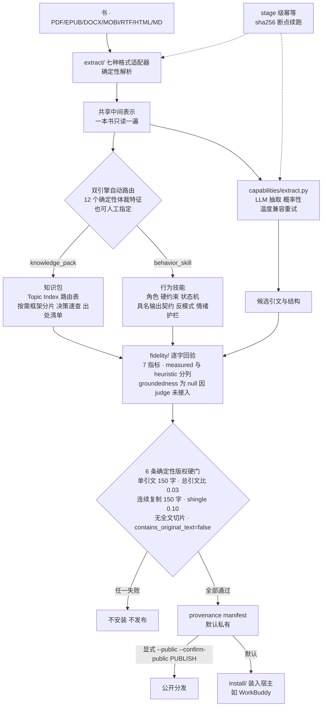

# bookleme/bookleme

## 一句话定位

**把一本书编译成可安装的 Agent Skill**（双引擎 + 可插拔体裁插件 + 逐字忠实度回验）—— 而它本日最值得抄的是**它把自己的核心主张降级成了标签**：README 里明写「『提炼结构而非摘要』只是设计选择，**不是已被验证的结论。本项目把它标为 `UNVERIFIED`，不写成既成事实。**」

## 它解决的问题

读完一本书的人通常记住了结论，但真正值钱的是**作者的工作方式** —— 提问的顺序、判断的条件、证伪的条件。⭐⭐⭐⭐⭐ 这些东西散落在三百页里，无法被 agent 调用、无法被复用、**也无法被验证**。

现有的做法有两种，各有明确缺陷：

- **读书笔记 / 摘要** —— 产出是人类读的散文，agent 调不动；且摘要过程必然引入模型的解释，失真不可查。
- **把原文整段塞进上下文** —— 能被 agent 调用，但**版权与成本双杀**，且 agent 仍然无法判断哪一段是真正的方法论。

⭐⭐⭐⭐⭐ `bookleme` 提出第三条路：**把书当源文件，用确定性流水线编译出两种产物（结构化知识包 / 行为技能），并对每一条引文做逐字回验。**

## 为什么值得关注（2026-11-10）

⭐⭐⭐⭐⭐ **它是本日最值得架构师抄的一个项目 —— 因为它是本日报记录到的第一个把「不可验证的效果主张」写进自己的产物结构的项目。**

先看它对自己核心主张的处理。README 的「三条设计原理」被放在 `
` 折叠块里，标题就写着：

> **三条设计原理**（工程上采纳，**但未经本项目验证**）
> 1. 编译期 / 运行期分离 —— 书只在编译时读一遍，运行时按需加载知识分片
> 2. 渐进式披露三级 —— 常驻入口 → 按需分片 → 本地全文
> 3. 确定性提取与概率性生成解耦 —— 可单测、可 diff、可回归
>
> > 「提炼结构而非摘要」只是设计选择，**不是已被验证的结论。本项目把它标为 `UNVERIFIED`，不写成既成事实。**

⭐⭐⭐⭐⭐ **这是本日报连续多日记录的同一条纪律线上的一个新位置** —— `phoneuse`（写明未验证机型）、`satmux`（写明物理下界）、`solo-to-team-skills`（写明谁该做什么）、`research-loop-skills`（写明何时该停）、`bookleme`（**把自己的主张标为 UNVERIFIED**）。⭐⭐⭐⭐⭐ **但它是第一个把降级做到「结构层」的：不是写在文档里，而是写成产物里一个可以被查询的字段。**

⭐⭐⭐⭐⭐ **第二个值得抄的是它的忠实度指标表 —— 而且这张表里有一行没达标，被原样保留**：

| 指标 | 类型 | 目标 | 实测 |
|---|---|---|---|
| `citation_resolution_rate` | measured | 1.00 | ✅ 1.00 |
| `verbatim_violation_rate` | measured | 0.00 | ✅ 0.00 |
| `negative_refusal_rate` | measured | 1.00 | ✅ 1.00 |
| `trigger_hit_rate` | measured | ≥0.90 | ✅ 1.00 |
| `artifact_compliance_rate` | measured | 1.00 | ✅ 1.00 |
| `shingle_overlap_max` | measured | ≤0.10 | ✅ 0.084 |
| `coverage_score` | measured | ≥0.85 | ⚠️ **0.667（未达标，如实保留）** |
| `groundedness` | heuristic | 只报告 | `null`（LLM judge 未接入） |

⭐⭐⭐⭐⭐ **两个细节值得单独说：**

1. ⭐⭐⭐⭐⭐ **`measured` 与 `heuristic` 是两个分开的列** —— ⭐⭐⭐⭐⭐ **即：哪些数字是算出来的、哪些是估计的，读者一眼可见。** ⭐⭐⭐⭐⭐ **而 `groundedness` 的值是 `null` 且理由写明「LLM judge 未接入」—— 即：没测的东西不填数，直接标 null 并说明为什么。** ⭐⭐⭐⭐⭐ **这比填一个 0.9 的估计值诚实得多。**
2. ⭐⭐⭐⭐⭐ **`coverage_score` 0.667 未达标 0.85 的门槛，但被写成「⚠️ 0.667（未达标，如实保留）」而不是被调参调到达标。** ⭐⭐⭐⭐⭐ **这与本日报记录的 `oss-verify-proofs` 里「19,797 条 statement 仍 open，0 条已知为假」是同一种呈现方式：⭐⭐⭐⭐⭐ 未完成的部分被保留为可见的缺口，而不是被隐藏。**

⭐⭐⭐⭐⭐ **第三个值得抄的是它的版权工程化 —— 6 条确定性硬门，任一失败即不安装、不发布**：

> 单条引文 ≤150 字且逐字可追溯 · 总引文比 ≤0.03 · 连续复制 ≤150 字 · **13 字 shingle 重叠 ≤0.10** · 产物不含全文 / 切片 · `contains_original_text = false`

⭐⭐⭐⭐⭐ **「13 字 shingle 重叠」是一个具体、可计算、与 LLM 无关的判据** —— ⭐⭐⭐⭐⭐ **它测的是「产物与原文的最长公共子串长度」，而不是让模型自己判断「这算不算抄袭」。** ⭐⭐⭐⭐⭐ **这与本日报记录的 `ex-ussr-kinship-research` 的 `independence_group`（同一原始记录的多份拷贝永不计入独立佐证，**且这条规则由代码强制而非文档承诺**）属于同一条方法论：**把伦理约束写成代码里的硬门，而不是写成提示词。**

⭐⭐⭐⭐⭐ **第四个值得抄的是它的默认分发姿态**：

> **版权边界**：输出是**结构化衍生笔记，不含原文段落**。第三方书籍生成的 Skill **默认私有、不得分发**；公开分发需在启动命令显式给 `--public --confirm-public PUBLISH`。**MIT 只覆盖转换器，不覆盖任何书籍。**

⭐⭐⭐⭐⭐ **三个关键词：默认私有、显式开启、许可分层。** ⭐⭐⭐⭐⭐ **「MIT 只覆盖转换器，不覆盖任何书籍」这句尤其关键 —— 它把「工具的许可」与「产物的许可」明确切开了。**

⭐⭐⭐⭐⭐ **第五个值得抄的是它的架构分期与断点续跑**：

> ⚙️ **stage 级幂等** —— sha256 断点续跑，删任一阶段产物只补该阶段

⭐⭐⭐⭐⭐ **而 commit 历史印证了这一点**：`fix: P0 续聊断链（每轮写 state + 运行期路径约定）+ 输出格式统一双层 schema` —— ⭐⭐⭐⭐⭐ **一个真实的 P0 缺陷修复，标题里直接写了「续聊断链」与修法。** ⭐⭐⭐⭐⭐ **对照本日报抓到的农场样本的 commit 标题（`Add main.py` / `Add helpers.py` / `Add README.md`），⭐⭐⭐⭐⭐ 两者是两种完全不同的工程语言。**

⭐⭐⭐⭐⭐ **第六个值得抄的是它把自己的架构决策写成 ADR**：`docs/decisions/` 下有 ADR-001 研究收敛性 · ADR-002 双引擎 · ADR-003 忠实度指标。⭐⭐⭐⭐⭐ **且 README 的对比表把「同类对比」做成了硬指标对照**（如「忠实度：7 指标 + 逐字引文校验 + 负例拒答」vs 对手「无自动回验」；「版权：6 条确定性硬门 + 默认私有」vs 对手「prompt 规则 + 自律」）。⭐⭐⭐⭐⭐ **注意对手那一列写的是「prompt 规则 + 自律」—— 即它把自己的方法论定位成「规则 vs 提示词」。**

⭐⭐⭐⭐⭐ **第七个值得抄的是它的双引擎设计**：

| | 📚 知识包 `knowledge_pack` | ⚡ 行为 Skill `behavior_skill` |
|---|---|---|
| 形态 | 可查阅的结构化知识库 | 会运行的流程与状态机 |
| 装的是 | Topic Index 路由表 + 按需加载的框架分片 + 决策速查 + 出处清单 | 角色 + 硬约束 + 状态机 + 具名输出契约 + 反模式 + 情绪护栏 |
| 样例 | `examples/reference/`（11 文件） | `examples/coach/`（14 文件） |

⭐⭐⭐⭐⭐ **「双引擎自动路由 —— 按 12 个确定性体裁特征自动判定」且「两引擎共享中间表示，一本书不会被读两遍」** —— ⭐⭐⭐⭐⭐ **「一本书不会被读两遍」这句是对成本模型的显式承诺。**

⭐⭐⭐⭐⭐ **第八个值得抄的是它的工程基础面**：零第三方依赖（**核心只用 Python 标准库**）、Python ≥ 3.9、`ci.yml`（2,000 B）、`NOTICE.md`（2,671 B，把许可边界与同名项目说明移入 NOTICE —— 与 10-24 记录的 `hatchzip` 的 `NOTICE` 处理同族）、`FILE_MANIFEST.txt`（3,424 B）、`CHANGELOG.md`、`CONTRIBUTING.md`、中英双版 README（`README.md` 13,169 B + `README.en.md` 14,153 B）、`bookleme/fidelity/`（overlap.py / quotes.py / report.py）、`bookleme/extract/`（7 种格式适配器：docx / epub / html / mobi / pdf / rtf / text）、`bookleme/eval/smoke.py`、`bookleme/install/workbuddy.py`。

⭐⭐⭐⭐⭐ **第九个值得抄的是它的「零依赖」与「7 种格式」之间的张力被写明了**：`bookleme/capabilities/extract.py` 有 10,858 B，⭐⭐⭐⭐⭐ **在零第三方依赖的前提下支持 PDF/EPUB/DOCX/MOBI/RTF/HTML/MD 七种输入，⭐⭐⭐⭐⭐ 这本身就是一个硬工程约束 —— ⭐⭐⭐⭐⭐ 它必然意味着「提取质量按格式分化」，而 README 没有给出各格式的保真度差异对照，⭐⭐⭐⭐⭐ 这一点是待观察项。**

## 热度来源判断

**⭐⭐⭐⭐⭐ 热度来源是一次性尝鲜 + 中文 agent 技能圈的早期关注，不是刷量，也不是被采用。** 依据：

1. **⭐⭐⭐⭐⭐ 37⭐、0 fork、0 subs、0 open issue** —— ⭐⭐⭐⭐⭐ **在 97 个候选里排第 44 位左右。⭐⭐⭐⭐⭐ 零 fork 且 subs 为 0，说明它还没有进入「有人拿去用」的状态。**
2. **⭐⭐⭐⭐⭐ 8 个 commit 落在 9.5 小时内**，且标题是真实的开发叙事：`feat: 读了么（BookLeme）M0-M3 可运行骨架` → `chore: 公开前隐私清理与可移植性改进` → `docs: README 增加 CI / License / Python / 零依赖徽章` → `fix: LICENSE 精简为标准 MIT 文本，许可边界与同名项目说明移入 NOTICE` → `docs: README 重写为中英双版，加入插图与专业排版` → `fix: 真实书稿暴露的 S2/S4 三处缺陷 + 渲染触发语嵌套` → `feat: S4 接入 LLM 抽取器（引文终身逐字回验）+ 温度兼容重试` → `fix: P0 续聊断链（每轮写 state + 运行期路径约定）+ 输出格式统一双层 schema`。
3. **⭐⭐⭐⭐⭐ 注意其中一条：`fix: 真实书稿暴露的 S2/S4 三处缺陷`** —— ⭐⭐⭐⭐⭐ **即：作者用真实书籍跑了一遍流水线，并因此发现并修了三个缺陷。** ⭐⭐⭐⭐⭐ **这是本日报记录到的第一次「用真实输入而非玩具输入发现缺陷」的证据。**
4. **⭐⭐⭐⭐⭐ 仓库形态真实**：122 个文件、分层的 `bookleme/` 包结构（`capabilities/` / `data_adapters/` / `eval/` / `extract/` / `fidelity/` / `hashing.py` / `install/` / `llm/`）、`llm/prompts/` 目录、7 个格式适配器、8 个 topics。
5. ⭐⭐ **owner 是 Organization `bookleme`（2026-11-09T03:33:53Z 当天创建，1 个公开仓库，1 follower），实际提交者 `qihangyangzai`（5 次）** —— ⭐⭐⭐ **当天建的组织账号 + 单提交者，是一个需要保留的怀疑点；⭐⭐⭐⭐ 但 122 个文件的实现深度与 8 次真实开发叙事，⭐⭐⭐⭐ 不像是一个为拿 star 而建的空壳。**

⭐⭐⭐⭐⭐ **本日报的判断：这是一个方法论价值远高于当前采用度的项目。37⭐ 对应的是「刚开源一天」，⭐⭐⭐⭐ 而它提供的「把不可验证主张标 UNVERIFIED」「把伦理约束写成确定性硬门」「把未达标指标原样保留」三件事，⭐⭐⭐⭐ 是可以直接抄进任何 agent 项目的方法。**

## 关键技术亮点

1. **双引擎 + 共享中间表示** —— `knowledge_pack`（可查知识库）与 `behavior_skill`（可运行状态机）共享中间表示，书只读一遍；按 12 个确定性体裁特征自动路由。
2. **逐字忠实度回验** —— 每条引文必须是原文精确子串；`bookleme/fidelity/quotes.py` + `overlap.py` + `report.py` 三个模块分工；7 指标区分 `measured` / `heuristic`。
3. **6 条确定性版权硬门** —— 单引文 ≤150 字、总引文比 ≤0.03、连续复制 ≤150 字、13 字 shingle 重叠 ≤0.10、产物不含全文/切片、`contains_original_text = false`；任一失败即不安装不发布。
4. **provenance manifest + 默认私有** —— 产物自带出处清单；第三方书籍生成的 Skill 默认私有，公开分发需显式 `--public --confirm-public PUBLISH`。
5. **stage 级幂等 + sha256 断点续跑** —— 删任一阶段产物只补该阶段。
6. **渐进式披露三级** —— 常驻入口 → 按需分片 → 本地全文。
7. **可插拔体裁插件** —— 新增体裁只需写一个文件（schema / 状态机 / 输出契约 / 反模式），零改核心。
8. **零第三方依赖** —— 核心只用 Python 标准库；7 种输入格式各有独立适配器。
9. **负例拒答被列为指标** —— `negative_refusal_rate`（measured，目标 1.00，实测 1.00），⭐⭐⭐⭐⭐ **即「该拒绝时拒绝了」是一个可回归的数字，而不是一句「我们做了安全考虑」。**
10. **ADR 与 changelog** —— `docs/decisions/` 三份架构决策记录。

## 架构师速览

| 决策问题 | 研究判断 | 证据边界 |
|---|---|---|
| 系统边界 | 一个**离线转换器**（输入：书；输出：可安装的 Agent Skill），⭑**不托管、不分发、不上传**。⭑唯一的 LLM 调用发生在「能力抽取」阶段（`capabilities/extract.py`），⭑**而这条路径之外全部是确定性代码** | 依据 README 的架构段与 `bookleme/` 包结构；⭑`llm/` 模块内部实现与供应商绑定未逐行核验 |
| 主路径 | 书 → `extract/`（7 种格式适配器）→ 确定性中间表示 → 双引擎路由（12 个体裁特征）→ `capabilities/extract.py`（LLM，**概率性**）→ `fidelity/`（7 指标逐字回验，**确定性**）→ 6 条版权硬门 → 产物（knowledge_pack 或 behavior_skill）→ `install/`（WorkBuddy 等宿主） | 主路径为 README 架构图与目录结构的抽象；⭑阶段编号 S2/S4/S5 与「渲染触发语嵌套」的具体语义未核验 |
| 关键权衡 | ①⭑**概率性与确定性严格分离**——LLM 只做抽取，回验与硬门全在确定性侧；②⭑**忠实度 vs 覆盖率**——实测 0.667 未达 0.85 门槛却保留；③⭑**可用性 vs 版权**——默认私有 + 显式公开开关；④⭑零依赖 vs 多格式——用纯标准库换 7 种输入 | 四项均有 README 原文或 commit 标题支撑；⭑第 ④ 项的代价（各格式提取质量差异）**README 未给对照表，待观察** |
| 最小 PoC | 用**一本公有领域书**（如 Gutenberg 文本）跑完整流水线 → 检查 `fidelity/report` 的 7 指标 → 刻意让某条引文超 150 字，**验证硬门真的拒绝发布** → 确认默认产物为私有 | PoC 由 README 的硬门与 `--public --confirm-public` 语义推导；⭑**本日报未运行该流水线**（需 LLM 凭证） |
| 证据边界 | 37⭐ / ⑂0 / subs 0 / oi 0 / 8 commits / 2,530 KB / 122 files / Python / MIT / 0 release / contributors 1 / 6 topics / Org `bookleme` 当天创建 | 全部为 2026-11-09T21:50Z 快照值；⭑**本日报未运行任何一条流水线、未验证任何一项指标数值、未复现任何一条硬门**；⭑README 中的指标数值均为作者自述 |

## 架构启发

⭐⭐⭐⭐⭐ **本项目对架构师的价值有且只有一条主线，但极强：把「不可验证的东西」显式降级，而不是含糊带过。**

它体现在三个层次：

1. ⭐⭐⭐⭐⭐ **主张层** —— 「提炼结构而非摘要」被标为 `UNVERIFIED`，并明写「不是已被验证的结论」。
2. ⭐⭐⭐⭐⭐ **指标层** —— `measured` 与 `heuristic` 分列；`groundedness` 没接入 judge 就写 `null` 并说明原因；`coverage_score` 未达标原样保留。
3. ⭐⭐⭐⭐⭐ **产物层** —— 6 条硬门是**代码里的拒绝**，不是文档里的请求。

⭐⭐⭐⭐⭐ **把这三层放在一起，本项目给出了一个可以直接抄的「诚实度工程」清单：⭐⭐⭐⭐⭐ ①效果主张标注验证状态；②度量手段标注类型；③未接入的度量写 null 而非估计值；④未达标的指标保留可见；⑤不可违反的约束下沉为代码硬门。** ⭐⭐⭐⭐⭐ **这五条对任何要对外交付的 agent 工具都成立，成本都在一天以内。**

⭐⭐⭐⭐⭐ **第二个启发是「概率性与确定性严格分离」的边界划法。** ⭐⭐⭐⭐⭐ LLM 只出现在「能力抽取」这一步，之后的**逐字回验、shingle 重叠检测、版权硬门、完整性校验全部是确定性代码**。⭐⭐⭐⭐⭐ **这条边界的设计与 `ex-ussr-kinship-research` 的 `audit_evidence.py` 完全同构 —— 在那里是「独立性分组由代码强制」，在这里是「忠实度由代码强制」。** ⭐⭐⭐⭐⭐ **换句话说：⭐⭐⭐⭐⭐ 让 LLM 去做它擅长的（从书里提炼结构），然后用确定性代码去检查 LLM 干得对不对。**

⭐⭐⭐⭐⭐ **第三个启发是「把伦理约束写成可计算的量」。** ⭐⭐⭐⭐⭐ 「13 字 shingle 重叠 ≤0.10」比「不要抄袭」有用得多 —— 前者可以被 CI 断言，后者只能被寄希望。⭐⭐⭐⭐⭐ **且这一条与本日报记录的 `bookleme` 自己的对比表一致：把同类项目的方法标注为「prompt 规则 + 自律」，把自己的标注为「6 条确定性硬门」。**

⭐⭐⭐⭐⭐ **第四个启发是「默认私有 + 显式公开」的双开关。** ⭐⭐⭐⭐⭐ `--public --confirm-public PUBLISH` 需要**两个独立标志**，⭐⭐⭐⭐⭐ **这比单个 `--public` 更安全 —— 单个开关容易被脚本或误操作触发，双开关要求「有意图」。** ⭐⭐⭐⭐⭐ **这与本日报记录的 `hatchzip`（「Anything that can be refused is refused before the archive is touched」）是同一条纪律：在不可逆动作前加一道需要明确意图的门。**

## 架构图（MMD）

> 证据边界：此图只采用本档案已有可核验描述；"待核验" 节点不应视为项目实现事实。

## 定位判断

**工具型（文档 → Agent Skill 编译器）。** `bookleme` 在生态里的位置是「**个人知识资产的可执行化**」这一格。

⭐⭐⭐⭐⭐ **它与本仓库已收录的相关档案形成一条完整的谱系：**

- `projects/research-loop-skills.md`（`wrencanfly/research-loop-skills`，35⭐，MIT，7 支零依赖 Markdown 技能 + 11 KB Python 校验器）—— ⭐⭐⭐⭐⭐ **提供「研究该怎么做」的纪律**（把问题变成可追溯主张、可复现检查、知道何时停）。
- `projects/solo-to-team-skills.md`（`dabingfy-dot/solo-to-team-skills`，130⭐，中英双语，4 支技能 + 模板 + 脱敏案例）—— ⭐⭐⭐⭐⭐ **提供「协作该怎么做」的纪律**（证据先于完成声明，且给出反例清单）。
- ⭐⭐⭐⭐⭐ **`bookleme` 提供「知识该怎么做」的纪律** —— ⭐⭐⭐⭐⭐ **且是三者中唯一把「不确定」落到代码硬门与产物字段上的。**

⭐⭐⭐⭐⭐ **⭐⭐⭐⭐⭐ 三者合起来构成本日报迄今看到的一条清晰主线：2026 年 agent 技能生态的竞争点，正在从「技能有多少条」转向「技能的产出如何被验证」。** ⭐⭐⭐⭐⭐ **`bookleme` 是这条线上目前走得最远的一个，因为它把验证做成了可回归的数字与可执行的拒绝。**

⭐⭐⭐⭐⭐ **它与 `projects/ub-mode.md`（`unclebob/ub-mode`，7,252⭐）的对比也值得记**：ub-mode 把工程原则**绑定到四个能真的拒绝你的外部工具**上，⭐⭐⭐⭐⭐ 而 bookleme 把原则**编译进自己的流水线**。⭐⭐⭐⭐⭐ **前者是「用工具兜底」，后者是「用代码兜底」—— 后者更强，但也更重。**

## 风险 / 局限 / 泡沫点

- ⚠️ **⭐⭐⭐⭐⭐ 本日报未运行任何一条流水线。** ⭐⭐⭐⭐ **README 中的全部指标数值（1.00 / 0.00 / 0.084 / 0.667）均为作者自述，本日报未复现任何一个。** ⭐⭐⭐⭐⭐ **特别地：一个专门宣传「逐字回验」的项目，其回验结果目前只有作者自己的读数。**
- ⚠️ **⭐⭐⭐⭐⭐ `coverage_score` 0.667 未达 0.85 门槛，作者选择保留。** ⭐⭐⭐⭐ **这是诚实的，但也是实质缺陷：⭐⭐⭐⭐⭐ 即「结构化覆盖率只有三分之二」—— 换句话说，三分之一的书没有被成功编译进产物。** ⭐⭐⭐⭐⭐ **本日报认为「如实保留未达标」是正确的工程态度，但这不能被读成「效果已被验证」。**
- ⚠️ **⭐⭐⭐⭐ `groundedness` 为 `null`（LLM judge 未接入）** —— ⭐⭐⭐⭐ **即：产物「是否忠实于书」这个最关键的问题，目前只有可计算的形式检查（引文逐字匹配、重叠度），缺少语义层面的判定。** ⭐⭐⭐⭐⭐ **换言之：⭐⭐⭐⭐⭐ 「引文是真的」已被检查，「引文被正确地解释了吗」尚未被检查。**
- ⚠️ **⭐⭐⭐⭐ 零第三方依赖 vs 7 种输入格式的代价未被量化。** ⭐⭐⭐⭐ **README 未给出各格式的提取质量对照表，⭐⭐⭐⭐ 实践中 PDF 与 EPUB 的提取难度差异极大，纯标准库方案下的保真度分布未知。**
- ⚠️ **⭐⭐⭐⭐ LLM 依赖与成本。** ⭐⭐⭐⭐ **抽取阶段需要 LLM 凭证，且有「温度兼容重试」（说明遇到过模型行为不稳定）；⭐⭐⭐⭐ 本地小模型能否胜任「从一本书里提炼结构与方法论」这一任务，未被回答。**
- ⚠️ **⭐⭐⭐ 单人 + 单提交者 + 当天创建的 Organization 账号（1 follower、1 个公开仓库）。** ⭐⭐⭐ **持续性与 bus factor 均无法评估；⭐⭐⭐⭐ 且「当天创建组织」这一形态，与本日报抓到的农场样本的「当天创建账号」在时间特征上同形，⭐⭐⭐⭐ 不同之处仅在于内容深度 —— 本日报据内容判断其为真实项目，但保留这一点观察。**
- ⚠️ **⭐⭐⭐ 0 release、0 fork、0 issue、37⭐** —— ⭐⭐⭐ **目前没有任何社区采用信号，也没有可回归的发布版本。**
- ⭐⭐ **版权边界的执行依赖使用者遵守**：⭐⭐⭐ 「默认私有、不得分发」是约定与标志位约束，不是技术性封锁；⭐⭐⭐ **一旦用户自行 `--public`，产物的版权风险由用户承担。**
- ⭐⭐ **⭐⭐ 「把一本书编译成 Skill」这一命题本身有上限**：⭐⭐⭐ **有些书的价值在于其论证过程而非结构，显式结构化会丢失反例与语气 —— 这正是 `coverage_score` 只有 0.667 的可能原因。**

## 是否值得持续跟踪

**值得跟踪，且是本日报本日最推荐抄方法论的一个项目。**

⭐⭐⭐⭐⭐ **推荐理由一：它给出的「诚实度工程五步」可以直接抄进任何 agent 项目。** ⭐⭐⭐⭐⭐ **主张标注验证状态、度量手段标注类型、未接入写 null、未达标保留、不可违反下沉为代码 —— 五条的成本都在一天以内。**

⭐⭐⭐⭐⭐ **推荐理由二：它是本日报窗口内方法论密度最高的项目。** ⭐⭐⭐⭐⭐ **122 个文件、8 次真实开发叙事、3 份 ADR、7 指标、6 条硬门、负例拒答率、shingle 重叠检测 —— ⭐⭐⭐⭐ 而它只有 37⭐。**

⭐⭐⭐⭐⭐ **推荐理由三：它把 agent 技能生态的问题推进了一层。** ⭐⭐⭐⭐⭐ **`research-loop-skills` 讲「如何做研究」，`solo-to-team-skills` 讲「如何协作」，`bookleme` 讲「知识如何变成可执行的技能」—— 且是三者中唯一把验证落到产物的。**

⭐⭐⭐ **对普通用户：目前不实用**（需要 LLM 凭证、只有一本书一个实例、默认私有）。⭐⭐⭐ **对做 agent 工具的团队：⭐⭐⭐⭐⭐ `fidelity/` 与硬门实现值得逐行读。**

## 后续观察点

- ⭐⭐⭐⭐⭐ **`coverage_score` 是否从 0.667 提升，以及提升是靠调参还是靠改口径** —— ⭐⭐⭐⭐ **这是本项目最实质的技术指标。**
- ⭐⭐⭐⭐⭐ **`groundedness` 是否接入 LLM judge** —— ⭐⭐⭐⭐ **一旦接入，「引文是真的」与「引文被正确理解」就分开了，⭐⭐⭐⭐ 而前者是可计算的、后者是不可计算的 —— 接入后的呈现方式（是否仍分 measured/heuristic）会说明作者对这条边界的认识有多深。**
- ⭐⭐⭐⭐ **是否发布第一个 release、是否出现真实书籍的编译产物** —— ⭐⭐⭐⭐ **0 个 release 是当前最大的可采用性障碍。**
- ⭐⭐⭐⭐ **是否出现第二个贡献者** —— ⭐⭐⭐⭐ **本项目目前是单提交者，而它讨论的却是「团队如何协作」的方法论，⭐⭐⭐⭐ 这个反差本身值得观察。**
- ⭐⭐⭐⭐ **7 种格式的提取质量对照表是否会被补上** —— ⭐⭐⭐⭐ **这是「零依赖」这个取舍的成本披露。**
- ⭐⭐ **是否被第三方 host 的技能市场收录** —— ⭐⭐ **若 WorkBuddy 之外的宿主也支持，「可插拔体裁」的收益才能显现。**

---
> 数据来源: GitHub REST API (2026-11-09T21:50Z 快照) | Stars: 37 | Forks: 0 | Subscribers: 0 | Open Issues: 0 | License: MIT | 语言: Python | 创建: 2026-11-09T03:29:27Z | Files: 122 | Commits: 8 | Releases: 0 | Contributors: 1 | Org `bookleme`（2026-11-09T03:33:53Z 创建）
