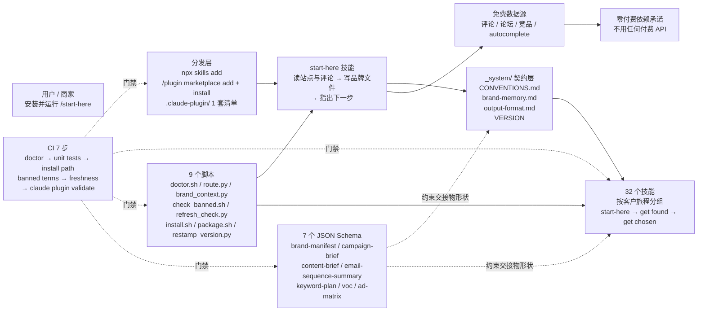

# boringmarketer/boring-marketing-skills

## 一句话定位
**本日新建、6 个 commit 交付 32 个营销技能的集合 —— 它最值得研究的是「用 6 个 commit 建成一套完整 CI 纪律」这件事：doctor 自检、单元测试、安装路径测试、违禁词检查、时效性检查、以及用官方 CLI 校验插件清单。**

## 它解决的问题
⭐⭐⭐⭐⭐ **本地商家 / 小企业的营销工作被 8 类任务切成碎片：调研、定位、文案、落地页、SEO、AI 搜索、投放、邮件与内容 —— 每类都需要一个 agent 技能。**

⭐⭐⭐⭐⭐ **但更实际的问题是「这些技能之间怎么协作」**：⭐⭐⭐⭐⭐ 品牌语气、目标受众、关键词计划、落地页主张 —— **这些是共享状态，如果每个技能各写各的，产出就会互相矛盾。**

⭐⭐⭐⭐⭐ 本项目的解法是**用一组共享文件 + 六个 JSON Schema 把 agent 间的契约固定下来**（详见「关键技术亮点」）。

⭐⭐⭐⭐⭐ 另一个被明确提出的约束（实测 README 原文）：**They were built from real campaigns, and every one works without a paid tool.** ⭐⭐⭐⭐⭐ **⭐⭐⭐ 即「零付费依赖」被写进产品承诺 —— ⭐⭐⭐⭐⭐ 而当前大量 agent 技能依赖付费 API，这在中小商家场景里直接不可用。**

## 为什么值得关注（2026-11-17）
⭐⭐⭐⭐⭐ **因为它构成了本日趋势 4 的一个极值样本：⭐⭐⭐⭐⭐ 内容层已经商品化到「6 个 commit 交付 32 个技能」，⭐⭐⭐⭐⭐ 而分发适配层还只有 1 套 harness 清单。⭐⭐⭐⭐⭐ 两者之间的落差，正是「竞争战场从技能内容转向分发适配层」这一判断的直接证据。**

**可核验事实一：规模与「刚出生」的状态（实测）。**

| 指标 | 实测 |
|---|---|
| stars / forks / **subs** / **open issues** | 117 / 52 / **0** / **0** |
| 体积 / blobs | 1,143 KB / 235 |
| `SKILL.md` 数 | **32** |
| 语言 / 许可 | Python / MIT |
| 创建 / 最后 push | **2026-11-16T15:09:46Z** / 2026-11-16T18:29:00Z（**建档时约 3 小时**） |
| commit | **仅 6 个**（全部作者 `boringmarketer`） |
| release | **0** |
| 贡献者 | **仅 1 人**（`boringmarketer` 6 commits） |
| harness 清单 | **1 套**：`.claude-plugin/plugin.json` + `.claude-plugin/marketplace.json` |
| owner | `boringmarketer`，账号 **2025-05-20** 创建、**12 个公开仓库**、**167 followers** |

⭐⭐⭐⭐⭐ **⭐⭐⭐ fork/star 比 **44.4%** —— 本日报实测的 9 个关键项目中这是最高值。⭐⭐⭐⭐⭐ **⭐⭐⭐ 而 owner 有 8 个月历史、12 个公开仓库、167 followers（对比本日记录的投放账号：0 followers、恰好 2 个仓库、提前数月养号）。⭐⭐⭐⭐⭐ **⭐⭐⭐ 即：**高 fork/star 比本身不是判据，但配上「owner 有真实历史 + 单人主导 + 6 个 commit」就构成一个清晰的图景：⭐⭐⭐⭐⭐ **这是一个人在一天之内交付 32 个技能、star 主要来自试用与 fork 的新项目。**

**可核验事实二：⭐⭐⭐⭐⭐ CI 纪律 —— 这是本项目最值得学的部分。**

⭐⭐⭐⭐⭐ 实测 `.github/workflows/ci.yml` 的完整步骤（6 个 job step，全部实测读到）：

```yaml
name: ci
on: [push, pull_request]
jobs:
  checks:
    runs-on: ubuntu-latest
    steps:
      - uses: actions/checkout@v4
      - uses: actions/setup-python@v5
        with: { python-version: "3.12" }
      - uses: actions/setup-node@v4
        with: { node-version: "22" }
      - name: doctor
        run: bash _system/scripts/doctor.sh
      - name: unit tests
        run: python3 -m unittest discover -s tests -v
      - name: install path
        run: bash tests/install_path_test.sh
      - name: banned terms
        run: bash _system/scripts/check_banned.sh .
      - name: freshness
        run: python3 _system/scripts/refresh_check.py $(cat tests/ttl_files.txt)
      - name: plugin validate
        run: |
          npm i -g @anthropic-ai/claude-code
          claude plugin validate .claude-plugin/plugin.json
          claude plugin validate .claude-plugin/marketplace.json
          claude plugin validate skills
```

⭐⭐⭐⭐⭐ **⭐⭐⭐⭐⭐ 本日报认为这是本日最值得直接抄走的一个 CI 配置，理由有六：**

| 步骤 | 作用 | 与本数据集已有线索的对应 |
|---|---|---|
| `doctor` | 环境/依赖自检 | `last30days-skill` 的 doctor · `agent-browser` 的 `cli/src/doctor/`（8 模块 + `fix.rs`） |
| `unit tests` | 单元测试 | 常规 |
| `install path` | **安装路径测试**（`tests/install_path_test.sh`） | ⭐⭐⭐⭐⭐ 直接针对「装不上」这一最常见的失败 |
| `banned terms` | **违禁词检查**（`check_banned.sh`） | ⭐⭐⭐⭐⭐ 针对内容质量 —— 营销文案里最实际的一类缺陷 |
| `freshness` | **时效性检查**（`refresh_check.py` + `tests/ttl_files.txt`） | ⭐⭐⭐⭐⭐ **⭐⭐⭐⭐⭐ 本档案在 `agent-browser` 档案里提出的「知识腐化」风险，这里给出了具体解法：给文件设 TTL 并在 CI 里检查** |
| `plugin validate` | **用官方 CLI 校验插件清单**（`claude plugin validate`） | ⭐⭐⭐⭐⭐ ⭐⭐⭐⭐⭐ **⭐⭐⭐⭐⭐ 即「用官方工具验证清单合法性」，而不是自己写一套校验 |

⭐⭐⭐⭐⭐ **⭐⭐⭐⭐⭐ `freshness` + `tests/ttl_files.txt` 这一对尤其值得记：⭐⭐⭐⭐⭐ 它把「哪些文件会过期」显式列成一个清单，⭐⭐⭐⭐⭐ 让 CI 能在过期时失败 —— ⭐⭐⭐⭐⭐ **这与本数据集 11-16 记录的 `pydtcpip` 的三档能力矩阵、⭐⭐⭐⭐⭐ `coordinator` 的 `.token-ceilings`、`interspace` 的签名校验条款属于同一条线索的最高形态：⭐⭐⭐⭐⭐ 「把会失效的东西写进机器会读到的地方，并让机器在它失效时报错」。**

**可核验事实三：`_system/` 共享契约层（实测 21 个文件）。**

⭐⭐⭐⭐⭐ 实测 `_system/` 下的构成：

- **共享上下文 3 份**：`CONVENTIONS.md` · `brand-memory.md` · `output-format.md` + `VERSION`
- **⭐⭐⭐ 六个 JSON Schema**：`ad-matrix.schema.json` · `brand-manifest.schema.json` · `campaign-brief.schema.json` · `content-brief.schema.json` · `email-sequence-summary.schema.json` · `keyword-plan.schema.json` · `voc.schema.json`（共 7 个）
- **脚本 9 个**：`brand_context.py` · `capability.py` · `check_banned.sh` · `doctor.sh` · `install.sh` · `package.sh` · `refresh_check.py` · `restamp_version.py` · `route.py`

⭐⭐⭐⭐⭐ **⭐⭐⭐⭐⭐ 这套结构的设计意图可以从实测 README 的安装说明反推出来：**

> Then type `/start-here` and name the business. It reads the site and the reviews, **writes the brand files every other skill uses**, and **tells you which skill to run next**. The first run takes about 3 minutes

⭐⭐⭐⭐⭐ **⭐⭐⭐⭐⭐ 即：`start-here` 是一个**入口路由器** —— 它读网站与评论 → 写出品牌文件（其他所有技能都要用的共享状态）→ **并指出下一步该跑哪个技能**。⭐⭐⭐⭐⭐ `route.py` 正是这个路由的实现。**

⭐⭐⭐⭐⭐ **⭐⭐⭐⭐⭐ 而七个 JSON Schema 的作用是：**让「品牌文件」「活动简报」「内容简报」「邮件序列摘要」「关键词计划」「VOC」「广告矩阵」这些 agent 之间的交接物有确定的形状。⭐⭐⭐⭐⭐ **⭐⭐⭐⭐⭐ 这就是本项目解决「技能之间互相矛盾」的手段 —— 不是靠提示词里的约定，而是靠 JSON Schema。**

**可核验事实四：32 个技能按客户旅程分组（实测 README 的技能表）。**

| 阶段 | 实测技能（部分） |
|---|---|
| **Start here** | `start-here` · `brand-voice` · `positioning-angles` · `audience-research` · `competitive-intel` |
| **Get found** | `google-business-profile` · `local-seo-plan` · `service-area-pages` · `ai-search` · `site-audit` · `keyword-research` · `seo-content` · `programmatic-seo` |
| **Get chosen** | `reviews` · `first-screen-check` · `landing-page` · `direct-response-copy` … |
| 另有 | `ads-incrementality-check` · `content-atomizer` · `ai-search`（实测目录名） |

⭐⭐⭐⭐⭐ **⭐⭐⭐⭐⭐ 注意技能命名本身就是产品方法论的载体：⭐⭐⭐⭐⭐ `start-here` 是入口、`brand-voice` 是语气、`positioning-angles` 是定位、`first-screen-check` 是「首屏是否说清了三件事」、⭐⭐⭐⭐⭐ `programmatic-seo` 明确要求「不产出 thin pages」、⭐⭐⭐⭐⭐ `ai-search` 检查「ChatGPT / Perplexity / Google 的 AI 是否提到了这个商家」。⭐⭐⭐⭐⭐ **⭐⭐⭐⭐⭐ 这批技能名背后是一套完整的本地商家营销方法论，⭐⭐⭐⭐⭐ 而 6 个 commit 就把它交付了 —— 这就是「内容层商品化」的实证。**

## 热度来源判断
⭐⭐⭐⭐⭐ **判断：热度来源是「一个具体到能立刻用的场景 + 一个明确的价格优势（零付费依赖）」，⭐⭐⭐⭐⭐ 但本档案必须强调**它建档时只有 3 小时历史，⭐⭐⭐⭐⭐ 117⭐ 与 52 forks 完全可能只是早期尝鲜与试用。**

支撑的**可核验事实**：

1. ⭐⭐⭐⭐⭐ **owner 有真实历史**：账号 2025-05-20 创建、12 个公开仓库、167 followers ⭐⭐⭐⭐⭐ —— **⭐⭐⭐ 与本数据集记录的投放账号（0 followers、恰好 2 个仓库）截然不同。**
2. ⭐⭐⭐⭐⭐ **⭐⭐⭐ 项目自带商业动机但表述克制**：README 提到作者还做 `boringmarketing.com` 与 `boringfunnels.com`，⭐⭐⭐⭐⭐ **⭐⭐⭐ 但把「需要客户用我的产品」的引导放在安装说明之后、且用一句话带过。**
3. ⭐⭐⭐⭐⭐ **⭐⭐⭐ 「不用付费工具」是真实约束下的产品决策**：⭐⭐⭐⭐⭐ 中小商家用不起付费 API，⭐⭐⭐⭐⭐ **而这条约束直接塑造了技能集（免费 autocomplete 数据做关键词研究、`ai-search` 只做「检查」而非「投放」）。**
4. ⭐⭐⭐⭐⭐ **⭐⭐⭐ 6 个 commit 却有 7 步 CI** —— ⭐⭐⭐⭐⭐ **⭐⭐⭐ 即工程纪律不是「攒够 commit 之后再补」的，而是第一天就有。**
5. ⭐⭐⭐ ⚠️ **⭐⭐⭐ 0 个 open issue / 0 个 subscriber** ⭐⭐⭐ ⚠️ —— **⭐⭐⭐ 对一个 3 小时大的项目，这是正常的，但也意味着**没有任何真实使用的证据**。**

⭐⭐⭐⭐⭐ **⚠️ 不作主张的部分：⭐⭐⭐⭐⭐ 本日报**不主张**「117⭐ 证明了需求」，⭐⭐⭐⭐⭐ 也**不主张** fork/star 44.4% 证明了真实使用；⭐⭐⭐⭐⭐ **所有热度数字都是 3 小时窗口内的快照，⭐⭐⭐⭐⭐ 长期价值需后续观察。**

## 关键技术亮点

1. **⭐⭐⭐⭐⭐ 七个 JSON Schema 作为 agent 间的交接契约**
   ⭐⭐⭐⭐⭐ `brand-manifest` / `campaign-brief` / `content-brief` / `email-sequence-summary` / `keyword-plan` / `voc` / `ad-matrix` ⭐⭐⭐⭐⭐ —— **⭐⭐⭐⭐⭐ 这解决了多技能协作里最容易出错的一环：交接物的形状。**

2. **⭐⭐⭐⭐⭐ `start-here` 作为入口路由器**
   ⭐⭐⭐⭐⭐ 读站点与评论 → 写品牌文件 → **指出下一步跑哪个技能**（`route.py`）⭐⭐⭐⭐⭐ —— **⭐⭐⭐⭐⭐ 即把「先做哪一步」也做成了代码，而不是让 agent 自己猜。**

3. **⭐⭐⭐⭐⭐ `freshness` + `tests/ttl_files.txt`：给文件设 TTL 并在 CI 里检查**
   ⭐⭐⭐⭐⭐ ⭐⭐⭐⭐⭐ **这是本档案在同日 `agent-browser` 档案里提出的「skill-data 会腐化」风险的具体解法 —— ⭐⭐⭐⭐⭐ **⭐⭐⭐⭐⭐ 而且它用一个清单文件显式列出「哪些文件会过期」，⭐⭐⭐⭐⭐ 让规则可审计。**

4. **⭐⭐⭐⭐⭐ 用官方 CLI 校验自己的插件清单**
   ⭐⭐⭐⭐⭐ `claude plugin validate .claude-plugin/plugin.json` / `marketplace.json` / `skills` ⭐⭐⭐⭐⭐ —— **⭐⭐⭐⭐⭐ ⭐⭐⭐⭐⭐ 不自己写校验器，而是调用官方工具 —— 这保证了「合规」的定义不会过时。**

5. **⭐⭐⭐⭐⭐ `check_banned.sh`：违禁词检查**
   ⭐⭐⭐⭐⭐ 营销文案有大量平台敏感词，⭐⭐⭐⭐⭐ **⭐⭐⭐⭐⭐ 用脚本在 CI 里挡住，比靠提示词约束可靠得多。**

6. **⭐⭐⭐⭐⭐ `install_path_test.sh`：安装路径测试**
   ⭐⭐⭐⭐⭐ ⭐⭐⭐⭐⭐ 直接测「能不能装上」—— ⭐⭐⭐⭐⭐ **⭐⭐⭐⭐⭐ 而本数据集这五天记录的最大问题恰恰是「投放体的仓库装不上」（实测 issue 内容是 `NOT WORK` 与 `无法运行`）。⭐⭐⭐⭐⭐ ⭐⭐⭐⭐⭐ 一个真项目把「装得上」做成 CI 测试，⭐⭐⭐⭐⭐ 一个假仓库把「装不上」当成正常 —— **⭐⭐⭐⭐⭐ 这是同一件事的两面。**

7. **⭐⭐⭐⭐⭐ 零付费依赖作为产品承诺**
   ⭐⭐⭐⭐⭐ 写进 README 并被贯彻到技能集设计里。

## 架构师速览

| 决策问题 | 研究判断 | 证据边界 |
|---|---|---|
| 系统边界 | **一个「共享契约层 + 32 个技能 + 打包分发」的技能包**。契约层 = `_system/`（3 份共享 md + 7 个 JSON Schema + 9 个脚本）；技能层 = `skills/<name>/SKILL.md` ×32；分发层 = `.claude-plugin/`。**边界不含模型、不含付费 API、不含任何外部 SaaS 集成** | 仓库树实测（235 blob / 32 SKILL.md / `_system/` 21 文件 / `.claude-plugin/` 2 文件）；CI 配置全文已读；**未安装、未运行、未执行任何技能** |
| 主路径 | ①用户安装（`npx skills add` 或 `/plugin marketplace add` + `/plugin install`）②跑 `/start-here` + 商家名 → `doctor.sh` 自检 → `brand_context.py` 读站点与评论 → 写品牌文件（受 `brand-manifest.schema.json` 约束）→ `route.py` 判定下一步 ③按阶段依次跑 `brand-voice` / `positioning-angles` / `audience-research` / …，每次的产出按对应 Schema 落到 `_system/` ④`package.sh` / `restamp_version.py` 打包发布 | 主路径由 README 安装说明 + 目录结构 + 脚本名推断；⭐⭐⭐ **`route.py` 与 `brand_context.py` 的实现未读，⭐⭐⭐ 路由规则完全未核验**；⭐⭐⭐ **品牌文件的具体位置与读取方式未核验** |
| 关键权衡 | ①**技能间一致性 vs 灵活性** → 用 JSON Schema 固定交接物形状；②**工程纪律 vs 交付速度** → 6 个 commit 同时配 7 步 CI；③**零付费依赖 vs 能力上限** → 明确不用付费工具，接受能力边界；④**广度（32 个）vs 深度** → 技能广度优先，单技能深度未核验 | ①②③ 有 CI 配置与 README 原文支撑；④ 由技能表结构推断；**⭐⭐⭐ 单个技能的质量未核验（未读任何一个 SKILL.md 的正文）** |
| 最小 PoC | 只装到一个 harness（Claude Code，走 marketplace）→ 跑 `/start-here` 指向**一个真实但非敏感的**本地业务（或用 README 自述的业务）→ 核对四件事：①品牌文件是否按 `brand-manifest.schema.json` 生成 ②`route.py` 推荐的下一步是否合理 ③`banned terms` 检查是否会误伤正常文案 ④`freshness` 检查对新建仓库是否误报 → 再跑 `doctor.sh` 看它报什么 → 最后才接入真实客户场景 | PoC 由本档案推导；⭐⭐⭐ **第③、④条最有价值**：违禁词检查的误伤率与 freshness 检查在新建仓库上的行为，都是「规则是否过严」的实测点，⭐⭐⭐ **而本日报未读这两个脚本**；⭐⭐⭐ **JSON Schema 的实际约束力未核验** |

## 架构启发
⭐⭐⭐⭐⭐ **启发一：⭐⭐⭐⭐⭐ 「Skill 之间会互相矛盾」是一个可以用 JSON Schema 解决的问题，而且成本极低。**
⭐⭐⭐⭐⭐ 七个 schema、235 blobs、单人、单日完成 ⭐⭐⭐⭐⭐ —— **⭐⭐⭐⭐⭐ 这比用提示词约定「请按统一格式输出」可靠得多，⭐⭐⭐⭐⭐ 也与本数据集记录的 `pydtcpip` 三档矩阵、`mixbar` 的第三方声明、`interspace` 的签名条款属于同一条线索。**

⭐⭐⭐⭐⭐ **启发二：⭐⭐⭐⭐⭐ 「会过期的东西」应该被显式列成一个清单，并让 CI 在它过期时失败。**
⭐⭐⭐⭐⭐ `tests/ttl_files.txt` + `refresh_check.py` ⭐⭐⭐⭐⭐ —— **⭐⭐⭐⭐⭐ 这直接回答了本档案在 `agent-browser` 档案里提出的问题（`skill-data/` 里的开发知识会随代码演进而腐化）：⭐⭐⭐⭐⭐ **⭐⭐⭐⭐⭐ 答案不是「别让知识过期」，而是「让 CI 告诉你它过期了」。**

⭐⭐⭐⭐⭐ **启发三：⭐⭐⭐⭐⭐ 「装得上」应该是一条测试，而不是一个愿望。**
⭐⭐⭐⭐⭐ `tests/install_path_test.sh` ⭐⭐⭐⭐⭐ **⭐⭐⭐⭐⭐ 与本数据集这五天反复出现的「用户装不上」（实测 issue：`NOT WORK` / `无法运行`）形成完整对照：⭐⭐⭐⭐⭐ **真项目把安装做成 CI 门禁；⭐⭐⭐⭐⭐ 而投放体把「装不上」当成正常状态。⭐⭐⭐⭐⭐ 同一个用户行为，在两类仓库里指向完全相反的结论。**

⭐⭐⭐⭐⭐ **启发四：⭐⭐⭐⭐⭐ 用官方工具做合规校验，而不是自研校验器。**
⭐⭐⭐⭐⭐ `claude plugin validate` ⭐⭐⭐⭐⭐ —— **⭐⭐⭐⭐⭐ 校验器的定义会变（规范会演进），⭐⭐⭐⭐⭐ 自研校验器必然过时。⭐⭐⭐⭐⭐ 这与本日报记录的 `SkillEvaluator` 「fetches **pinned, verified** releases」是同一条原则：⭐⭐⭐⭐ **在供应链上，「固定版本 + 官方来源」比「自己实现」更可靠。**

⭐⭐⭐⭐⭐ **启发五：⭐⭐⭐⭐⭐ 「先做哪一步」也值得做成代码。**
⭐⭐⭐⭐⭐ `route.py` + `start-here` 的「tells you which skill to run next」⭐⭐⭐⭐⭐ —— **⭐⭐⭐⭐⭐ 这与 `ffmpeg-skill` 的「probe → edit → check → verify」工作流是同一种思路：⭐⭐⭐⭐⭐ **⭐⭐⭐⭐⭐ 把流程顺序从提示词里挖出来，变成可执行的路由。**

## 架构图（MMD）

> 证据边界：此图只采用本档案已有可核验描述；标注「待核验」的节点不应视为项目实现事实。



## 定位判断
**观察型 —— 但它是一个值得作为「样板」观察的对象。**

⭐⭐⭐⭐⭐ 在 117⭐ / 52 forks 的体量下，它已经具备：⭐⭐⭐⭐⭐ 32 个技能、7 步 CI、7 个 JSON Schema、9 个脚本、完整安装路径、零付费依赖承诺。⭐⭐⭐⭐⭐ **⭐⭐⭐ 用 6 个 commit 做到这个程度，说明「一个高质量的小型 Skill 包」是完全可实现的 —— 这对任何想快速交付一批技能的人是一个可参照的成本基准。**

⭐⭐⭐⭐⭐ ⭐⭐⭐ 但它与本日报记录的两个参照物形成了鲜明对比：⭐⭐⭐⭐⭐ **对照 `mvanhorn/last30days-skill`（68,087⭐ / 6,035 forks / 34 条机制级 issue / 6 位贡献者 / 4 套 harness 清单 / 8 个工作流），⭐⭐⭐⭐⭐ 本项目只有 1 套清单、1 位贡献者、0 条 issue；⭐⭐⭐⭐⭐ **对照 `NVIDIA/SkillEvaluator`（2,623⭐ / 1,180 blobs / 8 个工作流 / 3 个 tier），⭐⭐⭐⭐⭐ 本项目的 CI 更完整但没有分层评估。**

⭐⭐⭐⭐⭐ ⭐⭐⭐ 最准确的定位：**「内容层商品化的极端样本 + 分发适配层刚起步的新项目」** ⭐⭐⭐⭐⭐ —— **⭐⭐⭐⭐⭐ 它正是本日第 4 条趋势的活标本：内容可以一天交付 32 个，但适配层（1 套清单）与真实使用反馈（0 条 issue）都还欠着。**

## 风险/局限/泡沫点
1. ⭐⭐⭐⭐⭐ **⭐⭐⭐ 建档时只有 3 小时历史**：⭐⭐⭐⭐⭐ **117⭐ 与 52 forks 全部落在最初几小时，⭐⭐⭐⭐⭐ 本档案**不主张**任何关于长期热度的结论。**
2. ⭐⭐⭐⭐⭐ **⭐⭐⭐ 单人单次提交**：1 位贡献者、6 个 commit、0 个 release ⭐⭐⭐⭐⭐ —— **⭐⭐⭐⭐⭐ 巴士因子 = 1，⭐⭐⭐⭐⭐ 且没有任何版本发布历史可供追责。**
3. ⭐⭐⭐⭐⭐ **⭐⭐⭐ 32 个技能的质量未核验**：⭐⭐⭐⭐⭐ **本日报未读任何一个 `SKILL.md` 的正文**（只读了 README 的技能表），⭐⭐⭐⭐⭐ **⭐⭐⭐ 32 个技能可能只是 32 个提示词骨架。**
4. ⭐⭐⭐ ⭐ **`freshness` 与 `banned terms` 可能过严**：⭐⭐⭐ ⭐ 两个脚本的判定规则未核验，⭐⭐⭐ ⭐ **⭐⭐⭐ 过严的 CI 会拖慢迭代，且新建仓库可能触发误报。**
5. ⭐⭐ ⚠️ **未核验项**：32 个 SKILL.md 的正文、7 个 JSON Schema 的实际约束力、`route.py` 的路由规则、零付费依赖在实操中的能力上限、CI 是否真的在 GitHub 上通过。

## 与同类项目的关系
- **vs `mvanhorn/last30days-skill`**：⭐⭐⭐⭐⭐ **⭐⭐⭐ 本日最直接的对照 —— 同为「覆盖 50+ host」路线，但 last30days 有 68k⭐ / 6035 forks / 34 条机制级 issue / 6 位贡献者，⭐⭐⭐⭐⭐ 而本项目是同日新建、0 issue、1 位贡献者。⭐⭐⭐⭐⭐ **⭐⭐⭐⭐⭐ 同一条路上相差约 5 个月与两个数量级的 star —— 这本身就是「Skill 赛道的分化速度」的证据。**
- **vs `NVIDIA/SkillEvaluator`**：⭐⭐⭐⭐⭐ **互补 —— 本项目的 CI 7 步里没有「质量评估」层；⭐⭐⭐⭐⭐ 而 SkillEvaluator 的 tier 1/2/3 恰好可以套在它身上。⭐⭐⭐⭐⭐ ⭐⭐⭐⭐⭐ 这两个项目放在一起，恰好构成「Skill 供给方 + Skill 评估方」的完整拼图。**
- **vs `kajisho5/ffmpeg-skill`**：⭐⭐⭐⭐⭐ ⭐⭐⭐ 两者都用「机器可读的交接契约」：ffmpeg-skill 是 `docs/contract.md`（工具契约），⭐⭐⭐⭐⭐ 本项目是 7 个 JSON Schema（业务交接物）；⭐⭐⭐⭐⭐ **⭐⭐⭐⭐⭐ 前者的对象是工具调用，后者的对象是 agent 之间的产物 —— 两者合起来覆盖了 agent 契约的两个层次。**
- **vs `google/elephant-goldfish-model`**：⭐⭐⭐⭐⭐ 正交 —— EGM 管规范评审，本项目管理营销工作流。
- **vs `elementalsouls/Claude-BugHunter`**：⭐⭐⭐⭐⭐ 同为多技能集合（32 vs 83 个 `SKILL.md`），⭐⭐⭐⭐⭐ 但 **Claude-BugHunter 有 `eval-harness.yml` / `leak-guard.yml` / `skill-lint.yml` / `install-smoke.yml` 四个专门工作流，⭐⭐⭐⭐⭐ 而本项目把它们合并成了一个 ci.yml。**

## 是否值得持续跟踪
**值得 —— 但作为「样板」而非作为「投资标的」跟踪。**

⭐⭐⭐⭐⭐ 建议的跟踪动作：① **30 天后回看它的 star / issue / fork 走势**，⭐⭐⭐⭐⭐ 判断「一天 32 个技能」是内容优势还是一次性发布；② **⭐⭐⭐⭐⭐ 看它的 CI 是否在真实 PR 上发挥过作用**（尤其 `install_path_test.sh` 与 `freshness`）；③ ⭐⭐⭐ ⭐ **看它是否补上第二套 harness 清单** —— ⭐⭐⭐ ⭐ **那将是「适配层竞争」在这个项目上的第一个信号。**

## 后续观察点
1. ⭐⭐⭐⭐⭐ **30 天后的 star / issue / fork 走势** —— ⭐⭐⭐⭐⭐ **⭐⭐⭐⭐⭐ 0 条 issue 是最需要被打破的指标**（要么说明没人真用，要么说明真用没障碍）
2. ⭐⭐⭐⭐⭐ **⭐⭐⭐⭐⭐ 是否新增第 2 套 harness 清单**（Cursor / Codex / Gemini 原生）
3. ⭐⭐⭐⭐⭐ **⭐⭐⭐⭐⭐ `install_path_test.sh` 是否被证明有效** —— 即是否有 issue 报告「装不上」并被该测试捕获
4. ⭐⭐⭐ ⭐ **是否接入质量评估**（如引入 `NVIDIA/SkillEvaluator` 的 tier 1）
5. ⭐⭐⭐ ⭐ **是否发布第一个 release**（当前 0 个 release，⭐⭐⭐ ⭐ **即尚无版本历史可供追溯**）
6. ⭐⭐⭐ ⚠️ **是否出现第二位贡献者** —— ⭐⭐⭐ ⚠️ 单人项目的可持续性是本项目的最大不确定性

---

*首次记录：2026-11-17 · 全部元数据取自 2026-11-17 CST 的 GitHub REST API 快照（`repos/*`、`git/trees/*?recursive=1`、`commits`、`readme`、`contents/.github/workflows/ci.yml`、`users/*`）*
