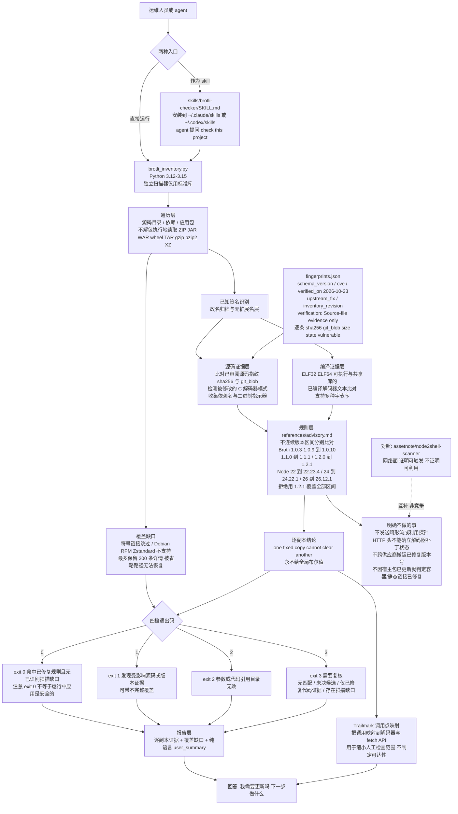

# trailofbits/brotli-checker

## 一句话定位
针对 CVE-2026-111497 的**离线式**资产盘点器——扫描源码、依赖、应用包与已解包的容器文件系统，找出可能需要更新的 Brotli 解码器副本，**并把「存在受影响副本」「被构建选中」「被发布」「攻击者可控输入可达」「可利用」拆成五个互不替代的独立结论**。

## 它解决的问题
**这个项目要解决的不是「漏洞是什么」，而是「我这次升级到底修没修」。**

这是 CVE 修复期最容易被忽略的一环：即使 Node.js 升到了 22.23.4 / 24.22.1 / 26.12.1，你的部署里**仍可能同时存在三四份 Brotli 解码器**——Node 自带的那份、npm 依赖里静态链接的那份、容器基础镜像里系统库的那份、以及发行版 backport 后的那份。**修好其中一份，不等于另外几份也被修好了。**

**⭐ 而更棘手的是「版本号不能告诉你答案」**：发行版可能给一个上游已修复的旧版本 backport 了补丁；静态链接的二进制里根本没有版本号可读；容器里的系统库和宿主的是两份不同的文件。**用 `npm ls` 或 `node -v` 都答不出这个问题。**

这个项目的答案是：**去文件系统里找每一份副本，逐份给结论，并且明说「哪几份它看不出来」。**

## 为什么值得关注（2026-10-26）
**⭐ 因为它是本日唯一把「扫描器返回 0」这件事正面否定掉的项目**——而这正是扫描器被误用得最多的地方。

四个可核验的硬事实：

1. **⭐⭐⭐ 它的四档退出码里，exit 0 的定义被显式限定了**。`docs/usage.md` 原文：

   > | Exit | Meaning |
   > | 0 | Reported items meet a known source or upstream-version fix rule, **with no recognized scan gaps**. |
   > | 1 | Affected source/code or potentially affected source/version evidence was found. |
   > | 2 | Invalid arguments or code-reference catalog. |
   > | 3 | **Review is needed**: no matches, unresolved candidates, fixed-code-only evidence, or scan gaps. |

   紧接着的正文是本日报今日最该抄的一句：

   > Affected evidence takes precedence over gaps: exit 1 can include incomplete coverage. **A fixed copy does not clear another, and exit 0 does not establish that the running app is fixed.**

2. **⭐⭐⭐ 它把结论拆成四个互不替代的命题**，写在 `SKILL.md` 开头：

   > Finding vulnerable source establishes **source containment**. **Build selection, shipment, attacker-controlled input reaching that decoder, and exploitability are separate conclusions.** Keep a result for each copy; **one fixed copy cannot clear other copies.**

3. **⭐⭐⭐ 它拒绝用一个版本号覆盖不连续的受影响区间**——`references/advisory.md` 原文：「**The CNA record has disjoint Brotli version ranges. A single comparison against 1.2.1 would incorrectly warn on fixed 1.0.10 and 1.1.1.**」

4. **⭐⭐ 它的快照有日期**：`fingerprints.json` 的 `verified_on` 为 **"2026-10-23"**，且 `SECURITY.md` 明说「Advisory rules and compiled references are snapshots, **and an old checkout does not automatically receive new guidance**」。

## 热度来源判断
**热度来自一个真实且持续的安全事件，但本项目自身的采用信号几乎为零。**

- **⭐ 事件热度是真实的**：`CVE-2026-111497 created:<date>` 的仓库数逐日为 **2 → 9 → 16 → 12 → 11**（10-21 至 10-25），`in:description` 共 **39** 个仓库且全部创建于 10-20 之后。**这是一个正在发生的 CVE 窗口，不是蹭热点。**
- **⭐⭐ 但本项目的采用信号是本日最弱的之一**：**subscribers_count = 0**、open issues = 0、topics 为空数组、44⭐ 而 ⑂3。**⭐ 即：几乎没有人在长期关注它。**
- **⭐⭐ 而这恰恰构成一个可核验的反差**：本项目的 star 数（44）**低于**同生态的 PoC 仓库（`Rabbitbong/node2shell` 81⭐、`dimasma0305/CVE-2026-111497-POC` 43⭐ ⑂14），**却远高于它的实际工程复杂度**（26 commits、6.8 MB、指纹目录、版本表、Trailmark 集成、3 个 release）。**⭐⭐ 即：本日又一次出现「热度与价值脱钩」，且方向与 PoC 仓库相反——本项目价值更高而 star 更少。**
- **⭐⭐⭐ 而有一个可核验的机制解释了这个反差**：**安全厂商发布工具时，不会用 star 作为目标函数。** 它有 3 个 release、1,108 行的 `docs/usage.md`、`SECURITY.md`、`CONTRIBUTING.md`、`scripts/check_mutation_score.py`（3,831 字节）、`scripts/verify_fingerprints.py`（4,905 字节）、`scripts/verify_slack_renderer.cjs`（11,848 字节）、`scripts/build_binary_references.py`（6,044 字节）——**⭐ 这些是「要在一个组织里长期可用」才需要的东西，star 一个都不需要。**
- **账号背景可核验**：`trailofbits` 是 Organization，298 个公开仓库，3,297 followers。

## 关键技术亮点

1. **⭐⭐⭐ 四档退出码 + 「exit 0 不等于安全」的显式声明**
   这是本项目最核心的设计。0 / 1 / 2 / 3 分别对应「已修复规则命中且无扫描缺口」「发现受影响证据」「参数或引用目录无效」「需要复核（含扫描缺口）」。
   **⭐ 而正文里那句「exit 0 does not establish that the running app is fixed」把退出码的语义从「检查结果」升级成了「证据强度声明」。**

2. **⭐⭐⭐ 结论的四级分解**
   `SKILL.md` 把「源码里有受影响副本」与「它被构建选中」「它被发布了」「攻击者可控输入能到达它」「它可被利用」明确分开。
   **⭐⭐ 关键的一句是最后那个否定式：「Keep a result for each copy; one fixed copy cannot clear other copies.」——即它**永远不会给出一个全局的「安全/不安全」布尔值**，因为那个值在多副本场景下不存在。**

3. **⭐⭐⭐ 不连续版本区间的正确处理**
   版本表逐行列出：Brotli 1.0.3–1.0.9 → 1.0.10；1.1.0 → 1.1.1；1.2.0 → 1.2.1；Node.js 22.x → 22.23.4；24.x → 24.22.1；26.x → 26.12.1。
   **⭐ 而它明写为什么要这样：「A single comparison against 1.2.1 would incorrectly warn on fixed 1.0.10 and 1.1.1.」**
   **⭐⭐ 并对「其他分支、fork、预发布、自定义构建」明说「need decoder-specific evidence」，以及「The helper does not assert that every historical Node release contains an affected decoder.」**

4. **⭐⭐⭐ 拒绝跨供应商搬运「已修复版本号」**
   > An older version can contain a vendor backport. Establish the OS release, provider, architecture, and complete package revision, then use that provider's advisory and native package version ordering. **Do not compare distro revisions as upstream SemVer or transfer one provider's fixed revision to another.** Verify the file/package actually loaded by the serving process and whether it restarted. **An updated host package does not establish the state of a container, native extension, or statically linked executable.**

5. **⭐⭐ 指纹来源被结构化**
   `fingerprints.json` 含 `schema_version` / `cve` / **`verified_on`** / `upstream_fix`（指向上游修复 commit 的 URL）/ **`inventory_revision`** / `verification`（原文：「Fetched upstream releases and pinned inventory source; **verified Git blob and SHA-256, and compared block-switch handling with upstream fix. Source-file evidence only.**」）/ 逐条指纹的 `sha256` / `git_blob` / `size` / **`state: "vulnerable"`** / `sources`。
   **⭐⭐ `verification` 里的 "Source-file evidence only" 是一句边界声明——它明说自己只证明了源码层面的证据。**

6. **⭐⭐ 覆盖缺口被当成一等输出**
   `docs/usage.md` 记录了各种会产生缺口的情况：符号链接被跳过（除非其解析目标在同一棵树内）、不支持的容器格式（Debian / RPM / Zstandard）会产生缺口并要求提供解包后的文件、无签名或无法识别的格式可能被漏掉。**⭐ 并规定「最多保留 200 条缺口详情，被省略的路径无法恢复」——即它诚实地告知自己的观测是有界的。**

7. **⭐⭐ 编译后代码的指纹比对**
   README 与 `docs/usage.md` 记录了它对 ELF32 / ELF64 可执行文件与共享库的**已编译解码器文本比对**，支持多种字节序，并明写「Unmatched code remains unknown; **compiler identity alone does not** [establish a match]」。

8. **⭐⭐ Trailmark 的角色被明确定义为「缩小检查范围」而非「判定可达性」**
   > The scanner finds suspect parts; **Trailmark helps show how the code connects.** The assistant checks whether those connections apply to the running app.
   **⭐ 即：扫描器负责「哪些文件有风险」，Trailmark 负责「代码怎么连的」，最终判断由人/agent 做。**

9. **⭐ 它明确划出了自己够不到的地方**
   > If only a URL is supplied, explain that **HTTP headers cannot establish the decoder's patch status.** Say "I can't confirm this from the website address alone"…
   > **Do not send malformed streams or exploit probes.**
   **⭐⭐ 即：它主动放弃了主动探测这条路（这正是它与 `assetnote/node2shell-scanner` 的分界线），因此它对「网络面」完全无能为力。**

## 架构师速览

| 决策问题 | 研究判断 | 证据边界 |
|---|---|---|
| 系统边界 | **单一本地资产面工具**，边界划在「**不接触运行中的服务**」。四层结构：① **容器/归档遍历层**（读取源码、依赖、应用包与**不解包执行**的 ZIP/JAR/WAR/wheel/TAR/gzip/bzip2/XZ 容器，按已知签名识别改名归档与无扩展名层；不认识的格式产生**覆盖缺口**）② **源码证据层**（比对已审阅的源码指纹 + 检测被修改过的 C 解码器模式 + 收集依赖名与二进制指示器）③ **编译证据层**（对 ELF32/ELF64 可执行与共享库做已编译解码器文本比对）④ **报告层**（逐副本结论 + 覆盖缺口 + 纯语言 `user_summary`，`--json` 时输出逐副本证据）。**⭐ 边界之外的两个方向都被明确声明为「不做」：不向网络发送畸形流或利用探针；不由 HTTP 头推断补丁状态** | `skills/brotli-checker/SKILL.md`（17,385 字节）、`docs/usage.md`（13,971 字节）、`references/advisory.md`、`references/fingerprints.json`、`README.md`（3,814 字节）、`SECURITY.md`、`scripts/` 四个脚本的存在与体积、`pyproject.toml`（2,462 字节）、`.github/workflows/checks.yml` 与 `security.yml`。**⭐ `brotli_inventory.py` 的遍历实现、容器处理的边缘情形、以及 `verify_fingerprints.py` / `check_mutation_score.py` 的具体判定本窗口未逐行核验，待核验** |
| 主路径 | 两种入口：① **作为 skill**——安装 `skills/brotli-checker/` 到 `~/.claude/skills/` 或 `~/.codex/skills/`，然后对 agent 说「check this project」；skill 会自动跑 `python3 scripts/brotli_inventory.py /absolute/target --json` 收集本地证据，再由 agent 结合 Trailmark 的调用点映射做人工判断，最后用纯语言回答「我需要更新吗、下一步做什么」。② **作为独立扫描器**——`git clone` 后直接 `python3 skills/brotli-checker/scripts/brotli_inventory.py /path/to/application`（默认输出面向人；`--json` 输出逐副本证据、覆盖缺口与 `user_summary`）。**⭐ 判定语义**：退出码 0 = 收集完成、3 = 证据不完整、2 = 参数无效；文档明写「Neither a successful exit nor an empty neighborhood establishes that a decoder is fixed or unreachable.」 | README 的「Install and use」「Run the scanner directly」「Understand the result」三节、`docs/usage.md` 的退出码表与「Main scanner exit codes」节、`SKILL.md` 的「Gather evidence」节给出的 `python3 scripts/brotli_inventory.py /absolute/target --json` 调用形式。**⭐ Trailmark 的调用点映射如何进入最终结论本窗口未核验，待观察** |
| 关键权衡 | **⭐ 离线盘点 vs 主动探测**（离线零副作用、能覆盖容器与静态链接的副本，但**答不了「输入可达吗」**）· **⭐ 退出码 0 vs 退出码 3**（选择把「有扫描缺口」单独编码为 3 而不是塞进 0——**代价是使用者必须真的去读 exit 3，否则会误以为一切正常**）· **⭐ 逐副本结论 vs 全局布尔**（拒绝给全局结论，**代价是使用者要自己聚合**）· **⭐ 不连续版本区间 vs 单一阈值**（选择按分支分别比对，**代价是规则复杂，且必须随上游新版本更新**）· **⭐ 拒绝跨供应商搬运 vs 自动判定**（不给「这个 distro 的 1.0.9 到底修没修」的答案，**代价是需要人去查该发行版的公告**）· **⭐ 快照 + 日期 vs 自动更新**（`verified_on` 是日期而非「最新」标签，`SECURITY.md` 明说旧 checkout 不会自动获得新指引——**代价是用户必须自己刷新**）· **⭐ 缺口有界 vs 假装完整**（「最多保留 200 条缺口详情，被省略的路径无法恢复」）· **⭐ 覆盖缺口优先于受影响证据 vs 反之**（文档明写「Affected evidence takes precedence over gaps」，即 **exit 1 可以带着不完整的覆盖**）· **⭐ 定位为「找可疑部分」而非「判定安全」** | `docs/usage.md` 的退出码表与「Affected evidence takes precedence over gaps」段、`references/advisory.md` 的版本表与 backport 段、`SECURITY.md`、`fingerprints.json` 的 `verification` 与 `verified_on` 字段、README 的「Understand the result」段。**未明示：误报/漏报率的公开统计、指纹目录的更新频率、以及退出码 3 在实际 CI 中被如何消费** |
| 最小 PoC | 1. **⭐ 先读 `references/advisory.md` 的版本表**，确认你关心的分支落在哪个区间（Brotli 1.0 / 1.1 / 1.2，Node 22 / 24 / 26）→ 2. `git clone` 并 `cd brotli-checker` → 3. **⭐ 运行 `python3 skills/brotli-checker/scripts/brotli_inventory.py /path/to/application`**（**注意：需要 Python 3.12–3.15**；独立扫描器仅用标准库，Trailmark 源码发现需要 `uv`）→ 4. **⭐⭐ 关键步骤：读 JSON 输出里的 `coverage_gaps` 字段**，确认扫描覆盖了什么、漏了什么——**这一步是唯一能证伪其「结论可信」的步骤**（若不看缺口，exit 0 与 exit 3 无异）→ 5. **⭐⭐ 关键步骤：确认在「有扫描缺口」的情况下退出码是 3 而不是 0**（**这验证的是它最有价值的语义**）→ 6. **⭐ 对一个确实含受影响副本的目录跑一遍，确认 exit 1 且能指出是哪一份副本**（**不要只看总结果，要看是不是「逐副本」的**）→ 7. **⭐ 读 `references/fingerprints.json` 的 `verified_on` 与 `state` 字段**，若早于你需要的补丁日期即为过期快照 → 8. **⭐ 抽查一条指纹的 `sha256` 与上游 release 的对应关系**（即验证指纹目录本身可信）→ 9. **⭐ 作为 skill 用一遍**：装到 `~/.claude/skills/`，让 agent 对一个项目说「check this project」，观察它是否在给出「你安全了」之前先问了覆盖情况 | **第 4、5 步是本 PoC 唯一的「证伪其核心主张」的步骤**（其余只验证它能跑）· **第 7、8 步是判断快照是否过期与可信的唯一手段** · **第 3 步的 Python 版本限制是硬门槛** · 本 PoC **不覆盖** 网络面判定（那是 scanner 的职责）· **不覆盖** Trailmark 源码发现路径的实际效果（需 `uv` 与真实仓库）· **不覆盖** 自定义构建与预发布版本的判定（文档明说需 decoder-specific evidence） |

## 架构启发

**⭐⭐⭐ 核心启发：「结论的强度」必须与「结论的粒度」一起被编码，而不能靠文档解释。**

exit 0 的定义里带着 "with no recognized scan gaps" 这半句——**即 exit 0 不是一个「通过」信号，而是一个「在我能看到的范围内、且在我没有识别到盲区的前提下，没有命中」的声明。** 这与本日报此前记录的 mcreplay（0/1/2/3 且 2 = 有破坏性风险）、oss-verify（`oft check` 在 `Print Assumptions` 阶段拒绝越界公理）属于同一族，但**本项目是本日唯一把这个语义写到退出码定义正文的**。

**⭐⭐ 第二个启发：多副本场景下，全局布尔值是一个错误的问题。**

「这个应用安全吗？」这个问题在多副本部署下**没有正确答案**——因为副本 A 已修复而副本 B 未修复时，"安全" 这个词无法定义。**本项目的解法不是「更聪明地聚合」，而是「拒绝聚合」**（one fixed copy cannot clear another）。**⭐ 这是本日报见过最干净的一次「拒绝回答一个错误的问题」。**

**⭐⭐⭐ 第三个启发：指纹的来源链必须能被复算，而不只是被信任。**

`fingerprints.json` 的 `verification` 字段写的是「Fetched upstream releases and pinned inventory source; **verified Git blob and SHA-256, and compared block-switch handling with upstream fix. Source-file evidence only.**」——**即它说明了自己是怎么得到这份指纹的，包括用哪个上游 commit、比对的是 git blob 还是 SHA-256、以及明确声明「仅源码层面证据」。**

**⭐⭐⭐⭐ 第四个启发（本日最可迁移的一条）：把「我答不了的问题」写进产品行为，而不是写进限制条款。**

它不向网络发一个字节（明写 "Do not send malformed streams or exploit probes"），不靠 HTTP 头猜补丁状态（明写 "HTTP headers cannot establish the decoder's patch status"），不给全局布尔值，不跨供应商搬版本号。**⭐ 每一个「不做」都是一道把误用挡在门外的护栏——这与本日报记录的 KohakUnlock「默认构建即禁用硬件执行」是同一条工程原则的不同领域再现。**

**⭐⭐⭐⭐⭐ 架构对比：** 与 `assetnote/node2shell-scanner` 构成一对**边界互补**的工具。**⭐ 一个在网络面证明「可触发」，一个在文件面证明「存在」；两者加起来仍然答不出「这台机器现在安不安全」——而这正是本日报趋势 1 要记的东西。**

## 架构图（MMD）

> 证据边界：此图只采用本档案已有可核验描述；「待核验」节点不应视为项目实现事实。

## 定位判断
**供应链资产盘点工具（Supply-chain inventory），不是扫描平台，也不是漏洞扫描器。**

在 CVE-2026-111497 的生态里，它占据的是「**防守方内部变更管理**」这一侧。这个位置在过去几年被反复证明是真实需求——**每一次供应链事件之后，「我们到底装了什么」都成为比「漏洞是什么」更耗时的问题。**

**⭐ 从工具形态看，它已经是一个完整的产品而非脚本**：`pyproject.toml`、`Makefile`、`CONTRIBUTING.md`、`SECURITY.md`、`docs/usage.md`（13,971 字节）、`CHANGELOG.md`、`scripts/` 下四个验证脚本（**含 `check_mutation_score.py`——即它对自己的测试做变异测试**）、`.github/workflows/checks.yml` 与 `security.yml`、3 个 release、**双语文档（`README.md` + `README.zh-CN.md`）**。

**⭐⭐ 而其中最值得注意的一个文件是 `scripts/verify_slack_renderer.cjs`（11,848 字节）**——**即它把「在 Slack 里渲染结果」这件事做成了一个可验证的模块。** **⭐ 这是一个强烈的信号：它的目标用户是「需要在团队协作工具里交付一份升级清单」的工程组织，而不是「跑一下看看有没有事」的个人开发者。**

**⭐⭐⭐ 而这个定位也解释了 subs 0 的原因：它的目标用户本来就不是 GitHub 上的个人开发者。**

## 风险 / 局限 / 泡沫点

- **⚠️⚠️⚠️ exit 0 在 CI 里极易被读成「安全」。** 工具本身明确否定了这个读法，但**否定写在文档里，而 CI 脚本只看退出码**。**⭐ 这是本项目最大的实际风险——不是工具错，是使用方式错。**
- **⚠️⚠️ 它的答案覆盖不了「输入可达吗」。** 离线盘点能证明「这份副本在」，**不能证明「攻击者的输入能走到它」**。**在多副本部署中，最危险的组合恰恰是「未修复的副本恰好是运行时真正加载的那一份」——而工具明说无法判定这一层（Verify the file/package actually loaded by the serving process）。**
- **⚠️⚠️ 发行版 backport 让版本号失效。** 工具明说必须查该发行版的公告——**这意味着在企业环境里（尤其是有内部镜像源的）它的自动化程度会显著下降**。**这与它「纯离线、可脚本化」的设计目标存在张力。**
- **⚠️⚠️ 快照会过期。** `verified_on: "2026-10-23"`，`SECURITY.md` 明说旧 checkout 不会自动获得新指引。**⭐ 指纹目录是一个需要人工维护的资产——而本日报无法核验它的更新频率。**
- **⚠️ 覆盖缺口有界且不可完全恢复。** 「最多保留 200 条缺口详情，被省略的路径无法恢复」——**即在大规模部署上，缺口明细本身会被截断。**
- **⚠️ 预发布版本与自定义构建无解。** 文档明说需 decoder-specific evidence。**对使用 `nvm` 装 nightly 或自编译 Node 的团队，本工具无法给出结论。**
- **⚠️ 零 subs、零 issue。** **没有外部用户的反馈通道**——**这既是「不需要广泛支持」的信号，也是「出问题时没有地方提问」的信号。**
- **⚠️ 它不是安全边界，只是一份清单。** 它的输出是一个「需要更新的副本列表」，**不是「你的部署是安全的」这个判断**。**把它当后者用，就是 exit 0 误读的根源。**

## 与同类项目的关系

- **⭐⭐ vs `assetnote/node2shell-scanner`（本日同期另一位 key_project）**：**本日最清晰的一对互补关系**。scanner 在**网络面**（URL → 主动探测 → 可触发性），brotli-checker 在**文件面**（目录 → 资产盘点 → 存在性）。**⭐⭐ 两者都把「不确定」做成独立输出状态**（`INCONCLUSIVE` vs exit 3），**⭐⭐⭐ 但能力边界完全相反——这恰好证明「两个工具加起来仍然答不出安不安全」。**
- **⭐ vs `trailofbits/trailmark`**：**不是竞品，是上游依赖**。README 明写 Trailmark 负责「maps calls to the decoder and fetch APIs, helping the assistant find callers to inspect」——**即 Trailmark 回答「代码怎么连的」，本工具回答「哪些文件有风险」，最终判断由人/agent 做。**
- **⭐ vs 发行版与容器的原生扫描器**（`trivy` / `grype` / `syft` 生态）：**它们扫「已知的 CVE 列表」，本工具扫「一个特定 CVE 的解码器副本」并给出「需要 decoder-specific evidence」的判断。** **⭐ 差异在于：本工具承认自己只懂这一个 CVE，但懂得比通用扫描器深**（它知道 Brotli 的不连续版本区间、知道发行版 backport 的陷阱、知道已编译代码的匹配方式）。
- **⭐ vs `dimasma0305/CVE-2026-111497-POC`（43⭐ ⑂14，NOASSERTION）、`ZeroHackOrg/node2shell-poc`、`shivrajem/node2shell-detect`、`CompleTetech-Security/node2shell-check`** 等同生态仓库：**⭐ 那些仓库提供「怎么打进去」或「粗略查一下」，本项目提供「逐副本的、结论强度被显式标注的判定」。** **本项目的 star 数（44）低于 PoC 仓库（`Rabbitbong/node2shell` 81⭐），而工程体量远大于它们——这本身就是本日的一条数据。**
- **⭐ vs 供应链清单工具（SBOM 生态，如 `spdx` / `cyclonedx` 工具链）**：**⭐ SBOM 回答「我装了什么版本」，本工具回答「我这份二进制里那份解码器到底修没修」——后者需要的正是前者的弱点所在。**

## 是否值得持续跟踪
**值得，且它比本批任何工具都更适合作为长期依赖——但使用方式必须正确。**

- **⭐ 理由一：它是本日唯一具备可持续更新形态的工具。** `verified_on` + `CHANGELOG.md` + 3 个 release + `scripts/verify_fingerprints.py` + `check_mutation_score.py` + `CONTRIBUTING.md`——**这套东西是为「在一个组织里跑三年」设计的，不是为「CVE 期间用两周」设计的。**
- **⭐ 理由二：它的设计模式可迁移到任何领域。** 「逐副本结论 + 覆盖缺口 + 四档退出码 + 快照日期 + 拒绝全局布尔值」——**这套模式可以直接套用到任何「多实例、多副本、多来源」的审计场景**（依赖审计、容器镜像审计、证书盘点、配置漂移检查）。
- **⭐ 理由三：它与 scanner 构成今日最有价值的一对方法论对照**，跟踪两者的后续演进，能判断「CVE 后的工具生态会长成什么样」。
- **⭐⭐ 使用建议（这是本日报最实际的一条）**：**把 exit 3 当作「未完成」而非「失败」，把 exit 0 当作「本工具认为无需人工介入」而非「安全」**，并**永远在 CI 报告里附上 `coverage_gaps`**——**这三条是本日报对该项目的采用建议。**

## 后续观察点

1. **⭐⭐ 指纹目录的更新频率与是否与上游发布同步**（`verified_on` 从 "2026-10-23" 何时前移）——**这决定它是否真的适合长期依赖。**
2. **⭐⭐ 是否会增加对「运行时实际加载了哪一份副本」的判定能力**（如进程映射检查、容器 digest 关联）——**⭐ 这是它当前最大的能力缺口（文档明说需人工 Verify the file/package actually loaded）。**
3. **⭐⭐ 是否有社区采用迹象**（subs 0 → ？、是否出现第一个外部 PR）——**若持续为 0，则应把它定位为「安全团队内部工具」而非「生态工具」。**
4. **⭐⭐ Trailmark 的调用点映射是否进入自动判定路径**——**若只是缩小人工检查范围，则「可达性」永远需要人回答。**
5. **⭐⭐ 下一个 Brotli / Node 安全版本发布时，它是否在同一天更新指纹**——**这是检验它「快照机制是否真的在运作」的最好测试。**
6. **⭐ 生态里 39 个 CVE 命中仓库的退潮速度**——**决定本日报这一节在 12 个月后应删除还是重写。**

---
> 数据来源: GitHub API (2026-10-25T22:55:09Z 快照) | Stars: 44 | Forks: 3 | Subscribers: 0 | Open Issues: 0 | License: MIT | 语言: Python | 创建: 2026-10-23T16:32:12Z | pushed: 2026-10-24T04:03:44Z | 26 commits | contributors 2 人（tob-scott-a、tob-joe）+ dependabot[bot] | releases 3 个 | topics 0 | 6,858 KB
> 附: 组织 `trailofbits` 创建于 Organization 类型，298 个公开仓库，3,297 followers；依赖 Python 3.12–3.15 与 uv（Trailmark 源码发现），独立扫描器仅用标准库
> 上游对照（已核验）: `google/brotli` 修复 commit `0ed4268a4401abcb4472096340477cf4af7d1a2b`（作者日期 2026-02-27T13:10:32Z）；安全版本 v1.0.10 / v1.1.1 / v1.2.1 均发布于 2026-10-21T19:26–19:27Z；`nodejs/node` v22.23.4 / v24.22.1 / v26.12.1 均发布于 2026-10-21T10:38Z，且 CHANGELOG_V22.md / CHANGELOG_V24.md 中确有「(CVE-2026-111497) deps: brotli: cherry-pick 0ed4268a4401abcb227」与「src: expose BROTLI_DECODER_ERROR_FORMAT_BLOCK_SWITCH」
> 证据边界: `brotli_inventory.py` 的遍历与容器处理实现、`verify_fingerprints.py` / `check_mutation_score.py` 的判定、Trailmark 如何进入最终结论均未核验；误报/漏报率无公开数据；指纹更新频率未知
