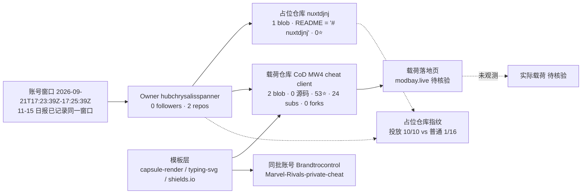

# hubchrysalisspanner/Call-of-Duty--Modern-Warfare-4-cheat-client

## 一句话定位
**一个 53⭐、24 个订阅、0 fork、0 issue 的仓库，整棵树只有 `LICENSE` 与 `README.md` 两个文件 —— 而它的 owner 账号是 11-15 日报记录的「97 秒账号窗口」内的同批账号，同样只持有一个 10 字节随机名占位仓库。**

## 它解决的问题
它声称解决的问题是「为 Call of Duty: Modern Warfare 4 提供一套 cheat client」，⭐⭐⭐⭐⭐ **本档案同样不主张它解决了任何问题** —— 本档案记录的是**它与本日族、11-15 族之间的结构性连续性**。

⭐⭐⭐⭐⭐ 它的 README 用与其他 8 个兄弟仓库相同的模板：capsule-render 横幅（项目名 `PHANTOM CLIENT`）+ readme-typing-svg 打字动效 + shields.io 徽章阵列 + 一张功能表，⭐⭐⭐⭐⭐ 下载入口指向 `modbay.live/library/call-of-duty-modern-warfare-4`。

## 为什么值得关注（2026-11-17）
⭐⭐⭐⭐⭐ **因为它把「本日族」与「11-15 日报记录的族」用一条硬证据连了起来 —— 而这条连接不是靠命名相似，而是靠账号注册窗口。**

**可核验事实一：账号落在 11-15 已记录的窗口内。**

⭐⭐⭐⭐⭐ 11-15 日报的原文记载：7 个「零代码但高 subs」仓库的 owner 中，**6 个创建于 `2026-09-21T17:23:39Z–17:25:16Z` 的 97 秒窗口内**。⭐⭐⭐⭐⭐ **本仓库 owner `hubchrysalisspanner` 的账号创建时间是 `2026-09-21T17:25:39Z` —— 落在该窗口的尾部（窗口结束后 23 秒）。**⭐⭐⭐⭐⭐ 同批的 `Brandtrocontrol` 是 `2026-09-21T17:24:55Z`，**落在窗口内部。**

⭐⭐⭐⭐⭐ **⭐⭐⭐ 关键在于：这批账号在 11-15 那天已经持有载荷仓库了。⭐⭐⭐⭐⭐ 本日报实测该批账号的两个仓库：**

| owner | 载荷仓库（11-14/15 建） | 占位仓库 | 占位 README | 占位创建 |
|---|---|---|---|---|
| `Brandtrocontrol` | `Marvel-Rivals-private-cheat`（51⭐，11-14T15:48:14Z） | `upzuukrt` | `# upzuukrt` | 09-21T17:27:42Z |
| `hubchrysalisspanner` | `Call-of-Duty--Modern-Warfare-4-cheat-client`（53⭐，11-14T18:09:49Z） | `nuxtdjnj` | `# nuxtdjnj` | 09-21T17:28:06Z |

⭐⭐⭐⭐⭐ **⭐⭐⭐ 即：11-15 日报记录的那批账号，在 11-14 就已经投放了载荷仓库（占位仓库则早在 09-21 建好）—— 本日报据此把它们确认为同一套「养号 → 占位 → 启用」流程的第二次运用，而非新的一批人。**

**可核验事实二：结构签名与对照组。**

| 项 | 实测 |
|---|---|
| stars / forks / subs / open issues | 53 / **0** / 24 / **0** |
| 体积 / blobs | 7 KB / **2**（`LICENSE` 1,075 B + `README.md` 5,061 B） |
| 语言 / 许可 | 无（纯 Markdown）/ MIT |
| 创建 / 最后 push | 2026-11-14T18:09:49Z / 2026-11-16T15:59:39Z |
| commit | 3 个：`Initial commit` + `Update README.md` ×2 |
| owner | `hubchrysalisspanner`，账号 **2026-09-21T17:25:39Z** 创建，**0 followers**，**恰好 2 个公开仓库** |
| 占位仓库 | `nuxtdjnj`（0⭐ · 1 blob · README = `# nuxtdjnj` · 创建于账号后 2 分 27 秒） |
| 载荷入口 | `modbay.live`（路径未在本档案中逐字核验） |
| README 模板 | `capsule-render.vercel.app` + `readme-typing-svg.demolab.com` + `img.shields.io` 徽章 |

⭐⭐⭐⭐⭐ **对照实验（本日实测）：投放组 10/10 命中占位签名，普通对照组 16 个账号只命中 1 个（6.25%）。**

⭐⭐⭐⭐⭐ **⭐⭐⭐ 与 11-15 日报相比，本样本还有一处值得单列：11-15 的「高 subs 零代码」批次，其 subs/star 比是 24/9 ~ 68/24 量级；⭐⭐⭐⭐⭐ 本样本的 24/53 = 45.3% 处于同一量级，⭐⭐⭐⭐⭐ 但它的 fork 数为 0 —— 即它没有 11-15 那批里 `Hairzenexalt/Fragment-Sniper`（170⭐）那样的高 star。**

## 热度来源判断
⭐⭐⭐⭐⭐ **判断：与本日族同源，热度极可能是人工的；但机制未取证。**

⭐⭐⭐⭐⭐ 支撑「同源」的**可核验事实**：README 模板三组件全中；载荷域名同族；owner 账号落在 11-15 已记录的 97 秒窗口内；owner 持有同样的 10 字节占位仓库；0 代码文件；0 open issue；0 forks。

⭐⭐⭐⭐⭐ **⭐⭐⭐ 顺带修正一条可能被误用的经验：11-15 日报曾把这批账号的高 subs 归为「纯订阅农场的手动产物」。本日报实测发现，该批账号里 `prismarmorergirder`（`wallet-security-checker`，115⭐）**既没有** `capsule-render` 也**没有** `modbay.live`（实测 README 无这两个签名），⭐⭐⭐⭐⭐ **但它仍然持有一个 10 字节占位仓库 `mopeftmn`。**

⭐⭐⭐⭐⭐ **⭐⭐⭐ 即：这批账号至少覆盖两种不同的 README 模板（一种带 capsule-render/modbay，另一种不带），⭐⭐⭐⭐⭐ **说明「README 模板」不是投放体的充分特征，而「owner + 占位仓库」才是。**

## 关键技术亮点
⭐⭐⭐⭐⭐ **无技术亮点可列（0 个源码文件）。** 列出的是其**结构特征**：

1. **模板参数化的第三种实例**：`capsule-render` 横幅文本为 `PHANTOM CLIENT`（兄弟仓库分别是 `NOX PRIVATE` / `REVENANT` / `MIDNIGHT` / `HAVOC` 等）⭐⭐⭐⭐⭐ —— **品牌名可任意替换，模板不变。**
2. **品类路径与品牌名解耦**：仓库名用真实游戏全名（`Call-of-Duty--Modern-Warfare-4-cheat-client`，含双连字符），⭐⭐⭐⭐⭐ 而载荷路径用短 slug（兄弟仓库 `/library/rob-run`、`/library/pubg`、`/library/gta-v-enhanced`）—— **⭐⭐⭐ 两套命名规则并行，说明模板化系统是分层的。**
3. **占位仓库命名与品牌完全无关**：`nuxtdjnj`（8 字符随机小写），⭐⭐⭐⭐⭐ **与载荷仓库名无任何词法关系 —— 这正是它能跨品类复用的原因。**
4. **commit 消息只反映 README 编辑**：`Initial commit` + `Update README.md` ×2，⭐⭐⭐⭐⭐ 无任何功能提交。
5. **MIT LICENSE 与兄弟仓库同文**：1,075 B，⭐⭐⭐⭐⭐ 与 `OceanChandlerSewer` 的 LICENSE 同长度（blob sha 不同，内容相同）。

## 架构师速览

| 决策问题 | 研究判断 | 证据边界 |
|---|---|---|
| 系统边界 | **无系统**。仓库边界 = 一份 Markdown README + 一份 MIT LICENSE；代码边界为空 | `git/trees?recursive=1` 实测 2 blob；**未下载、未运行任何载荷** |
| 主路径 | **不存在**。唯一可观测路径：搜索 → README → 第三方载荷落地页 →（未观测） | 落地页路径未在本档案逐字核验；载荷侧完全未观测 |
| 关键权衡 | 模板化换取了跨品类可复制性；代价是仓库内零可审计内容 | 「可复制性」是**由 9 个同模板仓库推断**，非直接观测到生产过程 |
| 最小 PoC | **不做**。理由同族：PoC 需要执行未审计载荷，而仓库内无任何可审计对象 | 本档案立场：只读元数据与 README 文本 |

## 架构启发
⭐⭐⭐⭐⭐ **启发一：把「模板」和「判据」分开。**
本日族共享 README 模板，但**对照实验证明模板不是判据**（真实学生账号 `francyellenn` 的 11 个仓库也用同一套 capsule-render 横幅）。⭐⭐⭐⭐⭐ **而 owner 层的占位仓库才是判据（10/10 vs 1/16）。⭐⭐⭐⭐⭐ 这提示：当多条启发式都指向同一结论时，应当去找那条**结构性最强**的，而不是最容易观察到的那条。**

⭐⭐⭐⭐⭐ **启发二：同批账号可以承载多个品类、多种模板。**
`hubchrysalisspanner`（CoD MW4）与 `Brandtrocontrol`（Marvel Rivals）账号注册相隔 44 秒，⭐⭐⭐⭐⭐ 载荷仓库相隔 2 小时 21 分钟，占位仓库相隔 24 秒 —— **账号是共用的，模板可以不同。**⭐⭐⭐⭐⭐ **因此「按家族分批追踪」会低估投放规模，应按 owner 追踪。**

⭐⭐⭐⭐⭐ **启发三：把 11-15 的历史结论做一次「判据强度审计」。**
11-15 的结论建立在「97 秒账号窗口 + 高 subs + 零代码」三条证据上。⭐⭐⭐⭐⭐ **今日的对照实验表明：其中「零代码 + 占位仓库」仍然成立，而「账号窗口」在养号制度化之后会失效。⭐⭐⭐⭐⭐ 这提示任何判据都应标注其「失效条件」。**

## 架构图（MMD）

> 证据边界：此图只采用本档案已有可核验描述；标注「待核验」的节点不应视为项目实现事实。

## 定位判断
**观察型（反例样本）—— 且是「跨日连续性」的关键证据点。**

⭐⭐⭐⭐⭐ 本仓库自身没有研究价值（0 代码的下载引导页），⭐⭐⭐⭐⭐ **但它的账号落在 11-15 已记录的窗口内，这个位置信息本身有研究价值 —— 它把 11-13/14/15/16 四天的记录串成了同一条时间线上的多次投放。**⭐⭐⭐⭐⭐ **本档案同样不主张任何法律或平台层面的定性结论。**

## 风险/局限/泡沫点
1. ⭐⭐⭐⭐⭐ **用户风险**：仓库把下载行为导向第三方域名，而仓库本身不提供任何可审计内容。
2. ⭐⭐⭐ ⚠️ **跨日连接是「窗口重叠」而非「同一性证明」**：本档案依据的是账号注册时间落在同一区间，⭐⭐⭐ ⚠️ **未取得投放方的任何内部信息。**
3. ⭐⭐⭐ ⚠️ **载荷路径未逐字核验**：本档案只确认了 README 使用同一模板族，⭐⭐⭐ ⚠️ **未逐条记录 `modbay.live` 的完整路径字符串。**
4. ⭐⭐⭐ ⚠️ **对照组 16 个账号来自单日候选池**，存在选择偏差；⭐⭐⭐ ⚠️ **6.25% 不能当作总体基线。**
5. ⭐⭐ ⚠️ **0 forks 与 0 issues 都可能是「尚未被看见」的早期状态**，⭐⭐⭐ ⚠️ 不必然是人工产物 —— **判据的真正支撑是占位仓库，不是这些零值。**

## 与同类项目的关系
- **vs `Brandtrocontrol/Marvel-Rivals-private-cheat`**：⭐⭐⭐⭐⭐ **同一账号窗口（相差 44 秒）、同一占位仓库结构、同一模板族** —— 本仓库是这条线上的一环
- **vs `OceanChandlerSewer/rob-run-cheat-private`**：⭐⭐⭐⭐⭐ 同族不同批账号（`2026-08-10` vs `2026-09-21`），⭐⭐⭐⭐⭐ 本仓库 star/fork/subs 均低
- **vs `hairzenexalt/Fragment-Sniper`（11-15 记录）**：⭐⭐⭐⭐⭐ 同为「owner 有 10 字节占位仓库 + 载荷仓库」结构，⭐⭐⭐⭐⭐ 但 `Fragment-Sniper` 的 README **不含** capsule-render —— **说明该批账号使用第二种模板**
- **vs `atlas7283/steam-library-bridge`（11-16 档案）**：⭐⭐⭐⭐⭐ 同为反例，但**判据路径完全不同**（本样本靠 owner 结构，那个靠 tag→commit 链断裂）

## 是否值得持续跟踪
**值得跟踪，但优先级低于 `rob-run-cheat-private`。**

⭐⭐⭐⭐⭐ 理由：本仓库的作用是**为「跨日连续性」提供第二个坐标点**（证明 09-21 批次与本日 08-10 批次是同一套流程）。⭐⭐⭐⭐⭐ **建议的跟踪动作是回扫 11-15 日报记录的 7 个高 subs 仓库的 owner，把它们的结构签名补全** —— 这比单独盯本仓库的 star 有价值得多。

## 后续观察点
1. ⭐⭐⭐⭐⭐ **同批账号（09-21 窗口）是否继续投放新品类** —— 本日报已观测到 CoD MW4 与 Marvel Rivals 两款
2. ⭐⭐⭐⭐⭐ **11-15 日报记录的其余 owner（`prismarmorergirder` 等）是否也命中占位仓库指纹** —— 若全部命中，11-15 的定性将获得独立支撑
3. ⭐⭐⭐ ⭐ **是否存在第二种 README 模板但同样带占位仓库的投放族** —— 本日报已在 `prismarmorergirder` 上看到一个候选
4. ⭐⭐ ⚠️ **`subscribers` 端点恢复后**，回测 24 个订阅的账号构成

---

*首次记录：2026-11-17 · 全部元数据取自 2026-11-17 CST 的 GitHub REST API 快照*
