# liseami/CCBaga

## 一句话定位
CCBaga 是一个跨 macOS arm64 / Linux x86_64 / Windows 10/11 的本地 Claude 工作流工具集——CCBaga-A 负责身份管理 / 系统设置 / 环境验证，CCBaga-B 是独立的 Fingerprint Chromium 148 profile 浏览器，加一个 Agent Skills 协议的可选 Network Skill（AI 引导 Debian 12/13 Xray/Reality 远端 setup）——把 Claude identity 切换 + 浏览器 fingerprint + 系统区域设置 + VPS/代理网络配置从「散装脚本 + 桌面工具零散」整合为「One region selector / Four everyday actions」严肃工程化形态。

## 它解决的问题
2026 年使用 Claude Code + 多区域 / 多 VPS / 多身份场景的开发者面临痛点：（1）Claude identity 切换在文件系统手工（~/.claude 目录复制/移动），无审计 / 回滚 / 加密；（2）浏览器 fingerprint 工具需另装，未与 Claude 工作流集成；（3）系统区域设置（时区/语言/location/permissions）零散，无统一面板；（4）VPS/代理网络配置靠 SSH 手工，无 AI 引导。CCBaga 直击这四件散装工具整合：**双应用分工（CCBaga-A × CCBaga-B） + .baga authenticated encrypted 身份容器 + SQLite 跟踪 names/policies/recovery + Agent Skills 协议 + 真实浏览器测量**。解决的是「Claude 桌面工作流 + 多区域 + 多身份 + 多 VPS」严肃工程化整合问题。

## 为什么值得关注（2026-10-13）
- **Stars:** 1572（截至 2026-10-13），2 天 1572⭐ ⑂154 fork/star 9.8%，**增长率** 9.8%（fork/star 反映社区参与）
- **Forks:** 154，社区参与度极高（桌面工具类项目天然适合 fork 定制）
- **Size:** 3564 KB（含 Rust + React 19 + Tauri 2 + .baga 容器 + Fingerprint Chromium metadata + Skill scripts）
- **License:** MIT
- **语言:** Rust（Tauri 2 主体） + React 19 + TypeScript（Cromma UI）
- **活跃度:** created 2026-10-11，pushed_at 2026-10-12，持续高活跃
- **平台:** macOS 12+ Apple Silicon / Linux x86_64 GTK 3 WebKitGTK 4.1 / Windows 10/11 x86_64 + Intel macOS 和 Linux ARM64 不支持

## 热度来源判断
CCBaga 的热度是 **「Claude 桌面工作流严肃工程化 × 双应用分工（CCBaga-A × CCBaga-B） × .baga 加密身份容器 × Fingerprint Chromium 148 独立 profile × Agent Skills 协议 × Debian 12/13 Xray/Reality 远端 setup × 真实浏览器测量 × 跨 macOS arm64 + Linux x86_64 + Windows 10/11」** 的组合。Claude Code 用户量极大（2026 年），多区域 / 多 VPS / 多身份场景的开发者急需严肃工程化整合——CCBaga 把「桌面应用 + Skills 协议 + 远端服务器 AI setup」三合一，自然爆火。154 fork 是桌面工具类项目的网络效应（fork = 定制版本）。热度真实且具「Claude 桌面工作流 + 多区域 + 多身份」严肃工程化场景的强需求。

## 关键技术亮点
1. **双应用分工（CCBaga-A × CCBaga-B）：** CCBaga-A 身份管理 + 系统设置 + 环境验证；CCBaga-B 独立 Fingerprint Chromium 148.0.7778.215 profile
2. **.baga authenticated encrypted 身份容器：** Archive 验证先于切换 + 失败回滚 + 中断恢复；filesystem ownership 或 administrator access 非绝对保密边界
3. **SQLite 跟踪 names/policies/recovery state：** 每个身份的状态机由 SQLite 记录
4. **Claude identities 切换：** 「Empty identity」归档当前状态 → 留 fresh workspace；或选已保存 identity 恢复；切换前自动保存 outgoing identity
5. **Keep in workspace 选项：** skills/commands/plugins/MCP/personal settings/conversation history/caches logs 选择保留；Login data 跟 archive 走
6. **Browser fingerprint rotation：** 生成新 seed + 应用区域语言/时区 + restart CCBaga-B
7. **Real environment checks：** DNS exit/country/timezone/language/platform/CPU/engine/location 检查 + 浏览器测量与机器/网络出口比对
8. **Native system settings：** 时区/语言/区域设置 + location/permissions 桌面控制
9. **AI-guided network setup（3 步）：** Get VPS → Get residential proxy → Install Skill；General/Codex/Cursor/OpenCode/Copilot coding-agent selector；Skill 走 Agent Skills 协议（`npx skills add liseami/CCBaga --skill ccbaga-network --global`）
10. **远端 Xray/Reality setup：** Debian 12/13 root key 22 端口 + Xray/Reality + 私钥本地 import 文件；TUN ON/System Proxy OFF/空 explicit browser proxy
11. **Claude Code CLI tools detect/uninstall/reinstall：** native/npm/bun/Homebrew/WinGet 工作流
12. **界面英语/中文 YAML catalog 共享：** 切换界面语言不改变电脑或浏览器语言
13. **One region selector / Four everyday actions（Easy setup）：** 缓存清理 / fingerprint 旋转 / 时区语言重置 / 身份归档
14. **browser test page 隔离：** CCBaga-B 浏览器测试页无 Tauri command 访问，通过 random-token loopback session 交换 context 和 measurements
15. **macOS Objective-C/Security/CoreLocation 桥 + Linux/Windows Rust 桥：** 平台原生 API 集成

## 架构师速览

| 决策问题 | 研究判断 | 证据边界 |
|---|---|---|
| 系统边界 | 一个跨平台桌面工具（macOS arm64 + Linux x86_64 + Windows 10/11）+ 双应用分工（CCBaga-A 身份/系统/验证 + CCBaga-B 独立 Fingerprint Chromium 148.0.7778.215 profile）+ 一个独立安装的 AI Network Skill（Agent Skills 协议，通过 `npx skills add liseami/CCBaga --skill ccbaga-network --global` 安装到 Claude Code/Codex/Cursor/OpenCode/Copilot）+ 一个 .baga authenticated encrypted 身份容器（archive/recovery）+ 一个 SQLite 数据库跟踪 names/policies/recovery state + 远端 SSH/Xray/Reality 服务（Debian 12/13 授权服务器，但 app 不直接连，由 AI 通过 skill 引导 setup） | 仅基于 README 「CCBaga-A: Identity management, system settings and environment verification / CCBaga-B: Companion browser with a dedicated profile / A separate Network Skill: Python standard library · OpenSSH · Bash · Xray / App does not collect SSH keys or proxy credentials and does not deploy to servers」+ 平台 badge + size 推断；具体 .baga container 加密算法、SQLite 库选择、xray 配置模板是否在仓库内未在档案明示 |
| 主路径 | 用户启动 CCBaga-A → 自动启动 CCBaga-B → Easy setup 选区域（country/region）→ 选动作（缓存清理/fingerprint 旋转/时区语言重置/身份归档）→ 如需网络：Network 选 3 步（Get VPS → Get residential proxy → Install Skill）→ 复制 Skill 安装 prompt 到本地 coding agent → AI 通过 SSH+Xray/Reality 配置 Debian 12/13 远端服务器 → 客户端 TUN ON/System Proxy OFF → 浏览器测量验证 → 完整环境就绪 | 主路径为 README 「Easy setup + Browser verification + Network setup」 段落整理；具体 .baga 容器加解密流程、SQLite 事务边界、xray config 模板未在档案明示 |
| 关键权衡 | 全栈自研（Rust + Tauri 2 + React 19 + Cromma UI + Fingerprint Chromium 148 + xray/Reality）vs 跨平台覆盖范围（macOS arm64 / Linux x86_64 / Windows 10/11 + Intel macOS 和 Linux ARM64 不支持）vs 隐私（DNS/WebRTC leak 未独立验证 + filesystem ownership 非绝对保密边界）vs .baga 容器被 archive tools 不能直接开 vs Network Skill 远端 setup 须用户显式批准 | 权衡来自 README 「DNS and WebRTC leak checks are not independently verified / Ordinary archive tools cannot open this container directly; filesystem ownership or administrator access is not an absolute secrecy boundary / Remote setup runs only after approval of the actual server changes」 |
| 最小 PoC | 在 macOS arm64（M-series）装 CCBaga-A.dmg + CCBaga-B.dmg → 启动 CCBaga-A → Easy setup 选 "US" → 选 "Browser fingerprint rotation" 验证 CCBaga-B 重启 + 选 "Claude identities" → "Empty identity" → Archive 验证 .baga 容器生成 + Browser 验证页运行；非必须远端 VPS 实验 | PoC 由 README 「Quick start + Browser verification + Claude identities」 段落整理；具体 .baga 容器跨机器恢复、Spawn process identity check 行为、xray 远端 setup 是否需要额外 token 未在档案明示 |
| 证据边界 | 仅核验：仓库存在、stars/forks/description/license/size/language 来自 GitHub API；README 节录自 raw 接口；CCBaga-A/CCBaga-B 双应用分工 + .baga 容器 + Fingerprint Chromium 148 + Agent Skills 协议 + Xray/Reality + Debian 12/13 由 README 直接叙述 | 待核验：.baga 容器加密算法、SQLite 库选择、xray 远端 config 模板、Spawn process identity check 实现细节、跨语言身份 archive 兼容性、Intel macOS 和 Linux ARM64 不支持原因 |

## 架构启发
CCBaga 的核心启发是 **「桌面应用 + Agent Skills 协议 + 远端服务器 AI setup」三合一严肃工程化路径**。当前 Claude Code 用户面对多区域 / 多 VPS / 多身份场景时，往往需要手工维护 .claude 目录、另装浏览器 fingerprint 工具、手工 SSH 配置 xray——三件事是割裂的。CCBaga 把这三件整合为「双应用分工 + 加密身份容器 + Agent Skills 协议」严肃工程化路径，类似 Docker 之于「应用 + 配置 + 镜像」整合。这指向 **「Claude 桌面工作流 + Skills 协议 + 远端服务器」** 的未来。CCBaga 还展示了 **「easy setup + advanced controls」** 的设计哲学——日常操作（4 个动作）放在一个面板，高级控制（Network/Claude identities/Browser/Computer）放在 sidebar。这与 `wheresryan22/anatomy`（Claude skill 物化技术概念）+ `storytold/craft-launcher`（Rust 全家桶 Launcher）形成完整的 Anthropic Skills 生态严肃工程化方向。

## 架构图（MMD）

> 证据边界：此图只采用本档案已有可核验描述；"待核验"节点不应视为项目实现事实。

```mermaid
flowchart LR
  User[用户] -->|启动| A[CCBaga-A<br/>身份/系统/验证]
  A -->|自动启动| B[CCBaga-B<br/>Fingerprint Chromium 148 profile]
  A -->|Easy setup| Easy[One region selector<br/>Four everyday actions<br/>缓存清理/fingerprint 旋转/时区语言重置/身份归档]
  A -->|Sidebar| Adv[Advanced controls<br/>Network/Claude identities/Browser/Computer]
  Adv -->|Claude identities| ID[SQLite 跟踪 names/policies/recovery<br/>.baga authenticated encrypted container<br/>Archive 验证先于切换/失败回滚/中断恢复]
  Adv -->|Browser| FP[Browser fingerprint rotation<br/>生成新 seed + 区域语言/时区 + restart CCBaga-B]
  Adv -->|Network 3 步| Net[Get VPS → Get residential proxy → Install Skill]
  Net -->|复制 prompt| Agent[Local coding agent<br/>Claude Code/Codex/Cursor/OpenCode/Copilot]
  Agent -->|npx skills add| Skill[AI Network Skill<br/>Agent Skills 协议 + Python stdlib + OpenSSH + Bash]
  Skill -->|SSH+Xray/Reality| VPS[Debian 12/13 授权服务器<br/>root key 22 端口<br/>Xray/Reality 配置]
  VPS -->|TUN ON/System Proxy OFF| Client[客户端 TUN 模式]
  Client --> B
  B -->|Browser test page<br/>random-token loopback| Verify[Real environment checks<br/>DNS exit/country/timezone/language/platform/CPU/engine/location]
  A -->|system settings| Sys[Native system settings<br/>时区/语言/区域/location/permissions]
  Verify -.DNS/WebRTC leak 未独立验证.-> Warn[隐私边界警告]
  ID -.filesystem ownership 非绝对保密.-> Warn
```

## 定位判断
**桌面工具型项目（Claude 工作流严肃工程化整合）。** CCBaga 不仅是身份管理工具，更展示了「桌面应用 + Agent Skills 协议 + 远端服务器 AI setup」三合一严肃工程化路径。1572⭐ + 154 fork/star 9.8% 已显示工具类需求。但能否持续取决于：（1）跨平台覆盖（Intel macOS 和 Linux ARM64 不支持）；（2）隐私边界（DNS/WebRTC leak 未独立验证 + filesystem ownership 非绝对保密）；（3）xray 远端 setup 用户教育成本；（4）Claude Code / Skills 协议演进。定位是「Claude 桌面工作流 + 多区域 + 多身份 + 多 VPS」严肃工程化整合的头部样本，向「团队 / 企业级 Claude 工作流管理」演进是合理路径。

## 风险 / 局限 / 泡沫点
- **平台覆盖窄：** Intel macOS 和 Linux ARM64 不支持；仅 macOS 12+ Apple Silicon / Linux x86_64 / Windows 10/11
- **隐私边界未独立验证：** DNS/WebRTC leak 未独立验证；filesystem ownership 或 administrator access 非绝对保密边界；.baga 容器被 archive tools 不能直接开
- **远端 setup 用户教育：** Network Skill 远端 setup 须用户显式批准；Debian 12/13 + root key 22 端口 + Xray/Reality 须用户有一定 Linux 基础
- **付费服务依赖：** README 提 DMIT + Webshare 推广 affiliate（README 内有 aff link），订阅 VPS/代理是商业服务
- **app 不直接连服务器：** Network setup 由 AI 引导，app 不收集 SSH keys 或 proxy credentials 也不部署到服务器（用户须配合）
- **个人项目属性：** liseami 个人维护，可持续性存疑
- **xray/Reality 配置更新频率：** xray/Reality 配置更新可能与上游版本脱节

## 与同类项目的关系
- **vs ~/.claude 手工管理:** 手工管理无审计/回滚/加密；CCBaga 提供 .baga 容器 + SQLite 状态机 + Agent Skills 协议
- **vs 浏览器 fingerprint 散装工具:** CCBaga-B 集成在 CCBaga-A 内，与 Claude identity 切换联动
- **vs SSH 手工 xray 配置:** CCBaga Network Skill 引导 AI 通过 SSH+Xray/Reality 配置 Debian 12/13，用户无须开终端
- **vs Anthropic Skills 协议其他项目:** anatomy（Claude skill 物化技术概念）、craft-launcher（Rust 全家桶 Launcher）都是 Skills 协议应用，CCBaga 走「桌面 + Skills + 远端服务器」三合一
- **vs Docker 整合应用 + 配置 + 镜像:** CCBaga 整合 Claude 身份 + 浏览器 + 系统 + 网络，类似 Docker 之于「应用 + 配置 + 镜像」整合

## 是否值得持续跟踪
**值得跟踪（Claude 桌面工作流 + Skills 协议 + 远端服务器严肃工程化整合）。** CCBaga 代表了 Claude Code 用户从「散装脚本 + 桌面工具零散」到「桌面应用 + Skills 协议 + 远端服务器 AI setup」三合一严肃工程化路径的演进。无论其本身成败，这一方向是 Claude Code / Skills 生态的趋势。建议关注：（1）跨平台覆盖（Intel macOS / Linux ARM64）；（2）隐私边界（DNS/WebRTC leak 独立验证）；（3）xray/Reality 配置更新；（4）Anthropic Skills 协议演进；（5）企业采用（团队是否将此作为 Claude 工作流管理标准）。对使用 Claude Code + 多区域 / 多 VPS / 多身份场景的开发者，这个工具是严肃工程化整合的实用选择，值得直接采用。

## 后续观察点
- 是否演化为独立公司 / 平台（从 GitHub 仓库升级为商业产品）
- 跨平台覆盖（Intel macOS / Linux ARM64）
- 隐私边界独立验证（DNS/WebRTC leak 独立测试）
- xray/Reality 配置更新频率
- Anthropic Skills 协议 register 与官方认证
- 企业采用（团队是否将此作为 Claude 工作流管理标准）
- 社区贡献（fork/star 增长，PR 数量）
- liseami 个人项目可持续性

---
> 数据来源: GitHub Repository API (2026-10-13) + README raw 接口 | Stars: 1572 | Forks: 154 | License: MIT | 语言: Rust + Tauri 2 + React 19 | Size: 3564 KB | 创建: 2026-10-11 | 平台: macOS 12+ Apple Silicon / Linux x86_64 / Windows 10/11
