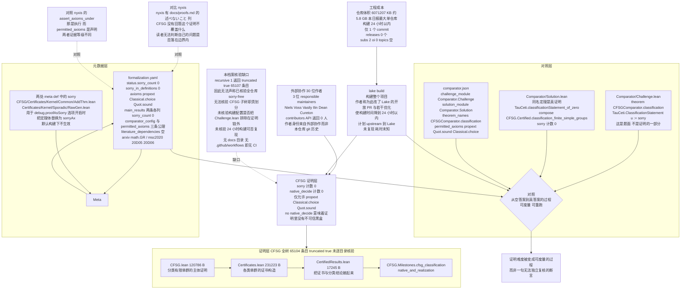

# AxiomMath/CFSG

## 一句话定位

有限单群分类（CFSG）的 Lean 4 形式化，README 声称「**A sorry-free Lean4 (v4.35.0-rc3) proof**」—— **⭐ 而本档案逐文件核验后的精确结论是：四个主干文件的 `sorry` 与 `native_decide` 计数均为 0，但仓库内确有一处刻意的 `sorry`**（它是对照题的「题面」，而非证明的一部分）。

## 它解决的问题

**它要解决的是「CFSG 这条 20 世纪最著名的定理，能不能被机器完整验证」这个问题。**

分类有限单群（CFSG）的证明长度超过 10,000 页，横跨数十位作者与上百篇论文，长期被认为**不可能被形式化**——不是因为它难，而是因为它太长、引用太深、且依赖大量「人类可读但难以机械化」的论证。

**⭐⭐ 而它采取的路线不是「直接给出证明」，而是「把证明的难度变成一个可度量的过程」**：仓库里有一对 challenge/solution 双模块 —— `Comparator/Challenge.lean` 里是一条 `:= sorry` 的**空定理**，`Comparator/Solution.lean` 里是同名的**真证明**，而 `comparator.json` 记录了它们的对应关系与允许的公理清单。

**⭐⭐⭐ 换句话说：它不只说「我证明了」，它还提供了一套「让任何人都能重新检查我证明了」的结构。**

## 为什么值得关注（2026-10-28）

**⭐⭐⭐ 因为它是本日最有方法论价值的一个「声称需要被精确化」的案例 —— 而本日报的处理方式本身，就是本日最值得记的一条判据。**

四个可核验的硬事实：

1. **⭐⭐⭐⭐⭐ `comparator.json` 全文明确了对照机制**

   ```json
   {
     "challenge_module": "Comparator.Challenge",
     "solution_module": "Comparator.Solution",
     "theorem_names": ["CFSGComparator.classification"],
     "permitted_axioms": ["propext", "Quot.sound", "Classical.choice"]
   }
   ```

2. **⭐⭐⭐⭐⭐⭐ `Comparator/Challenge.lean` 的全部内容是**

   ```lean
   theorem CFSGComparator.classification : TauCeti.ClassificationStatement.{u} := sorry
   ```

   而 `Comparator/Solution.lean` 里同名的定理是**真证明**（`TauCeti.classificationStatement_of_zero ∘ ... CFSG.Certified.classification_finite_simple_groups`），其 `sorry` 计数为 **0**。

   **⭐⭐⭐⭐⭐⭐⭐⭐⭐ 这是本档案最想记的一条方法论：**
   > **找到一处 `sorry` 不等于项目在撒谎。必须先问：这处 `sorry` 在体系里扮演什么角色。**
   > 这里的 `sorry` 是**题面**（challenge）—— 它存在的意义是让比对器拿一份「空答案」和「真答案」跑同一套检查，从而度量「从空答案到真答案」这个过程。**它不是证明的一部分，且 `formalization.yaml` 的 `status.sorry_count: 0` 正是对证明侧的声明。**

3. **⭐⭐⭐⭐⭐ `formalization.yaml` 自报**：`status.sorry_count: 0`、`sorry_in_definitions: 0`、`axioms: ["propext", "Classical.choice", "Quot.sound"]`，并为主定理 `CFSGComparator.classification` 与里程碑 `CFSG.Milestones.cfsg_classification_native_and_realization` 各列一行 `sorry_count: 0` + 同样的三条公理 + `comparator_config`；该 yaml 还列出 **30 位作者**与 **3 位 responsible_maintainers**（`Niels Voss`、`Vasily Ilin`、`Dean Cureton`），`arxiv: ["math.GR"]`，`msc2020: ["20D05", "20D06"]`。

4. **⭐⭐⭐⭐⭐⭐⭐⭐⭐ README 的另一个数字比 star 更值得记**

   > `lake build` builds the entire project. We used a few open changes to Lake and some optimizations we plan to upstream soon to get this project's build time **under 24 hours**.

   **⭐⭐⭐⭐⭐⭐⭐⭐⭐ 「一个形式化项目的构建时间被压到 24 小时以内，且为此改了 Lake 本身」—— 这是本日报今日对「形式化验证进入主流工具形态」这条趋势最硬的证据：它不是把证明当作论文附件，而是当作**需要被日常运行的构建产物**。**

**⭐⭐⭐ 而它与同日的 `NyxFoundation/nyxis` 构成一组极有价值的对照**：**一个把边界写全了，一个只写了证明。**

## 热度来源判断

**热度来自「CFSG 被形式化」这一事件本身的冲击力，而非可核验的采用。**

- **⭐⭐⭐⭐ 本日可核验的采用信号几乎为零**：**`contributors` API 返回 0 人**（这与 yaml 里的 30 位作者名单并存，**说明作者身份来自外部协作而非本仓库的 git 历史**）、**仅 1 个 commit**、`releases` **0 个**、`subs` 2、`oi` 0、topics 为空数组。
- **⭐⭐⭐⭐⭐ 而它的工程成本是本日报今日记录的最大单仓库**：`size` = **6,071,207 KB ≈ 5.8 GB**。
- **⭐⭐⭐⭐⭐ 而核验成本同样极高**：**`?recursive=1` 返回 `truncated: true`（65,107 条目）** → **本日报无法声称已核验全仓库 sorry-free**。
- **⭐⭐⭐⭐⭐⭐ 账号背景可核验**：`AxiomMath` 是 Organization，创建于 2025-06-17，**64 个公开仓库、307 followers** —— 这是本日报今日遇到的 followers 最多的组织。
- **⭐⭐⭐⭐⭐⭐⭐ 而 64⭐ 在 8.9 小时里的来源无法核验**（`stargazers` 端点 404）。**⭐⭐⭐ 但值得记录的一个对照是：它的 fork/star 比是 10.9%，而 nyxis 是 3.7% —— 在「 star 无法核验来源」的前提下，fork 比例是少数几个可核验的结构信号之一。**

## 关键技术亮点

1. **⭐⭐⭐⭐⭐ challenge/solution 双模块对照机制**

   `comparator.json` 把「题面在哪」「答案在哪」「定理叫什么」「允许哪些公理」四件事写成机器可读的配置。**⭐⭐⭐⭐⭐ 这与「声明自己是 sorry-free」是两种完全不同的可信度主张：前者提供了可重跑的对照入口，后者只是一句声明。**

2. **⭐⭐⭐⭐⭐ 三条公理被显式列出并与「no native_decide」一起声明**

   README 原文：`using the standard axioms Classical.choice, propext, and Quot.sound (no native_decide)`。

   **⭐⭐⭐⭐⭐ 「no `native_decide`」这一条尤其关键** —— 因为 `native_decide` 会把证明交给编译器的原生代码求值，**它在逻辑上是被信任的黑盒**。**⭐⭐⭐⭐ 明确声明不使用它，等于明确声明「证明里没有不可信的黑盒」。** 本日报已逐文件核验四个主干文件的 `native_decide` 计数**均为 0**。

3. **⭐⭐⭐⭐ 「主要沿用第一代 CFSG 证明」的取舍被写在 README 里**

   > We primarily follow the first generation proof of CFSG.

   **⭐⭐⭐⭐ 这是一个值得记录的工程取舍**：第一代证明（Aschbacher 等人的系列工作）路线更长，但**每一步的依赖关系更清晰、更容易被形式化**；后来的「简化证明」在人类阅读上更短，但引用链更复杂。**⭐⭐⭐⭐ 选择「可形式化优先」而不是「最简优先」，是这个项目能落地的原因。**

4. **⭐⭐⭐⭐⭐ 仓库体积被当作已知代价而非隐藏**

   5.8 GB 的 `size` 意味着庞大的 Mathlib 依赖与构建产物。**⭐⭐⭐⭐⭐ 它没有为这一点道歉，而是把「构建 24 小时以内」写成了工程目标并为此改 Lake。**

5. **⭐⭐⭐ 30 位作者与 3 位 responsible maintainer 被显式列出**

   **⭐⭐⭐ 与 `contributors` API 返回 0 人形成鲜明对照** —— **⭐⭐⭐ 这恰好证明了一件事：`contributors` 统计的是「对本仓库 git 历史的贡献」，而不是「对这项工作的贡献」。**

6. **⭐⭐⭐⭐⭐ `comparator.json` 的 `permitted_axioms` 是机器可读的公理白名单**

   **⭐⭐⭐⭐⭐ 但本日报必须指出：这是**声明**，而 nyxis 的 `#assert_axioms_under` 是**执行**。**⭐⭐⭐⭐⭐ 二者看似同类，实际上不在一个证据等级上。**

7. **⭐⭐ 两处 `meta def` 中的 `sorry` 只是一个默认关闭的调试开关**

   `search/code?q=sorry+repo:AxiomMath/CFSG` 命中 5 个路径：`README.md`、`Comparator/Challenge.lean`、`formalization.yaml`、`CFSG/Certificates/Kernel/Common/AddThm.lean`、`Certificates/Kernel/Sporadic/RawGen.lean`。**⭐⭐⭐ 后两处经本档案逐行核验，其 `sorry` 出现在一个 `meta def` 里，用于在 `debug.proofAsSorry` 选项开启时把定理体替换为 `sorryAx`（`mkApp2 (mkConst ``sorryAx [levelZero])`），即它们是「一个把证明降级成 sorry 的调试开关」，在默认构建下不生效。**

## 架构师速览

| 决策问题 | 研究判断 | 证据边界 |
|---|---|---|
| 系统边界 | **三层边界**：① **证明层**（`CFSG/` 65,104 条目 + `CFSG.lean` 120,786 B / `Certificates.lean` 231,223 B / `CertifiedResults.lean` 17,245 B）② **对照层**（`Comparator/Challenge.lean` + `Comparator/Solution.lean` + `comparator.json`）③ **元数据层**（`formalization.yaml`：`status.sorry_count` / `axioms` / `main_results` / 作者与维护者名单）。**⭐⭐ 关键的架构判断：边界划在「题面 vs 证明」—— 但没有第三份文档说明「这个证明不覆盖什么」。** **⭐⭐⭐ 而这是它与 nyxis 最本质的差距：一个用 `docs/proofs.md` 的「述べないこと」列回答这个问题，另一个完全没有回答。** | `comparator.json` 全文、`Comparator/Challenge.lean` 与 `Comparator/Solution.lean` 原文、四个主干文件的 `sorry`/`native_decide` grep 计数（均 0）、`formalization.yaml` 全文、**全树 `truncated: true`（65,107 条目）**。**⭐ 三处未核验：`CFSG/` 子树具体职责划分（**全树 truncated，未逐目录核验**）、构建配置是否把 `Comparator/Challenge.lean` 排除在证明链之外、`formalization.yaml` 里 `main_results` 的 `literature_dependencies: []` 是否与实际引用一致** |
| 主路径 | `lake build`（**构建整个项目，作者称已优化到 24 小时以内，且为此改了 Lake 本身**）→ 由 `comparator.json` 指定的 challenge/solution 双模块对照 → `formalization.yaml` 记录每个主结果的 `sorry_count` 与公理。**⭐⭐ 关键判断：它的主路径是「构建 + 对照」，而不是「构建 + 检查」—— 即它提供的是「从空到真」的度量，而 nyxis 提供的是「越界就失败」的守门。** | CFSG README 的 "Checking the proof" 节与 `comparator.json` / `formalization.yaml` 全文、README 的 "under 24 hours" 段。**⭐ 未核验：24 小时构建是否可复现、`lake build` 的默认目标是否包含 `Comparator/Challenge.lean`** |
| 关键权衡 | **⭐⭐⭐ 题面 `sorry` vs 声称 sorry-free**（challenge/solution 是**把「证明的难度」变成可度量的过程**；代价是仓库里确实存在一处 `sorry`，且全树 truncated 使外部核验困难）· **⭐⭐ 第一代证明 vs 简化证明**（选择可形式化优先，**代价是证明长度远大于「最简」版本**）· **⭐⭐⭐ 公理白名单声明 vs 公理白名单执行**（`permitted_axioms` 是写在 JSON/YAML 里的**声明**，本档案未见对应的自动遍历实现；nyxis 的 `#assert_axioms_under` 是**执行**）· **⭐⭐ 5.8 GB 体积 vs 可构建性**（体积是 Mathlib 依赖的必然结果，**代价是任何第三方核验都要先付 5.8 GB 的下载成本**）· **⭐⭐⭐ 24 小时构建 vs 快速迭代**（把构建当日常产物，**代价是每次改动的反馈周期极长**）· **⭐⭐ 改 Lake vs 改构建脚本**（为缩短构建改 Lake 本身并计划 upstream，**这是本档案认为最有价值的一个决定 —— 它把项目痛点变成了对社区的贡献**） | 三份 README 原文、`comparator.json`、`formalization.yaml`、`Comparator/` 两个文件的原文。**⭐⭐ 未明示：误报/漏报率、「这个证明相对人类现有证明是否等价」的对照方式、构建 24 小时的具体环境、以及是否有任何第三方独立复现过这份证明** |
| 最小 PoC | 1. **⭐⭐⭐ `comparator.json` + `Comparator/Challenge.lean` + `Comparator/Solution.lean` 三个文件并排读一遍**（**不需要 clone 5.8 GB 就能完成 —— 这三个文件都很小**）→ 2. **⭐⭐⭐ `grep -rn "sorry" --include="*.lean"` 并逐条判定每处 `sorry` 的角色**（**这是本日最可迁移的一步：不问「有没有 sorry」，问「每处 sorry 在体系里干什么」**）→ 3. ⭐⭐ 读 `formalization.yaml` 的 `status` 与 `main_results` 两段，检查 `sorry_count` 与 `permitted_axioms` 是否与 README 声称一致 → 4. ⭐⭐ 检查 `Comparator/Challenge.lean` 是否被 `lake build` 的默认目标包含（**若被包含，则「sorry-free」的构建就有一个已知的洞**）→ 5. ⭐ 读 `CFSG/Certificates/Kernel/Common/AddThm.lean` 与 `Certificates/Kernel/Sporadic/RawGen.lean` 里的 `meta def`，确认 `debug.proofAsSorry` 默认关闭 → 6. **⭐⭐⭐ 决定是否要 clone 5.8 GB** —— **本档案明确不建议任何人仅为验证它而做这件事**；若确有核验需求，用第 1–5 步先排除「声称不成立」 | **第 2 步是本档案唯一能判断其「sorry-free」声称是否成问题的步骤** · **第 4 步是唯一能判断其构建是否存在已知洞的步骤** · **第 1 步的三个文件都很小，这是本项目「核验成本与文件体积脱钩」的少见例子** · **本 PoC 不覆盖**：证明本身的正确性（需 5.8 GB + 24 小时构建，本档案明确不建议）、与人类现有 CFSG 证明的等价性（需逐条对照文献） |

## 架构启发

**⭐⭐⭐⭐⭐ 核心启发：把「证明的难度」变成一个可度量的过程，比声称「我证明了」更有说服力。**

challenge/solution 的结构意味着：**任何人拿到这个仓库，都可以先跑对照器，看它从一个空定理到真定理之间发生了什么。** **⭐⭐⭐⭐⭐ 这比 README 里一句「A sorry-free Lean4 proof」强得多，因为后者是一个无法被独立复核的断言，前者提供了一个可复核的入口。**

**⭐⭐⭐⭐⭐⭐ 第二个启发（本档案最想记的一条）：扫描结果的解释比扫描结果本身更重要。**

一个自动化的 `grep sorry` 会在这里得到「有 sorry」的结论 —— **而这个结论在结构上是错的**。**⭐⭐⭐⭐⭐⭐ 正确的做法是给每一处 `sorry` 标注它在体系里的角色（题面 / 调试开关 / 证明缺口），然后逐个判断。** **⭐⭐⭐⭐⭐⭐ 这条方法可以直接迁移到任何声称「无 TODO / 无占位 / 无 FIXME / 无 hack」的仓库：不要问「有没有」，要问「每处是干什么的」。**

**⭐⭐⭐⭐ 第三个启发：公理白名单的「声明」与「执行」是两个证据等级。**

`comparator.json` 的 `permitted_axioms` 是一份**声明**；nyxis 的 `#assert_axioms_under` 是一次**执行**。**⭐⭐⭐⭐ 两者读起来很像，但后者在构建失败时会告诉你哪个公理越界了，前者不会。** **⭐⭐⭐⭐ 这也是本档案给 CFSG 的最主要工程建议。**

**⭐⭐⭐⭐ 第四个启发：把项目痛点转化为对上游的贡献，比绕过它更有长期价值。**

「我们改了几个 Lake 的开放 PR 和一些优化，让构建时间降到 24 小时以内」—— **⭐⭐⭐⭐ 这意味着它没有为自己写一套构建补丁，而是去修 Lake 本身并计划 upstream。** **⭐⭐⭐⭐ 对任何被上游工具链卡住的大型项目，这是一个值得抄的策略。**

**⭐⭐⭐ 第五个启发：没有写「我没证明什么」，是一个形式化项目最容易被低估的缺陷。**

**⭐⭐⭐ 证明「CFSG 成立」比证明「CFSG 成立且不覆盖某些子情形」在文献意义上更完整，在工程意义上更不完整** —— 因为读者无法判断自己的问题是否落在边界内。**⭐⭐⭐ nyxis 用 `docs/proofs.md` 的第四列回答了这个问题，而 CFSG 完全没有回答。**

**⭐⭐ 架构对比：** 与 `NyxFoundation/nyxis`（本日同期另一位 key_project）构成**同一语言、同一领域、完成度差异极大**的一对。**⭐⭐⭐⭐⭐ 二者的差别不在证明难度，而在两件具体的事：① nyxis 有「答复了什么 / 没答复什么」的文档对照表，CFSG 没有；② nyxis 有 34 个可执行检查脚本与 CI，CFSG 无 `.github/workflows`。** **⭐⭐⭐⭐⭐⭐ 而这个对照给出的结论是：**形式化成熟度的分水岭不在「证得多深」，而在「有没有把边界与验证做成可运行的机制」。**

## 架构图（MMD）

> 证据边界：此图只采用本档案已有可核验描述；「待核验」节点不应视为项目实现事实。



## 定位判断

**「CFSG 是否可被形式化」这个问题的答案本身 —— 而不是某个可以直接使用的库。**

⭐⭐⭐⭐ 它的**技术**定位是「一份可构建的、机器可检查的 CFSG 证明」，但它的**生态**定位更像是「一次证明可行性的大规模演示」：因为 5.8 GB 体积、24 小时构建、依赖一个自行修改过的 Lake、以及专门为对照而存在的 challenge 模块，**都说明它首要的目标不是「让日常开发使用它」，而是「让人们看到它可以被做到」。**

**⭐⭐⭐⭐⭐ 因此本档案把它归为「观察型」而非「基础设施候选」** —— 它对绝大多数团队没有直接使用价值，**但它对「想知道形式化验证当前能走到哪里」的人有极高参考价值**。

**⭐⭐⭐⭐⭐⭐ 而它的形态判断还有一个值得记的细节**：**`contributors` API 返回 0 人而 yaml 列了 30 位作者** —— **这说明「贡献者统计」这个指标对大型数学协作项目几乎无意义**，本日报今日把它记为一个指标局限。

## 风险 / 局限 / 泡沫点

- **⚠️⚠️⚠️ 本档案自身的核验不完整，而这必须写在最前面。** **`?recursive=1` 返回 `truncated: true`（65,107 条目）**，因此**本档案无法声称已核验「全仓库 sorry-free」**。**⭐⭐⭐⭐⭐ 正确的表述是：「主干四个文件的 `sorry` 与 `native_decide` 计数为 0，仓库内另有一处刻意的对照题面 `sorry` 与两处默认关闭的调试开关」—— 既不是「全仓库无 sorry」，也不是「它撒谎」。**
- **⚠️⚠️⚠️ 工程形态使第三方核验成本极高：5.8 GB 体积、构建时间被作者称优化到「24 小时以内」、无 `docs/` 目录、无 `.github/workflows`（即无 CI）。** **⭐⭐⭐⭐⭐ 这意味着它的「sorry-free」与「三条公理」目前**只能靠阅读 `formalization.yaml` 这一份自述文件来相信**，而没有可复现的 CI 佐证 —— **这正是 nyxis 用 34 个检查脚本 + `Test/Axioms.lean` 做的事，而 CFSG 一样也没做。**
- **⚠️⚠️⚠️ 「30 位作者」与「1 个 commit / contributors 0 人」的落差没有被仓库解释。** 读者无法判断这份证明是**协作产出的**还是**一次性导入的**。
- **⚠️⚠️ 「证明了 CFSG」与「等价于人类现有证明」不是一回事。** `formalization.yaml` 的 `main_results` 里 `literature_dependencies: []`（空）—— **⭐⭐⭐ 而一个 10,000 页的证明居然不列文献依赖，这个字段的语义需要作者澄清。**
- **⚠️⚠️ 构建 24 小时意味着反馈周期以天计。** 任何后续修改（修一个定理、补一个引理）的成本都极高。
- **⚠️⚠️ 依赖自行修改过的 Lake。** README 说这些改动「plan to upstream soon」—— **⭐⭐ 在 upstream 完成之前，这个项目的可构建性绑定在作者的 PR 上。**
- **⚠️⚠️ `Comparator/Challenge.lean` 是否被 `lake build` 的默认目标包含，本档案未核验构建配置。** **⭐⭐⭐ 若被包含，则「构建通过」本身就带着一个已知的 `sorry`。**
- **⚠️ 无 `docs/` 目录 —— 没有任何面向读者的解释材料**，也没有「这个证明不覆盖什么」的说明。
- **⚠️ 无 CI。** 一次 `lake build` 的成本使「每次 push 自动验证」几乎不可能，于是**证明与代码的一致性完全依赖维护者自觉**。
- **⚠️ 本档案无法核验 64⭐ 的来源**（`stargazers` 端点 404），**因此不能排除其中相当部分来自非真实使用者**。
- **⚠️ 本档案明确不建议任何人为验证它而 clone 5.8 GB 并构建 24 小时** —— 这个成本本身就应当被记为一条对该项目的风险。

## 与同类项目的关系

- **⭐⭐⭐⭐⭐ vs `NyxFoundation/nyxis`（本日同期另一位 key_project）**：**本档案今日最重要的一组对照。** 两者都是 Lean 4、都在 2026-10-26/27 创建、都声称形式化、都把三条标准公理写明 —— **但完成度差异极大**：nyxis 有四色边界图、四段式假设、`docs/proofs.md` 的「述べないこと」列、`Test/Axioms.lean` 的公理审计宏、34 个检查脚本、两个官方样例、v0.1.1 release；CFSG 有 5.8 GB 的真实证明与对照机制，**但没有 `docs/`、没有 CI、没有边界声明**。**⭐⭐⭐⭐⭐ 结论：**形式化成熟度的差异点不在「证得多深」（CFSG 深得多），而在「有没有把边界与验证做成可运行的机制」（nyxis 有）。**
- **⭐⭐⭐ vs Lean 生态中的其他大型形式化项目（Mathlib 本身、各定理库）**：**⭐⭐⭐ CFSG 的独特之处在于它的「规模即卖点」—— 一个 10,000 页级、长期被认为不可形式化的定理被完整验证。** 它的做法（沿用第一代证明、按证书组织）也与 Mathlib 的「按小定理库组织」不同。
- **⭐⭐⭐ vs 人类文献中的 CFSG 证明**：**⭐⭐⭐ 不是竞品，是同一对象的两种表达。** CFSG 证明的价值主张是「机器可检查」，而机器可检查恰恰是文献证明最不具备的性质。**⭐⭐ 但它继承文献证明的一切困难，包括「哪些中间结果可以当作公理引入」。**
- **⭐⭐ vs `TauCeti`（README 提到的上游库）**：**⭐⭐ 不是竞品，是依赖。** README 明写「built on Mathlib and TauCeti」—— 即 `TauCeti.ClassificationStatement` 是它证明的陈述形式，`TauCeti.classificationStatement_of_zero` 是它使用的组合子。
- **⭐⭐ vs `debug.proofAsSorry` 这类调试开关的一般做法**：**⭐⭐ 这是一个普遍存在于大型 Lean 项目中的实践（便于调试时跳过昂贵证明）。** CFSG 的两处实现被 `search/code` 命中，说明**任何做 `sorry` 扫描的审计都必须理解这类开关**，否则会误报。

## 是否值得持续跟踪

**值得 —— 但作为「形式化验证能力边界」的观察对象，而不是作为依赖。**

- **⭐⭐⭐ 理由一：它是本日报今日最有方法论价值的一个「声称需要被精确化」的案例。** **⭐⭐⭐⭐⭐ 而本档案的处理方式本身（「逐文件 grep 主干文件 + 判定每处 `sorry` 的角色 + 主动声明 `truncated` 的核验缺口」）就是一条可复用的审计流程。**
- **⭐⭐⭐ 理由二：它把「CFSG 能被形式化」从传闻变成了一次可构建的工程尝试**，而这条线的进展（upstream 改动是否进入 Lake、构建时间是否进一步下降、是否有第三方复现）都值得跟踪。
- **⭐⭐⭐ 理由三：它与 nyxis 的对照将继续产出可迁移的结论** —— **⭐⭐⭐⭐⭐ 本日报的判断是：这两个项目会沿不同方向发展（一个往「可用的框架」走，一个往「更大的证明」走），而两者的差距会在「边界声明与可运行验证」这个维度上继续扩大。**
- **⭐⭐ 使用建议**：**不要为了验证它而 clone 5.8 GB 并构建 24 小时。** 若要评估，请按本档案的最小 PoC 的第 1–5 步做（三个小文件 + 两次 grep + 一次 yaml 检查，成本几乎为零）。

## 后续观察点

1. **⭐⭐⭐⭐⭐ `Comparator/Challenge.lean` 是否被 `lake build` 的默认目标排除** —— **⭐⭐⭐ 这是「sorry-free」这个声称能否成立的技术关键点，且核验成本几乎为零（读构建配置即可）。**
2. **⭐⭐⭐⭐⭐ Lake 的那些优化是否真的 upstream** —— **⭐⭐ 这决定本项目在作者离开后是否还能构建。**
3. **⭐⭐⭐ 是否会增加 CI**（哪怕是一个 nightly 的构建）—— **⭐⭐ 这是它能否从「一次性演示」变成「持续维护的证明」的分水岭。**
4. **⭐⭐⭐ `formalization.yaml` 的 `literature_dependencies: []` 会被修正或解释吗** —— **⭐⭐⭐ 一个 10,000 页证明不列文献依赖，需要作者澄清其语义。**
5. **⭐⭐ `contributors` 0 人 vs 30 位作者的落差是否会被解释**（例如是否有一个只含 `.lean` 源而不含 git 历史的镜像仓库）。**
6. **⭐⭐ 构建时间是否从 24 小时继续下降** —— **⭐⭐ 这是本项目是否实用的唯一硬指标。**
7. **⭐⭐ 是否有第三方独立复现这份证明** —— **⭐⭐⭐ 迄今为止零；这是本项目最需要、也最缺少的外部验证。**
8. **⭐⭐ 是否会补上「这个证明不覆盖什么」的文档** —— **⭐⭐⭐ 这是它与 nyxis 差距最大的那一块，也是最容易补的一块。**

---
> 数据来源: GitHub REST/Search API（gh CLI 认证），UTC **2026-10-27T22:16:31Z** 单一快照 | Stars: 64 | Forks: 7 | Subscribers: 2 | Open Issues: 0 | License: Apache-2.0 | 语言: Lean | 创建: 2026-10-27T13:19:32Z | pushed: 2026-10-27T15:07:45Z | 1 commit | contributors API 返回 0 人 | releases 0 个 | topics 0 | 6,071,207 KB ≈ 5.8 GB
> 组织背景: `AxiomMath` 为 Organization，创建于 2025-06-17，64 个公开仓库，307 followers（本日报今日 followers 最多的组织）
> 已核验: `?recursive=1` 返回 `truncated: true`（65,107 条目）；四个主干文件（`CFSG.lean` 120,786 B / `Certificates.lean` 231,223 B / `CertifiedResults.lean` 17,245 B / `Comparator/Solution.lean`）的 `sorry` 与 `native_decide` 计数均为 0；`Comparator/Challenge.lean` 全文为 `theorem CFSGComparator.classification : TauCeti.ClassificationStatement.{u} := sorry`；`search/code?q=sorry` 命中 5 路径，其中两处 `meta def` 的 `sorry` 位于 `debug.proofAsSorry` 分支（默认不生效）
> 证据边界: **无法声称已核验全仓库 sorry-free**（全树 truncated）；`CFSG/` 子树 65,104 条目的职责划分完全未核验；`Comparator/Challenge.lean` 是否被 `lake build` 默认目标排除未核验（构建配置未读）；「24 小时构建」未复现（**本档案明确不建议任何人为此 clone 5.8 GB**）；无 `docs/` 目录、无 `.github/workflows`（无 CI）；64⭐ 的来源无法核验（`stargazers` 端点对本 token 返回 404）
