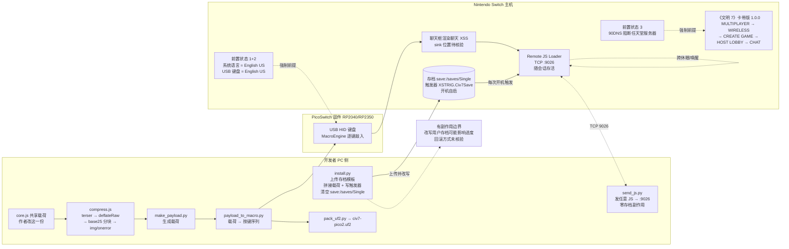

# Gezine/CivSwitch

## 一句话定位

用一支 RP2040/RP2350 开发板把约 87 行「聊天框 XSS」载荷**物理敲进**Switch 的游戏聊天框，从而在《文明 7》的用户态里启动 Remote JS Loader——**而它最值得记的不是漏洞本身，是它把「哪一步需要人」这件事写成了流程**：Pico 只负责打字，注入器负责改存档，90DNS 负责断网，而整条链路被拆成四个各自可验证的物理动作。

## 它解决的问题

Switch 1/2 上的《文明 7》**只有实体卡带版**，没有 eShop 下载版。这意味着拿到游戏代码的唯一途径是读卡带；而一旦只能读卡带，很多「跑自制代码」的路子（如常见的 title 越狱）就断了。

**⭐ CivSwitch 走的是一条绕开越狱的路：不改主机固件、不打补丁，而是利用游戏自带的一个联网聊天功能里的 XSS。** 游戏里能发聊天消息 → 消息在某处被渲染 → 如果渲染路径会执行 JS，那么「发一条会执行 JS 的消息」就等于「在游戏用户态里跑代码」。

**⭐⭐ 而这条路的难点不在漏洞，在物理输入。** 攻击者要把载荷打出来，但主机系统层面不能随便往虚拟键盘写东西——所以 CivSwitch 用一支 **RP2040/RP2350（Pico）** 伪装成 **USB HID 键盘**，把载荷**一个字符一个字符地敲进聊天气泡里**（README 说约 87 行、约 15 分钟）。

**⭐⭐⭐ 第二个问题是「敲进去之后怎么持续存在」。** 一次性载荷在重启后就没了。CivSwitch 的解法是**写存档**：把压缩后的载荷拼接进存档模板，写进 `save:/saves/Single/`，并用一个 savedata 触发器（README 写 `XSTRIG.Civ7Save`）在每次开机时重新触发它。

## 为什么值得关注（2026-11-03）

- **⭐ 它的技术核心不是「找到一个 XSS」，而是「把一次性的用户态代码执行变成开机自启的持久化存在」** —— 而这三条要求（物理输入 / 载荷编码 / 存档持久化）分别落在三个完全不同的技术层，恰好构成一个完整可复现的链路。
- **⭐⭐ 载荷编码这一层是本日最值得抄的一条**：`compress.js` 的流程被 README 明确写出——**terser → deflateRaw → base-25 分块 → `img/onerror` 行 → 「censor armor」（审查规避）**。选 base-25 而不是 base64 是因为**聊天输入框可能屏蔽某些字符**，base-25 只用 25 个可打印字符，直接规避字符集黑名单；再套 `img/onerror` 是因为它是一个**任何浏览器都会解析、但不依赖脚本被启用的**事件属性。
- **⭐⭐⭐ 它的「不可见」设计被写成了硬性前置条件，而不是可选项**：README 明确要求**必须把系统语言改成 English(US)**、**必须把 USB 键盘改成 English(US)**（否则打不出英文字母），并要求**用 90DNS 屏蔽任天堂服务器**（阻止官方校验拦截）。**这三条限制是「让这条链路成立的前提」而不是「使用时的注意事项」**——这种写法让读者能立刻判断自己的环境是否满足。
- **⭐ 它对「没法改语言设置」的机型给出了具体替代路径**：JP-only 的 Switch 2 可以用**两台机通过本地无线联机**，把 Pico 插在另一台上，用网络把载荷送过去。
- **⭐⭐ 仓库结构本身就是一份可核验的架构文档**（全树 64 条目，`truncated: false`）：根目录 `core.js`（两个组件共享的载荷本体）、`send_js.py`（向运行中的 loader 发任意 JS）、`PicoSwitch/`（固件：RP2040 + RP2350 双目标，`CMakePresets.json` 里 `pico2` preset）、`installer-creator/`（注入器）、`misc/`、`payloads/`。
- **⭐⭐ `PicoSwitch/src/` 的子目录划分直接说明了它要解决的问题范围**：`macro/MacroEngine.cpp`（宏引擎，负责把载荷变成按键序列）、`otherController/`（`Switch/Gamecube/N64` 的控制器实现——**因为要骗过主机的控制器输入**）、`switchController/`（`SwitchBluetooth.cpp` / `SwitchUsb.cpp`）。工具链也是三件套：`make_payload.py`（生成载荷）、`pack_uf2.py`（打包固件）、`payload_to_macro.py`（**把载荷翻译成按键序列**——这是整条链路里「文本」变成「物理动作」的那一步）。
- **⭐ `releases` API 返回 1 个 release（`1.0`，published 2026-11-01T16:53:48Z）带 2 个 asset**（pico 1 / pico 2 两份 uf2 固件），**合计下载 3,295 次**——**对一个 43 小时的仓库，这是本批最硬的外部使用信号**（对比：多数同批仓库 subs 为 0）。
- **⭐ 它对固件的构建要求写到了可复现的程度**：README 给出完整的 Ubuntu 24.04 依赖清单、`pico-sdk` 的 **branch 2.3.1 + `--depth 1 --recurse-submodules --shallow-submodules`** 精确克隆方式、`PICO_SDK_PATH` 环境变量、`cmake --preset pico2 && cmake --build --preset pico2` 产出 `build-pico2/src/civ7-pico2.uf2`。
- **⚠️ 但热度与成熟度要分开读**：462⭐ 出现在 43 小时内，**fork/star 高达 21.0%**（97 个 fork）——**这个比例对「有一个值得复现的硬件方案」是合理的，对「一个成熟工具」是不合理的**。

## 热度来源判断

**⭐ 热度来源是「一个具体到能照做的越狱方案」，不是「一款好玩的游戏工具」。** 判断依据：

- **fork/star 21.0%**——**这是本日四个新项目中最高的**，且高在正确的地方：fork 一个仓库的直接用途是「我也要做一遍」，而这个仓库的可 fork 内容恰好是**一份完整的硬件 + 固件 + 注入器方案**（`payloads/` 目录的存在说明作者预期别人会换载荷）。
- **release asset 下载 3,295 次**——**这是真正的外部使用计数**（GitHub release asset 的 `download_count`），与 star 是两种完全不同的信号：**star 可以是围观，asset 下载是「我要用」**。
- **仓库零 issue**（`issues` API 返回 0 条）——**这既不是「质量好」也不是「没人用」**：一个 43 小时、硬件门槛很高、且需要 JP/EN 语言设置配合的项目，零 issue 更可能说明**目标用户还没走到「能提问」的那一步**（需要卡带、需要 Pico、需要改设置），而不是「没有 bug」。

**⭐ 但热度确实含泡沫成分，必须标注**：这是**一个漏洞利用链**，其热度会随补丁发布而衰减。CivSwitch 自己也暴露了这个依赖——README 明确限定「**Only the 1.0.0 version of the game in physical cartridge is supported**」，并列出「firmware 20.x.x 到 23.0.1」。**也就是说它的有效期取决于游戏版本与主机固件两个变量。**

## 关键技术亮点

1. **⭐⭐ 物理输入层（PicoSwitch）**：RP2040 + RP2350 双目标的 C/C++ 固件，用 USB HID 宏引擎把载荷打成按键序列。`CMakePresets.json` 提供 `pico2` preset，产出 `civ7-pico2.uf2`。工具链三件套分工明确：`make_payload.py` → `payload_to_macro.py` → `pack_uf2.py`。
2. **⭐⭐ 载荷编码层（`compress.js`）**：terser → deflateRaw → base-25 分块 → `img/onerror` 属性行 → 审查规避（censor armor）。**base-25 的选择是为了绕过聊天输入的字符集限制**，`img/onerror` 是为了不依赖脚本被启用。
3. **⭐⭐⭐ 持久化层（`installer-creator/`）**：`install.py <console-ip>` 上传存档模板 → 在主机上把压缩载荷拼接进去 → **清空 `save:/saves/Single/`** → 写入触发器（`XSTRIG.Civ7Save`）。**开机自启由「读存档时触发」实现，而不是由常驻进程实现**——这让它能扛住休眠/唤醒。
4. **⭐⭐ 通道层（`send_js.py`）**：`python send_js.py <console-ip> [port] file.js` 把任意 JS 发给 loader（默认 9026 端口），并**打印主机回传的日志直到连接关闭或超时**。**这让「远程控制 Switch」从一次性动作变成可反复进行的操作。**
5. **⭐⭐ 控制器伪装层**：`otherController/` 下同时实现 Switch / GameCube / N64 三种控制器——**说明作者知道主机可以「把主机当成手柄连到别的东西」，这是一条可扩展的攻击面**。
6. **⭐ 环境前置条件的显式化**：系统语言 English(US) + USB 键盘 English(US) + 90DNS 屏蔽任天堂服务器，**三条都被写成「required」而非「建议」**。

## 架构师速览

| 决策问题 | 研究判断 | 证据边界 |
|---|---|---|
| 系统边界 | 边界在**游戏用户态**（卡带 → 游戏进程），不触及主机固件、不触及系统级越狱。四个组件分处四个物理层：Pico 固件（USB HID 设备）· 游戏聊天框（渲染进程）· 存档子系统（持久化）· PC 上的注入器（网络上传） | 「不触及固件」由 README 全篇无越狱/firmware patch 步骤 + 目录结构（无 kernel/firmware 相关目录）支持；**未核验**游戏具体哪个组件渲染聊天、该组件的 XSS sink 位置、是否存在服务端过滤 |
| 主路径 | ① PC 侧生成并压缩载荷 → ② 编译为按键序列并烧入 Pico → ③ 用户把主机语言与 USB 键盘改为 English(US) → ④ 用 90DNS 阻断任天堂服务器 → ⑤ 主机内建多人房间 → ⑥ **插上 Pico，焦点置于聊天框，Pico 约 15 分钟敲完约 87 行** → ⑦ loader 在 9026 端口上线 → ⑧ PC 侧 `install.py` 上传存档并写入触发器 → ⑨ 此后每次开机经存档触发载荷 | ①③④⑤⑥⑦⑧⑨ 均由 README 原文直接支持；**② 的固件二进制未编译验证**；**⑥「约 87 行 / 约 15 分钟」为 README 自述，未复现**；**⑧「清空 `save:/saves/Single/`」的后果（是否清除既有存档进度）未核验** |
| 关键权衡 | **① 用物理输入而非程序化注入**——换来「不需要任何主机侧漏洞」的可移植性，代价是 15 分钟的机械等待与一套额外硬件；**② 用存档触发而非常驻**——换来扛住休眠/唤醒，代价是必须改写存档（**潜在的用户存档风险**）；**③ 用 base-25 而非 base64**——换来绕过字符集限制，代价是载荷膨胀（未核验膨胀比）；**④ 用 90DNS 阻断官方服务器**——换来不被校验拦截，代价是这台主机在实验期间完全离线 | ①–④ 的**取舍方向**由 README 与目录结构支持；**膨胀比、存档改写的具体实现与回滚方式、90DNS 是否仅拦 DNS 层而未拦其他出网路径均未核验** |
| 最小 PoC | ① 烧录官方 `1.0` release 的 pico 1 uf2 → ② 主机语言与 USB 键盘改 English(US) → ③ 90DNS 生效 → ④ 建多人房间进聊天 → ⑤ 插 Pico 观察是否出现 loader → ⑥ **在装存档触发器之前先验证 ⑤**，因为 ⑦ 的存档改写会触碰用户存档 | PoC 的**顺序由 README 的四步流程反推**；**未核验**是否可以在不写存档的前提下验证 ⑤（README 的流程里 loader 与触发器是可分离的两步，但「不写存档时 loader 能否在会话内独立存活」未核验）；**退出路径**：不写存档即退出，代价仅为一次 15 分钟的 Pico 输入与一次被断网的联机会话 |

## 架构启发

**⭐⭐ CivSwitch 的启发不在漏洞技术，而在「跨物理层的执行链」怎么写才可复现。**

一个通常被忽略的事实是：**当执行链跨越了「物理输入」这一层时，每一层的失败模式都完全不同，而大多数项目只写成功路径。** CivSwitch 的 README 把**三层前置条件分别归因**：打不出字母是**语言设置**问题、被官方服务器拦是**DNS**问题、载荷打进去不执行是**编码/字符集**问题。**每一条失败都被指向了一个具体的、可检查的状态，而不是「请重试」。**

**⭐⭐⭐ 更值得抄的是「权限分层」的做法**：`send_js.py` 与 `install.py` 是两个**权限完全不同**的动作——前者只向一个已经在运行的端口发数据（**对主机存档零影响**），后者会改写存档（**可能影响用户进度**）。README 把它们分成两个章节、给出不同的命令，**并明确说明第 ⑧ 步会「清空 `save:/saves/Single/`」**。**当一个工具链里有「无副作用的观察动作」和「有副作用的持久化动作」时，把它们显式分层，比在文档里写一句「注意备份」要有效得多。**

**⭐ 与前几日记录的同类信号的关系**：本日之前已记录多个项目「把边界写进可核验位置」（10-24 的 `docs/checks.md`、10-30 的 Zero-Breach 的 `docs/VERIFYING.md`）。**CivSwitch 属于同一族，但它的形式更特殊——它把边界写成了「物理前置条件清单」**：每条限制都对应一个**用户可以在菜单里自己确认的状态**（系统语言、USB 键盘语言、DNS）。**这是把「我的方案有前提」从免责声明变成检查表。**

**⭐ 对架构师的通用启发**：当你的方案依赖多个**彼此独立的环境条件**时，不要在文档里散落这些条件，**把它们收敛成一张「可检查的状态 → 它影响哪一步」的表**。CivSwitch 用「三条硬前置 + 各自的 `why`」做到了这件事，而这条经验对任何跨环境部署的方案都成立。

## 架构图（MMD）

> 证据边界：此图只采用本档案已有可核验描述；「待核验」节点不应视为项目实现事实。

## 定位判断

**「窄到不能再窄」的一次性利用链，但结构上是一个通用工具。** CivSwitch 不是通用越狱，它只支持《文明 7》1.0.0 卡带版、只支持 Switch 1/2 固件 20.x–23.0.1、只跑 87 行载荷。**从「产品」看它极其脆弱。**

**⭐ 但从「工具」看，它的三段式拆分是通用的**：`payload_to_macro.py`（任意载荷 → 按键序列）、`send_js.py`（任意 JS → 主机）、`installer-creator`（任意载荷 → 存档持久化）。**这三段都不含《文明 7》的语义**——`payloads/` 目录的存在说明作者自己也把它们当通用件。**若把游戏换成别的有同样 XSS 的目标，链路不变。**

**⭐ 它在生态里的位置**：属于「游戏主机用户态代码执行」这一小类。相较更常见的 title 越狱路线，它的独特性是**不需要任何主机侧漏洞**——**因此它不会因为任天堂发布固件补丁而失效，只会因为游戏版本更新而失效**（后者对用户来说更容易自己判断）。

**⭐ 值得注意的分层**：CivSwitch 提供**能力**（在游戏用户态跑 JS），不提供**内容**（`payloads/` 里是什么未核验）。这与 Zero-Breach-Toolkit 的分工正好相反——后者提供**判断**（有没有被间谍软件搞过），自己不下手。**「提供能力」与「提供判断」是两类完全不同的开源项目，各自的风险面也不同。**

## 风险 / 局限 / 泡沫点

- **⭐⭐⭐ 存档改写是真实风险**：`install.py` 会「上传存档模板、拼接载荷、**清空 `save:/saves/Single/`**、写入触发器」。**README 没有说明如何备份/回滚既有存档进度**——对一个正在玩的存档来说，这是一个不可逆操作。**本档案建议：在做这一步之前先自行备份存档目录。**
- **⭐⭐⭐ 越狱链的合法边界由当地法律决定**：README 自己写明「It is not legal advice, and the rules differ by country」，并把项目定位为「preservation and personal use」。**本档案不对任何具体使用场景给出建议。**
- **⭐⭐ 硬性版本依赖**：只支持游戏 1.0.0 卡带版。游戏更新后是否仍可用**未核验**——README 只说「Only the 1.0.0 version」，没有说明更新后的行为。
- **⭐⭐ 固件兼容性窗口**：README 说「firmware 20.x.x 到 23.0.1 应该都能用」，并自述在 22.5.0 / 20.4.0 / 23.0.1 上测过——**「应该都能用」是作者措辞，不是全矩阵验证结果**。
- **⭐⭐ 「键盘语言必须改 English(US)」是相当大的使用门槛**：对中文、日文、韩文用户，这一步要么改设置、要么用两台机联机的变通——**后者需要额外一台 Switch，是不成比例的成本**。
- **⭐⭐ 90DNS 阻断官方服务器有连带损失**：实验期间该主机与游戏相关的一切在线服务都不可用（**含 Nintendo Account 相关功能与本作的在线要素**）。README 只给了链接与一句「block Nintendo servers」，**未说明影响范围**。
- **⭐ 零 issue 不能读作「质量已验证」**：43 小时、硬件门槛高、环境前置多——**目标用户很可能还没走到能提问的那一步**。
- **⭐ 462⭐ 的时长极短**：43 小时，且 fork/star 21.0% 属「有具体方案」的形态而非「有广泛采用」的形态。**热度对有效性不构成证据。**
- **⭐ 载荷内容未核验**：`payloads/` 目录中具体是什么未读。**一个「能让任意 JS 在主机上跑」的框架，其载荷目录的实际内容是判断项目性质的关键，本次未核验。**

## 与同类项目的关系

- **vs 传统 Switch 越狱（如 Atmosphère 系方案）**：传统方案**一次性夺取更高权限**（可读写系统分区、可安装自制包），CivSwitch **只拿到游戏用户态**。前者能力强但需要匹配固件漏洞、后者只需要一个游戏侧的 XSS。**两者不可比，因为能力边界根本不同。**
- **vs PicoSwitch 的同类「USB HID 宏」项目**（例如各类宏键盘固件）：PicoSwitch 的**独特之处不在 HID 本身，而在它后面接的三段工具链**（载荷→按键、发送、持久化）。**单独的 HID 宏板是成熟品类，CivSwitch 的增量在「怎么把载荷变成按键」和「怎么让结果留下来」。**
- **vs Zero-Breach-Toolkit（本日同批）**：**方向完全相反**——Zero-Breach 只做**只读判断**（扫痕迹、报告证据强度），自己不下手；CivSwitch **提供执行能力**。**前者可安全推荐给非技术用户，后者必须附带明确的授权边界说明。**
- **vs floorplan / stack-diagram（本日同批的 Agent 工具）**：两者都属「把一个原本需要手工的步骤自动化成一句话」，但 CivSwitch 的输出是**在别人硬件上执行代码**，而 floorplan 的输出是**一张图**。**风险面差三个数量级。**

## 是否值得持续跟踪

**值得跟踪，但理由是「架构范式」而不是「工具可用性」。**

**⭐ 对绝大多数开发者**：**不建议使用**（硬件门槛 + 存档风险 + 法律边界 + 版本脆弱性）。但**值得读它的 README**，因为它示范了「跨物理层执行链」该怎么写才可复现、该怎么在文档里分层「无副作用的观察」与「有副作用的持久化」。

**⭐ 对做安全研究的人**：**这是本日最值得读的利用链实现**，因为它**完整、可复现、且把每一步的前置条件都写清了**。

**⭐⭐ 对做 Agent/自动化工具的人**：**它的三段式拆分（payload → 输入 → 持久化）是一个可直接借用的模式**——任何「让外部系统执行一段代码」的场景都有对应的「把它变成某种输入」「把它变成持久化触发」两段。

**⭐ 观察优先级**：**① 是否有第二个游戏目标复用这套工具链**（若 `payloads/` 与三件套被复用，说明它确实被当作通用件）；**② 游戏更新后 README 的版本限定是否变化**；**③ 是否出现第二位外部贡献者**（今日 `contributors` API 返回 1 人，即作者本人）。

## 后续观察点

1. **⭐⭐ `payloads/` 目录的实际内容** —— **本档案最关键的未核验项**：这决定 CivSwitch 是「一个研究项目」还是「一个投递载荷的渠道」。
2. **⭐⭐ 是否出现第二位外部贡献者 / 第二个 issue** —— 今日 `contributors` 返回 1 人、`issues` 返回 0 条，**「零外部参与」是 43 小时内的正常状态，但它是判断采用度的第一个分水岭**。
3. **⭐⭐ release asset 下载数的变化** —— 今日 3,295 次（两份 uf2）。**这是本批唯一可核验的外部使用计数**，它的走向比 star 数更有信息量。
4. **⭐ 游戏 1.0.0 之外版本的适配** —— README 只写「Only the 1.0.0 version」，**没有说明作者是否会跟进更新**。
5. **⭐ 存档回滚路径是否被文档化** —— 若作者补上「如何备份/还原 `save:/saves/Single/`」，这个工具的可用性判断会实质改善。
6. **⭐ 固件全矩阵验证** —— 「20.x.x 到 23.0.1 应该都能用」是期望，不是验证；**若作者补一张实测矩阵，可信度会明显上升**。

---
> 数据来源: GitHub REST/Search API（gh CLI 认证），UTC **2026-11-03T06:00Z** 单一快照 | Stars: 462 | Forks: 97 | Subscribers: 13 | Open Issues: 0 | License: MIT | 语言: JavaScript | 创建: 2026-11-01T13:30:59Z | pushed: 2026-11-02T14:10:23Z | 14 commits | contributors 1 人 | releases 1 个（2 asset，累计下载 3,295）| topics 0 | 995 KB
> 结构证据: 全树 64 条目（`truncated: false`）；根目录 `core.js` / `send_js.py` / `PicoSwitch/` / `installer-creator/` / `misc/` / `payloads/`；`PicoSwitch/src/` 分 `macro/`（MacroEngine.cpp）、`otherController/`（Switch/Gamecube/N64）、`switchController/`（SwitchBluetooth.cpp、SwitchUsb.cpp）；工具链 `make_payload.py` / `pack_uf2.py` / `payload_to_macro.py`；`installer-creator/save_template.bin`
> 证据边界: **未执行任何 payload、未编译固件、未连接任何主机**；游戏侧 XSS sink 的具体组件与位置未核验；`payloads/` 目录内容未读；「约 87 行 / 约 15 分钟」为 README 自述未复现；「清空 `save:/saves/Single/`」对既有存档进度的影响与回滚方式未核验；90DNS 的拦截范围（是否仅 DNS 层）未核验；`issues` API 返回 0 条、`contributors` API 返回 1 人均已核验为事实；462⭐ 的来源无法核验（`stargazers` 端点对本 token 返回 404），故只作总量记录
