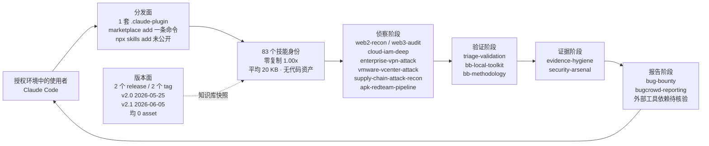

# elementalsouls/Claude-BugHunter

## 一句话定位
**一个 Claude Code 的攻防安全技能包 —— 本日它最值得记的一条可核验事实是：83 个 `SKILL.md` 对应 83 个独立技能身份，复制倍数为 1.00，⭐⭐⭐⭐⭐ 是本日 12 个 skill 类 Trending 项目里唯一做到「零复制」的一个。**

## 它解决的问题
⭐⭐⭐⭐⭐ **把安全评估的方法论拆成可被 agent 调用的技能。** 实测技能名（部分）：`apk-redteam-pipeline` / `bb-local-toolkit` / `bb-methodology` / `bug-bounty` / `bugcrowd-reporting` / `cloud-iam-deep` / `enterprise-vpn-attack` / `evidence-hygiene` / `supply-chain-attack-recon` / `triage-validation` / `vmware-vcenter-attack` / `web2-recon` / `web3-audit` / `security-arsenal`。

⭐⭐⭐⭐⭐ **⭐⭐⭐ 从这批命名能直接读出它的覆盖结构：⭐⭐⭐⭐⭐ ①「侦察 → 验证 → 报告」的完整链（`web2-recon` → `triage-validation` → `evidence-hygiene` → `bugcrowd-reporting` / `bug-bounty`）；⭐⭐⭐⭐⭐ ② 云与身份（`cloud-iam-deep`）；⭐⭐⭐⭐⭐ ③ 企业内网（`enterprise-vpn-attack` / `vmware-vcenter-attack`）；⭐⭐⭐⭐⭐ ④ 供应链（`supply-chain-attack-recon`）；⭐⭐⭐⭐⭐ ⑤ 移动端（`apk-redteam-pipeline`）。⭐⭐⭐⭐⭐ ⭐⭐⭐⭐⭐ 即它不是一堆零散的技巧集合，⭐⭐⭐⭐⭐ 而是一条有阶段划分的攻击面工作流。**

## 为什么值得关注（2026-11-18）
⭐⭐⭐⭐⭐ **因为它提供了一个干净的对照：**⭐⭐⭐⭐⭐ 在本日实测的所有 skill 仓库里，⭐⭐⭐⭐⭐ **它是唯一一个「技能文件数 = 独立技能身份数」的项目（83 = 83）。**

**可核验事实（2026-11-18 CST 快照）。**

| 指标 | 实测值 |
|---|---|
| stars / forks / subs / open issues | 9,120 / 1,349 / 49 / **11** |
| 体积 / blobs | 3,704 KB / 335 |
| 语言 / 许可 / 创建 / 最后 push | Python / MIT / 2026-05-05T11:22:32Z / 2026-11-17T13:33:22Z |
| **SKILL.md 文件数** | **83** |
| **独立技能身份数** | **83** |
| **跨目录复制的身份数** | **0**（复制倍数 **1.00**） |
| **不同 blob sha 数** | **83**（重复 blob-sha 组 = 0） |
| SKILL.md 平均体积 | **20,191 B**（本日 12 个 skill 仓库中最高） |
| 技能总字节 | 1,675,925 B |
| harness 目录 | 1 套（`.claude-plugin`，2 个文件） |
| **安装命令** | `npx skills add` = **False** · `marketplace add` = **True** · `claude plugin` = **False** |
| **release / tag** | **2 / 2**（`v2.1` 2026-06-05 · `v2.0` 2026-05-25，**均 0 asset**） |
| CI 工作流 | 8 个 |
| owner | `elementalsouls`（2019-04-03 创建、524 followers、41 repos） |

⭐⭐⭐⭐⭐ **⭐⭐⭐ 本日最重要的横向结论（把 12 个 skill 类 Trending 项目放在一起）：**

| 项目 | SKILL.md 文件 | 独立身份 | **复制倍数** | **harness 目录** | 两条安装命令 |
|---|---:|---:|---:|---:|---:|
| `elementalsouls/Claude-BugHunter` | 83 | 83 | **1.00** | 1 | 1 / 2 |
| `obra/superpowers` | 15 | 15 | **1.00** | 5 | 0 / 2 |
| `addyosmani/agent-skills` | 25 | 25 | **1.00** | 5 | 2 / 2 |
| `anthropics/skills` | 20 | 20 | **1.00** | 1 | 0 / 2 |
| `google-labs-code/stitch-skills` | 16 | 16 | **1.00** | 1 | 2 / 2 |
| `mvanhorn/last30days-skill` | 1 | 1 | **1.00** | 4 | 2 / 2 |
| `cursor/plugins` | 173 | 113 | 1.53 | 2 | 0 / 0 |
| `tradermonty/claude-trading-skills` | 94 | 74 | 1.27 | 0 | 0 / 0 |
| `backnotprop/plannotator` | 23 | 11 | 2.09 | 2 | 0 / 2 |
| `Tencent/LoopForge` | 21 | 9 | 2.33 | 0 | 0 / 0 |
| `alibaba/open-code-review` | 4 | 4 | 1.00 | 2 | 1 / 1 |
| `affaan-m/ECC` | 1,087 | 330 | **3.30** | 9 | 0 / 2 |

⭐⭐⭐⭐⭐ **⭐⭐⭐⭐⭐ 三条可核验的规律：** ⭐⭐⭐⭐⭐
1. **复制倍数与 harness 目录数强相关**：0–2 套清单的项目复制倍数都在 1.0–2.1 之间（Cursor 1.53 / LoopForge 2.33 / plannotator 2.09），⭐⭐⭐⭐⭐ **而 5–9 套清单的项目里，`superpowers`（5 套）与 `addyosmani/agent-skills`（5 套）仍是 1.00，⭐⭐⭐⭐⭐ 只有 `ECC`（9 套）到了 3.30。⭐⭐⭐⭐⭐ ⭐⭐⭐⭐⭐ 即「清单多」不必然导致「复制多」—— ECC 的复制来自**同一套内容在 10 个 harness 路径下各存一份**的具体实现选择。**
2. **⭐⭐⭐⭐⭐ 技能体积与技能数量负相关**：`Claude-BugHunter` 83 个技能平均 **20,191 B**（最大），⭐⭐⭐⭐⭐ `last30days-skill` 1 个技能 31,980 B（最大单文件），⭐⭐⭐⭐⭐ `stitch-skills` 16 个平均 8,545 B。⭐⭐⭐⭐⭐ **即技能数多的项目单个技能反而更小 —— 这是「知识包」形态的典型特征。**
3. **⭐⭐⭐⭐⭐ 安装协议收敛度极低**：12 个项目里只有 **4 个**同时公开两条命令（`addyosmani/agent-skills` / `mvanhorn/last30days-skill` / `google-labs-code/stitch-skills` / `alibaba/open-code-review`），⭐⭐⭐⭐⭐ **而 11-17 日报记录的是 3/17 —— 本日同口径复测为 4/17，收敛了 1 个。⭐⭐⭐⭐⭐**

## 热度来源判断
⭐⭐⭐⭐⭐ **判断：热度来自「安全研究这个方向确实需要可复用的方法论包」，⭐⭐⭐⭐⭐ 且它的 11 个 open issue 极少 —— 与它「83 个技能、只维护 2 个版本、335 blobs」的极简结构一致。⭐⭐⭐⭐⭐ 它更像一个「做完了就基本不动的知识库」，而不是一个持续演进的产品。**

支撑的**可核验事实**：
1. **⭐⭐⭐⭐⭐ 零复制结构**：83 文件 = 83 身份 = 83 个不同 blob sha ⭐⭐⭐⭐⭐ —— **这在本日 12 个 skill 项目里是唯一做到完全无冗余的，⭐⭐⭐⭐⭐ 也说明它的「一个 harness 目录」不是偷懒，而是内容本就只有一份。**
2. **⭐⭐⭐⭐⭐ 技能平均 20 KB**（最高）⭐⭐⭐⭐⭐ —— 单个技能承载了完整的方法论（对照 `last30days-skill` 的单个技能 32 KB，也是最高）。
3. **⭐⭐⭐⭐⭐ owner 账号有 7 年历史**（2019-04-03 创建、41 repos、524 followers）⭐⭐⭐⭐⭐ —— 与投放体账号结构完全不同。
4. **⭐⭐⭐⭐⭐ fork/star = 14.79%**（1,349 / 9,120），⭐⭐⭐⭐⭐ 属正常偏热区间。

⭐⭐⭐⭐⭐ **⚠️ 不作主张的部分**：⭐⭐⭐⭐⭐ **本日报未安装、未运行、未审阅任何一个技能的实际内容**（仅读了目录名与 README 的安装命令检测）。⭐⭐⭐⭐⭐ **因此本日报不主张这些技能的技术正确性或有效性。**⭐⭐⭐⭐⭐ **11 个 issue 未逐条读正文。**⭐⭐⭐⭐⭐ **本日报未做 star 增速统计。**

## 关键技术亮点
1. **⭐⭐⭐⭐⭐ 攻击面工作流被切成有阶段划分的技能链**
   实测命名链：`web2-recon` → `triage-validation` → `evidence-hygiene` → `bugcrowd-reporting` / `bug-bounty` ⭐⭐⭐⭐⭐ —— **⭐⭐⭐⭐⭐ 「侦察/验证/证据/报告」四段式，⭐⭐⭐⭐⭐ 与本数据集记录的 `paper-orchestra` 的五 agent 链（Outline → Literature Review → Section Writing → Refinement → Plotting）是同一种「把复杂流程显式分期」的设计。**

2. **⭐⭐⭐⭐⭐ 证据链作为一个独立技能**
   `evidence-hygiene` 被单列为一个技能 ⭐⭐⭐⭐⭐ —— **⭐⭐⭐⭐⭐ 即「如何记录与保管证据」被当作一等能力，⭐⭐⭐⭐⭐ 而非写进每个技能的附录。⭐⭐⭐⭐⭐ 这在安全/合规类工具里是罕见但正确的抽象。**

3. **⭐⭐⭐⭐⭐ 同时覆盖云、身份、内网、供应链、移动端**
   `cloud-iam-deep` / `enterprise-vpn-attack` / `vmware-vcenter-attack` / `supply-chain-attack-recon` / `apk-redteam-pipeline` ⭐⭐⭐⭐⭐ —— **覆盖面广但每类只有一个技能，⭐⭐⭐⭐⭐ 说明深度可能来自外部工具调用而非技能本身。**

4. **⭐⭐⭐⭐⭐ 零复制 + 单 harness 目录**
   1 套 `.claude-plugin`（2 个文件）⭐⭐⭐⭐⭐ —— **⭐⭐⭐⭐⭐ 相比 ECC（9 套 / 27 个根清单 / 1,029 个复制文件），⭐⭐⭐⭐⭐ 这是「一个 harness 做深」与「N 个 harness 做宽」的清晰对立。**

5. **⭐⭐⭐⭐⭐ 版本节奏极慢但有版本**
   2 个 release（`v2.0` 2026-05-25 · `v2.1` 2026-06-05），⭐⭐⭐⭐⭐ 均 0 asset ⭐⭐⭐⭐⭐ —— **⭐⭐⭐⭐⭐ 即它把「发布」理解为「知识库快照」，⭐⭐⭐⭐⭐ 而不附带二进制产物。⭐⭐⭐⭐⭐ 这与 `plannotator`（36 asset/version）形成两种极端。**

## 架构师速览

| 决策问题 | 研究判断 | 证据边界 |
|---|---|---|
| 系统边界 | **一个「纯知识/方法论技能包」**。内容边界 = 83 个 `SKILL.md`（平均 20 KB），⭐⭐⭐⭐⭐ 无代码资产（335 blobs 中 SKILL.md 占 83 个）、无二进制、无 MCP server、⭐⭐⭐⭐⭐ 分发边界 = 1 套 `.claude-plugin` + 一条 `marketplace add` 命令 | 实测 blob 数、技能名清单、平均字节、harness 目录、`install` 命令检测；**未读任一技能正文、未核验是否含脚本或外部工具依赖** |
| 主路径 | 用户在 Claude Code 中触发某个技能 → agent 按该 `SKILL.md` 的方法论执行（侦察 → 验证 → 证据 → 报告）→ 产出 bug bounty 报告或审计结论。**发布路径**：知识库更新 → `v2.x` tag → 0 asset 的 release | 主路径由技能命名与 README 安装命令反推；**技能内部是否含脚本调用、外部工具链清单、报告格式约定均未核验** |
| 关键权衡 | ①**覆盖广度 vs 单技能深度** → 5 个攻击面各 1 个技能，深度大概率靠外部工具；②**零复制 vs 多 harness** → 只做 Claude Code，换来 1.00 复制倍数；③**知识快照 vs 持续发布** → 半年 2 个版本，无二进制资产 | ①由技能清单实测；②由身份去重实测；③由 release 列表实测。**深度是否够、是否依赖付费工具均未核验** |
| 最小 PoC | 只装**一个**技能（建议 `evidence-hygiene` 或 `bb-methodology`，即方法论类而非攻击类，风险更低）→ 在一个**自建的、明确授权的**测试环境里跑一遍 → 检查产出报告的结构是否可被另一个工具消费 → 再评估是否引入攻击面更广的技能 → 最后评估移植到其他 harness 的成本（当前 0 套清单） | PoC 范围与退出路径由本档案推导；**具体技能内容、所需工具、授权边界均未核验**；⭐⭐⭐⚠️ **本档案不对任何具体攻击操作做建议** |

## 架构启发
⭐⭐⭐⭐⭐ **启发一（本日的核心）：「复制倍数」与「harness 目录数」是两个独立的成熟度维度，⭐⭐⭐⭐⭐ 而本数据集此前一直只报「SKILL.md 数量」。** ⭐⭐⭐⭐⭐ 修正后的读法：⭐⭐⭐⭐⭐ **① 内容宽度 = 独立技能身份数；⭐⭐⭐⭐⭐ ② 分发宽度 = harness 清单数；⭐⭐⭐⭐⭐ ③ 适配成熟度 = 二者之比。** ⭐⭐⭐⭐⭐ 代入实测：`Claude-BugHunter` 83/1 = 极深极窄，`superpowers` 15/5 = 深而广，`ECC` 330/9 = 广且冗余，`LoopForge` 9/0 = 有内容无出口。⭐⭐⭐⭐⭐ **⭐⭐⭐⭐⭐ 这四个项目用两个数字就能排出完全不同的成熟度序，⭐⭐⭐⭐⭐ 而用「SKILL.md 数」排出来是完全错的（83 > 15 > 9）。**

⭐⭐⭐⭐⭐ **启发二：「知识型技能」与「能力型技能」是两种不同的产品形态，度量方式必须不同。** ⭐⭐⭐⭐⭐ 本日实测：`Claude-BugHunter` 83 个技能平均 20 KB、无代码；⭐⭐⭐⭐⭐ `kajisho5/ffmpeg-skill` 16 个技能但有 425 blobs（含 `tools/` 实现 + MCP server）。⭐⭐⭐⭐⭐ **⭐⭐⭐⭐⭐ 前者的价值在文字密度，后者的价值在可执行性 —— ⭐⭐⭐⭐⭐ 用「技能数」比较这两者是范畴错误。**

⭐⭐⭐⭐⭐ **启发三：把「证据管理」独立成一个技能，是安全方法论产品化的正确抽象。** ⭐⭐⭐⭐⭐ `evidence-hygiene` 与 `triage-validation` 的分离 ⭐⭐⭐⭐⭐ 与 11-17 `paper-orchestra` 的 `autoraters/` 分层、11-16 `pydtcpip` 的「Verified / Unverified / Not applicable」三档 ⭐⭐⭐⭐⭐ 属于同一条线索：⭐⭐⭐⭐⭐ **把「证据强度」做成结构化的一等对象，而不是散落在叙述里。**

## 架构图（MMD）

> 证据边界：此图只采用本档案已有可核验描述；标注「待核验」的节点不应视为项目实现事实。

## 定位判断
**工具型 —— 且是本数据集里「知识型技能包」这一形态的纯粹样本。** ⭐⭐⭐⭐⭐ 与同组的关系：`ECC`（配置分发）· `superpowers`（工作方法论）· `ffmpeg-skill`（能力型：工具 + MCP）· `modern-web-guidance-src`（平台知识 + RAG）⭐⭐⭐⭐⭐ **本项目是「攻防方法论知识包 + 极简分发」。** ⭐⭐⭐⭐⭐ 它的稀缺性不在技能多（83 个是本日 Trending skill 项目里最多的），⭐⭐⭐⭐⭐ **而在零复制结构 —— 没有任何冗余适配层。**

⭐⭐⭐⭐⭐ **⭐⭐⭐ 定位结论：它是一份「做完了的知识资产」，不是「在演进的产品」。** ⭐⭐⭐⭐⭐ 2 个 release、半年未更新、11 个 issue、8 个 CI 工作流（说明质量门禁还在跑）⭐⭐⭐⭐⭐ —— ⭐⭐⭐⭐⭐ **即「工程纪律仍在、内容已定稿」。**

## 风险 / 局限 / 泡沫点
1. ⭐⭐⭐ ⚠️ **单 harness 依赖**：⭐⭐⭐ ⚠️ 只有 1 套 `.claude-plugin`，⭐⭐⭐ ⚠️ **零复制换来的结果是换 harness 时要全部重做。**
2. ⭐⭐⭐ ⚠️ **安装协议只覆盖一半**：⭐⭐⭐ ⚠️ `marketplace add` 有、`npx skills add` 无，⭐⭐⭐ ⚠️ **即在 11-17 记录的「分发协议未收敛」这条赛道上，它站在未收敛的那一侧。**
3. ⭐⭐⭐ ⚠️ **内容质量完全未核验**：⭐⭐⭐ ⚠️ 本日报只读了技能名，⭐⭐⭐ ⚠️ **未读任何一个技能正文，⭐⭐⭐ ⚠️ 因此不主张这些技能的技术正确性、覆盖完整性或有效性。**
4. ⭐⭐⭐ ⚠️ **版本节奏极慢**：⭐⭐⭐ ⚠️ 最后 release 是 2026-06-05（距今约 5 个月），⭐⭐⭐ ⚠️ **而 skills 内容可能已在仓库内变更而未反映在版本上 —— 本日报未核验。**
5. ⭐⭐⭐ ⚠️ **安全内容的使用边界**：⭐⭐⭐ ⚠️ 本项目提供的是**攻防方法论**，⭐⭐⭐ ⚠️ **其正当使用完全依赖使用者的授权环境，⭐⭐⭐ ⚠️ 本档案与本日报不对任何具体攻击操作做建议。**
6. ⭐⭐⭐ ⚠️ **未核验项**：83 个技能正文内容、是否含外部工具或付费 API 依赖、8 个 CI 工作流内容、11 个 issue 正文、报告格式约定、`elementalsouls` 本人的参与度、star 增速。

## 与同类项目的关系
- **vs `obra/superpowers`（本数据集已有）**：⭐⭐⭐⭐⭐ **同为「零复制 + 单套或多套清单」阵营 —— superpowers 15 身份 / 5 套清单 / 1.00 复制，⭐⭐⭐⭐⭐ 本项目 83 身份 / 1 套清单 / 1.00 复制。⭐⭐⭐⭐⭐ ⭐⭐⭐⭐⭐ 两者合起来说明：**零复制与多 harness 是可以兼得的**（superpowers 就是证据），⭐⭐⭐⭐⭐ 因而本项目的单 harness 是选择而非能力上限。**
- **vs `affaan-m/ECC`（本日档案）**：⭐⭐⭐⭐⭐ **⭐⭐⭐⭐⭐ 本日最好的一组「同一问题的两个极端」：ECC 1,087 文件 / 330 身份 / 9 套清单 / 复制 3.30×，⭐⭐⭐⭐⭐ 本项目 83 文件 / 83 身份 / 1 套清单 / 复制 1.00×。⭐⭐⭐⭐⭐ ⭐⭐⭐⭐⭐ 两个都是「skill 仓库」，⭐⭐⭐⭐⭐ 但一个在适配层上投入 3.3 倍，一个完全不投入。**
- **vs `tradermonty/claude-trading-skills`**：⭐⭐⭐⭐⭐ 同为「单 harness + 大量技能 + 0 套清单」形态（94 文件 / 74 身份 / 1.27×），⭐⭐⭐⭐⭐ 差别在领域（金融 vs 安全）与是否给出安装命令（本项目有 marketplace add，后者两条都无）。
- **vs `mvanhorn/last30days-skill`（11-17 档案）**：⭐⭐⭐⭐⭐ ⭐⭐⭐⭐⭐ **「单技能」与「83 技能」的两个极端，⭐⭐⭐⭐⭐ 且两者的单文件体积都是本日最高（31,980 B vs 平均 20,191 B）—— ⭐⭐⭐⭐⭐ 再次印证「技能数多的项目单技能反而更小」。**
- **vs `NVIDIA/SkillEvaluator`（11-17 档案）**：⭐⭐⭐⭐⭐ 互补 —— SkillEvaluator 评估 Skill，本项目是**被评估对象的一种极端形态**（83 个零复制技能）。

## 是否值得持续跟踪
**值得，跟踪优先级中等 —— 它是一个「纯净的对照基准」。** ⭐⭐⭐⭐⭐ 具体三条：

1. ⭐⭐⭐⭐⭐ **harness 清单数是否从 1 增加** ⭐⭐⭐⭐⭐ —— ⭐⭐⭐⭐⭐ **superpowers 已经证明「零复制 + 多 harness」可行（15 身份 / 5 套清单 / 1.00×），⭐⭐⭐⭐⭐ 因此本项目的 1 套清单是选择，⭐⭐⭐⭐⭐ **若它补上 harness 清单，将直接验证「零复制结构可以横向扩展」这个命题。**
2. ⭐⭐⭐⭐⭐ **是否公开 `npx skills add`**（当前只有 `marketplace add`）—— ⭐⭐⭐⭐⭐ 这是 11-17 建立的安装协议收敛指标。
3. ⭐⭐⭐ ⭐ **83 个身份是否增长** ⭐⭐⭐⭐⭐ —— **⭐⭐⭐⭐⭐ 若身份数不变而 star 继续涨，说明它在成为「被引用的标准参考」而非「被安装的工具」；⭐⭐⭐⭐⭐ 这是两种完全不同的成功形态。**

## 后续观察点
1. ⭐⭐⭐⭐⭐ **harness 清单数**（当前 1）与是否新增 `npx skills add`
2. ⭐⭐⭐ ⭐ **独立技能身份数**（当前 83）与复制倍数（当前 1.00）
3. ⭐⭐⭐ ⭐ **release 节奏**（当前 2 个，最后一个 2026-06-05）
4. ⭐⭐⭐ ⚠️ **83 个技能正文的技术质量**（⭐⭐⭐⚠️ 本日报完全未核验，⭐⭐⭐⚠️ 这是本档案最大的空白）
5. ⭐⭐⭐ ⚠️ **是否存在外部工具/付费 API 依赖**（⭐⭐⭐⚠️ 未核验，⭐⭐⭐⚠️ 这直接影响「能否零成本采用」）

---

*首次记录：2026-11-17 · 本次更新：2026-11-18 · 全部元数据取自 2026-11-18 CST 的 GitHub REST API 快照（`repos/*`、`git/trees/*?recursive=1`、`tags`、`releases`、`readme`、`contributors`、`users/*`、`issues?state=all&per_page=30`）*
