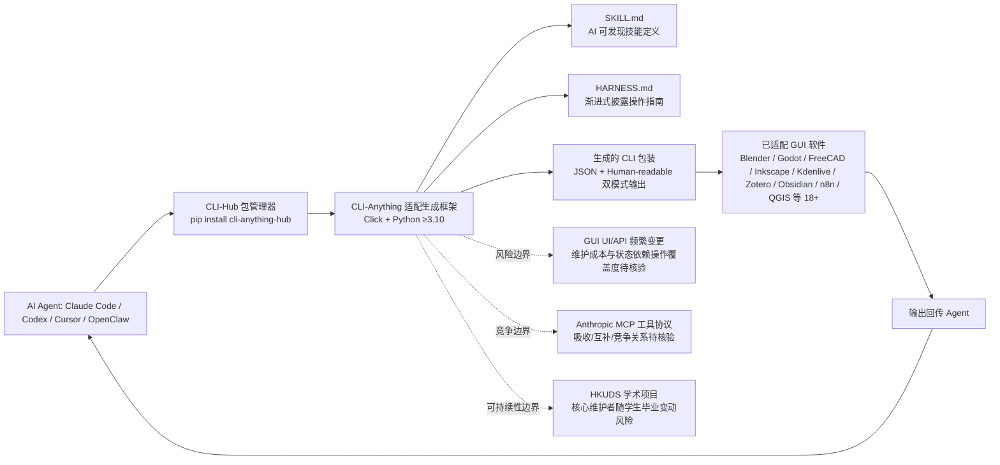

# CLI-Anything — 让所有软件变为 Agent 可调用的 CLI

## 最近动态（2026-11-23）

⭐⭐⭐⭐⭐ **本日为本项目首次建立完整档案（此前仅有一条 2026-08-11 的简略记录），⭐⭐⭐⭐⭐ 并把它确立为本日第 4 条趋势中「契约检查成为标准做法」这条判断的第二个独立样本。**

**可核验事实一（2026-11-23 CST 快照）：**

| 指标 | 实测值 |
|---|---|
| stars / forks / subs / open issues | **62,725** / 5,689 / 232 / 285 |
| 体积 / blobs | 42,161 KB / **1,872** |
| 语言 / 许可 / 创建 / 最后 push | Python / Apache-2.0 / **2026-03-08T13:52:57Z** / 2026-11-20T10:05:15Z |
| homepage | `https://clianything.cc/` |
| **CI 工作流（7 个）** | `check-codex-skill.yml` · `check-cursor-plugin.yml` · `check-root-skills.yml` · `deploy-pages.yml` · `pr-labeler.yml` · `pr-labeler-tests.yml` · `publish-cli-hub.yml` |
| 贡献者 | `yuh-yang` 290 · `AiMiDi` 43 · `omerarslan0` 33 · `furkankoykiran` 31 · `hito0512` 31 · `apireno` 22 · `haorui-harry` 19 · `OGRLEAF` 18 |
| 顶层目录 | `skills/` 71 · `mailchimp/` 49 · `unimol_tools/` 47 · `docs/` 42 · `macrocli/` 40 · `iterm2/` 39 · `freecad/` 36 · `audacity/` 34 · `slay_the_spire_ii/` 34 · `firefly-iii/` 33 · `zotero/` 32 · `live2d/` 31 |
| 扩展名分布 | `.py` **1,267** · `.md` 441 · `.json` 24 · `.sh` 18 · `.yml` 14 |
| README 长度 | **80,335 B**（含 18 个 app 的 demo 章节与 arXiv 技术报告链接 `arxiv.org/abs/2606.03854`） |
| **SKILL.md** | **151 个文件 / 名口径 82 身份（1.84×）/ 内容口径 131 身份（1.15×）** |
| **同名身份中出现 ≥2 份的** | **4 个**（`skills` 67 份 / 67 个不同 sha · `cli-hub-meta-skill` 2 份 · `cli-anything-firefly-iii` 2 份 · `cli-anything-openrefine` 2 份），**逐字节相同的 0 个** |
| **harness 目录** | **0 套** |
| **安装命令** | `pip install cli-anything-hub` · `npx skills add HKUDS/CLI-Anything --list` · `npx skills add HKUDS/CLI-Anything --skill cli-hub-meta-skill -g -y` |
| release / tag | 3 / 3 |

⭐⭐⭐⭐⭐ **⭐⭐⭐⭐⭐ 三个本日报首次测到的事实：**

**事实一：它是「有命令、无 harness 目录」的反向样本。** ⭐⭐⭐⭐⭐ 实测 **0 套 harness 目录**（`.claude` / `.codex` / `.cursor` / `.gemini` 等一个都没有），⭐⭐⭐⭐⭐ **却有 3 条别人能直接粘贴运行的安装命令**，⭐⭐⭐⭐⭐ 且其中两条是 `npx skills add` 协议 —— **即「包内多 harness 清单」与「安装协议」在本项目上是解耦的，⭐⭐⭐⭐⭐ 本日报第 4 条趋势据此判断：唯一稳定的结构事实是安装命令，而不是 harness 目录数。**

**事实二：它是「契约检查」的第二个独立样本。** ⭐⭐⭐⭐⭐ 实测 7 个工作流里有 **3 个是契约检查**：`check-codex-skill.yml` / `check-cursor-plugin.yml` / `check-root-skills.yml` —— ⭐⭐⭐⭐⭐ **即「每个 harness 的产物形态是否符合契约」被做成了每次 CI 必跑的检查。⭐⭐⭐⭐⭐ 这与 11-18 记录的 `alibaba/open-code-review` 的 `plugin-contract.yml` / `action-contract.yml` 是同一模式，⭐⭐⭐⭐⭐ 两个不同机构、两个不同领域（代码评审 vs agent CLI 生成）、同一做法，⭐⭐⭐⭐⭐ **本日报把「契约检查正在成为多 harness 项目的标准做法」列为本日的一条正面发现。**

**事实三：它的「复制」本质上是「为 67 个不同软件各生成一份适配」。** ⭐⭐⭐⭐⭐ 实测 `skills` 这个身份名下有 **67 份 SKILL.md、67 个不同的 blob sha**，⭐⭐⭐⭐⭐ 路径形如 `3MF/agent-harness/cli_anything/threemf/skills/SKILL.md` / `QGIS/agent-harness/cli_anything/qgis/skills/SKILL.md` / `adguardhome/agent-harness/cli_anything/adguardhome/skills/SKILL.md`；⭐⭐⭐⭐⭐ 且实测存在 `.github/scripts/generate_meta_skill.py` 与 `.github/scripts/sync_root_skills.py` 两个生成脚本、⭐⭐⭐⭐⭐ 各 app 目录下还有 `skill_generator.py` / `preview_bundle.py` / `core/generate.py` 等生成器。⭐⭐⭐⭐⭐ **即它的名口径 1.84× 几乎全部来自「按 app 生成的 per-CLI 适配」，而不是内容冗余（内容口径仅 1.15×）。**

⭐⭐⭐⭐⭐ **⭐⭐⭐ 修正后的三层判据定位：`CLI-Anything` = ① 内容冗余 1.15×（低）· ② 变体率 0.05（**最低**）· ③ 身份跨度 4 个。⭐⭐⭐⭐⭐ 即它是本队列里「变体率最低」的项目 —— 它的 151 个文件几乎都是不同 app 的不同技能，⭐⭐⭐⭐⭐ 而不是同一个技能的多个版本。**

**可核验事实四：6 条抽样 issue 全是「具体 app + 具体现象」。**

| issue | 提交者 | 标题 |
|---|---|---|
| `#691` | `ajack13` | fix(libreoffice): declare xmlns:of so Calc formulas evaluate |
| `#690` | `dung997tb` | docs: update Japanese README to current version |
| `#689` | `dung997tb` | docs: add Vietnamese README translation |
| `#688` | `mhmd2520` | fix(blender): resolve the EEVEE engine id across Blender 4.2–5.x |
| `#687` | `mhmd2520` | fix(blender,freecad,shotcut): stop live preview pid checks from killing processes |
| `#686` | `mhmd2520` | [Bug]: [blender/freecad/shotcut] live preview pid check kills the poller on Windows |

⭐⭐⭐⭐⭐ **⭐⭐⭐ 注意 `#690` 与 `#689` 是「文档翻译待补」类 issue —— 这与本数据集 11-16 记录的「issue 的技术含量与定位精度是免费信号」是同一条判断：**多语言文档的翻译进度被公开追踪，本身就是项目活跃度的一个侧面。**

**证据边界：**
- ⭐⭐⭐ ⚠️ **本日报未 clone、未运行任何生成的 CLI、未安装 `cli-anything-hub`、未验证任何一条安装命令可执行。**
- ⭐⭐⭐ ⚠️ **151 个 SKILL.md 的「67 份不同 sha」只证明「不是逐字节相同」**，⭐⭐⭐ ⚠️ 未逐份 diff，⭐⭐⭐ ⚠️ **不主张它们在功能语义上不同。**
- ⭐⭐⭐ ⚠️ **「2,461 个测试通过」「18 个 app 的 demo」「arXiv 技术报告」均为 README 自述**，⭐⭐⭐ ⚠️ **本日报未核验任何一项。**
- ⭐⭐⭐ ⚠️ **8 月 11 日快照到本日的 star 跨度（46,882 → 62,725）跨越了三个多月**，⭐⭐⭐ ⚠️ **不是时间序列增速；⭐⭐⭐ ⚠️ 且本项目本日才首次进入 Trending 榜单，⭐⭐⭐ ⚠️ 故本日报不对其增长做任何速率主张。**
- ⭐⭐⭐ ⚠️ **未核验项**：`check-*.yml` 三个契约检查的具体规则、CLI-Hub 的实际内容与审核流程、67 个 per-CLI 生成物的功能质量、285 个 issue 的正文、`publish-cli-hub.yml` 的发布策略。

---

## 一句话定位
港大 HKUDS 团队出品的 Agent-Native CLI 生成框架，自动将 GUI 软件转换为标准 CLI 接口，让 AI Agent（Claude Code / Codex / Cursor / OpenClaw）直接调用任何软件——配套 CLI-Hub 包管理器和 18+ 已适配应用。

## 它解决的问题
AI Agent 要操控 GUI 软件极其困难——需要浏览器自动化、OCR、坐标点击、屏幕截图分析，且极其脆弱。CLI-Anything 的核心思路是**"与其让 Agent 学会操作所有 GUI，不如先把 GUI → CLI 标准化"**。它自动发现 GUI 软件的可操作入口并生成 CLI 包装，让 Agent 通过标准命令行协议调用。目前已覆盖 Blender、FreeCAD、Godot、Inkscape、Kdenlive、Zotero、Obsidian、n8n、QGIS 等 18+ 应用，配套 CLI-Hub 包管理器（`pip install cli-anything-hub`）可一行安装社区贡献的 CLI。

## 为什么值得关注（2026-08-11）
- **Stars:** 46,882（截至 2026-08-11），4 个月内从 32.6K 增至 46.9K
- **Forks:** 4,360，社区贡献极其活跃（平均每周新增 CLI 适配）
- **Watchers:** 178
- **License:** Apache-2.0
- **语言:** Python（Click CLI 框架）
- **Open Issues:** 80
- **测试覆盖:** 2,461 个测试通过，单元 + E2E 覆盖
- **学术背书:** 港大数据科学实验室 (HKUDS) 出品，有 arXiv 技术报告
- **CLI-Hub:** 类似 npm 的 CLI 包管理器，社区可贡献新 CLI
- **多语言文档:** 中文、日文、德文 README

## 热度来源判断
CLI-Anything 的热度是**"Agent-Native 接口标准化的确定性趋势 × 港大学术背书 × CLI-Hub 社区贡献飞轮 × 18+ 真实应用覆盖"**的组合。"万物 Agent-Native"的愿景极具吸引力，但关键是它**不只是概念**——已有 18+ 真实应用适配（Blender、Godot、FreeCAD 等都是主流工具），2461 个测试通过说明工程质量扎实。4,360 个 forks 反映社区高度参与——这正是"包管理器"类项目的网络效应：贡献的 CLI 越多，价值越大，吸引更多用户和贡献者。热度**真实且具有飞轮潜力**。178 个 subscribers 说明核心开发者群体深度关注。

## 关键技术亮点
1. **HARNESS.md 渐进式披露设计:** 每个 CLI 适配包含一个 SKILL.md（AI 可发现的技能定义）+ HARNESS.md（渐进式操作指南），Agent 按需加载详细文档，而非一次性灌入全部上下文
2. **CLI-Hub 包管理器:** `pip install cli-anything-hub` + `cli-hub install <name>`——类似 npm 的社区 CLI 分发机制，支持 pip/npm/brew 多源安装
3. **SKILL.md 自动生成 (Phase 6.5):** 每个生成的 CLI 自动附带 AI 可发现的技能定义，Agent 可以自主发现和安装 CLI
4. **CLI-Hub Meta-Skill:** Agent 可以自主发现、安装、管理 CLI——真正的"Agent 自主扩展能力"
5. **标准输出格式:** JSON + Human-readable 双模式输出，既适合 Agent 解析也适合人类阅读
6. **Click 框架 + Python ≥3.10:** 基于成熟的 Click CLI 框架，代码质量和可维护性有保障
7. **多工具兼容:** 生成的 CLI 可被 Pi、OpenClaw、nanobot、Cursor、Claude Code 等 Agent 直接使用

## 架构师速览

| 决策问题 | 研究判断 | 证据边界 |
|---|---|---|
| 系统边界 | CLI-Anything 是位于 AI Agent（Claude Code/Codex/Cursor/OpenClaw）与 GUI 软件（Blender/Godot/FreeCAD/Inkscape/Kdenlive/Zotero/Obsidian/n8n/QGIS 等 18+）之间的 CLI 适配生成层 + CLI-Hub 分发渠道，外部边界包含目标 Agent 运行时、pip/npm/brew 安装源、底层 GUI 软件版本 | 适配清单与 Agent 列表来自档案；MCP/平台供应商协议未在档案中给出 |
| 主路径 | 目标 GUI 软件 → CLI-Anything 自动发现可操作入口并生成 Click 框架 CLI + SKILL.md（AI 可发现）+ HARNESS.md（渐进式披露） → 经 CLI-Hub 安装到 Agent → Agent 通过 JSON/Human-readable 双模式输出调用 → 标准输出回传 | Click、SKILL.md/HARNESS.md、双模式输出在档案中明确；具体编排协议与会话持久化未描述 |
| 关键权衡 | 扩展速度（46.9K stars、4.3K forks、周级新增适配） vs GUI 软件 UI/API 频繁变更的维护成本、状态依赖操作（Blender 编辑模式/Godot 场景树）覆盖不完整、社区贡献 CLI 的测试与安全审查、HKUDS 学术项目的可持续性、与 Anthropic MCP 工具协议的潜在重叠 | 权衡论点来自档案"风险/局限"段；具体维护 SLA、版本兼容矩阵未在档案中给出 |
| 最小 PoC | 在 Claude Code/Codex/Cursor/OpenClaw 任一 Agent 中，通过 `pip install cli-anything-hub` + `cli-hub install` 拉取一款已适配 GUI（如 Blender 或 Godot）的 CLI，对一个非状态依赖命令做端到端 JSON 输出验证，并核对 SKILL.md/HARNESS.md 是否可被 Agent 自主发现 | 18+ 适配列表、CLI-Hub 安装命令、Agent 兼容性在档案中明确；具体 CLI 名称是否覆盖目标场景需逐项核验 |

## 架构启发
CLI-Anything 的核心启发是**"适配器模式在 AI 时代的重大应用"**。经典软件工程中，适配器模式用于让不兼容的接口协同工作。CLI-Anything 将其提升到生态级别——**为所有 GUI 软件生成统一的 CLI 适配层**，让 Agent 获得一个标准化的"操作系统级 API"。

更深层的启发是**CLI 作为 Agent 与软件交互的标准协议**。当前 Agent 与软件交互的方式极其碎片化（浏览器自动化、API 调用、MCP 工具、屏幕操作），而 CLI-Anything 提出了一种统一范式：**所有软件都应暴露 CLI 接口**。这与 Google Workspace CLI 的思路一致——平台厂商和学术界都在向 CLI 优先靠拢。

企业架构师应认真考虑：**所有内部工具都应提供 CLI 接口**，这是 Agent-Native 基础设施的基本要求。

## 架构图（MMD）

> 证据边界：此图只采用本档案已有可核验描述；“待核验”节点不应视为项目实现事实。

## 定位判断
**基础设施候选（强）。** CLI-Anything 试图成为 **Agent 与软件之间的标准适配层**——类似 MCP（工具协议）但面向完整应用而非单个工具。如果 CLI 成为 Agent 调用软件的标准接口（这是确定性趋势），CLI-Anything 就是这个转换层的头部实现。CLI-Hub 包管理器赋予了它平台化潜力——社区贡献的 CLI 越多，它就越接近"Agent 的应用商店"。46K stars + 4.3K forks + 18+ 真实应用已显示飞轮雏形。

## 风险 / 局限 / 泡沫点
- **GUI 软件变化频繁:** CLI 包装层需要持续跟进底层软件的 UI/API 变化，维护成本极高
- **状态依赖操作:** 很多 GUI 操作有复杂状态依赖（如 Blender 的编辑模式、Godot 的场景树），CLI 化可能不完整
- **"ALL Software"的宏大定位:** 实际覆盖率需要持续验证——18+ 应用虽不少，但相比"所有软件"仍是极小比例
- **与 MCP 的潜在竞争:** MCP (Model Context Protocol) 是 Anthropic 推动的工具协议标准，如果 MCP 扩展到覆盖完整应用，CLI-Anything 的"适配层"价值可能被吸收
- **学术项目可持续性:** HKUDS 是大学实验室，核心维护者可能随学生毕业而变动

## 与同类项目的关系
- **vs Google Workspace CLI:** Google 自家产品 CLI 化（官方、专一）；CLI-Anything 做通用化（社区、广泛）
- **vs MCP (Anthropic):** MCP 是工具调用协议标准（细粒度）；CLI-Anything 是应用级 CLI 适配（粗粒度）——不同层级，可能互补
- **vs OpenCLI:** OpenCLI 偏 Web → CLI；CLI-Anything 偏 Desktop Software → CLI
- **vs npm / PyPI:** CLI-Hub 是专门面向 Agent 的 CLI 分发渠道，类似"Agent 的包管理器"
- **vs wshobson/agents:** agents 提供 Agent 技能/规则；CLI-Anything 提供软件操作能力——不同层面的 Agent 赋能

## 是否值得持续跟踪
**是（高优先级）。** Agent-Native 接口标准化是确定性趋势，CLI-Anything 是这一方向的头部项目。建议：对 Agent 系统构建者，直接评估采用 CLI-Hub 安装已有适配（Blender/Godot/FreeCAD 等）。对架构师，将其"CLI 优先"理念纳入内部工具设计规范。对生态观察者，关注它是否成为 Agent 调用软件的事实标准。

## 后续观察点
1. **CLI 覆盖范围增长:** CLI-Hub 中社区贡献的 CLI 数量增速（目前 18+，是否突破 100+）
2. **Agent 平台原生集成:** Claude Code / Codex / OpenClaw 是否原生支持 CLI-Hub 安装
3. **与 MCP 的关系:** 是被吸收、互补，还是竞争
4. **企业采纳:** 是否有企业将 CLI-Anything 作为内部工具 Agent 化的标准方案
5. **标准化努力:** 是否形成"CLI-for-Agent"规范草案
6. **社区贡献质量:** 社区贡献的 CLI 是否经过充分测试和安全审查

---
> 数据来源: GitHub API (2026-08-11) | Stars: 46,882 | Forks: 4,360 | License: Apache-2.0 | 语言: Python | 创建: 2026-03-08 | arXiv: 2606.03854
