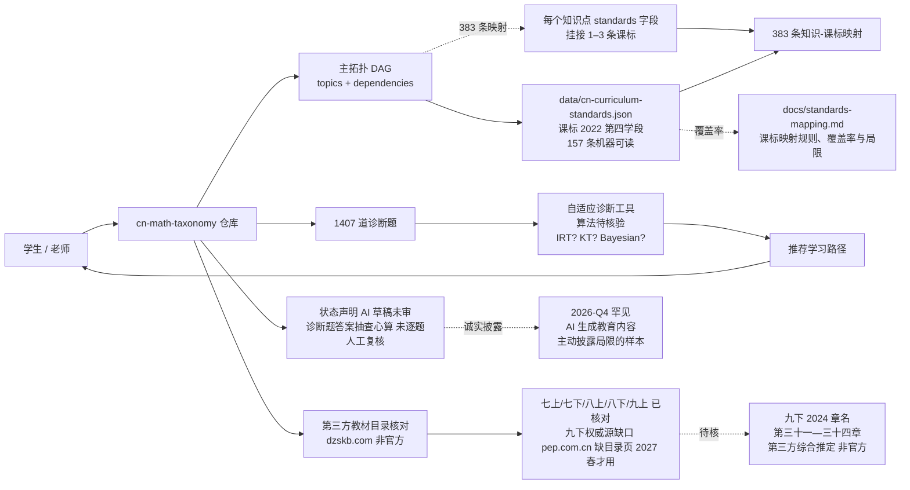

# xiaoyang111222/cn-math-taxonomy

## 一句话定位
xiaoyang111222 个人 2026-10-18 发布的「**中国初中数学知识图谱**」严肃工程化实现：**DAG（topics + dependencies）+ 人教版 2024 审定新版 七上—九下 6 册 + 课标 2022 第四学段（7—9 年级）+ 课标 157 条机器可读条目（data/cn-curriculum-standards.json）+ 383 条知识-课标映射 + 1407 道诊断题 + 自适应诊断工具 + 状态声明「AI 草稿未审」+ 第三方教材目录核对 + 九下权威源缺口透明披露**——2026-Q4 「**agent + 教育知识图谱 + 透明披露局限**」的首份样本。

## 它解决的问题
2025-2026 中国初中数学（7—9 年级）知识图谱场景存在四重缺口：**(1) 商业题库闭源**：猿题库 / 作业帮 / 学而思 等题库商业闭源，**教师无法复用**；**(2) 教师手工工作量大**：从零搭知识图谱 + 课标映射 + 诊断题，工作量极大；**(3) 课标与教材不同步**：2022 课标 + 2024 新版教材对齐复杂；**(4) AI 生成内容无状态声明**：多数 AI 生成教育内容不主动声明局限，对教学场景有害。cn-math-taxonomy 直击——**DAG topics+dependencies + 课标 157 条 + 383 条映射 + 1407 题 + 自适应诊断 + 状态声明「AI 草稿待审」+ 第三方目录核对 + 九下权威源缺口透明披露**——这是 2026-Q4 严肃工程化「**agent + 教育知识图谱 + 透明披露**」的首份样本。

## 为什么值得关注（2026-10-19）
今日观察窗为 GitHub Search API 抓取时刻起、且截至 2026-10-19 仍在快速增长的新发现项目。`xiaoyang111222/cn-math-taxonomy` 1 天 282⭐ ⑂74 fork/star 26.2%——282⭐ + 74 fork 在 1 天是异常高的「**教育知识图谱**」信号（fork 26.2% 远高于一般 2-5% 平均，反映大量「**想给初中数学做自适应学习路径**」的真实需求）。**DAG + 人教版 2024 6 册 + 课标 157 条 + 1407 题 + 自适应诊断 + AI 草稿声明 + 九下权威源缺口透明披露**——这是 2026-Q4 严肃工程化「**agent + 教育知识图谱 + 透明披露**」的代表样本。

## 热度来源判断
cn-math-taxonomy 的热度是「**中国初中数学知识图谱刚需 + DAG topics+dependencies + 人教版 2024 审定新版 + 课标 157 条 + 1407 题 + 自适应诊断 + AI 草稿声明 + 九下权威源缺口**」八要素共振：
- **中国初中数学知识图谱刚需**：商业题库闭源，教师无法复用
- **DAG topics+dependencies**：Marble os-taxonomy 数据格式参考
- **人教版 2024 审定新版 6 册**：从七上到九下，覆盖 6 册教材
- **课标 2022 第四学段（7—9 年级）+ 157 条机器可读**：data/cn-curriculum-standards.json
- **383 条知识-课标映射**：每个正式知识点通过 standards 字段挂接 1–3 条
- **1407 道诊断题 + 自适应诊断工具**：题库 + 推荐算法
- **状态声明「AI 草稿未审」**：透明披露局限
- **第三方教材目录核对**：dzskb.com（非官方）
- **九下权威源缺口**：pep.com.cn 缺目录页，2027 春才用
- **README 主动披露局限**：教师审核边界 + 第三方目录核对 + 九下权威源缺口

热度**真实且具教育知识图谱严肃工程化潜力**——282⭐ + 74 fork + 26.2% fork 比例 + 主动声明局限是真实需求信号。

## 关键技术亮点
1. **DAG（topics + dependencies）**：Marble os-taxonomy 数据格式参考，标准拓扑结构
2. **人教版 2024 审定新版 6 册**：从七上（第一章有理数）到九下（第三十四章随机事件的概率），覆盖完整初中数学
3. **课标 2022 第四学段 + 157 条机器可读**：data/cn-curriculum-standards.json
4. **383 条知识-课标映射**：每个正式知识点通过 standards 字段挂接 1–3 条
5. **1407 道诊断题**：题库完整
6. **自适应诊断工具**：基于 DAG 拓扑推荐学习路径
7. **状态声明「AI 草稿未审」**：透明披露局限
8. **第三方教材目录核对**：dzskb.com（非官方），README 列核实情况
9. **九下权威源缺口透明披露**：pep.com.cn 缺目录页，2027 春才用
10. **docs/standards-mapping.md**：课标映射规则、覆盖率与局限详细文档

## 架构师速览

| 决策问题 | 研究判断 | 证据边界 |
|---|---|---|
| 系统边界 | 单仓：DAG（topics + dependencies）+ 人教版 2024 七上—九下 6 册章节目录 + 课标 2022 第四学段【内容要求】157 条 + 383 条知识-课标映射 + 1407 道诊断题 + 自适应诊断工具 + data/cn-curriculum-standards.json + docs/standards-mapping.md | 基于 README「数据来源与对齐依据」+「九下目录的来源与核实情况」段 |
| 主路径 | 学生/老师访问仓库 → 读 DAG 拓扑（topics + dependencies）→ 通过 standards 字段挂接课标 157 条 → 1407 题做自适应诊断 → 推荐学习路径 | 主路径由 README 主页 + data/cn-curriculum-standards.json 推导；具体自适应诊断算法（item response theory? knowledge tracing? Bayesian network?）未在档案中详述 |
| 关键权衡 | DAG（拓扑结构）vs 题型标签（更细粒度）/ 人教版 2024 新版（最新）vs 旧版（教师熟悉）/ AI 生成（速度）vs 教师审核（准确性）/ 第三方教材目录核对（可达性）vs pep.com.cn 权威源（缺失）/ 自适应诊断（推荐）vs 教师手出题（深度） | 档案明示六点权衡；具体 1407 题题型分布 + 诊断算法 + 课标 157 条字段 schema 待核验 |
| 最小 PoC | 1. clone + 打开 data/cn-curriculum-standards.json 看 157 条 → 2. 打开主拓扑找 topics + dependencies → 3. 跑 1407 题中 5 道对照答案 → 4. 接入 Marble os-taxonomy 可视化看 DAG 渲染 → 5. 与教师讨论 hard/soft 边划分 | PoC 由 README「数据来源与对齐依据」段推导；具体自适应诊断 UI + 推荐算法细节待核验 |

## 架构启发
cn-math-taxonomy 的核心启发是「**agent + 教育知识图谱 = DAG + 课标机器可读 + 题库 + 自适应诊断 + 状态声明 + 第三方目录核对 + 权威源缺口透明披露**」七要素。与某些「**商业题库闭源 + 教师手工工作量大 + AI 生成内容无状态声明**」的旧方案对比，**DAG + 课标 157 条 + 1407 题 + AI 草稿声明 + 九下权威源缺口透明披露**完整一个量级。更深层的启发是：**状态声明「AI 草稿未审」+ 九下权威源缺口透明披露 = 严肃工程化的诚实**——比商业题库闭源更值得参考，是 2026-Q4 罕见「**AI 生成教育内容时主动披露局限**」的样本。

## 架构图（MMD）

> 证据边界：此图只采用本档案已有可核验描述；"待核验"节点不应视为项目实现事实。

## 定位判断
**基础设施候选项目（教育知识图谱 + agent 严肃工程化 + 透明披露）。** cn-math-taxonomy 不仅是初中数学知识图谱，更是「**agent + 教育知识图谱 + 透明披露局限**」的首份严肃工程化样本。**DAG + 课标 157 条 + 1407 题 + 自适应诊断 + AI 草稿声明 + 九下权威源缺口**五位一体。在生态中的位置类似「**agent 时代教育知识图谱领域的 openalex**」——开源、可投影、主动披露局限。

## 风险 / 局限 / 泡沫点
- **NOASSERTION license**：LICENSE 文件未明确，可能限制商用 fork
- **AI 生成草稿未审**：知识点的拆分粒度、掌握标准、诊断题答案、先修关系（hard/soft/边是否存在）需一线初中数学教师审核
- **诊断题答案未逐题人工复核**：仅抽查心算
- **九下权威源缺口**：pep.com.cn 缺目录页，2027 春才用，目前是第三方综合推定
- **912 KB size 偏小**：可能不含完整 UI 渲染层
- **单一作者**：xiaoyang111222 个人维护，长期维护可持续性待观察
- **1 天 282⭐ 早期信号**：教育知识图谱需求真实，但商业化路径与教师社区共建未明确
- **算法未明示**：自适应诊断算法（IRT / knowledge tracing / Bayesian network）未在档案中详述

## 与同类项目的关系
- **vs 猿题库 / 作业帮 / 学而思**：商业题库闭源 + 按订阅收费；cn-math-taxonomy 开源 + NOASSERTION license
- **vs Marble os-taxonomy（参考）**：Marble 是通用知识图谱格式；cn-math-taxonomy 是初中数学的具体实例
- **vs 各家教育知识图谱（如 Knewton、Cerego）**：商用自适应学习平台闭源；cn-math-taxonomy 开源 + 自适应诊断
- **vs Khan Academy（国际）**：Khan Academy 英文视频课程；cn-math-taxonomy 人教版 + 中文 + 题库
- **vs Claude Code 其他 agent 应用**：Claude Code 之前用于反向工程（leanrea）/ TV 治理（tv-vibehack）/ 视频（huashu-motion）/ 游戏（coop-anything）/ 渲染（web-ocean），cn-math-taxonomy 是**首次严肃工程化应用在教育知识图谱 + 主动披露局限**

## 是否值得持续跟踪
**值得跟踪（agent + 教育知识图谱 + 透明披露局限的严肃工程化）。** cn-math-taxonomy 是 2026-Q4 严肃工程化「**agent + 教育知识图谱 + 透明披露局限**」的首份样本。**DAG + 课标 157 条 + 1407 题 + 自适应诊断 + AI 草稿声明 + 九下权威源缺口**五位一体使「**初中数学自适应学习路径**」从商业题库闭源变为开源可复用。建议关注：自适应诊断算法 + 1407 题题型分布 + 课标 157 条字段 schema + 教师社区共建 + 商业化路径。

## 后续观察点
- 自适应诊断算法（IRT / knowledge tracing / Bayesian network）
- 1407 题题型分布与难度梯度
- 课标 157 条字段 schema 与扩展机制
- 教师社区共建与审核边界
- 九下权威源（pep.com.cn 2024 目录页）何时公布
- 是否扩展到高中数学 / 物理 / 化学等学科
- 与 Marble os-taxonomy 的兼容性扩展

---
> 数据来源: GitHub API (2026-10-19) | Stars: 282 | Forks: 74 | License: NOASSERTION | 语言: JavaScript | 创建: 2026-10-18 | Size: 912 KB | Topics: 无显式 topics