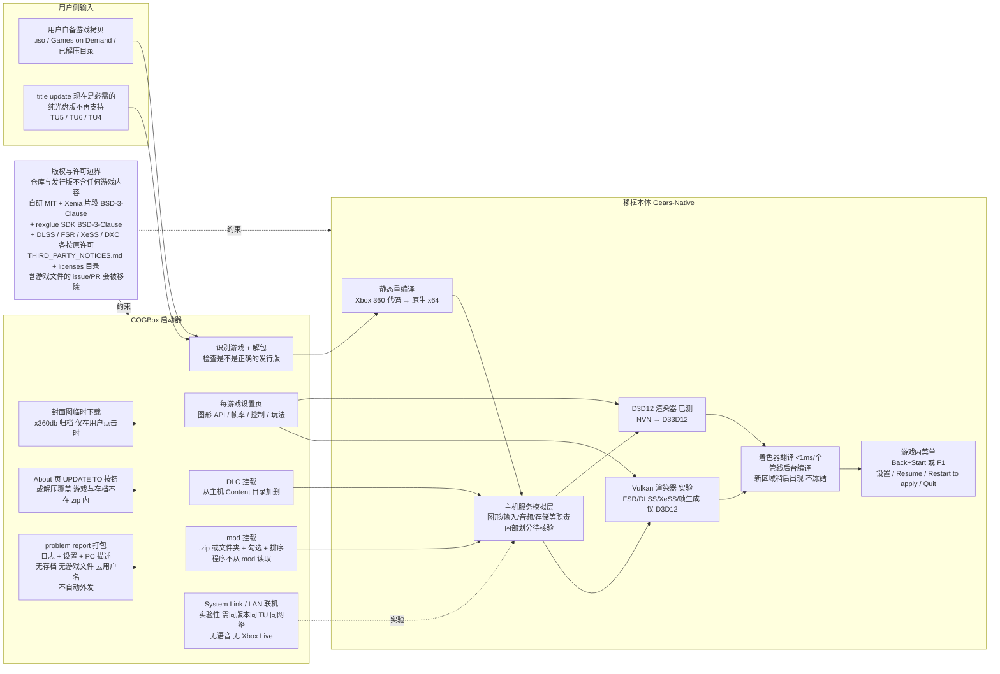

# Shagg88/COGBox

## 一句话定位

把三个 Xbox 360 时代的《战争机器》游戏静态重编译成原生 Windows 程序并配一个启动器——**而它最值得记的不是移植本身，是它把「什么算测试过」写成了一句带具体硬件型号的话**：「In testing means on the developer's PC (an RTX 3080 Ti) and scripted test runs through the chapters. Other hardware hasn't been tried yet - please report what you find.」

## 它解决的问题

**把 Xbox 360 的《战争机器 2》《战争机器 3》《战争机器：审判》（Gears of War 2 / 3 / Judgment）搬到 Windows 上原生运行。**

**⭐⭐ 这个问题的技术核心是「图形栈」而不是「CPU」**：CPU 侧可以用静态重编译（提前把 ARM/Xenon 代码翻成 C 再编译成本机代码）解决，**但主机用的是 NVN（NVIDIA 主机专有图形 API），PC 上没有对应实现，所以整个渲染栈必须自己写。**

**⭐⭐⭐ 而 COGBox 比同题材的其它移植项目多解决了一个问题：分发与配置。** 它不只是一个能跑的 `.exe`，而是**一个启动器**——负责识别你的游戏拷贝、检查版本、解包、配置、报错、以及（可选）下载封面图。

**⭐ 但它同时明确划了一条法律与版权的边界线**（README "Legal" 一节）：不包含任何游戏内容；发行版只含自研代码（MIT）+ Xenia 项目的片段（BSD-3-Clause）+ rexglue SDK 运行时（BSD-3-Clause）+ 各厂商的放大库（NVIDIA DLSS、AMD FidelityFX、Intel XeSS）+ DirectX Shader Compiler，**每份许可都在 `THIRD_PARTY_NOTICES.md` 和发行版的 `licenses` 目录里**；并要求「**只使用你自己拥有的副本，不要在任何地方分享游戏文件、光盘镜像或从它们提取出来的任何东西**」，以及「**包含游戏文件的 issue 或 PR 会被移除**」。

## 为什么值得关注（2026-11-03）

- **⭐⭐⭐ 它的测试边界写法是本日最值得抄的一条**：「**In testing means on the developer's PC (an RTX 3080 Ti) and scripted test runs through the chapters. Other hardware hasn't been tried yet - please report what you find.**」——**一句话里同时给出了三件事：测试在什么硬件上做的、测试是怎么做的（scripted test runs）、以及没测的部分明确说没测**。**这比「基本可玩」这种说法有用一个数量级。**
- **⭐⭐ 它的游戏状态表用三列写清了每个游戏的版本绑定与状态**：
  | 游戏 | 移植所针对的版本 | 状态 |
  |---|---|---|
  | Gears of War 2 | US disc (0.0.0.5) + Title Update 6 | Every chapter plays in testing; TU6 是默认且最快的构建 |
  | Gears of War 3 | Disc + Title Update 6 | Playable; TU6 是默认 |
  | Gears of War: Judgment | Disc + Title Update 4（当前必需） | Playable |
  **⭐⭐ 「TU6 是默认且最快的构建」这句话同时透露了两件事：选哪个版本不是随意的，而且版本之间有性能差异。**
- **⭐⭐⭐ 它把「版本要求」升级成了硬性阻断**：README 明写「**The game's title update - required. Title updates are now required to play; disc-only versions are no longer supported.**」并给出四个游戏的 title ID（`4D5307D5` / `4D53082D` / `4D5308AB` / `4D530A26`）与它们在主机上的确切路径。**⭐ 对比同批的 TotK 移植项目仍写「base game version 1.0.0」——两条路线对「版本」的处理方式完全不同，这是一个可对比的架构选择。**
- **⭐⭐ 它的错误处理是产品级的**：游戏异常退出时，COGBox 会说明发生了什么并提供一个 **problem report**——「**桌面上一个 zip，含日志、你的设置和你 PC 的描述——没有存档，没有游戏文件，你的 Windows 用户名被移除。Nothing is sent anywhere by itself.**」**⭐⭐ 「Nothing is sent anywhere by itself」这句是本日值得单独引用的边界声明。**
- **⭐⭐ 它明写自己的启动器行为不会破坏用户数据**：「**Your games, saves and settings are not in the zip, so they are kept.**」（升级时解压新发行版覆盖旧目录）。**并且 mod 机制也有边界**：「A mod is laid out like the game's own files (`GearGame\...`) and replaces or adds files without changing your copy; **programs are never taken from a mod.**」——**⭐ mod 可以改文件、不能塞可执行程序**，这条限制把「装 mod」的风险面砍掉了一大块。
- **⭐⭐ 它的多语言处理写出了一个真实的例外**：支持美版与欧版全部 21 种语言，「the ones on your copy work」；日本版（玩家报告 #103）：Gears 3 与 Judgment 可从日版光盘运行（文本与语音），**但 Gears 2 的日语不在开箱状态下支持——只有文本与字幕可用，需要手动 workaround，且电影语音保持英文**。**⭐ 这是一个「逐游戏、逐语言」级别的诚实边界，而不是一句「支持多语言」。**
- **⭐⭐ 它的 System Link / LAN 联机功能被明确标为实验性并写出了限制**：需要每台 PC 装同版本（0.4.0）与同一个游戏+TU，同一网络或 Radmin VPN / ZeroTier / Hamachi 这类 LAN VPN（**明确排除 NordVPN 这类互联网 VPN**）；**3 台及以上时每台都要列出其余所有 PC**；**Gears 2 战役联机在测试中可用，其他模式与游戏测试较少**；**没有语音聊天，也没有 Xbox Live 联机**。**⭐ 并且它写了一个具体的已知风险**：「**On 0.4.0, Gears 3 System Link co-op needs a two-PC test.** The #68 fix changes two things the game sees: XNetRandom now gives real random numbers (before, every PC could produce the same 'random' values, so this should help), and Gears 3 now gets 'no online ID' (0) for every player on every PC.」——**⭐⭐ 它明确指出「这个修复改变了游戏看到的东西，而我们自己也没验证游戏自己的会话代码会怎么处理这些 ID」。**
- **⭐⭐⭐ 它的「What's coming」一节（README 末尾）明确列出未做的东西，而不是含糊带过**——**本档案未读该节全文**。
- **⭐⭐ 它自己的发行版要求被写成了可执行的清单**：Windows 10/11 64 位（或 Linux/Steam Deck 经 Proton，实验性）、**CPU 必须支持 AVX2（Intel Haswell / AMD Ryzen 或更新，约 2013 年起）**、DirectX 12 显卡、自己的游戏副本、每个游戏 8–16 GB 空闲空间（若由 COGBox 解包镜像）。
- **⭐ 它的渲染器路线是 D3D12 为主、Vulkan 为实验**：README 明写「Direct3D 12 is the default and the tested renderer. Vulkan (experimental) is on each game's Graphics tab - **FSR / DLSS / XeSS and frame generation are Direct3D 12 only**」。
- **⭐⭐ 它把「第三方素材从哪来」写清了**：封面图与背景**不包含在仓库里**，只在用户按下「Get box art」时从 [x360db](https://github.com/xenia-manager/x360db) 归档下载到用户自己的 PC。
- **⭐⭐ 它的自更新机制与「不覆盖数据」是配套的**：About 页有 **UPDATE TO ...** 按钮；也可直接解压新发行版覆盖旧目录，而游戏、存档、设置因不在 zip 里而保留。

## 热度来源判断

**⭐ 热度来源是「怀旧 + 移植」这个组合，而它的真实性证据在结构而不在星数。**

- **347⭐ vs 10-28 记录的 216⭐** —— 8 天内 +131⭐（+60.6%）。**这个增速在本批里属于温和**，但**同期 commits 从 53 涨到 202（+149）**，**contributors 从 1 人涨到 5 人**，**releases 从 9 个涨到 12 个**。
- **⭐⭐⭐ 这三个数字的组合才是关键**：**「star 温和增长 + commit 增长三倍 + 贡献者从 1 变 5」是典型的「真有人用」的形态**；而本批同时出现的农场形态是「star 暴涨 + commits 几乎不动 + contributors 恒为 1」。**COGBox 是本批少数几个可以用结构指标排除在农场之外的样本。**
- **⭐ 它的 fork/star 只有 2.6%**（9 forks / 347⭐）——**低，且低得合理**：这是一个需要自备游戏拷贝、需要 D3D12 显卡、且**分发形式是一个 zip 启动器而非可 fork 的库**的项目。**「fork 出去改一改再发布」在这个项目上没有意义**（也不能——涉及游戏文件）。
- **⭐ 它的 subs 10** 是本批新项目中较高的（对比 stack-diagram 的 2、dsh-see-now 的 0）。**深度关注者相对较多，与「移植项目需要长期跟进游戏版本」的性质相符。**

**⭐ 但必须说清「热度不等于价值」**：本项目今天最硬的部分是**它的文档结构与边界写法**，而不是它的移植质量——后者本日报完全无法核验（未构建、未运行、未看视频）。

## 关键技术亮点

1. **⭐⭐⭐ 自写 D3D12 渲染器**（NVN → D3D12）：支持 1x–4x 原生分辨率（最高 5K）或匹配显示器、带真实额外细节而非拉伸；快速 1080p 模式（720p 渲染后放大锐化）用于弱显卡；支持 SMAA、AMD FSR、NVIDIA DLSS、Intel XeSS（含放大模式）；解除 30fps 上限、可按显示器设上限、AMD FSR 帧生成（**「highly experimental for now」**）。
2. **⭐⭐ 着色器在构建期翻译**：「the games' shaders are translated straight to Direct3D 12 shader code **in under a millisecond each** (as Xenia Canary does), kept on your PC, and **pipelines are made in the background - a new area shows a moment later instead of freezing the game**」。**⭐ 「后台预编译管线」是把移植游戏从「卡顿」变成「平滑」的关键工程手法。**
3. **⭐⭐ 低输入延迟**：one frame in flight，支持 NVIDIA Reflex / AMD Anti-Lag 2。
4. **⭐⭐ 完整画面特性**：HDR10、21:9 超宽（Gears 2 除外——**README 表格里 Gears 2 一行写的是 "all three games"，但 System Link 一节写 Gears 2 战役联机可用；超宽的逐游戏支持范围本档案未逐条核验**）、16x 各向异性过滤、可调 FOV、以及游戏自带的后期效果（运动模糊、景深、镜头光晕）作为开关。
5. **⭐⭐ 输入多样性**：Gears 2 分屏、Xbox 与 PlayStation 手柄、键鼠（**鼠标视角不带摇杆速度上限**，按键可自定义）、章节选择、title update。
6. **⭐⭐ 内嵌游戏菜单**：游戏中按 Back+Start（PS 上是 Share+Options，或 F1）打开菜单，含设置 / Resume / Restart to apply / Quit。**⭐ 「Restart to apply」被明确写出——说明设置变更需要重启游戏才生效，这个语义被如实呈现而非隐藏。**
7. **⭐⭐ 启动器的识别与校验**：拖入 `.iso` / Games on Demand 拷贝 / TU 包 / 已解压目录，COGBox **识别游戏、解包到自身旁边、并检查是不是正确的发行版**；每游戏独立设置页（选项悬停有说明）。
8. **⭐⭐ 11 种界面语言**：英、西、法、德、意、葡（巴西）、波、俄、日、简中、韩——首次启动询问，任何游戏的 About 页可改。
9. **⭐⭐ DLC 与 mods 的受控接入**：DLC 从主机的 `Content\...\00000002` 目录加/删；mod 以 `.zip` 或文件夹形式放入游戏的 `mods/` 目录，可勾选并排序，**但程序不从 mod 读取**。

## 架构师速览

| 决策问题 | 研究判断 | 证据边界 |
|---|---|---|
| 系统边界 | 三层：**① 游戏本体**（Xenon/Xbox 360 代码静态重编译为原生 x64）· **② 主机服务模拟层**（NVN 图形 API → 自写 D3D12 渲染器 + 着色器翻译 + 输入/音频/存储等主机职责）· **③ COGBox 启动器**（识别拷贝、解包、版本校验、设置、DLC/mod 挂载、封面临时下载、problem report 打包、自身更新）。**法律边界是第四层且是硬边界**：仓库与发行版都不含任何游戏内容，用户自备且不得分享 | ①–③ 的分层由 README 的功能描述与目录（`Gears1-Native` / `Gears2-Native` / `Gears3-Native` / `GearsJ-Native` / `tools`）支持；**未核验**主机服务模拟层的内部模块划分（`Gears*-Native` 下的具体结构未读）；**未核验**「自写渲染器」是否复用 Xenia 代码还是全新实现——README 只说「pieces of the Xenia emulator projects (BSD-3-Clause)」，**复用范围未核验**；**未核验** `tools/` 的职责 |
| 主路径 | ① 用户自备游戏拷贝 + title update（**TU 现在是必需的，纯光盘版不再支持**）→ ② 把拷贝放入 COGBox 窗口，COGBox 识别并解包 → ③ 检查发行版是否匹配（**不匹配则拒绝并警告**）→ ④ 选图形 API（D3D12 已测 / Vulkan 实验）→ ⑤ 启动；运行中：着色器翻译 + 管线后台编译（首遇场景可能停顿）→ ⑥ 设置改动需「Restart to apply」→ ⑦ 异常退出 → COGBox 本地打包 problem report（**不含存档/游戏文件、去除 Windows 用户名、不自动外发**）→ ⑧ 用户自行贴到 issue | ①–⑧ 由 README 明文支持；**未核验**「识别与解包」的具体判据（README 只说「checks it is the right release」）；**未核验**渲染时是否需要联网（README 未说明）；**未核验**problem report zip 的确切文件清单；**⭐ 未核验**「着色器翻译 <1ms」这一性能数字的测量条件 |
| 关键权衡 | **① 静态重编译而非模拟器**——换来原生性能与任意分辨率，代价是**必须绑定游戏的确切版本**（本项目选择绑定 TU6/TU4，即「版本漂移成本转嫁给用户」）；**② D3D12 主 + Vulkan 实验双路**——换来覆盖更多硬件，代价是**两套渲染路径的 bug 面翻倍**（README 明说「Problem reports from Vulkan help a lot」，即 Vulkan 路径问题更多）；**③ 启动器而非裸 exe**——换来版本校验与用户体验，代价是**多一个必须维护的组件**（11 种语言、设置系统、自更新）；**④ TU 强制而非可选**——换来确定的兼容基线，代价是**老存档/纯光盘用户被排除**；**⑤ mod 允许改文件但禁止可执行**——换来 mod 生态，代价是 mod 能力受限 | ①–⑤ 的取舍方向由 README 明文支持；**① 的关键代价是「绑定 TU6」这一决策本身**——它与 SkyboundTotk（绑定 base 1.0.0）形成一组可直接对比的样本：同一款游戏、同一技术路线、**两种版本策略**；**② 未核验** Vulkan 与 D3D12 的功能差异面；**⑤ 未核验** 「programs are never taken from a mod」是由代码强制还是有约定成分 |
| 最小 PoC | ① 只选 **Gears of War 2 + TU6** 一个游戏（README 称其「Every chapter plays in testing; TU6 is the default and fastest build」——**测试状态最明确**）→ ② 只用 D3D12 路径（Vulkan 留待问题出现再试）→ ③ 用存档备份（若有）而非新档 → ④ 先跑完一个章节，再决定是否投入 → ⑤ 遇到问题走 problem report 流程（不外发） | PoC 的**选择依据直接取自 README 的状态表与「tested renderer」表述**；**未核验**单游戏安装的最小步骤（README 描述的是「每个游戏」流程，是否可只装一个未核验）；**退出路径**：解压发行版目录即卸载，**用户游戏与存档不在 zip 内故不受影响**——这是本项目相对于 CivSwitch 存档改写风险的关键优势 |

## 架构启发

**⭐⭐⭐ COGBox 的架构启发集中在一点：移植项目的真正产品不是「能跑的 exe」，而是「把版本、硬件、文件来源这三类不确定性收敛到一个可控界面里的启动器」。**

移植类项目的失败模式通常不是「跑不起来」，而是「**在别人机器上跑不起来，而作者不知道为什么**」。COGBox 的应对是三重的：
1. **启动时校验发行版**（你的拷贝是不是它针对的那个版本）；
2. **启动前校验硬件**（AVX2、D3D12、磁盘空间）；
3. **出问题时给出可上传的诊断包**（且明确剔除了存档、游戏文件与用户名，且不自动外发）。

**⭐⭐ 这三层合起来，就是把「请报告你遇到的问题」这句话变成一条**不需要用户具备任何调试能力**的路径**——用户只要点按钮。**

**⭐⭐⭐ 第二条启发更可迁移：版本绑定策略是一个可以被独立选择的架构决策，而不是技术路线的副产品。** 本日同时观察到同一款游戏（Tears of the Kingdom）的两条独立移植路线：
- **COGBox（Games of War）**：绑定 **Title Update 6**，**强制要求 TU**，纯光盘版不再支持；
- **SkyboundTotk**：绑定 **base game 1.0.0**，README 明写「a successful build does not guarantee a complete playthrough」，且 1.2.1 只能通过「按主模块 build id 选钩子」的方式适配（PR #19）。

**⭐ 这两条路线的差别不是质量，是「把版本漂移的风险放在谁身上」**：强制 TU 把漂移风险前置到用户（用户必须去找 TU），而 base-only 把漂移风险留在项目里（游戏更新后钩子失效，作者要重做）。**前者用户多一步、后者作者多一步。** 这是一个纯粹的架构取舍，而两者都用 README 把它写清楚了。

**⭐ 第三条启发关于 mod 与插件的信任边界**：「programs are never taken from a mod」这条限制的价值在于——**它把「装 mod」这个动作的风险从「任意代码执行」降级为「数据覆盖」**，而这个降级只用了 README 里的一句话加一句代码级的保证。**任何做插件系统的项目都该问一句：我的插件边界是「数据」还是「代码」？**

## 架构图（MMD）

> 证据边界：此图只采用本档案已有可核验描述；「待核验」节点不应视为项目实现事实。

## 定位判断

**「一个把『技术成就』与『产品化』同时做完了的移植项目」——在本批同题材的四个 TotK 移植项目里，它是唯一有完整启动器与多语言支持的。**

**⭐ 与同题材 TotK 移植群的对比（本日报持续跟踪的 valenterah/totk-pc-recomp、kuraeow/ultratears、NotRexed/SkyboundTotk）**：

| | COGBox | totk-pc-recomp | ultratears | SkyboundTotk |
|---|---|---|---|---|
| 目标游戏 | Gears 2/3/Judgment | TotK | TotK | TotK |
| 图形 API | **D3D12（已测）+ Vulkan（实验）** | Vulkan | Vulkan | **WebGPU** |
| 分发形态 | **启动器 + zip** | 安装器 | AppImage + 打包器 | 构建脚本 + dist/ |
| 多语言 | **11 种界面语言 + 21 种游戏语言** | 未核验 | 有 README.ru.md | 未核验 |
| 版本策略 | **绑定 TU6（强制）** | 1.4.3 | 1.4.3 | base 1.0.0 |
| 联机 | LAN/System Link（实验） | 未核验 | 未核验 | 未核验 |

**⭐ 它是这组里唯一一个「把使用者当普通用户来服务」的**——11 种界面语言、封面图按需下载（不预置）、DLC 与 mod 的图形化管理、崩溃后一键打包诊断、自身更新按钮。**其余三个更接近「给会折腾的人的工具」。**

**⭐⭐ 它的独特生态位是「Xenon 时代的 Gears 系列」**——而这一代游戏的移植需求在别的项目里没有对应物（COGBox 的 README 也说明 Gears 1 不是当前优先：「Gears of War 1 is currently not a priority because there's about 5 versions (it feels like) that are available natively to PC」——**⭐ 这是一个「先做有缺口的那一代」的判断**）。

**⭐ 它同时是一个法律边界的样板**：「preservation and personal use, as is, with no warranty. It is not legal advice, and the rules differ by country.」

## 风险 / 局限 / 泡沫点

- **⭐⭐⭐ 版本硬绑定**：TU 现在是必需的，纯光盘版不再支持。**用户必须自己搞到 TU**（路径 `Content\...\000B0000\`），而 TU 来自「曾联网打过这游戏的主机」——**这是一个真实门槛，不是文档问题。**
- **⭐⭐ 未签名可执行文件**：README 明写「**The programs aren't code-signed, so Windows may show 'Windows protected your PC' - choose 'More info', then 'Run anyway'.**」**⭐ 这既是可用性问题也是安全信号——用户被训练成要绕过 SmartScreen。**（值得与 Zero-Breach-Toolkit 的「Why there is no code signature」对照：后者明说拿不到证书是「by choice」。）
- **⭐⭐ Vulkan 路径是实验性的且问题更多**：README 明写「Problem reports from Vulkan help a lot」——**即 Vulkan 的已知问题密度高于 D3D12**。
- **⭐⭐ 硬件门槛**：**CPU 必须有 AVX2（约 2013 年后）**，且必须有 D3D12 显卡；每游戏 8–16 GB 空间。
- **⭐⭐ Linux/Steam Deck 经 Proton 是实验性的**：README 明写「**Untested on real hardware yet**」，且在 Proton 下会跳过独占全屏、Reflex 与 Anti-Lag。
- **⭐⭐ System Link 联机风险**：Gears 3 在 0.4.0 上的联机**明确需要两台 PC 测试**；**没有语音、没有 Xbox Live**；3 台以上每台要互列。
- **⭐⭐ Gears 2 的日语需手动 workaround，且电影语音保持英文**；日版 Gears 3 / Judgment 可从日版光盘运行（玩家报告 #103，**非作者验证**）。
- **⭐ mod 生态的残余风险**：虽然「程序不从 mod 读取」，但 **mod 可以「replaces or adds files」**——**它能覆盖游戏文件**，这在信任模型上仍是一块实际风险面。
- **⭐ 8 天 +131⭐ 是温和增长**，且**本日报完全无法核验移植质量**（未构建、未运行、未观看）。**本档案对该项目的评分主要基于其文档与工程组织的可核验性，而非运行质量。**
- **⭐ 单作者主导**：contributors 从 1 涨到 5 是好信号，但**核心仍在一个人手里**；且该项目涉及大量与游戏版本绑定的适配工作，**维护负担随游戏更新而增长**。

## 与同类项目的关系

- **vs 本日同题材的 TotK 移植群（totk-pc-recomp / ultratears / SkyboundTotk）**：见定位判断的对比表。**⭐ 最关键的差异是图形 API（D3D12 vs Vulkan vs WebGPU）与版本策略（绑定 TU vs 绑定 base），而不是代码质量**——四者互不使用对方的代码，也没有两个承认对方存在（10-30 日报已记录此事实）。
- **vs Xenia / Xenia Canary**：COGBox 明确使用了「pieces of the Xenia emulator projects (BSD-3-Clause)」并提到着色器翻译「as Xenia Canary does」。**⭐ 它不是从零实现——它站在 Xenia 的部分工作之上，但用静态重编译替代了解释执行。** 与 Xenia 的关键差别是 Xenia 无需用户游戏版本严格匹配（它是模拟器），而 COGBox 的版本要求是硬性的。
- **vs 模拟器路线（RPCS3、Ryujinx 等）**：模拟器需要持续跟进主机固件与游戏版本；静态重编译把成本前置到「编译期」但换来运行时无解释开销。**⭐ COGBox 的 TU 强制策略本质上就是静态重编译路线的必然结果。**
- **vs Zero-Breach-Toolkit（本日同批）**：**方向正交**——一个把游戏搬到 PC，一个在 PC 上找间谍软件的痕迹。**但两者有一个共同点值得记录：都把「我的结论到哪一步为止」写成了明确边界。**
- **vs 同批的农场仓库**：**本批 94% 的当日新建仓库是体积 ≤20KB 的空壳**，而 COGBox 的 4,526 KB、202 commits、716 个 blob、12 个 release 构成**结构上的反证**。**⭐ 这是一个可以直接用的判别规则：先看 commits 与 blob 数，再看 star。**

## 是否值得持续跟踪

**值得跟踪（作为「产品化的移植项目」样本），但使用需自行评估风险。**

**⭐ 对本日报的研究目的**：**它最有价值的地方是「测试边界」与「版本策略」这两处写法**——前者是本批最好的「什么叫测过」，后者与 SkyboundTotk 构成一组可直接对照的架构取舍样本。**这两个观察点都与 star 数无关。**

**⭐⭐ 对实际想玩的人**：**它已经是本批最接近「可用产品」的移植项目**（启动器、11 种界面语言、DLC 与 mod 管理、诊断包、自更新）。**但必须先确认三件事**：① 你有对应的 TU；② 你的 CPU 有 AVX2 且有 D3D12 显卡；③ 你接受未签名 exe 与 SmartScreen 绕过。**再考虑法律边界（README 自己说不是法律意见，各地规则不同）。**

**⭐⭐⭐ 观察优先级**：**① 是否有第二个外部贡献者进入核心渲染路径**（contributors 1→5 已是好信号）；**② Vulkan 路径是否会收敛到与 D3D12 同等地位**（README 自己说 Vulkan 的问题报告「帮助很大」）；**③ Gears 3 System Link 联机在两台 PC 上的实测结果**（README 明确留了一个未验证的坑）。

## 后续观察点

1. **⭐⭐⭐ Gears 3 的 System Link 联机在两台 PC 上是否真的可用** —— README 明写「needs a two-PC test」，且指出 #68 修复改变了游戏看到的两样东西（XNetRandom、online ID）。**这是作者自己标出的最需要外部验证的一项。**
2. **⭐⭐ commits 与贡献者的持续性** —— 8 天内 commits 53→202、contributors 1→5、releases 9→12。**这个组合是否继续增长，是判断它是不是「被真实使用」的持续指标。**
3. **⭐⭐ 「What's coming」一节的内容** —— **本档案未读该节**；它是本项目对未完成事项最直接的公开清单，**对判断路线图的价值高于任何猜测**。
4. **⭐ Vulkan 与 D3D12 的功能差距是否收敛** —— 若 Vulkan 路径长期停在「实验」，说明实际用户全在 D3D12 上，Vulkan 更像是一个未兑现的承诺。
5. **⭐ 是否有可执行文件签名** —— 未签名状态对非技术用户是真实的采用障碍，且会训练用户绕过 SmartScreen。
6. **⭐ Gears 1 是否启动** —— README 说「目前不是优先，因为 PC 上原生就有大约 5 个版本」；若启动，迁移对象从「有缺口的一代」变成「全系列」。
7. **⭐ mod 机制中「程序不从 mod 读取」是否由代码强制** —— **本档案未核验**；若是约定而非强制，这条风险声明的强度需要下调。

---
> 数据来源: GitHub REST/Search API（gh CLI 认证），UTC **2026-11-03T06:00Z** 单一快照 | Stars: 347 | Forks: 9 | Subscribers: 10 | Open Issues: 36 | License: MIT（含 BSD-3-Clause 等第三方组件，详见 `THIRD_PARTY_NOTICES.md`）| 语言: C++ | 创建: 2026-10-27T04:28:46Z | pushed: 2026-11-02T12:49:05Z | 202 commits | contributors 5 人 | releases 12 个（26 asset）| topics 8 | 4,526 KB
> 结构证据: 全树 716 blob（`truncated: false`）；根目录 `Gears1-Native` / `Gears2-Native` / `Gears3-Native` / `GearsJ-Native` / `tools` / `LICENSE` / `README.md`；README 状态表三游戏 × 版本 × 状态；「In testing means on the developer's PC (an RTX 3080 Ti) and scripted test runs through the chapters」
> 证据边界: **未构建、未运行、未观看任何画面**；**⭐⭐ 本档案对该项目的评分基于文档与工程组织，而非运行质量**；`Gears*-Native` 内部结构与 `tools/` 职责未读；Xenia 代码复用范围未核验；「着色器翻译 <1ms」的测量条件未核验；problem report zip 的文件清单未核验；「程序不从 mod 读取」是否代码强制未核验；System Link 未实测；347⭐ 的来源无法核验（`stargazers` 端点对本 token 返回 404），故只作总量记录；**10-28 → 11-03 的 +131⭐ 是两次快照间的总量差，不是当日新增**
