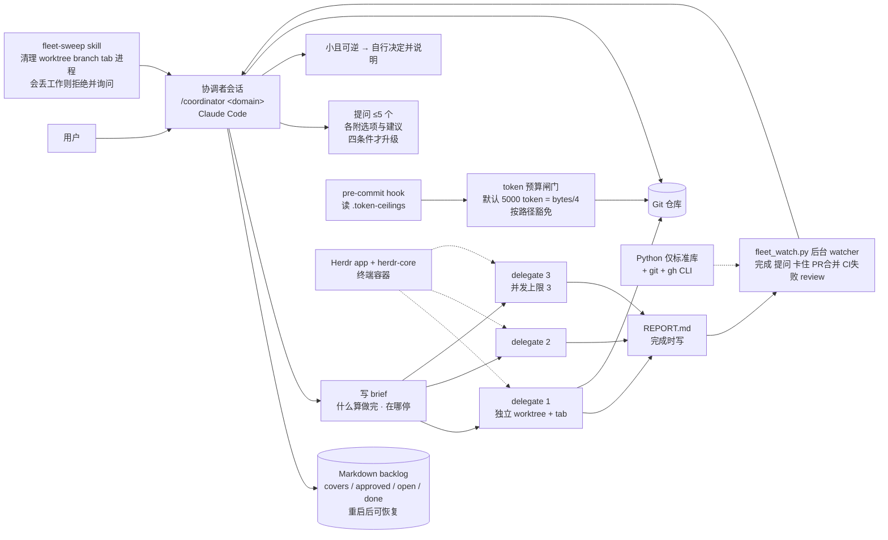

# petekp/coordinator

## 一句话定位
**把一个 Claude Code 会话变成「多 agent 舰队」的调度器：⭐⭐⭐⭐⭐ 状态存放在一份 Markdown backlog 里，每个 delegate 拿到独立的 Git worktree、独立 tab 和一份写明「什么算做完」的 brief，而 ⭐⭐⭐⭐⭐ 「不许让单个文件膨胀到撑爆上下文」这条纪律被做成了 `.token-ceilings` 这个 pre-commit hook 可读的配置文件。**

## 它解决的问题
**Coding Agent 的并发协作目前缺少一个「管理者」层。** ⭐⭐⭐⭐⭐ 具体痛点：

- 单个会话处理多个任务会互相污染上下文；
- ⭐⭐⭐⭐⭐ 并行开多个会话时，用户无法同时盯住它们，也收不到它们的提问；
- ⭐⭐⭐⭐⭐ 任务结束后 worktree、branch、终端进程会残留；
- ⭐⭐⭐⭐⭐ 「什么时候该问用户、什么时候可以自己定」没有规则。

⭐⭐⭐⭐⭐ Coordinator 的答案不是「再写一个 agent」，而是**「一个会话 + 一份 backlog + 一组 delegate」**：⭐⭐⭐⭐⭐ 你只跟一个会话说话，它替你派活、盯活、收活。

## 为什么值得关注（2026-11-16）
⭐⭐⭐⭐⭐ **因为它把「上下文预算是硬约束」这件事，从口头纪律变成了机器可校验的文件 —— 这是本数据集里第一次见到这种形态。**

**实测 `.token-ceilions`（490 B）全文：**

```
# Files allowed over the 5,000-token limit (tokens = bytes / 4), each with the
# most tokens it may hold. One "path ceiling" entry per line. The pre-commit
# hook reads this file.
#
# Herdr's layout gallery reads one RECIPE.md per layout.
herdr/RECIPE.md 6500
# Single-file clones of Herdr's shipped agents and spaces mods, kept in the
# shipped shape so each can be compared with a newer Herdr release.
herdr/mods/coordinator-agents/main.js 9000
herdr/mods/coordinator-spaces/main.js 7500
```

⭐⭐⭐⭐⭐ **注意它的换算规则写进了注释：`tokens = bytes / 4`，默认上限 5,000 token，超限文件按路径逐个豁免并给出各自的上限。**⭐⭐⭐⭐⭐ **即「不要让 agent 的上下文被一个巨大文件吃掉」这条纪律，被编码成了一个「路径 → 上限」清单 + 一个 pre-commit hook。**

⭐⭐⭐⭐⭐ **第二个值得记的点：它的「决策权限」被写成了显式规则，而不是让模型自由裁量。**

> The coordinator decides small, reversible things on its own and says what it chose. It asks you when the answer changes what gets built, costs time or money, reaches other people, or is a matter of taste. **Questions arrive in batches of at most five, each with its options and a recommendation.**

⭐⭐⭐⭐⭐ **四个升级条件（改变构建结果 / 消耗时间或金钱 / 影响他人 / 品味问题）+ 「每次最多 5 个问题 + 必须附建议」—— 这是本数据集里少见的、把 agent 的「什么时候该问」写成契约的样本。**

⭐⭐⭐⭐⭐ **第三个值得记的点：状态载体是 Markdown 而不是数据库。**

> It owns one domain and keeps its state in a Markdown **backlog** file: what the domain covers, what you approved for good, what is open, and what is done. **The backlog is what survives a restart.**

⭐⭐⭐⭐⭐ **「能扛住重启」被明确写成设计目标 —— 而这也意味着 backlog 文件同时是人可读的审计日志。**

⭐⭐⭐⭐⭐ **第四个值得记的点：清理是保守的。** ⭐⭐⭐⭐⭐ README 明写 fleet-sweep「removes finished worktrees, branches, tabs and stray processes. **It refuses anything that would lose work and asks you about it.**」

## 热度来源判断
⭐⭐⭐⭐⭐ **真实需求 + 小众工具的正常形态，不含明显的投放特征。**

支持「真实」的一面：⭐⭐⭐⭐⭐ **owner 账号创建于 2011-08-01，有 82 个公开仓库、72 followers**；⭐⭐⭐⭐⭐ **26 个 commit 的消息是语义化的工程动作**（`Herdr sidebar layout for the coordinator workflow (#1)` / `The update check runs at the watcher's first wake-up ea…` / `fleet.md: name the unknown event, and say what --domain…` / `Restart: raise asks an earlier version marked open befo…` / `Update check only for a clone of this repo, under a loc…`）；⭐⭐⭐⭐⭐ 2 个 release；⭐⭐⭐⭐⭐ fork 到达分布极慢（3 个 fork，中位间隔 31,252 秒，≤10 秒 0 个）。

⭐⭐⭐⭐⭐ **commit 消息质量值得单独一提：⭐⭐⭐⭐⭐ 其中三条是「把行为约束写进 commit message」的形态** —— `Restart: raise asks an earlier version marked open befo…`（重启时 raise 只问更早的、标记为 open 的版本）、`Update check only for a clone of this repo, under a loc…`（更新检查只对本仓库的 clone 生效）、`fleet.md: name the unknown event, and say what --domain…`（把未知事件命名清楚，并说明 --domain 的语义）。⭐⭐⭐⭐⭐ **这类消息让 commit 历史本身成为约束的文档。**

⭐⭐⭐⭐⭐ **规模必然有限**：它依赖 `herdr-core`（`hc`）、Herdr app、Claude Code 三件外部工具，⭐⭐⭐⭐⭐ **这是一个「工具链上层建筑」型项目 —— 生态位窄，但粘性高。**

## 关键技术亮点
1. **一对多委派**：⭐⭐⭐⭐⭐ `/coordinator <domain or project>` 启动一个协调者会话，它为每个任务写一份 brief 并启动独立 delegate 会话。
2. **隔离执行环境**：⭐⭐⭐⭐⭐ 每个 delegate 拥有自己的 Git worktree、自己的 tab，完成时写 `REPORT.md`。
3. **Markdown backlog 作为唯一状态**：⭐⭐⭐⭐⭐ 「什么覆盖了、什么已批准、什么还开着、什么已完成」四段。
4. **后台 watcher（`fleet_watch.py`）**：⭐⭐⭐⭐⭐ 在 delegate 完成、提问或卡住时唤醒协调者；⭐⭐⭐⭐⭐ **也在 PR 被合并、CI 失败或收到 review 时唤醒**。
5. **并发上限与 PR 上限**：⭐⭐⭐⭐⭐ 「at most three delegates working at once」，并可限制一个仓库里未合 PR 的数量。
6. **静默 delegate 的回收**：⭐⭐⭐⭐⭐ 一天没有响应的 delegate 会被结束，有新任务时用同一会话恢复。
7. **保守的清理**（fleet-sweep skill）：⭐⭐⭐⭐⭐ 会拒绝任何可能丢失工作的操作并询问用户。
8. **`.token-ceilings` + pre-commit hook**：⭐⭐⭐⭐⭐ 见上文。
9. **自检的更新检查**：⭐⭐⭐⭐⭐ commit `The update check runs at the watcher's first wake-up ea…` 与 `Update check only for a clone of this repo, under a loc…` 表明更新检查被刻意约束在「本仓库的 clone、且在特定时机」。
10. **零第三方依赖**：⭐⭐⭐⭐⭐ README 明写 Python 脚本「use only the standard library」。

## 架构师速览

| 决策问题 | 研究判断 | 证据边界 |
|---|---|---|
| 系统边界 | 边界 = 「一个 Claude Code 会话 + 一组 delegate 会话 + 用户的 Git 仓库 + Herdr 终端管理器」；⭐⭐⭐⭐⭐ **协调者自己不写业务代码**，它写 brief、派活、验收、清理 | README「How it works」5 条 + `skills/coordinator/SKILL.md` 前 18 行。⚠️ **本日报未安装、未运行、未启动任何会话** |
| 主路径 | 用户 → `/coordinator <domain>` → 协调者读 backlog → 写 brief → 起 delegate（各自 worktree + tab）→ delegate 写 `REPORT.md` → `fleet_watch.py` 唤醒协调者 → 协调者验收 → 提问（≤5 个带建议）或自行决定 → 完成后 fleet-sweep 清理 | 主路径由 README 的 5 个 bullet 给出。⚠️ **唤醒机制的具体实现（进程/文件轮询？）本日报未核验** |
| 关键权衡 | ①**Markdown backlog vs 数据库**：牺牲并发写，换人可读 + 重启可恢复 + 可审计；②**worktree 隔离 vs 共享工作区**：牺牲磁盘，换并行安全；③**agent 自行决定 vs 全部询问**：以「小且可逆」为界，换吞吐；④**清理 vs 保守拒绝**：牺牲磁盘回收，换不丢工作；⑤⭐⭐⭐⭐⭐ **单文件大小上限 vs 功能完整性**：用 `.token-ceilings` 硬性约束，换上下文可控 | ①–⑤均有 README / `AGENTS.md` 原文支撑（尤其 ③ 的四条件与 ⑤ 的换算规则）。⭐⭐⭐ ⚠️ **每个权衡的实际代价本日报未实测**（未测并发下的 backlog 冲突、未测清理误判率） |
| 最小 PoC | ① 建一个空 Git 仓库；② `pip install` 本项目并按 `SETUP.md` 配置 `~/.config/coordinator/config.json`；③ 用一个**非生产**的 domain 启动 `/coordinator`；④ 让它派 1 个 delegate 做一个 10 分钟内的小任务；⑤ 检查 `REPORT.md`、worktree 是否被正确创建；⑥ 故意把 `herdr/RECIPE.md` 写超 6500 字节，**确认 pre-commit hook 真的拦截**（⭐⭐⭐⭐⭐ 这是最值得先验的一条，因为它验证的是「纪律真的被执行」而不只是「被写下」） | PoC 范围由本档案的取证路径推导。⭐⭐⭐ ⚠️ **本日报未执行任何一步**；⭐⭐⭐ ⚠️ **第 ⑥ 步是本档案建议的最小验证**（`.token-ceilings` 的注释称 hook 存在，但 **hook 本体不在仓库树中，本日报未核验其实现**） |

## 架构启发
⭐⭐⭐⭐⭐ **最值得抄的一条：把「上下文预算」写成配置，而不是写成提醒。**

⭐⭐⭐⭐⭐ 「别让单个文件太大」几乎每个 agent 项目都写过，但绝大多数只写在 README 或注释里 —— **写在那里等于没写，因为没有任何东西会去看它。**⭐⭐⭐⭐⭐ Coordinator 把它变成了「路径 → token 上限」的清单 + 一个 pre-commit hook，⭐⭐⭐⭐⭐ **这符合本数据集反复出现的那条主线（把纪律做进会被机器读到的地方）。**

⭐⭐⭐⭐⭐ 第二条：**agent 的「决策权限」应当是契约而不是裁量。** ⭐⭐⭐⭐⭐ 四个升级条件 + 「每次最多 5 个问题 + 必须附建议」+ 「小且可逆的事自己定但要说明」—— ⭐⭐⭐⭐⭐ **这三条合起来把「什么时候该打断用户」变成了可预测的行为。**⭐⭐⭐⭐⭐ 这与本数据集记录的 `mate`（每条回复带 `[demo]` 标记）、`impacket-rs`（`T!error`）是同一类：**用机制替代信任。**

⭐⭐⭐⭐⭐ 第三条：**用「能扛住重启」来定义状态存储。** ⭐⭐⭐⭐⭐ 「The backlog is what survives a restart」这句话把状态设计的目标说清楚了 —— ⭐⭐⭐⭐⭐ **而 Markdown backlog 同时是人可读的审计日志，这一点是数据库做不到的。**

⭐⭐⭐⭐⭐ 第四条：**破坏性操作应当「宁可拒绝也不自动执行」。** ⭐⭐⭐⭐⭐ fleet-sweep「refuses anything that would lose work and asks you about it」—— ⭐⭐⭐⭐⭐ **这与 11-15 的 `hikaku-extension`（把元数据声明与模型估计分成两条路径）、`ScanDot`（明确声明手机端不做摄影测量）是同一条原则的不同层次：不制造虚假确定性。**

⭐⭐⭐⭐⭐ 第五条（观察）：**commit message 可以承载约束。** ⭐⭐⭐⭐⭐ `Restart: raise asks an earlier version marked open before…` 这类消息让「重启后该问什么」这条规则进入了 git 历史，⭐⭐⭐⭐⭐ **而 git 历史是 agent 在上下文丢失后最可靠的记忆来源。**

## 架构图（MMD）

> 证据边界：此图的结构取自 README、`skills/coordinator/SKILL.md` 与仓库树；标「待核验」的节点是本日报未能独立验证的部分。



## 定位判断
**工具型。** ⭐⭐⭐⭐⭐ 定位是「agent 编排层」—— ⭐⭐⭐⭐⭐ 它自己不做 AI 推理，不做代码生成，⭐⭐⭐⭐⭐ **做的是「把多个已经在跑的 agent 组织起来，并让它们的产出可验收、资源可回收」。**

⭐⭐⭐⭐⭐ 在本数据集的坐标里，它与 11-08 记录的 `solo-to-team-skills` / `research-loop-skills`（同作者族）属同一方向，⭐⭐⭐⭐⭐ **但层次更高：那两组是「给 agent 的技能」，Coordinator 是「管 agent 的调度器」。**⭐⭐⭐⭐⭐ 它也是 11-11 记录的 `hikaku-extension` 那种「把不确定性分层」思路在编排层的对应物 —— ⭐⭐⭐⭐⭐ **「小且可逆的自己定，其余必须问」就是把不确定性分层做进了权限模型。**

⭐⭐⭐⭐⭐ **它是本数据集里第一个把「agent 上下文预算」当作工程问题而非提示词问题来解的项目。**

## 风险/局限/泡沫点
- ⭐⭐⭐⭐⭐ **强依赖外部工具链**：`herdr-core`（`hc`）、Herdr app、Claude Code（可选 Codex）、`gh` CLI 登录状态。⭐⭐⭐⭐⭐ **任一环缺失或版本变化，整个方案失效。**
- ⭐⭐⭐⭐⭐ **无 CI**：⭐⭐⭐⭐⭐ 该仓库**没有 `.github/workflows/`** —— ⭐⭐⭐⭐⭐ **一个 49 blob、26 commit 的 agent 编排工具，其自身的正确性没有任何自动化验证**，⭐⭐⭐⭐⭐ 而它的全部价值恰恰在于「正确地编排别人」。
- ⭐⭐⭐⭐⭐ **Markdown backlog 的并发写冲突**：⭐⭐⭐⭐⭐ 多个 delegate 同时回报时谁来合并，⭐⭐⭐ ⚠️ **README 未描述该机制，本日报未核验**。
- ⭐⭐⭐⭐⭐ **`skills/coordinator/SKILL.md` 有 17,700 B** —— ⭐⭐⭐⭐⭐ 按它自己定义的 `tokens = bytes / 4`，约 4,425 token，⭐⭐⭐⭐⭐ **恰好在默认 5,000 上限之内但已接近**，⭐⭐⭐⭐⭐ 且它**不在 `.token-ceilings` 的豁免清单里** —— ⭐⭐⭐ ⚠️ **这是本日报的一个观察点（若该文件也受 hook 管辖则已接近上限；豁免清单只列了 `herdr/` 下的三个文件）**，⭐⭐⭐ ⚠️ **hook 的实际管辖范围本日报未核验**。
- ⭐⭐⭐⭐⭐ **v0.2.0、仅 2 个 release**，⭐⭐⭐⭐⭐ 且 README 声明的测试环境（herdr-core 0.1.21 / Herdr app 0.1.15 / Claude Code 2.1.325 / Codex 0.164.0）**与版本号绑定** —— 上游工具升级即可能失配。
- ⭐⭐⭐ ⚠️ **未核验项**：pre-commit hook 本体、backlog 并发合并机制、唤醒机制实现、并发上限的实际执行、README 声明的测试环境。

## 与同类项目的关系
- **vs 11-08 的 `solo-to-team-skills` / `research-loop-skills`**：⭐⭐⭐⭐⭐ 同一作者族、同一方向（多 agent 协作），⭐⭐⭐⭐⭐ **但层次不同：那些是「技能包」，这个是「调度器 + 运行时」。**
- **vs 11-15 的 `opencoredev/islandcn`**：⭐⭐⭐⭐⭐ 两者都用 `AGENTS.md` 作为给 agent 的契约，⭐⭐⭐⭐⭐ **但 islandcn 的 `AGENTS.md` 是路径归属与许可归属的约束，Coordinator 的 `SKILL.md` 是流程与权限的约束。**
- **vs 11-11 的 `solana-vigil`**：⭐⭐⭐⭐⭐ 同样拒绝伪造确定值，⭐⭐⭐⭐⭐ **但 solana-vigil 用 `unknown` 枚举表达不确定性，Coordinator 用「四条件才升级提问」表达权限边界。**
- **vs 同日的 `pydtcpip`**：⭐⭐⭐⭐⭐ 两者都把「不做什么 / 不自动做什么」写成机器可读的规则（`AGENTS.md` 的否定式清单 vs `SKILL.md` 的四条件 + `fleet-sweep` 的拒绝），⭐⭐⭐⭐⭐ **但 pydtcpip 管的是不可逆的协议操作，Coordinator 管的是不可逆的文件删除。**

## 是否值得持续跟踪
**值得跟踪其方法论；对多数用户暂不推荐直接采用。**

具体建议：
1. ⭐⭐⭐⭐⭐ **做 agent 工具的人应抄它的三条**：`.token-ceilings` 式的预算清单 + pre-commit 闸门、「四条件才升级提问」的权限契约、Markdown backlog 作为唯一状态载体；
2. ⭐⭐⭐⭐⭐ **注意它自身的反证价值**：⭐⭐⭐⭐⭐ **一个专门管 agent 协作的项目却没有 CI，⭐⭐⭐⭐⭐ 这提醒我们「把纪律写进配置」和「验证纪律真的被执行」是两件事** —— 后者需要 CI；
3. ⭐⭐⭐⭐⭐ 若 Herdr 生态继续发展，Coordinator 值得长期跟；
4. ⭐⭐⭐ 现阶段不推荐给生产环境使用。

## 后续观察点
- 仓库是否补上 CI（**最值得观察的一条** —— 若补上，说明作者意识到「自身正确性需要被验证」）
- `pre-commit` hook 是否被纳入仓库（目前不在树中）
- `.token-ceilings` 清单是否随文件增长而更新（尤其 `skills/coordinator/SKILL.md` 是否被纳入豁免）
- backlog 的并发合并机制是否被显式设计
- 是否支持除 Claude Code 之外的 harness（README 已提 Codex 可做「小而机械」的活）
- 用户量是否突破小众生态位（⭐⭐⭐⭐⭐ **若 star 数在数周内快速上升但 issue 数不动，则需要重新评估其真实性**）

---
> 数据来源: GitHub API (2026-11-16) | Stars: 34 | Forks: 3 | Subscribers: 0 | Open Issues: 1 | License: MIT | 语言: Python | 创建: 2026-11-15T00:00:02Z | release v0.2.0 / v0.1.0 | owner 创建: 2011-08-01 | fork 间隔中位 31252s ≤10s 0/3 | 无 CI 工作流
