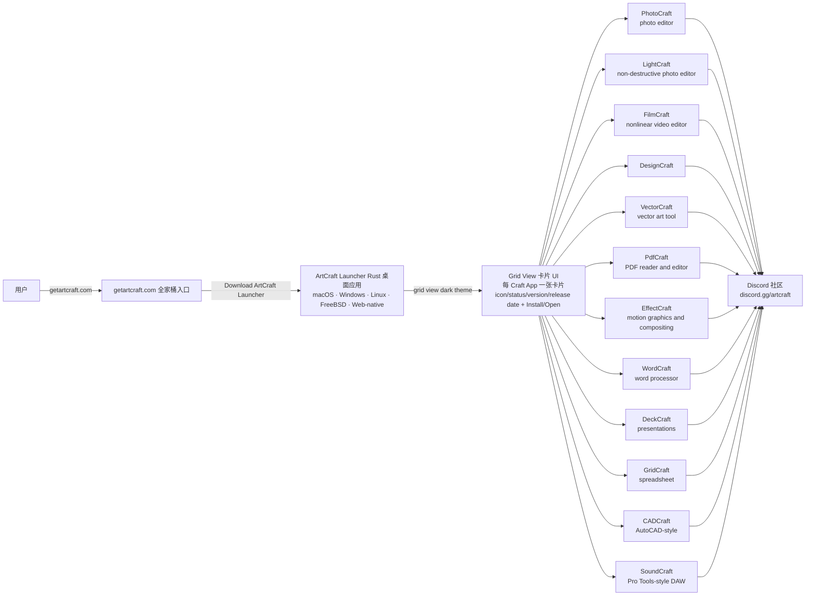

# storytold/craft-launcher

## 一句话定位
Craft App Launcher 是 ArtCraft 团队 Rust 100% 重实现 Adobe/Microsoft/Avid 12 库全家桶（PhotoCraft/LightCraft/FilmCraft/DesignCraft/VectorCraft/PdfCraft/EffectCraft/WordCraft/DeckCraft/GridCraft/CADCraft/SoundCraft）的一键安装 / 更新 / 打开 Launcher + 跨 macOS/Windows/Linux/FreeBSD/Web-native + Apache-2.0/MIT 双重许可 + 早期 alpha + Discord 社区 + getartcraft.com 全家桶。

## 它解决的问题
2026 年 Adobe/Microsoft/Avid 创意套件许可证贵（Photoshop + Premiere + Lightroom + Acrobat + Illustrator + After Effects + Word + Excel + PowerPoint + AutoCAD + Pro Tools 月费几百到几千美元），订阅制被社区诟病。Storytold ArtCraft 团队用 Rust 100% 重实现这 12 个应用，从「单库 2026-10-07 photocraft 严肃工程化」推到「8 库 WordCraft/CADCraft/GridCraft/SoundCraft/DeckCraft 跟进 + ArtCraft Launcher 一键安装 / 更新 / 打开」。craft-launcher 是这一全家的「分发 + 启动入口」——一个 grid view（dark theme card + icon/status/version/release date + Install/Open 按钮）。解决的是 **「Rust 100% 重实现 Adobe/Microsoft/Avid 全家桶的一键安装 / 更新 / 打开严肃工程化承诺」** 的平台候选型问题。

## 为什么值得关注（2026-10-12）
- **Stars:** 1155（截至 2026-10-12），3 天 1155⭐ ⑂409 fork/star 35.4%（**fork/star 35.4% 极高**，反映社区强烈参与）
- **Forks:** 409
- **Size:** 5000 KB
- **License:** MIT OR Apache-2.0（双重许可）
- **语言:** Rust（100% Rust）
- **活跃度:** created 2026-10-09，pushed_at 2026-10-11，持续高活跃
- **跨平台:** macOS · Windows · Linux · FreeBSD · Web-native
- **状态:** early alpha
- **Discord 社区:** https://discord.gg/artcraft
- **官网:** https://getartcraft.com/

## 热度来源判断
craft-launcher 的热度是 **「Adobe/Microsoft/Avid 许可证贵 + 订阅制被诟病 × Rust 100% 重实现全家桶 × 一键安装 / 更新 / 打开 × 跨 macOS/Windows/Linux/FreeBSD/Web-native × Apache-2.0/MIT × Discord 社区 × getartcraft.com 全家桶 × 早期 alpha + 409 fork/star 35.4% 极高反映社区强烈参与」** 的组合。Rust 重实现 Adobe 全家桶是 niche 但需求强烈的严肃工程化承诺——设计师 / 创意工作者 / 视频剪辑师都希望摆脱订阅制。fork/star 35.4% 反映社区强烈参与——这是「分发 + 启动入口」类项目的核心 KPI（每个 fork 都可以二次分发 / 二次开发）。热度真实——但需警惕：早期 alpha 状态、Rust 重实现工作量、跨平台维护成本、与 Adobe/Microsoft/Avid 兼容度均待核验。

## 关键技术亮点
1. **12 个 Rust 100% 重实现应用：** PhotoCraft（photo editor）+ LightCraft（non-destructive photo editor）+ FilmCraft（nonlinear video editor）+ DesignCraft + VectorCraft（vector art tool）+ PdfCraft（PDF reader and editor）+ EffectCraft（motion graphics and compositing）+ WordCraft（word processor）+ DeckCraft（presentations）+ GridCraft（spreadsheet）+ CADCraft（AutoCAD-style computer-aided design）+ SoundCraft（Avid Pro Tools-style DAW）
2. **ArtCraft Launcher 一键安装 / 更新 / 打开：** 「One place to install, update and open every app in the Craft App Suite」
3. **跨 5 个平台：** macOS · Windows · Linux · FreeBSD · Web-native
4. **Apache-2.0/MIT 双重许可：** 「License: MIT OR Apache-2.0」
5. **grid view 卡片 UI：** 「a card for each Craft App with its icon, status, version, release date and an Install or Open button, grouped into classic and new apps」
6. **早期 alpha 状态：** 「Status: early alpha」
7. **Discord 社区 + getartcraft.com 全家桶：** Discord 链接 + 官网全家桶入口
8. **Download ArtCraft Launcher link：** https://github.com/storytold/craft-launcher/releases/latest

## 架构师速览

| 决策问题 | 研究判断 | 证据边界 |
|---|---|---|
| 系统边界 | 一个 Rust 写的桌面 Launcher 应用 + 一个 Discord 社区 + getartcraft.com 全家桶入口 + 12 个 Rust 重实现应用（独立仓库）；Launcher 本身不是 IDE / 编辑器，是分发 + 启动入口——选对 build、安装/更新、打开应用 | 仅基于 README 「One place to install, update and open every app in the Craft App Suite, rebuilt in pure Rust. PhotoCraft, LightCraft, FilmCraft, DesignCraft, VectorCraft, PdfCraft, EffectCraft, WordCraft, DeckCraft, GridCraft, CADCraft and SoundCraft: the right build for your computer, kept up to date」 + 「Status: early alpha」 |
| 主路径 | 用户访问 getartcraft.com → 下载 ArtCraft Launcher → 选 macOS/Windows/Linux/FreeBSD/Web-native build → 安装 → 启动 → grid view 显示 12 个 Craft App 卡片（dark theme + icon/status/version/release date + Install/Open 按钮）→ 点 Install 下载安装对应应用 → 点 Open 启动应用 → 自动更新检查 | 主路径为 README 「artcraft-launcher-grid.png 截图」 + 「a card for each Craft App with its icon, status, version, release date and an Install or Open button, grouped into classic and new apps」 推断；具体安装包格式、是否自动更新、是否支持二次分发均待核验 |
| 关键权衡 | Adobe/Microsoft/Avid 全家桶许可证替代 vs Rust 重实现工作量 vs 早期 alpha 状态 vs 与 Adobe/Microsoft/Avid 兼容度 vs 跨 5 个平台维护成本 vs 早期 alpha 状态 | 权衡来自 README 「Status: early alpha」 + 「100% Rust」 + 「Apache-2.0/MIT」 + 「macOS · Windows · Linux · FreeBSD · Web-native」 |
| 最小 PoC | 访问 https://github.com/storytold/craft-launcher/releases/latest → 下载 macOS/Windows/Linux build → 启动 ArtCraft Launcher → 验证 grid view 显示 12 个 Craft App 卡片 → 点 Install 一个应用（如 WordCraft）→ 验证下载安装 → 点 Open 启动 → 验证能用 | PoC 流程由 README Download 段落推断；具体 macOS/Windows/Linux build 大小、安装路径、与原版兼容度未在档案明示 |
| 证据边界 | 仅核验：仓库存在、stars/forks/description/license/license size/language 来自 GitHub API；README 节录自 raw 接口；12 个应用列表、跨 5 个平台、Apache-2.0/MIT 由 README 直接叙述 | 待核验：12 个 Craft App 的成熟度（早期 alpha）、与 Adobe/Microsoft/Avid 兼容度、自动更新机制、二次分发策略、跨平台维护成本 |

## 架构启发
craft-launcher 的核心启发是 **「Rust 100% 重实现 Adobe/Microsoft/Avid 全家桶 + 一键安装/更新/打开 = 创意套件订阅制严肃替代」**。当前 Adobe/Microsoft/Avid 许可证贵 + 订阅制被诟病，但 Rust 重实现工作量巨大。Storytold 团队从「单库 2026-10-07 photocraft 严肃工程化」推到「8 库 WordCraft/CADCraft/GridCraft/SoundCraft/DeckCraft 跟进 + 12 库全家桶 + ArtCraft Launcher 一键安装 / 更新 / 打开」。craft-launcher 是这一全家的「分发 + 启动入口」——一个 grid view 卡片 UI + 跨 macOS/Windows/Linux/FreeBSD/Web-native。这指向 **「Rust 100% 重实现 + 跨平台 + Apache-2.0/MIT + Discord 社区 + 全家桶分发」** 的未来。

## 架构图（MMD）

> 证据边界：此图只采用本档案已有可核验描述；"待核验"节点不应视为项目实现事实。

## 定位判断
**平台候选型项目（创意套件订阅制严肃替代）。** craft-launcher 不仅是 Launcher，更展示了「Rust 100% 重实现 Adobe/Microsoft/Avid 12 库全家桶 + 一键安装/更新/打开 + 跨 macOS/Windows/Linux/FreeBSD/Web-native + Apache-2.0/MIT + Discord 社区 + getartcraft.com 全家桶」严肃工程化承诺。1155⭐ + 409 fork/star 35.4% 极高反映社区强烈参与。但能否持续取决于：（1）12 个 Craft App 的成熟度（早期 alpha）；（2）与 Adobe/Microsoft/Avid 兼容度；（3）跨 5 个平台维护成本；（4）Storytold 团队持续投入。定位是「Rust 100% 重实现 Adobe/Microsoft/Avid 全家桶」严肃工程化承诺的头部样本，向「创意套件订阅制严肃替代」演进是合理路径。

## 风险 / 局限 / 泡沫点
- **早期 alpha 状态：** 12 个 Craft App 均早期 alpha，生产可用性低
- **与 Adobe/Microsoft/Avid 兼容度未明示：** 文件格式兼容度、特殊功能支持未在档案明示
- **Rust 重实现工作量巨大：** 12 个 Craft App 全部 Rust 重实现，维护成本极高
- **跨 5 个平台维护成本：** macOS/Windows/Linux/FreeBSD/Web-native 5 个平台兼容性维护成本
- **Storytold 团队持续投入：** 个人 / 小团队长期维护 12 个应用的可持续性
- **Microsoft/Adobe/Avid 商标警告：** 12 个 Craft App 命名与 Microsoft/Adobe/Avid 重叠，是否影响商标未明
- **getartcraft.com 商业模式：** 官网是否含商业产品未明

## 与同类项目的关系
- **vs Adobe Creative Cloud:** 强订阅制 + 贵；craft-launcher 是 Rust 重实现 + Apache-2.0/MIT + 跨平台
- **vs Microsoft 365:** 强订阅制 + 服务化；craft-launcher 无服务化 + Apache-2.0/MIT
- **vs LibreOffice:** 桌面安装 + 部分功能；craft-launcher 12 库 Rust 重实现
- **vs tcchen2026/VibeOffice:** VibeOffice 是浏览器 office + lossless save；craft-launcher 是 Rust 重实现 12 库全家桶
- **vs AutoCAD 开源替代品 (FreeCAD / LibreCAD):** FreeCAD / LibreCAD 是开源 CAD；CADCraft 是 Rust 重实现 AutoCAD 风格
- **vs Storytold 其他 11 库:** photocraft / lightcraft / filmcraft / pdfcraft / vectorcraft / effectcraft / wordcraft / deckcraft / gridcraft / cadcraft / soundcraft 是这 11 库；craft-launcher 是 Launcher

## 是否值得持续跟踪
**值得跟踪（创意套件订阅制严肃替代）。** craft-launcher 代表了 Rust 100% 重实现 Adobe/Microsoft/Avid 全家桶 + 跨平台 + Apache-2.0/MIT + Discord 社区的 niche 严肃工程化承诺。无论其本身成败，这一方向是创意套件订阅制替代的趋势。建议关注：（1）12 个 Craft App 的成熟度演进；（2）与 Adobe/Microsoft/Avid 兼容度；（3）Storytold 团队持续投入。对设计师 / 创意工作者 / 视频剪辑师，这个仓库是「Adobe/Microsoft/Avid 严肃替代」的头部样本，值得持续关注。

## 后续观察点
- 12 个 Craft App 的成熟度（早期 alpha → beta → 正式版）
- 与 Adobe/Microsoft/Avid 兼容度（文件格式 / 特殊功能）
- 跨 5 个平台维护成本
- 自动更新机制
- 二次分发策略
- getartcraft.com 商业模式
- Storytold 团队持续投入
- Microsoft/Adobe/Avid 商标警告后是否影响项目

---
> 数据来源: GitHub Repository API (2026-10-12) + README raw 接口 | Stars: 1155 | Forks: 409 | License: MIT OR Apache-2.0 | 语言: Rust | Size: 5000 KB | 创建: 2026-10-09 | Discord: https://discord.gg/artcraft