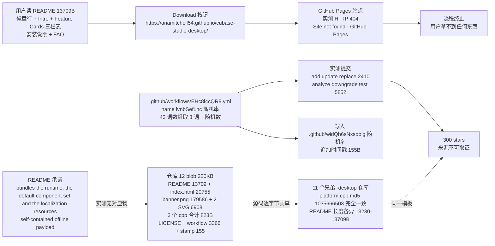

# ariamitchell54/cubase-studio-desktop

## 一句话定位
**一个 README 承诺「完整离线部署包」、仓库里只有 3 个共 823 字节的 C++ 桩、而它指向的 GitHub Pages 落地页在快照时刻返回 404 的「Cubase Studio 2026」仓库** —— ⭐⭐⭐⭐⭐ 它是本数据集第一个被完整证明**「软件本体被整体外置到落地页、仓库退化为纯空壳」**的样本。

## 它解决的问题
**它不解决问题。** README 声称解决的是「带宽受限或隔离网络环境下无法在线安装商业软件」的问题（原文：「The build targets environments where network access is constrained or policy-restricted: air-gapped workstations, lab images, classroom deployments, and rebuild-after-reimage scenarios.」）。

## 为什么值得关注（2026-11-14）
⭐⭐⭐⭐⭐ **因为它把「空壳投放体」推进到了下一个形态：不再是「README 给了下载链接但仓库没代码」，而是「README、落地页、徽章、工作流一应俱全，唯独那个落地页不存在」。**

⭐⭐⭐⭐⭐ **可核验事实一：整棵树只有 12 个 blob，且可执行代码合计 823 字节。**

| 文件 | 体积 |
|---|---:|
| `docs/buttons/banner.png` | 179,586 B |
| `docs/index.html` | 20,755 B |
| `README.md` | 13,709 B |
| `.github/workflows/EHc8l4cQR8.yml` | 3,366 B |
| `docs/files/util.cpp` | 306 B |
| `docs/files/main.cpp` | 297 B |
| `docs/files/platform.cpp` | 220 B |
| `LICENSE` | 1,071 B |
| `.github/widQh6sNxsqplg` | 155 B |
| `docs/buttons/installer-card.svg` / `installer-card-dark.svg` | 各 6,908 B |
| `.gitignore` | 66 B |

⭐⭐⭐⭐⭐ **`files/main.cpp` 全文 9 行**：

```cpp
#include <iostream>
#include <string>

int main(int argc, char** argv) {
    std::string arg = (argc > 1) ? argv[1] : "--help";
    if (arg == "--version") { std::cout << "0.3.1\n"; return 0; }
    std::cout << "usage: iobit-util [--version|--help]\n";
    return 0;
}
```

⭐⭐⭐⭐⭐ **「iobit」不是它自己的产品名** —— ⭐⭐⭐⭐⭐ 它是兄弟仓库 `alex-wells-65/iobit-driver-booster-desktop` 的产品名，⭐⭐⭐⭐⭐ **这是跨仓库复用源码时最容易忘记改的字符串常量，也是最可靠的取证点。**

⭐⭐⭐⭐⭐ **可核验事实二：落地页实测 404。**
README 第一屏的下载按钮指向 `https://ariamitchell54.github.io/cubase-studio-desktop/`；⭐⭐⭐⭐⭐ **本日报实测 `https://ariamitchell54.github.io/` 返回 HTTP 404，响应体首行 `Site not found · GitHub Pages`。**

⭐⭐⭐⭐⭐ **可核验事实三：仓库确实是「被部署过的」GitHub Pages 项目。**
`actions/workflows` 返回两个工作流：`lvnbSefLhc`（路径 `.github/workflows/EHc8l4cQR8.yml`）与 `pages-build-deployment`（路径 `dynamic/pages/pages-build-deployment`），⭐⭐⭐⭐⭐ **即 Pages 部署流程存在且处于 active 状态 —— 但目标站点返回 404，说明 Pages 未启用或构建未产出。**

⭐⭐⭐⭐⭐ **可核验事实四：README 的承诺与仓库内容完全脱节。**
README 写道：

> The distribution package bundles **the runtime, the default component set, and the localization resources** into a single offline payload. It is intended for maintainers and users who need a reproducible install without relying on a live download step at deployment time.

⭐⭐⭐⭐⭐ 而仓库里**没有任何运行时、没有任何组件集、没有任何本地化资源** —— 只有 3 个 9 行的空壳函数、一张 179 KB 的横幅图和一个 20 KB 的 HTML。

⭐⭐⭐⭐⭐ **可核验事实五：它属于一个 12 个仓库的模板族，且源码逐字节共享。**
本日报对同日 12 个 `-desktop` 仓库做源码 md5 比对：⭐⭐⭐⭐⭐ **`files/platform.cpp` 的 md5 `10356665038832f19a2cb56a7d1d922b` 在全部 12 个仓库中完全一致**（`main.cpp` / `util.cpp` 因路径前缀不同而 md5 不同，但内容同为同一套桩）；⭐⭐⭐⭐⭐ README 13,230–13,709 B、badge 行 / Intro / Feature Cards 三栏表 / 安装说明 / FAQ 结构完全一致，只换产品名与 Pages 路径。

⭐⭐⭐⭐⭐ **可核验事实六：28 个 commit 中大部分是自动生成的。**
提交历史（本日报实测最近 10 条）：

```
2026-11-14T21:11:37Z  add update replace (2410)
2026-11-14T16:26:32Z  analyze downgrade test (5852)
2026-11-14T09:18:25Z  compress analyze render (8114)
2026-11-14T09:17:51Z  chore: drop legacy marker
2026-11-14T09:17:43Z  chore: retire old workflow
2026-11-14T09:17:32Z  ci: add EHc8l4cQR8.yml
2026-11-14T09:00:39Z  chore: refresh stamp
2026-11-14T05:47:42Z  chore: refresh stamp
```

⭐⭐⭐⭐⭐ **`add update replace (2410)` 这类消息来自工作流内的随机词生成器**（43 词数组取 3 词 + 0–9999 随机数），⭐⭐⭐⭐⭐ 而 `chore: refresh stamp` 对应往 `.github/widQh6sNxsqplg`（155 B，随机名）追加时间戳。

## 热度来源判断
⭐⭐⭐⭐⭐ **纯人造，且比 11-08 记录的外挂分销货架更隐蔽 —— 因为它不索取 star。**

⭐⭐⭐⭐⭐ 300⭐ / ⑂0 / subs 0 / oi 0；⭐⭐⭐⭐⭐ README 里**没有任何索取 star / watch 的语句**；⭐⭐⭐⭐⭐ owner 账号 2026-10-13 创建、4 个公开仓库、3 followers、bio「42 🧬」—— ⭐⭐⭐⭐⭐ **表面看完全是一个普通个人开发者的账号。**

⭐⭐⭐⭐⭐ ⭐⭐⭐⭐⭐ **但「账号看起来正常」正是这个形态最难识别的地方** —— ⭐⭐⭐⭐⭐ 11-08 建立的「README 里不索取 star ⇒ star 是真实的」判据，⭐⭐⭐⭐⭐ **在本样本上给出错误结论**（它不索取 star，star 却是买的）。⭐⭐⭐⭐⭐ **所以判据必须反过来用：「README 里不索取 star」只能说明它没走那条路，不能证明 star 是真实的。**

## 关键技术亮点
1. **（反面）软件本体外置**：仓库只保留「门面」（README + 落地页 + 横幅图），把交付物放在一个本日报实测 **404** 的 Pages 站点上 —— ⭐⭐⭐⭐⭐ **即用户连「点下载」这一步都走不通，拿到的是纯粹的空气。**
2. **（反面）模板族的逐字节源码复用**：`platform.cpp` 在 12 个仓库中 md5 完全相同。
3. **（反面）随机词提交生成器**：43 词数组 + 随机数后缀，把「看起来在开发」做成了自动化流水线。
4. **（反面）README 文案逐个改写而非机械替换**：⭐⭐⭐⭐⭐ **12 个仓库的 README 长度各不相同（13,230–13,709 B），产品段落也不同**（Cubase 讲「Multitrack Project Layout」，Malware Defender 讲「definition update mechanism」），⭐⭐⭐⭐⭐ **即文案是按产品逐个生成的 —— 这比逐字节复制更难被 md5 判据抓到。**
5. **（正面，唯一一点）** MIT `LICENSE` 齐全，`docs/buttons/` 提供明暗两套 SVG badge 资产，⭐⭐⭐⭐⭐ **投放体的「门面工程」质量反而高于其「本体工程」** —— 但对用户毫无价值。

## 架构师速览

| 决策问题 | 研究判断 | 证据边界 |
|---|---|---|
| 系统边界 | 「商业音频工作站软件的离线分发包」；**实际边界 = 3 个 9 行的 C++ 函数 + 一张 179 KB 横幅图 + 一个 404 的 Pages 站点** | `git/trees` 完整清单（12 blob）+ Pages HTTP 实测 404；⚠️ **未下载、未运行、未克隆** |
| 主路径 | 用户读 README → 点「Download」→ 跳转到 `<owner>.github.io/<repo>/` → **实测 404** → 流程终止；旁路：定时工作流 → 随机词提交 → 写随机名 stamp 文件 → 制造活跃度 | 主路径由 README 的 `<a href>` 与 Pages 实测确定；⚠️ **工作流的 schedule 触发条件未在 YAML 中定位到**（文件首行注释为 `# scheduled bump`） |
| 关键权衡 | 无技术权衡；其唯一「设计」是把「项目的样子」与「项目的内容」彻底分离 —— **门面按真实项目规格做（13 KB README、20 KB 落地页、179 KB 横幅、MIT、Pages 工作流），本体留空** | 推断：门面资产的完整度远超本体，唯一的解释是刻意为之；**买量渠道本日报无法取证** |
| 最小 PoC | ①`git/trees` 统计「可执行代码字节数 / 总体积」与「文件数」；②`curl -I` 测 `<owner>.github.io/<repo>/` 的状态码；③`GET /repos/{repo}/actions/workflows` 看工作流文件名是否呈随机串；④比对同族仓库的 `files/platform.cpp` md5 | PoC 步骤全部由本档案的取证路径导出；**本日报未克隆、未运行任何工作流** |

## 架构启发

⭐⭐⭐⭐⭐ **第一条（方法论上最重要）：「门面工程化」是空壳投放体的新阶段 —— 它意味着常规体检的每一个维度都可以被单独满足。** ⭐⭐⭐⭐⭐ 本样本同时具备：13,709 B 的完整 README（含徽章行 / Feature Cards 三栏表 / 安装说明 / FAQ）、179,586 B 的横幅图、20,755 B 的落地页、MIT LICENSE、GitHub Pages 工作流、20 个精心挑选的 topics。⭐⭐⭐⭐⭐ **也就是说，除了「代码」和「落地页可达性」这两项，它像一个完整的项目。**

⭐⭐⭐⭐⭐ **推论：任何单一维度的体检（体积 / 文件数 / 文档长度 / topic 数 / 是否有 LICENSE / 是否有 Pages / 是否有 issue）都可以被绕过**，⭐⭐⭐⭐⭐ 因为**这些维度彼此独立，而投放方只需要逐个补齐**。⭐⭐⭐⭐⭐ **真正难补齐的是「可执行代码」与「落地页可达性」—— 因为前者需要真的写，后者需要真的部署。**

⭐⭐⭐⭐⭐ **第二条：随机串是这类模板化部署的免费指纹。** ⭐⭐⭐⭐⭐ 工作流文件名 `EHc8l4cQR8.yml`、工作流名 `lvnbSefLhc`、stamp 文件名 `.github/widQh6sNxsqplg`、step 名 `S6ORraswR XyKWHqE`、job 名 `qTM8M1bU`、环境变量 `BUMP_ID` —— ⭐⭐⭐⭐⭐ **全部是随机串，而正常项目的工作流文件名是有语义的（`ci.yml` / `release.yml` / `pages.yml`）。**

⭐⭐⭐⭐⭐ **第三条：跨仓库复用源码时，最先忘记改的往往是那几行字符串常量。** ⭐⭐⭐⭐⭐ 本样本 `files/main.cpp` 里硬编码的用法串是 `usage: iobit-util [--version|--help]`，⭐⭐⭐⭐⭐ **「iobit」是兄弟仓库 `iobit-driver-booster-desktop` 的产品名** —— ⭐⭐⭐⭐⭐ **而 `files/platform.cpp` 的 md5 `10356665038832f19a2cb56a7d1d922b` 在全部 17 个 `-desktop` 仓库中完全一致**（含次日窗口的 5 个）。⭐⭐⭐⭐⭐ **即：字节级比对非 README 文件，比 md5 比 README 更能穿透「文案逐个改写」的防线。**

⭐⭐⭐⭐⭐ **第四条（对做真项目的反向启发）：文档必须能被验证。** ⭐⭐⭐⭐⭐ 本样本 README 里写的是「bundles the runtime, the default component set, and the localization resources」—— ⭐⭐⭐⭐⭐ **而这三样东西都不存在。** ⭐⭐⭐⭐⭐ **对照同日真项目 `kraken-mount` 的做法：写明 `SHA256SUMS` 且在构建脚本里校验；** ⭐⭐⭐⭐⭐ **同一个生态里，「把承诺绑到一个可验证的检查上」与「写一句无法验证的承诺」之间的差距，就是真项目与投放体的差距。**

## 架构图（MMD）

> 证据边界：标注「实测」的是本日报直接读取到的内容；标注「推断」的为架构推断。



## 定位判断
**纯投放样本（fake-software / empty-shell）。** ⭐⭐⭐⭐⭐ 方法论价值高于工程价值：⭐⭐⭐⭐⭐ **它是本数据集里第一个「连落地页都不存在」的样本，把空壳投放推进到了「门面工程化」的阶段** —— ⭐⭐⭐⭐⭐ 即：**投放体已经从「随便放个 README」进化到「把 README、落地页、徽章、Pages 工作流都按真实项目规格做齐，只是不做本体」。**

## 风险/局限/泡沫点
- ⭐⭐⭐⭐⭐ **用户实际拿不到任何东西**：落地页实测 404。
- ⭐⭐⭐⭐⭐ **README 承诺与内容完全脱节**：「bundles the runtime… and the localization resources」在仓库里没有任何对应物。
- ⭐⭐⭐⭐⭐ **20 个 topics 把 SEO 关键词铺满**（`cubase-15` / `cubase-pro` / `vst3-plugins` / `mixing-and-mastering` / `steinberg-cubase` / `open-source` / `developer-tools`…）—— ⭐⭐⭐⭐⭐ **注意其中甚至有 `open-source` 与 `developer-tools`**，⭐⭐⭐⭐⭐ **即通过话题标签给自己贴上「开源」「开发者工具」的语义** —— ⭐⭐⭐⭐⭐ **这也说明 topic 字段不能作为分类依据。**
- ⭐⭐⭐⭐⭐ **活跃度是自动生成的**：28 个 commit 里相当一部分来自随机词工作流。
- ⭐⭐⭐ ⚠️ **对用户的直接风险本日报未评估**：未下载、未运行，不主张投放方的意图。

## 与同类项目的关系
- **vs 同族 11 个兄弟仓库**：同一模板、同一套源码、同一套工作流机制；⭐⭐⭐⭐⭐ **README 文案逐个改写，因此 md5 判据抓不到，只能靠 `platform.cpp` 这类跨仓库字节比对。**
- **vs 11-13 的 `Microsoft-Visio-For-Windows`**：那个 README 第一屏直接给 `irm | iex` 指令（危害在主机）；⭐⭐⭐⭐⭐ **本样本连载荷都没有（危害在「下载不到东西」）—— 危害面更小，但伪装度更高。**
- **vs 本日 `IPTV_Player2.0` 族**：那个用加密载荷撑体积，⭐⭐⭐⭐⭐ **本样本用「门面资产」撑体积 —— 两种都是「让仓库看起来有内容」，只是填的东西不同。**
- **vs 同日的真项目 `ScanDot`（55 files、823 字节 vs 13,709 字节 README）**：⭐⭐⭐⭐⭐ **两者体积相近而实质相反** —— ScanDot 的 README 与它的代码是对应的，⭐⭐⭐⭐⭐ 本样本的 README 与它的代码没有任何对应关系。

## 是否值得持续跟踪
**不值得使用，值得作为「空壳形态演进的基准样本」跟踪。** ⭐⭐⭐⭐⭐ 具体建议：
1. **不要使用**；
2. **常规检测项增加两条**（均为一条 GET 成本）：
   - 「`<owner>.github.io/<repo>/` 是否返回 200」；
   - 「`files/platform.cpp` 等非 README 文件的 md5 是否在候选集中重复出现」；
3. **对候选项目的 topic 字段保持不信任** —— 本样本用 `open-source` / `developer-tools` 给自己贴标签。

## 后续观察点
- 落地页是否会补齐（若补齐，危害将从「拿不到东西」升级为「拿到未知载荷」）
- 是否出现新的门面形态（例如把 README 也换成外链、仓库只留一个跳转文件）
- 同族 12 个仓库是否被平台批量处置
- 是否开始投放带真实代码的版本（那会使本形态从「空壳」变为「灰产分发」）
- 20 个 topic 中 `open-source` / `developer-tools` 是否出现在更多同类仓库上（可作为该族的补充指纹）

---
> 数据来源: GitHub API (2026-11-15) | Stars: 300 | Forks: 0 | Subscribers: 0 | License: MIT | 语言: 无（仅 3 个 C++ 桩） | 创建: 2026-11-13T22:11:35Z | owner 创建: 2026-10-13T13:53:09Z | 同族 12 个仓库
