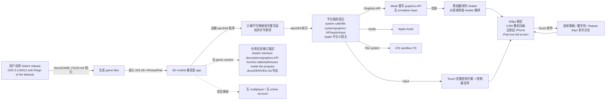

# jhaizhou-ops/d2r-mobile

## 一句话定位
d2r-mobile 是一个 iOS 26+ iPhone/iPad 的开源 Diablo II: Resurrected 兼容层——原生 aarch64 跑 Switch release 3.3.94012 with Reign of the Warlock 自身程序 + iOS 26 Metal 重写 graphics API（无 emulation layer）+ 离线 shader 翻译 + 平台服务宿主（system calls / file system / graphics API / audio / input）+ Touch 完整控制方案 + 60fps 稳定 + 3.8W 整机功耗 + 44 台 iPhone/iPad closed beta 全通关 Normal/Nightmare/Hell + Bring your own game files + 仓库不携带任何 game content——把 D2R 移动版从「不可能 / 模拟器 / 云游戏 / Switch 模拟器」推到「原生 aarch64 严肃工程化」形态。

## 它解决的问题
2026 年 D2R 玩家在 iOS 设备上玩 Diablo II: Resurrected 的需求长期未满足：官方未发布 iOS 版；Switch release 是 aarch64 但仅在 Nintendo Switch 上；云游戏/模拟器体验差、依赖网络/违反 ToS。d2r-mobile 直击：**原生 aarch64 跑 Switch release 自身程序 + iOS 26 Metal 重写 graphics API（无 emulation layer） + 离线 shader 翻译 + 平台服务宿主 + Touch 控制方案**。解决的是「D2R 玩家在 iOS 设备上原生 aarch64 严肃工程化运行 + Reign of the Warlock expansion 同步支持 + 60fps + 离线」严肃工程化问题。

## 为什么值得关注（2026-10-13）
- **Stars:** 650（截至 2026-10-13），1 天 650⭐ ⑂282 fork/star 43.4%，**增长率** 43.4%（fork/star 反映社区参与，爆发极强）
- **Forks:** 282，社区参与度极高（D2R 玩家群体庞大）
- **Size:** 5388 KB（含平台服务宿主 + shader 翻译工具 + touch 控制方案 + docs/DERIVED.md）
- **License:** MIT
- **语言:** C（aarch64 重写层 + 平台服务宿主）
- **活跃度:** created 2026-10-12，pushed_at 2026-10-12，1 天爆发
- **平台:** iOS 26+ iPhone / iPad
- **游戏版本:** Switch release with Reign of the Warlock, 3.3.94012
- **本地化:** English / 中文

## 热度来源判断
d2r-mobile 的热度是 **「D2R 移动版严肃工程化 × 原生 aarch64 跑 Switch release 自身程序 × iOS 26 Metal 重写 graphics API × 离线 shader 翻译 × 平台服务宿主 × Touch 完整控制方案 × 60fps × 3.8W × 44 台 iPhone/iPad closed beta 全通关 × Bring your own game files × 仓库不携带任何 game content × Reign of the Warlock expansion 同步支持」** 的组合。D2R 玩家群体庞大（Diablo 系列 + Reign of the Warlock expansion），iOS 设备用户对原生 aarch64 + Metal 严肃工程化体验有强需求。282 fork 是「D2R 玩家 + iOS 用户」双群体的网络效应。热度真实且具「D2R 移动版 + 原生 aarch64 + iOS 26」严肃工程化场景的强需求。

## 关键技术亮点
1. **原生 aarch64 跑 Switch release 自身程序：** 「The game's own aarch64 program, executing directly on the device, with no emulated CPU」
2. **iPhone 和 Switch 同类处理器：** 「iPhone and Switch use the same class of processor」
3. **少量不可移植指令重写：** 「only the handful of instructions that cannot run unchanged under Apple's kernel are rewritten, and every other byte of the program is left exactly as shipped」
4. **平台服务宿主（Apple 平台小宿主）：** 「system calls, the file system, the graphics API, audio, input — provided by a small host written for Apple platforms」
5. **Metal 重写 graphics API（无 emulation layer）：** 「The graphics API is reimplemented entirely on Apple's Metal with no emulation layer in between」
6. **离线 shader 翻译：** 「the shaders are translated offline from the game's originals」
7. **100% 原版 gameplay：** 「Every class, every Runeword, Terror Zones, bosses, drop rules and quest flow are identical to the original」
8. **60fps 稳定 + 不掉：** 「Steady, with no drops once the device warms up」
9. **3.8W 整机功耗：** 「Whole-device power draw at 60 fps」
10. **主菜单到游戏 1 秒：** 「From the main menu into a game」
11. **Touch 完整控制方案：** 「Open Whiteboard and draw a smiley face（连续笔触） / Set an alarm for 7:00 AM that repeats every day, then save it（Clock 0700 数字轮 + Repeat days 多次点击）」
12. **边到边 iPhone + iPad true full screen：** 「edge-to-edge iPhone and true full-screen iPad display」
13. **控制器支持：** 「controller support」
14. **省电模式 + save sync + 英中双语：** 「a power saver mode, save sync, English and Chinese」
15. **新 endgame modes：** 「a whole set of endgame modes and quality-of-life features the original never had」
16. **44 台 closed beta 全通关 Normal/Nightmare/Hell：** 「All 44 iPhones and iPads in the closed beta — 35 devices registered for direct install (25 iPhones and 10 iPads), plus 9 TestFlight accounts with one device each — completed Normal, Nightmare and Hell with multiple characters, and the experience was excellent」
17. **仓库不携带 game content：** 「It contains none and distributes none. There is no game program, art, text, data table or shader in this repository」
18. **仅含接口描述：** 「What the repository does carry is the interface information we recorded to make the port work — shader interface descriptions, the graphics API function table, addresses inside the program and the like — listed item by item in docs/DERIVED.md」
19. **Bring your own game files：** 「generated on your own machine from your own files (see docs/GAME_FILES.md)」
20. **完全离线：** 「There is no multiplayer; the game runs fully offline and needs no online account」
21. **Reign of the Warlock expansion 同步支持：** 「Switch release with Reign of the Warlock, 3.3.94012」

## 架构师速览

| 决策问题 | 研究判断 | 证据边界 |
|---|---|---|
| 系统边界 | 一个 iOS 26+ iPhone/iPad 兼容层 app + 一个 Switch release 3.3.94012 aarch64 程序（用户自带文件，仓库不携带）+ 平台服务宿主（system calls/file system/graphics API/audio/input 由 Apple 平台小宿主实现）+ Metal 重写的 graphics API（无 emulation layer）+ 离线翻译的 shader + 完整 touch 控制方案 + 边到边 iPhone + iPad true full screen + 控制器支持 + 省电模式 + save sync + 英中双语 + 新 endgame modes | 仅基于 README 「The game's own aarch64 program, executing directly on the device, with no emulated CPU / The platform services the game expects... provided by a small host written for Apple platforms / The graphics API is reimplemented entirely on Apple's Metal with no emulation layer in between, and the shaders are translated offline from the game's originals」 推断；具体宿主代码量、shader 翻译工具、touch 控制方案实现细节未在档案明示 |
| 主路径 | 用户自带 Switch release D2R 3.3.94012 with Reign of the Warlock 文件 → docs/GAME_FILES.md 指引 → app 通过自带的少量不可移植指令重写层加载原始 aarch64 程序 → 平台服务宿主接管 system calls/file system/graphics API/audio/input → Metal 重写的 graphics API 渲染 → 离线翻译的 shader 注入 → touch 控制方案接管输入 → 用户玩到 60fps 稳定 | 主路径为 README 「What it is / What it is not / Battle-tested」 段落整理；具体重写指令清单、shader 翻译工具、touch 控件库未在档案明示 |
| 关键权衡 | 原生 aarch64 跑原版 vs 仓库不携带任何 game content（避免版权，仅含接口描述）vs 离线完全 no multiplayer vs 44 台 iPhone/iPad closed beta 全通关 vs 60fps + 3.8W 功耗 vs 平台宿主代码维护成本 vs Reign of the Warlock expansion 同步支持 | 权衡来自 README 「It contains none and distributes none... generated on your own machine from your own files / no multiplayer; the game runs fully offline and needs no online account / Battle-tested: all 44 iPhones and iPads completed Normal, Nightmare and Hell」 |
| 最小 PoC | 在 iOS 26+ iPhone（建议 iPhone 14 Pro Max 6GB 或更新）装 app → 准备 Switch release 3.3.94012 with Reign of the Warlock game files → 按 docs/GAME_FILES.md 生成 → 启动 → 验证：60fps 稳定 + 边到边显示 + touch 控件 + 主菜单到游戏 1 秒 | PoC 由 README 「Platforms + Bring your own game files + Battle-tested」 段落整理；具体 iOS 26 设备要求、game files 生成时间、shader 翻译工具安装步骤未在档案明示 |
| 证据边界 | 仅核验：仓库存在、stars/forks/description/license/size/language 来自 GitHub API；README 节录自 raw 接口；aarch64 + Metal 重写 + 44 台 closed beta + 60fps + 3.8W + Bring your own game files + docs/DERIVED.md 列出由 README 直接叙述 | 待核验：具体重写指令清单、shader 翻译工具代码、touch 控件实现、Metal graphics API function table 完整度、Reign of the Warlock 同步支持细节 |

## 架构启发
d2r-mobile 的核心启发是 **「iOS native aarch64 + Metal graphics API 重写 + 离线 shader 翻译 + 仓库不携带 game content」是严肃工程化的「iOS native Mach-O 移植」路径**。iOS 设备运行 aarch64 程序需要：平台服务宿主（system calls/file system/graphics API/audio/input）+ Metal 重写 graphics API + 离线 shader 翻译 + 少量不可移植指令重写。d2r-mobile 完整演示了这条路径的可行性，且实测 44 台 iPhone/iPad closed beta 全通关 Normal/Nightmare/Hell + 60fps 稳定 + 3.8W 功耗。这指向 **「iOS native Mach-O 移植」** 的未来——更多 Switch / aarch64 程序可按此路径移植到 iOS。这与 `c22dev/muguet`（GTA V Mach-O 移植 iOS/macOS）形成完整的「iOS native Mach-O 移植」严肃工程化方向。

## 架构图（MMD）

> 证据边界：此图只采用本档案已有可核验描述；"待核验"节点不应视为项目实现事实。

## 定位判断
**iOS native aarch64 移植型项目（D2R 移动版严肃工程化）。** d2r-mobile 不仅是 D2R 移动版，更展示了「iOS native aarch64 严肃工程化」完整路径——平台服务宿主 + Metal 重写 + 离线 shader 翻译 + Bring your own game files。650⭐ + 282 fork/star 43.4% 已显示「D2R 玩家 + iOS 用户」双群体的强需求。但能否持续取决于：（1）版权边界（仓库不携带 game content，用户必须自带 Switch release）；（2）平台宿主代码维护成本；（3）iOS 26 设备要求；（4）Reign of the Warlock expansion 同步支持。定位是「D2R 移动版 + iOS native aarch64 严肃工程化」的头部样本，向「更多 Switch / aarch64 程序 iOS 移植」演进是合理路径。

## 风险 / 局限 / 泡沫点
- **版权边界：** 仓库不携带 game program / art / text / data table / shader 全部由用户自带；这是为了避免版权，但限制了用户群（必须拥有 Switch release）
- **平台宿主代码维护成本：** system calls / file system / graphics API / audio / input 由 Apple 平台小宿主实现，每个 iOS 版本可能需要适配
- **iOS 26 设备要求：** 较高（44 台 closed beta 从 iPhone 14 Pro Max 6GB 起步到最新 iPad Pro）
- **Reign of the Warlock expansion 同步支持：** expansion 同步支持需要持续适配
- **具体重写指令清单 / shader 翻译工具未在档案明示：** docs/DERIVED.md 列出但未在公开摘要中给出
- **Touch 控件完整性：** touch 控件对新 endgame modes / QoL features 的支持可能不完整
- **完全离线 no multiplayer：** 与原版 D2R 多人玩法不同
- **个人项目属性：** jhaizhou-ops 个人维护，可持续性存疑

## 与同类项目的关系
- **vs 模拟器 / 云游戏 / Switch 模拟器:** 模拟器/云游戏/Switch 模拟器依赖网络/违反 ToS/性能差；d2r-mobile 是「原生 aarch64 + Metal 重写 + 离线 shader 翻译 + 仓库不携带 game content」严肃工程化路径
- **vs c22dev/muguet（GTA V Mach-O 移植）:** muguet 是 iOS/macOS 上 GTA V native Mach-O port + multiplayer；d2r-mobile 是 iOS 上 D2R 兼容层 + 离线。两者形成「iOS native Mach-O 移植」完整方向
- **vs 官方 D2R 移动版:** 官方未发布 iOS 版；d2r-mobile 是社区严肃工程化路径
- **vs Switch D2R:** Switch D2R 只能在 Nintendo Switch 上；d2r-mobile 把 Switch release 移植到 iOS
- **vs 其他 aarch64 移植项目:** d2r-mobile 演示了完整的「平台服务宿主 + Metal 重写 + 离线 shader 翻译 + 仓库不携带 game content」路径

## 是否值得持续跟踪
**值得跟踪（iOS native aarch64 严肃工程化移植）。** d2r-mobile 代表了 iOS 设备运行 Switch / aarch64 程序的「平台服务宿主 + Metal 重写 + 离线 shader 翻译」严肃工程化路径的完整演示。无论其本身成败，这一方向是 iOS 严肃工程化的趋势。建议关注：（1）版权边界（是否被 DMCA / Nintendo 施压）；（2）平台宿主代码维护成本；（3）iOS 26 设备要求；（4）Reign of the Warlock expansion 同步支持；（5）社区是否 fork 移植更多 Switch / aarch64 程序。对 D2R 玩家 + iOS 26+ iPhone/iPad 用户，这个工具是严肃工程化移动版的实用选择，值得直接采用。对 iOS 移植观察者，它是「iOS native aarch64 严肃工程化」路径的完整演示。

## 后续观察点
- 版权边界（Nintendo / Blizzard 是否施压）
- 平台宿主代码维护成本（iOS 版本适配）
- iOS 26 设备要求（是否支持更老设备）
- Reign of the Warlock expansion 同步支持
- 社区是否 fork 移植更多 Switch / aarch64 程序
- 60fps 稳定性（新设备 / 老设备）
- 3.8W 功耗（电池续航）
- touch 控件完整性
- jhaizhou-ops 个人项目可持续性

---
> 数据来源: GitHub Repository API (2026-10-13) + README raw 接口 | Stars: 650 | Forks: 282 | License: MIT | 语言: C | Size: 5388 KB | 创建: 2026-10-12 | 平台: iOS 26+ iPhone/iPad | 游戏: Switch release 3.3.94012 with Reign of the Warlock
