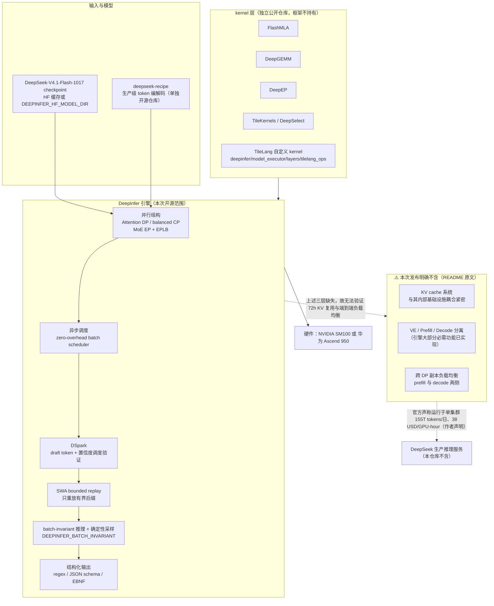

# deepseek-ai/DeepInfer

## 一句话定位

DeepSeek 生产大规模推理服务所用的推理框架的开源版本，提供离线推理与规模化服务所需的核心里能力（优化 kernel、并行策略、投机解码调度、异步批调度），但**明确不含 KV cache 系统、PD 分离与跨副本负载均衡**。

## 它解决的问题

推理框架在 2026 年已经分化成两类问题：

- **kernel 效率**：MoE 的 GEMM、通信、attention 各自的 kernel 质量决定上限。
- **系统组织**：kernel、通信、调度、缓存管理四者互相影响，共同决定端到端性能——这一点在单机时代不明显，在跨集群时代变成主矛盾。

DeepInfer 属于第二类问题的产物。仓库里的 `doc/inference_deployment_qa.md` 把整个系统的三条设计目标写得很直接：**支持多厂商加速器**、**围绕商用硬件组织 prefill 与 decode**（prefill 用普通 8 卡机、decode 用普通 64–128 卡超节点）、**KV cache 保留超过 72 小时**（以换取上下文复用，命中即省一次 prefill）。这三条目标决定了后面所有架构选择。

## 为什么值得关注（2026-10-23）

**这是本日四个项目里唯一一个由头部模型厂商官方开源、且明确描述了自己生产环境规模的项目。** `doc/inference_deployment_qa.md` 里有一句可核验的原话：**「A single cluster currently serves 155 trillion tokens per day, with overall revenue of US$38 per GPU-hour (at valley pricing).」**——单集群每日 15.5 万亿 token，每 GPU 小时 38 美元（谷值定价）。这把"这个框架在什么量级上被验证过"从推测变成了声明。

同时它的 `subscribers_count = 43` 是本日四个项目中最高的（其余为 3 / 4 / 0），**说明这是本日唯一有相当规模真实关注者的项目**。

19,806⭐ 出现在创建后 7 天，fork/star 10.6%。这个比例与它的形态相符：推理框架的 fork 价值主要是"读它的调度逻辑"而不是"改完就能用"。

## 热度来源判断

**热度来源是双重的，且两者都要分开说：**

1. **模型侧关注度外溢**：DeepSeek-V4.1-Flash 是 DeepSeek 的当前主力模型，其开源框架必然随模型热度获得关注。这是事件/发布驱动的。
2. **工程侧参考价值**：它开源的调度与并行策略（尤其"围绕商用硬件而非顶级超节点组织"这个反向选择）对做推理服务的人是直接可读的样本。这一部分是持续的。

**与 10-22 记录的 php2shell 事件的关键区别**：DeepInfer 的 star 数与"值得被工程师细读"之间没有明显脱节——`subscribers_count = 43` 与 `open_issues_count = 193` 说明有真实的深度使用与提问群体。**但仍须注意：193 个 issue 在 7 天内出现，对一个刚开源的框架是正常的早期信号，不能读作质量缺陷。**

## 关键技术亮点

1. **DSpark + confidence-scheduled verification**：用 draft token 加速解码，并用置信度估计来调度验证时机。环境变量 `DEEPINFER_ENABLE_MTP_VARLEN=1`，`DEEPINFER_USE_NEXTN_DECODE` 控制最大 draft 长度（默认 5）。**「验证多少个 draft token」从固定值变成由置信度决定**，这正是 2026 年投机解码的核心争论点。
2. **SWA bounded replay**（decoder 侧）：只重放一个有界后缀来减少 prefill 工作量。默认设置 `DEEPINFER_YOCO_PREFILL_TRUNCATION_MODE=compact` + `DEEPINFER_YOCO_PREFILL_KEEP_TOKENS=140`，并说明**保留的后缀必须覆盖 SWA 窗口加上最大回退长度**——这个约束条件本身就是一条重要的正确性要求。
3. **Batch-invariant inference**（`DEEPINFER_BATCH_INVARIANT=1`，仅 NVIDIA）：保证不同 batch 组合下模型结果一致。配合 `DEEPINFER_ENABLE_MTP_VARLEN=0` + 固定 `seq_seed` 即得到确定性采样。**这两项是把"可复现性"做进推理引擎而不是靠外部固定种子**的完整方案。
4. **异步调度（默认开启）**：CPU 批调度与设备执行重叠，README 称之为 zero-overhead batch scheduler。
5. **kernel 栈全是自家仓库**：FlashMLA · DeepGEMM · DeepEP · TileKernels · DeepSelect + 自定义 TileLang kernel（位于 `deepinfer/model_executor/layers/tilelang_ops`）。**这五者在 GitHub 上均为独立仓库**，意味着 kernel 与框架是分开的两层。
6. **双厂商支持**：NVIDIA SM100 GPU 与华为 Ascend 950 NPU，需 CUDA 13 或 CANN 9.2。

**必须同时记录的三项"不含"**（README 的 Required for a complete inference service 段落）：**KV cache 系统**、**VE/Prefill/Decode 分离**（原文注明"引擎的大部分必需功能已实现"）、**prefill 与 decode 两侧的跨数据并行副本负载均衡**。`doc/inference_deployment_qa.md` 补充说明 KV cache 管理与负载均衡"与内部基础设施耦合紧密，尚未完全开源"。

## 架构师速览

| 决策问题 | 研究判断 | 证据边界 |
|---|---|---|
| 系统边界 | Python 包 + `csrc/` + `vendor/`（顶层：csrc, deep_cluster, deepinfer, doc, eval, examples, scripts, tests, vendor）。**边界清晰地停在 KV cache 与负载均衡之前**——README 明列这三项不在本次发布范围内。数据面是 GPU/NPU 上的 kernel 执行；控制面是 DP/CP/EP 并行组构、批次调度、投机解码的验证调度 | README 的「Required for a complete inference service (not included in this release)」三条 + `git/trees/HEAD` 顶层目录（`deep_cluster/` 的存在暗示集群能力有部分代码）+ `doc/inference_deployment_qa.md` 的「KV cache management and load balancing ... are not yet fully open-sourced」；**`deep_cluster/` 的实际内容与 PD 分离实现程度本窗口未取，待核验** |
| 主路径 | 加载 checkpoint（默认首次运行下载 `deepseek-ai/DeepSeek-V4.1-Flash-1017`，可用 `DEEPINFER_HF_MODEL_DIR` 指向本地）→ MoE 部分在（超）节点内用 EP 提升 batch 与 GEMM 效率 → prefill 在 8 卡机、decode 在 64–128 卡超节点 → 异步调度把 CPU 批调度与设备执行重叠 → DSpark 产 draft token、按置信度调度验证 → SWA bounded replay 只重放保留后缀（覆盖 SWA 窗口 + 最大回退）→ KV cache 保留 >72h 供上下文复用（**该层不在本次开源范围**） | 由 `doc/inference_deployment_qa.md` 的三条目标 + README 的特性段与 `
` 配置说明 + `examples/offline_inference.py` 入口推出；**「8 卡 prefill / 64–128 卡 decode」是 QA 文档所述其生产系统的组织方式，README 的 benchmark 也正是 prefill 在 4 张 SM100、decode 在 64 张上测的**，但**其代码中这两级的自动化切分是否已开源，未核验** |
| 关键权衡 | **围绕商用硬件组织 vs 围绕顶级超节点优化**（明写 prefill 用普通 8 卡机、decode 用 64–128 卡超节点——这是与"只在 H100/GB200 上刷 benchmark"相反的选择）· **KV cache 保留 >72h（换来 prefill 复用）vs 容量与管理开销**（文档明说这是有代价的）· **置信度调度验证 vs 固定 draft 长度**（更快但引入"验证多少"的正确性判断）· **SWA bounded replay 省 prefill vs 保留后缀必须覆盖 SWA 窗口 + 最大回退**（一个写死在文档里的正确性约束）· **开源引擎但不开源 KV cache**（保住了核心调度价值，但拿不到完整系统）· **batch-invariant + 确定性采样（可复现）vs 吞吐**（两条都标"仅 NVIDIA"） | `doc/inference_deployment_qa.md` 的三目标 + README 明示的三项"不含"+ 环境变量开关的分组（batch-invariant 与确定性采样都标注 NVIDIA only）+ **benchmark 硬件配置与生产组织方式一致这一点是可核验的交叉印证**（prefill 4×SM100、decode 64×SM100，各自在一个 scale-up 域内）；**未明示：EPLB 的具体策略、draft 模型的显存/算力成本占比、以及昇腾路径与 NVIDIA 路径的功能对等程度** |
| 最小 PoC | 1. 确认硬件落在两档之一（NVIDIA SM100 或华为 Ascend 950；需 CUDA 13 / CANN 9.2、GCC≥13、Python 3.12）→ 2. 建空的 Python 3.12 环境并 `export DEEPINFER_ACCELERATOR=nvidia`（昇腾改为 `ascend`），跑 `./build.sh` → 3. 首次运行会下载 `DeepSeek-V4.1-Flash-1017` 到 HF 缓存（或先设 `DEEPINFER_HF_MODEL_DIR` 指向本地副本）→ 4. `python examples/offline_inference.py` 跑通**默认路径**——**注意默认路径不含 KV cache，72h 复用这一核心目标本 PoC 验证不了** → 5. 逐个打开特性并观察变化，每次只改一个：`DEEPINFER_ENABLE_MTP_VARLEN=1`（投机解码）→ `DEEPINFER_YOCO_PREFILL_TRUNCATION_MODE=compact` + `..._KEEP_TOKENS=140`（SWA bounded replay）→ `DEEPINFER_BATCH_INVARIANT=1`（batch 不变性，**只在此处测 batch 不变性才有意义**）→ 6. **`DEEPINFER_BATCH_INVARIANT=1 DEEPINFER_ENABLE_MTP_VARLEN=0` + 固定 `seq_seed`，验证同输入同采样参数两次运行输出逐 token 相同**——这是整个 PoC 里唯一真正可证伪的一步 → 7. 结构化输出按 `examples/_structured_output.py` 传 `so_args={"schema_type":..., "schema":...}` → 8. 复现 benchmark：`examples/sweep/run_sweep.sh`（README 的两张 Pareto 图就是它产出的） | 步骤全部按 README 已给出的证据链倒排；**第 5 步是本项目最值得做的一步**：batch-invariant 是本框架少数几个能在一台机器上自我验证的性质，且它同时解锁确定性采样；**第 4 步要特别留意 README 自己标注的三项"不含"——若 PoC 结果与官方 API 行为有出入，先排除是否落在这三项范围内，而不是先怀疑框架有 bug** |

> 证据边界：此图只采用 README、`doc/inference_deployment_qa.md` 与仓库目录结构。虚线与 ⚠️ 节点表示 README 明示的「不在本次发布范围」，不得视为已实现；「生产服务规模」为作者声明，本日报未独立核验。

## 架构启发

**它最值得学的一条是「把不在范围内的东西明写出来」。** README 有一整段叫 `Required for a complete inference service (not included in this release)`，列出 KV cache、PD 分离、跨副本负载均衡三项。对比本日另一个项目 Macintosh 的做法（Status 表格逐项写明「not supported」），两者用的是同一种纪律：**把缺口列成一张表，比让人自己踩到强得多**。

第二条是 **72 小时 KV cache 保留这个目标本身**。它听起来像一个容量优化，实际上是一个**架构决策**：既然 prefill 可以在 8 卡机上做、decode 在 64 卡超节点上做，那缓存就必须跨越这两个层级存活 72 小时。这解释了为什么 prefill 和 decode 的硬件配置差了一个数量级——**不是为了省钱，而是为了让缓存有一个能待得住的家**。这类"从业务目标反推硬件布局"的推理方式，比任何单个 kernel 优化都更值得学。

## 定位判断

**生产推理框架的开源子集（基础设施候选，但当前不足以支撑生产部署）。** 需要说清的是：开源的部分（kernel 组、并行策略、调度、投机解码、异步批调度）确实是推理框架里最难的那些；**而"最难"的部分恰好也是最难独立验证正确性的部分**——因为 KV cache 不在，72h 复用的正确性就无从测起。

与同类项目的关系：
- **vs vLLM**：DeepInfer 自述最初主要构建于 vLLM 之上，并从 SGLang 与 TensorRT-LLM 获得启发。**这不是独立实现，是有明确血缘的。** 这不降低它的价值——把生产调度经验放进公开框架本身就是贡献——但读者应当知道差异点在哪里。
- **vs SGLang**：两者都在做投机解码与异步调度；DeepInfer 的 SWA bounded replay 与 confidence-scheduled verification 是 SGLang 未强调的部分。
- **vs NVIDIA/flare-local-inference（10-22 项目）**：正交且互补。Flare 是**本地单用户推理**，明确声明不是 vLLM 类生产引擎的替代；DeepInfer 是**大规模生产服务**，明确不含本地单机场景的全部功能。
- **vs 自建团队**：对多数团队，引入 DeepInfer 的成本低于从 vLLM 深度定制，但**低于从零构建**。

## 风险 / 局限 / 泡沫点

1. **⚠️ 最关键的限制是「框架不完整」**：不含 KV cache、PD 分离、跨副本负载均衡。**这意味着即使全部编译成功，也无法用它复现 README 描述的 72h 缓存复用行为**——而那是这个框架最核心的设计目标之一。拿它做生产部署前必须先自己补这三层。
2. **7 天内 193 个 open issue**：对新开源框架属正常区间，但配合 `subscribers_count = 43` 也说明确有大量真实用户在读与用。**这是早期信号而非质量缺陷**，但需持续观察关闭率。
3. **「155 万亿 token/日、38 美元/GPU-hour」是作者声明**：本日报未独立核验，也无法核验——它是私有集群的运行数据。README 与 QA 文档提供的两张 Pareto 图（prefill 在 4×SM100、decode 在 64×SM100）是**当前唯一可复核的量化证据**。
4. **batch-invariant 与确定性采样均标注「NVIDIA only」**：昇腾路径缺这两项能力。在双厂商支持下，这意味着**两条路径的功能并非对等**。
5. **昇腾支持的实际成熟度未知**：README 列出 Ascend 950 + CANN 9.2 为受支持硬件，但本窗口未取到任何昇腾特定的性能数据或已知限制。
6. **`topics` 字段为空数组**：未设置 GitHub topics（不影响技术，但降低检索可见度）。
7. **无 release**：`releases` API 返回空数组，分发路径为 `./build.sh` 从源码构建。对本地研究可接受，对生产引入意味着要自己承担构建与版本固定。

## 是否值得持续跟踪

**值得，且优先级在本日四个项目中最高。** 理由与 star 数无关：它是本日**唯一一个有公开声明的生产规模、且把不在范围内的东西写进 README 的项目**——这两点加起来意味着它的信息可信度高于 star 数给出的印象。

**7 天后判断标准**：三项缺失（KV cache / PD 分离 / 负载均衡）是否开始开源，是这个项目未来的分水岭。若开源，DeepInfer 会成为 vLLM 与 SGLang 之外第三个完整选项；若长期不开放，它就始终是一个"读来有用的参考实现"。

## 后续观察点

- KV cache 系统与负载均衡是否会在后续版本开源（这是最关键的一个变量）
- `deep_cluster/` 目录的实际内容——PD 分离的代码是否已在树内但未接线
- 昇腾路径与 NVIDIA 路径的功能差距是否会缩小（尤其 batch-invariant）
- `subscribers_count` 与 open issue 关闭率的变化（判断是真实采用还是一次性围观）
- 是否有第三方基于 DeepInfer 完成完整部署的公开案例

---
*首次记录：2026-10-23*