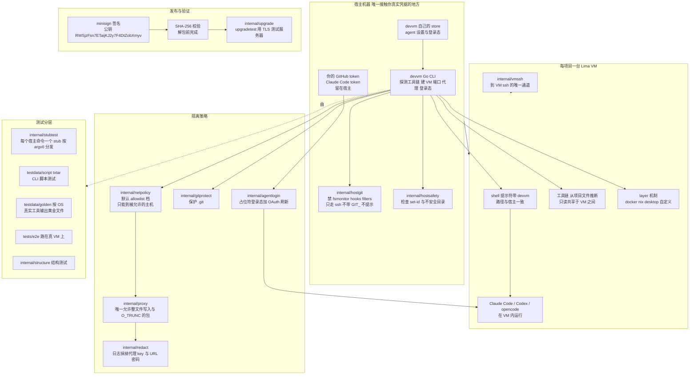

# devvmhq/devvm

## 一句话定位

「每个项目一台 VM」的沙箱工具（Go CLI + Lima 后端），让 coding agent 在一个隔离的、只挂载该项目目录的 VM 里工作。

而它本日最值得记的是：它的 `AGENTS.md` 本身就是一份用自然语言写成的架构契约，而且它把架构规则变成了 CI 会拒绝的代码模式。

## 它解决的问题

让 agent 在你的机器上写代码，有三个层次的风险：

1. **越权** —— agent 读到你的 SSH key、`.env`、浏览器 cookie；
2. **污染** —— agent 改坏你的工作树、`.git` 配置、全局 git hooks；
3. **不可复现** —— 每次运行依赖宿主机上「恰好装了」的工具链。

devvm 的答案是一套组合：每项目一台 VM（只挂载该项目目录，路径与宿主机一致）+ 工具链只读共享（从 base image 复制）+ 网络默认白名单档 + 凭据留在宿主机 + `.git` 保护。

## 为什么值得关注（2026-11-07）

### 一、它把架构原则写成了 lint 规则

`AGENTS.md` 里的原话（节选）：

> `internal/ui/` — **the only package that prints**: `ui.UI` (messages, prompts, status line, run log, cleanups), `ui.Main` (signals); **no package state**
>
> `internal/ports/` — a VM's ports section (forwards asked for, host ports chosen) and **the one allocator of host ports**, under the claims lock
>
> `internal/state/` — every file written whole (`WriteFile`/`WriteFileMode`): **forbidigo bans `os.WriteFile`, `os.Create` and `O_TRUNC` elsewhere but the proxy**
>
> `internal/daemon/` — ... **the only place a process is signalled by pid (forbidigo)**
>
> `internal/vmssh/` — devvm's own over a VM's ssh, on every backend: `Checked`, **the one way to a VM's ssh** ...
>
> `internal/structure/` — the structure test (tests only)

也就是说：「只有 `internal/ui/` 可以打印」「只有 `internal/ports/` 可以分配宿主端口」「除 proxy 外禁止 `os.WriteFile`」这些不是文档里的君子协定，而是**用 forbidigo 这类静态检查写进 lint 规则的硬约束**。

**本日报在所有项目里第一次看到这种做法 —— 把架构原则变成 lint 规则后，违反它的 PR 会在 CI 里直接被拒。**

### 二、它把「宿主主机 git 会被骗」当成一类显式攻击面

`internal/hostgit/` 一条：

> every host git command devvm runs (**no fsmonitor, hooks or filters, ssh only, no `GIT_*` of the environment, no prompts**)

配套的还有 `internal/gitprotect/`（`.git` 保护）与 `internal/hostsafety/`（检查 set-id 文件与不安全目录、跳过 `.git`、处理 SSH origin）。

### 三、网络隔离是分层策略而非开关

> **Network tiers:** new VMs get the **allowlist tier** by default, so they reach only the hosts you allow

实现落在 `internal/netpolicy/` + `internal/proxy/`。

### 四、凭据留在宿主机

> **Secrets stay home:** on every tier, your secrets, such as your GitHub token and Claude Code token, **stay on your machine**.

机制在 `internal/agentlogin/`（把登录态带占位符放进 VM 并做 OAuth 刷新）与 `internal/redact/`（从日志里抹掉代理 key、URL 密码）。

### 五、它主动承认沙箱不是万能的

> **No sandbox closes every gap:** a few habits close most of what devvm can't close on its own, so read Staying safe before you trust a VM with a project.

并给出一个具体的替代路径（`--clone`）：

```sh
devvm --clone                 # make the VM with its own clone, and open a shell in it
git fetch devvm               # later, on this machine, fetch the VM's work as devvm/<branch>
git log -p main..devvm/main   # review it before you merge it
```

**⭐⭐⭐⭐⭐ 这段代码值得单独抄 —— 它把「agent 的产出如何安全地回到我的仓库」写成了三步可操作的动作，而不是一句「请自行审查」。**

### 六、发布是可验证的

> Each release is signed with devvm's minisign key, `RWSjzFsn7ETaijKJ2y7F4DtZobXmyv+LmdclJwZP/KmAkLUwOCzWF/2b`

实现见 `internal/upgrade/`（解包前校验 minisign 的 `ED` 签名与 SHA-256），测试见 `internal/upgrade/upgradetest/`（一个 TLS 测试服务器 + minisign 签名器）。

### 七、测试分层做得极细

| 层次 | 内容 |
|---|---|
| `internal/stubtest/` | 「every host command」一个 stub 二进制，按 `argv[0]` 分发；`stubstate/` 管状态；`stubtest` 把 stub 放到 `PATH` 上 |
| `testdata/script/*.txtar` | CLI 脚本测试 |
| `testdata/golden/<os>/` | 真实工具输出的黄金文件（`mise run e2e -- --golden`） |
| `tests/e2e/` | 跑在真 VM 上（Go `e2e` tag），有 sandbox、slots、locks |
| `internal/structure/` | 结构测试（tests only） |

### 八、最重要的元数据发现 —— `created_at` 陷阱的第三个实例

- `repos/{owner}/{repo}` 的 `created_at` = **2026-11-06T07:02:30Z**
- `commits` API 的 Link 头显示 **共 600 个 commit**
- 最早两个 commit 是 **2026-10-24T07:10:51Z**「build: Go module and devvm entry point」与 **2026-10-24T07:15:29Z**「build: mise tasks, golangci-lint and CI」
- Organization `devvmhq` 确实是 **2026-11-06T06:22:15Z 当天创建**的（3 个公开仓库、2 followers）

即：仓库在 11-06 迁入了一个当天新建的组织，因此**任何按 `created_at` 排序的「今日新项目」榜单都会把一个 13 天历史的工程排到第一**。

这与本日报此前记录的 `mirkobrombin/raven`（改名时间戳）是同一类问题，只是这次叠加了「组织也是当天新建的」这一层。

## 热度来源判断

**⭐⭐⭐⭐ 真实使用信号，但社区信号极薄，本日报记为「基础设施候选」。**

支持「真实」的证据：

- 600 个 commit、完整的测试分层（stubtest / txtar / golden / e2e）、独立的文档站 `devvm.dev`（Hugo + Hextra）、`AGENTS.md` / `CONTRIBUTING.md` / `SECURITY.md` 齐全。
- `pushed_at` 2026-11-06T07:02:30Z，README 里的安装脚本 URL 指向 `releases/latest`，说明发布流程在跑。
- 安装方式（Homebrew tap + install script + `devvm doctor`）与文档结构都指向真实交付。
- `oi` 10 —— 有 issue 在流动，说明有人在用它并提问。

**反向信号**：`subscribers_count` 仅 **1**、forks 仅 **2**（fork/star 1.7%）、contributors **1**。

**⭐⭐⭐⭐⭐ 这是本日最强烈的对比**：farm 那四个仓库是 260–386 个 fork、subs 7–9；这个 116⭐、600 commits 的真实工程只有 **2 个 fork、1 个订阅者**。

**⭐⭐⭐⭐⭐⭐ 这本身就是一个结论：fork 数与 star 数都不是价值指标。** 600 commits + 结构化测试 + lint 级架构约束的项目，在「按热度排序」的榜上几乎不可见。

## 关键技术亮点

1. **⭐⭐⭐⭐⭐ 架构原则 lint 化**：forbidigo 强制「唯一打印包」「唯一端口分配者」「唯一整文件写入点（proxy 除外）」「唯一按 pid 发信号处」。
2. **⭐⭐⭐⭐⭐ 只读共享工具链**：每台 VM 是 base image 的拷贝，工具链在 VM 间只读共享 —— 兼顾隔离与秒级启动。
3. **⭐⭐⭐⭐ 网络分层**：默认 allowlist 档，VM 只能到达被允许的主机。
4. **⭐⭐⭐⭐ 凭据留在宿主机**：GitHub token / Claude Code token 不进 VM；`internal/agentlogin/` 处理带占位符的登录态。
5. **⭐⭐⭐⭐ 宿主 git 加固**：禁 fsmonitor / hooks / filters，只走 ssh，不带环境里的 `GIT_*`，不弹交互提示。
6. **⭐⭐⭐⭐ 发布链可验证**：minisign 签名 + SHA-256 校验，在解包前完成。
7. **⭐⭐⭐⭐ `--clone` 工作流**：agent 在独立 clone 里工作，回宿主后 `git fetch devvm` 再人工 review 合并。
8. **⭐⭐⭐ 工具链自动探测**：从项目文件（`package.json` → node）推断该装什么。
9. **⭐⭐⭐ coding agent 集中管理**：Claude Code / Codex / opencode 在 VM 内运行，设置与登录态存在 devvm 自己的 store 里，`devvm agent import` 可从本机已有 agent 导入。
10. **⭐⭐⭐ `devvm doctor`**：检查本机缺什么并说明怎么补。
11. **⭐⭐⭐ layers 机制**：内置 `docker` / `nix` / `desktop`，也可用 `devvm layer new` 自建。
12. **⭐⭐⭐ 安装脚本会先问**：安装 Lima / QEMU / 访问 `/dev/kvm` 之前都会先询问。
13. **⭐⭐ 结构测试**：`internal/structure/` 专门验证包结构约定。

## 架构师速览

| 决策问题 | 研究判断 | 证据边界 |
|---|---|---|
| 系统边界 | Go CLI（宿主侧）+ 每项目一台 Lima VM；VM 内跑 coding agent；宿主侧负责工具链探测、镜像与层、网络策略、端口分配、凭据代理与登录态注入 | 依据 README 的「What's supported」段、`AGENTS.md` 的包清单、`internal/` 目录结构；**各包实现未逐个读** |
| 主路径 | `cd` 进项目 → `devvm` 读项目文件探测工具链 → 建 VM（首跑构建 base image）→ 在 VM 内开 shell，路径与宿主一致、提示符带 `(devvm)` → agent 在 VM 内工作 → 变更经挂载目录回到宿主（或经 `--clone` 后 `git fetch devvm` 人工合并） | 主路径为 README「Quick start」段的语义抽象；**端口转发、SSH、layer 叠加的具体实现未核验** |
| 关键权衡 | ① **VM 隔离 vs 启动速度**：用 base image 拷贝 + 工具链只读共享换秒级启动；② **挂载宿主目录 vs `--clone`**：前者协作顺手但 agent 能碰到工作树与 `.git`，后者更安全但多一步人工合并；③ **默认网络白名单 vs 便利**：牺牲出网便利换「agent 不能随便联系外部」；④ **架构约定写成文档 vs 写成 lint 规则**：后者增加一点开发摩擦，换来违反即 CI 红 | ① ② ③ 有 README 原文与代码目录直接支撑；④ 是本日报基于 `AGENTS.md` + forbidigo 提及的**解读** |
| 最小 PoC | `curl -fsSL .../install.sh \| bash`（**先验签再执行**，README 给了 minisign 公钥与验签文档）→ `devvm doctor` 确认依赖齐备 → `cd` 到一个只有 `package.json` 的空项目 → `devvm` 建第一台 VM（首跑几分钟建 base image）→ **在 VM 内确认 `pwd` 与宿主一致、提示符带 `(devvm)`** → 起 agent 跑一个只读任务 → 再测 `--clone` 模式下工作树确实未被改动 → 最后把网络档调到更严一档确认白名单生效 | PoC 路径由 README 的 Install / Quick start / `--clone` 三段推导；**本日报未安装、未运行、未建 VM** |
| 证据边界 | **可核验**：GitHub 元数据（600 commits / 1 contributor / 116⭐ / 2 fork / 1 sub / 10 oi / MIT / Go）、README 全文、`AGENTS.md` 引文、commit 时间戳、组织创建时间。**未核验**：`internal/` 各包实现、`docs/` 站点内容、`tests/e2e/` 行为、minisign 签名是否真的覆盖所有发布物、`devvm doctor` 的检查项清单 | **本日报未运行该工具，也未核验任何安全声明的实际有效性** —— 安全产品的自述需要独立验证 |

## 架构启发

**启发一：⭐⭐⭐⭐⭐ 把架构原则写成 lint 规则，而不是写成文档。**

文档是给人读的，规则是给 CI 读的。`AGENTS.md` 里那句「`internal/ui/` 是唯一可以打印的包」如果只写在文档里，半年后总有人加一行 `fmt.Println`；写成 forbidigo 规则，它在 PR 阶段就会被拒。

**⭐⭐⭐⭐⭐ 更值得学的细节是它连「例外」都显式写出来**：「forbidigo bans `os.WriteFile`, `os.Create` and `O_TRUNC` **elsewhere but the proxy**」—— 允许一个明确的例外，但要求例外被写在规则里。

**启发二：⭐⭐⭐⭐⭐ 承认工具的边界，比夸大覆盖范围更有说服力。**

「**No sandbox closes every gap**」这句被放在 README 的卖点段里，紧接着给出 `--clone` 的具体替代路径。**很多安全类项目会选择把限制藏进文档的角落，而 devvm 把它放在最显眼的位置并给出可操作的补救。**

**启发三：⭐⭐⭐⭐⭐ 产出回收路径要写成命令序列。**

`devvm --clone` → `git fetch devvm` → `git log -p main..devvm/main` → 人工合并 —— 三个命令，把「agent 改的东西怎么安全回来」这件事从流程描述变成了可复制的动作。

**启发四：⭐⭐⭐⭐⭐ 「工具链从项目文件推断」是一个好得多的默认值。**

`package.json` 存在 → 装 node。这个规则可预测、可解释、零配置。**⭐⭐⭐⭐ 相比让用户在一堆选项里勾选，隐式推断把「配置」变成了「零」。**

**启发五：⭐⭐⭐⭐⭐ 本档案最大的启发来自元数据 —— `created_at` 会说谎。**

600 个 commit 的项目，因为仓库在 11-06 迁入新组织，`created_at` 就变成了 11-06。**⭐⭐⭐⭐⭐ 这意味着任何按创建时间排序的「今日新项目」榜单，都可能被一次仓库迁移完全污染。** 本日报此前已记录过 `mirkobrombin/raven` 的改名时间戳问题 —— **这是第三个同类案例，而它说明这不是个案，是一个必须默认防御的类别。**

## 架构图（MMD）

> 证据边界：此图只采用本档案已有可核验描述；「待核验」节点不应视为项目实现事实。



## 定位判断

**⭐⭐⭐⭐ 基础设施候选 —— 属于「值得长期跟踪，但今天还不能下生产结论」那一档。**

它的形态很清晰：一个用 Go 写的、把「agent 沙箱」这件事做成了有明确架构契约和分层测试的工程。**⭐⭐⭐⭐ 与本日报记录的其它 agent 沙箱类项目相比，它最突出的是三样东西：架构规则 lint 化、发布可验签、以及主动声明自己关不掉所有缺口。**

**⭐⭐⭐⭐ 它的独特位置在「每项目一台 VM」这个粒度** —— 比容器更重但隔离更彻底（VM 内不共享宿主内核），比整台机器更轻但比进程级隔离更完整。

## 风险 / 局限 / 泡沫点

- **⭐⭐⭐⭐⭐ 社区信号极薄**：116⭐ 但 subs **1**、forks **2**、contributors **1**。**600 commits 的一人项目 —— 巴士因子为 1 是真实风险。**
- **⭐⭐⭐⭐⭐ 所有安全声明均为作者自述**：README 的「Isolated」「Secrets stay home」「No sandbox closes every gap」都未经过本日报独立验证。**⭐⭐⭐⭐ 本日报未运行该工具。**
- **⭐⭐⭐⭐⭐ 它自己承认沙箱有缺口**：README 原文「No sandbox closes every gap」，并要求读者在信任 VM 前先读 Staying safe。**⭐⭐⭐⭐ 这应当被当作限制条件而非免责声明。**
- **⭐⭐⭐⭐⭐ 底层是 Lima**：VM 能力上限就是 Lima 的能力上限。Lima 自身的兼容性、启动耗时与升级节奏会直接传导过来。
- **⭐⭐⭐⭐⭐⭐ `created_at` 具有误导性**：仓库 `created_at` 是 2026-11-06，实际有 600 个 commit、最早 commit 在 2026-10-24。**⭐⭐⭐⭐ 任何以「今日新建」为前提的判断（包括本日报的采集口径）都需要对此类仓库做 commit 时间校验。**
- **⭐⭐⭐⭐ 组织当天新建**：`devvmhq` 创建于 2026-11-06T06:22:15Z，仅 3 个公开仓库、2 followers。**⭐⭐⭐ 新组织 + 一次性迁移的组合，本身就是「项目可能随时消失」的形态。**
- **⭐⭐⭐⭐ `curl ... | bash` 的安装方式**：README 给了 minisign 公钥与单独的验签文档，说明作者意识到了这个问题，**但默认路径仍是管道执行。**
- **⭐⭐⭐ 平台支持不全**：README 明写「Tested on Apple silicon Macs and on Linux on arm64 and x86_64, **but not yet on Intel Macs**」；要求 macOS 13+ 或 Linux + Lima 2.2+。
- **⭐⭐⭐ `oi` 10 但 `subs` 1**：有人在用、有人在问，但没人 watch。
- **⭐⭐ 未核验面大**：`internal/` 全部实现、`docs/` 站点、e2e 行为、签名覆盖面。

## 与同类项目的关系

- **⭐⭐⭐⭐⭐ vs 本日报记录的其它 agent 沙箱类项目**：本日报此前记录过若干以容器或进程隔离为核心的项目。devvm 的差别在**粒度（每项目一 VM）与实现方式（Lima 虚拟化而非容器）**。
- **⭐⭐⭐⭐⭐ vs Docker / Podman 式沙箱**：容器共享宿主内核，`/dev/kvm`、内核模块与系统调用面更宽；VM 隔离更彻底，**代价是资源占用与启动复杂度**。devvm 的「工具链只读共享 + base image 拷贝」正是在补 VM 的启动速度短板。
- **⭐⭐⭐⭐⭐ vs 本日报记录的 farm 簇（91 个带 `git-software.cc` 载荷的仓库）**：那些仓库的 README 教用户**暂停杀毒软件**再执行混淆脚本；devvm 的安装脚本会**在安装 Lima / QEMU / 访问 `/dev/kvm` 之前先询问**，且发布物带 minisign 签名与 SHA-256 校验。**⭐⭐⭐⭐⭐ 两种「让你在本机跑点什么」的伦理姿态完全相反。**
- **⭐⭐⭐⭐ vs `devvm` 生态外的同类产品**（如各类 agent 开发容器）：**本日报未在本窗口调查该方向的其他产品**，因此不对该方向的生态质量下结论。
- **⭐⭐⭐⭐ vs 本日报的 `hermes-voice`（同为生态相邻项目）**：hermes-voice 把「人格归 profile、集成层不接管」作为解耦原则；devvm 把「架构归 lint、文档不背书」作为解耦原则。**⭐⭐⭐⭐ 两者的共同点是：都把规则放在比文档更硬的地方。**

## 是否值得持续跟踪

**⭐⭐⭐⭐ 值得跟踪，理由明确：它是本日「真实工程 vs 农场」对照里最干净的一组样本。**

**⭐⭐⭐⭐⭐ 具体理由**：
1. 它代表了一种可复现的判据 —— **本日报看到 farm 时会想到「600 commits + lint 级架构约束 + 可验签发布」这组特征，作为「真项目」的正向标记**；
2. 它的 `AGENTS.md` 与 lint 规则的组合，是本日报此前从未记录过的架构表达方式，**值得看更多同类案例**；
3. 它的 `created_at` 陷阱案例，可以直接补进本日报的采集口径 —— **下次遇到「今日新建」的仓库，先查 commit 最早时间与组织创建时间**。

**⭐⭐⭐⭐ 具体跟踪方式**：
1. 跟踪 **contributors 是否从 1 增长**（巴士因子）；
2. 跟踪 **`subscribers_count` 是否离开 1**（有没有形成用户群）；
3. 跟踪 **`internal/` 是否继续用 forbidigo 加固更多规则**（架构约束的覆盖面）；
4. 跟踪 **文档站 `devvm.dev` 的内容深度**（本日报未核验）；
5. 跟踪 **Lima 后端之外的第二个后端是否出现**（当前单一后端是单点依赖）。

## 后续观察点

- **⭐⭐⭐⭐⭐ contributors 与 subscribers 是否增长**（当前 1 / 1）；
- **⭐⭐⭐⭐⭐ `AGENTS.md` 里的 forbidigo 规则是否继续增加**；
- **⭐⭐⭐⭐⭐ Lima 之外的第二个后端是否出现**；
- **⭐⭐⭐⭐ `docs/` 站点（`devvm.dev`）的安全章节实际内容** —— 本日报只读到 README 的链接与摘要；
- **⭐⭐⭐⭐ Intel Mac 支持是否补上**（README 明写未测）；
- **⭐⭐⭐ `oi` 的 10 个 issue 是否包含真实的缺陷报告**（而不是安装求助）；
- **⭐⭐⭐ minisign 签名是否覆盖全部发布物**（含 install.sh 与各平台二进制）。

---
> 数据来源: GitHub REST API (2026-11-06T22:00Z 快照区间) | Stars: 116 | Forks: 2 | Subscribers: 1 | Open Issues: 10 | License: MIT | 语言: Go | Commits: 600 | Contributors: 1 | Releases: 1 | 创建(仓库): 2026-11-06T07:02:30Z | 最早 commit: 2026-10-24T07:10:51Z | 组织 devvmhq 创建: 2026-11-06T06:22:15Z
> 本档案未核验项：`internal/` 各包实现、`docs/` 站点内容、`tests/e2e/` 行为、minisign 签名的实际覆盖面、`devvm doctor` 检查项清单、任何安全声明的实际有效性。
> **本日报未安装、未运行该工具。**
