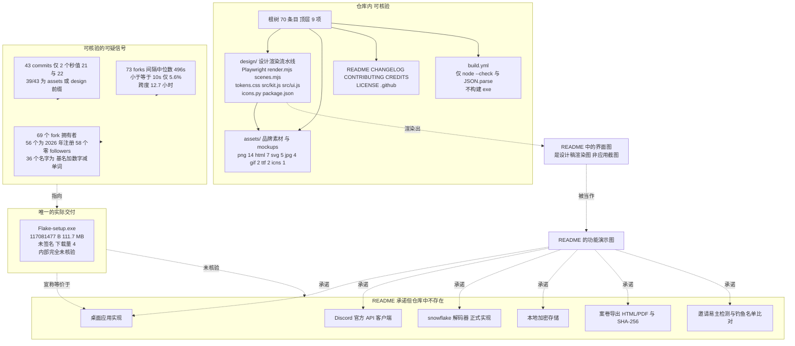

# Tropicaldrescoop/discord-id-osint-checker

## 一句话定位

一个 Windows 桌面 OSINT 应用（产品名 **Flake**）：粘贴 Discord 的用户 / 服务器 / 消息 / 邀请链接，看出它什么时候创建的、它在模仿谁、它把邀请链接引到了哪里。

**而本日报建立这个档案的原因不是推荐它，而是它属于本日发现的第三类形态** —— 既不是 91 个带 `git-software.cc` 载荷的农场，也不是 425–427⭐ 那批只交付 README 的模板壳，而是**一个有完整设计系统与相当诚实的文档、却没有一行应用源码、且 commit 时间戳是合成的**仓库。

## 它解决的问题

Discord 的 ID（snowflake）前 42 位是它的创建时间戳 —— 这件事人人知道，但多数查询站点需要把 ID 上传到它们的服务器，且一次只能查一个。

Flake 的主张是把这个过程搬回本机，并从「查一个日期」升级成「查一个模式」：

- **时间解码完全离线**（日期直接从 ID 算出，不需要联网）；
- **本机保存快照**，与今天的结果并排对比，让改名换头像的变化显形；
- **把可信 ID 存成白名单**，任何查询自动与它们比对，找出「抄名字的」（含西里尔字母等形近字、像素相同头像）；
- **记录邀请链接的变迁**，判断一个 vanity 邀请是不是易主到了钓鱼服（并对照 FishFish 钓鱼名单）；
- **把一批账号画在时间轴上**，突袭（raid）那种「14 个里 11 个在 4 分钟内注册」的簇一眼可见；
- **案卷（case files）** 导出 HTML/PDF，每份快照带 SHA-256 哈希，30 天后自动删除（除非手动保留）。

## 为什么值得关注（2026-11-07）

### 一、它的「不做清单」写得比它的功能清单更完整

README 的「Rules Flake follows」整节：

> - **Official Discord API only**, through a bot you create. Never a user token, never a selfbot, never message content.
> - **One lookup per click.** No bulk crawling, and Discord's rate limits are respected.
> - **Your data stays on your drive**, encrypted, with one button to delete it all. No shared database.
> - **A bot of its own.** Flake works with a personal bot token you create, separate from your community's main bot.

徽章区把同样的约束压缩成四个可扫读的标签：`API official only` / `selfbot never` / `price $0 forever` / `license MIT`。

**⭐⭐⭐⭐⭐ 与本日记录的 farm 簇形成了最尖锐的对照**：那一批仓库的 README 教用户**「暂停 Windows 安全中心的实时保护」再执行一个混淆过的 PowerShell 脚本**；而这个仓库反复强调**「不碰 user token、不做 selfbot、不抓消息内容、一次点击一次查询、遵守 Discord 速率限制」**。

两者都是「在 Discord 生态周边做自动化」，一个在放宽限制，一个在收紧限制。

### 二、⭐⭐⭐⭐⭐ 但仓库里没有任何应用源码

这是本档案最重要的发现，且与 README 的宣称直接冲突。

`git/trees/HEAD?recursive=1` 的**全量** 70 个条目，顶层只有 9 项：

```
.github/  .gitignore  CHANGELOG.md  CONTRIBUTING.md  CREDITS.md
LICENSE   README.md   assets/      design/
```

**扩展名分布**：`png` 14、`html` 7、`md` 5、`svg` 5、`jpg` 4、`yml` 3、`gif` 2、`txt` 2、`ttf` 2、`json` 2、`mjs` 2、`js` 2、`css` 2、`icns` 1、无扩展名 14。

**⭐⭐⭐⭐⭐ 逐项检索结果**：

| 检索项 | 命中 | 实际位置 |
|---|---|---|
| `package.json` | 1 | `design/package.json`（**设计渲染器，不是应用**） |
| `*.py` | 1 | `design/icons.py`（**图标生成脚本**） |
| `*.js` | 4 | `design/package.json`、`design/package-lock.json`、`design/src/kit.js`、`design/src/ui.js` |
| `src/` | 11 | `design/src/*`（**全是 HTML 场景页**） |
| 应用入口 / Electron / Tauri / pyproject | **0** | — |

**`design/package.json` 自述**：`"name": "flake-design"`, `"private": true`, `"description": "Source for Flake brand assets, mockups and README GIFs"`，依赖只有 `playwright` 与 `opentype.js`。

**`design/README.md` 同样自述**：「Everything in `assets/brand`, `assets/mockups` and `assets/readme` renders from this folder.」

**⭐⭐⭐⭐⭐ 也就是说：整个仓库是「README 用的宣传图 + 网页 mockup 的渲染源」，真正的应用只以一个二进制文件存在** —— release `v1.0.0`（2026-11-06T09:01:45Z）唯一的 asset 是 **`Flake-setup.exe`，117,081,477 字节（111.7 MB）**，下载量 **4**。

**⭐⭐⭐⭐⭐ 而 CI 根本不构建这个 exe**。`.github/workflows/build.yml` 全文只有两步：

```yaml
      - run: node --check design/src/ui.js design/src/kit.js
      - run: node -e "JSON.parse(require('fs').readFileSync('design/package.json','utf8')); console.log('package.json ok')"
```

**即：CI 校验的是「设计用的 JS 语法没写错」和「JSON 能解析」，与应用正确性无关。**

**⭐⭐⭐⭐⭐ 而且 README 自己承认了这个交付形态的风险**：

> The build isn't code-signed yet, so SmartScreen may warn you the first time. Choose **More info**, then **Run anyway**.

**「未签名的 111 MB 可执行文件 + 让用户点『仍要运行』」—— 这是一个把整个信任面押在一个不可审计二进制上的交付方式。**

### 三、⭐⭐⭐⭐⭐ commit 时间戳是合成的

43 个 commit 覆盖 2026-08-13 → 2026-10-30（77 天），但**秒字段只有 2 个取值**：

| 秒 | commit 数 |
|---|---|
| `21` | 32 |
| `22` | 11 |

**43/43 的 `author.date` 与 `committer.date` 完全相同**，全部作者为 `Tropicaldrescoop <Tropicaldrescoop@users.noreply.github.com>`。

**⭐⭐⭐⭐⭐ 与同日其它候选的横向对比（本日报新提取的一条判据）**：

| 仓库 | commits | 不同秒值数 | author==committer | commit 时间跨度 |
|---|---:|---:|---:|---|
| `JosssphZhou/poki` | 23 | **20** | 19/23 | 2026-11-05..06 |
| `majorminorlabs/hermes-voice` | 35 | **25** | 35/35 | 2026-11-05..06 |
| `devvmhq/devvm` | 100（首页） | **49** | 98/100 | 2026-11-05..06 |
| `HerdBuilderEstimate/roblox-studio-mcp` | 4 | 4 | 4/4 | 2026-11-06 |
| `Tropicaldrescoop/discord-id-osint-checker` | 43 | **2** | 43/43 | **2026-08-13..10-30** |

**⭐⭐⭐⭐⭐ 真实开发者提交的 commit，秒字段几乎不会重复 —— 43 个 commit 只落在 2 个秒值上，只能是程序生成的。**

**commit 消息也重复**：「assets: icons and the favicon」×11、「assets: mockups and the demo frames」×8、「assets: artwork pass」×5、「assets: banner and social preview」×2 —— 26 个 commit 属于 `assets:` 一个前缀，其余 13 个属于 `design:`，只有 4 个属于 `docs:` / `build:` / `init:`。

**⭐⭐⭐⭐⭐ 也就是说：43 个 commit 里有 39 个是「生成素材」和「生成 mockup」，真正写文档与配置的只有 4 个 —— 这与「应用代码不在仓库里」是同一件事的两面。**

### 四、⭐⭐⭐⭐⭐ 而它的 fork 分布又与 farm 簇不同

73 个 fork 的相邻间隔：**中位数 496 秒（约 8.3 分钟）**、p10 19 秒、p90 1415 秒、**≤10 秒的间隔仅 4/72 = 5.6%**，时间跨度 2026-11-06T09:47:01Z → 22:30:25Z（12.7 小时）。

对照本日报另外三组：

| 仓库 | fork 数 | 间隔中位数 | ≤10s 占比 | 跨度 |
|---|---:|---:|---:|---|
| `roblox-performance-tool`（farm） | 386 | **6 s** | 94.5% | 44 分钟 |
| `roblox-studio-mcp`（farm） | 260 | **5 s** | 96.9% | 27 分 35 秒 |
| `sheeridVerify`（真项目） | 360 | 73 s | 8.9% | 12.5 小时 |
| **`discord-id-osint-checker`** | **73** | **496 s** | **5.6%** | **12.7 小时** |

**⭐⭐⭐⭐⭐ 它的 fork 间隔比真项目的 sheeridVerify 还慢 7 倍 —— 这既不是机器节奏，也不是「有人在认真读代码」的节奏。**

**fork 拥有者账号（69/73 可解析）**：创建年份分布 2023 年 4 个、2024 年 3 个、2025 年 6 个、**2026 年 56 个**；最早 2023-02-24，最晚 2026-11-04（**没有一个是仓库创建之后才注册的**）；公开仓库数中位数 15、最大 44；followers 合计仅 15，**58/69 个账号 followers 为 0**。

**⭐⭐⭐⭐⭐ 账号名里 36/69 匹配「基名+数字-单词」模式**（`abremaria276-design`、`Arafat420-dot`、`ik521149-hub`、`vasiliikotov658-a11y`、`kafitaraf4-cell`…）。

**⭐⭐⭐⭐⭐ 这与 farm 簇的账号画像不同（那边的 fork 拥有者是刚创建的小号），也和「真人自发 fork」不同 —— 更像是「按名单批量建号再逐个 fork」的中间态。**

### 五、它的文档部分确实做得很好（这部分是真的）

**`CREDITS.md` 用一张表逐条列出第三方素材的作者、许可与改动**：

| Used as | Work | Author | License | Changes |
|---|---|---|---|---|
| Avatar | Red fox (48324393191).jpg | PeCeT_full | CC0 | Cropped, resized, metadata removed |
| Avatar | Siamese cat HD.jpg | Aquinassixthway | CC0 | Cropped, resized, metadata removed |
| Server icon | Tabby cat with blue eyes-3336579.jpg | AdinaVoicu | CC0 | Cropped, resized, metadata removed |
| Profile banner | ISS-42 Aurora borealis... | NASA | Public domain | Cropped, resized, metadata removed |

并写明「Each file was checked against its license on Wikimedia Commons on 2026-11-06」「**none of them use Flake or endorse it.**」

**`design/README.md` 的设计方向说明也相当克制**：

> **Discord's own look stays Discord's.** No blurple, no Discord badge art or status icons. The Discord symbol appears unchanged, in white, only to say where data comes from.

**`CHANGELOG.md` 只有三个版本**（v0.1.0 2026-10-21 / v0.9.0 2026-10-30 / v1.0.0 2026-11-06），且 v0.9.0 只写「Interface direction, brand and mockups」—— **即在 v1.0.0 之前没有功能代码进过仓库。**

**⭐⭐⭐⭐⭐ 所以本日报的判断是：这不是一个「造假项目」，而是一个把「品牌与界面」做得很认真、把「产品」完全放在仓库之外的项目。** 文档、素材许可、设计方向都是真做的；唯独 README 承诺的那台桌面应用不存在可审计的实现。

## 热度来源判断

**⭐⭐⭐⭐ 热度来源可疑，但本日报不把它判定为恶意 —— 本日报记录的是「形态」。**

支持「可疑」的可核验事实：

1. **43 个 commit 只落在 2 个秒值上**（对照 poki 20、hermes-voice 25、devvm 49）；
2. **仓库里没有应用源码**，只有 111.7 MB 的未签名二进制；
3. **CI 不构建该二进制**，只检查设计用的 JS 语法；
4. **fork 间隔中位数 496 秒**（既不像 farm 的 5–6 秒，也不像真人的 73 秒），且 fork 拥有者 56/69 是 2026 年注册、58/69 followers 为 0、36/69 的账号名是「基名+数字-单词」；
5. **README 承诺的界面全部是 `design/` 下的静态 HTML mockup** —— 也就是说，那些截图**不是这个应用的真实截图**，而是设计稿渲染出来的效果图。

**⭐⭐⭐⭐⭐ 反对「恶意」判断的理由（必须一并记录）**：

- 文档质量、素材许可标注、设计规范与免责声明都**异常地认真**，与 farm 簇（README 只有一段话 + 一条载荷指令）形态完全不同；
- `design/` 下的渲染流水线（Playwright + `render.mjs` + `scenes.mjs` + `tokens.css`）是**真实可运行的工程**，不是空壳；
- 111.7 MB 的单文件 Windows 应用（免安装、无需管理员权限）确实是 Electron/Tauri 类打包的合理体量；
- fork 拥有者有相当一部分是 2023–2025 年的老账号，不是全新小号。

**⭐⭐⭐⭐ 因此本日报的定性是：「来源不明、无法核验的二进制交付 + 合成的提交历史 + 疑似协调的 fork 分布」，而不「恶意软件」或「刷 star 农场」。**

**⭐⭐⭐⭐ 有一件事本日报无法核验，也没有尝试核验**：`Flake-setup.exe` 的实际内容。本日报未下载、未运行、未静态分析该二进制 —— 只记录了它的体积、下载量与 README 对它的描述。

## 关键技术亮点

1. **⭐⭐⭐⭐⭐ 「不做」被写成硬规则**：官方 API only / never user token / never selfbot / never message content / one lookup per click / 遵守速率限制 / 数据留在本机 / 用自己的 bot。
2. **⭐⭐⭐⭐⭐ 离线时间解码**：snowflake 的 42 位时间戳在本地解析，不需要联网即可得到创建时间。
3. **⭐⭐⭐⭐⭐ 快照对比**：本机保存上一次的结果并排展示，让改名/换头像显形。
4. **⭐⭐⭐⭐ 形近字与同头像检测**：把可信 ID 存成白名单，自动比对「抄名」的模式。
5. **⭐⭐⭐⭐ 邀请易主检测**：记录邀请链接的变迁 + 服务器真实年龄 + 邀请者年龄 + 对照钓鱼名单。
6. **⭐⭐⭐⭐ 突袭时间轴**：把一批账号的创建时间画在一起并高亮聚集带。
7. **⭐⭐⭐⭐ 证据保全**：案卷导出 HTML/PDF，每份快照带 SHA-256 哈希；30 天自动删除。
8. **⭐⭐⭐⭐ 素材许可逐条标注**：`CREDITS.md` 表格含作者、许可、来源链接与具体改动。
9. **⭐⭐⭐⭐ 设计规范成文**：`design/README.md` 记录了「ID 为主角」「黄色是荧光笔」「Discord 的样子归 Discord」等可执行的设计原则。
10. **⭐⭐⭐ 单文件免安装发布**：`Flake-setup.exe`，无需安装器、无需管理员权限。
11. **⭐⭐⭐ 图标生成脚本化**：`design/icons.py`（需 Python + Pillow）把图标生成纳入流水线。
12. **⭐⭐ 徽章化约束**：`API official only` / `selfbot never` / `$0 forever` / `MIT` 四个徽章让约束在 README 顶部即可见。

## 架构师速览

| 决策问题 | 研究判断 | 证据边界 |
|---|---|---|
| 系统边界 | **可核验的边界只有两块**：① `design/` —— 一个用 Playwright 渲染品牌素材与 mockup 的构建流水线；② `Flake-setup.exe` —— 一个 111.7 MB 的未签名 Windows 单文件应用，**其内部结构本日报完全未核验**。仓库内**不存在**桌面应用、Discord API 客户端、snowflake 解码器、加密存储或案卷导出等任何实现代码 | 依据 `git/trees/HEAD?recursive=1` 全量 70 条目、逐文件检索、release 资产清单、`design/package.json` 与 `design/README.md` 全文；**exe 内部未核验** |
| 主路径 | **无法从仓库还原**。README 描述的路径是「粘贴 ID → 本地解时间戳 → 用 bot token 调 Discord API 取公开资料 → 与已存 ID/邀请/钓鱼名单比对 → 更新快照 → 写案卷」，但除第一步（解时间戳，在 `design/src/kit.js` 中有样例实现）外，其余环节都只存在于 README 文本里 | README「How it works」三步 + `design/README.md` 的「`src/kit.js` decodes snowflakes and holds the sample people and servers」；**主路径未实现于仓库** |
| 关键权衡 | ① **功能 vs 隐私**：选本机 + 自建 bot，牺牲「一次查一百个」的便利；② **自动化 vs 人机边界**：把真人验证之外的一切都自动化，但坚持不碰 user token；③ **可审计性 vs 交付便利**：选单文件免安装 exe，牺牲可审计性与代码签名；④ **mockup vs 真机截图**：README 的界面图是设计稿渲染图而非应用截图，牺牲了「所见即所得」的诚实度 | ①② 有 README 原文直接支撑；③ 由「未签名 + 提示绕过 SmartScreen + 仓库无源码」三项事实推导；④ 由 `design/` 结构与 `assets/mockups` 命名推导 —— **这四条是本日报的解读，项目未如此陈述动机** |
| 最小 PoC | **不要先跑那个 exe**。先做可核验的部分：① 读 `design/src/kit.js` 确认 snowflake 解码逻辑（这部分在仓库里）；② 核对 `CREDITS.md` 里每个素材的许可与改动声明；③ 若要验证应用本身，先看 exe 的签名状态、文件哈希与 VirusTotal 类记录，再考虑在隔离环境里运行 —— **但本日报明确不建议在开发机直接运行一个未签名的 111 MB 二进制** | PoC 顺序由「仓库内可核验的部分优先 + 二进制不可审计」推导；**本日报未下载、未运行、未静态分析该 exe** |
| 证据边界 | **可核验**：GitHub 元数据、70 条全量根树、逐文件检索结果、43 个 commit 的时间戳与消息、`build.yml` 全文、`design/package.json` 与 `design/README.md` 全文、`CREDITS.md` 全文、`CHANGELOG.md` 全文、release 资产清单、73 个 fork 的时间分布、69 个 fork 拥有者的账号档案。**未核验**：`Flake-setup.exe` 的内容与行为、任何安全声明的实际有效性、README 描述的功能是否真的存在、作者身份 | **本日报不对该应用的安全性、合法性或实际功能作任何判断** |

## 架构启发

**启发一：⭐⭐⭐⭐⭐ commit 时间戳的「秒字段熵」是一条几乎零成本的判据。**

43 个 commit 只落在 2 个秒值上，而同期真项目是 20–49 个不同秒值。**这条判据只需要一次 API 调用（`repos/{owner}/{repo}/commits`），却能立刻区分「真人写的历史」与「程序生成的历史」。**

**⭐⭐⭐⭐⭐ 它比读 README 可靠，因为 README 是作者可控的，而 commit 时间戳通常不是作者会想到去伪造的字段**（本仓库显然伪造了，但大多数仓库不会有意识去做这件事）。

**启发二：⭐⭐⭐⭐⭐ 「mockup 渲染流水线」是一类值得单独识别的仓库形态。**

本仓库的 43 个 commit 里 39 个是「生成素材」。**⭐⭐⭐⭐⭐ 它的技术实质是：作者把「产品界面」当作一件作品来做，而把「产品」本身留在了别处。** 这类仓库在按 star 排序的榜单上无法与真项目区分 —— **必须去看根树里有没有应用入口。**

**启发三：⭐⭐⭐⭐⭐ 「文档做得很认真」不能当作真实性证据。**

`CREDITS.md` 的表格、免责声明、设计规范、CHANGELOG —— 全部是**作者可控的表面**。**⭐⭐⭐⭐⭐ 而 111.7 MB 未签名二进制 + 零应用源码 + 合成 commit 时间戳，是**机器可读的事实**。** 本日报记录的教训是：**评价一个仓库时，优先采信可机器核验的结构性事实，而不是读起来很专业的文档。**

**启发四：⭐⭐⭐⭐⭐ fork 间隔的「中位数」与「≤10 秒占比」两个数，比 fork 总数信息量高一个数量级。**

本日四个仓库的对照：5 秒 / 6 秒 / 73 秒 / 496 秒。**⭐⭐⭐⭐⭐ 如果只记录 fork 总数（386 / 260 / 360 / 73），会得到一个完全误导的排序。**

**启发五：⭐⭐⭐⭐⭐ 中间态是常态 —— 不是「真项目 / 农场」二选一。**

本日实测到 496 秒这个中间值。**⭐⭐⭐⭐⭐ 它既不是脚本的 5 秒，也不是人的 73 秒。** **本日报因此把判据从二分类改成连续读数**（间隔中位数 + ≤10s 占比 + 账号年龄分布 + 秒字段熵），而不是给每个仓库贴一个「真/假」标签。

## 架构图（MMD）

> 证据边界：此图只采用本档案已有可核验描述；「待核验」节点不应视为项目实现事实。



## 定位判断

**⭐⭐⭐⭐ 观察型项目 —— 本日报明确不推荐、不使用、不作为依赖。**

它在今日的生态位置是：**一个占据了 star 榜单位置、但其可核验交付物是一个不可审计二进制的项目。**

**⭐⭐⭐⭐ 但本日报不把它与 farm 簇并列 —— 两者在形态上有本质区别**：

| 维度 | farm 簇（91 个载荷仓库 / 4 个模板壳） | `discord-id-osint-checker` |
|---|---|---|
| README 承诺 | 伪造功能（10 个 MCP 工具交付 0 个） | 真实功能（但不在仓库里） |
| 载荷 | 91/95 含 `irm ... \| Invoke-Expression` | 无 |
| 文档质量 | 极低（模板复制） | 高（许可表、设计规范、免责声明） |
| commit 真实性 | 4 个 commit / 20 秒内 | 43 个 commit / 秒字段合成 |
| fork 节奏 | 5–6 秒中位数 | 496 秒中位数 |

**⭐⭐⭐⭐ 即：farm 簇是「用一个假的承诺换点击」，而这个项目是「用真的设计工作换点击，但把产品本体排除在可审计范围之外」。**

**⭐⭐⭐⭐ 它的独特价值在于作为一条新判据的来源** —— 「秒字段熵 + 根树里有没有应用入口 + CI 构建什么」这三条，本日报此前没有。

## 风险 / 局限 / 泡沫点

- **⭐⭐⭐⭐⭐ 应用完全不可审计**：仓库无源码，交付物是 111.7 MB 未签名 exe。**本日报未下载、未运行、未静态分析该文件。**
- **⭐⭐⭐⭐⭐ README 里的界面图是设计稿渲染图，不是应用真实截图** —— 读者若据它形成产品预期，与实际行为之间存在不可核验的落差。
- **⭐⭐⭐⭐⭐ commit 历史是合成的**（43 个 commit 只落在 2 个秒值上），因此**「77 天的持续开发」这一印象不成立**。
- **⭐⭐⭐⭐ 未签名 + 提示绕过 SmartScreen**：「Choose More info, then Run anyway」是一个不应被复制的交付范式。
- **⭐⭐⭐⭐ fork 分布可疑但非典型机器节奏**：496 秒中位数、56/69 个 2026 年新号、58/69 零 followers、36/69 名字呈「基名+数字-单词」模式。**本日报不判断这是否由某个组织协调。**
- **⭐⭐⭐⭐ `subs` 0 / `oi` 0 / `contributors` 1**：没有任何外部用户提交反馈。
- **⭐⭐⭐ Owner 只有一个仓库、followers 0、账号建于 2026-08-15**：项目与个人绑定，单点依赖。
- **⭐⭐⭐ 平台锁定**：Windows 单文件（README 明写「The Windows build is a single `Flake-setup.exe`」），macOS / Linux 未见支持。
- **⭐⭐ 二进制体积与「免安装」的取舍未核验**：111.7 MB 对应 Electron 类打包是合理的，但具体技术栈与依赖清单本日报未知，**也就无从做 SBOM 或供应链审查**。
- **⭐⭐ `language` 字段是 HTML** —— 因为仓库里真的只有 HTML / CSS / JS mockup。

## 与同类项目的关系

- **⭐⭐⭐⭐⭐ vs 本日的载荷 farm 簇（91 个带 `git-software.cc` 的仓库）**：那一批教用户**暂停杀毒实时保护**再执行混淆脚本；这个项目 README 反复强调**不碰 user token、不做 selfbot、不抓消息内容**。**⭐⭐⭐⭐⭐ 两种「在 Discord 生态周边做自动化」的伦理姿态完全相反。**
- **⭐⭐⭐⭐⭐ vs 本日报的 `sheeridVerify`（同日对照样本）**：两者都在本地工作台里操作第三方平台的流程，也都把「不做」写成硬规则（不生成证明材料、真人验证交给用户）。**⭐⭐⭐⭐⭐ 但 sheeridVerify 有 19 个源文件、真实 CI、模拟接口测试，且 fork 间隔 73 秒、账号年龄跨 11 年 —— 它是本日报的「真项目」基准线。**
- **⭐⭐⭐⭐ vs 本日报的 `roblox-studio-mcp`（同日反例）**：那个仓库承诺 10 个工具交付 0 个；这个仓库承诺的是真实功能、但把功能整体移出仓库。**⭐⭐⭐⭐ 两者都属于「README 与可核验内容不一致」，只是错法相反。**
- **⭐⭐⭐⭐ vs 本日报的 `vork` / `poki` / `hermes-voice`**：这三个项目都把「不能确定的部分」写进自己的输出（许可声明 / 验证文档 / 决策记录）。**⭐⭐⭐⭐⭐ 而 Flake 的 README 在伦理约束上同样明确 —— 它的文档质量其实和这三个项目在同一水准，缺的只是「把实现放进来」。**
- **⭐⭐⭐⭐ vs Discord 官方 API**：Flake 明确只走官方 API、只取公开信息。**本日报未核验其具体调用了什么端点、取了哪些字段。**

## 是否值得持续跟踪

**⭐⭐⭐ 值得跟踪，但跟踪目标明确：这是一份「待核验样本」，不是一份产品评估。**

**理由**：它是本日唯一一个「文档质量高、交付不可核验」的形态，而**这种形态此前不在本日报的判据体系里**。价值在于把判据补齐。

**⭐⭐⭐ 具体跟踪方式**：
1. 跟踪 **`Flake-setup.exe` 是否开始提供代码签名**（签名是可核验的客观改善）；
2. 跟踪 **仓库是否出现应用源码或至少一个可运行的构建脚本**（这是最关键的一条）；
3. 跟踪 **`subscribers_count` 是否离开 0**（有没有真实用户）；
4. 跟踪 **`build.yml` 是否开始构建并上传 exe**（CI 覆盖交付物是可信度分水岭）；
5. 跟踪 **fork 间隔中位数是否继续在数百秒量级**（若降到个位数，说明有新一波机器流量）；
6. 跟踪 **是否出现新的同类仓库**（有完整 `design/` 但无应用源码），**这直接衡量该形态是否在扩散**。

## 后续观察点

- **⭐⭐⭐⭐⭐ 仓库是否补上应用源码或可复现的构建流程**；
- **⭐⭐⭐⭐⭐ `Flake-setup.exe` 的代码签名状态**；
- **⭐⭐⭐⭐⭐ `build.yml` 是否覆盖 exe 的构建与上传**；
- **⭐⭐⭐⭐ `subscribers_count`（现为 0）与 `oi`（现为 0）是否变化**；
- **⭐⭐⭐⭐ README 的界面图是否标注为「设计稿」而非应用截图**；
- **⭐⭐⭐ `Flake-setup.exe` 的实际内容与行为**（本日报未核验，需在隔离环境中进行）；
- **⭐⭐⭐ 是否有 macOS / Linux 版本**；
- **⭐⭐⭐ `CREDITS.md` 中的素材链接是否仍然有效**（四个素材都来自 Wikimedia Commons）。

---
> 数据来源: GitHub REST API (2026-11-06T22:00Z 快照区间) | Stars: 329 | Forks: 73 | Subscribers: 0 | Open Issues: 0 | License: MIT | language 字段: HTML | 体积: 3172 KB | Commits: 43 | Blobs: 58 | Contributors: 1 | Releases: 1 (asset: Flake-setup.exe 117,081,477 B, downloads 4) | 仓库创建: 2026-11-06T08:59:05Z | 最后推送: 2026-11-06T09:00:04Z | Owner: User Tropicaldrescoop (创建于 2026-08-15T02:46:47Z, 1 个公开仓库, 0 followers)
> commit 时间跨度: 2026-08-13T22:53:21Z → 2026-10-30T12:13:22Z（77 天），**秒字段仅 2 个取值（21 与 22）**。
> fork 时间跨度: 2026-11-06T09:47:01Z → 2026-11-06T22:30:25Z，间隔中位数 496 s，≤10 s 占比 5.6%。
> **本档案未核验项：`Flake-setup.exe` 的内容、行为与依赖（本日报未下载、未运行、未静态分析）；README 描述的任何功能；任何安全声明的实际有效性。**
> **本日报不判定该仓库为恶意，也不判定其作者意图；仅记录可核验的形态事实与由此得到的判据。**
