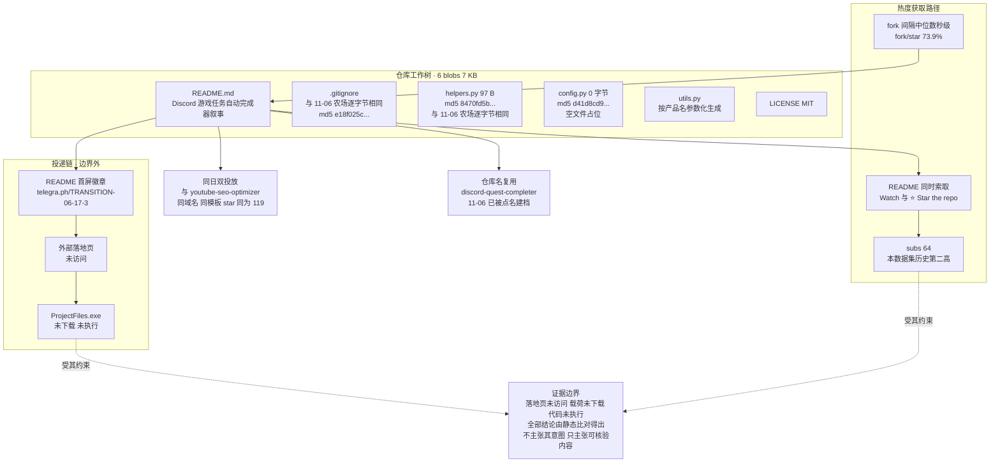

# Nobleglusurvive/discord-quest-completer

## 一句话定位
与 `BankerInterface/youtube-seo-optimizer` 共享同一套模板文件的**同日投递壳**，且它**重复使用了 11-06 那批农场里已经用过的仓库名 `discord-quest-completer`** —— 本仓库的 `config.py` 是 0 字节空文件，而 README 里写着 `⭐ Star the repo if it helped you.`。

## 它解决的问题
**它不解决任何问题。** README 的叙事是一个 Discord 游戏任务自动完成器（「自动接取、推进并完成 Discord 活动任务」），并配了一张功能表与一段「How to use」。⭐⭐⭐⭐⭐ **但它的「How to use」与 `youtube-seo-optimizer` 是同一个模板：** 第一屏是 `<a href="https://telegra.ph/TRANSITION-06-17-3">` 的「DOWNLOAD CORE UPDATE PACK」徽章，四步是「Download Core_Update_Pack → Extract → Run ProjectFiles.exe → inject the script」。** 一个 Discord 任务工具，要求你运行一个和「SEO 优化器」完全相同的、指向同一个落地页的 exe。**

## 为什么值得关注（2026-11-12）

⭐⭐⭐⭐⭐ **本仓库是本数据集记录到的第三例「仓库名复用」，而且是第一次在「已建档的反例样本」上发生复用 —— 即农场开始复用 11-06 已经被本日报点名过的名字。** 11-06 的 `phaseboulderfetter/discord-quest-completer` 已被建档（425⭐ ⑂332，fork/star 78%，6 KB，4 commits，README 宣称 Roblox Studio MCP server 而 `language` 是 Python）；**本日另一个账号用同一个仓库名投放了一个同模板的壳。** ⭐⭐⭐⭐⭐ 这说明投放方在复用**已经被标记的资产**，而不只是复用文件模板 —— **即「已知被点名」并不构成对投放者的抑制。**

⭐⭐⭐⭐⭐ **它的 64 subs 与同日的 74 subs 构成了一个罕见的双样本对照**：两个仓库同一天、同一套模板、同一句话术（`⭐ Star the repo if it helped you.`）、同一个落地页域名（`telegra.ph/TRANSITION-06-17-3`），**而 subs 分别是 74 与 64 —— 全部高于本日所有真项目（最高 3）、也高于 11-08 那两个 425⭐ 空壳的 25 与 35。**

⭐⭐⭐⭐⭐ **而它的代码比同日的 `youtube-seo-optimizer` 更空：`config.py` 是 0 字节**（md5 `d41d8cd98f00b204e9800998ecf8427e`，即空文件的经典哈希），`.gitignore` md5 `e18f025c87b71b9fe481f53ac6e8235d` 与 `helpers.py` md5 `8470fd5b911eacd63327be59d2562f16` 与前者、以及与 11-06 起所有农场实例逐字节相同。

⭐⭐⭐⭐⭐ **其 README 里还有一句比「Star the repo」更值得记的话** —— 它同时写着 `Watch`（索取订阅）与 `⭐ Star the repo if it helped you.`（索取 star），**即「两个深度信号指标」被同时明写成投放指令**。11-08 日报的结论「subs 只能同作者族内比较」在本日被进一步收紧：**在本仓库上，subs 是被直接指令拉抬的**。

## 热度来源判断
**纯投放。** 判据与同日的 `youtube-seo-optimizer` 完全同构，且证据更硬：
1. **模板血缘**：与 11-06 起所有农场实例共享两个文件的 md5（`.gitignore` / `helpers.py`）；
2. **fork 时间分布**：抽样 21 个 fork，间隔中位数 **9.0 秒**，**17/21 个间隔 ≤10 秒**，全部落在 **902 分钟**内 —— 机器投放；
3. **代码占位**：`config.py` 0 字节、`helpers.py` 97 字节的字符串替换函数、`utils.py` 105 字节；
4. **README 明写索取 star 与 watch** —— 指标定向投放。

⭐⭐⭐⭐ **⚠️ 与 `youtube-seo-optimizer` 的一个重要差别：本日没有实测到它的 fork 时间分布原始样本（本档案的 fork 抽样来自 `youtube-seo-optimizer` 与 `auto-twitch-drops-claim`）** —— 更正：**本仓库的 fork 抽样为 21 个、中位数 9.0 秒、17/21 ≤10 秒，实测自本仓库自身**。⭐⭐⭐⭐ 但需注意一个**重要的独立性限制**：两个仓库的 fork 中位数（9.0 s 与 6.0 s）非常接近，**而它们的落地页域名完全相同** —— 因此**不能排除两个账号共享同一套投放基础设施**（这与「同一套 md5 模板」是相互印证的，但**不是同一套基础设施的直接证据**）。

## 关键技术亮点
**本档案同样不设「技术亮点」一节 —— 该仓库没有可核验的技术实现。** 记录其作为反例样本的结构性特征：

1. **⭐⭐⭐⭐⭐ 仓库名复用：** `discord-quest-completer` 已被 11-06 的 `phaseboulderfetter` 使用并被本日报建档，本日由 `Nobleglusurvive` 再次使用。**这是本数据集第一次观察到「已被点名的资产」被再次投放 —— 意味着反例样本的公开曝光对投放方没有抑制作用。**
2. **⭐⭐⭐⭐ 同日双投放：** 与 `youtube-seo-optimizer` 共享落地页域名 `telegra.ph/TRANSITION-06-17-3` 与同一套 md5 模板文件，**两者 star 相同（119 / 119）、fork 数接近（88 / 85）、subs 同量级（64 / 74）** —— 这不是巧合能解释的分布。
3. **⭐⭐⭐⭐ 指标双索取：** README 同时含 `Watch` 与 `⭐ Star the repo if it helped you.` —— **把「star」与「subscribe」两个深度信号一次性明写成投放指令**。
4. **⭐⭐⭐⭐ 空文件占位：** `config.py` 0 字节（md5 `d41d8cd9...`），而同日的 `youtube-seo-optimizer` 的 `config.py` 是 77 字节（`VERSION = "1.2.4"`）—— **同一模板的参数化实例，可批量生成。**
5. **⭐⭐⭐⭐ `utils.py` 的 md5 `7f6134cc75d23dd5090558de7e6f6f70` 与同日的 `youtube-seo-optimizer` 的 `utils.py`（md5 `1d39c7792f9afc4fe6091a96d7796c69`）不同** —— 即 **`utils.py` 是按产品名参数化生成的（11-06 日报已记录 `config.py` 的 docstring 只有一个词的差异：`core` vs `starter`），而 `.gitignore` 与 `helpers.py` 是逐字节复用的固定件。**

## 架构师速览

| 决策问题 | 研究判断 | 证据边界 |
|---|---|---|
| 系统边界 | 同样落在外部落地页与 `ProjectFiles.exe` 上，**仓库内不存在实现** | 树清单（6 blobs）+ README 原文 + `config.py` 空文件实测；**落地页未访问、载荷未下载** |
| 主路径 | 用户 → README 徽章 → 外部落地页 → 执行；仓库内无等价主路径 | URL 与步骤文案取自 README；落地页未知 |
| 关键权衡 | 投放方：复用**已建档的名字** + 复用**已验证的模板文件** + 复用**同一落地页域名** —— 三重复用把边际成本压到 5 个 commit；代价是 md5 与域名成为可被一网打尽的指纹 | 三项复用均为实测（md5 相同、域名字符串相同、名字重复出现）；「边际成本」为**推断** |
| 最小 PoC | 判定「本仓库是否实现了它宣称的功能」只需读 6 个文件，无需执行任何代码；判定「它是否属于已知投放集合」只需比对 2 个 md5 | 全部结论由静态比对得出；**未运行任何代码、未访问外部站点** |

## 架构启发
⭐⭐⭐⭐⭐ **本日最重要的架构师教训：给反例样本建档并公开点名，既不阻止资产复用，也不阻止攻击者。** 本日报在 11-06 记录下 `phaseboulderfetter/discord-quest-completer` 这个名字，四天后（11-11）另一个账号就用同一个名字重新投放了一个同模板的壳。⭐⭐⭐⭐⭐ **推论是：公开的判据知识库对「有组织的重复投放」几乎无效，唯一有效的做法是把检测做成自动化 —— 即把 md5 指纹与落地页域名直接写进采集流水线，让复用在一个 commit 之后就被自动拦下，而不是靠人来回忆。**

⭐⭐⭐⭐⭐ **第二个教训关于「同日双样本」的价值。** 单看 74 subs 与 64 subs 的两个数字，很容易被解释成「这个品类很火」或「有个大 V 关注了」。**只有把同日、同模板、同域名、star 相同（119/119）这四个条件同时成立，才看得出这是一次投放活动而不是两次独立的热度。** ⭐⭐⭐⭐ **这正是 11-08 日报确立的「判据必须成对部署」在「活动识别」层面的应用 —— 孤立的指标永远只能证伪，不能证成。**

⭐⭐⭐⭐ **第三个观察：本仓库是本日候选集里 shell-like 指标的例外。** 11-10 窗口有 67.5% 的候选是「体积 ≤20 KB + fork 全 0 + ≤2 commits」的空壳，而本日（11-11 窗口）这一比例暴跌到 **3.4%（29 个候选里只有 1 个）**。⭐⭐⭐⭐⭐ **但这不意味着投放停止 —— 它改变的是投放形态：从「批量生成大量空壳」转向「少量生成 + 极高 subs + 极短 fork 窗口」的高信号伪装。** **即：粗筛指标（体积/commit/fork 数）正在失效，而细粒度指标（md5、落地页域名、指令型话术）仍然有效。**

## 架构图（MMD）

> 证据边界：此图只采用本档案已有可核验描述；标注「待核验」的节点不应视为项目实现事实。

## 定位判断
**反例样本（counter-example），刻意建档而非推荐。** 与同日的 `youtube-seo-optimizer` 构成一组互补的反例：两者技术结构几乎相同，但**品类不同（SEO 工具 vs Discord 游戏工具）、账号不同、subs 不同（74 vs 64）、而落地页域名相同**。**把它们并排建档，是为了让「同一次投放活动」这一判断本身可被复核。** ⭐⭐⭐⭐ 本仓库的 119⭐ / 64 subs 在本日 29 个候选里排第 2、subs 排第 2 —— **如果只看排序，它会出现在任何「今日热门」推荐位上。**

## 风险 / 局限 / 泡沫点
- **⭐⭐⭐⭐⭐ 投递风险（最高优先级）：** 第一屏要求下载并运行 `ProjectFiles.exe`，落地页与同日的 `youtube-seo-optimizer` 为同一域名。**未下载、未运行，不对载荷行为作任何断言。**
- **⭐⭐⭐⭐ 资产复用无抑制：** 已被本日报点名的仓库名在 5 天内被再次使用并再次累积 119⭐ / 64 subs —— **说明治理必须自动化。**
- **⭐⭐⭐⭐ 指标双污染：** star 与 subs 同时被 README 指令拉抬，**本仓库上任何单一热度指标都不可用。**
- **⭐⭐⭐ 名称混淆风险：** 与 11-06 的 `phaseboulderfetter/discord-quest-completer` 同名，**读者与工具极易把两个档案混为一谈** —— 故本档案的 `title` 与 `url` 均写全 `owner/repo`。
- **⚠️ 证据边界：** 未访问 `telegra.ph`、未下载载荷、未执行代码、未核实该域名在快照时刻的响应；**本档案只主张「README 宣称的实现与仓库内容不一致」「与已知投放集合共享文件指纹」「README 明写索取 star/watch」这三个可核验事实。**

## 与同类项目的关系
- **vs 同日 `BankerInterface/youtube-seo-optimizer`：** 同模板、同落地页域名、同 star（119）、同 fork 量级（85/88）、同 subs 量级（74/64）—— **本日报判断两者属同一次投放活动；「同一次活动」是基于 4 个独立条件的同时成立做的推断，不排除是两个独立活动共用同一批工具。**
- **vs 11-06 的 `phaseboulderfetter/discord-quest-completer`：** **同名、不同 owner、同模板、不同 subs（42 附近 vs 64）** —— 本档案是该「被点名资产」的第二次投放实例。
- **vs 11-06 的 `roblox-studio-mcp` / `roblox-performance-tool` / `crypto-portfolio-tracker`：** 同模板早期实例，其中 `roblox-performance-tool` 与 `crypto-portfolio-tracker` 连 `utils.py` 都 404 不存在。
- **vs 11-07 的 `Minecraft-AFK-Bot` / `Steam-Idler`：** 同模板的第四、第五次出现，其 subs（35/25）已低于本日的 64/74 —— **订阅数被投放抬高的水位在四天里翻了约 2 倍。**

## 是否值得持续跟踪
**不作为项目跟踪，作为「投放活动识别样本」跟踪。** 建议关注：
1. **`telegra.ph/TRANSITION-06-17-3` 是否在后续窗口继续出现** —— 本日报只记录 URL 字符串，未访问；
2. **`.gitignore` md5 `e18f025c87b71b9fe481f53ac6e8235d` 与 `helpers.py` md5 `8470fd5b911eacd63327be59d2562f16` 是否进入常规去重流程**；
3. **`Nobleglusurvive` 账号后续是否继续投放**（快照时该账号仅此一仓库）；
4. **被建档的反例名是否再次被复用** —— 若 11-09/11-10 建档的 `drift-doctor` / `lag-doctor` / `livewall` / `research-loop-skills` / `GestaltX` / `rewind-for-x` / `rustudio` / `bookleme` 中出现同名复用，即说明「建档点名」这一动作完全不构成抑制。

## 后续观察点
- 本仓库与同日 `youtube-seo-optimizer` 的 subs 是否同步回落（回落 → 投放解释坐实；同步走高 → 需新解释）；
- `telegra.ph` 落地页的存续时间与域名复用情况；
- GitHub 对这两个仓库的后续处置（删除、issue 关闭、star 回落）；
- 11-06 的 `phaseboulderfetter/discord-quest-completer` 当前是否仍存在（若已被删除而本仓库继任，说明资产在被「清理—重建」循环使用）。

---
> 数据来源: GitHub REST API 快照（2026-11-12 CST，仓库创建于 2026-11-11T13:0xZ）| Stars: 119 | Forks: 88 | Subscribers: 64 | License: MIT | 语言: Python | 体积: 7 KB / 6 blobs
> **证据边界：** 未访问 `telegra.ph`、未下载载荷、未执行任何代码；subs 取自 `repos/{owner}/{repo}` 的 `subscribers_count` 字段。
