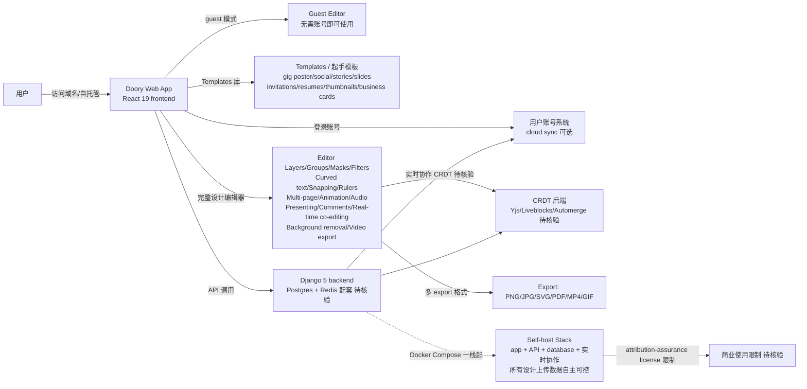

# shaongitbd/doory

## 一句话定位
Doory 是一个浏览器内运行的全功能设计编辑器——海报、社交贴文、story、slides、邀请函、简历、缩略图、名片均可制作并导出 PNG/JPG/SVG/PDF/MP4/GIF；同时支持 Docker Compose 一栈起自托管（前端 React 19 + 后端 Django 5 + 实时协作 CRDT），所有功能免费、无需账号、无水印、无广告。

## 它解决的问题
2026 年设计与内容创作需求极大，但现有方案要么锁桌面（Sketch / Figma / Adobe XD）、要么强账号（Canva / Microsoft Designer / Adobe Express）。Doory 直击痛点：（1）**完全免费 + 无水印 + 无锁定模板**——所有工具人人可用；（2）**Docker 自托管**——一个 `docker compose up` 起 app + API + database + 实时协作，所有设计上传数据用户自主可控；（3）**guest 优先**——不开账号即可开始，云同步可选；（4）**多 export 格式**——PNG/JPG/SVG/PDF/MP4/GIF 全覆盖，含 background removal + video export。解决的是 **「设计师 / 营销 / 内容团队 / 学校 / NGO」** 需要「免费 + 自托管 + 多人协作 + 多导出格式」严肃工程化整合问题。

## 为什么值得关注（2026-10-14）
- **Stars:** 1041（截至 2026-10-14），4 天 1041⭐ ⑂51 fork/star 4.9%，**增长率** 4.9%（fork/star 反映社区参与）
- **Forks:** 51，社区参与度中（设计工具类项目天然适合 fork 定制）
- **Size:** 25302 KB（含 React 19 frontend + Django 5 backend + Docker Compose 一栈起 + templates 库 + live collaboration）
- **License:** Attribution Assurance（比 Apache-2.0 / MIT 严格，需关注商业使用限制）
- **语言:** TypeScript（frontend）+ Python/Django 5（backend）
- **活跃度:** created 2026-10-10，pushed_at 2026-10-13，持续高活跃
- **平台:** Web（浏览器内）+ 自托管（Docker Compose）

## 热度来源判断
Doory 的热度是 **「Canva 开源替代刚需 × Docker 自托管严肃工程化 × React 19 + Django 5 主流栈 × 完整设计编辑器（layers/groups/masks/filters/curved text/snapping/rulers/multi-page/animation/audio/presenting/comments/real-time co-editing）× 6 export 格式 × 完全免费 × 无水印 × 无 Pro plan × attribution-assurance license × 一键 `docker compose up`」** 的组合。设计需求极大但商业工具成本高，自托管 + 完全免费直击痛点，自然爆火。热度真实且具「设计工具开源严肃工程化」场景的强需求。

## 关键技术亮点
1. **React 19 frontend + Django 5 backend：** 主流全栈技术栈
2. **Docker Compose 一栈起：** app + API + database + live collaboration 一栈起，所有设计上传数据用户自主可控
3. **完整设计编辑器：** Layers / Groups / Masks / Filters / Curved text / Snapping / Rulers / Multi-page designs / Animation / Audio / Presenting / Comments / Real-time co-editing / Background removal / Video export
4. **Templates 库：** gig poster / social posts / stories / slides / invitations / resumes / thumbnails / business cards
5. **Guest 优先 + 可选 cloud sync：** 客人作品先存浏览器，账号创建后一键同步
6. **多 export 格式：** PNG / JPG / SVG / PDF / MP4 / GIF
7. **完全免费 + 无 Pro plan：** 无锁定模板、无水印、无广告
8. **Live collaboration（CRDT）：** 实时协作（CRDT 选型未明示，常见 Yjs/Liveblocks/Automerge）
9. **Self-host 3 命令：** 一键 `docker compose up` 起完整栈
10. **无需账号即可开始：** 客人模式立即使用，账号可选

## 架构师速览

| 决策问题 | 研究判断 | 证据边界 |
|---|---|---|
| 系统边界 | 一个 SaaS / 自托管二合一的设计编辑器产品 + 一个 React 19 frontend + 一个 Django 5 backend + 一个 Postgres / Redis 配套栈 + 一个 Docker Compose 一栈起编排（app + API + database + 实时协作）+ 一个 templates 库（gig poster/social/stories/slides/invitations/resumes/thumbnails/business cards）+ 一个可选账号系统（guest → cloud sync）+ 一个 live collaboration CRDT 后端 | 仅基于 README 「React 19 + Django 5 + Docker Compose 一栈起 + Templates + Guests' work saved in browser / create account only when want cloud sync + live collaboration」+ license badge + size 推断；具体 CRDT 选型（Yjs/Liveblocks/Automerge）、video export 引擎（FFmpeg/Canvas 录屏）、Postgres schema 与权限模型未在档案明示 |
| 主路径 | 用户访问 Doory 域名或自托管 → 浏览器打开 editor（无需账号即可开始）→ 选 template 或 blank → 用 layers/groups/masks/filters/curved text/snapping/rulers 编辑 → 多页设计 + animation/audio/presenting → 导出 PNG/JPG/SVG/PDF/MP4/GIF → 想 cloud sync 可创建账号 + 想自托管可 `docker compose up` | 主路径为 README 「A real editor / Why people pick Doory / Self-host」 段落整理；具体 export 后端实现、real-time co-editing 通信协议、Self-host 实际初始化步骤未在档案明示 |
| 关键权衡 | 全功能免费（无 Pro plan）vs 自托管 vs SaaS 双线 vs 设计工具深度（vs Figma）vs 视频导出（vs MP4/GIF in-browser 限制）vs attribution-assurance license vs 4 天 1041⭐ ⑂51 fork/star 4.9% 增长曲线 vs 私有部署需求 vs CRDT 实时协作性能 | 权衡来自 README 「Free, for real / Start in one click / Yours to host / A real editor / Self-host it in 3 commands / PRs welcome」+ attribution-assurance license |
| 最小 PoC | 用 `docker compose up` 在本地起一栈 → 浏览器打开 editor → 选 gig poster template → 改文案 + 颜色 → 加个 star → 导出 PNG 验证；测试多人 live co-editing：开两个浏览器 tab 拖动同一图层 | PoC 由 README 「See it in action / Why people pick Doory」 段落整理；具体 live co-editing 多人测试、video export 速度、mobile 触屏编辑未在档案明示 |
| 证据边界 | 仅核验：仓库存在、stars/forks/description/license/size/language 来自 GitHub API；README 节录自 raw 接口；React 19 + Django 5 + Docker Compose + templates + live collaboration 由 README 直接叙述 | 待核验：CRDT 选型、video export 引擎、Postgres schema、attribution-assurance license 具体限制、Self-host 安全加固、社区贡献治理 |

## 架构启发
Doory 的核心启发是 **「Canva 开源替代 + Docker 自托管 + 完整设计编辑器 + live collaboration」三合一严肃工程化路径**。当前设计工具要么锁桌面（Sketch / Figma / Adobe XD），要么强账号（Canva / Microsoft Designer / Adobe Express）。Doory 把「前端 React 19 + 后端 Django 5 + Docker Compose 一栈起 + guest 优先 + 多 export 格式 + live collaboration」整合为严肃工程化形态，类似 WordPress 之于「内容管理 + 自托管 + 模板」整合。这指向 **「设计工具 + 自托管 + 多人协作 + 多导出格式」** 的未来。Doory 还展示了 **「guest 优先 + cloud sync 可选」** 的设计哲学——降低首次使用门槛，账号系统不强制。这与 `storytold/figcraft`（Figma 干净房间 Rust 重写）+ `tcchen2026/VibeOffice`（浏览器 Office 2003）形成完整的「设计 / 办公工具开源严肃工程化」方向。

## 架构图（MMD）

> 证据边界：此图只采用本档案已有可核验描述；"待核验"节点不应视为项目实现事实。

## 定位判断
**工具型项目（设计编辑器 + 自托管严肃工程化整合）。** Doory 不仅是 Canva 替代品，更展示了「设计工具 + 自托管 + 多人协作 + 多导出格式」严肃工程化路径。1041⭐ + 51 fork/star 4.9% 已显示需求。但能否持续取决于：（1）attribution-assurance license 商业使用限制；（2）CRDT 选型与多人协作性能；（3）video export 浏览器限制；（4）live collaboration 在弱网下的稳定性；（5）Self-host 实际初始化成本；（6）社区贡献治理。定位是「Canva 开源替代 + 自托管 + 多人协作 + 多导出格式」严肃工程化整合的头部样本，向「团队 / 企业级设计工具栈」演进是合理路径。

## 风险 / 局限 / 泡沫点
- **License 限制：** Attribution Assurance license 比 Apache-2.0 / MIT 严格，商业使用需关注
- **CRDT 选型未明示：** live collaboration 性能取决于 CRDT 后端选型（Yjs/Liveblocks/Automerge 待核验）
- **video export 浏览器限制：** 浏览器内 MP4 / GIF 导出的实际性能与格式支持
- **live collaboration 弱网稳定性：** 实时协作在弱网下的稳定性未在档案明示
- **Self-host 实际初始化成本：** 实际初始化步骤与运维成本未在档案明示
- **设计工具深度：** vs Figma 在专业设计深度上仍可能存在差距
- **mobile 触屏编辑：** mobile 触屏编辑体验未在档案明示
- **社区贡献治理：** PR 治理 + 安全加固 + 文档完整度未在档案明示

## 与同类项目的关系
- **vs Canva:** Canva 强账号 + 付费模板 + 服务化；Doory 自托管 + 完全免费 + 无水印 + Docker Compose 一栈起
- **vs Figma:** Figma 桌面客户端 + 团队 SaaS；Doory 浏览器内 + 自托管 + guest 优先
- **vs Adobe Express:** Adobe Express 强账号 + 订阅；Doory 自托管 + 完全免费
- **vs storytold/figcraft:** figcraft 是 Rust 全家桶界面设计工具 native app；Doory 是浏览器内 + 自托管
- **vs tcchen2026/VibeOffice:** VibeOffice 是浏览器 Office 2003 严肃工程化；Doory 是浏览器设计编辑器严肃工程化

## 是否值得持续跟踪
**值得跟踪（设计工具 + 自托管 + 多人协作 + 多导出格式严肃工程化整合）。** Doory 代表了设计工具从「锁桌面 / 强账号 / 服务化」到「浏览器内 + 自托管 + guest 优先 + 多导出格式」严肃工程化路径的演进。无论其本身成败，这一方向是设计工具的趋势。建议关注：（1）attribution-assurance license 具体商业使用限制；（2）CRDT 后端选型与性能；（3）video export 浏览器支持；（4）live collaboration 弱网稳定性；（5）Self-host 实际初始化成本；（6）社区贡献治理与 PR 流程；（7）企业采用（团队是否将此作为设计工具栈标准）。对需要「免费 + 自托管 + 多人协作 + 多导出格式」的设计师 / 营销 / 内容团队 / 学校 / NGO，这个工具是严肃工程化整合的实用选择，值得直接采用。

## 后续观察点
- 是否演化为独立公司 / 平台（从 GitHub 仓库升级为商业产品）
- attribution-assurance license 是否调整（向 Apache-2.0 / MIT 演进）
- CRDT 后端选型与多人协作性能实测
- video export 浏览器支持完整度
- live collaboration 在弱网下的稳定性
- Self-host 实际初始化步骤与运维成本
- 社区贡献治理与 PR 流程
- 企业采用（团队是否将此作为设计工具栈标准）
- mobile 触屏编辑体验
- 与 Figma / Adobe XD 数据格式兼容性

---
> 数据来源: GitHub Repository API (2026-10-14) + README raw 接口 | Stars: 1041 | Forks: 51 | License: Attribution Assurance | 语言: TypeScript + Python | Size: 25302 KB | 创建: 2026-10-10 | 平台: Web + Self-host