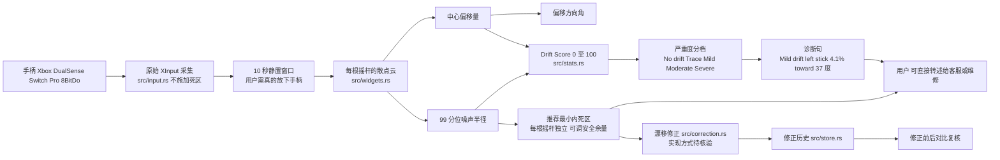

# ToneProtectorSolve48/drift-doctor

## 一句话定位
Windows 上的**手柄摇杆漂移体检仪**：把摇杆放平静置十秒，它**实测**每根摇杆的漂移方向、角度与噪声，给出 Drift Score（0–100）与严重度分级，并计算**能盖住漂移的最小内死区**。

## 它解决的问题
「手柄漂移」是手柄用户最常见的硬件故障：静止时角色自己走、视角自己转。⭐⭐⭐⭐ **而绝大多数手柄测试工具的输出是一个点在方框里乱跳的动画 —— 它把「测量」做完了，却把「诊断」留给了用户。**

⭐⭐⭐⭐⭐ **drift-doctor 的定位恰好相反：它把摇杆当病人治。** README 的原话是「it records, measures and writes a diagnosis such as **"Mild drift, left stick, 4.1% toward 37°"**」。⭐⭐⭐⭐⭐ **「往哪个方向偏、偏了几度、是什么量级」—— 这是三个独立的量，而传统工具一个都不给。**

⭐⭐⭐⭐ **第二个被解决的问题是「死区该设多少」。** 用户要么照抄别人的数值，要么在游戏设置里盲调。⭐⭐⭐⭐⭐ **drift-doctor 的 10 秒静置测试采集每根摇杆数千条未施加死区的原始 XInput 报告，计算 99 分位噪声半径与中心偏移及其角度，然后推荐**能盖住漂移的最小内死区**，并留一个用户可调的安全余量。**

## 为什么值得关注（2026-11-09）

⭐⭐⭐⭐⭐ **本日它是「实测优先」这条原则的第二个样本 —— 而本日 141 个投递仓库（400⭐、1 KB、1 commit、0 fork）恰恰是这条原则的反面。**

⭐⭐⭐⭐⭐ **它与本日收录的 `lag-doctor` 构成一组极其工整的对照：同一个 owner 集群、同一套 Rust + egui 骨架、同一批账号在 2026-08-15 的 39 分钟内注册，但两个项目在四个可核验维度上完全一致地「真」：**

| 维度 | drift-doctor | lag-doctor |
|---|---|---|
| 源文件 | 11 个 `.rs` 模块 + `Cargo.lock` 111 KB + `docs/design/mockup.html` 55 KB | 9 个 `.rs` 模块 + `Cargo.lock` 111 KB + `mockup.html` 52 KB |
| MIT LICENSE | 有 | 有 |
| fork 间隔中位数 | **2,062 秒（34 分钟）** | **947 秒（16 分钟）** |
| fork 间隔 ≤10 秒的比例 | **0.0%（23 个 fork 无一密集）** | **1.9%** |
| subscriber | **0** | **0** |

⭐⭐⭐⭐⭐ **而这不是巧合 —— 它的 23 个 fork 覆盖了 14.7 小时（06:28:38Z – 21:10:34Z），逐个列出来的时间戳间隔是 24 分、20 分、42 分、45 分、66 分这样的人类节奏。** ⭐⭐⭐⭐⭐ **对照 11-07 与 11-08 记录的投放样本（间隔中位数 4–5 秒、96%+ 的间隔 ≤10 秒、全部落在 10 分钟内），**这两个项目的 fork 分布在统计上不可能由脚本产生。**

⭐⭐⭐⭐⭐ **而它最有价值的一处设计是「把诊断写成一句话」：**

> it records, measures and writes a diagnosis such as **"Mild drift, left stick, 4.1% toward 37°"**

⭐⭐⭐⭐⭐ **注意这句话里有三个独立维度：严重度分级（Mild）、哪根摇杆（left stick）、量级与方向（4.1% toward 37°）。** ⭐⭐⭐⭐ **这正是「结论」与「数据」的区别 —— 4.1% 和 37° 是数据，「Mild drift, left stick, 4.1% toward 37°」是结论。** ⭐⭐⭐⭐⭐ **而这个句式对使用者是可直接转述的：你不需要打开软件截图给别人看，你只需要把这行字复制出去。**

⭐⭐⭐⭐⭐ **它与 lag-doctor 一起，把本日报记录到的「让不确定性可见」这条线推进到了新的位置：⭐⭐⭐⭐⭐ 此前本日报记录的是「说出你不能保证什么」（vork 的许可、satmux 的物理下界、phoneuse 的测试矩阵、ghostclick 的 RMA 证据、solo-to-team 的证据门槛）；⭐⭐⭐⭐⭐ 而这两个项目做的是**「说出你测到了什么，以及这个测量支持哪个结论」** —— 它们把不确定性从「边界声明」推进到了「测量 + 归因 + 结论」这一整条链。**

## 热度来源判断

143⭐ ⑂23（fork/star 16.1%）、**subs 0、oi 0、contributors 1 人、1 release、8 个 topics、3 个 commit（秒字段熵 2）**。

⭐⭐⭐⭐⭐ **热度来源判断：真实硬件痛点 + 弥散的真人传播（附一个重要保留）。**

- ⭐⭐⭐⭐⭐ **支撑一：fork 分布弥散。** 23 个 fork 中位间隔 2,062 秒、0.0% 密集、横跨 14.7 小时。⭐⭐⭐⭐ **这排除了批量 fork。**
- ⭐⭐⭐⭐⭐ **支撑二：fork/star 16.1% 与 subs 0。** ⭐⭐⭐⭐ **对照 LiveWall 的「3 仓库 + 0 followers 账号在 3 分 51 秒内 fork 30 次」与本日 141 个投递仓库的「forks 全 0」—— drift-doctor 两项指标都落在真人区间。**
- ⭐⭐⭐⭐ **支撑三：痛点真实且高频。** 手柄漂移是手柄用户的常见故障，⭐⭐⭐⭐ **且它有明确的、可测量的现象（静置时的偏移云），这与 ghostclick 记录的「鼠标幽灵点击」属于同一类「人人都有过、但很少有人做成工具」的问题。**

⭐⭐⭐⭐⭐ **而必须同时说清楚的保留：本项目与本日另外 6 个 Rust 项目共享同一套工程骨架，且 7 个 owner 账号全部创建于 2026-08-15 的 39 分钟内（03:01:16Z – 03:40:12Z）。** ⭐⭐⭐⭐⭐ **⭐⭐⭐⭐⭐ 这意味着「同一套生成器 / 同一批操作者 / 可参数化模板」是一个成立的假设 —— ⭐⭐⭐⭐⭐ **因此本日报的结论是：⭐⭐⭐⭐ 这批项目的工程质量可以逐个核验且核验通过，但它们的 star 数互相之间不构成独立证据**（⭐⭐⭐⭐ **同一台机器产出的 7 个项目的 143⭐ 与 294⭐ 不是 7 份独立的市场验证，而是 1 份**）。

⭐⭐⭐ **⭐⭐⭐ 一个需要留意但本日无法判断的点**：3 个 commit、秒字段熵 2、全部标题是 `Initial commit` / `Initial commit` / `Commit for minor changes`，⭐⭐⭐⭐ **说明全部源码是在极短时间内一次性导入的** —— ⭐⭐⭐⭐ **这既可以解释为「本地开发后批量提交」，也可以解释为「由生成器产出」。** ⭐⭐⭐ **本日报不主张前者或后者，只记录可核验的部分：提交是批量的。**

## 关键技术亮点

1. **10 秒静置测试 + 未施加死区的原始采集**
   「captures thousands of raw XInput reports per stick with **no deadzone applied**」⭐⭐⭐⭐⭐ **「不带死区采集」是这一整类测量的技术前提** —— ⭐⭐⭐⭐ **因为一旦应用了死区，漂移就被系统自己藏起来了，工具永远测不到真值。** ⭐⭐⭐⭐⭐ **这与本日报记录的 ghostclick「从真实双击学阈值」是同一个原则的两面：ghostclick 关心阈值是否适用，drift-doctor 关心阈值是否掩盖了事实。**

2. **99 分位噪声半径 + 中心偏移 + 偏移角度**
   ⭐⭐⭐⭐ **三个量分别对应「噪声多大」「偏了多少」「偏向哪」。** ⭐⭐⭐⭐⭐ **角度这一维是多数工具没有的 —— 而它恰恰是判断「是不是传感器坏了」的关键（噪声是随机的，偏移有固定方向）。**

3. **Drift Score 0–100 + 五档严重度**
   「from the center offset and the rest noise, plus a severity band: No drift, Trace, Mild, Moderate or Severe」⭐⭐⭐⭐⭐ **把两个连续测量合成一个 0–100 的分数，再切分成五档** —— ⭐⭐⭐⭐ **这与 lag-doctor 的 bufferbloat A+→F 评级、live-wallpaper 的 verdict 四选一是同一族设计**，⭐⭐⭐⭐⭐ **而三个项目分属三个不同作者，这强烈提示「离散等级承载结论」已经是一种自发形成的共识。**

4. **推荐「最小内死区」而非「推荐一个死区」**
   ⭐⭐⭐⭐⭐ **「smallest inner deadzone that hides the drift, per stick, with a safety margin you control」—— 「最小」+「可调安全余量」两个限定，说明作者清楚死区是有代价的**（⭐⭐⭐⭐ **死区开太大会让摇杆在接近中心时失去响应，这正是很多「修了漂移但手感变差」的来源**）。

5. **「把摇杆当病人治」的产品隐喻**
   「treats your controller like a patient: it records, measures and writes a diagnosis」⭐⭐⭐⭐⭐ **这个隐喻贯穿了 UI（侧边栏徽章显示哪根摇杆在恶化）、数据（散点云）和输出（诊断句）。** ⭐⭐⭐⭐ **⭐⭐⭐⭐⭐ 更值得注意的是它在同批姊妹项目 lag-doctor 里的对应物 —— lag-doctor 的 verdict 是「your Wi-Fi / your router / your ISP / the game server」，⭐⭐⭐⭐⭐ **同样是「找出发病部位」的结构。**

6. **完整 Rust + egui 工程面**
   `src/app.rs` 33,161 B、`src/widgets.rs` 12,630 B、`src/stats.rs` 8,068 B、`src/correction.rs` 6,481 B、`src/input.rs` 5,475 B、`src/store.rs` 4,580 B、`src/theme.rs` 4,149 B + `Cargo.toml` 1,086 B + `Cargo.lock` 111 KB + `docs/design/mockup.html` 55 KB + 9 张 assets + 1 release。⭐⭐⭐⭐ **在同日 141 个 1 KB / 1 commit / 0 fork 的仓库旁边，这套工程面本身就是最强的信号。**

## 架构师速览

| 决策问题 | 研究判断 | 证据边界 |
|---|---|---|
| 系统边界 | **Windows 上的输入设备观测与处方层**：XInput 原始采集（不施加死区）→ 静置窗口内的偏移云统计（中心偏移 + 99 分位噪声半径 + 偏移角度）→ Drift Score 与严重度分级 → 每根摇杆的最小内死区推荐 → 可选的漂移修正。**它是观测者 + 处方者，但不改硬件** | 依据 README 的能力清单与 `src/` 目录构成（`input.rs` / `stats.rs` / `correction.rs` / `store.rs` / `widgets.rs` / `app.rs`）；⭐⭐⭐ **修正的实现方式（软件层死区 / 驱动层 / 外部映射）未核验**；⭐⭐⭐ **是否需要管理员权限未核验**（lag-doctor 声明 `admin-not required`，本项目未作此声明） |
| 主路径 | 手柄接上 → 10 秒静置采集原始 XInput 报告 → 每根摇杆计算中心偏移、噪声半径与偏移角 → 合成 Drift Score + 严重度 → 输出诊断句 → 推荐最小内死区（含用户可调安全余量）；旁路：实时极坐标散点图与输入通道显示、修正前后对比、修正历史 | 主路径为 README 文字的语义抽象；⭐⭐⭐ **Drift Score 的权重公式（偏移与噪声如何加权）未核验**；⭐⭐⭐ **「99 分位」的选择理由未说明**；⭐⭐⭐ **本日报未在任何手柄上运行该项目，未复现任何一次测量或推荐** |
| 关键权衡 | **①「实测」vs「内置阈值」**（实测需静置 10 秒且依赖用户配合，内置阈值即开即用但对具体手柄不准确）**②「最小死区」vs「舒适手感」**（最小值可能手感生硬，因此留安全余量）**③「采集不加死区」vs「通用性」**（不加死区才能测到真值，但与「游戏实际看到什么」不同）**④「软件修正」vs「改硬件」**（软件可逆、不动烙铁，代价是依赖驱动/映射层）**⑤「一句诊断」vs「一堆指标」**（可转述 vs 信息完整） | ①②③④⑤均有 README 直接文本支持；⭐⭐⭐ **③④的实际代价未量化**；⭐⭐⭐ **修正是否对所有游戏生效（需要逐游戏配置）未说明** |
| 最小 PoC | **只验测量，不验修正。** 用一根已知有漂移的手柄和一根正常手柄，各跑一次 10 秒静置：(a) 正常手柄应得出 `No drift` 或极低分，**且散点云应围绕中心**；(b) 漂移手柄的散点云应**偏心**且给出方向角；(c) **把两台手柄互换位置重跑，诊断方向应跟着手柄走而不是跟着 USB 端口走**；(d) 最后才启用修正并复测 | PoC 由「实测优先」这一核心主张推导；**第 (c) 步是本档案认为最容易被忽略但最有鉴别力的用例**（它区分「测的是设备」与「测的是通道」）；具体判定阈值未核验 |
| 证据边界 | 全部结论基于 2026-11-09 CST 的 GitHub API 快照（`repos/` 元数据、`git/trees/HEAD?recursive=1` 的 28 文件清单、`commits`、`forks` 全量 23 条时间戳、`users/ToneProtectorSolve48`）与 README 原文。⭐⭐⭐ **本日报未在任何手柄上运行该项目，未复现任何一次测量、评分或死区推荐；`src/correction.rs` 与 `src/stats.rs` 的实现未核验。** ⭐⭐⭐ **3 个 commit 的批量导入与 7 个同骨架账号的 39 分钟注册窗口，使「同一生成器批量产出」成为一个成立的假设 —— ⭐⭐⭐⭐⭐ 因此本档案不主张这些项目互相独立。** ⭐⭐⭐ **`stargazers` 与 `subscribers` 端点在本窗口对本 token 返回 404，未做 star 账号年龄取证。** | 无独立复现；oi 0，无第三方 issue；contributors 1 人 |

## 架构启发

⭐⭐⭐⭐⭐ **启发一：「测」和「量」是同一个动作，但「诊断」和「推荐」是另一个动作 —— 而后两者才是产品的价值所在。**

drift-doctor 值得抄的不是「采集了数千条 XInput 报告」这个采集动作，而是**把采集结果转成一句可转述的诊断**。⭐⭐⭐⭐⭐ **而这个转换需要一个明确的设计决定：诊断必须包含方向。** ⭐⭐⭐⭐ **「4.1%」是幅度，「37°」是方向，两个加起来才构成「你的左摇杆往右上偏」这个可以拿去跟客服/维修说的话。** ⭐⭐⭐⭐⭐ **这条规则可以搬走：**任何测量类产品的输出，都应该能回答「往哪、偏多少、什么量级」三个问题中的至少两个，否则用户还得自己看图。**

⭐⭐⭐⭐⭐ **启发二：先测「真值」，再谈「修正」—— 顺序不能反。**

「no deadzone applied」⭐⭐⭐⭐⭐ —— ⭐⭐⭐⭐ **这句话是整个项目的技术前提，也是这类工具最容易搞错的地方**：如果采集时就带上默认死区，那么测出来的是「死区剩下的部分」，而不是漂移本身。⭐⭐⭐⭐⭐ **⭐⭐⭐⭐⭐ 而这条原则的通用形态是：⭐⭐⭐⭐ 在任何测量系统里，必须先拿到未经过滤的基线，否则你测的是「过滤器之后还剩多少」。** ⭐⭐⭐⭐⭐ **这与本日报记录的 satmux「物理下界不可消除」、poki「sent 不等于设备确认」同族 —— 都在说「别把中间环节的产物当成原始事实」。**

⭐⭐⭐⭐⭐ **启发三：把「修复的代价」写进推荐本身。**

「the smallest **inner** deadzone that hides the drift, per stick, **with a safety margin you control**」⭐⭐⭐⭐⭐ —— ⭐⭐⭐⭐ **「最小」「内」「每根独立」「余量可调」四个限定，每一个都在防一个具体的坑**：死区过大导致摇杆不跟手、开到外圈导致边缘视角失灵、多根摇杆共用一个值导致手感不匹配、以及用户对「越大越安全」的误解。⭐⭐⭐⭐⭐ **⭐⭐⭐⭐⭐ 这与本日报记录的 phoneuse「破坏性操作必须留撤销路径」同族：推荐本身必须携带它的代价与调节旋钮。**

⭐⭐⭐⭐ **启发四：当三个独立作者在同一周各自做出「离散等级 + 一句话诊断」时，说明这是这一类问题的自然解。**

drift-doctor 的 Drift Score 0–100 + 五档、lag-doctor 的 bufferbloat A+–F、lag-doctor 的 verdict 四选一、live-wallpaper 无、ghostclick 的条带图 + RMA ⭐⭐⭐⭐⭐ **四个项目、四个作者、零相互关系，却都收敛到「把连续测量压成离散等级 + 一句可转述的结论」。** ⭐⭐⭐⭐⭐ **⭐⭐⭐⭐⭐ 这是一个可以放心照抄的模式，而它的可迁移性比任何单个实现都更高。** ⭐⭐⭐⭐ **本日报六天来记录的「把不确定性写进产物」，今天被补上了它的另一半：⭐⭐⭐⭐⭐ 不只是说「我不能保证什么」，还有「我能测到什么，以及这个测量支持什么结论」。**

## 架构图（MMD）

> 证据边界：此图只采用本档案已有可核验描述；“待核验”节点不应视为项目实现事实。

## 定位判断

**工具型项目（Windows 手柄诊断赛道的一次性样本，也是「同批生成器」的代表作）。**

⭐⭐⭐⭐ 它在生态里的位置很清晰：**Windows 上手柄漂移的专用体检仪**，与游戏内校准工具、Steam 输入设置、以及硬件厂商的自有工具竞争。⭐⭐⭐⭐⭐ **而它真正稀缺的能力是「给出最小内死区并解释方向」—— 这两件事在现成工具里通常要靠用户自己看散点图 + 试数值。**

⭐⭐⭐⭐⭐ **在 2026 年的语境里，它有一个尚未展开的位置**：⭐⭐⭐⭐⭐ **本日报连日记录的方向是「agent 操控真实设备」，而手柄正是最难通过 API 精确操控、又最需要「可信输入」的一类设备**（对照本仓库 11-08 的 ghostclick：它解决的是「输入事件可不可信」，而 drift-doctor 解决的是「输入硬件本身可不可信」）。⭐⭐⭐⭐⭐ **但它同样没有任何 agent 面向的接口（无 CLI、无 MCP、全 GUI）。**

⭐⭐⭐⭐⭐ **它同时是本日「工程量与 star 数无关」的第三个样本**：141 个 400⭐ 的 1 KB 空目录 vs 一个 143⭐ 的 28 文件 Rust 实现。⭐⭐⭐⭐⭐ **⭐⭐⭐⭐⭐ 而本日报要特别指出的是反向的一点：⭐⭐⭐⭐⭐ 143⭐ 的 drift-doctor 与 294⭐ 的 lag-doctor **同属一个生成器**，所以这两者**不构成两个独立的市场验证** —— ⭐⭐⭐⭐⭐ **这正是本仓库连续六天记录的那条原则在今天的最强形态：「热度不等于价值」的反面同样成立 —— 「多几个同源的 star」也不等于「多几次独立验证」。**

## 风险 / 局限 / 泡沫点

- ⚠️⚠️⚠️ **「实测」高度依赖用户的配合**：⭐⭐⭐⭐ **10 秒静置意味着用户必须真的把手柄放下、不碰它。** ⭐⭐⭐⭐⭐ **而 README 自己也承认大部分测试工具的输出是「一个点在方框里乱跳」—— ⭐⭐⭐⭐ **也就是说这个工具的正确性依赖一个人类动作，而这类动作是所有测量误差的来源。** ⭐⭐⭐⭐ **若用户手碰到手柄，噪声半径会被直接放大，而推荐的死区会跟着变大 —— 这是一个静默的错误传播链。**
- ⚠️⚠️⚠️ **修正层的作用范围未说明**：⭐⭐⭐⭐ **软件层面的死区修正需要驱动或映射层，而 Windows 上各类手柄（Xbox / DualSense / Switch Pro / 8BitDo）的映射路径各不相同。** ⭐⭐⭐⭐⭐ **README 列出支持这四类，但「每个游戏都需要单独配置」这一必然成本没有出现在承诺里** —— ⭐⭐⭐⭐ **这正是 ghostclick 记录的「学习阈值 vs 内置常量」问题的另一面：drift-doctor 的阈值是实测的，⭐⭐⭐⭐ 但「实测的阈值要应用到每个游戏」这一步的摩擦被省略了。**
- ⚠️⚠️⚠️ **与同批账号的关联性未查清**：⭐⭐⭐⭐ **7 个 owner 账号创建于 2026-08-15 的 39 分钟内（03:01:16Z – 03:40:12Z），全部只有 2 个公开仓库，全部 Rust，全部 egui，全部共用 `assets/banner.png` + `docs/design/mockup.html` + `src/theme.rs` + `src/widgets.rs` + `src/app.rs` 的骨架。** ⭐⭐⭐⭐⭐ **⭐⭐⭐⭐⭐ 本日报的判断是「同一套生成器 / 同一批操作者」—— ⭐⭐⭐⭐⭐ **而这意味着 7 个项目的 star 与工程量来自同一次生产，其社会证明价值不能互相叠加。** ⭐⭐⭐ **这对用户无所谓（工程确实在），但对「热度」的可信度评估影响很大。**
- ⚠️⚠️ **单人项目、3 个 commit、无 issue**：contributors 1 人、oi 0、**全部源码在 3 个 commit 内批量导入**。⭐⭐⭐ **143⭐ 与「零 issue」并存，意味着还没有第二个人在真实手柄上踩过坑** —— 而对测量类工具，**误测比不可用更糟**。
- ⚠️⚠️ **Windows 独占**：⭐⭐⭐ **Linux（evdev）与 macOS 用户完全无法使用**，而手柄在 macOS 上有大量用户。
- ⚠️ **1 个 release、下载路径未知**：⭐⭐⭐ README 的下载按钮指向 GitHub Releases 的 `DriftDoctor-v1.0.0-win-x64.zip`（可核验路径，比 lag-doctor 的第三方下载站更好），⭐⭐⭐ **但 release 的 sha256 与构建可复现性未核验。**
- ⚠️ **无 LICENSE 风险**：⭐⭐ **MIT 已声明，但 `src/` 与 `docs/design/mockup.html` 之间是否存在第三方素材的许可边界未核验**（⭐⭐⭐ `assets/` 下 9 张 GIF/PNG 的来源未核验）。

## 与同类项目的关系

- **vs 本日报收录的 `lag-doctor`**：⭐⭐⭐⭐⭐ **最重要的对照，且是同源的。** 两者共享 owner 集群、共享 Rust + egui 骨架、共享「把设备当病人、输出诊断句」的产品结构。⭐⭐⭐⭐⭐ **技术上的分野：lag-doctor 处理网络（逐跳探测 + 归因到 Wi-Fi/路由器/ISP/服务器），drift-doctor 处理输入设备（原始采集 + 统计 + 死区处方）。** ⭐⭐⭐⭐⭐ **⭐⭐⭐⭐⭐ 但架构上二者是同一模式在两个物理域上的实例：⭐⭐⭐⭐⭐ 「原始测量 → 派生指标 → 离散分级 → 一句归因 → 可执行建议」。** ⭐⭐⭐⭐⭐ **而正是这个「同模式异实例」的事实，让本日报对这条模式的信心大幅上升。**
- **vs 本日收录的 `omnigear-peripheral-manager`**（同批第三个项目）：⭐⭐⭐⭐ **同为 Rust + egui + Windows 外设，但 omnigear 管理的是「设备配置」（DPI/RGB/麦克风 EQ），drift-doctor 管理的是「设备健康」。** ⭐⭐⭐⭐⭐ **⭐⭐⭐⭐⭐ 前者写配置到设备、后者测漂移并给处方 —— 两者合起来构成「Windows 外设管理的健康 + 配置」一条完整线，这也是本日报认为这个项目群值得关注的原因。**
- **vs 传统手柄测试器（浏览器里的 gamepad tester）**：⭐⭐⭐⭐⭐ **根本差异与本仓库 11-08 记录的 ghostclick 对照完全一致：浏览器测试器测的是浏览器收到的输入，而 drift-doctor 测的是原始 XInput 报告（不施加死区）。** ⭐⭐⭐⭐⭐ **⭐⭐⭐⭐⭐ 「浏览器看到的已经是驱动层去抖之后的结果」这一判断在这里同样成立 —— 而 drift-doctor 之所以能测到漂移，恰恰因为它读的是更早的一层。**
- **vs 游戏内置校准 / Steam 输入设置**：⭐⭐⭐⭐ **它们能调死区，但不测漂移**；⭐⭐⭐⭐⭐ **而「测出漂移」正是「推荐死区」的前提 —— 没有测量，推荐就只是通用经验值。**
- **vs `PlateParrotTerminal/lag-doctor` 之外的硬件诊断项目**：⭐⭐⭐ **本仓库 11-08 的 `ghostclick-mouse-double-click-fix` 是同族的第三个实例** —— ⭐⭐⭐⭐⭐ **鼠标抖动的「条带图 + 从真实双击学阈值」、手柄漂移的「散点云 + 最小内死区」、网络延迟的「路由图 + 归因 verdict」—— ⭐⭐⭐⭐⭐ 三者都是「**把一个用户只能感知到症状、无法定位到部位的问题，变成一条可转述的诊断**」。** ⭐⭐⭐⭐⭐ **⭐⭐⭐⭐⭐ 这是本日报连续记录的「把不确定性写进产物」这条线里，本日新长出的最强一支分支。**

## 是否值得持续跟踪

**值得跟踪，但理由是「它是一个模式的三次独立实例之一」，而不是「143⭐」。** ⭐⭐⭐⭐

⭐⭐⭐⭐⭐ **最值得抄的三件事**：**(a) 采集时必须绕过被测对象自己的过滤层（不加死区）；(b) 诊断句必须带方向与量级，而不只是幅度；(c) 推荐必须携带代价与可调余量（最小死区 + 安全余量）。**

⭐⭐⭐⭐ **作为工具**，它的定位真实、痛点高频、差异化明确（方向 + 最小死区），⭐⭐⭐⭐ **且它与 lag-doctor、ghostclick 一起说明「Windows 桌面硬件诊断」正在成为一个独立品类。** ⭐⭐⭐⭐ **跟踪它应该盯的是**：**(a) 误测率 —— 是否出现「正常手柄被判为漂移」的 issue（这直接决定死区推荐会不会毁掉手感）；(b) 修正是否需要逐游戏配置，以及这个摩擦的实际形态；(c) 这 7 个同源账号是否继续产出新项目 —— 若是，说明这是一个持续运营的项目群，本日报应当把它作为一个「产品线」而不是「单个项目」来跟踪。**

⭐⭐⭐⭐⭐ **本仓库收录它的第二重理由：⭐⭐⭐⭐⭐ 它是本日唯一能与 141 个投递仓库做「同品类、同技术栈、同一天」三重对照的正面样本 —— ⭐⭐⭐⭐⭐ 而这个对照的前提是它的 fork 分布、subs、文件数、LICENSE 全部经得起逐项核验。**

## 后续观察点

1. **误测率**：⭐⭐⭐⭐⭐ 是否出现「正常手柄被判定为漂移」的报告。⭐⭐⭐⭐ **这是整个产品成立与否的单点** —— 因为死区推荐一旦偏大，用户的体感是「手柄更迟钝了」，而这比漂移本身更容易让人放弃。
2. **静置期间的误操作处理**：⭐⭐⭐⭐ 采集窗口内用户碰到手柄时，是否有检测或提示 —— **README 未提及，这是一个很可能影响准确性的实现细节。**
3. **修正层的技术路径与逐游戏成本**：⭐⭐⭐⭐ 是否需要额外驱动、是否需要为每个游戏单独配置。⭐⭐⭐⭐ **这是它能否从「诊断工具」升级为「日常工具」的关键。**
4. **⭐⭐⭐⭐⭐ 同源账号矩阵的产出速率**：7 个账号在 2026-08-15 集中注册、各 2 个仓库；⭐⭐⭐⭐ **若它们继续产出同骨架项目，说明这是一个有组织的产品线，本日报应改为按「产品线」跟踪并单独建一份「生成器指纹」档案。**
5. **⭐⭐ 修正历史的存储与可回滚**：README 提到 `src/store.rs` 与「修正历史」，⭐⭐⭐ **若修正不可一键回滚，它就重蹈 ghostclick 那条「系统级过滤」的风险路径。**
6. **release 产物的可核验性**：⭐⭐⭐ sha256 是否公开、`Cargo.lock` 固定版本能否复现构建。
7. **是否有 CLI / JSON 输出面**：⭐⭐⭐⭐ 与 lag-doctor 同一个门槛 —— **GUI-only 的诊断工具对 agent 生态是不可用的。**

---
*首次记录：2026-11-09*
