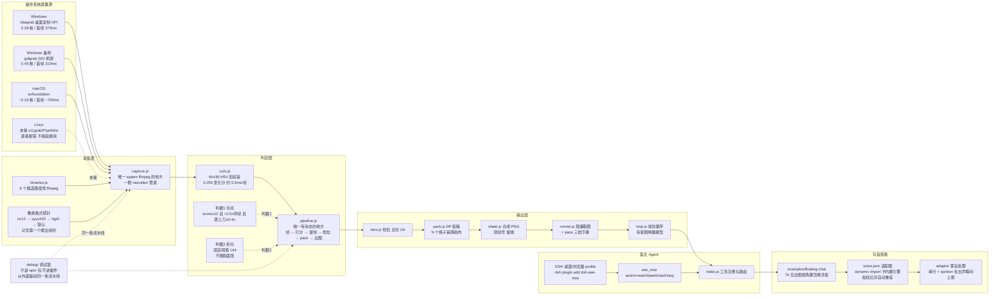

# SAOS-3624/dsh-see-now

## 一句话定位

给 DSH（DeepSeek 自己的 Agent Harness）用的实时视觉插件：**只把「画面变了」的那几帧传给模型**——而它最值得记的不是省 token，而是它把「怎么算变了」写成了**两个缺一不可的判据**，并且把每一条实测数字（首帧毫秒数、CPU 核数、变化分刻度）都放在了 README 的表格里。

## 它解决的问题

想让 AI 陪你看屏幕，最直觉的做法是「定时截全屏喂过去」，README 用一张表把它的两个死结摆出来：

| 做法 | 问题 |
|---|---|
| 每 2 秒截一张全屏 | 一分钟 30 张图，全是重复画面，token 直接烧穿 |
| 每隔 30 秒截一张 | 中间发生了什么全丢了，AI 只会说「看起来你在用电脑」 |

**⭐ See Now 的思路是把「采样」变成「筛选」：先判断这一帧值不值得看，再决定传不传。**

**⭐⭐ 但它的第二个问题比第一个更值得记**——**「怎么判断『变了』」本身是一个需要被精确定义的问题，而不是一个能靠调参解决的模糊问题。**

## 为什么值得关注（2026-11-03）

- **⭐⭐⭐ 它的两条判据是本日最值得抄的技术判断**（README「它是怎么判断『变了』的」一节原文）：
  - **① 切点**——`score ≥ cutAbs(12)`（绝对地板：变化够不够大）**且** `score > 2.5 × max(1, 前后帧)`（尖峰：是不是「一下子」）**且** 距上一刀 ≥ 0.4 秒（不应期）；
  - **② 积分**——`need = 4分 × 12fps × 3秒 = 144`（**固定的绝对阈值，不跟着画面一起涨**），每帧累加自己的分，累够就录、清零。
  - **⭐ 它明写了两条为什么都要的理由**：「**尖峰是相对的**，在低分区也会成立。实测缓慢放大（持续运动）有帧 `s=13.6`、前后邻居只有 1.1/1.3，尖峰判据完全放行——没有绝对地板，它就会被切成一块块。反过来只有地板也不行：一镜到底的视频每帧 4 分，永远不会『跳』。」**这段解释本身就是「两个判据各自堵住对方的漏洞」的完整论证。**
- **⭐⭐⭐ 变化分的刻度被实测出来并写成表**（0–255，同一套代码）：静止桌面 **0.00**（屏幕采集近似无损）/ 光标在静止画面上移动 **0.7** / 两张色调接近的照片切换 16~18 / 滚网页或切窗口 30~42 / 两张完全不同的照片切换 46~63。**⭐ 它明写了这个刻度的作用位置**：「所以 `cutAbs: 12` 这个默认值的位置是：**照片切换抓得住，光标和微小抖动碰不到**。」——**「阈值从哪来」被写成了可核验的实测，而不是拍脑袋。**
- **⭐⭐⭐ 它的成本口径是算出来的，不是估的**：800×450 一张 ≈ **233 token**（按宿主 DeepSeek-V4 的 patch 网格算：14px patch 向上对齐 → 42px 一格 → `rows×(cols+1)+2`），并指出**一张图里塞 4 帧还是 8 帧价格一样**，所以「多留一帧几乎免费，漏掉一帧才贵」。**⭐ 并且它主动纠正了自己代码里的旧注释**：「插件源码里 `SIZES` 的旧注释写着 218 token，那是早期按『像素 ÷ 1650』估的，偏低。以 233 为准。」——**这是一个把错误数字留在原地并标注纠正，而不是悄悄改掉的典型。**
- **⭐⭐ 它把「四帧拼一张图」做成了显式的装箱问题**：`pack.js` 的职责被 README 写为「**DP 装箱：把 N 个不同大小的格子铺满画布**」，`tiers.js` 管「格子边长 1/k」与策略——**⭐ 即帧的尺寸档位与拼图布局是两件事，且布局用动态规划解**。
- **⭐⭐⭐ 它的 release 说明是本日最诚实的一批 changelog**：v0.0.3 写「**社区反馈（B 站评论）**：『文件回放有 bug：回放会在 24 秒里解 1955 帧、攒下一堆唤醒，然后一直弹有新画面——关了悬浮窗也停不干净，得卸载才行』」并把根因拆成三处共同点；v0.0.7 写「**社区反馈（1 例）**：『放着放着它自己就结束了，模型说了句『好，先停在这儿』就再没下文』。只有一个人报，本来当个例放着；查下来是真 bug，而且**判错一次就回不来**」——**并给出了精确的机制**：窗口每秒 touch 一个心跳文件、6 秒过期就算「这窗不能用了」（这是 issue #2 修的），而**常驻循环拿同一个判据去回答「用户是不是不看了」**，于是机器睡一觉醒来或窗口主线程被拖住几秒 → 心跳过期 → 循环**第一拍**就 `stop('window-closed')` → 落一条挂断说明「用户关掉了悬浮窗……不要再调 `see_now`」还会 `hangUp()`。
  - **⭐⭐ 这是一个教科书级的判据复用错误**：一个为「窗口是否已死」设计的判据，被拿去回答「用户是否已离开」这个语义不同的问题。**「判错一次就回不来」——因为它触发的是 `hangUp()`，即会话被挂断。**
- **⭐⭐ 它有真实的外部贡献与外部 issue**：`issues` API 返回 4 条 —— **PR #4（open，作者 `xingranya`）、ISS #3、ISS #2（`moyi-anoko`，附「本地的逐像素透明实现」）、ISS #1（`says693`）**，且三条 issue 全部 closed。**这是本批新项目里社区信号最实的一个**：不是「PR 是作者自己提的」（对比 stack-diagram 的 PR #1 作者是 caru-ini 自己）。
- **⭐⭐ 它的 issue 标题本身就是需求文档**：ISS #1 写「**持续陪看链路：peek 丢弃已成图队列、会话归属竞争及 minFrames 约束失效**」——**三个不同层次的问题（队列、会话归属、约束失效）被一个外部用户在一条 issue 里分别点名**。
- **⭐⭐ 它的失败模式被写成「不假装能用」**：README 已知限制一节明写「**Linux 还没接**（要补 `x11grab` 或 PipeWire，**现在会直接报错，不假装能用**）」。**⭐ 而且 macOS 的一个真实坑被写成独立小节**：「**没有「屏幕录制」权限时它不报错**，exit 0、帧数正常，只是全黑」——探针会算平均像素，发现全黑就在 `start` 的返回里带一句提示。**「静默失败 → 让它响」是一个具体的工程处理。**
- **⭐⭐⭐ 它还有一条「把开发工具排除在发布包外」的组织纪律**：README 目录一节写「`debug/` — 调试窗（**不在 npm 包里**）」，并解释「代码在 `debug/`，**不进 npm 包、不进插件**，只是从外面驱动同一条流水线」。**⭐⭐ 同一套调试窗还有一条更狠的细节**：「`install-dev` 是**复制**不是软链（Node 解析裸包名要走真实路径，软链会找不到宿主的 `@deepseek-ai/dsh-tools`）」——**一个真实的坑，且解法被写成了可复制的规则。**
- **⭐ 它的许可策略明写「没有任何东西锁在付费后面」**：README 授权说明一节先给 Apache-2.0 与「不需要问我要授权，也不收费」，再放赞赏码并注明「**纯自愿，不影响上面任何一个字**」。**⭐ 并且它把另一个项目里的分裂修掉了**：「`examples/floating-chat/` 来自同作者的另一个项目 `dsh-watch-together`，两边现在是**同一个协议**，**不再有『这个目录 Apache、其余非商业』的分裂**。」

## 热度来源判断

**⭐ 热度来源是「一个具体到能立刻用的问题被一个具体到能立刻装的插件解决」，热度是真实的，但极短。**

- **161⭐ 在 41 小时内**，**fork/star 仅 5.0%**——**比 CivSwitch 的 21.0% 低一个数量级**。这个差异本身就是信号：**CivSwitch 有硬件门槛、必须照着买板子接线，fork 出去才有意义；而 See Now 是 `npx` 就能装的东西，不需要 fork，所以 fork 比例自然低。** **fork 比例的高低下，测的是「复制成本」而不是「质量」。**
- **⭐⭐ 它的真实采用信号不是 star，是 issue 与 PR 的作者多样性**：`issues` API 里出现了 **3 个不同的外部账号**（`xingranya` / `moyi-anoko` / `says693`），且 `releases` API 显示 **v0.0.2 → v0.0.3 → v0.0.7** 三个版本**都在两天内发出**，其中 v0.0.3 与 v0.0.7 的 changelog **直接引用了外部反馈**（B 站评论、用户报告）。**「有人在用，并且用出了问题，并且作者把它写进 release note」——这是本批最完整的采用闭环。**
- **⚠️ 但 subs 0 必须标注**：`subscribers_count` 为 **0**。**深度关注者为零**——这与 161⭐ 并存，说明**这个仓库的star 主要来自「路过 + 点一下」，而非「持续跟更新」**。对一个两天内发了三个版本的迭代型项目，**subs 0 是一个真实的负面信号**。
- **⭐ 它是 DSH 生态的插件**，而 DSH 本身是 `deepseek-ai` 的项目——**⭐ 这意味着它的用户基数受限于 DSH 的装机量**，而 DSH 的装机量在本日报中**未核验**。**不能把 161⭐ 读成「一个通用产品的用户量」。**

## 关键技术亮点

1. **⭐⭐⭐ 双判据切点检测**（`cuts.js`）：HSV 三通道加权差，在 **64×36 网格**上算（约 0.2ms/帧）；切点 = 绝对地板（12）+ 相对尖峰（>2.5× 邻帧）+ 不应期（0.4s）；积分为固定绝对阈值 144（不随画面涨）。**两条判据互为对方的反例，README 直接写出各自的失败场景。**
2. **⭐⭐ DP 装箱的拼图布局**（`pack.js` / `tiers.js`）：N 个不同尺寸的格子铺满画布，格子边长按 1/k 档位；`scene:true` 时固定压到 1 帧铺满，README 说明「不然场景一密，格子会缩到 1/4、1/9，中间全是灰条」。
3. **⭐⭐ 单根 rawvideo 管道**（`capture.js` 是唯一 spawn ffmpeg 的地方）：Windows `ddagrab`（桌面复制 API）/ `gdigrab`（GDI 抓屏）自动探测，macOS `avfoundation`。**实测：Windows i9-12900HX / RTX 4060 Laptop / 2560×1600 上，`ddagrab` 首帧 370ms / 0.28 核，`gdigrab` 310ms / 0.45 核，OBS 虚拟摄像头 575ms / 0.13 核；macOS M 系列 Retina 上 `avfoundation` 首帧 ~700ms / ~0.16 核**（首帧慢在 `AVCaptureSession` 冷启动，ffmpeg 进程本身 ~300ms）。
4. **⭐⭐ 像素格式探针**：README 明写「像素格式是**探针试出来的**，不是写死的：屏幕输入不支持默认的 `yuv420p`，探针按 CPU 从省到费（`nv12` → `uyvy422` → `bgr0` → 设备默认）试到第一个真能出帧的，然后整个进程记住」。
5. **⭐⭐ TTS 动态挂载**：核心**不内置任何 TTS 引擎**，只 dynamic import 用户指定的模块；每次调用工具前比对配置指纹（适配器路径 + `tts.json` 内容摘要），变了就自动卸载重挂，没变就一次读文件。README 指出适配器要自己处理两件事：**串行**（两个 `say` 抢音频设备会像结巴）与 **`spoken` 上报**（在出声的那一瞬发，不能等念完）。
6. **⭐⭐ 「可独立使用的库」边界**：包本身不依赖 DSH，`capture` / `pipeline` / `png` 都独立导出，README 直接给出脱离 DSH 的 `createPipeline` + `spawnFrames` + `p.take()` 示例。
7. **⭐ 三档节奏（`pace`）**：`calm`（20 分 / 30 秒）/ `normal`（12 分 / 15 秒，默认）/ `dense`（7 分 / 8 秒），**且用户可以用自然语言让模型传档**（「慢一点 / 省点钱」→ `pace:"calm"`；「不灵敏」→ `pace:"dense"`）。

## 架构师速览

| 决策问题 | 研究判断 | 证据边界 |
|---|---|---|
| 系统边界 | 边界在**采集与筛选**：一个 ffmpeg 子进程（唯一 spawn 点）+ 一条纯 JS 的判定/装箱流水线；**上游是操作系统屏幕 API，下游是宿主 Agent（DSH）的一个工具调用**。它**不碰**模型、不碰屏幕内容之外的任何数据源、**不内置 TTS**、**不含 DSH 依赖**（`capture`/`pipeline`/`png` 可独立使用） | 「唯一 spawn ffmpeg 的地方」由 README 目录表 `capture.js 唯一 spawn ffmpeg 的地方，一根 rawvideo 管道` 直接支持；**未核验**是否真的只有这一处 spawn（未读代码）；**未核验**插件是否真的在非 DSH 环境零依赖（README 给出示例但未运行）；「不内置 TTS」由 README 明写支持 |
| 主路径 | ① spawn 采集进程 → ② 原始帧进 `cuts.js` 打 0–255 变化分（64×36 HSV 网格）→ ③ `pipeline.js` 判切点/积分并决定留帧 → ④ `tiers.js` 定格子档位 → ⑤ `pack.js` DP 装箱 → ⑥ `sheet.js` 合成 PNG → ⑦ `runner.js` 阻塞取图 → ⑧ `loop.js` 常驻循环有新图就唤醒模型 → ⑨ `index.js` 路由；旁路：`binaries.js` 按 6 个候选路径找 ffmpeg；`examples/floating-chat/` 是 Tk 悬浮窗；`debug/` 是同一条流水线的外部驱动 | ①–⑨ 各文件职责由 README 目录表逐条列出（**但本档案未读源码，职责描述是 README 的自述而非代码核验**）；**未核验** `runner.js` 与 `loop.js` 的并发模型；**未核验** `sheet.js` 烧帧号/留缝的具体实现；**未核验** `index.js` 的工具 schema |
| 关键权衡 | **① 「留帧」而不是「调采样率」**——换来不漏事件，代价是判定逻辑复杂（两个判据 + 不应期）；**② 一张图装多帧而不是多张图**——换来固定成本被摊薄（README 明算 233 token 的固定成本），代价是每帧分辨率下降（可能影响 OCR 类任务，**README 未评估此代价**）；**③ 「变化」而非「语义」**——换来 O(1) 判定，代价是**明确的能力上限**（README 自陈：「同一句话的两个排版版本算变化，两段内容不同但长得很像的页面可能算没变」）；**④ 动态 import TTS 而非内置**——换来零语音依赖与可换音色，代价是用户要自己写适配器并处理串行/上报两个坑；**⑤ debug 代码不进包**——换来发布包干净，代价是调试能力对最终用户不可用 | ①–⑤ 的**取舍方向**由 README 明文支持；**② 的分辨率代价未量化、③ 的漏检率未测量、⑤ 对最终用户的影响未核验**；**未核验**是否存在「同一张图里 4 帧 vs 8 帧 token 相同」这一断言在宿主侧的实测（README 给出计算式，但本档案未在宿主上复算） |
| 最小 PoC | ① 只装 Windows 路径（`ddagrab`），不动 macOS、不碰 Linux → ② 用 `debug:live` 看帧流与变化分曲线，**先确认静止时分数≈0、滚动时分数进入 30~42 区间**（README 的实测刻度）→ ③ 调 `cutAbs` 直到「光标移动不触发、切窗口触发」→ ④ 跑一次 `see_now({action:"watch"})` 确认返回的拼图张数符合预期 → ⑤ 确认 `minFrames` 与 `pace` 行为符合预期 | PoC 的**顺序由 README 的调试窗说明与实测刻度表反推**；**未核验** `debug:live` 在无 DSH 环境下能否独立运行（README 说它「从外面驱动同一条流水线」，但**未说明能否单独 npm run**）；**退出路径**：卸载插件即可，**不涉及存档或系统状态**——这一点与 CivSwitch 形成鲜明对比 |

## 架构启发

**⭐⭐⭐ See Now 的核心启发是「把一个模糊判断拆成两个各自可证伪的判据」，并且把这个拆解过程本身写进文档。**

大多数「智能采样」类设计会写成「用某种算法检测画面变化」，读者既无法判断它是否会漏，也无法判断它的阈值从哪来。See Now 做的是三件更狠的事：
1. **写出每个判据各自会失败的样子**（缓慢放大 → 尖峰误触发；一镜到底 → 地板不触发）；
2. **用实测刻度把阈值锚定**（0.00 / 0.7 / 16~18 / 30~42 / 46~63），并明说阈值的位置是「照片切换抓得住，光标和微小抖动碰不到」；
3. **⭐ 把「为什么两个都要」写在正文而不是附录里**。

**⭐⭐ 第二个启发是「判据的语义不能跨问题复用」——这个教训来自 v0.0.7 的真实事故。**

窗口心跳（6 秒过期）是为「这个窗口是不是死了」设计的；常驻循环却拿它回答「用户是不是不看了」。**这两个问题在直觉上很像（都是「还有人在吗」），但在系统上完全不同**——前者答错的后果是窗口重开，后者答错的后果是 `hangUp()` 挂断整个会话，**且不可恢复**。

> **可迁移的规则**：一个判据被复用前，必须回答「答错的后果是否对称」。**后果不对称的两个问题，不能共用一个判据。**

**⭐⭐ 第三个启发是「静默失败必须变成响的失败」。** macOS 屏幕录制权限未授予时，ffmpeg 依然 exit 0、帧数正常、只是全黑——**这在生产环境里是最坏的失败形态（看起来在跑，其实在骗你）**。See Now 的处理是：探针算平均像素，发现全黑就在返回值里带一句提示。**「让失败路径也产出一个信号」是可靠性设计里最常被跳过、也最值钱的一步。**

**⭐⭐⭐ 第四个启发（本日最可迁移的一条）来自 release note 的写法**：v0.0.7 的 changelog 不是「修复若干问题」，而是**从一句用户原话开始，到一个精确的机制解释结束**（机器睡醒 → 心跳过期 → 第一拍 `stop('window-closed')` → 挂断说明 → `hangUp()`）。

**这条 changelog 同时完成了三件事**：① 让读者知道这个 bug 长什么样（能自己识别）；② 让读者知道它为什么发生（能自己判断是否受影响）；③ 让读者知道作者把「只有一个人报」当回事（能建立信任）。**

**对比本日另一批项目的做法**：许多项目的 release note 写的是「feat: add X」「fix: various issues」。**See Now 的写法让 changelog 本身成为一份 bug 复现说明。**

## 架构图（MMD）

> 证据边界：此图只采用本档案已有可核验描述；「待核验」节点不应视为项目实现事实。

## 定位判断

**「把一个昂贵且无用的默认行为，换成一个便宜且有信息的行为」——这是一个通用模式，See Now 是这个模式在本批里做得最完整的一次。**

它的位置在 **Agent 的「视觉输入」这一层**。这一层的现状是：要么不做（模型看不见），要么做得很粗（全屏定时截帧）。See Now 站在中间，提供**一个可插拔的中间层**。

**⭐ 它与自己生态的关系很特别**：`dsh-see-now` 是 **DSH 生态的插件**（`deepseek-ai` 的 Agent Harness），但**它不依赖 DSH**——`capture`/`pipeline`/`png` 独立导出，README 直接给出脱离 DSH 的用法。**这意味着它同时是「一个 DSH 插件」和「一个可独立使用的库」。** 这个分层做得很干净（装进 DSH 用 `dsh plugin`，不装就用 `spawnFrames` + `createPipeline`）。

**⭐ 它与本日另一批项目 `caru-ini/stack-diagram` 形成有意思的对照**：
| | dsh-see-now | stack-diagram |
|---|---|---|
| 产物 | 一张「变化了的画面」拼图 | 一张「你的技术栈」架构图 |
| 判定 | **有算法**（双判据 + 实测刻度） | **无算法**（把命名交给 agent 判断） |
| 成本意识 | **显式**（233 token 的计算式） | 无（agent 调用次数未量化） |
| 验证方式 | **数值表**（首帧 ms / CPU 核 / 变化分） | **视觉检查**（渲染后 agent 自查） |
| 失败暴露 | 主动响（黑屏检测 / Linux 直接报错） | 部分（"No arrows through text" 靠 agent 自查） |

**⭐ 结论：See Now 是「把不确定性压进算法」的一侧，stack-diagram 是「把不确定性交给 agent」的一侧。** 前者的成本更高（要设计判据、要实测刻度），但行为可预测；后者更省事，但输出质量依赖 agent 当次的判断。**本日同时记录这两个项目，是本日最有价值的一组对照——它们代表同一问题的两种答案。**

## 风险 / 局限 / 泡沫点

- **⭐⭐⭐ 最大的能力上限被 README 自己写明**：「**只认『画面变了』，不认『语义变了』**。同一句话的两个排版版本算变化，两段内容不同但长得很像的页面可能算没变。」——**对一个要「陪你看屏幕」的 agent 来说，这意味着它会漏掉内容变了但长得像的事件。** 这不是 bug，是设计选择，但用户必须知道。
- **⭐⭐ 没有跨帧去重**：「除了 `dupMin` 那道粗筛」之外，「它不保证给你的每一帧都『有新信息』」。**即「省 token」的承诺是有上限的。**
- **⭐⭐ Linux 完全不支持**：「现在会直接报错，不假装能用」——**诚实，但也意味着 Linux 用户拿不到任何价值**。
- **⭐⭐ macOS 需要一次人工授权**：「系统设置 → 隐私与安全性 → 屏幕录制，勾上跑 DSH 的那个 App。没给的时候不会报错，只会全黑」——**权限模型决定了「能不能用」不由软件决定**。
- **⭐⭐⭐ subs 0**：161⭐ 而 `subscribers_count` 为 **0**。**对一个两天发三个版本的迭代项目，零深度关注者是真实的负面信号**——它可能意味着 star 多为路过。**同时它也意味着改动节奏快到用户跟不上**（v0.0.2 → v0.0.3 → v0.0.7，中间还有 v0.0.4–0.0.6 未在 API 前 30 条中出现，**版本号跳跃本身说明发布频繁且未逐一列出**）。
- **⭐⭐ 版本号跳跃本身就是信号**：README 目录表提到 `test/ 87 条测试`，而 release 序列出现 v0.0.7 但未见 v0.0.4/5/6 的说明——**本日报未核验是否存在被跳过的版本或只是未在 API 返回的前几条中**。
- **⭐ 依赖宿主生态**：`dsh plugin --profile web add dsh-see-now`，且**「桌面版换成 `--profile desktop`（那个 profile 需要先开过一次桌面端才会被初始化）」**——**安装路径本身有前置条件**，而 DSH 的装机量在本日报中未核验。
- **⭐ 「桌面 profile」的路径耦合**：`install-dev` 是复制不是软链，因为「Node 解析裸包名要走真实路径，软链会找不到宿主的 `@deepseek-ai/dsh-tools`」——**说明它与宿主工具包的耦合比 README 表面看起来更紧**。
- **⭐ 赞赏码与 Apache-2.0 并列**：作者主动声明「不影响上面任何一个字」「没有任何东西锁在付费后面」——**这一点值得肯定**，但读者仍应自己核对 `LICENSE` 与 `NOTICE` 文件（**本日报未读这两个文件**）。
- **⭐ 41 小时、161⭐**——**热度对成熟度不构成证据**；它的可信度来自 changelog 与实测数字，不来自星数。

## 与同类项目的关系

- **vs 屏幕共享/录制类工具（OBS、CleanShot X 等）**：那些工具的目标是「录下来给人看」，See Now 的目标是「**筛出变化喂给模型**」。**⭐ 它的竞争对象其实不是这些工具，而是「另一个 screen-capture 类 MCP 插件」**——生态里已有多个 `dsh`/`mcp` 屏幕插件。**本日报未核验同类竞品的实现细节**，因此**不宣称它是最省 token 的那个**。
- **vs VLM 的原生视频能力（多帧输入、视觉 token 预算）**：多模态模型本身正在变得能直接吃视频。**See Now 的优势是「与具体宿主解耦」和「省的是宿主侧的重采样成本」；它的劣势是「丢失了帧间连续信息」，而这正是原生视频输入能给的**。**这是一个可能很快被上游能力吞掉的方向。**
- **vs `haydenschmitty/floorplan`（同日仍在跟踪）**：floorplan 做的是「把代码库画成图」，See Now 做的是「把屏幕变化喂给 agent」——**两者都在给 agent 喂『更少但更准』的输入**，但 floorplan 的输入是文本化的静态结构，See Now 的输入是像素。**⭐ 值得注意的方向一致性：2026 年 Agent 工具的竞争点正在从「能力更多」转向「单位 token 的信息量更高」。**
- **vs `caru-ini/stack-diagram`（本日新项目）**：见上文定位判断中的对照表——**同一问题的两种答案**（算法化 vs agent 化）。
- **vs `deepseek-ai/dsh-superagent-prototype`（10-31 已记录）**：同属 DSH 生态，**但那条线是官方原型，这条线是社区插件**——**本日报未核验两者是否有协作关系**。

## 是否值得持续跟踪

**值得跟踪，且可以现在就试用**（Windows / macOS 用户，`dsh plugin --profile web add dsh-see-now`）。

**⭐ 理由是它同时满足三个条件**：
1. **痛点具体**（陪看屏幕的 token 成本）；
2. **解法可自己判断**（README 的实测刻度让你能预测它在你自己的屏幕上会怎么表现）；
3. **⭐ 有真实外部反馈闭环**（三个不同外部账号提 issue/PR，且 changelog 引用了具体用户原话）。

**⭐⭐ 它值得作为「Agent 工具怎么做评测」的范本**：本日报已连续多日记录「把边界写进可核验位置」的项目（10-24 `docs/checks.md`、10-30 Zero-Breach `docs/VERIFYING.md`、本日 stack-diagram 的「agent 渲染后自查」）。**See Now 在这条线上更进一步——它给出了数值。** 数值刻度表比任何「我们做了充分测试」的声明都有用。

**⭐ 但对 Linux 用户，或需要「语义级变化检测」的场景，本档案不建议采用**——前者不可用，后者是明确的能力缺口。

## 后续观察点

1. **⭐⭐⭐ Linux 支持是否落地** —— README 明写「要补 `x11grab` 或 PipeWire」。**一旦落地，项目的人群会明显扩大**；同时这也是判断作者承诺兑现度的第一个检验点。
2. **⭐⭐ subs 是否从 0 变成非 0** —— **161⭐ / subs 0 是当前最刺眼的不一致**。若持续为 0，说明它是一个「被推荐一次就用一次」的工具，而不是一个会被持续更新的依赖。
3. **⭐⭐ 「语义变了」的能力缺口是否被正视** —— README 把它列为已知限制。**若作者引入语义判定（如 OCR diff），它的定位会从「省 token 的采样器」变成「事件提取器」，价值量级完全不同。**
4. **⭐⭐⭐ 判据复用问题是否会在别处复发** —— v0.0.7 的根因是「一个判据被拿去回答语义不同的另一个问题」。**⭐ 这是本档案最想观察的一项**：这个 bug 类别（语义相近的问题共用判据）在别处是否还有实例。
5. **⭐ DSH 装机量与 `dsh plugin` 分发规模** —— 本日报未核验。**它决定这个项目的天花板**。
6. **⭐ 外部 PR #4（macOS 屏幕采集补全，作者 `xingranya`）是否合并** —— 这是今日**唯一的 open 外部 PR**，合并与否是外部贡献是否被接受的信号。
7. **⭐ `test/ 87 条测试` 的覆盖面** —— **本档案未读测试代码**；变化分判据的边界情况是否有对应测试，是判断「数值刻度是否可信」的关键。

---
> 数据来源: GitHub REST/Search API（gh CLI 认证），UTC **2026-11-03T06:00Z** 单一快照 | Stars: 161 | Forks: 8 | Subscribers: 0 | Open Issues: 1 | License: Apache-2.0 | 语言: JavaScript | 创建: 2026-11-01T13:32:34Z | pushed: 2026-11-02T18:06:29Z | 14 commits | contributors 1 人 | releases 3 个（v0.0.2 / v0.0.3 / v0.0.7，均 0 asset）| topics 9 | 8,186 KB
> 结构证据: 全树含 `src/`（capture.js / binaries.js / cuts.js / pipeline.js / tiers.js / pack.js / sheet.js / runner.js / loop.js / index.js）/ `examples/floating-chat/` / `debug/` / `test/`（87 条测试，README 自述）/ `bin/` / `scripts/` / `docs/` / `dsh.plugin.json` / `cordis.patch.yml`
> 证据边界: **未安装、未运行、未截图**；`src/` 各文件的职责描述**来自 README 自述而非源码核验**；「233 token」的计算式未在宿主 DeepSeek-V4 上复算；「4 帧与 8 帧价格一样」未在宿主侧实测；实测刻度（首帧 ms / CPU 核 / 变化分）**为作者自述的单机型数据，本日报未复现**；`LICENSE` 与 `NOTICE` 未读；`test/` 87 条测试未读；v0.0.4–v0.0.6 的存在与否未核验；161⭐ 的来源无法核验（`stargazers` 端点对本 token 返回 404），故只作总量记录
