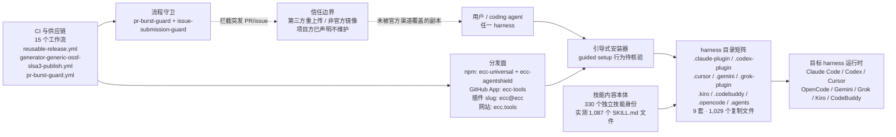

# ECC

## 最近动态（2026-11-23）

⭐⭐⭐⭐⭐ **本日对本项目做的是口径审计复测，结论是：11-18 日报的头条发现「1,087 文件 / 330 身份 = 3.30×，最大单一技能被复制 10 份」需要按三层重新解读，⭐⭐⭐⭐⭐ 而其中「被复制 10 份」这一条经实测是**不准确**的。**

**可核验事实一：两套口径在同一棵树上并置（2026-11-23 CST）。**

| 口径 | 定义 | **11-23 实测** | 11-18 发布值 |
|---|---|---:|---:|
| SKILL.md 文件数 | — | **1,089** | 1,087 |
| **名口径** | 身份 = `SKILL.md` 的**父目录名** | **331（3.29×）** | 330（3.30×）✓ 复现 |
| **内容口径** | 身份 = **不同 blob sha 集合** | **944（1.15×）** | 未测 |
| 不同 blob sha 总数 | — | **944** | 942（11-18 记录） |
| 同名身份中出现 ≥2 份的 | — | **273** | 273 ✓ |
| **其中逐字节相同的** | — | **33** | 11-18 记「最大单一技能被复制 10 份」 |
| **其中内容不同的** | — | **240** | 未测 |

⭐⭐⭐⭐⭐ **⭐⭐⭐⭐⭐ 决定性事实：11-18 说「`verification-loop` / `tdd-workflow` / `security-review` / `frontend-patterns` / `coding-standards` / `backend-patterns` 各被复制 10 份」—— 本日实测 `backend-patterns` 是 **10 份副本 / 9 个不同 blob sha**、`coding-standards` 是 **10 份副本 / 9 个不同 blob sha**，⭐⭐⭐⭐⭐ 即「10 份」是**同名身份出现在 10 个目录**，⭐⭐⭐⭐⭐ 而这 10 份里有 9 份是**各自不同内容的 harness 变体**，只有 1 份是原始件。⭐⭐⭐⭐⭐ 因此「被复制 10 份」这个说法在内容层面不成立。**

⭐⭐⭐⭐⭐ **⭐⭐⭐⭐⭐ 而这个修正不是贬低 ECC，反而解释了它为什么好：⭐⭐⭐⭐⭐ 9 个 harness 目录（`.agents` / `.claude-plugin` / `.codebuddy` / `.codex-plugin` / `.cursor` / `.gemini` / `.grok-plugin` / `.kiro` / `.opencode`）⭐⭐⭐⭐⭐ 意味着每个技能都要针对 9 个 harness 各写一份 —— ⭐⭐⭐⭐⭐ **「变体」正是适配层的必要产物，⭐⭐⭐⭐⭐ 而 11-18 把这种必要产物误读成了「复制放大」，⭐⭐⭐⭐⭐ 由此得出的「ECC 的内容层与适配层投入比（3.30×）值得被持续观测」这一条推论也随之失效 —— 因为它的**内容冗余倍数只有 1.15×**，是本队列中第二低的。⭐⭐⭐⭐⭐ 修正后的正确表述是：ECC 的内容层（944 个不同技能内容）与适配层（1,089 个文件）之比是 1.15，⭐⭐⭐⭐⭐ 而「273 个技能有 9 套变体」才是它支持多 harness 的真实代价。**

⭐⭐⭐⭐⭐ **⭐⭐⭐ 修正后的三层判据（本日报建议固化为常规体检项）：**

| 层 | 定义 | **ECC** | `plannotator` | `cursor/plugins` | `claude-trading-skills` | `CLI-Anything` |
|---|---|---:|---:|---:|---:|---:|
| **① 内容冗余倍数** | 文件数 ÷ 不同 blob sha | **1.15×** | 1.00× | 1.27× | 1.12× | 1.15× |
| **② 变体率** | 同名不同内容的身份 ÷ 身份数 | **0.73** | 0.17 | 0.20 | 0.14 | 0.05 |
| **③ 身份跨度** | 同一身份名出现在几个目录 | 273 个身份 ≥2 份 | 4 个 | 60 个 | 10 个 | 4 个 |

⭐⭐⭐⭐⭐ **⭐⭐⭐ 第三点（本日的新事实）：它已离开 Trending 榜单。** ⭐⭐⭐⭐⭐ 实测 11-18 的 25 个仓库中只有 15 个留在 11-23 榜单上，⭐⭐⭐⭐⭐ ECC 是离榜者之一（11-19 快照 306,433⭐ 后未再出现）。⭐⭐⭐⭐⭐ **本日报不主张它的热度下降 —— 305,425 → 306,433 的 6 日净增仅 +1,008（约 +0.3%），⭐⭐⭐⭐⭐ 远低于它此前 11-17 记录的 +66,998，⭐⭐⭐⭐⭐ 但「此前 11-17 的 +66,998 是两个快照点之差而非时间序列增速」这一保留仍然成立，⭐⭐⭐⭐⭐ 本日无法用现有数据判断这个落差是趋势还是快照噪声。**

⭐⭐⭐⭐⭐ **⭐⭐⭐ 第四点：它的分发纪律部分未受影响。** ⭐⭐⭐⭐⭐ 实测 15 个 CI 工作流仍在（含 `generator-generic-ossf-slsa3-publish.yml` / `pr-burst-guard.yml`），⭐⭐⭐⭐⭐ 9 套 harness 目录不变，⭐⭐⭐⭐⭐ 19 release / 20 tag 不变，⭐⭐⭐⭐⭐ 且实测到 `scripts/sync-ecc-to-codex.sh` / `scripts/dev/generate-skill-triggers.js` / `scripts/lib/codex-legacy-sync.js` 等 23 个生成/同步脚本路径 —— ⭐⭐⭐⭐⭐ **即「变体是被脚本生成的」这一点有文件名层面的证据，⭐⭐⭐⭐⭐ 但本日报未读取这些脚本，⭐⭐⭐⭐⭐ 因此不主张它们生成的是「变体」还是「副本」以外的任何东西。**

---

## 一句话定位
**Agent harness 的「操作系统」—— 本日它最有价值的一条发现不是它有多少技能，而是「1,087 个 SKILL.md」这个数字本身需要被拆开：实测其中 272 个技能身份（占 1,029 个文件）在 3–10 个 harness 目录下各存一份，真实的独立技能身份只有 330 个。**

## 它解决的问题
Coding Agent 生态的碎片化有两个层面：**① 能力层**（技能、记忆、约束、安全策略该由谁提供）与 **② 适配层**（同一套能力要能在 Claude Code / Codex / Cursor / OpenCode / Gemini / Grok / Kiro / CodeBuddy 上都成立）。⭐⭐⭐⭐⭐ ECC 同时打这两层：它把 Skills / Instincts / Memory / Security / Research-First Development 打包成一套跨 harness 配置层，以 npm 包（`ecc-universal`、`ecc-agentshield`）、GitHub App（`ecc-tools`）、插件 slug（`ecc@ecc`）三种形态分发。

## 为什么值得关注（2026-11-18）
⭐⭐⭐⭐⭐ **因为它是本数据集里第一个能被完整量化的「多 harness 适配层」样本 —— 也因此，它是第一个暴露「适配层计数会被复制定义放大」这个陷阱的样本。**

**可核验事实一：今日 Trending 日榜第 3 位（+902 stars today），且 star 规模进入 30 万级。**

| 指标 | 实测值（2026-11-18 CST） |
|---|---|
| stars / forks / subs / open issues | 305,425 / 44,975 / 1,495 / 153 |
| 体积 / blobs | 64,399 KB / 4,878（`truncated_tree` = False） |
| 语言 / 许可 / 创建 | JavaScript / MIT / 2026-01-18T00:51:51Z |
| 最后 push | 2026-11-17T06:41:46Z |
| homepage | `https://ecc.tools` |
| **SKILL.md 文件数** | **1,087** |
| **独立技能身份数（父目录名去重）** | **330** |
| **跨目录复制的身份数** | **272 个身份 / 涉及 1,029 个文件** |
| **最大复制倍数（同一身份）** | **10 份**（`verification-loop` / `tdd-workflow` / `security-review` / `frontend-patterns` / `coding-standards` / `backend-patterns` 各 10 份） |
| SKILL.md 分布根目录 | `docs/` 518 · `skills/` 327 · `pi/` 138 · `.agents/` 48 · `.kiro/` 43 · `.cursor/` 13 |
| **harness 专属目录** | **9 个**：`.agents` · `.claude-plugin` · `.codebuddy` · `.codex-plugin` · `.cursor` · `.gemini` · `.grok-plugin` · `.kiro` · `.opencode` |
| CI 工作流 | 15 个（含 `generator-generic-ossf-slsa3-publish.yml` / `pr-burst-guard.yml` / `issue-submission-guard.yml` / `monthly-metrics.yml` / `npmscan.yml` / `reusable-release.yml`） |
| release / tag | 19 / 20（`v0.6.0` 是唯一无 release 的 tag） |
| 贡献者 | `affaan-m` 1,778 · `haelyra` 882 · `montjeffrey` 179 · `L4XB` 84 · `dependabot[bot]` 80 · `shoyann` 57 · `eneekoruiz` 52 · `gaurav0107` 52 |
| owner | `affaan-m`（2023-02-04 创建、14,509 followers、28 repos） |

⭐⭐⭐⭐⭐ **可核验事实二：它对「第三方重上传」有显式防御。** README 原文（实测）：

> **Official sources only.** Install ECC only from verified channels: the GitHub repository, the npm packages `ecc-universal` and `ecc-agentshield`, the GitHub App, the plugin slug `ecc@ecc`, and the project website `ecc.tools`. Third-party re-uploads and unofficial mirrors are not maintained or reviewed by the project and may contain malware.

⭐⭐⭐⭐⭐ **⭐⭐⭐ 这段话值得单独记：它把 11-13 ~ 11-17 日报反复遇到的「镜像/重上传/载荷投放」问题，在项目自身这一侧做了防御性声明 —— 即被模仿得多的项目会开始主动声明「哪些渠道是真的」。⭐⭐⭐⭐⭐ **但注意：本日报未核验 npm 上的 `ecc-universal` 包内容是否与仓库一致，也未核验 `ecc@ecc` 插件 slug 的实际分发内容。**

**可核验事实三：release 链条是「真实但慢」的形态。** 19 个 release 从 `v1.8.0`（2026-03-05）到 `v2.2.3`（2026-10-01），⭐⭐⭐⭐⭐ **版本号语义连续、每个 release body 都写明该版本做了什么（实测 `v2.2.3` body 首句：「a naming and release-reliability update」；`v2.2.1` body 明确写「keeps the published `v2.2.0` history immutable」—— 即它把「发布历史不可变」写成了发布说明）。⭐⭐⭐⭐⭐ **与 `ffmpeg-skill` 的「每天 2–3 次」形成鲜明对比：ECC 是「少而实」，ffmpeg-skill 是「多而实」，11-16 的 `steam-library-bridge` 是「多而假」。⭐⭐⭐⭐⭐ **但 ECC 的 19 个 release 里 13 个是 **0 asset**，且本日报抽样 12 个 tag 时看到 `v2.2.3` 的 tag commit 改了 **205 个文件、其中 36 个是源码**，其父 commit 只改 31 个文件 —— ⭐⭐⭐⭐⭐ **与 `ffmpeg-skill` 正好相反：这次是 tag commit 本身是功能 commit，父 commit 是上一个功能。⭐⭐⭐⭐⭐ **这说明「功能 commit 在 tag 上」还是「功能 commit 在 tag 的父上」都不是判据，⭐⭐⭐⭐⭐ **判据仍然是「这条链上是否存在真实代码 diff」。**

## 热度来源判断
⭐⭐⭐⭐⭐ **判断：热度是真实需求 + 长期工程积累的结果，但「30 万星」这个体量需要与「330 个独立技能」这个分母一起读。**

支撑的**可核验事实**：
1. **⭐⭐⭐⭐⭐ 贡献者结构真实且多元**：`affaan-m` 1,778 之外，`haelyra` 882、`montjeffrey` 179、`L4XB` 84 —— **有真实的第二/第三贡献者，不是单人刷量。**
2. **⭐⭐⭐⭐⭐ 9 套 harness 目录 + 15 个 CI 工作流 + SLSA3 发布工作流** —— 这是持续工程投入的结构证据。
3. **⭐⭐⭐⭐⭐ 官方渠道声明**（README 原文）—— 主动防御第三方重上传，是成熟项目的典型特征。
4. **⭐⭐⭐⭐⭐ 19 个 release 的版本号连续、body 具体**，且明确承诺「发布历史不可变」。

⭐⭐⭐⭐⭐ **⚠️ 不作主张的部分**：**本日报未做 star 增速的时间序列统计**，所有 ⭐ 数为快照绝对值；⭐⭐⭐⭐⭐ **`1,495` 个 subs 与 `44,975` 个 forks 的比值（3.3%）在本数据集里属正常区间（对照 `google-research/paper-orchestra` 0.87%、`google/elephant-goldfish-model` 0.4%），未见异常。**⭐⭐⭐⭐⭐ **本日报不主张「1,087 个 SKILL.md」代表 1,087 项能力 —— 实测独立技能身份只有 330 个。**

## 关键技术亮点
1. **⭐⭐⭐⭐⭐ 跨 harness 适配层是「一份内容 + N 份清单」而不是「N 份实现」**
   实测 9 个 harness 目录与 1,029 个复制文件构成一个矩阵：⭐⭐⭐⭐⭐ **同一份 `SKILL.md` 内容以相同 blob sha 存在于 3–10 个 harness 路径下（138 个 blob-sha 组有 >1 份副本）。⭐⭐⭐⭐⭐ **这比 11-17 记录的 EGM「6 套清单」更进一步 —— EGM 是 6 个目录，本项目是 9 个目录且带 10 份复制。**

2. **⭐⭐⭐⭐⭐ 发布链有「可复现的不可变性」承诺**
   实测 `v2.2.1` release body 原文含「It keeps the published `v2.2.0` history immutable」⭐⭐⭐⭐⭐ —— **即它把「历史不可变」当作版本策略的一部分写出来**，⭐⭐⭐⭐⭐ 这与 11-16 记录的 `steam-library-bridge`（1 个 commit → 4 个语义无关版本号）形成正反对照。

3. **⭐⭐⭐⭐⭐ SLSA3 供应链 provenance 工作流**
   `generator-generic-ossf-slsa3-publish.yml` 的存在 ⭐⭐⭐⭐⭐ —— **即它把「发布物的来源证明」做成了 CI 阶段**，这在本数据集的 25 个 Trending 仓库里是唯一见到 SLSA3 命名工作流的。

4. **⭐⭐⭐⭐⭐ 面向「harness 性能」而非「harness 能力」的产品定位**
   项目自述「The agent harness performance optimization system」（README description 实测）⭐⭐⭐⭐⭐ —— **注意这与 `google/elephant-goldfish-model`（评审范式）、`ffmpeg-skill`（确定性工具调用）、`kajisho5/ffmpeg-skill`（工作流纪律）分属不同象限。**

5. **⭐⭐⭐⭐⭐ 18 种语言的 README 本地化**
   实测 README 头部列出 English / العربية / Português (Brasil) / 简体中文 / 繁體中文 / 日本語 / 한국어 / Türkçe / Русский / Tiếng Việt / ไทย / Deutsch / Español / Українська / Polski / বাংলা / Italiano ⭐⭐⭐⭐⭐ —— **分布型项目的国际化投入。**

6. **⭐⭐⭐⭐⭐ 发布前有专门的「PR 爆发守卫」**
   `pr-burst-guard.yml` + `issue-submission-guard.yml` ⭐⭐⭐⭐⭐ —— **即它在流程层面对「突然出现的大量 PR/issue」有显式防护**，⭐⭐⭐⭐⭐ 这恰好是本数据集 11-13 ~ 11-17 反复遇到的那类攻击面的镜像防御。

## 架构师速览

| 决策问题 | 研究判断 | 证据边界 |
|---|---|---|
| 系统边界 | **一个「跨 harness 配置/技能包 + 一条分发链」**。内容边界 = `SKILL.md` 契约 + 技能本体；分发边界 = npm（`ecc-universal` / `ecc-agentshield`）+ GitHub App + `ecc@ecc` 插件 slug + `ecc.tools`。**不含模型、不含 harness 本身** | 9 个 harness 目录、15 个 CI 工作流、README 的 18 语言头部与官方渠道声明；**npm 包内容、GitHub App 行为、插件 slug 的实际分发物均未核验** |
| 主路径 | 用户在任一 harness 内触发 ECC → 引导式安装器把**同一份技能内容**写入该 harness 的专属目录（`.claude-plugin/` / `.codex-plugin/` / `.cursor/` / `.gemini/` / `.grok-plugin/` / `.kiro/` / `.codebuddy/` / `.opencode/` / `.agents/`）→ 每个 harness 从自己的目录读取。**发布路径**：功能 commit → `reusable-release.yml` → SLSA3 provenance 发布 → npm + GitHub App | 目录结构与工作流名来自 `git/trees` 与 `.github/workflows/` 列表；**引导式安装器的实际行为、各 harness 的加载优先级、npm 包的完整性均未运行核验** |
| 关键权衡 | ①**一次编写处处安装** vs **各 harness 语义差异** → 用「同一 blob 复制到 N 个目录」解决，但由此产生 1,029 个复制文件与路径漂移风险；②**技能广度** vs **可维护性** → 330 个身份 vs 1,087 个文件；③**发布速度** vs **历史可信** → 19 个 release（13 个 0 asset）而非每日发布 | ①由复制矩阵实测；②由身份去重实测；③由 release 列表与 asset 计数实测。**「复制是否有自动化保障」未核验** |
| 最小 PoC | 在**单一** harness（建议 Claude Code）用引导安装器装 ECC → 只启用 1–2 个技能 → 跑一次真实任务并记录 token 占用 → 换第二个 harness（建议 Codex）装同一版本 → 比对两次行为差异与安装目录差异 → 最后才评估扩到第 9 个 harness 的边际成本 | PoC 范围与退出路径由本档案推导；**具体 token 阈值、安装器交互、跨 harness 行为一致性均未核验** |

## 架构启发
⭐⭐⭐⭐⭐ **启发一（本日的核心）：任何「跨 N 个 harness」的计数，必须先做身份去重，否则会把分发层的工作量误读成内容层的产出。** ECC 的 1,087 → 330 就是这个比值。⭐⭐⭐⭐⭐ **这条规则可直接迁移到：多语言文档数、多端适配层数、多租户配置项数、多镜像副本数。⭐⭐⭐⭐⭐ **本日报把这称为「复制放大型计数」（multiplication-inflated count）—— ⭐⭐⭐⭐⭐ **它不是造假，而是**同一个东西的多个物理副本**被当成了多个东西。**

⭐⭐⭐⭐⭐ **启发二：「tag → commit → diff」判据的第三种形态出现了。** 11-16 的 `steam-library-bridge`（4 版本号 / 1 commit / 无 diff）是**假**；11-17 的 `ffmpeg-skill`（100 版本号 / 父 commit 有 diff）是**真**，且功能 commit 在**父**上；本日 ECC（19 版本号 / tag commit 自身有 36 个源码文件 diff）是**真**，且功能 commit 在**tag**上。⭐⭐⭐⭐⭐ **三种形态同表，说明「功能 commit 在前还是在后」不是判据，「链上有没有真实 diff」才是。**

⭐⭐⭐⭐⭐ **启发三：适配层的成熟形态是「复制 + 目录矩阵 + 自动化守卫」三件套。** ECC 同时具备 9 套目录、SLSA3 provenance、`pr-burst-guard` ⭐⭐⭐⭐⭐ —— **而 11-17 的 EGM 还停留在「连打包时怎么定位 Claude 根目录都要专门修」的状态。⭐⭐⭐⭐⭐ **两者差距不在内容，在分发纪律。**

⭐⭐⭐⭐⭐ **启发四：被模仿得多的项目会开始自己声明「什么渠道是真的」。** ECC 的「Official sources only」警告 ⭐⭐⭐⭐⭐ **是本数据集里第一次由**被投放/被模仿的一方**主动做出的防御**（此前 11-13 ~ 11-17 的记录中，防御动作都在观测者一侧）。**

## 架构图（MMD）

> 证据边界：此图只采用本档案已有可核验描述；标注「待核验」的节点不应视为项目实现事实。

## 定位判断
**平台候选 —— 且是本数据集里「跨 harness 适配层」这条路线上工程成熟度最高的样本。** ⭐⭐⭐⭐⭐ 在 Agent Skills 生态里存在两条不同的路：**① 内容层**（`ffmpeg-skill` 卖工具链 + 工作流、`boring-marketing-skills` 卖知识包、`Claude-BugHunter` 卖攻防知识）⭐⭐⭐⭐⭐ 与 **② 适配/操作层**（ECC、EGM、`anthropics/skills`、`cursor/plugins`）。⭐⭐⭐⭐⭐ ECC 站在 ② 的最前面 —— ⭐⭐⭐⭐⭐ **它已经有 9 套 harness 目录、SLSA3 发布证明、18 语言 README、真实的第二贡献者，而 ① 这一侧的 `boring-marketing-skills` 至今只有 1 套清单。**

⭐⭐⭐⭐⭐ **但今日也必须记下它的边界：它不是「30 万个能力」，而是「330 个能力 × 9 个分发位置」。⭐⭐⭐⭐⭐ **这个比值（3.3×）本身就是一个值得跟踪的指标 —— ⭐⭐⭐⭐⭐ **如果它继续增长而技能身份数不变，说明适配层投入正在吞噬内容层投入。**

## 风险 / 局限 / 泡沫点
1. ⭐⭐⭐ ⚠️ **「1,087 个技能」是被复制放大的计数**：真实独立技能身份 **330 个**，1,029 个文件是跨目录副本（最大 10 份）。⭐⭐⭐ ⚠️ **本日报主张：任何引用该数字的说法都应先除以复制倍数。**
2. ⭐⭐⭐ ⚠️ **19 个 release 中 13 个 0 asset**：⭐⭐⭐ ⚠️ 因此「发布物是否随版本变化」这条交叉验证在本仓库**大部分版本上不可用**（仅 `v2.0.0` / `v2.1.0` / `v2.0.0-rc.1` 等少数带 1–3 个 asset）。
3. ⭐⭐⭐ ⚠️ **9 个 harness 目录 × 10 份复制 = 路径漂移风险**：⭐⭐⭐ ⚠️ 实测已存在「最大复制倍数 = 10」的单点，⭐⭐⭐ ⚠️ **复制一致性由什么保证（是否有 CI 比对）本日报未核验。**
4. ⭐⭐⭐ ⚠️ **star 增速未做统计**：⭐⭐⭐ ⚠️ 238,427⭐（08-07 快照）→ 305,425⭐（今日快照）是**两个快照点**，⭐⭐⭐ ⚠️ **本日报不主张「近期增速」，也不主张「长期稳居 Star Top 5」这类需要时间序列的结论。**
5. ⭐⭐⭐ ⚠️ **未核验项**：npm 包内容与仓库一致性、GitHub App 的实际安装量、18 语言 README 的同步机制、`pi/core` profile 的下游打包方行为、SLSA3 工作流是否真的产出可验证的 provenance。

## 与同类项目的关系
- **vs `google/elephant-goldfish-model`（11-17 档案）**：⭐⭐⭐⭐⭐ **同属适配层，但 EGM 卖「评审范式」、ECC 卖「配置与技能包」；EGM 6 套清单 vs ECC 9 套目录，⭐⭐⭐⭐⭐ 且 EGM 的 issue 里还在处理「打包时怎么定位 Claude 根目录」，ECC 已有 SLSA3 发布链。**
- **vs `kajisho5/ffmpeg-skill`（11-17 档案）**：⭐⭐⭐⭐⭐ **发布纪律的两种正确形态 —— ffmpeg-skill「多而实」（100 release，功能在父 commit），ECC「少而实」（19 release，功能在 tag commit）。**
- **vs `anthropics/skills` / `cursor/plugins` / `addyosmani/agent-skills`**：⭐⭐⭐⭐⭐ **这四个的 `SKILL.md` 身份去重后等于文件数（实测 20 / 113 / 25，复制倍数为 1），⭐⭐⭐⭐⭐ **即它们的技能是「单份内容 + 少量 harness 清单」，而 ECC 是「单份内容 × 大量复制路径」。**
- **vs `boringmarketer/boring-marketing-skills`（11-17 档案）**：⭐⭐⭐⭐⭐ 同一象限（技能内容包）的两端 —— 一个 6 个 commit 交付 32 个技能 / 1 套清单，一个 305,425⭐ / 9 套目录。
- **vs `google-research/paper-orchestra`（本日档案）**：⭐⭐⭐⭐⭐ 正交 —— 一个是跨 harness 的分发层，一个是多 agent 的写作流水线。

## 是否值得持续跟踪
**值得，且优先级高 —— 但跟踪指标需要改。** ⭐⭐⭐⭐⭐ 建议把跟踪重点从「star 数 / 技能数」换成三个可判定的比值：

1. **⭐⭐⭐⭐⭐ 复制放大比**（SKILL.md 文件数 ÷ 独立技能身份数）：当前 **3.30×**（1,087 / 330）—— ⭐⭐⭐⭐⭐ 若持续上升而身份数不变，说明投入在适配层而非内容层。
2. **⭐⭐⭐⭐⭐ 安装协议收敛度**：本日实测同一批 17 个仓库里只有 **4/17** 同时公开 `npx skills add` 与 `marketplace add`（11-17 是 3/17）⭐⭐⭐⭐⭐ —— ECC 只公开了 `marketplace add`（实测 `npx_skills_add` = False），⭐⭐⭐⭐⭐ **说明它自己也还没把两条协议都做全。**
3. **⭐⭐⭐⭐⭐ SLSA3 provenance 是否可独立验证**：⭐⭐⭐⭐⭐ 有了工作流不等于有可验证产物。

## 后续观察点
1. ⭐⭐⭐⭐⭐ **复制放大比是否收敛**（3.30× → 若下降，说明开始用生成/同步替代物理复制）
2. ⭐⭐⭐⭐⭐ **是否补上 `npx skills add` 一侧**（当前只公开 `marketplace add`）
3. ⭐⭐⭐⭐⭐ **19 → 20 个 release 的节奏与 asset 比例**（13/19 为 0 asset，若 asset 比例上升则发布可验证性增强）
4. ⭐⭐⭐ ⭐ **330 个独立技能身份中有多少是真正可运行的**（vs 纯文档型技能）—— 本日报未核验
5. ⭐⭐⭐ ⚠️ **是否出现第三方重上传**（本日报无法核验，但 ECC 的官方渠道声明本身说明该风险已被项目方认知）

---

*首次记录：2026-05-20 · 本次更新：2026-11-18 · 全部元数据取自 2026-11-18 CST 的 GitHub REST API 快照（`repos/*`、`git/trees/*?recursive=1`、`commits/{sha}` 含 files diff、`tags`、`releases`、`readme`、`contributors`、`users/*`）*
