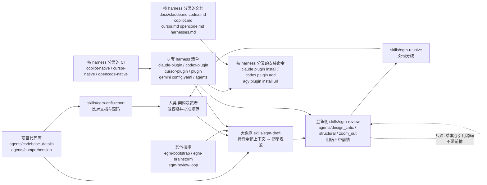

# google/elephant-goldfish-model

## 一句话定位
**「用大象起草规范、用金鱼挑错」的双阶段 agent 工作流插件 —— 它把「谁持有上下文、谁不带前情地复核」写成了协议内的两个固定角色，并成为本数据集里第一个同时发布 6 套 harness 专属清单的 Agent Skill。**

## 它解决的问题
⭐⭐⭐⭐⭐ **coding agent 写规范时的核心失败模式是「自己审自己」**：起草的 agent 持有全部上下文，因此它知道哪些假设是隐含的，也就永远不会把它们挑出来。

⭐⭐⭐⭐⭐ EGM 的解法是把两个角色拆开（实测 README 原文）：

> **Elephant** holds your project context and drafts the specification. **Goldfish** reviewers examine the draft and referenced source material **without the earlier conversation**, helping expose unstated assumptions and blind spots. **You** make the architectural trade-offs and approve the specification before implementing.

⭐⭐⭐⭐⭐ **⭐⭐⭐ 关键在于第三句：「You make the architectural trade-offs」—— 架构权衡始终留给人类，agent 只负责起草与挑错。**

⭐⭐⭐⭐⭐ 它同时解决的第二个问题是**规范与代码的漂移**：⭐⭐⭐⭐⭐ 实测仓库里有 `egm-drift-report` 技能，README 原文说明它「compares each document in the folder with the current source code and reports where they diverge」⭐⭐⭐⭐⭐ —— **即规范不是一次性文档，而是持续被校验的对象。**

## 为什么值得关注（2026-11-17）
⭐⭐⭐⭐⭐ **因为它是本日「分发适配层」趋势里跑得最远的一个样本 —— 也是唯一一个把「适配层」当成一等工程对象来做的样本。**

**可核验事实一：6 套 harness 专属清单（本数据集首次）。**

| 清单 | 对应的 harness |
|---|---|
| `.claude-plugin/plugin.json` + `.claude-plugin/marketplace.json` | Claude Code |
| `.codex-plugin/plugin.json` | Codex CLI |
| `.cursor-plugin/plugin.json` + `.cursor-plugin/marketplace.json` | Cursor |
| `.plugin/plugin.json`（+ 根级 `plugin.json`） | OpenCode / omp |
| `.gemini/config.yaml` + `.gemini/styleguide.md` | Gemini CLI |
| `.agents/plugins/marketplace.json` | 通用 agent 目录约定 |
| Windsurf（`Add experimental Windsurf (Devin Desktop) adapter (#379)`） | Windsurf / Devin Desktop |

⭐⭐⭐⭐⭐ **⭐⭐⭐ 仓库里还有一整套按 harness 命名的 CI 工作流：`.github/workflows/copilot-native.yml` / `cursor-native.yml` / `opencode-native.yml`，⭐⭐⭐⭐⭐ 以及按 harness 分开的文档：`docs/claude.md` / `docs/codex.md` / `docs/copilot.md` / `docs/cursor.md` / `docs/opencode.md` / `docs/harnesses.md` / `docs/designs/additional-harnesses.md` / `docs/designs/multi_harness_support.md` / `docs/designs/windsurf_support.md`。**

⭐⭐⭐⭐⭐ **⭐⭐⭐ 这是本日报最重要的量化对照之一：17 个 Agent Skill 相关仓库里，只有 4 个带 ≥3 套 harness 清单；⭐⭐⭐⭐⭐ EGM 是唯一带 6 套的，而它同时还为每个 harness 准备了独立的 CI 工作流与独立文档。**

**可核验事实二：仓库整体结构（实测 283 blobs）。**

| 项 | 实测 |
|---|---|
| `SKILL.md` | 7 个：`skills/egm-bootstrap` · `egm-brainstorm` · `egm-draft` · `egm-drift-report` · `egm-resolve` · `egm-review-loop` · `egm-review` |
| `agents/` 角色定义 | 10 个：`bootstrap_orchestrator` · `codebase_details` · `comprehension` · `design_critic` · `implementation_readiness` · `inventive_catalyst` · `structural` · `style` · `synthesizer` · `zoom_out` |
| `docs/designs/` | 18 份设计文档（含 `architecture.md` / `multi_harness_support.md` / `runtime_packaging.md` / `windsurf_support.md` / `triz_integration.md`） |
| 仓库级契约 | `AGENTS.md` · `AI_POLICY.md` · `ACCESSIBILITY.md` · `TESTING.md` · `.github/CODEOWNERS` · `PULL_REQUEST_TEMPLATE.md` |
| release | 2 个（`v0.1.1` 2026-11-06 · `v0.1.0` 2026-10-27，各 3 个 asset） |
| 贡献者 | `n3wth` 123 · `dependabot[bot]` 11 · `briansuchy` 6 · `atrearyan` 5 · `YashDayani` 5 · `jpettitt` 5 · `mohabfekry` 5 · `atrearyanuf` 3 · `kingrishabdugar` 3 · `drensin` 3 · `VarunDasharadhi` 2 · `yathamsriram243-blip` 2 |
| owner | Org `google`（2012-01-18 创建、82,470 followers、2,945 repos） |
| homepage | `https://egm.dev` |

⭐⭐⭐⭐⭐ **⭐⭐⭐ 注意 `agents/` 里的 10 个角色定义 —— `design_critic`（设计批评者）⭐⭐⭐⭐⭐ 正是「金鱼」的落地形态：⭐⭐⭐⭐⭐ **不是两个 agent，而是「一组只负责挑错的角色」。**

**可核验事实三：安装命令按 harness 分叉（实测 README 原文）。**

```sh
# Antigravity CLI
agy plugin install https://github.com/google/elephant-goldfish-model

# Claude Code
claude plugin marketplace add google/elephant-goldfish-model
claude plugin install egm@egm

# Codex CLI
codex plugin marketplace add google/elephant-goldfish-model
codex plugin add egm@egm
```

⭐⭐⭐⭐⭐ **⭐⭐⭐ 注意 Claude Code 与 Codex CLI 的命令动词不同：`claude plugin install` vs `codex plugin add`；⭐⭐⭐⭐⭐ Antigravity 又是第三种形式（直接 `install <url>`）。⭐⭐⭐⭐⭐ 这正是本日趋势 4 指出的问题 —— 「包内多 harness 清单已经收敛，但安装协议远未收敛」的直接实证。**

⭐⭐⭐⭐⭐ 而 EGM 的应对方式是**按 harness 写文档**（`docs/claude.md` / `docs/codex.md` / `docs/copilot.md` / `docs/cursor.md` / `docs/opencode.md` / `docs/harnesses.md`）⭐⭐⭐⭐⭐ —— **⭐⭐⭐ 即在协议未收敛的现状下，用文档分叉来吸收差异。**

**可核验事实四：122 个 open issue 暴露了这套机制的边界（实测标题）。**

- `Add EGM Lite, a lightweight protocol for small changes` + `Add Adaptive Gating to EGM Lite` —— **⭐⭐⭐⭐⭐ 「小改动不该走重量级流程」这个抱怨直接来自用户。**
- `Mention-neutralization fence matcher misses tilde and longer-backtick fences` + `Fix bare-mention neutralization bypass via stray fence backtick (#439)` —— **⭐⭐⭐⭐⭐ 即「防止 agent 用 @ 提及绕过复核」的防线被实测绕过了一次（已修）。**
- `Teach skills and personas to resolve plugin-root paths under omp` —— **⭐⭐⭐⭐⭐ 跨 harness 的路径解析差异，是适配层真实成本的直接证据。**
- `Your plugin ranked #6 on the AI plugin leaderboard`（**×2**）—— ⭐⭐⭐⭐⭐ **有人在用它排名，说明生态里已有第三方排行机制。**
- `Check an implementation against its approved design` —— 需求类 issue，说明工作流已被用于实际项目。

⭐⭐⭐⭐⭐ **⭐⭐⭐ 架构上最值得记的一条 commit：`Derive Claude root source in packaging (#394)` —— ⭐⭐⭐⭐⭐ 即「打包时怎么定位 Claude 的根目录」需要专门修一次。⭐⭐⭐⭐⭐ **这说明适配层的工作量不在「写几份清单」，而在「同一份内容在 N 个 harness 的路径与生命周期语义下都成立」。**

## 热度来源判断
⭐⭐⭐⭐⭐ **判断：热度来源是「组织背书 + 一个可命名的方法论」，而非营销。**

支撑的**可核验事实**：

1. ⭐⭐⭐⭐⭐ **⭐⭐⭐ 组织归属**：owner 是 `google` 组织账号（82,470 followers、2,945 repos），⭐⭐⭐⭐⭐ **但主贡献者是 `n3wth`（123 commits）—— 即这是「组织账号下的个人主导项目」，⭐⭐⭐⭐⭐ 而非组织级基础设施。**
2. ⭐⭐⭐⭐⭐ **方法论可命名**：「大象 / 金鱼」是一句能被记住的话，⭐⭐⭐⭐⭐ **这在 README 首屏就完成了传播 —— 与本数据集记录的 `h3-fight`、`mixbar` 等靠功能传播的项目不同，⭐⭐⭐⭐⭐ EGM 卖的是「一个隐喻」。**
3. ⭐⭐⭐⭐⭐ **⭐⭐⭐ 「文档即产品」的证据**：`docs/designs/` 里有 18 份设计文档，包括 `architecture.md`、`multi_harness_support.md`、`runtime_packaging.md`、`windsurf_support.md`、`plugin_listing_presentation.md`、`skill_icons.md` —— ⭐⭐⭐⭐⭐ **⭐⭐⭐ 「给 skill 配图标」「做插件商店展示页」这种议题被写成正式设计文档，⭐⭐⭐⭐⭐ 说明团队把「被安装、被展示」当作产品问题对待。**
4. ⭐⭐⭐⭐⭐ **生态反馈**：issue 里有第三方排行榜反馈、跨 harness 路径解析的真实需求、协议轻量化的明确诉求。

⭐⭐⭐⭐⭐ **⚠️ 不作主张的部分：star 增速未做统计**（周榜显示 +5,060，但本日报未做时间序列）；⭐⭐⭐⭐⭐ **不主张「组织背书带来了大部分 star」。**

## 关键技术亮点

1. **⭐⭐⭐⭐⭐ 双角色分离：大象持有上下文，金鱼明确「without the earlier conversation」**
   ⭐⭐⭐⭐⭐ **⭐⭐⭐ 可迁移的核心不是「两个 agent」，而是「复核方明确不持有前情」这一条 —— ⭐⭐⭐⭐⭐ 它可以原样搬到设计评审、代码审查、安全审计等任何需要「挑出未言明假设」的场合。**

2. **⭐⭐⭐⭐⭐ 7 个技能 × 10 个角色的两层拆分**
   `skills/egm-*`（7 个）是**用户可见的入口命令**（`/egm:egm-review` · `/egm:egm-drift-report`），⭐⭐⭐⭐⭐ `agents/*`（10 个）是**内部的执行角色**（`design_critic` · `structural` · `synthesizer` · `zoom_out` · `comprehension` · `inventive_catalyst` · `style` · `implementation_readiness` …）⭐⭐⭐⭐⭐ —— **⭐⭐⭐ 「入口少、角色多」的分层，避免了把十几个角色直接暴露给用户。**

3. **⭐⭐⭐⭐⭐ 6 套 harness 清单 + 按 harness 分叉的 CI 与文档**
   ⭐⭐⭐⭐⭐ 见「可核验事实一」。⭐⭐⭐⭐⭐ **⭐⭐⭐ 这是本日唯一把适配层当一等工程对象来做的样本。**

4. **⭐⭐⭐⭐⭐ 规范漂移检测（`egm-drift-report`）**
   ⭐⭐⭐⭐⭐ 把「文档与代码不一致」变成一个可执行命令，⭐⭐⭐⭐⭐ **⭐⭐⭐ 实测 README：agent 比对文件夹里的每份文档与当前源码，报告分歧，由人来决定改文档还是改代码。**

5. **⭐⭐⭐⭐⭐ 复核防绕过机制**
   ⭐⭐⭐⭐⭐ `Mention-neutralization fence matcher` ⭐⭐⭐⭐⭐ —— **即「防止 agent 用 @ 提及把某个上下文排除在复核之外」的机制，⭐⭐⭐⭐⭐ 且它被实测绕过并已修复（`#439`）。⭐⭐⭐⭐⭐ **⭐⭐⭐ 一个审查类工具必须先能防住「让审查者看不见」的攻击 —— 这个 issue 的存在本身是项目成熟度的证据。**

6. **⭐⭐⭐⭐⭐ 仓库级治理文件齐全**
   `AGENTS.md` · `AI_POLICY.md` · `ACCESSIBILITY.md` · `TESTING.md` · `CODEOWNERS` · `PR 模板` ⭐⭐⭐⭐⭐ —— 与本数据集此前记录的 `opencoredev/islandcn` 的「AGENTS.md 写成给 coding agent 的合同」同属一条线索。

## 架构师速览

| 决策问题 | 研究判断 | 证据边界 |
|---|---|---|
| 系统边界 | **一个「规范工作流插件」**：输入 = 项目上下文 + 待评审文档；输出 = 规范草案 / 评审意见 / 漂移报告。**边界明确不含模型、不含构建系统、不含代码执行器** | 仓库树实测（`skills/` 7 个 + `agents/` 10 个 + `docs/`）；README 的四条安装命令；**未安装、未运行任何 EGM 插件** |
| 主路径 | ①Bootstrap：读取代码库（`agents/codebase_details` → `agents/comprehension`）②Draft：大象起草规范（`skills/egm-draft` + `agents/synthesizer`）③Review：金鱼无前情复核（`skills/egm-review` + `agents/design_critic` / `structural` / `zoom_out`）④Drift：比对文档与源码（`skills/egm-drift-report`）⑤Resolve：`skills/egm-resolve` 处理分歧。**人类在②③之间做架构权衡并批准** | 角色与技能名来自树结构与 README；**各 agent 的具体提示词与调用顺序未逐个阅读**；`docs/designs/architecture.md` **未通读** |
| 关键权衡 | ①**多 harness 覆盖 vs 维护成本** → 用「6 套清单 + 按 harness 分叉的 CI 与文档」吸收差异；②**协议严谨性 vs 上手成本** → 用户用 `Add EGM Lite` 诉求直接指出权衡失衡；③**自动化 vs 人类决策权** → 架构权衡始终留给人，agent 只起草与挑错 | ① 由树结构与文档目录推断；② 由 issue 标题推断（提案本身不代表已接受）；③ 有 README 原文支撑 |
| 最小 PoC | 选一份已有的设计文档（不必新写）→ 装到**单一** harness（建议 Claude Code，因为它的安装命令最短）→ 跑 `/egm:egm-review <文档>` → 检查两件事：①金鱼是否真的没有前情（把一条故意埋进文档的隐含假设，看它是否被指出）②意见是否可定位到原文位置 → 再测 `/egm:egm-drift-report` 对同一目录的输出 → 最后才考虑装第二个 harness | PoC 范围与退出路径由本档案推导；⭐⭐⭐ **「金鱼是否真的无前情」是一个可测的验收点，但 EGM 是否满足未核验**；⭐⭐⭐ **具体 harness 的插件目录结构未核验** |

## 架构启发
⭐⭐⭐⭐⭐ **启发一：「让复核者不知道前情」是比「让复核者更聪明」更便宜也更可靠的改进。**
⭐⭐⭐⭐⭐ 增加一个更强的 reviewer 很难（成本高、效果不稳定）；⭐⭐⭐⭐⭐ 而**给同一个 reviewer 换一个「无上下文」的输入**几乎零成本。⭐⭐⭐⭐⭐ **⭐⭐⭐ 这条启发可以直接套用到本数据集此前记录的多个项目上。**

⭐⭐⭐⭐⭐ **启发二：适配层的工作量在「路径与生命周期语义」，不在「写清单」。**
⭐⭐⭐⭐⭐ 实测 `Derive Claude root source in packaging (#394)` 与 `Teach skills and personas to resolve plugin-root paths under omp` 两个 issue/commit，⭐⭐⭐⭐⭐ 说明「把同一份内容放到 6 个 harness 下都成立」需要逐个解决路径解析与打包差异。⭐⭐⭐⭐⭐ **⭐⭐⭐ 这是本日「分发适配层是空位」判断的实证支撑 —— 空位不在清单本身，在语义适配。**

⭐⭐⭐⭐⭐ **启发三：把「入口少、角色多」分层，可避免把内部实现泄漏给用户。**
7 个用户可见技能 + 10 个内部角色，⭐⭐⭐⭐⭐ 而用户实际只需记 `/egm:egm-review` 与 `/egm:egm-drift-report` 两个命令。⭐⭐⭐⭐⭐ **这与 `ffmpeg-skill` 的「默认 12 个 / 全量 42 个」是同一种思路的两个版本：⭐⭐⭐⭐⭐ 一个管工具暴露面，一个管角色暴露面。**

⭐⭐⭐⭐⭐ **启发四：「协议越严，用户越会要求轻量通道」是必然张力。**
`Add EGM Lite, a lightweight protocol for small changes` ⭐⭐⭐⭐⭐ 与 `Add Adaptive Gating to EGM Lite` 两个 issue ⭐⭐⭐⭐⭐ 说明用户已经在用真实项目反馈这套流程太重。⭐⭐⭐⭐⭐ **任何把纪律硬编码进协议的系统，都会遇到同样的张力 —— 值得提前设计「轻量通道」而不是等用户来提。**

## 架构图（MMD）

> 证据边界：此图只采用本档案已有可核验描述；标注「待核验」的节点不应视为项目实现事实。



## 定位判断
**工具型 —— 但它正在向「平台候选」移动。**

⭐⭐⭐⭐⭐ 在「规范起草 + 复核」这一细分上，EGM 目前看不到同等规格的竞争者：⭐⭐⭐⭐⭐ 17 个相关仓库里带 ≥3 套 harness 清单的只有 4 个，⭐⭐⭐⭐⭐ 带 6 套的只有它一个，⭐⭐⭐⭐⭐ 带「轻量协议提案 + 跨 harness 路径解析 issue + 防绕过机制」的也只有它一个。

⭐⭐⭐⭐⭐ ⭐⭐⭐ 但把它称作「平台」需要谨慎：⭐⭐⭐⭐⭐ 它只有 2 个 release（`v0.1.0` / `v0.1.1`）、7 个技能、⭐⭐⭐⭐⭐ **⭐⭐⭐ 而 `Add EGM Lite` 这个 issue 说明连核心协议形态都还在被提议调整。⭐⭐⭐⭐⭐ 更准确的定位是：**「把适配层与协议一起当作工程对象来做」的样板项目** —— ⭐⭐⭐⭐⭐ 它的价值可能不在自身用户数，而在于它示范了「多 harness 适配应该长什么样」。**

## 风险/局限/泡沫点
1. ⭐⭐⭐ ⚠️ **组织归属与实际主导者不一致**：owner 是 `google` 组织，主贡献者是 `n3wth`（123 commits），⭐⭐⭐ ⚠️ **⭐⭐⭐ 组织的资源与个人主导的代码之间存在耦合风险 —— 组织策略变化可能直接终止项目。**
2. ⭐⭐⭐ ⚠️ **协议过重已被用户指出**：`Add EGM Lite` / `Add Adaptive Gating to EGM Lite` ⭐⭐⭐ ⚠️ —— **⭐⭐⭐ 若轻量通道迟迟不来，协议会因太贵而被弃用。**
3. ⭐⭐⭐ ⚠️ **复核机制可被绕过**：`#439` 实测了一次绕过（裸提及 + 反引号围栏），⭐⭐⭐ ⚠️ **⭐⭐⭐ 说明「防止 agent 藏起上下文」这类对抗性设计很难一次做对。**
4. ⭐⭐⭐ ⚠️ **122 个 open issue 相对 7 个技能是极高的比例**（17:1），⭐⭐⭐ ⚠️ **⭐⭐⭐ 可能是社区活跃，也可能是协议复杂度带来的负担 —— 本日报不区分这两种解释。**
5. ⭐⭐ ⚠️ **未核验项**：Windsurf 适配器的落地形态（仓库树中未见独立 `.windsurf-plugin/`）、`egm.dev` 与 `docs/` 站点、`docs/designs/architecture.md` 的实际内容、各 agent 提示词、elephant 与 goldfish 的上下文隔离是否真的成立。

## 与同类项目的关系
- **vs `kajisho5/ffmpeg-skill`**：⭐⭐⭐⭐⭐ **正交且互补 —— EGM 解决「如何评审」，ffmpeg-skill 解决「如何执行」。⭐⭐⭐⭐⭐ 但在适配层成熟度上两者是本数据集的两个极端：EGM 6 套清单 + 按 harness 分叉的 CI 与文档，⭐⭐⭐⭐⭐ ffmpeg-skill 4 套清单 + 无分叉。**
- **vs `NVIDIA/SkillEvaluator`**：⭐⭐⭐⭐⭐ **互补 —— SkillEvaluator 评估 Skill 质量，EGM 定义规范工作流；⭐⭐⭐⭐⭐ 两者共同指向「Skill 生态正在工程化」这一趋势。**
- **vs `addyosmani/agent-skills`**：⭐⭐⭐⭐⭐ 同样带 3 套 harness 清单，⭐⭐⭐⭐⭐ 但 EGM 是**单个工作流的深度实现**，而 addyosmani 是**多领域技能的横向集合**。⭐⭐⭐⭐⭐ 两者代表「深度」与「广度」两条路线。
- **vs `mvanhorn/last30days-skill`**：⭐⭐⭐⭐⭐ 同为多 harness（4 套，含 Grok 与 Codex），⭐⭐⭐⭐⭐ 但 last30days 卖的是**信息聚合能力**，EGM 卖的是**方法论**。
- **vs `opencoredev/islandcn`（11-15 档案）**：⭐⭐⭐⭐⭐ 同属「把 `AGENTS.md` 写成给 coding agent 的合同」这一线索，⭐⭐⭐⭐⭐ EGM 的合同对象从「代码库路径」扩展到了「评审流程」。

## 是否值得持续跟踪
**值得，优先级高。**

⭐⭐⭐⭐⭐ 三条理由：① 它是本日「分发适配层」趋势的**领跑样本**，⭐⭐⭐⭐⭐ 跟踪它能判断这条赛道是否会收敛成某种标准；② 「金鱼无前情」这条原则**可以直接迁移到本数据集的其他项目**；③ `Add EGM Lite` 的落地情况将直接检验「协议严谨性 vs 使用成本」这个张力。

## 后续观察点
1. ⭐⭐⭐⭐⭐ **`Add EGM Lite` / `Add Adaptive Gating` 是否被接受并落地** —— 即协议是否会长出轻量通道
2. ⭐⭐⭐⭐⭐ **harness 清单数是否从 6 继续增加**（尤其 OpenAI 官方 Codex 插件渠道、Antigravity App）
3. ⭐⭐⭐⭐⭐ **⭐⭐⭐ 是否出现官方的跨 harness 统一安装协议** —— 若出现，EGM 的适配层投入会被大幅摊薄
4. ⭐⭐⭐ ⭐ **「金鱼无前情」是否被用户验证有效**（issue 中是否出现「它确实挑出了我没说的假设」这类反馈）
5. ⭐⭐⭐ ⚠️ **组织归属与个人主导的耦合是否变化**（`n3wth` 的贡献占比）
6. ⭐⭐⭐ ⚠️ **release 节奏**（当前只有 2 个 release，⭐⭐⭐ ⚠️ 频率偏低是稳定还是停滞，未知）

---

*首次记录：2026-11-17 · 全部元数据取自 2026-11-17 CST 的 GitHub REST API 快照*
