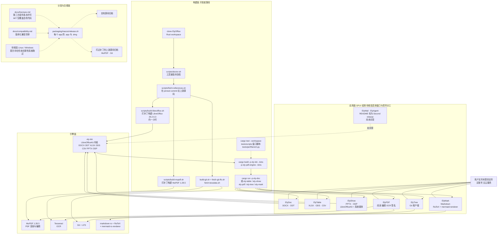

# ELY-Open-Source/ElyOffice

## 一句话定位
离线优先的桌面办公套件：Rust + GPUI 写六个应用，文件留在你自己的文件夹里，没有账号没有云服务；上游（LibreOffice / MuPDF / Git）不是用发行版，而是在 pinned commit 上打补丁自己 build。

## 它解决的问题
办公套件领域长期被两类产品占据：**本地的是 LibreOffice/OpenOffice**——二进制巨大、界面陈旧、格式兼容要靠用户自己验证；**云端的是 Microsoft 365 / Google Docs**——免费档功能受限、协作强，但文件在别人服务器上、离线不可用、长期订阅。

ElyOffice 的定位是"两者之间偏本地的一侧"：**offline-first、文件留在你的文件夹、没有账号没有云**。它没有声称解决云协作，也没有声称比 LibreOffice 更兼容——它解决的是"想要一个本地、现代、不用登录的办公套件"。

## 为什么值得关注（2026-10-21）
- **自建上游 + 同时发布打过补丁的上游源码归档**（MuPDF、Git）——这是许可证合规的**硬动作**，比"我们支持 ODF 格式"这类口号具体得多。README 明写 `packaging/macos/release.sh` 产出每个 app 的 `.app` 与 `.dmg`、源码归档、以及**打过补丁的上游源码归档**到 `dist/`
- **诚实的未完成声明**：README 把 ElyMail 与 ElyAgent 标为 `Second release`——即尚未实现，这种边界声明在 2 天内的新项目里不常见
- **同样诚实的跨平台声明**：README 明写 `Linux and Windows recipes are in packaging/linux and packaging/windows; they have not been run on those systems`——跨平台承诺只有配方没有验证
- **版本化兼容清单**：`docs/compatibility.md` 明示存在，而不是宣称"全兼容"
- **GPUI 而非 Electron/Tauri**：复用 Rust 生态，且避免了 webview 运行时（待量化验证）
- 组织账号 `ELY-Open-Source` 而非个人号，是本日四个项目中唯一的组织发布

## 热度来源判断
**曝光成分较高。** 566⭐ ⑂34 的 fork-star 6.0%，`subscribers_count = 2`，`open_issues_count = 12`——fork-star 与 subscribers 都指向"被看到但没被深度跟踪"。而 **55225 KB（54 MB）的仓库体积与"构建 LibreOffice 约一小时"这两条真实的采用门槛，很可能已经筛掉了一部分人**——这也可能是 fork 数不高的一个解释。

反向看，**12 个 issue 在 2 天内产生**，对一个刚发布、宣称"还没在那些系统跑过"的项目来说不算冷。这个组合的解读是：**有人在认真试（提 issue），但还没有人把它接进自己的日常**。

## 关键技术亮点
1. **Rust + GPUI 的离线优先套件**：定位句 `Offline-first desktop apps in Rust and GPUI. Files stay in your folders; no account, no cloud service.`
2. **六应用分工明确**（README 一张表讲清每个 app 做什么、用什么引擎）：
   - **ElyDoc** 文字处理（DOCX、ODT）— LibreOfficeKit
   - **ElyTable** 电子表格（XLSX、ODS、CSV）— LibreOfficeKit
   - **ElyShow** 演示（PPTX、ODP）— LibreOfficeKit + 系统媒体
   - **ElyPDF** PDF 阅读与编辑、OCR、签名 — MuPDF + Tesseract
   - **ElyTree** Git 客户端 — Git
   - **ElyMark** Markdown — markdown-rs + RaTeX + mermaid-rs-renderer
   - **ElyMail、ElyAgent** — 标为 `Second release`（尚未实现）
3. **在 pinned commit 上自建上游**：`scripts/fetch-references.sh` 在固定 commit 上拉上游源码 → `scripts/build-libreoffice.sh` 打补丁构建 **LibreOffice 26.2.6.3**（README 诚实标注约一小时）→ `scripts/build-mupdf.sh` 打补丁构建 **MuPDF 1.28.5** → `scripts/build-git.sh && scripts/fetch-git-lfs.sh` → `scripts/fetch-tessdata.sh`
4. **合规动作**：`packaging/macos/release.sh` 除 `.app` 与 `.dmg` 外，同时产出**源码归档**与**打过补丁的上游源码归档（MuPDF、Git）**到 `dist/`；MIT 覆盖自有代码，第三方组件各自保留许可（见 `docs/licenses.md`）
5. **测试面完整**：`cargo test --workspace` + `tests/scripts` 下的窗口脚本（macOS + Accessibility 权限）+ `tests/perf/bench.py` 基准
6. **文档面完整**：`docs/help.md`（打开保存 / 恢复 / 离线限制 / 仓库）· `docs/compatibility.md`（版本化兼容清单）· `docs/accessibility.md`（无障碍与语言评审）· `docs/perf/`（基准记录）· `docs/licenses.md`（许可与来源）
7. **工具链自检**：`scripts/doctor.sh` 先查工具链版本，再开始构建

## 架构师速览

| 决策问题 | 研究判断 | 证据边界 |
|---|---|---|
| 系统边界 | 一个 Rust workspace 内六个独立桌面应用：ely-doc / ely-table / ely-show 共用 `ely-lok`（LibreOfficeKit 内核），ely-pdf-engine 走 MuPDF + Tesseract，ely-tree 走 Git，ely-mark 走 markdown-rs + RaTeX + mermaid-renderer；上游以 pinned commit 引入并本地重建；分发产出 .app/.dmg + 自有源码归档 + 上游源码归档 | 全部由 README「Build」段脚本序列 + 应用表格 Engine 列 + `packaging/macos/release.sh` 描述推得；**六个 app 是六个独立进程还是单进程多窗口，README 未明示**；GPUI 具体承担哪些窗口/控件未明示 |
| 主路径 | 开发者 clone → `scripts/doctor.sh` 查工具链 → `fetch-references.sh` 拉 pinned 上游 → 构建 LibreOffice（约一小时）与 MuPDF → 取 LFS 与 tessdata → `cargo build -p ely-lok --bins -p ely-pdf-engine --bins` → `cargo run -p ely-doc`（或 ely-table / ely-show / ely-pdf / ely-tree / ely-mark）→ 打开与保存本地文件夹里的文件（无账号、无云） | 逐条来自 README「Build (macOS)」代码块与描述；**用户侧的安装路径（是否有 brew cask / DMG 直装）README 未给**——本节描述的是开发者构建路径 |
| 关键权衡 | 自建上游（在 pinned commit 打补丁、换可控与合规）vs 直接用发行版（省一小时构建、拿不到补丁）· MIT 覆盖自有代码 vs 第三方组件各自许可（必须查 `docs/licenses.md`）· 离线优先无账号 vs 云协作（易分享免登录）· GPUI（Rust 原生、复用 Rust 生态）vs Tauri/Electron（Web 技术栈、体积内存代价）· macOS 先验证 vs 三平台齐发（Linux/Windows 未跑）· 提供版本化兼容清单 vs 宣称全兼容 | README 明示 `patched LibreOffice 26.2.6.3 / patched MuPDF 1.28.5`、`third-party components keep their own licences`、`they have not been run on those systems`、`ElyMail, ElyAgent — Second release`；**未明示 GPUI 相对 Tauri 的实际体积/内存收益数字** |
| 最小 PoC | 1. 在一台 macOS 上备齐工具链 → 2. 跑 `scripts/doctor.sh` → 3. 跑 `fetch-references.sh` 并**核对拉到的上游 commit 是否与 README 所写版本一致** → 4. 构建 LibreOffice（预留一小时以上）→ 5. 构建 MuPDF、LFS、tessdata → 6. `cargo test --workspace` → 7. **先只构建并运行 `ely-mark`**（最轻、无 LibreOfficeKit 依赖）确认链路通 → 8. 再试 `ely-doc` 打开真实 .docx 并另存，验证 LibreOfficeKit 通路 | 顺序按依赖倒排（markdown-rs 路径最轻 → LibreOfficeKit 路径最重）；README 已明示 ElyMail/ElyAgent 未实现、Linux/Windows 未验证，多变量一次全测会难以定位问题 |

## 架构图（MMD）

> 证据边界：此图只采用本档案已有可核验描述；"待核验"节点不应视为项目实现事实。

## 架构启发
ElyOffice 最值得学的决策是**在 pinned commit 上自建上游，并同时发布打过补丁的上游源码归档**。多数"做本地办公套件"的项目会直接链接 LibreOffice 发行版（省一小时构建、拿不到补丁），或干脆声称兼容（不担合规责任）。ElyOffice 选了最重的一条：拉固定 commit、打补丁、构建、**并把打过补丁的 MuPDF 与 Git 源码连同自有源码一起归档发布**——这是一条完整的许可证合规链路，不是宣传话术。

这背后是一个可迁移的判断框架：**当你需要的能力已经存在于成熟上游，但你需要控制版本、修补漏洞或确保许可证清晰时，"自建上游"比"依赖发行版"更值得，哪怕它的构建成本高一个数量级。** 适用场景包括内网部署、国产化适配、审计合规、以及上游默认配置不满足安全要求的情况。

第二个启发关于**用"未完成"作为边界声明**。README 把 ElyMail 与 ElyAgent 标为 `Second release`、把 Linux/Windows 标为 `have not been run on those systems`——两条都是主动暴露弱点。在 2 天内的新项目里，这种表达不常见，但它把评估成本前置：读者立刻知道能测什么、不能测什么，而不是装完发现跑不起来。

第三个启发关于**GPUI 这个选择的隐含代价**。选 GPUI（Rust 原生 GUI）复用了 Rust 生态、避免了 webview 运行时，但 README **没有给出相对 Tauri/Electron 的体积或内存对比数字**。这提醒我们：**架构选择的价值需要被量化，否则读者只能接受主张而无法验证主张**——这是 ElyOffice 文档上的一处缺口，也是它区别于"宣传良好的项目"的地方。

反面同样清楚：**自建上游的代价是每次上游安全更新都要人工跟进**，而 README 没有说明更新策略。这笔债是结构性的，不是一次性成本。选择这条路就要接受它，并明确安排还债的机制。

## 定位判断
**平台候选（野心大于当前完成度）。** 它想做的不是"一个更好的 LibreOffice"，而是**"一套可自建的本地办公栈"**：Rust 外壳 + 成熟上游引擎 + 合规分发。这个模式与 Zed（Rust + 自维护语言服务）或 Neovim（自建 Lua 生态）同源——**用自建能力换取对上游的完全控制权**。

风险也来自同一处：自建上游意味着**每次上游安全更新都要人工跟进**（README 未说明更新策略）。这个负债是结构性的，不是一次性成本。当前它更像一个**有说服力的架构宣言 + 一条 macOS 可跑通的路**，而非可用产品。

## 风险 / 局限 / 泡沫点
- **仅 macOS 被验证**：README 明写 Linux/Windows 配方"未在那些系统跑过"。跨平台承诺目前是意图而非事实
- **构建门槛高**：`build-libreoffice.sh` 约一小时，加上 MuPDF、Git、LFS、tessdata，新用户的首次构建成本远超"装个软件"。README 只给开发者路径，**未给用户侧安装方式**——这可能是 566⭐ 只有 34 fork 的一个直接原因
- **两个应用尚未实现**：ElyMail、ElyAgent 标为 Second release。README 诚实标注了，但意味着"办公套件"目前少了邮件与智能体两块
- **上游维护债未说明**：自建 LibreOffice 26.2.6.3 与 MuPDF 1.28.5，README 未说明上游安全更新的跟进策略与频率
- **兼容性依赖 LibreOfficeKit**：DOCX/ODT/XLSX/ODS/PPTX/ODP 的实际保真度取决于 LibreOfficeKit，README 只提供版本化清单未给实测数据；`docs/compatibility.md` 的内容本档案未取
- **GPUI 的收益未量化**：README 未给相对 Tauri/Electron 的体积或内存对比数字，选型依据缺失
- **组织背景未知**：`ELY-Open-Source` 为新组织账号，无历史记录，长期维护承诺无法评估

## 与同类项目的关系
- **vs LibreOffice / OpenOffice**：LibreOffice 是上游本身，ElyOffice 是"用 Rust + GPUI 重写外壳并自建上游"的方案。格式兼容性继承自 LibreOfficeKit，不会更好，也不会更差——差别在外壳与分发
- **vs OnlyOffice Desktop Editors**：OnlyOffice 是 AGPL 的现代桌面办公套件，走"完整自研引擎"路线；ElyOffice 走"复用 LibreOfficeKit + MuPDF"。前者更独立、后者更省力但更受上游牵制
- **vs Collabora Online / CryptPad（自托管路线）**：那是以服务端为中心的协作路线；ElyOffice 明确"没有账号没有云"，与之正交
- **vs Microsoft 365 / Google Docs（云端）**：正面对照。ElyOffice 放弃协作换离线与数据自主
- **vs Zettlr / Obsidian + Pandoc（轻量路线）**：那类只做 Markdown，不做 DOCX/XLSX/PPTX 全兼容。ElyOffice 的野心更大，实现难度也高一个量级

## 是否值得持续跟踪
**值得跟踪，但定位为"架构样本"而非"可采用产品"。** 值得跟踪的理由是可迁移的：**"用自建上游换取控制权与合规"是一套可复用的决策框架**——当你需要的能力已经存在于成熟上游、但你需要控制版本、修补漏洞或确保许可证清晰时，这套流程（pinned commit + 打补丁 + 同时发布上游源码归档）可以直接照搬。

**但今天不该推荐任何人采用它**：两个应用未实现、三平台只验证一个、首次构建约一小时、用户侧安装方式未给。**观察重点：`docs/compatibility.md` 的实际内容、上游更新策略是否说明、Linux/Windows 是否被验证、ElyMail/ElyAgent 的时间表。**

## 后续观察点
- `docs/compatibility.md` 的实际内容——格式保真度承诺到底有多具体
- 上游（LibreOffice 26.2.6.3 / MuPDF 1.28.5）安全更新的跟进策略与频率，自建债如何还
- `packaging/linux` 与 `packaging/windows` 配方是否被真机验证，以及何时
- 用户侧安装路径是否补齐（brew cask / DMG 直装 / 预编译 release）
- ElyMail、ElyAgent 的发布时间表
- `open_issues_count = 12` 中 2 天内的主要问题方向（构建失败？格式问题？平台问题？）
- 是否有第三方贡献者参与（组织账号的可信度信号）

---
*首次记录：2026-10-21*

> 数据来源: GitHub REST API + README 原文（2026-10-21 CST 06:00） | Stars: 566 | Forks: 34 | License: MIT | 语言: Rust | 创建: 2026-10-19 | 推送: 2026-10-20 | Subscribers: 2 | Open Issues: 12 | Size: 55225 KB