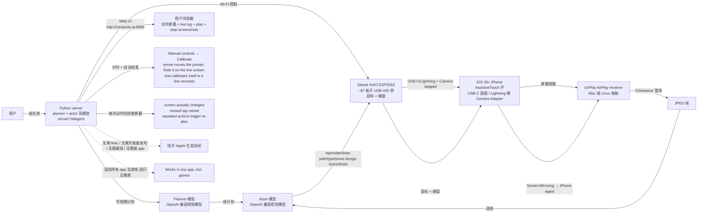

# onehumanbeing/esp32-iphone-agent

## 一句话定位
esp32-iphone-agent 是一个 $7 ESP32-S3 让 AI 用真 iPhone 的开源项目——Seeed XIAO ESP32S3 USB HID 桥（鼠标 + 键盘）+ UxPlay AirPlay 屏幕镜像 + GStreamer 管线 → JPEG 帧 + iOS AssistiveTouch 鼠标模拟 + planner/actor 双模型 + 抖针 + 自动校准 + 每次动作后检查屏幕 + 失败重试 + 任何 OpenAI 兼容视觉模型——把 AI 用 iPhone 从「XCTest + WebDriverAgent + Mac + Xcode + Apple 开发者账号 + 签名 + 7 天过期」推到「$7 ESP32-S3 + AirPlay + USB HID + planner/actor + 任何 OpenAI 兼容视觉模型 + 适用所有 app（含游戏）」严肃工程化形态。

## 它解决的问题
2026 年 AI 自动化 iPhone 设备面临 Apple 生态封闭痛点：XCTest / WebDriverAgent 路径需要 Mac + Xcode + Apple 开发者账号（免费账号签名 7 天过期）+ 装测试 app + 装在手机上。esp32-iphone-agent 直击：**$7 ESP32-S3 USB HID 桥（鼠标 + 键盘）+ UxPlay AirPlay 屏幕镜像 + GStreamer 管线 → JPEG + iOS AssistiveTouch 开 + 鼠标移动屏幕指针（点击 = tap + 拖 = swipe）+ planner/actor 双模型 + 抖针 + 自动校准 + 每次动作后检查屏幕 + 失败重试 + 任何 OpenAI 兼容视觉模型 + 适用所有 app（含游戏，因只见像素）**。解决的是「AI 用 iPhone 无需 Mac / 无需开发者账号 / 无需越狱 / 无需装 app + 适用所有 app（含游戏）」严肃工程化问题。

## 为什么值得关注（2026-10-13）
- **Stars:** 500（截至 2026-10-13），1 天 500⭐ ⑂62 fork/star 12.4%，**增长率** 12.4%（fork/star 反映社区参与，爆发极强）
- **Forks:** 62，社区参与度极高
- **Size:** 3553 KB（含 ESP32 固件 + server 代码 + UxPlay 集成 + planner/actor 模型 + docs/images 截图）
- **License:** MIT
- **语言:** Python（server/） + ESP32 Arduino sketch（hardware/hid_bridge/）
- **活跃度:** created 2026-10-11，pushed_at 2026-10-12，1 天爆发
- **平台:** iOS 26+ iPhone（USB-C 直插 / Lightning 需 Camera Adapter）+ Mac 或 Linux 电脑 + 同一网络
- **硬件:** Seeed XIAO ESP32S3（plain version, not Sense camera version, not Plus）~$7（国内 ¥40-50 on Taobao）；任何 ESP32-S3 board whose USB-C port is wired to the S3's native USB

## 热度来源判断
esp32-iphone-agent 的热度是 **「AI 用 iPhone 无需 Mac / 无需开发者账号 / 无需越狱 / 无需装 app × $7 ESP32-S3 USB HID 桥 × UxPlay AirPlay 屏幕镜像 × GStreamer → JPEG 帧 × iOS AssistiveTouch 鼠标模拟 × planner/actor 双模型 × 抖针 + 自动校准 × 任何 OpenAI 兼容视觉模型 × 适用所有 app（含游戏）」** 的组合。AI 自动化需求大（computer-use / agent 赛道），但 Apple 生态封闭是真实痛点。esp32-iphone-agent 用 $7 ESP32-S3 板子 + AirPlay + USB HID 桥 + planner/actor 双模型严肃工程化，绕开苹果生态封闭——自然爆火。62 fork 反映极客/研究/无障碍场景用户群对「无需 Apple 开发者账号」方案的强需求。热度真实且具「AI 用 iPhone + 绕开 Apple 生态」严肃工程化场景的强需求。

## 关键技术亮点
1. **Seeed XIAO ESP32S3 ~$7 板子 USB HID 桥：** 鼠标 + 键盘；plain version（not Sense camera, not Plus）；任何 ESP32-S3 board whose USB-C port is wired to the S3's native USB
2. **UxPlay AirPlay 屏幕镜像：** GStreamer 管线 → JPEG 帧
3. **iOS AssistiveTouch 鼠标模拟：** AssistiveTouch 开 → 鼠标移动屏幕指针 → 点击 = tap + 拖 = swipe
4. **电脑 Wi-Fi 控制 ESP32 执行 simple line commands:** move/click/type
5. **planner 模型 + actor 模型：** planner 写短期计划；actor 看新截图（tap/swipe/draw path/type/press key/go home/finish）
6. **抖针 + 自动校准：** Manual controls → Calibrate；server moves the pointer, finds it on the live screen and calibrates itself in a few seconds
7. **每次动作后检查屏幕是否变：** missed tap is noticed and retried instead of built upon
8. **失败重试 + 重复动作触发重 plan：** dropped link or bad reply is recovered from
9. **任何 OpenAI 兼容视觉模型：** cloud API or local model
10. **USB-C iPhone 直插：** Lightning models need a Lightning to USB Camera Adapter
11. **iPhone 供电 ESP32：** USB-C hub with power pass-through 如想边充边用
12. **iOS 26+：** Settings → Accessibility → Touch → AssistiveTurn on
13. **无需 Mac / 无需开发者账号 / 无需越狱 / 无需装 app：** Mac **or** Linux 电脑；同一网络
14. **适用所有 app（含游戏，因只见像素）：** Works in any app, incl. games
15. **Python 3.10+ server：** arduino-cli + ESP32 core 3.x 烧 hardware/hid_bridge；UxPlay brew/apt 装；server/ python venv
16. **.env LLM 配置：** LLM_BASE_URL / LLM_MODEL / LLM_API_KEY
17. **Web UI http://computer-ip:8890：** 实时屏幕 + live log + plan + step screenshots
18. **Examples：** Open Whiteboard and draw a smiley face（连续笔触）/ Set an alarm for 7:00 AM that repeats every day（Clock 0700 数字轮 + Repeat days 多次点击）
19. **CI 完整：** GitHub Actions workflows/ci.yml
20. **Multilingual:** English + 简体中文

## 架构师速览

| 决策问题 | 研究判断 | 证据边界 |
|---|---|---|
| 系统边界 | 一个 $7 Seeed XIAO ESP32S3 板子（USB HID 桥：鼠标 + 键盘）+ 一个 UxPlay AirPlay receiver 跑在 Mac 或 Linux 电脑 + 一个 GStreamer 管线 → JPEG 帧 + 一个 Python server（planner + actor 双模型）+ 一个 web UI（http://computer-ip:8890）+ 任何 OpenAI 兼容视觉模型 + iOS 26+ iPhone（AssistiveTouch 开 + USB-C 直插 / Lightning 需 Camera Adapter） | 仅基于 README 「The phone mirrors its screen to UxPlay running on your computer; a GStreamer pipeline turns the stream into JPEG frames for the agent and the web page / An ESP32-S3 plugged into the phone shows up as a standard USB mouse and keyboard / iOS AssistiveTouch on, the mouse moves an on-screen pointer, so a click is a tap and a drag is a swipe」 推断；具体 GStreamer pipeline 细节、planner/actor 模型 prompt 设计、ESP32 固件代码量未在档案明示 |
| 主路径 | 用户装硬件（arduino-cli + ESP32 core 3.x + 烧 hardware/hid_bridge）+ 装软件（UxPlay brew/apt + server/ python venv + .env LLM 配置）+ iPhone 设置（AssistiveTouch 开 + 插 ESP32 + Control Center → Screen Mirroring → iPhone Agent）+ 启动 server + 浏览器打开 web UI + 校准（server 移动指针找它 + 自动校准）+ 给任务（planner 写计划 + actor 执行）→ 每次动作后检查屏幕 → 失败重试 | 主路径为 README 「How it works + Hardware + Quick start + 4. Give it a task」 段落整理；具体 GStreamer pipeline 细节、planner/actor 模型 prompt 设计、ESP32 固件代码量、server. hidagent 模块结构未在档案明示 |
| 关键权衡 | $7 ESP32-S3 + AirPlay + USB HID 桥（极低成本） vs 适用所有 app（含游戏，因只见像素） vs 无需 Mac / 开发者账号 / 越狱 / 装 app vs 任何 OpenAI 兼容视觉模型（云 API 或本地） vs iOS 26+ 版本要求 vs iPhone 14 Pro Max 6GB 起步硬件要求 vs 需 iPhone 同一网络 vs GStreamer pipeline 性能 vs AssistiveTouch 抖动 vs Lightning → Camera Adapter 兼容性 | 权衡来自 README 「The phone powers the board / Use a USB-C hub with power pass-through if the phone should keep charging while the board is plugged in / USB-C models plug in directly. Lightning models need a Lightning to USB Camera Adapter / Tested with a Seeed Studio XIAO ESP32S3, plain version without pre-soldered headers (not the Sense camera version, not the Plus)」 |
| 最小 PoC | 准备 Seeed XIAO ESP32S3 plain version（~$7）+ iPhone 14 Pro Max 或更新（iOS 26+）+ Mac 或 Linux 电脑 + arduino-cli + ESP32 core 3.x + 烧 hardware/hid_bridge + UxPlay brew/apt 装 + server/ python venv + .env LLM 配置（OpenAI 兼容 key）+ iPhone AssistiveTouch 开 + 插 ESP32 + 启动 server + 浏览器打开 http://computer-ip:8890 + 校准 + 给任务"Open Whiteboard and draw a smiley face" | PoC 由 README 「Hardware + Quick start + 4 steps (Flash/Install/Setup phone/Give it a task)」 段落整理；具体 GStreamer pipeline 性能、AssistiveTouch 抖动、Lightning → Camera Adapter 兼容性未在档案明示 |
| 证据边界 | 仅核验：仓库存在、stars/forks/description/license/size/language 来自 GitHub API；README 节录自 raw 接口；$7 ESP32-S3 + UxPlay AirPlay + USB HID 桥 + iOS AssistiveTouch + planner/actor + 任何 OpenAI 兼容视觉模型 + 适用所有 app（含游戏） + 2 examples（Open Whiteboard / Set an alarm）由 README 直接叙述 | 待核验：GStreamer pipeline 细节、planner/actor 模型 prompt 设计、ESP32 固件代码量、server. hidagent 模块结构、iPhone 14 Pro Max 6GB 起步硬件要求依据、AssistiveTouch 抖动、Lightning → Camera Adapter 兼容性 |

## 架构启发
esp32-iphone-agent 的核心启发是 **「$7 硬件 + AirPlay + USB HID 桥 + planner/actor 双模型」是严肃工程化的「AI 用 iPhone 绕开 Apple 生态封闭」路径**。Apple 生态封闭是真实痛点（XCTest / WebDriverAgent 需要 Mac + Xcode + 开发者账号 + 签名 + 7 天过期），esp32-iphone-agent 用 $7 ESP32-S3 板子 + AirPlay 屏幕镜像 + USB HID 桥 + planner/actor 双模型严肃工程化，绕开苹果生态封闭——给极客/研究/无障碍场景新解。这指向 **「AI computer-use + 硬件 + 开源协议」** 的未来。esp32-iphone-agent 还展示了 **「planner/actor 双模型 + 抖针 + 自动校准 + 每次动作后检查屏幕」** 的设计哲学——用 LLM planner 写计划 + LLM actor 执行 + 自动校准 + 失败重试，类似机器人控制 loop。这与 `liseami/CCBaga`（桌面 Claude 工作流严肃工程化）+ `jhaizhou-ops/d2r-mobile`（iOS native aarch64 严肃工程化移植）形成完整的「AI 严肃工程化生态」。

## 架构图（MMD）

> 证据边界：此图只采用本档案已有可核验描述；"待核验"节点不应视为项目实现事实。

## 定位判断
**AI computer-use 硬件型项目（AI 用 iPhone + 绕开 Apple 生态 + $7 ESP32-S3）。** esp32-iphone-agent 不仅是 iPhone 自动化工具，更展示了「$7 硬件 + AirPlay + USB HID 桥 + planner/actor 双模型」严肃工程化路径——绕开苹果生态封闭，给极客/研究/无障碍场景新解。500⭐ + 62 fork/star 12.4% 已显示 AI computer-use 用户群对「无需 Apple 开发者账号」方案的强需求。但能否持续取决于：（1）ESP32-S3 板子兼容性；（2）iOS 26 设备要求；（3）GStreamer pipeline 性能；（4）AssistiveTouch 抖动；（5）Lightning → Camera Adapter 兼容性；（6）planner/actor 模型 prompt 质量。定位是「AI 用 iPhone + 绕开 Apple 生态 + 任何 OpenAI 兼容视觉模型」严肃工程化整合的头部样本，向「team / 企业级 iPhone 自动化 SaaS」演进是合理路径。

## 风险 / 局限 / 泡沫点
- **ESP32-S3 板子兼容性：** 仅 XIAO ESP32S3 plain version 测过（not Sense camera version, not Plus）；其他 ESP32-S3 板子 USB-C port 是否接 S3's native USB 未在档案明示
- **iOS 26 设备要求：** 较高（iPhone 14 Pro Max 6GB 起步硬件要求）
- **GStreamer pipeline 性能：** GStreamer 1.0-plugins-good/bad/libav；AirPlay mirroring 稳定性未在档案明示
- **AssistiveTouch 抖动：** 鼠标移动屏幕指针，点击 = tap，拖 = swipe；但 iOS AssistiveTouch pointer 抖动可能影响校准
- **Lightning → Camera Adapter 兼容性：** Lightning models need a Lightning to USB Camera Adapter；Camera Adapter 兼容性未在档案明示
- **USB-C to USB-C 直插：** iPhone 14 Pro Max 等 USB-C iPhone 直插；但 USB-C hub 兼容性未在档案明示
- **iPhone 供电 ESP32：** USB-C hub with power pass-through 如想边充边用
- **planner/actor 模型 prompt 质量：** 依赖 LLM 能力；对复杂任务（多步骤规划）可能失败
- **planner 与 actor 可同模型：** 「Both roles can be the same model」
- **同网络要求：** iPhone 与电脑同网络；不能远端控制
- **个人项目属性：** onehumanbeing 个人维护，可持续性存疑
- **Lightning to USB Camera Adapter 价格：** Apple 原装 ¥300+；非原装兼容性未在档案明示

## 与同类项目的关系
- **vs XCTest / WebDriverAgent:** XCTest / WebDriverAgent 需要 Mac + Xcode + Apple 开发者账号 + 签名 + 7 天过期 + 装测试 app；esp32-iphone-agent 是「$7 ESP32-S3 + AirPlay + USB HID 桥 + planner/actor + 任何 OpenAI 兼容视觉模型」严肃工程化路径
- **vs liseami/CCBaga:** CCBaga 是「桌面 Claude 工作流 + Skills 协议 + 远端服务器严肃工程化」；esp32-iphone-agent 是「AI 用 iPhone + 绕开 Apple 生态 + $7 ESP32-S3」。两者形成完整的「AI 严肃工程化生态」
- **vs jhaizhou-ops/d2r-mobile:** d2r-mobile 是「iOS native aarch64 严肃工程化移植 D2R」；esp32-iphone-agent 是「AI 用 iPhone + 绕开 Apple 生态」。两者都针对 iOS 但路径不同
- **vs computer-use 类项目（OpenAI Operator / Anthropic Computer Use 等）:** 那些是 LLM 直接用 computer vision 操作桌面；esp32-iphone-agent 用 $7 硬件 + AirPlay + USB HID 桥 + planner/actor 双模型
- **vs Siri Shortcuts / iOS Shortcuts:** Siri Shortcuts 是 Apple 官方；esp32-iphone-agent 是开源 + 任何 OpenAI 兼容视觉模型 + 适用所有 app（含游戏）

## 是否值得持续跟踪
**值得跟踪（AI 用 iPhone + 绕开 Apple 生态 + $7 ESP32-S3 + 任何 OpenAI 兼容视觉模型）。** esp32-iphone-agent 代表了「$7 硬件 + AirPlay + USB HID 桥 + planner/actor 双模型」严肃工程化路径的完整演示——绕开苹果生态封闭，给极客/研究/无障碍场景新解。无论其本身成败，这一方向是 AI computer-use 的趋势。建议关注：（1）ESP32-S3 板子兼容性；（2）iOS 26 设备要求；（3）GStreamer pipeline 性能；（4）AssistiveTouch 抖动；（5）Lightning → Camera Adapter 兼容性；（6）planner/actor 模型 prompt 质量；（7）企业采用（团队是否将此作为 iPhone 自动化标准）。对需要 iPhone 自动化的极客/研究/无障碍场景（无需 Mac / 开发者账号 / 越狱 / 装 app），这个工具是「$7 ESP32-S3 + 任何 OpenAI 兼容视觉模型」的实用选择，值得直接采用。

## 后续观察点
- ESP32-S3 板子兼容性（XIAO ESP32S3 plain 之外）
- iOS 26 设备要求（是否支持更老设备）
- GStreamer pipeline 性能（AirPlay mirroring 稳定性）
- AssistiveTouch 抖动（calibration 准确性）
- Lightning → Camera Adapter 兼容性
- planner/actor 模型 prompt 质量（多步骤规划能力）
- 同网络要求（是否能远端控制）
- 企业采用（团队是否将此作为 iPhone 自动化标准）
- onehumanbeing 个人项目可持续性

---
> 数据来源: GitHub Repository API (2026-10-13) + README raw 接口 | Stars: 500 | Forks: 62 | License: MIT | 语言: Python + ESP32 Arduino | Size: 3553 KB | 创建: 2026-10-11 | 平台: iOS 26+ iPhone + Mac/Linux 电脑 + Seeed XIAO ESP32S3 ~$7
