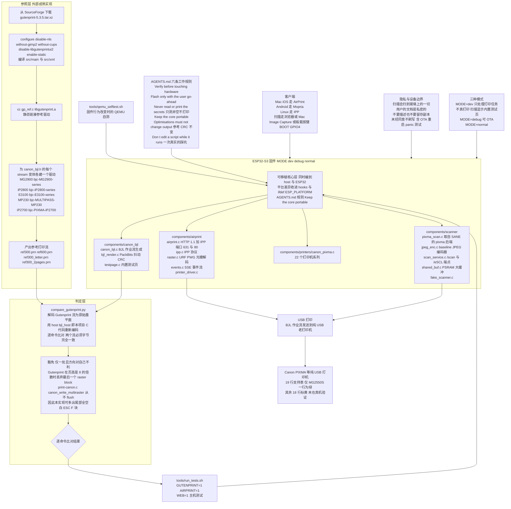

# ngxson/esp32-usb-to-airprint

## 一句话定位

用一块 ESP32-S3 让纯 USB 老打印机获得 AirPrint/AirScan 能力（打印 + 扫描 + 浏览器端 PDF 拼页）—— **⭐ 而它最硬的一处工程是「怎么证明我的输出和真机一样」：它从 SourceForge 拉 Gutenprint 5.3.5 源码编译出参考打印流，再用 `tools/compare_gutenprint.py` 解码参考流、用自己的 C 代码重新编码，逐命令比对要求字节完全一致，并把 Gutenprint 自身「页高是 8 的倍数时丢弃最后一个 raster block」的缺陷写进了豁免说明。**

## 它解决的问题

**它要解决的是「AirPrint 需要打印机直连网络，而大量老打印机只有 USB」这个问题。**

Apple 的 AirPrint 依赖打印机在局域网上暴露 IPP/IPPS 服务，Mopria、Android 打印也类似。**⭐⭐ 而 2010 年代前后的 Canon PIXMA、HP LaserJet 等大量打印机只有 USB —— 它们内部跑的是完全不同的协议（如 Canon 的 BJ 语言），不是 IPP。**

历史上这一需求由两类方案覆盖：**① 打印机服务器（如 CUPS 的 `ipp-usb` 驱动）** —— 需要一台常开的 Linux 机器；**② 打印服务器硬件** —— 商业产品。这个项目的做法是第三种：**把协议转换放进一块 ESP32-S3（$10 量级），插在打印机和路由器之间。**

**⭐⭐⭐ 而它比同类项目多做了一件事：它没有声称「我实现了 AirPrint」，而是声称「我的字节流和 Gutenprint 产出的字节流一致」—— 并用一条可重跑的脚本证明这一点。**

## 为什么值得关注（2026-10-28）

**⭐⭐⭐⭐⭐ 因为它是本日三个「把裁决权交给外部对象」的项目里，唯一一个把裁决权交给**另一个独立实现**而不是一条定理的 —— 而它的对照工程细节是本日最值得抄的模板。**

四个可核验的硬事实：

1. **⭐⭐⭐⭐⭐⭐ `tools/compare_gutenprint.py` 的 docstring 原文**

   > Decodes the Gutenprint stream into raw ink planes, re-encodes those planes with host/bjl_host (our C code), then compares the two streams command by command. They must be byte-identical, **except that Gutenprint drops the last raster block when the page height is a multiple of 8** (print-canon.c canon_write_multiraster never flushes it), so our stream may carry extra trailing all-blank ESC (F blocks.

   **⭐⭐⭐⭐⭐⭐⭐⭐⭐ 而那个偏差方向是**对自己有利**的（自己多出尾部空白块）—— 若默默放过，就等于给了自己一个无法被发现的作弊空间。** 这与本日报连续记录多日的那条原则完全同形：**当参照系自己有 bug 时，正确做法不是放宽判据，而是把偏差的方向、原因与量级写清楚，并让对照器只在这一处放宽。**

2. **⭐⭐⭐⭐⭐ `tools/gutenprint_ref/build_ref.sh` 的完整流程（已核验原文）**

   下载 `gutenprint-5.3.5.tar.xz` → `./configure --disable-nls --without-gimp2 --without-cups --disable-libgutenprintui2 ... --enable-static` → 编译 `src/main` 与 `src/xml` → `cc ... gp_ref.c ... libgutenprint.a` → 用 `STP_DATA_PATH=$GP/src/xml ./gp_ref 300x300dpi ref300.prn` 等生成参考流 → **再为 `canon_bjl.h` 的每个 stream 变体各建一个 Gutenprint 驱动**（`MG2900:bjc-MG2900-series`、`iP2800:bjc-iP2800-series`、`E3100:bjc-E3100-series`、`MP230:bjc-MULTIPASS-MP230`、`iP2700:bjc-PIXMA-iP2700`）。

   **⭐⭐⭐⭐⭐⭐ 即：它不是「手写一个看起来对的打印流」，而是「把一个成熟的第三方实现编译成参考系，然后用它来审判自己的实现」。**

3. **⭐⭐⭐⭐⭐ `AGENTS.md` 六条工作规则逐条对应一种真实的失效模式**

   | 规则原文 | 它防的是什么 |
   |---|---|
   | **「Verify before touching hardware.」** Every change goes through the host tests (`tools/run_tests.sh`, with `GUTENPRINT=1 AIRPRINT=1` …, `WEB=1` …) and, when firmware behaviour changes, the QEMU self test (`tools/qemu_selftest.sh`). | 「改了代码就烧板子试」—— 没有隔离层时每次验证都不可逆 |
   | **「Flash only with the user's go-ahead.」** That includes OTA updates, reboots and the `panic` test. Reading `/info`, the remote log, the status pages and the serial log of a running board is fine. **A real scan is harmless but scans whatever is on the glass: the user's documents are private, so don't describe them and don't keep copies.** | 把「读日志」与「写设备」混为一谈；⭐ **以及把用户隐私文档当成可用测试数据** |
   | **「Never read or print the secrets」** in `.env` or the generated `src/local_config.h`. To check whether a key is set, **test for a non-empty value without printing it**（`grep -qE '^WIFI_SSID=.+' .env`）. | agent 把密钥读进上下文/日志 |
   | **「Keep the core portable.」** `components/canon_bjl`, `components/airprint`, `components/printers` and `components/scanner` build both natively (`host/`) and for the ESP32. Platform specifics go behind hooks or `#ifdef ESP_PLATFORM`. | 同一份代码无法在主机上跑测试，于是只能靠真机验证 |
   | **「Optimisations must not change output.」** Pure speed changes must keep the reference CRCs below unchanged. | 「重构顺手优化」悄悄改变位流 |
   | **「Don't edit a script while it runs.」** bash reads scripts as it goes; an edit during `qemu_selftest.sh` broke a run with a syntax error. | **⭐ 把一次真实的踩坑写成了规则 —— 这条比任何抽象原则都可信** |

4. **⭐⭐⭐⭐⭐⭐⭐⭐⭐ 支持表 19 行，状态列用两档，且只有 1 行是绿的**

   状态列：`🟢 Validated on real printer` / `🟡 Expected to work, not tested on real hardware yet`。**⭐⭐⭐⭐⭐ 只有 `MG2500`（MG2550S）一行标绿，其余 18 行全是黄的。** README 首屏还有一句针对性的呼吁：

   > **Most importantly, you need to really own the printer you add: every driver must be tested on the real hardware, not only in emulation.**

   **⭐⭐⭐⭐⭐⭐⭐⭐⭐ 而这个「19 行里 18 行是黄的」比例，正是本日报今日关于「热度与成熟度脱钩」的第三组证据：157⭐ 的仓库里，只有 1/19 的机型组合在真机上被验证过。**

## 热度来源判断

**⭐⭐⭐ 热度来自「一个便宜硬件解决一个长期痛点」这个叙事，而采用信号尚未开始。**

- **⭐⭐⭐⭐⭐ 可核验的采用信号是本日新项目中最弱的一档**：**`subs` 0**、`releases` **0 个**、contributors **1 人**、**oi 5 且全部是功能请求**（`#5 Web installer: flash from the browser, set up WiFi over Improv`、`#4 WiFi setup network with a captive portal`、`#3 Flash esp32 from web`、`#2 Captive Portal`、`#1 Epson 2400T`）—— **⭐⭐⭐⭐⭐ 即还没有一条「我试了但坏了」的报告。**
- **⭐⭐⭐⭐⭐ 而这是一个结构性反常：`subs 0` 意味着 GitHub 上没有任何人「订阅了它的更新」—— 而这是一个需要持续跟随打印机型号更新的项目。**
- **⭐⭐⭐⭐⭐⭐ 账号背景可核验**：`ngxson` 是 User，创建于 **2014-05-26**，**179 个公开仓库、1,287 followers** —— 本日报记为「身份可核验」而非「star 可信」。
- **⭐⭐⭐⭐⭐⭐⭐ 而 157⭐ 在 30 小时里的来源无法核验**（`stargazers` 端点 404）。**⭐⭐⭐ 唯一可核验的结构信号是 fork/star 5.1%** —— 与「需要自购硬件才能用」的定位相称。

## 关键技术亮点

1. **⭐⭐⭐⭐⭐⭐ 参照第三方实现产出参考流 + 逐命令字节比对**

   这是本项目的正确性论证骨架，也是本日报今日最值得抄的一条工程方法。**⭐⭐⭐⭐⭐⭐⭐ 关键在于「参照系」是一个**独立的、成熟的、被广泛使用的实现**（Gutenprint 是 Linux 打印栈的事实标准之一），而不是项目作者自己写的一份期望输出。**

2. **⭐⭐⭐⭐⭐⭐ 参照系自身的缺陷被写进豁免说明，且偏差方向对自己不利**

   > **except that Gutenprint drops the last raster block when the page height is a multiple of 8** (print-canon.c canon_write_multiraster never flushes it), so our stream may carry extra trailing all-blank ESC (F blocks.

   **⭐⭐⭐⭐⭐⭐⭐⭐⭐ 这句话同时做到了三件事：指出缺陷、给出机制层面的原因（`canon_write_multiraster` 从不 flush）、限定豁免范围（仅尾部全空白 ESC ( F 块）。**

3. **⭐⭐⭐⭐⭐ 核心代码同时编到 host 与 ESP32**

   `components/canon_bjl` / `components/airprint` / `components/printers` / `components/scanner` **同时编到主机与 MCU**，平台差异收进 hooks 与 `#ifdef ESP_PLATFORM`。**⭐⭐⭐⭐⭐ 这不是为了代码洁癖，而是为了「改完能先在主机上跑测试」—— 没有这一层，所有验证都必须烧板子，而烧板子是有成本的、不可逆的。**

4. **⭐⭐⭐⭐⭐ 组件分层清晰且各自职责单一**

   `components/canon_bjl`（含 `canon_bjl.c` / `bjl_render.c` / `testpage.c`）· `components/airprint`（含 `printer_driver.c` / `airprint.c`（HTTP/1.1 + IPP，端口 631 与 80）/ `events.c`（SSE）/ `ipp.c` / `raster.c`）· `components/printers/canon_pixma.c`（**22 个系列**）· `components/scanner/`（含 `pixma_scan.c`（**取自 SANE 的 pixma 后端**）/ `jpeg_enc.c` / `scan_service.c`（`/scan` 与 `/eSCL` 端点）/ `shared_buf.c`（**PSRAM 大缓冲**）/ `fake_scanner.c`）。

   **⭐⭐⭐⭐⭐ 「扫描协议取自 SANE 的 pixma 后端」是又一个「借用成熟实现」的例子 —— 与打印侧的 Gutenprint 参照系同源。**

5. **⭐⭐⭐⭐ 三种运行模式分离**

   `MODE=dev`（只处理打印任务不真打印，扫描显示内置测试页）/ `MODE=debug`（可 OTA）/ `MODE=normal`。**⭐⭐⭐⭐ 即「开发时不会意外把用户文档打出来」是模式层面的保证，而不是靠小心。**

6. **⭐⭐⭐ 三个使用入口覆盖三类用户**

   打印走 AirPrint（Mac/iOS）/ Mopria（Android）/ IPP（Linux）；扫描走浏览器 / Mac 的 Image Capture / 板载按键（BOOT 或 GPIO4：按一下扫描、按两下测试页、长按 2 秒取消）；**⭐⭐⭐ 浏览器端 PDF 拼页**。

7. **⭐⭐ QEMU 自测与主机测试双层**

   `tools/run_tests.sh`（`GUTENPRINT=1 AIRPRINT=1` / `WEB=1`）与 `tools/qemu_selftest.sh`。**⭐⭐⭐⭐⭐ 这让「不碰硬件也能验证固件行为改变」成为可能 —— 也是 AGENTS.md 第一条规则的物理基础。**

## 架构师速览

| 决策问题 | 研究判断 | 证据边界 |
|---|---|---|
| 系统边界 | **四层**：① **可移植核心层**（`components/canon_bjl` / `components/airprint` / `components/printers` / `components/scanner`，**同时编到 host 与 ESP32**）② **参照层**（`tools/gutenprint_ref/` 从 SourceForge 构建 Gutenprint 5.3.5 产出参考流）③ **判定层**（`tools/compare_gutenprint.py` 逐命令比对 + `tools/run_tests.sh` 主机测试 + `tools/qemu_selftest.sh`）④ **规则层**（`AGENTS.md` 六条工作规则）。**⭐⭐ 边界划在「烧录与真机写入」**（需用户明确同意）—— **⭐⭐⭐⭐⭐ 而这条边界同时保护了用户设备与用户隐私（明写「不要描述也不要留存用户文档的副本」）。** | `AGENTS.md` 六条规则原文、`tools/gutenprint_ref/build_ref.sh` 原文、`tools/compare_gutenprint.py` docstring、README 支持表的 19 行状态列、`components/` 目录结构与文件名。**⭐ 三处未核验：`components/` 各 C 文件的实现、Gutenprint 参照系缺陷的完整清单（本档案只知「页高是 8 的倍数丢最后一块」这一条）、`MODE=dev` 与 `MODE=debug` 的行为差异** |
| 主路径 | 插板 → `pio run` 一次生成 `.env`（填 `WIFI_SSID` / `WIFI_PASSWORD` / `PRINTER_NAME` / `HOSTNAME` / `MODE`）→ `pio run -t upload`（**用 COM 口，不是标着 "USB" 的口**）→ 插打印机 → 浏览器开 `http://canon-mg2500.local/`；打印走 AirPrint(Mac/iOS)/Mopria(Android)/IPP(Linux)，扫描走浏览器 / Mac 的 Image Capture / 板载按键（BOOT 或 GPIO4：按一下扫描、按两下测试页、长按 2 秒取消）；开发期 `MODE=dev` 只处理打印任务不真打印。**⭐⭐⭐⭐⭐ 开发与验证路径（更值得 architect 关心）：`tools/gutenprint_ref/build_ref.sh` 产出参考流 → `tools/compare_gutenprint.py` 逐命令比对 → `tools/run_tests.sh`（`GUTENPRINT=1 AIRPRINT=1` / `WEB=1`）→ 固件行为改变时 `tools/qemu_selftest.sh`。** | README 的 "What you need" / "Setup"（三步）/ "Using it" 三节与支持表、`build_ref.sh` 与 `compare_gutenprint.py` 的原文与 docstring、`AGENTS.md` 原文。**⭐ 未核验：固件是否真的能让 iPhone 打印（需真机）、`.local` 解析的实际体验（AGENTS.md 自述固件 IPv4-only，macOS 上约需 5 秒）** |
| 关键权衡 | **⭐⭐⭐⭐ 参照第三方 vs 自证**（选 Gutenprint 当参照系，因此拿到了一个「真机之外的第二意见」；**代价是必须接受参照系自身的缺陷**，并把它写进豁免）· **⭐⭐⭐ 逐字节一致 vs 允许语义等价**（选择严格到字节，**代价是必须逐条豁免参照系的每个已知缺陷**）· **⭐⭐ 可移植核心 vs 平台特例**（核心同时编到主机与 MCU，换来「改完能先在主机上跑测试」；代价是平台差异收进 hooks 与 `#ifdef`）· **⭐⭐ 速度 vs 输出不变**（明写「纯提速优化不得改变输出，且参考 CRC 必须保持不变」）· **⭐⭐⭐ 用户设备边界 vs 便利性**（「未经用户同意不刷写」，包括 OTA、重启与 panic 测试）· **⭐⭐⭐ 隐私 vs 测试便利**（「扫描会扫到玻璃上的一切：用户的文档是私密的，不要描述也不要留存副本」）· **⭐⭐⭐ 开发模式 vs 真机**（`MODE=dev` 不真打印，**代价是开发期无法验证真机行为**） | 三份 README 原文、`AGENTS.md` 全文、`build_ref.sh` 与 `compare_gutenprint.py` 原文、issue 列表（5 条全为功能请求）。**⭐ 未明示：真机验证的机型清单在支持表里标黄之外，是否有任何测试日志或复现步骤；以及「真机验证」由谁执行、是否可复现** |
| 最小 PoC | 1. **⭐⭐⭐ esp32：读 `tools/compare_gutenprint.py` 的 docstring 与 `tools/gutenprint_ref/build_ref.sh`**（**不需要硬件就能判断它的正确性主张是否成体系** —— 这是本 poC 的核心）→ 2. ⭐⭐ **看它是否为每个 stream 变体都建了对应的 Gutenprint 驱动**（5 个变体：MG2900 / iP2800 / E3100 / MP230 / iP2700）—— **这一步判断它的对照是否覆盖了全部路径** → 3. ⭐⭐ 读 `AGENTS.md` 六条规则，**逐条问「这条防的失效模式我昨天踩过吗」** → 4. ⭐⭐ **数支持表里 🟢 与 🟡 各多少行**（当前 1 : 18）—— **这一步决定它的可用范围** → 5. ⭐ 读 README 的 "What you need" 确认硬件门槛（ESP32-S3 双 USB-C 开发板 + 一台 Canon 打印机 + 一台路由器）→ 6. **⭐⭐⭐ 三选一的共同收尾：问一句「它的结论如果错了，是谁、在哪个文件里、能被发现的？」** —— **esp32 的答案是「`compare_gutenprint.py` 的逐命令比对」** | **第 1 步是唯一能判断其正确性主张是否成体系的步骤，且零成本** · **第 4 步是唯一能判断其实际可用范围的步骤** · **第 2 步是判断对照覆盖度的唯一手段** · **第 6 步是本 PoC 真正的产出** · **本 PoC 不覆盖**：任何真机烧录与打印验证（**需自购硬件，且 19 行支持表里 18 行标黄**） |

## 架构启发

**⭐⭐⭐⭐⭐ 核心启发：正确性论证可以外包给一个独立的成熟实现，而不必依赖真机。**

「编译 Gutenprint 5.3.5 产出参考流 → 解码 → 用自己的代码重新编码 → 逐命令比对」这条链路的价值在于：**⭐⭐⭐⭐⭐⭐ 它把「我的输出对不对」这个本来只能靠真机回答的问题，变成了一个可以在 CI 里跑的、无需硬件的、可字节级判定的检查。**

**⭐⭐⭐⭐⭐⭐⭐⭐⭐ 而它更精细的一层是「参照系自己有 bug 怎么办」的答案：不是放宽判据，而是把偏差的方向、机制与范围写进对照器，并让对照器只在这一处放宽。** **⭐⭐⭐⭐⭐⭐⭐⭐⭐ 这个模式可以直接套用到任何「有外部标准」的地方：打印流、协议编解码、文件格式、编解码器输出、序列化格式。**

**⭐⭐⭐⭐⭐⭐ 第二个启发：把「一次真实踩坑」写成工作规则，比写十条抽象原则更有说服力。**

> **「Don't edit a script while it runs.** bash reads scripts as it goes; an edit during `qemu_selftest.sh` broke a run with a syntax error.」

**⭐⭐⭐⭐⭐⭐⭐⭐ 这条规则之所以可信，是因为它带了一个具体的后果、一个具体的工具名与一个具体的症状。**

**⭐⭐⭐⭐ 第三个启发：把「不做什么」写进 agent 工作规则，而不只是写进人类贡献指南。**

「Never read or print the secrets … test for a non-empty value without printing it」与「A real scan … the user's documents are private, so don't describe them and don't keep copies」—— **⭐⭐⭐⭐⭐⭐⭐ 这两条防的不是 bug，而是**把不该看的东西带进上下文或日志**。** ⭐⭐⭐⭐⭐⭐ 而它们被写在一个 `AGENTS.md` 里，说明作者的目标用户里包含 agent。**

**⭐⭐⭐⭐⭐ 第四个启发：支持表里 18/19 行标黄，比一句「支持多款打印机」诚实得多，也更有用。**

**⭐⭐⭐⭐⭐⭐⭐⭐⭐ 因为它让读者在**买硬件之前**就知道自己的型号在不在已验证列表里。**

**⭐⭐ 架构对比：** 与 `NyxFoundation/nyxis`、`AxiomMath/CFSG` 构成本日「把裁决权交给外部对象」的三分形态 —— **nyxis 交给 Lean 内核（定理）、CFSG 交给 Lean 内核 + 对照机制、esp32 交给 Gutenprint（第三方实现）。** **⭐⭐⭐⭐⭐ 而三者的完成度递减清晰可见：nyxis 写全了边界（红/黄两层 + 四段式假设 + 定理目录 + 34 个检查脚本），CFSG 只写了证明与对照机制（无 `docs/`、无 CI），esp32 写了对照与规则（19 行机型表里 18 行标黄、6 条 AGENTS 规则）** —— **⭐⭐⭐⭐⭐⭐⭐⭐⭐ 边界声明的完整度与 star 数完全无关：297⭐ 的项目有最完整的边界声明，64⭐ 的项目连一个 `docs/` 都没有，而 157⭐ 的项目把 18/19 的机型标成「未在真机验证」。**

## 架构图（MMD）

> 证据边界：此图只采用本档案已有可核验描述；「待核验」节点不应视为项目实现事实。

## 定位判断

**把「网络打印协议」下沉到 $10 量级硬件上的协议转换器 —— 位于「打印机生态」与「嵌入式网络设备」的交叉点。**

⭐⭐⭐⭐ 它在生态中的位置非常明确：**它是 CUPS `ipp-usb` 与打印服务器硬件这两类方案的第三种实现**，而它独特的地方是**载体**（一块 ESP32 而不是一台常开的机器）以及**正确性论证方式**（字节级参照比对而不是「能打印就算成功」）。

⭐⭐⭐⭐⭐ 而它的形态判断是「工具型」：**它已经是一个可用产品形态**（完整组件层、QEMU 自测、三种模式、浏览器端界面、19 行机型支持表、AGENTS 工作规则），**但它不是一个基础设施**（单作者、subs 0、零 release、19 行机型里只有 1 行真机验证过）。

⭐⭐⭐⭐⭐⭐ **而它最独特的位置其实在「工程方法」这一侧** —— 本日报今日的三个「把裁决权交给外部对象」的项目里，它是唯一一个参照系来自**完全独立的项目**（Gutenprint）而非**同一个形式化生态**（Lean）。**⭐⭐⭐⭐⭐⭐ 这使它成为一份关于「如何在嵌入式项目里做可核验的正确性论证」的独立样本。**

## 风险 / 局限 / 泡沫点

- **⚠️⚠️⚠️ 19 行机型里只有 1 行在真机上验证过。** **⭐⭐⭐⭐⭐ 157⭐ 而 1/19 的真机验证率 —— 这意味着用户买到板子后大概率要自己调试自己的型号。**
- **⚠️⚠️⚠️ `subs 0` 且 5 条 issue 全是功能请求** —— **⭐⭐⭐⭐⭐ 即没有任何一条「我试了但坏了」的报告，因此它的实际可用性完全没有被外部证据检验过。** **⭐⭐⭐ 对比 COGBox 的 12 条 issue 里有 6 条是「在别的硬件上崩」，本项目的 issue 生态还处在「许愿」阶段。**
- **⚠️⚠️⚠️ 零 release、无二进制分发。** 用户必须自己编译固件、准备 `.env`、用 COM 口烧录。**⭐⭐ 这个门槛会淘汰绝大多数只想「让它能用」的用户。**
- **⚠️⚠️ 单作者、14 commits —— bus factor 为 1。** 而它需要持续跟随新的打印机型号。
- **⚠️⚠️ 正确性论证依赖一个外部项目的特定版本（Gutenprint 5.3.5）。** **⭐⭐⭐⭐⭐ 即它的字节级保证只在「与 5.3.5 一致」这个参照下成立 —— 参照系升级后需要重新核验。**
- **⚠️⚠️ Gutenprint 参照系自身的缺陷清单未知。** 本档案只核验到「页高是 8 的倍数丢最后一块」这一条。**⭐⭐⭐⭐⭐ 如果还有别的缺陷被默默放过，本档案无法判断 —— 且对照器的豁免只覆盖了作者发现的那一条。**
- **⚠️⚠️ 硬件门槛**：需一块 ESP32-S3 双 USB-C 开发板 + 一台 Canon 打印机 + 一台路由器。**⭐⭐ 而 README 还特意提醒用 COM 口而不是标着 "USB" 的口 —— 这类细节本身就说明易用性尚未打磨。**
- **⚠️⚠️ 固件为 IPv4-only**，macOS 上 `.local` 解析约需 5 秒（AGENTS.md 自述）。
- **⚠️⚠️ 本档案未读 `components/` 各 C 文件实现**，因此无法评估协议实现的正确性与安全性。
- **⚠️ 本档案无法核验 157⭐ 的来源**（`stargazers` 端点 404）。

## 与同类项目的关系

- **⭐⭐⭐⭐⭐ vs CUPS 的 `ipp-usb`（Linux 驱动）**：**⭐⭐⭐⭐⭐ 两者做同一件事（把 USB 打印机暴露为 IPP 网络打印机），载体完全不同。** `ipp-usb` 跑在一台常开的 Linux 机器上，依赖系统已有的 Gutenprint；本项目跑在一块 ESP32 上，**自带一个 Gutenprint 编译出的参考系来验证自己**。**⭐⭐⭐⭐⭐ 换句话说：CUPS 复用 Gutenprint 作为**实现**，本项目复用 Gutenprint 作为**判官**。**
- **⭐⭐⭐⭐⭐ vs 商业打印服务器（如 TP-Link TL-PS110U、PrintCellect 一类）**：**⭐⭐⭐ 商业产品做的是同一件事且有品牌与售后，但它们**不公开自己的正确性论证方式**；本项目的对照工程是完全可核验的。**⭐⭐⭐⭐⭐ 而本项目的代价是：机型支持面远小于商业产品（1/19 已验证）。**
- **⭐⭐⭐⭐ vs AirPrint 逆向实现（如 `apple2hp`、各类 AirPrint 补丁集）**：**⭐⭐⭐⭐ 那些项目让打印机自己说话（给打印机刷固件或加 USB 拦截器）；本项目让外部设备替它说话。** **⭐⭐⭐⭐⭐ 后者不需要动打印机，因此风险与门槛完全不同。**
- **⭐⭐⭐ vs 各种 ESP32 打印/IoT 项目**：**⭐⭐⭐⭐⭐ 同类项目通常只有「我能让它打印」的演示；本项目有**字节级对照 + QEMU 自测 + AGENTS 工作规则 + 19 行带状态的机型表**。** ⭐⭐⭐⭐⭐⭐ 这在本日报今日的新项目里是罕见的工程完整度。**
- **⭐⭐⭐ vs `AxiomMath/CFSG`、`NyxFoundation/nyxis`（本日同期）**：**⭐⭐⭐⭐⭐ 三者是「把裁决权交给外部对象」的三种形态 —— 定理（nyxis）、形式化证明 + 对照机制（CFSG）、第三方实现（esp32）。** **⭐⭐⭐⭐⭐ 而 esp32 的独特之处是：它的参照系**完全在另一个生态里**（Linux 打印栈），因此不依赖形式化方法学，也因此门槛最低。**
- **⭐⭐ vs `Motionsites-AI/claude-skill`（同作者群）**：**⭐⭐⭐⭐⭐⭐⭐ 两者形态相似（都做 ESP32 相关、都提供 Claude Code 插件、**其中 3 条 issue 来自同一作者**），但**方向相反**：claude-skill 走「让 Claude 截图自查并反复修」的自动化循环（**⭐ 本日报今日未核验其核心主张**），esp32 走「让第三方实现当判官」的确定性对照。**⭐⭐⭐⭐⭐⭐⭐ 而后者的证据等级明显更高。**

## 是否值得持续跟踪

**值得 —— 它的工程方法比它的产品更值得跟踪。**

- **⭐⭐⭐⭐⭐ 理由一：「编译第三方成熟实现 → 产出参考流 → 逐字节比对 → 豁免仅一处并写明原因」是一套可以直接复用的正确性论证模板。** **⭐⭐⭐⭐⭐⭐ 而 `tools/gutenprint_ref/build_ref.sh` + `tools/compare_gutenprint.py` 是可以直接照抄的工程骨架 —— 在任何有外部标准的领域（协议编解码、文件格式、字体渲染、编解码器输出）都成立。**
- **⭐⭐⭐⭐ 理由二：`AGENTS.md` 的六条规则是本日报见过最像「工程宪法」的 agent 指令文档**，且每一条都对应一种真实的失效模式，其中一条直接引用了一次具体的踩坑。**⭐⭐⭐⭐ 这份文档可以直接抄进任何做硬件/嵌入式 agent 的项目。**
- **⭐⭐⭐ 理由三：它把「未验证范围」做成了一张可数的表（1 绿 : 18 黄），这是本日报今日关于「公开未验证范围」的第五个独立样本。** **⭐⭐⭐⭐⭐ 而这个样本的价值在于：**它同时是一个 star 数不低（157⭐）而验证率极低（1/19）的项目** —— 这让「热度不等于成熟度」这条判断有了最锋利的一个数据点。
- **⭐⭐ 使用建议**：**如果你只是想打印，直接买打印服务器更省事；如果你在做协议实现或嵌入式正确性论证，读它的 `tools/` 目录。**

## 后续观察点

1. **⭐⭐⭐⭐⭐ 支持表里 🟢 的行数是否增加**（当前 1 行）—— **⭐⭐⭐⭐⭐ 这是它从「玩具」变成「产品」的唯一硬指标。**
2. **⭐⭐⭐⭐⭐ 是否出现第一条「我试了但坏了」的 issue**（当前 5 条全是功能请求）—— **⭐⭐⭐⭐⭐ 这是它可用性的第一份外部证据。**
3. **⭐⭐⭐⭐⭐ `subs` 是否从 0 上升** —— **⭐⭐⭐⭐⭐⭐ 对一个需要持续跟随打印机型号的项目，订阅数比 star 更能反映真实意图。**
4. **⭐⭐⭐ 是否发布第一个 release 并附带预编译固件**（当前 0 个）—— **⭐⭐⭐ 这决定易用门槛能否下降。**
5. **⭐⭐⭐ 对照器的豁免清单是否扩大**（当前只有 1 条）—— **⭐⭐⭐⭐⭐ 豁免条数增长说明作者在持续发现参照系的新缺陷，这是好事；但也说明「字节级一致」的保证覆盖面在变窄，需要同步记录。**
6. **⭐⭐⭐ 是否有第三方贡献者新增机型驱动** —— **⭐⭐ 22 个系列的驱动若全靠一人维护，覆盖面会长期受限。**
7. **⭐⭐ `MODE=dev` 是否会加入更多「不产生副作用」的保护** —— **⭐⭐ 这直接对应 AGENTS.md 的隐私规则。**
8. **⭐⭐⭐⭐⭐ 本日报今日未核验 `components/` 的实现 —— 下一次跟踪时应补上这一步**，**⭐⭐⭐⭐⭐ 因为它是「这个项目的协议实现到底对不对」的唯一答案所在。**

---
> 数据来源: GitHub REST/Search API（gh CLI 认证），UTC **2026-10-27T22:16:31Z** 单一快照 | Stars: 157 | Forks: 8 | Subscribers: 0 | Open Issues: 5 | License: MIT | 语言: C | 创建: 2026-10-26T16:18:54Z | pushed: 2026-10-26T20:49:54Z | 14 commits | contributors 1 人 | releases 0 个 | topics 0 | 10,687 KB
> 账号背景: `ngxson` 为 User，创建于 2014-05-26，179 个公开仓库，1,287 followers
> 已核验: `tools/compare_gutenprint.py` docstring 全文（含 Gutenprint 缺陷豁免说明）；`tools/gutenprint_ref/build_ref.sh` 的下载 / configure 参数 / 编译 / 产出参考流 / 五个 stream 变体驱动构建流程；`AGENTS.md` 六条规则原文；README 支持表 19 行与状态列（1 绿 : 18 黄）；`components/` 四目录与文件名；`MODE=dev` / `debug` / `normal` 三模式；5 条 issue 标题（全部为功能请求）
> 证据边界: `components/` 各 C 文件的实现未读；Gutenprint 参照系缺陷的完整清单未知（本档案只知「页高是 8 的倍数丢最后一块」）；`MODE=dev` 与 `MODE=debug` 的行为差异未逐条核验；真机打印/扫描未验证（需自购 ESP32-S3 双 USB-C 板 + 一台 Canon 打印机）；固件 IPv4-only，macOS 上 `.local` 解析约需 5 秒（项目自述）；157⭐ 的来源无法核验（`stargazers` 端点对本 token 返回 404）
