# HeyPuter/everything

## 一句话定位
The Everything Project 是把世界上所有闭源软件从零开始重建并开源（MIT）的 mono-repository——从 Office 到 Slack 到 Photoshop 到 AutoCAD，9 大类 34+ apps，每 app 都有明确的「替代关系映射」与 try-it / source 双入口，由 HeyPuter 同一组织统一维护。

## 它解决的问题
2026 年 AI 替代 SaaS 的浪潮让 FOSS（Free and Open Source Software）替代诉求极强，但现状：（1）**FOSS 替代多但分散**——LibreOffice / GIMP / Inkscape / FreeCAD 等各自独立维护、各自独立仓库、各自独立社区；（2）**替代关系发现难**——用户要找到「Photoshop 替代」需看 awesome list；（3）**商业 SaaS 闭源**——Office 365 / Adobe Creative Cloud / AutoCAD / Figma 等月费 + 数据托管闭源；（4）**不同 FOSS 项目生态壁垒**——每个项目有自己的 README / 安装方式 / UI 标准。Everything 直击痛点：（1）**mono-repository 包含 34+ apps**——一个仓库统一管理；（2）**9 大类覆盖**——Office / Collaboration / Creative / Engineering / Productivity / Finance / Business / Developer Tools / Games；（3）**每个 app 都有替代关系映射**——Spreadsheet/Excel/Sheets/Numbers + Documents/Word/Docs/Pages + ... + Photo Studio/Photoshop/Pixelmator + Video Studio/CapCut/Premiere/FCP/DaVinci + ... + CAD/AutoCAD/DraftSight/BricsCAD；（4）**try-it / source 双链**——puter.com 子域名在线试 + src/[app-name]/ 本地开发；（5）**全部 MIT-licensed**——商用清晰。

## 为什么值得关注（2026-10-15）
- **Stars:** 731（截至 2026-10-15），2 天 731⭐ ⑂107 fork/star 14.6%，**增长率** 14.6%（mono-repo 项目 fork 一致性高）
- **Forks:** 107，社区参与度显著高于平均水平
- **Size:** 416995 KB（mono-repo 34+ apps 整体极大）
- **License:** MIT
- **语言:** JavaScript（mono-repo 内各 app 可能不同语言）
- **活跃度:** created 2026-10-13，pushed_at 2026-10-14，今日持续高活跃
- **平台:** 浏览器（puter.com 子域）+ 本地开发（npm / bun）

## 热度来源判断
Everything 的热度是 **「开源软件替代闭源应用刚需 × mono-repo 严肃工程化 × 34+ apps 一次性覆盖 × 每个 app 都有 Photoshop/CapCut/Illustrator/AutoCAD/SolidWorks/Excel/Word/Zoom/Slack/DocuSign 等替代关系 × try-it / source 双链 × 全部 MIT × HeyPuter 同组织 × 2 天 731⭐ ⑂107 fork/star 14.6%」** 的组合。AI 浪潮 + 商业 SaaS 月费 + 数据托管忧虑让 FOSS 替代诉求比往年更强烈；同时「Hello World FOSS 替代」到「Enterprise-grade FOSS 替代」需要严肃工程化整合，Everything 用 mono-repo + 9 大类 34+ apps + try-it / source 双链给出了答案。热度真实且具「严肃工程化跨领域替代 SaaS」场景的强需求。

## 关键技术亮点
1. **mono-repository containing all the applications and tools：** 一个仓库统一管理 34+ apps
2. **9 大类覆盖：** Office / Collaboration / Creative Tools / Engineering / Productivity / Finance / Business / Developer Tools / Games
3. **每个 app 有明确替代关系映射：** Spreadsheet/Microsoft Excel/Google Sheets/Apple Numbers · Documents/Microsoft Word/Google Docs/Apple Pages · Presentation/Microsoft PowerPoint/Google Slides/Apple Keynote · Whiteboard/Miro/Microsoft Whiteboard/FigJam · PDF/Adobe Acrobat/PDF Expert · Notes/Microsoft OneNote/Evernote/Apple Notes · Records/Airtable/Microsoft Access/Baserow · Meetings/Zoom/Google Meet/Microsoft Teams · Teamchat/Slack/Microsoft Teams/Google Chat · Email/Gmail/Microsoft Outlook/Apple Mail · Contacts/Google Contacts/Apple Contacts · Calendar/Google Calendar/Apple Calendar/Outlook Calendar · Signatures/DocuSign/Adobe Acrobat Sign/Dropbox Sign · Photo Studio/Adobe Photoshop/Pixelmator · Video Studio/CapCut/Adobe Premiere Pro/Final Cut Pro/DaVinci Resolve · Vector Studio/Adobe Illustrator/CorelDRAW/Affinity Designer · Audio Studio/Adobe Audition/Sound Forge · Music Studio/FL Studio/Ableton Live/Logic Pro · 3D Studio/Autodesk Maya/SketchUp · CAD/AutoCAD/DraftSight/BricsCAD · Parametric/SolidWorks/Autodesk Fusion/Autodesk Inventor · Circuits/Altium Designer/Autodesk Eagle/OrCAD · Building Design/Autodesk Revit/ArchiCAD/Vectorworks
4. **try-it / source 双链：** puter.com 子域名在线试 + src/[app-name]/ 本地开发
5. **Getting started：** `git clone https://github.com/HeyPuter/everything.git && cd everything/src/[app-name] && npm install && npm run dev`
6. **App names, descriptions, and navigation are native text. The Everything logo, app icons, and decorative hero are images. Demo and source links use project metadata where available; missing destinations point to the link-status note：** 清晰的文字与图片边界，链接完整性透明
7. **全部 MIT-licensed：** 商用清晰，对开发者友好
8. **HeyPuter 同组织维护：** 一个组织同步推进 34+ apps，治理集中
9. **Demo 和 source 链接使用项目元数据：** 自动从各 app README 提取 try-it / source
10. **link-status note 占位机制：** missing destinations point to the link-status note，避免文档破碎

## 架构师速览

| 决策问题 | 研究判断 | 证据边界 |
|---|---|---|
| 系统边界 | 一个 mono-repository + 9 大类 + 34+ apps，每个 app 在 `src/[app-name]/` 独立 npm 项目 + 每个 app 在 puter.com 子域有 try-it demo + 一个 link-status 元数据约定（missing destinations point to the link-status note）+ 一个 App names/descriptions/navigation native text + 一个 Puter 平台统一栈（推测）+ 一个 HeyPuter 团队维护 | 仅基于 README「mono-repository containing all the applications + Office 8 + Collaboration 6 + Creative 6 + Engineering 4 + 全部 MIT + HeyPuter + 每 app 替代关系 + try-it / source」+ license badge + size 推断；具体每个 app 是否独立 README、CI/CD、tests、共享 component 是否存在、put.com 域名 -> GitHub repo 的映射完整性未在档案明示 |
| 主路径 | 用户访问 everything 仓库 → 选要看的 app 类别（Office / Collaboration / Creative / Engineering / Productivity / Finance / Business / Developer Tools / Games）→ 选具体 app（如 Spreadsheet）+ 看替代关系（Excel/Sheets/Numbers）+ 点「Try it」试在线版（puter.com 子域）或点「Source」看源码 → `git clone https://github.com/HeyPuter/everything.git && cd everything/src/spreadsheet && npm install && npm run dev` | 主路径为 README「Office + Collaboration + Creative Tools + Engineering + Getting started」表格整理；具体每个 app 是否独立 npm module、put.com 上的多 app 数据隔离、Puter 平台 subscription 模型未在档案明示 |
| 关键权衡 | mono-repo vs poly-repo（每个 app 独立仓库）vs MIT vs 商业 SaaS（Puter）vs 9 大类 34+ apps vs 各家独立 FOSS（LibreOffice/GIMP/Inkscape/FreeCAD）vs try-it 双链 vs vs LINKSTATUS 占位 vs Hero / Icon 图片与文字 native/UI 边界 | 权衡来自 README「From Office to Slack and Photoshop to AutoCAD + mono-repository + 9 大类 + 全部 MIT + HeyPuter」 |
| 最小 PoC | `git clone https://github.com/HeyPuter/everything.git` → `cd everything/src/spreadsheet` → `npm install && npm run dev` 起本地 development server → 打开 `http://localhost:5173`（具体端口视 app 而定）→ 试基础 spreadsheet 操作（建 worksheet / sum / cell reference）→ 在 puter.com 上同步试一下在线版 | PoC 由 README「Getting started + git clone + cd src/[app-name] + npm install + npm run dev + Office (Spreadsheet etc.) 」段落整理；具体各 app 的 build instructions、put.com 个人数据治理、与既有 Puter 平台 account 关系未在档案明示 |
| 证据边界 | 仅核验：仓库存在、stars/forks/description/license/size/language 来自 GitHub API；README 节录自 raw 接口；mono-repo 34+ apps + MIT + HeyPuter + 9 大类 + each app 替代映射 + try-it / source 由 README 直接叙述 | 待核验：各 app 是否独立 README + tests + shared component 机制 + puter.com 与 GitHub repo 的发布同步 / link-status 占位完整性 / 各 app 许可证一致性（README 顶部称 MIT，但具体每 app LICENSE 文件是否就位） |

## 架构启发
Everything 的核心启发是 **「严肃工程化 mono-repo + 替代关系明示 + try-it / source 双链 + MIT」**。当前开源软件替代闭源应用的方式多半是「awesome-list + 每个独立仓库」的发现模型——用户要看 Photoshop 替代需自行 awesome、链接各散。Everything 把整个 FOSS 替代生态做成 mono-repo + 替代关系明示 + try-it / source 双链一体化。这指向 **「OSS 替代的下一步是 vertical OSS marketplace」**。Everything 还展示了 **「link-status 占位」** 的优雅做法——missing destinations point to the link-status note，避免文档「to do」体；同时 **「App names, descriptions, and navigation are native text」** 的边界让所有功能导航都可被屏幕阅读器识别，符合 accessibility best practice。这与「doory 设计编辑器 + RustGIS 跨平台 GIS + ps2-web-recomp PS2 in browser」一同指向「2026 年严肃工程化跨领域」浪潮。

## 架构图（MMD）

> 证据边界：此图只采用本档案已有可核验描述；"待核验"节点不应视为项目实现事实。

```mermaid
flowchart TB
  Mono[HeyPuter/everything<br/>mono-repository] --> Cat{9 大类}
  Cat --> Office[Office 8]
  Cat --> Collab[Collaboration 6]
  Cat --> Creative[Creative Tools 6]
  Cat --> Eng[Engineering 4]
  Cat --> Prod[Productivity 待核验]
  Cat --> Finance[Finance 待核验]
  Cat --> Bus[Business 待核验]
  Cat --> Dev[Developer Tools 待核验]
  Cat --> Games[Games 待核验]
  Office --> Spreadsheet[Spreadsheet<br/>替代 Excel/Sheets/Numbers]
  Office --> Docs[Documents<br/>替代 Word/Docs/Pages]
  Office --> Pres[Presentation<br/>替代 PowerPoint/Slides/Keynote]
  Office --> White[Whiteboard<br/>替代 Miro/MS Whiteboard/FigJam]
  Office --> PDF[PDF<br/>替代 Acrobat]
  Office --> Notes[Notes<br/>替代 OneNote/Evernote/Apple Notes]
  Office --> Records[Records<br/>替代 Airtable/MS Access/Baserow]
  Collab --> Meet[Meetings<br/>替代 Zoom/Google Meet/Teams]
  Collab --> TC[Teamchat<br/>替代 Slack/Teams/Google Chat]
  Collab --> Email[Email<br/>替代 Gmail/Outlook/Mail]
  Collab --> Contacts[Contacts<br/>替代 Google/Apple]
  Collab --> Cal[Calendar<br/>替代 Google/Apple/Outlook]
  Collab --> Sign[Signatures<br/>替代 DocuSign/Adobe Sign/Dropbox Sign]
  Creative --> Photo[Photo Studio<br/>替代 Photoshop/Pixelmator]
  Creative --> Video[Video Studio<br/>替代 CapCut/Premiere/FCP/DaVinci]
  Creative --> Vec[Vector Studio<br/>替代 Illustrator/CorelDRAW/Affinity]
  Creative --> Aud[Audio Studio<br/>替代 Adobe Audition/Sound Forge]
  Creative --> Mus[Music Studio<br/>替代 FL Studio/Ableton/Logic]
  Creative --> Three[3D Studio<br/>替代 Maya/SketchUp]
  Eng --> CAD[CAD<br/>替代 AutoCAD/DraftSight/BricsCAD]
  Eng --> Para[Parametric<br/>替代 SolidWorks/Fusion/Inventor]
  Eng --> Cir[Circuits<br/>替代 Altium/Eagle/OrCAD]
  Eng --> Build[Building Design<br/>替代 Revit/ArchiCAD/Vectorworks]
  Spreadsheet -. 双入口 .-> TryIt[puter.com 子域<br/>Try it 在线版]
  Spreadsheet -. 双入口 .-> Src[src/spreadsheet/<br/>git clone + npm install + npm run dev]
  TryIt -.占位缺失.-> LS[link-status note]
  Src -. LICENSE 一致性待核验 .-> MIT[MIT License]
```

## 定位判断
**平台候选型项目（vertical OSS marketplace 严肃工程化样本）。** Everything 不仅是工具集，更是一种「vertical OSS marketplace」范式——mono-repo + 替代关系明示 + try-it / source 双链 + MIT + 9 大类 34+ apps + 同组织统一维护。它把「awesome-list + 各自独立仓库」的发现模型升级为一体化严肃工程化基础设施。能否成为 OSS 替代的默认入口，取决于（a）apps 数量与完成度持续增长；（b）put.com 在线版 SLA 与个人数据治理；（c）社区贡献与 fork 子项目治理；（d）商业化路径（订阅 / 赞助 / 云服务）。

## 风险/局限/泡沫点
- **mono-repo 体量过大：** 416995 KB 极大，git clone / IDE index / CI build 体验需优化
- **各 app 完成度差异大：** 部分 app 仅有 src/ 占位（如 Building Design / Music Studio），与 Adobe Photoshop / AutoCAD 等头部商用产品还有差距
- **各 app CI / tests 完整度未明示：** 部分 app 可能没有 CI 或 tests
- **puter.com 域名 ↔ GitHub repo 同步机制：** 在线版与源码一致性的保障机制未明
- **link-status 占位完整性：** 多个 app 仍是 missing destinations 占位，需 user 自行 try 实际访问
- **与 Puter 平台 account / 订阅模型关系：** 部分 app 可能只在 Puter Pro 才能用在线版
- **每 app LICENSE 一致性：** README 顶部称 MIT，但具体每 app LICENSE 文件是否就位未核实
- **HeyPuter 单组织维护风险：** 单一组织 / 单一公司依赖，bus factor 1
- **商业化路径：** Puter 商业 SaaS 与 GitHub Everything OSS 之间的边界、贡献者协议等需进一步明

## 与同类项目的关系
- **vs LibreOffice / GIMP / Inkscape / FreeCAD 等独立 FOSS：** 那些是 poly-repo 独立项目；Everything 是 mono-repo 整合 + 替代关系 + try-it / source 双链
- **vs awesome-selfhosted / awesome-FOSS：** 那些是 awesome list 索引；Everything 是实际可运行 app 集合
- **vs Puter commercial SaaS：** Puter 是商业 SaaS；Everything 是 OSS 部分（GitHub 仓库），puter.com 是实际产品，二者关系需进一步明
- **vs craft-launcher / wordcraft / photocraft / cadcraft：** 那些是 craft app ecosystem 严肃工程化（Rust 桌面端为主）；Everything 是 mono-repo web app 集合，定位不同
- **vs Microsoft 365 / Google Workspace / Adobe Creative Cloud / Figma：** 这些是闭源商业 SaaS；Everything 是 MIT open-source 替代
- **vs doory + RustGIS + ps2-web-recomp（单领域严肃工程化）：** Everything 是跨领域整合

## 是否值得持续跟踪
**值得跟踪（vertical OSS marketplace 严肃工程化候选）。** Everything 代表了 2026 年 OSS 替代 SaaS 的严肃工程化路径：mono-repo 34+ apps + 替代关系明示 + try-it / source 双链 + MIT + HeyPuter 同组织。建议关注：（a）apps 数量与完成度；（b）put.com 个人数据治理与订阅模型；（c）社区贡献；（d）mono-repo 性能优化（git sparse-checkout / workspaces）；（e）商业化路径。任何需要「找到某个闭源软件的 FOSS 替代」的用户可访问 everything 看替代关系 + try-it / source 双链；对 vertical OSS marketplace 观察者，它是样本。

## 后续观察点
- 各 app 的实际完成度 + 与对标商业产品的功能等价度
- put.com 在线版的 SLA / 数据治理 / 订阅模型
- mono-repo git 性能（sparse-checkout / workspaces 集成）
- community contribution 流程 + bus factor
- 各 app LICENSE 一致性 + CLA 协议
- 与 Puter 商业 SaaS 的边界 + 商业模式
- link-status 占位的清理速度（每日 / 每周）
- 与 LibreOffice / GIMP / Inkscape / FreeCAD 等成熟 FOSS 的功能重叠度

---
> 数据来源: GitHub API (2026-10-15) | Stars: 731 | Forks: 107 | License: MIT | 语言: JavaScript | 创建: 2026-10-13
