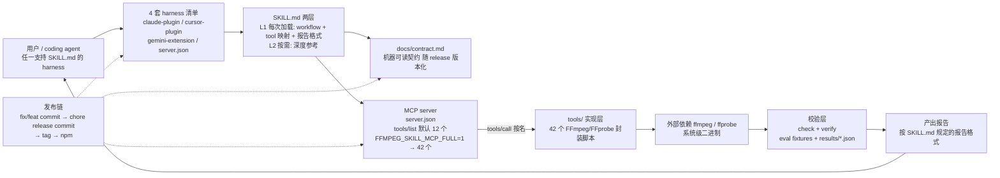

# kajisho5/ffmpeg-skill

## 一句话定位
**一个把 42 个 FFmpeg 工具封装成 Agent Skill 的项目 —— 它最值得研究的不是功能，而是它证明了「100 个 release」既可以是假的（11-16 的 `steam-library-bridge`），也可以是真的，而区别只在于「tag → commit → 代码 diff」这条链是否闭合。**

## 它解决的问题
视频编辑的门槛不在 FFmpeg 本身，而在于**参数组合的组合爆炸**：裁剪、拼接、去静音、等比缩放、字幕与卡拉 OK、叠加与动效、HDR→SDR 与 LUT、音频清理与动态、同步与漂移校正、多机位、响度标准化、交付检查、整片渲染工程、批量文件夹 —— ⭐⭐⭐⭐⭐ 每一条都对应一组互相影响的 FFmpeg 参数组合。

⭐⭐⭐⭐⭐ **而 coding agent 面对 FFmpeg 的真实问题是：它知道命令语法，但不知道「哪些参数不能一起用」「什么样的输出其实是对的」。** ⭐⭐⭐⭐⭐ 本项目给出的答案是**一个固定工作流（probe → 尽可能无损地编辑 → check → verify）** ⭐⭐⭐⭐⭐ 加上 **42 个封装好的工具**，⭐⭐⭐⭐⭐ 加上 **一份机器可读的契约**。

⭐⭐⭐⭐⭐ **⭐⭐⭐ 它还解决了一个更隐蔽的问题：agent 的上下文预算。** 42 个工具全部塞进 `tools/list` 会挤占客户端上下文，⭐⭐⭐⭐⭐ 而本项目的解法是「默认只暴露 12 个核心工具」—— **详见「关键技术亮点」第 4 条。**

## 为什么值得关注（2026-11-17）
⭐⭐⭐⭐⭐ **因为 11-16 日报刚刚用 `atlas7283/steam-library-bridge` 证伪了「release 多 = 有发布历史」这条判据；本日这个项目从反面给出了同一条判据的正面样本，并让判据本身变得可执行。**

**可核验事实一：release / tag 结构（2026-11-17 CST 快照）。**

| 指标 | 实测值 |
|---|---|
| stars / forks / subs / open issues | 6,630 / 598 / 12 / 33 |
| 体积 / blobs | 40,342 KB / 425（`SKILL.md` 16 个） |
| 语言 / 许可 | Python / MIT |
| 创建 / 最后 push | 2026-09-03T14:33:38Z / 2026-11-16T01:08:43Z |
| homepage | `https://www.npmjs.com/package/ffmpeg-skill` |
| topics | 19 个，含 `agent-skills` / `mcp` / `mcp-server` / `model-context-protocol` / `gemini-cli-extension` |
| **release 数** | **100** |
| **tag 数** | **100** |
| **tag 指向的 commit sha 去重后** | **100 / 100（无一重复）** |
| **release 的 tag_name 集合 == git tag 集合** | **True** |
| 100 个 release 最早 / 最晚 | `2026-10-15T11:32:24Z` / `2026-11-15T23:32:43Z`（跨度 **756.0 小时**） |
| 相邻 release 间隔中位数 | **2.42 小时**（最小 0.3 小时，最大 113.01 小时） |
| **带 asset 的 release** | **0 / 100** |
| CI 工作流 | 8 个：`ci.yml` / `codeql.yml` / `scorecard.yml` / `release.yml` / `pages.yml` / `cflite.yml` / `dependabot-auto-merge.yml` / `release-drafter.yml` |
| harness 清单 | **4 套**：`.claude-plugin/`（含 `marketplace.json` + `plugin.json`）· `.cursor-plugin/plugin.json` · `gemini-extension.json` · `server.json`（MCP） |
| 贡献者 | `kajisho5` 322 · `github-actions[bot]` 194 · `claude[bot]` 53 · `dependabot[bot]` 9 · `claude` 4 · `rymalia` 2 |
| owner | `kajisho5`，账号 **2016-07-25** 创建、**121 个公开仓库**、0 followers |

**可核验事实二：决定性的一步 —— 逐个查 tag 指向的 commit，看代码到底改没改。**

⭐⭐⭐⭐⭐ **本日报抽样 12 个 tag，分别检查「tag 的 commit」与「它的父 commit」各自改了哪些文件：**

| tag | release commit 改的文件数 | 其中源码文件 | **父 commit** 改的文件数 | **父 commit 中源码文件** |
|---|---:|---:|---:|---:|
| `v3.10.1` | 8 | **0** | 17 | **12** |
| `v3.10.0` | 8 | **0** | 5 | **2** |
| `v3.9.3` | 8 | **0** | 19 | **14** |
| `v3.9.2` | 8 | **0** | 8 | **6** |
| `v3.9.1` | 8 | **0** | 9 | **4** |
| `v3.9.0` | 8 | **0** | 21 | **15** |
| `v3.8.23` | 8 | **0** | 13 | **10** |
| `v3.8.22` | 8 | **0** | 9 | **7** |
| `v3.8.21` | 8 | **0** | 17 | **12** |
| `v3.8.20` | 8 | **0** | 6 | **4** |
| `v3.8.19` | 8 | **0** | 21 | **17** |
| `v3.8.18` | 8 | **0** | 16 | **13** |

⭐⭐⭐⭐⭐ **⭐⭐⭐ 结论：release commit 本身是纯元数据提交（8 个文件、+16/-9，全部是 `package.json` / `.claude-plugin/plugin.json` / `.cursor-plugin/plugin.json` / `gemini-extension.json` / `server.json` / `CHANGELOG.md` / `docs/contract.md` / `docs/roadmap.md`），但它的父 commit 100% 触及源码（2–17 个源码文件）。**

⭐⭐⭐⭐⭐ **⭐⭐⭐ 即：真实功能 commit 落在 release commit 的前一位，release 只是给它贴标签。⭐⭐⭐⭐⭐ 并且实测最近 100 个 commit 中，47 个 `chore(release)` 里有 35 个紧接着一个 `fix:` 或 `feat:` 提交。**

⭐⭐⭐⭐⭐ **实测 release commit 改动的完整文件列表（以 `v3.10.1` / `f1c97cbf` 为例）：**

```
.claude-plugin/plugin.json   modified +1/-1
.cursor-plugin/plugin.json   modified +1/-1
CHANGELOG.md                modified +7/-0
docs/contract.md            modified +2/-2
docs/roadmap.md             modified +1/-1
gemini-extension.json       modified +1/-1
package.json                modified +1/-1
server.json                 modified +2/-2
```

⭐⭐⭐⭐⭐ **⭐⭐⭐ 本日把 11-16 的判据补完为一条可执行的三段式检查：**

| | 11-16 `steam-library-bridge`（伪造） | 本日 `ffmpeg-skill`（真实） |
|---|---|---|
| 版本号语义 | 4 个 release 互不相关（v1.2.8 → v4.4.2） | 100 个 tag 语义连续（v2.9.0 → v3.10.1） |
| commit sha 是否唯一 | 仅 1 个 commit | **100 / 100 互不相同** |
| 是否有代码 diff 支撑该版本 | **无** | **有**（父 commit 12/12 触及源码） |

⭐⭐⭐⭐⭐ **⭐⭐⭐ 关键的方法论修正：判据不是「release 数量」，而是「tag → commit → 代码 diff」这条链是否闭合。**

**可核验事实三：CI 列表里有一个别处没有的东西。**

⭐⭐⭐⭐⭐ 本仓库的顶层路径里有 **`.clusterfuzzlite/Dockerfile` / `.clusterfuzzlite/build.sh` / `.clusterfuzzlite/project.yaml`**，⭐⭐⭐⭐⭐ 对应工作流 `.github/workflows/cflite.yml` —— **即它把 fuzzing 接进了自己的工具链。** ⭐⭐⭐⭐⭐ 配合 `codeql.yml` / `scorecard.yml` / `dependabot-auto-merge.yml`，⭐⭐⭐⭐⭐ **这是把 Skill 当作软件工程制品而非提示词合集的路线。**

## 热度来源判断
⭐⭐⭐⭐⭐ **判断：热度来源是真实需求 + 极高质量的工程执行，而非营销。**

支撑的**可核验事实**：

1. **⭐⭐⭐⭐⭐ owner 有 10 年历史**：账号 2016-07-25 创建、121 个公开仓库 —— ⭐⭐⭐⭐⭐ 与本数据集记录的投放账号（0 followers、恰好 2 个仓库、提前数月养号）结构完全不同。
2. **⭐⭐⭐⭐⭐ 贡献者结构真实**：`kajisho5` 322 commits + `github-actions[bot]` 194 + `claude[bot]` 53 + `dependabot[bot]` 9 + 2 位真人（`claude` 4 / `rymalia` 2）—— ⭐⭐⭐⭐⭐ **有外部贡献者与 bot 的正常混合，且 6 个 CI 工作流在跑。**
3. **⭐⭐⭐⭐⭐ release 链闭合**：100 个 tag、100 个互不相同的 commit sha、12/12 抽样中父 commit 触及源码。
4. **⭐⭐⭐⭐⭐ 有 33 个 open issue 与真实的失败率记录**：⭐⭐⭐⭐⭐ README 里有一张「eval 22 at 1.18.3（8 个只给症状不给参数名的提示）…… 7/8 routed，第八个提示是一个诚实的部分完成」的自评表，⭐⭐⭐⭐⭐ **并明确写出「安装了 `faster-whisper` 后手工复测确认 fixture 里没有真实语音」** —— **⭐⭐⭐⭐⭐ 这种把自己测不出来的东西写进文档的做法，在本数据集里非常罕见。**

⭐⭐⭐⭐⭐ **⚠️ 不作主张的部分：star 增速未做统计。** 所有 ⭐ 数为快照绝对值；⭐⭐⭐⭐⭐ **本日报不主张「6,630⭐ 的增长速度证明了需求」，只记录其结构性证据。**

## 关键技术亮点

1. **⭐⭐⭐⭐⭐ 「默认 12 / 全量 42」的分层工具暴露（最值得抄的一条）**
   实测 README 原文：
   > Every tool is also callable as an MCP tool (`tools/list` advertises a core 12 by default to keep client context small, with `FFMPEG_SKILL_MCP_FULL=1` listing all 42; every tool is reachable by name through `tools/call` either way)

   ⭐⭐⭐⭐⭐ **⭐⭐⭐ 这把「工具太多会撑爆客户端上下文」从抱怨变成了可配置的契约：默认给 12 个，其余按环境变量开启，但每个工具按名都可达。**

2. **⭐⭐⭐⭐⭐ SKILL.md 的两层结构**
   实测 README 原文：`SKILL.md` is two-tier (1.11.0): the file the agent loads every session keeps the workflow, the … ⭐⭐⭐⭐⭐ **即「每次会话都加载的那份」与「按需查阅的那份」被显式分离** —— 这是上下文预算在 prompt 层面的对应做法。

3. **⭐⭐⭐⭐⭐ 机器可读的契约文件**
   `docs/contract.md` 在每次 release 中被同步更新（+2/-2），⭐⭐⭐⭐⭐ 意味着**工具契约本身是被版本化管理的对象**，而不是文档里的自然语言描述。

4. **⭐⭐⭐⭐⭐ 固定工作流而非工具列表**
   probe → edit losslessly where possible → check → verify，⭐⭐⭐⭐⭐ **workflow 与工具集是两层：工具负责「怎么做」，workflow 负责「按什么顺序做、什么时候停」。**

5. **⭐⭐⭐⭐⭐ 诚实的评测记录**
   `evals/results/iteration-22.json` 等文件记录每次评测，⭐⭐⭐⭐⭐ 且 README 里那张表**把没测出来的也写上**（「Three refused honestly rather than fabricate a number」）—— ⭐⭐⭐⭐⭐ **即「agent 诚实地拒绝编造」被当作正面结果记录。**

6. **⭐⭐⭐⭐⭐ 4 套 harness 清单并存**
   `.claude-plugin/` · `.cursor-plugin/` · `gemini-extension.json` · `server.json`（MCP）—— **同一个包面向 4 种加载方式。**

## 架构师速览

| 决策问题 | 研究判断 | 证据边界 |
|---|---|---|
| 系统边界 | **一个「能力包 + 一个 MCP server」**。包边界 = `SKILL.md` 契约 + `tools/` 实现；进程边界 = MCP server（`server.json` 声明）。不包含模型、不包含播放器 | `git/trees` 实测 425 blob / 16 个 SKILL.md / 4 套清单；README 的 MCP 段落；**未运行、未调用任何工具** |
| 主路径 | agent 读 `SKILL.md`（workflow + request→tool 映射 + report 格式）→ 按 workflow 调 `tools/call` → 每次调用对应 `tools/` 下一个脚本 → 脚本包 `ffmpeg`/`ffprobe` → 结果写回报告。**release 路径**：功能 commit → `chore(release)` 元数据 commit → tag → npm 发布 | workflow 与 tool 映射来自 README 的自述；`tools/` 具体实现**未逐个阅读**；npm 发布流程**未核验** |
| 关键权衡 | ①**上下文预算 vs 能力完整** → 用「默认 12 / 全量 42」分层解决；②**release 频率 vs 版本语义** → 用「功能 commit 与 release commit 分离」保证每个版本号背后有真实 diff；③**SKILL.md 两层** vs 单文件完整 → 把每次会话的加载量压到最小 | ①、③ 有 README 原文支撑；② 有 12 个 tag 的父 commit diff 支撑；**「100 个 tag 全部如此」未全量核验**（抽样 12 个） |
| 最小 PoC | 在单一 harness（建议 Claude Code）装包 → 只开默认 12 个工具 → 跑一次「裁剪 + 加字幕 + 统一响度」的完整链路 → 核对输出文件用 `ffprobe` 读回时长/分辨率/响度 → 再用 `FFMPEG_SKILL_MCP_FULL=1` 验证 42 个工具按名可达 → 最后读 `docs/contract.md` 比对实际返回 | PoC 由本档案推导；**具体阈值（响度目标、字幕样式）未核验**；`ffprobe` 校验方式为本档案建议 |

## 架构启发
⭐⭐⭐⭐⭐ **启发一：把「数量」判据升级为「链路」判据，是本日最具迁移价值的一步。**
11-16 说「release 多不等于有发布史」，本日说「release 多也可能真的等于有发布史」⭐⭐⭐⭐⭐ —— **两条合起来才是完整判据：不是看数量，而是看 tag → commit → diff 这条链断没断。**⭐⭐⭐⭐⭐ **这条判据可以直接迁移到 commit 数、push 频率、版本号多样性、star 增速 —— 它们全都是「数量」，也都需要一条对应的链路来验。**

⭐⭐⭐⭐⭐ **启发二：分层暴露（默认子集 + 开关）是能力与预算的通用解。**
`tools/list` 默认 12 个、开关打开 42 个、每个按名可达 ⭐⭐⭐⭐⭐ —— **这个模式可以原样搬到任何「工具/插件/数据集」超过客户端预算的场景**，⭐⭐⭐⭐⭐ **且它没有牺牲能力，只是改变了默认暴露面。**

⭐⭐⭐⭐⭐ **启发三：把「release commit」与「功能 commit」分开，是一个低成本的工程纪律。**
本项目实测的形态是：`fix:`/`feat:` 提交改代码 → `chore(release): bump version to X.Y.Z [skip ci]` 提交只改版本号与文档 → tag 打在这个 release commit 上。⭐⭐⭐⭐⭐ **⭐⭐⭐ 这条纪律的直接收益是：任何第三方都可以用「tag 的父 commit 有无源码 diff」来判断这个版本是否值得安装 —— ⭐⭐⭐⭐⭐ **不需要信任发布者的自述。**

⭐⭐⭐⭐⭐ **启发四：把「我测不出来的东西」写进文档，本身就是一种质量信号。**
实测 README 里那句「the fixture has no real speech to transcribe, confirmed by installing `faster-whisper` mid-eval and re-testing by hand」⭐⭐⭐⭐⭐ —— **⭐⭐⭐ 这与本数据集此前记录的 `pydtcpip` 的「Verified / Unverified (profile implemented) / Not applicable」三档、`hikaku-extension` 的「把模型真实失败率写进 `docs/MODELS.md`」是同一条线索的最高级形态：⭐⭐⭐⭐⭐ **不仅标注「没测」，还写明「怎么确认的没测」。**

## 架构图（MMD）

> 证据边界：此图只采用本档案已有可核验描述；标注「待核验」的节点不应视为项目实现事实。



## 定位判断
**生产可用 —— 且是本日报里「发布纪律」这一维度的正面标杆。**

⭐⭐⭐⭐⭐ 在 Skill 生态里，本项目属于**「把 Skill 当软件工程制品」**的一端：⭐⭐⭐⭐⭐ 8 个 CI 工作流、ClusterFuzzLite、CodeQL、Scorecard、机器可读契约、版本化的 eval 结果、诚实的失败率记录。⭐⭐⭐⭐⭐ 与之相对的是 `boring-marketing-skills` 那一端：6 个 commit 交付 32 个技能。

⭐⭐⭐⭐⭐ ⭐⭐⭐ 这两端不是高下之分，而是**两种不同的产品形态**：⭐⭐⭐⭐⭐ 一端卖「可安装的能力」（`ffmpeg-skill` 卖 42 个工具 + 一套工作流），⭐⭐⭐⭐⭐ 另一端卖「可复用的知识包」（营销技能包）。⭐⭐⭐⭐⭐ **但本日从「分发适配层」的视角看，⭐⭐⭐⭐⭐ 前者已经解决了适配层成本（4 套清单 + 分层工具暴露），⭐⭐⭐⭐⭐ 后者还在起步（1 套清单）。**

## 风险/局限/泡沫点
1. ⭐⭐⭐ ⚠️ **100 个 tag 只抽样了 12 个**：⭐⭐⭐ ⚠️ 「每个版本背后都有真实代码 diff」是抽样结论，**未全量核验**。
2. ⭐⭐⭐ ⚠️ **0 / 100 个 release 带 asset**：⭐⭐⭐ ⚠️ 因此 11-16 判据的第二段「release 资产是否随版本变化」在本仓库不适用，⭐⭐⭐ ⚠️ **也意味着无法用 asset 变化做独立交叉验证。**
3. ⭐⭐⭐ ⚠️ **单 owner 主导**：⭐⭐⭐ ⚠️ `kajisho5` 322 commits，外部真人贡献仅 2 人（`claude` 4 / `rymalia` 2），⭐⭐⭐ ⚠️ **关键人风险仍在。**
4. ⭐⭐⭐ ⚠️ **高频发布本身是风险**：实测中位间隔 **2.42 小时**、最小 **0.3 小时**，⭐⭐⭐ ⚠️ **即使每次都有真实 diff，版本粒度过细也意味着下游几乎不可能逐一验证 —— ⭐⭐⭐ ⚠️ 实质上把信任问题从「版本是假的」转成了「我该信哪个版本」。**
5. ⭐⭐ ⚠️ **未核验项**：npm 包内容与仓库是否一致、42 个工具的实现质量、`clusterfuzzlite` 的实际覆盖范围、eval 的可复现性、README 中的自评数字。

## 与同类项目的关系
- **vs `atlas7283/steam-library-bridge`（11-16 档案）**：⭐⭐⭐⭐⭐ **本日报最重要的一组对照 —— 两者都有多个 release、都有版本号，但一个的 tag 背后是 4 个互不相关的版本号与唯一一次 commit，另一个的 100 个 tag 各自指向不同的 commit 且父 commit 触及源码。**
- **vs `NVIDIA/SkillEvaluator`**：⭐⭐⭐⭐⭐ 互补 —— 本项目产出 Skill，SkillEvaluator 评估 Skill；⭐⭐⭐⭐⭐ **本项目的 `evals/` 目录形态与 SkillEvaluator 的 tier 评估流程指向同一件事：Skill 的质量需要被测量。**
- **vs `boringmarketer/boring-marketing-skills`**：⭐⭐⭐⭐⭐ 同为 Agent Skill，但一个卖工具链、一个卖知识包；⭐⭐⭐⭐⭐ **适配层成熟度差距明显（4 套清单 vs 1 套）。**
- **vs `elementalsouls/Claude-BugHunter`**：⭐⭐⭐⭐⭐ 同为多 skill 集合（16 vs 83 个 `SKILL.md`），⭐⭐⭐⭐⭐ 但 **Claude-BugHunter 的领域是攻防知识，ffmpeg-skill 的领域是确定性工具调用。**
- **vs `google/elephant-goldfish-model`**：⭐⭐⭐⭐⭐ 正交 —— EGM 解决「如何评审」，本项目解决「如何执行」。

## 是否值得持续跟踪
**值得，且优先级高。**

⭐⭐⭐⭐⭐ 理由有三：① 它是本日报唯一能提供「发布纪律正例」的项目，⭐⭐⭐⭐⭐ **持续跟踪它可以为「tag → commit → diff」这条判据提供更多对照样本**；② 它的「默认 12 / 全量 42」分层是**可直接复用的工程范式**；③ 它的 4 套 harness 清单是**「分发适配层」竞争中的实际进展**，⭐⭐⭐⭐⭐ **跟踪它能判断这条赛道是否会在几个月内收敛。**

## 后续观察点
1. ⭐⭐⭐⭐⭐ **release 频率是否放缓**（中位 2.42 小时 → 若是，说明发布策略在调整）
2. ⭐⭐⭐⭐⭐ **是否新增 harness 清单**（当前 4 套：Claude / Cursor / Gemini / MCP）—— ⭐⭐⭐⭐⭐ **新增一套即代表适配层竞争在推进**
3. ⭐⭐⭐⭐⭐ **eval 记录是否引入外部复现者**（当前 `evals/results/` 全为自评）
4. ⭐⭐⭐ ⭐ **npm 包与仓库的一致性**（发布链的最后一环未核验）
5. ⭐⭐⭐ ⚠️ **是否出现「只改元数据、不带功能 commit」的 release** —— 一旦出现，即说明这条链开始退化，⭐⭐⭐ ⚠️ **那将是本判据被项目自身推翻的信号**

---

*首次记录：2026-11-17 · 全部元数据取自 2026-11-17 CST 的 GitHub REST API 快照（`repos/*`、`git/trees/*?recursive=1`、`commits/{sha}` 含 files diff、`tags`、`releases`、`readme`、`contributors`、`users/*`）*
