# NVIDIA/flare-local-inference

## 一句话定位
NVIDIA 官方组织开源的本地推理服务器，面向 SM120/SM121 GPU 与「长会话 + coding agent + 反复工具调用」这类工作负载——**用「编译期 Python 生态 / 运行期纯 Rust」这条硬边界换取聚焦的服务契约，并明确说自己不是也不会是 vLLM 的替代。**

## 它解决的问题
2026 年本地推理的竞争已经分裂成两条路：vLLM 这类通用引擎用**广度**换规模（覆盖更多模型、硬件与部署形态），另一条路用**深度**换场景——针对少数硬件与特定工作负载把服务契约做到极致。

Flare 明确选了第二条，并且把选择写在了 README 首页：**「vLLM covers a much broader range of models, hardware, and deployment patterns. Flare trades that breadth for a focused serving contract around selected models and local workloads. Flare is not, and will never, be a replacement for production inference engines like vLLM.」**

它针对的具体痛点是 agent 时代的工作负载特征：**长会话**（会话状态与 KV cache 巨大且需复用、分支、恢复）· **反复工具调用**（多次短请求而非一次长生成）· **本地工作站与紧凑系统**（如 DGX Spark，内存与带宽都紧张）。

## 为什么值得关注（2026-10-22）
**因为它的发布方式本身就是一条可复制的技术信号——尤其是在 agent 开始参与开源贡献的当下。**

README 的第一句是对 agent 说的：

> **Coding agents: skip this README and read AGENTS.md directly.**

然后 `AGENTS.md` 里是**三类明确的驳回标准**——这是本档案认为本项目最值得学的部分：

- **拒绝未批准的范围扩张**：CPU 或非 NVIDIA 执行、可互换执行后端、训练或微调、多模型托管与路由、无关服务 API、通用集群编排，**均需维护者明确决定后才能实现**；并且明说「已支持的跨节点准备与服务**不授权**这些新增」
- **拒绝架构违规**：生产 Python 回调、eager serving、运行期编译或重捕获、稳态 GPU 分配、模型特定原生策略或状态更新算法、准备元数据中的可执行扩展机制——并补一句「**Flags, enums, callbacks, optional paths, and temporary implementations cannot be used to bypass them**」
- **拒绝削弱保证**：完整缓存与投机状态、非活跃行行为、异步资源生命周期、checkpoint 精度、模型语义、模型包兼容性；「**不得删除校验、压制错误、静默替换执行路径，或放宽参考值、工作负载与数值边界来换取通过的检查或好看的指标**」

此外还有一句直接针对 agent 生成的贡献：

> **Hypothetical future consumers, agent-generated suggestions, and lint findings alone do not establish a need for a change.**

以及一条针对「agent 把架构评审的拒绝当成 lint 报错去改」的防御性设计——发版纪律要求提交前启用 `.githooks/commit-msg` 钩子并按 `docs/design-review.md` 做 staged-diff 复核，且：

> **A rejected acknowledgment requires reading that document and reviewing the staged change before retrying; do not treat the rejection as a formatting repair.**

**这三条加在一起，可以直接抄进任何有 agent PR 的开源项目，成本几乎为零。**

## 热度来源判断
2 天 485⭐ ⑂47，**fork-star 9.7% 是本批四个 key_projects 中最高的**（对比 ikow 35.9%、guard 7.5%、harp 5.5%）。

这个比例通常有两种解释：开发者把它收藏了，或者开发者真的读了代码。这个仓库的形态让第二种更可信——它带 **30+ 份设计文档**（`core-design.md`、`runtime-package-design.md`、`scheduling-theory.md`、`prefix-cache-offoffload.md`、`mtp-design.md`、`roce-ring.md`、`tp-checkpoint-layout.md`、`design-review.md` 等）与 **agent 客户端配置样本**（`docs/clients/{claude-code.json, codex-models.json, codex.toml}`）。**「读完文档就能改自己的配置」是一个直接使用 fork 的理由**，与 fork 一个终端不是一回事。

**反向信号同样要说清楚**：`subscribers_count = 5`，`open_issues_count = 8`，`releases` API 返回**空数组**。README 自述「**This is a research prototype, and is made available via open-source to enable technical collaboration and collect early feedback**」——**热度来自一个 NVIDIA 官方账号 + 研究原型的稀缺性，而不是生产采用的证据**。而且 README 首页**没有任何 benchmark 数字**，这与它 30+ 份设计文档的体量形成了可见的落差。

## 关键技术亮点
1. **构建期 / 运行期的单向硬边界：** `ignition/`（Python 包）用 PyTorch、Transformers、FlashInfer/b12x **加载模型、调 kernel、编译 forward、把 CUDA graph 捕获成运行时包**；`flare/`（Rust CLI）链接 `helios/`（Rust 运行库）**在没有 Python 的情况下**服务已准备好的 CUDA graph。AGENTS.md 明确依赖方向：**Helios 同时被 Flare 与 Heliopause 依赖，而 Helios 没有任何 Python 或准备工具的依赖**。
2. **「编译与图捕获在服务之前完成」**——运行期不编译。这是与 vLLM 一类通用引擎最本质的架构分野。
3. **把内存与状态显式化（README 第三条原则）：** 提前规划 buffer 与执行容量；**把会话状态连同循环状态（recurrent state）与 KV cache 当作一个整体**，使复用、分支与恢复都能正确保持。这正是 2026 年 serving 设计的核心争论点，而 README 把它列为原则而非实现细节。
4. **复用规范模型实现，只为布局或执行确实不同的部分做特化。** 这是一条明确的否定式原则——不是「什么都自己重写」。
5. **运行时保持小而专：** 模型配方（model recipe）负责模型计算，运行时负责调度、缓存存储与请求处理。「一个聚焦的硬件与 kernel 栈让这些边界可管理」。
6. **Orbit 管多主机流程：** 管理服务所需的主机、准备、包与 rank 进程。**单机执行与跨节点张量并行都在范围内**。
7. **文档密度异常高**，且有缺陷专章（如 `docs/glm-batched-speculation-defect.md`）——把已知缺陷单独成文是成熟的工程信号。

## 架构启发
**第一条启发关于「边界要写在能被拒绝的地方」。** 大多数项目的 README 会写「我们支持 X」，但很少有项目写「我们拒绝 Y，以及拒绝的理由」。Flare 的 `AGENTS.md` 把「拒绝什么」变成三类可执行标准，且每条都给了理由与例外条件（「已支持的跨节点 TP 不授权这些新增」）。**规则一旦可执行，就能被自动执行**——这正是 `.githooks/commit-msg` + `docs/design-review.md` 这套 staged-diff 复核机制存在的原因。

**第二条启发关于「把 agent 当作一类需要专门防御的贡献者」。** 「agent-generated suggestions… do not establish a need for a change」这句话，承认了 agent PR 会以「假设性的未来用途」和「lint 发现」为理由提交与主线无关的改动。多数项目对此的应对是逐个 review；Flare 的应对是**在制度层预先封堵**。这个模式的可迁移性极高。

**第三条启发关于「研究原型如何诚实地表达未验证状态」。** README 明说「不是、也永远不会是 vLLM 的替代」并自述「研究原型、开源是为了收集早期反馈」。**这与它的架构主张形成了一个有意思的张力**：架构讲得很细（30+ 份设计文档），但首页没有 benchmark。**读这个项目时应当把架构文档当作主张而非结论**——这是本档案明确的证据边界。

**第四条启发关于「构建期生态 vs 运行期性能」的分工。** 「编译期用最趁手的工具，运行时用最轻的语言」是一条可以迁到很多领域的架构原则；本项目的具体化是「PyTorch 生态负责一切需要灵活性的准备，Rust 负责一切需要确定性的服务」。

## 架构师速览

| 决策问题 | 研究判断 | 证据边界 |
|---|---|---|
| 系统边界 | 四块且依赖方向单向：**Ignition**（`ignition/` Python，准备期：加载/调 kernel/编译 forward/捕获 CUDA graph → 打包成运行时包）· **Heliopause**（`heliopause/` crate，构建 `flare_heliopause` 扩展）· **Helios**（`helios/` Rust 运行库，**无 Python 与准备工具依赖**，负责调度、缓存存储、请求处理）· **Orbit**（管理服务流程所需的主机、准备、包与 rank 进程）。**数据面是 CUDA graph 驱动的推理；控制面是准备期产物（运行时包）与多主机调度** | AGENTS.md 开篇的依赖描述 + README 四条原则 + 仓库树中 `ignition/` `heliopause/` `helios/` `flare/` 四目录与 `docs/` 下的 `orbit.md` `multi-host.md`；**Ignition 产出物的具体格式（`docs/runtime-package-design.md` 存在但本窗口未取其内容）与签名机制（`docs/signing.md` 存在）待核验** |
| 主路径 | 主机侧用 PyTorch / Transformers / FlashInfer / b12x 把选定模型配方编译并捕获 CUDA graph → 打成运行时包 → Orbit 把包分发到目标主机、起 rank 进程 → Rust CLI 经 Helios 直接执行已捕获的 CUDA graph 服务请求，全程无 Python、无运行期编译、无稳态 GPU 分配 → 会话状态（循环状态 + KV cache）按预规划容量整体复用，支持分支与恢复 | 全部由 AGENTS.md 的依赖方向、README 的「Compilation and graph capture finish before serving」与「the runtime owns scheduling, cache storage, and request handling」推出；**分支与恢复的具体实现（`docs/prefix-cache-offload.md` / `docs/scheduling-*.md` 存在但本窗口未取内容）待核验** |
| 关键权衡 | **构建期 PyTorch 生态 vs 运行期 Rust（编译期灵活、服务期轻）vs 全 Python（简单但服务期重）** · **复用规范模型实现 vs 为布局/执行不同的部分特化**（README 明示后者是例外而非默认）· **提前规划内存与容量（稳态无分配）vs 动态按需分配（灵活但引入抖动与碎片）** · **聚焦硬件（仅 SM120/SM121）与模型覆盖（换取聚焦的服务契约）vs 广覆盖（vLLM 的路子）** · **贡献闸门严格（三类驳回标准）vs 接受度与迭代速度** · **发布研究原型收早期反馈 vs 等更成熟再开源** | README 四条原则 + 「Flare trades that breadth for a focused serving contract」「Flare is not, and will never, be a replacement for production inference engines like vLLM」+ AGENTS.md 三类驳回标准与「This is a research prototype, and is made available via open-source to enable technical collaboration and collect early feedback」；**未明示：SM120/SM121 具体对应哪些 GPU、聚焦模型清单、以及哪些部分已有实测数据** |
| 最小 PoC | 1. 确认机器是 SM120 或 SM121（README 未给检测方法，`docs/cli-design.md` 可能有）→ 2. 按 `docs/model-preparation.md` 准备一个受支持模型配方 → 3. 用 `docs/container.md` 或 `docs/debian.md` 起环境 → 4. 只起**单机**（README 明示 single-host execution 在范围内），跨节点 TP 放到最后 → 5. 用 `docs/clients/codex.toml` / `claude-code.json` 的客户端配置接上 → 6. 只测一个明确工作负载：**长会话 + 反复工具调用**（README 自述的定位场景）→ 7. **故意在同一会话里做一次「恢复」与一次「分支」，核对会话状态（含循环状态与 KV cache）是否被整体保留**——这是 README 第三条原则唯一可证伪的地方 → 8. 跑 `.github/workflows/native-serving.yml`（仓库内存在该工作流）对照 | PoC 顺序按依赖倒排且刻意只测单机；**第 1 步（硬件判定）与第 7 步（状态整体性）是本项目最关键也最缺公开说明的两个点**，前者 README 未给命令，后者只能靠 `docs/prefix-cache-offload.md` 与 `docs/scheduling-theory.md` 补 |

## 架构图（MMD）

> 证据边界：此图只采用本档案已有可核验描述；标注「待核验」的节点不应视为项目实现事实。

```mermaid
flowchart LR
  Host[工作站 / DGX Spark 等紧凑系统<br/>SM120 或 SM121 GPU] --> Prep

  subgraph Prep[准备期 · Ignition Python]
    Torch[PyTorch + Transformers]
    Kernel[FlashInfer / b12x 调 kernel]
    Compile[编译 forward]
    Capture[捕获 CUDA graph]
    Package[打包成运行时包]
    Torch --> Kernel --> Compile --> Capture --> Package
  end

  Package --> RuntimePkg[运行时包<br/>格式待核验 · 签名机制待核验]
  RuntimePkg --> Orbit[Orbit 管理主机 准备 包与 rank 进程]

  subgraph Serve[服务期 · 无 Python]
    CLI[flare/ Rust CLI]
    Helios[Helios Rust 运行库<br/>无 Python 与准备工具依赖]
    Sched[调度]
    Cache[缓存存储 含 KV cache 与循环状态]
    Req[请求处理]
    CLI --> Helios
    Helios --> Sched
    Helios --> Cache
    Helios --> Req
  end

  Orbit --> CLI
  Heliopause[heliopause/ crate<br/>构建 flare_heliopause 扩展] --> Helios

  Req --> Client[本地客户端<br/>docs/clients 下 codex.toml claude-code.json 样本]

  Cache --> State["会话状态整体复用 分支与恢复<br/>循环状态与 KV cache 作为一体<br/>实现待核验"]

  subgraph Gate[贡献闸门 AGENTS.md]
    G1[拒绝未批准的范围扩张<br/>CPU 执行 训练微调 多模型路由 通用编排]
    G2[拒绝架构违规<br/>生产 Python 回调 eager serving 运行期编译<br/>flags 与 callbacks 不得绕过]
    G3[拒绝削弱保证<br/>不得删校验 压制错误 静默替换执行路径<br/>换好看的指标]
  end

  Contributor[贡献者 含 coding agent] --> Review[docs/design-review.md staged-diff 复核<br/>由 .githooks/commit-msg 强制]
  Review --> Gate
  Gate -->|驳回 需重读文档重审| Review
  Review -->|通过| Prep
```

## 定位判断
**基础设施候选中的「窄而深」样本，且其治理方式可能比其推理实现更有普适价值。**

在推理引擎的生态位上，Flare 不与 vLLM 竞争（README 自己划清了界），而是占住「**特定硬件 + 特定工作负载下的最优解**」这个格子。它的竞争对象更可能是 llama.cpp 一类「本地跑得起来」的工具，以及各 GPU 厂商自己的推理栈。

**但对本档案而言，它的第二重定位更重要**：它是目前可见的、把「研究原型 + agent 协作」这两件事的治理规则写得最完整的样本之一。**任何有 agent PR 的开源项目都可以直接借鉴 `AGENTS.md` 的三类驳回标准与 staged-diff 复核流程**——这部分与它的硬件门槛无关。

从成熟度看：2 天、`subscribers_count = 5`、`oi = 8`、`releases` 为空、README 无 benchmark。**它处在「值得读、不宜依赖」的区间。**

## 风险 / 局限 / 泡沫点
1. **研究原型，且无 release。** `releases` API 返回空数组，启动路径需自行按 `docs/` 构建。这是评估任何采用计划的第一道障碍。
2. **硬件门槛硬且窄。** 仅 SM120 / SM121，README 明说覆盖范围比 vLLM 窄得多，且**未给出这两个代号对应哪些具体 GPU 的说明**——想试的人第一步就卡住。
3. **⚠️ 架构主张与实测证据之间有可见落差。** 30+ 份设计文档 vs README 首页零 benchmark。**「我们把内存与状态显式化」是一句主张，不是一个测量结果。** 这是本档案对它的架构判断最主要的限定。
4. **`subscribers_count = 5`，8 个 open issues 在 2 天内。** 早期项目的正常状态，**不能读作质量信号也不能读作问题信号。**
5. **贡献闸门严格可能拖慢采纳。** AGENTS.md 明确拒绝的范围（训练/微调、多模型托管与路由、CPU 执行）恰好覆盖了不少潜在用户最想做的事。对这些人而言，「贡献不被接受」不是贡献门槛高，而是方向不被需要。
6. **NVIDIA 官方组织的「官方开源」不等于社区驱动。** 维护节奏与方向由 NVIDIA 决定，一旦内部优先级变化，项目可能无声停摆。README 未给出路线图或时间表。
7. **`AGENTS.md` 里那条「不授权范围扩张」的规则可能与生态预期冲突。** 社区常见的诉求（换执行后端、CPU fallback）都在拒绝列表里——**这保护了架构，但可能让项目变成「只能 NVIDIA 用」。**

## 与同类项目的关系
- **vs vLLM：** README 明确划界——不是竞品。vLLM 用广度换规模，Flare 用广度换聚焦的服务契约。**「不是、也永远不会替代」这句话应该被当作事实陈述来读，而不是谦辞。**
- **vs llama.cpp 一类本地推理：** 目标不同（llama.cpp 追求「到处跑得起来」，Flare 追求「特定硬件上最优」）。但**在「本地工作站跑 coding agent」这个具体场景上二者会正面相遇**——那正是 Flare 自述的目标场景。
- **vs 各 GPU 厂商自有推理栈：** Flare 是 NVIDIA 官方的，本身就是这个栈的一个公开形态。它的开放程度（Apache-2.0 + 30+ 份设计文档）高于多数厂商栈。
- **vs `eagle-hq/EAGLE-4`（713⭐ ⑂18，`Official Inference Code of EAGLE-4`，NOASSERTION）：** 同属「官方开源推理代码」形态，但本日未取其 README，模型与许可均无法核验，**本档案不做对比判断**。若二者同期出现，说明「官方推理代码开源化」正在成为一个独立趋势，值得后续单独跟踪。
- **vs 各类「agent 友好的本地推理」提案：** Flare 是本日唯一把「coding agents」写进定位并提供客户端配置样本（`docs/clients/*.toml` / `*.json`）的推理项目。

## 是否值得持续跟踪
**值得，但分两条线跟踪，价值差一个量级。**

- **技术线（观察，不依赖）：** 它对「长会话 + 反复工具调用」这类 agent 工作负载的状态管理设计——尤其「循环状态与 KV cache 作为一体规划」这一条——是本日四个项目中最有技术含量的架构主张。**跟踪它的 benchmark 是否出现**，因为一旦出现，主张才能被采信。
- **治理线（可立即借鉴）：** `AGENTS.md` 的三类驳回标准 + 「agent 生成的建议本身不构成变更理由」+ 「被拒绝的确认不得当作格式修复」+ `docs/design-review.md` 的 staged-diff 复核与 commit-msg 钩子。**这一套今天就能抄进自己的项目，不需要等 Flare 成熟。**

**观察重点：**
1. **是否开始发布带 benchmark 的 release。** 这是本项目从「主张」变成「可采信结论」的唯一路径。
2. **SM120 / SM121 之外是否扩展。** 不扩展则永远是一个小众工具；扩展则要与 vLLM 正面相遇。
3. **贡献闸门在实际协作中是否真的挡住了架构违规。** 观察 issue 里被拒绝的 PR 类型——如果三个月后仍没有出现过明显的架构违规尝试，说明规则有效；如果出现了，说明执行有漏洞。
4. **是否有社区或第三方独立验证其性能主张。**
5. **与 `eagle-hq/EAGLE-4` 等同期「官方推理代码」项目是否形成趋势。**

## 后续观察点
1. **首次 release 与 benchmark 的内容。** 观察 `releases` 是否从空数组变为有带数字的版本，以及 README 是否补上性能表。
2. **受支持模型清单。** README 说「selected models」但未给清单；观察 `docs/model-preparation.md` 的更新频率（若频繁更新，说明支持面在快速扩张）。
3. **运行时包格式与签名机制。** `docs/runtime-package-design.md` 与 `docs/signing.md` 存在但本窗口未取内容——**这是安全评估的关键：准备期产物在分发到其他主机时如何被信任。**
4. **跨节点张量并行与 RoCE 的实际可用性。** `docs/roce-ring.md` 与 `docs/multi-host.md` 存在；观察单机路径是否先被充分验证（README 明示两者都在范围内，但单机应当先做）。
5. **AGENTS.md 的驳回标准是否被放宽。** 若开始出现「临时路径」「experimental flag」等措辞，需重新评估边界是否已被绕过。
6. **`subscribers_count` 与 `open_issues` 的变化方向。** 8 个 open issues 在 2 天内属正常；观察它是否向「被广泛使用」或「被广泛质疑」两个方向移动。

---

*首次记录：2026-10-22*