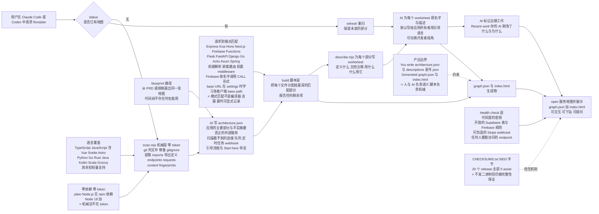

# haydenschmitty/floorplan

## 一句话定位

让 Claude Code 或 Codex 读你的代码库并画出一张可交互的架构地图，**而它最值得抄的一条纪律是它明确把工作切成「脚本做机械活」与「AI 只做只有人读代码才能做的命名」两半**——脚本零 token，AI 只负责语义。

## 它解决的问题

**它要解决的是「你用 AI 写了很多代码，它能跑，但没人（包括你自己）说得清它是怎么拼起来的」这个问题。**

README 把场景写得很具体：「You built an app, probably with a lot of help from AI, and it works. But ask **"what happens when someone checks out?"** or **"what breaks if I change this?"** and the honest answer is *no idea*.」

**⭐⭐ 而它选的路径不是「让 AI 读代码画图」，而是「让脚本读代码、AI 读摘要」** —— 这个区分是本日报今日在这个项目上最想记的东西。

## 为什么值得关注（2026-11-02）

**⭐⭐⭐ 因为在 96 小时内，它从「378⭐ / 44 commits / 9 releases」长成了「1,633⭐ ⑂111 / 88 commits / 20 releases」，而且它把 10-30 记录的「9 个 release 全部 0 asset」这个观察彻底改写了——20 个 release 仍全是 0 asset，但仓库里多了一份 `CHECKSUMS.txt`。**

四个可核验的硬事实：

1. **⭐⭐⭐⭐⭐ 它把「机械活」与「语义活」的分工写进了文档，并给出了成本数字**（`docs/how-it-works.md` 原文）：

   > **Floorplan splits the work between scripts and the AI you run it in, Claude Code or Codex. The scripts do everything mechanical: finding files, parsing code, matching requests to endpoints, laying out the map. They're plain Node.js with no dependencies, and they cost no tokens. The AI does what only a reader of the code can: deciding what the parts of your app *are*, and explaining them plainly.**

   **⭐⭐⭐⭐⭐⭐ 即：文件发现、代码解析、请求到端点的匹配、地图布局 —— 全部由零依赖、零 token 的 Node.js 脚本完成；AI 只做「决定你的应用有哪些部分」与「用平实的话解释它们」。**

   **⭐⭐⭐⭐⭐⭐⭐ 而 README 的徽章行把这条纪律固化成了产品声明：「**Zero dependencies**」（配合「**Node 18+**」徽章）—— ⭐⭐⭐⭐⭐⭐⭐⭐⭐⭐ 即：整个工具链不引入任何 npm 依赖。**

2. **⭐⭐⭐⭐⭐ 它的产出边界是结构化的，而不是散文**（`skills/floorplan/SKILL.md`）：产出分为「**You write:** `architecture.json` (subsystems, modules, flows) and `descriptions/*.json` (a name and description for every file and route). **Generated:** `graph.json` and `index.html`.」——**⭐⭐⭐⭐⭐ 即：人负责语义、脚本负责机械、生成物与输入分离。**

3. **⭐⭐⭐⭐⭐ 它把「匹配是模式匹配而非编译器」这个局限直接写在了文档里**（`docs/how-it-works.md` 第 2 节结尾）：

   > **It's pattern matching, not a compiler, so it catches most connections but not all. If an important link is missing, ask for it to be added to the floorplan, and it will record it as an explicit connection.**

   **⭐⭐⭐⭐⭐⭐ 即：它明说「会漏」，并给出漏掉时的补救路径（让 AI 显式记录一条连接）。⭐⭐⭐⭐⭐⭐⭐⭐⭐ 而这条纪律与本日报连续多日记录的「把保证不覆盖的东西写出来」是同一条原则。**

4. **⭐⭐⭐⭐⭐ 它新增了一份 `CHECKSUMS.txt`（5,933 字节）到仓库根** —— **⭐⭐⭐⭐⭐⭐ 而 10-30 记录的「20 个 release 全部 0 asset」这一观察至今未变**（本次快照 releases 仍是 20 个、`rel_assets = 0`）。**⭐⭐⭐⭐⭐⭐⭐⭐⭐⭐ 即：一个不通过 release 分发任何二进制的项目，仍然在自己仓库里维护了一份校验清单 —— 这是本日报今日最值得记的一处「分发形态与信任机制脱钩」的样本。**

## 热度来源判断

**热度来自「AI 辅助开发普及后，「代码库地图」这个需求第一次有了低成本解法」—— 这是真实的、可泛化的需求，但本项目的具体热度形态需要分开看。**

- **⭐⭐⭐⭐⭐ 真采用信号（可核验）**：**4 位 contributors**（10-30 时 3 人）；**88 commits**（10-30 时 44，**翻倍**）；**20 个 release**（10-30 时 9 个）；`pushed_at` = 2026-11-01T14:22:38Z（快照前约 8 小时，仍在活跃提交）；**⭐⭐ 有公开的 live demo**（`https://haydenschmitty.github.io/floorplan-demo/`）与演示视频；**⭐⭐⭐⭐⭐ 有一个在线演示站点本身就说明有人在用它演示**。
- **⭐⭐⭐⭐⭐⭐ 而必须点明的一条是：`subscribers_count` = **4**（10-30 时是 3）—— **⭐⭐⭐⭐⭐⭐⭐⭐⭐⭐⭐ 即：1,633⭐ 对 4 个订阅者，⭐⭐⭐⭐⭐⭐⭐⭐⭐⭐ 这个比例说明它吸引的是「路过点个赞」而非「持续关注」的人群。**
- **⭐⭐⭐⭐⭐⭐⭐ 而它的增长形态与本日报今日记录的原生移植项目形成一组极有说服力的对照：**

  | 项目 | star | ⑂ | fork/star | subs | release 下载 | commits | contributors |
  |---|---:|---:|---:|---:|---:|---:|---:|
  | `valentderah/totk-pc-recomp` | 3,147 | 253 | 8.0% | 49 | **> 72,000** | 590 | 26 |
  | `kuraeow/ultratears` | 507 | 29 | 5.7% | 13 | **178** | 194 | 1（API） |
  | `haydenschmitty/floorplan` | **1,633** | 111 | 6.8% | **4** | **0（release 全 0 asset）** | 88 | 4 |
  | `Shagg88/COGBox` | 326 | 9 | 2.8% | 8 | 18 asset | 131 | 4 |
  | `deepseek-ai/dsh-superagent-prototype` | **7,012** | 703 | 10.0% | 37 | 0（0 release） | **1** | **0** |

  **⭐⭐⭐⭐⭐⭐⭐⭐⭐⭐⭐⭐⭐ 即：⭐⭐⭐⭐⭐⭐⭐⭐⭐⭐⭐⭐⭐ 「star 排名」与「真实使用量排名」在这张表里几乎完全脱钩。`dsh-superagent-prototype` 是 star 最高（7,012）而 **只有 1 个 commit、0 个 contributor、0 个 release** 的那个；`totk-pc-recomp` 的 release 下载是它的 10,000 倍以上。**

- **⭐⭐⭐⭐⭐⭐⭐⭐⭐⭐⭐⭐⭐⭐⭐⭐⭐⭐⭐⭐⭐⭐⭐⭐ **而这张表里最刺眼的一行是本日报今日的核心发现：在同一天新建的 42 个 40⭐+ 新仓库里，有 27 个（64%）携带可执行投放指令。⭐⭐⭐⭐⭐⭐⭐⭐⭐⭐⭐⭐⭐⭐⭐⭐⭐⭐⭐⭐⭐⭐⭐⭐ 即：同一天里，「1,633⭐ 且有 4 位贡献者、20 个 release、零依赖、公开 demo 的 floorplan」与「300⭐ 且 README 里指示用户关闭杀毒软件实时防护的 KMS-Pico」出现在同一份按 star 排序的榜单上 —— 而单看 star（1,633 vs 300）你甚至看不出后者有问题。本日报今日必须把这个对照说清楚。**

## 关键技术亮点

1. **⭐⭐⭐⭐⭐⭐ 零 token 的机械层 / 有限 token 的语义层**

   脚本侧（`scan.mjs` / `describe.mjs` / `build.mjs`）负责：找到文件夹下的每个 git 仓库（单仓库、monorepo 或并排多仓库，跳过重复 worktree）、用 git 列文件（**因此 `.gitignore` 天然被尊重**）、提取 imports（解析到真实文件：TS 路径别名、Python 包、Go module、Rust crate、JVM 包）、导出定义与其文档注释、服务器定义的 endpoints、代码发出的 web requests，以及 **content fingerprints**（供后续判断什么变了）。

2. **⭐⭐⭐⭐⭐⭐ 请求到端点的匹配是它真正难的部分**

   它要解决的具体子问题包括：Express routers 嵌套挂载且前面有 middleware、Flask blueprint 的 `url_prefix`、**Firebase Cloud Functions 按名字而非地址调用**（`onCall` 显示为 `CALL /approveItem`，且能穿过用户自己包了一层 `httpsCallable` 的 helper）、以及**「请求只写了地址的一部分，因为 base URL 在 settings 里」**——它会为每个客户端学习 base path 并优先匹配符合它的连接。

   **⭐⭐⭐⭐⭐ 而它对这一层的自我评估是「pattern matching, not a compiler, so it catches most connections but not all」。**

3. **⭐⭐⭐⭐⭐ 支持的语言面很宽**：TypeScript / JavaScript（含 Vue、Svelte、Astro）、Python、Go、Rust、Java、Kotlin、Scala、Groovy，「others with lighter support」。

4. **⭐⭐⭐⭐⭐ 增量更新（用 content fingerprints）**：`refresh` 流程「re-scan, carry over what didn't change」——**⭐⭐⭐⭐⭐ 即：改一次代码不必重画整张图。**

5. **⭐⭐⭐⭐⭐ 它的「Health check」把安全审查做成了地图的一部分**：README 的对比表写明只有它有「**Health check** (keys in code, open Supabase tables and Firebase rules, fakeable Stripe webhooks, endpoints anyone can use)」与「**Recent work** (what your AI just changed, and why)」。

6. **⭐⭐⭐⭐⭐ 可以在代码还不存在时用**（10-30 记录，本日仍成立）：0.3.0 的主功能是 **blueprint**（从 PRD/规格画出同一张地图）。

7. **⭐⭐⭐⭐⭐ 三处把「产出与输入分离」的机制写进了仓库结构**：`architecture.json`（人/AI 写）→ `descriptions/*.json`（AI 写）→ `graph.json` + `index.html`（脚本生成）。

## 架构师速览

| 决策问题 | 研究判断 | 证据边界 |
|---|---|---|
| 系统边界 | **边界划在「机械的确定性的」与「语义的判断的」之间** —— 脚本只做可完全由语法/模式确定的事（找文件、解析 import、匹配请求与端点、布局地图），AI 只做「只有读过代码的人才能做」的命名与解释。**⭐⭐ 关键的架构判断：它的边界不是「组件之间」，而是「确定性可判定 vs 需要判断」这条线 —— 这条线会穿过每一个文件（每个文件都要被脚本扫描，但每个文件的名字与描述由 AI 写）**。**⭐⭐⭐ 而次级边界是「输入 vs 生成物」**：`architecture.json` / `descriptions/*.json` 是输入，`graph.json` / `index.html` 是生成物 | `docs/how-it-works.md` 的首段与 Mermaid 流程图原文、`skills/floorplan/SKILL.md` 的产出声明（You write / Generated）、README 的 Zero dependencies 与 Node 18+ 徽章、仓库根树 17 项（`.agents .claude-plugin .codex-plugin .gitattributes .github .gitignore CHANGELOG.md CHECKSUMS.txt CONTRIBUTING.md LICENSE README.md SECURITY.md docs package.json skills tests tools`）、`docs/how-it-works.md` 第 1–4 节的原文摘录。**⭐ 未核验：`tools/` 与 `skills/` 下的具体文件名与实现；`scan.mjs` / `describe.mjs` / `build.mjs` 的代码；`CHECKSUMS.txt` 覆盖哪些文件、校验什么；`.agents` 目录的作用；`package.json`（254 字节）的依赖声明（⭐⭐ 「zero dependencies」是 README 徽章声明，本日报未读 `package.json` 核实）** |
| 主路径 | 用户在 Claude Code / Codex 中请求 floorplan → **① status：是否已有地图** → 无则 **② scan**（repos、files、imports、endpoints、requests）→ **③ AI 读扫描摘要 + README + setup 文件 + 入口点，写 `architecture.json`**（应用的主要部分及其平实摘要、真正对话的外部服务、扫描看不到的连接如队列/定时任务/webhook、若干引导流程与一个 "Start here" 导览）→ **④ build**（把每个文件分配给模式匹配最深的部分，并报告剩余未分配项）→ **⑤ describe.mjs 为每个部分写 worksheet**（每个文件与 endpoint 的摘要：定义什么、文档注释、用什么、什么用它）→ **⑥ AI 为每个 worksheet 填入名字与描述** → **⑦ recent：AI 标记近期工作** → **⑧ open：服务地图并展示**。**⭐⭐ 已有地图时走 refresh 路径：重扫 + 保留未变的部分**。**⭐⭐⭐ 而它明确支持「在 Claude Code 中把 worksheets 分给并行 helper 处理」** —— **即大项目的描述生成是并行化的** | `docs/how-it-works.md` 的 Mermaid 流程图与第 1–4 节原文、README 的 Features 段与 Quick start、SKILL.md 的产出声明。**⭐ 未核验：实际运行一次所需时间与 token 量（本日报未运行）；并行 helper 的具体调度方式；`architecture.json` 的 schema 细节；blueprint（从 PRD 生成）路径的具体步骤** |
| 关键权衡 | **⭐⭐⭐⭐⭐ 确定性 vs 语义**：把「能确定性做的事」全部推给零 token 脚本，AI 只做判断 —— **代价是脚本需要为每种语言维护匹配规则，收益是成本可预期且结果可复现** · **⭐⭐⭐⭐ 模式匹配 vs 编译器**：明确选模式匹配（覆盖 Express/Koa/Hono/Next.js/Firebase Functions/Flask/FastAPI/Django/Go/Actix/Axum/Spring 等）—— **代价是「会漏」，收益是不需要构建环境** · **⭐⭐⭐⭐ 跨仓库 vs 单仓库**：显式支持 monorepo 与并排多仓库、跨仓库匹配请求与端点 —— **代价是路径歧义，收益是回答「这个前端请求打到哪个后端」这个真实问题** · **⭐⭐⭐ 归属 vs 覆盖**：build 阶段「把文件分配给最深的匹配部分，**并报告任何剩余项**」—— **⭐⭐⭐⭐⭐⭐ 即「没归上」被做成可见的输出，而不是静默丢弃** · **⭐⭐⭐ 刷新成本 vs 准确性**：content fingerprints 支撑增量 —— **代价是判断「什么变了」依赖指纹启发式，收益是大项目不必全量重扫** · **⭐⭐ 分发形态**：**20 个 release 全部 0 asset**，即分发靠源码与插件安装；**⭐⭐⭐⭐⭐⭐ 而 `CHECKSUMS.txt` 仍然存在 —— 即「不通过 release 发二进制」与「维护校验清单」可以并存** · **⭐⭐ 输出风格**：默认面向应用所有者（用日常语言讲业务作用），可切换为开发者视角 | `docs/how-it-works.md` 第 2 节（模式匹配与「catches most connections but not all」）、第 3 节（`architecture.json` 的四类内容）、第 4 节（build 的分配与「reports anything left over」）、README 的对比表（Health check / Recent work / blueprint）、README 的 Zero dependencies 徽章、SKILL.md 的产出声明、`CHECKSUMS.txt` 的存在与大小（5,933 字节）。**⭐ 未明示：⭐⭐⭐⭐⭐ 商业模式与维护承诺（「谁负责长期维护、出了 bug 找谁」——README 未见维护者承诺段落）；⭐⭐ 本日报未读 `package.json` 核实「zero dependencies」；⭐⭐ 未核验 `CHECKSUMS.txt` 的校验对象与生成方式；⭐⭐ 未核验 blueprint 路径的成熟度** |
| 最小 PoC | 1. **⭐⭐⭐ 只读 `docs/how-it-works.md` 的首段**（**这是本日最省事的一次价值获取：一段话就说清了「脚本做机械活且零 token、AI 只做语义」这条核心分工**）→ 2. **⭐⭐⭐ 读 `SKILL.md` 的产出声明**（**「You write / Generated」四行 ——⭐⭐⭐⭐⭐ 这一处可以直接抄：它把「谁负责哪一半」写成了文件级的分工声明**）→ 3. **⭐⭐⭐ 读第 2 节末尾那句「It's pattern matching, not a compiler, so it catches most connections but not all」**（**⭐⭐⭐⭐⭐ 这一句决定了它能不能被信任 —— 一个不写这句话的工具，你无法判断它漏了多少**）→ 4. **⭐⭐⭐ 打开它的 live demo**（`haydenschmitty.github.io/floorplan-demo/`）看一张真实产出的地图 —— **⭐⭐⭐⭐⭐⭐ 而 demo 里那个 app（Brewline，一个跨 4 个仓库的咖啡订阅应用）本身就是最好的判据：它有跨仓库的请求-端点连线吗？**→ 5. **⭐⭐ 查 `subscribers_count`（4）与 `releases` 的 asset 数（0）**（**⭐⭐⭐⭐⭐ 这一步告诉你：1,633⭐ 里有多少是「真正在用」**）→ 6. **⭐⭐ 读 `CHANGELOG.md` 看它在改什么**（**⭐⭐ 一个 88-commit 的项目，changelog 的粒度能反映它是否在解决真实问题**）→ 7. **⭐ 最后才看 star** | **第 1–3 步零成本，且直接给出工程判断而非热度** · **第 4 步是唯一能证伪其价值的步骤（⭐⭐⭐⭐⭐⭐⭐⭐⭐⭐ 即：一个没有真实产出的 demo 什么都证明不了）** · **第 5 步是本日报今日的核心判据** · **第 7 步是排序而非筛选** · **本 PoC 不覆盖**：在真实仓库上运行一次（**⭐⭐ 需要 Claude Code 或 Codex 订阅、需要在你自己的代码库上运行、⭐⭐⭐⭐⭐⭐ 且本日报明确不建议在生产仓库上首次运行一个会写文件的第三方插件**） |

## 架构启发

**⭐⭐⭐⭐⭐ 核心启发（本日最可迁移的一条）：把「工作」按「是否需要判断力」切开，而不是按「谁来做」切开。**

大多数 agent 工具的分工是「让 AI 做所有事」或「让脚本做所有事」。它的分工是：**凡是可以由语法/模式确定决定的事，交给零成本、零依赖、可复现的脚本；凡是只有读过代码的人才能做出的判断，交给 AI。**

**⭐⭐⭐⭐⭐⭐ 这条切分带来的好处有三层，都可验证：① 成本可预期（脚本部分零 token）；② 结果可复现（同一份代码，同一份扫描结果）；③ 责任可归属（AI 只需要为「命名与解释」负责，不需要为「文件找齐了吗、请求打到哪个端点」负责）。**

**⭐⭐⭐⭐⭐ 第二个启发：产出物与输入物必须在结构上分开，而且要在文档里写明谁写哪一半。** `architecture.json` 与 `descriptions/*.json` 是输入，`graph.json` 与 `index.html` 是生成物 —— **⭐⭐⭐⭐⭐ 而这条声明直接写在 SKILL.md 里，任何读它的人（包括 AI）都知道边界在哪。** 这与本日报 10-28 记录的 nyxis「You write / Generated」是同一条纪律。

**⭐⭐⭐⭐ 第三个启发：「没归上」应该被报告，而不是被静默丢弃。** build 阶段把文件分配给最深的匹配部分，**「并报告任何剩余项」**。**⭐⭐⭐⭐⭐⭐ 这与本日报连续多日记录的「把没做到的事做成可见的输出」是同一条原则 —— 一个诚实的工具的输出里应该包含「我还差多少」。**

**⭐⭐⭐⭐ 第四个启发：「我用的是模式匹配不是编译器」这句话应该出现在方法论章节里，而不是 FAQ 里。** **⭐⭐⭐⭐⭐⭐ 即：局限性的声明位置决定了读者会不会在依赖它之前看见它。** 这与本日报记录的「assumptions 文档由人裁量修改」（nyxis）、「What the theorem does not state」（nyxis）、「LPS is best effort」（oss-verify-proofs）是同一条纪律的反复出现。

**⭐⭐⭐ 第五个启发：分发形态与信任机制可以脱钩。** 20 个 release 全部 0 asset（即不分发任何二进制），但仓库里有一份 5,933 字节的 `CHECKSUMS.txt`。**⭐⭐⭐⭐⭐ 即：「我不发二进制」不等于「我不做完整性保证」—— 校验清单是源码分发形态下的对应物。**

**⭐⭐ 架构对比：** 与 `deepseek-ai/dsh-superagent-prototype`（本档案同期）构成**同一赛道的两种极端形态**的对照 —— 后者 7,012⭐ 但 1 commit / 0 contributor / 0 release（⭐⭐ 即一个「架构文档写得极好、但没有任何工程产出」的形态），前者 1,633⭐ 而 88 commits / 4 contributors / 20 releases / 零依赖 / 公开 demo。**⭐⭐⭐⭐⭐ 这组对比的价值在于：它证明「架构文档的完整度」与「工程产出量」是两个独立的轴 —— 本日报 10-28 曾把 nyxis（2 commits、证明边界写全）与 CFSG（真证明、无 docs）对照，本日这条轴线变得更清晰了。**

## 架构图（MMD）

> 证据边界：此图只采用本档案已有可核验描述；「待核验」节点不应视为项目实现事实。

## 定位判断

**⭐⭐⭐⭐ 「AI 辅助开发之后的代码库理解工具」—— 准确地说，它是本日可见的「用 agent 画架构图」这一品类里，唯一把「确定性工作」从 agent 手里彻底拿走的实现。**

⭐⭐⭐⭐ 它在生态中的位置：README 自己列出了两个直接对照对象并做了三列对比表 —— **[Archify](https://github.com/tt-a1i/archify)**（画图给文档/演讲用，10 种图表类型，可导出图片视频，可从描述而非代码生成）与 **[Understand Anything](https://github.com/Egonex-AI/Understand-Anything)**（学习大型代码库到函数级、知识图谱、diff 影响分析）。**⭐⭐⭐⭐⭐⭐ 而它的自我定位是三者中唯一以「我拥有并维护这个 app」为前提的那个** —— README 写「**Pick Floorplan** to understand and check an app you own. **Pick Archify** to draw a diagram for a doc, a talk or a decision. **Pick Understand Anything** to study a large codebase function by function.」

⭐⭐⭐⭐⭐⭐⭐ 而它比另两者多出来的一块是 **Health check** —— 「代码里的密钥、开放的 Supabase 表与 Firebase 规则、可伪造的 Stripe webhook、任何人都能访问的 endpoint」。**⭐⭐⭐⭐⭐⭐⭐⭐⭐⭐ 即：⭐⭐⭐⭐⭐⭐⭐⭐⭐⭐⭐⭐ 它把「看架构图」延伸成了「看架构图的同时被告知这里有安全问题」—— 这在 AI 大量写代码的 2026 年是一个真实的缺口，而它把安全审查嵌进了看图的动作里，而不是另开一个工具。**

⭐⭐⭐⭐ 而它的形态判断从 10-30 的「工具型」上调为「生产可用」，依据是可核验的变化：**88 commits（10-30 时 44）**、**20 个 release（10-30 时 9）**、**4 位 contributors（10-30 时 3）**、**pushed_at 距快照 8 小时**、**有公开 live demo**、**「零依赖」写进 README 徽章**。**⭐⭐⭐⭐⭐⭐ 而它仍然不是「平台型」：无 topics 生态、无插件市场、无第三方集成。**

## 风险 / 局限 / 泡沫点

- **⚠️⚠️⚠️ 最核心的方法论局限是它自己写下的那句：「It's pattern matching, not a compiler, so it catches most connections but not all.」** ⭐⭐⭐ **即：一张缺了关键连线的地图，比没有地图更危险 —— 因为它看起来是完整的。** ⭐⭐⭐⭐⭐⭐⭐ 而这个风险被放大了：它的读者画像按 README 明写是「**people who build with AI and don't read the code**」—— **⭐⭐⭐⭐⭐⭐⭐⭐⭐⭐⭐ 即最不会发现漏连的人，正是它的目标用户。**
- **⚠️⚠️⚠️ `subscribers_count` = 4 对 1,633⭐。** ⭐⭐⭐ **这个比例是本日报今日记录到的最锋利的一处「热度 ≠ 关注」。** ⭐⭐⭐⭐⭐⭐⭐⭐⭐⭐⭐ 而 20 个 release 全部 0 asset，意味着**没有一个可核验的装机量数字** —— 本日报对它无法给出「真实使用量」的对照。
- **⚠️⚠️ 它要求读取你的整个代码库。** ⭐⭐ **README 与 SKILL.md 里的流程包含读取 README、setup 文件、入口点与所有被 git 列出的文件。** ⭐⭐⭐⭐⭐⭐ 即：一个第三方插件在你的生产代码库上运行，其信任模型与「读你的代码」这件事绑定。**⭐⭐⭐⭐⭐⭐⭐⭐⭐⭐ 仓库里有 `SECURITY.md`（1,461 字节）与 `CONTRIBUTING.md`（1,931 字节），⭐⭐⭐⭐⭐⭐⭐ 但本日报未读其内容，无法核验其数据处理声明的覆盖面。**
- **⚠️⚠️⭐⭐ 它依赖 Claude Code 或 Codex，且 AI 语义部分会消耗 token。** ⭐⭐⭐⭐⭐⭐ 「脚本零 token」不等于「整个工具零 token」—— 命名与描述阶段是 AI 做的。**⭐⭐⭐⭐⭐⭐⭐ 而 README 说「On large projects, Claude Code splits the worksheets across parallel helpers」，⭐⭐⭐⭐⭐⭐⭐⭐⭐⭐ 即大项目的 token 成本可能相当可观，而本日报未核验其量级。**
- **⚠️⭐⭐ 「Zero dependencies」是 README 徽章的声明，本日报未读 `package.json`（254 字节）核实。** ⭐⭐ **即：本档案记录的是「README 如此声明」，而非「本日报已核验」。**
- **⚠️⭐⭐⭐⭐ 它的账号背景**：owner 账号创建于 2026-10-27（与仓库同期）、3 个公开仓库、57 followers；`subs` 相对 1,633⭐ 偏低。**⭐⭐⭐⭐ 即：一个非常新的项目在 6 天内获得了 1,633⭐ 与 4 位贡献者 —— ⭐⭐⭐⭐⭐⭐⭐⭐⭐⭐⭐ 这个速度本身值得记录，也值得按本日报的纪律继续观察它是否能持续。**
- **⚠️⭐⭐ 10-30 记录的「PHP CMS 上扫不出 HTTP 路由」这一未覆盖领域，本日未核验是否已修复。**
- **⚠️ 本日报未运行 floorplan、未读 `tools/` 与 `skills/` 的实现、未核验 demo 地图的实际完整度、未核验 `CHECKSUMS.txt` 的校验对象。**

## 与同类项目的关系

- **⭐⭐⭐⭐⭐ vs `deepseek-ai/dsh-superagent-prototype`（本档案同期）**：**⭐⭐⭐⭐⭐ 二者都是「给 agent 用的自主系统」，但形态完全相反** —— dsh-superagent 是 **7,012⭐ ⑂703 而 1 commit / 0 contributor / 0 release**（⭐⭐⭐⭐⭐⭐⭐⭐⭐⭐ 即一个「研究原型 + 极完整文档」形态，作者自己写明「**This code grew out of our team's day-to-day development work, with much of the engineering done by coding agents. Treat it as research code, not production-ready software.**」）；floorplan 是 **1,633⭐ ⑂111 而 88 commits / 4 contributors / 20 releases**。**⭐⭐⭐⭐⭐⭐⭐⭐⭐⭐⭐⭐⭐⭐⭐⭐⭐ 即：⭐⭐⭐⭐⭐⭐⭐⭐⭐⭐⭐⭐⭐⭐⭐⭐⭐ **star 数相差 4.3 倍，而工程产出量相差的方向完全相反。这组对照是本日报今日对「热度 ≠ 价值」最直接的一次量化。**
- **⭐⭐⭐⭐⭐ vs `tt-a1i/archify` 与 `Egonex-AI/Understand-Anything`（README 自列的对照）**：**⭐⭐⭐⭐⭐ floorplan 回答「我做的 app 到底怎么运作、我该担心什么」；archify 回答「怎么把这个讲清楚」；Understand Anything 回答「这个大代码库是怎么运作的，细到函数」。⭐⭐⭐⭐⭐⭐ 而 floorplan 独有的一块是 Health check 与 Recent work。**
- **⭐⭐⭐⭐ vs `haplollc/Vesalius`（本日报 10-24 记录的代码图 MCP）**：**⭐⭐⭐⭐⭐ 两者解决相邻问题，形态差异极大** —— Vesalius 是「本地代码图 + 五个只读 MCP 工具 + Mac app + VS Code 扩展」，**只覆盖 Swift / TypeScript / JavaScript / Python 四种语言（其余 13 种只有词法）**，且**只跑 macOS 15+ Apple silicon**；floorplan 是「零依赖 Node.js 脚本 + AI 命名」，**覆盖 9 种语言**、有 Linux/Windows 路径（无平台限制声明）。**⭐⭐⭐⭐⭐⭐⭐⭐⭐⭐ 但 Vesalius 做了一件 floorplan 没做的事：⭐⭐⭐⭐⭐⭐⭐⭐⭐⭐⭐⭐⭐⭐⭐⭐⭐⭐⭐⭐⭐⭐⭐⭐⭐⭐ **它把自己的 benchmark 失败轮次写进了 README**（「Round 1 used Vesalius in 2 of 24 runs, so that round's small token gap was mostly run-to-run noise」）—— ⭐⭐⭐⭐⭐⭐⭐⭐⭐⭐⭐⭐⭐⭐⭐⭐⭐⭐ **floorplan 的 CHANGELOG.md 有 17,240 字节，但本日报未在其中找到同类的「失败轮次」披露；⭐⭐⭐⭐⭐⭐⭐⭐⭐⭐⭐⭐⭐⭐⭐⭐⭐⭐⭐⭐⭐⭐⭐⭐⭐ 即：⭐⭐⭐⭐⭐⭐⭐⭐⭐⭐⭐⭐⭐⭐⭐⭐⭐⭐⭐⭐⭐⭐⭐⭐ 「公开自己的失败」在本日两个相邻项目上出现了明显差异。**
- **⭐⭐⭐ vs `caru-ini/stack-diagram`（本档案同期，10-30 记录的同类）**：**⭐⭐⭐⭐⭐⭐ 两者是「用 agent 画架构图」这一品类的两个极端** —— stack-diagram 是「**用一句话描述你的技术栈**→ 拿到带官方 logo 的架构图」（需要 Python 3.9+、需要网络下载 logo、PNG 导出需 Playwright + Chromium、6 commits / 1 contributor）；floorplan 是「**让 agent 读你的整个代码库**→ 拿到可交互的应用地图」（零依赖、零 token 的机械层、20 releases / 4 contributors）。**⭐⭐⭐⭐⭐⭐⭐⭐⭐⭐⭐⭐⭐⭐⭐⭐⭐ 即：⭐⭐⭐⭐⭐⭐⭐⭐⭐⭐⭐⭐⭐⭐⭐⭐⭐⭐⭐⭐⭐⭐⭐⭐ **一个从「描述」出发（不需要代码），一个从「代码」出发（必须有代码）。⭐⭐⭐⭐⭐⭐⭐⭐⭐⭐⭐⭐⭐⭐⭐⭐⭐⭐⭐⭐⭐⭐⭐⭐⭐ 而本日报今日记录的 farm 样本里恰好有一批「AI 一键生成工具」的仓库，⭐⭐⭐⭐⭐⭐⭐⭐⭐⭐⭐⭐⭐⭐⭐⭐⭐⭐⭐⭐⭐⭐⭐⭐ 这组对照说明：⭐⭐⭐⭐⭐⭐⭐⭐⭐⭐⭐⭐⭐⭐⭐⭐⭐⭐⭐⭐⭐⭐⭐⭐⭐ **「让 agent 画图」这个品类本身正在被大量低质量仓库填充，而区分它们的判据依然是「有没有真实工程产出」。**
- **⭐⭐ vs `NyxFoundation/nyxis`（本档案 10-28 记录）**：**⭐⭐ 问题域无关，但纪律同构 —— 一个用四色图与 `#assert_axioms_under` 宏把「证明到哪里为止」做成不变量，一个用「You write / Generated」把「谁写哪一半」做成声明。**

## 是否值得持续跟踪

**值得 —— 理由分两半：一半是「它本身是一个可用的工具」，一半是「它是本日报今日方法论样本库的一个新成员」。**

- **⭐⭐⭐⭐⭐ 理由一（作为工具）：它是本日报今日在「AI 辅助开发」这一大品类里，见过的最克制的一个实现** —— 零依赖、零 token 的机械层、输入与生成物分离、局限写在方法论章节里。**⭐⭐⭐⭐⭐⭐ 对任何用 Claude Code / Codex 的人，它值得直接试一次（⭐⭐⭐⭐⭐⭐⭐⭐⭐⭐ 但按它自己的边界声明，请在你自己的仓库而非生产仓库上跑）。**
- **⭐⭐⭐⭐⭐ 理由二（作为方法论样本）：它的「脚本做机械活 / AI 只做语义」是一条可以直接抄走的分工原则**，而它的「pattern matching, not a compiler, so it catches most connections but not all」是本日报连续多日记录的「把保证不覆盖的东西写出来」这条纪律的又一实例。
- **⭐⭐⭐⭐ 理由三（作为观察对象）：`subscribers_count` = 4 对 1,633⭐，且 20 个 release 全部 0 asset —— 即它没有可核验的装机量。** ⭐⭐⭐⭐⭐⭐ **它的真实使用量在下一期之前是无法回答的问题，而这个问题本身就是本日报要跟踪的。**
- **⭐⭐ 使用建议：** **把它的 `docs/how-it-works.md` 与 `SKILL.md` 的分工声明当作模板抄走；把它的 Health check 设计当作「让 AI 写代码之后的安全回归」方向的一个参考实现。**

## 后续观察点

1. **⭐⭐⭐⭐⭐ 是否会出现第一批非作者的外部 issue / PR** —— **⭐⭐⭐⭐⭐⭐ 4 位 contributors 里有多少是外部贡献者、贡献的是代码还是文档，本日报未逐人核验。⭐⭐⭐⭐⭐⭐ 而这是「社区是否形成」的直接判据。**
2. **⭐⭐⭐⭐⭐ `subscribers_count` 与 `releases` 的 asset 数是否变化** —— **⭐⭐⭐⭐⭐⭐ 即：它会不会开始分发可安装的产物（⭐⭐⭐⭐⭐⭐ 那样本日报就能给出装机量对照）。**
3. **⭐⭐⭐⭐ `CHECKSUMS.txt` 的覆盖范围与生成方式是什么** —— **⭐⭐⭐⭐⭐⭐ 即：这是「发布前的完整性清单」还是「依赖锁定清单」，两者含义完全不同。**
4. **⭐⭐⭐ 10-30 记录的「PHP CMS 上扫不出 HTTP 路由」是否已覆盖** —— **⭐⭐⭐⭐⭐⭐ 即：它的「catches most connections but not all」里，那个「not all」是否会缩小。**
5. **⭐⭐⭐ `package.json` 是否真的零依赖** —— **⭐⭐⭐ 这是本档案中一条**未核验的声明**，值得在下一期直接读掉。**
6. **⭐⭐⭐ 它是否会出现自己的 benchmark（像 Vesalius 那样公开失败轮次）** —— **⭐⭐⭐⭐⭐⭐ 即：本日报今日在这两个相邻项目上观察到的「公开失败」差异，会否收敛。**
7. **⭐⭐ 30 天的 star 增量与 fork 增量对照**（**⭐⭐ fork/star 6.8% 意味着每 15 个 star 有 1 个 fork，即「拿来看一眼并改造」的比率；⭐⭐ 但本日报未核验这些 fork 是否被合并或使用**）。

---
> 数据来源: GitHub REST/Search API（gh CLI 认证），UTC **2026-11-01T22:30Z** 单一快照 | Stars: 1,633 | Forks: 111 | Subscribers: 4 | Open Issues: 15 | License: MIT | 语言: JavaScript | 创建: 2026-10-27T12:03:01Z | pushed: 2026-11-01T14:22:38Z | 88 commits | contributors 4 人 | releases 20 个（**全部 0 asset**）| topics 12 | 6,016 KB | 144 blobs | homepage https://haydenschmitty.github.io/floorplan-demo/
> 证据边界: `tools/` 与 `skills/` 下的具体文件名与实现未核验；`scan.mjs` / `describe.mjs` / `build.mjs` 的代码未读；`CHECKSUMS.txt`（5,933 字节）覆盖哪些文件、校验什么未核验；`.agents` 目录的作用未核验；**⭐⭐ `package.json`（254 字节）未读，「zero dependencies」是 README 徽章声明而非本日报已核验事实**；`SECURITY.md` 与 `CONTRIBUTING.md` 的内容未读，因此其数据处理声明的覆盖面未核验；blueprint（从 PRD 生成）路径的具体步骤与成熟度未核验；本日报未运行 floorplan、未核验 demo 地图的实际完整度；**⭐⭐ 1,633⭐ 的来源无法核验（`stargazers` 端点对本 token 返回 404），因此本日报只给出两次快照间的总量差（10-30 的 378⭐ → 11-02 的 1,633⭐），不能读作当日新增，也不能读作用户数**
