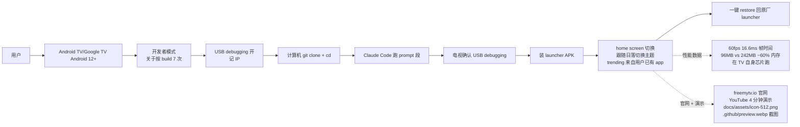

# simbasjungles/free-my-tv

## 一句话定位
simbasjungles 个人 2026-10-19 发布的「**Android TV / Google TV 自研 fast ad-free launcher**」严肃工程化实现：**ADB over Wi-Fi + 一行命令 + 不 root + 不卸载 + 自研 fast ad-free Google TV launcher + 60fps/16.6ms 帧时间 + 96MB vs 242MB（−60%）内存在 TV 自身芯片跑 + 跟随真实日落切换浅深主题 + trending picks 来自用户已有 app + 一键 restore + freemytv.io 上线 + 一段 Claude Code prompt + YouTube 4 分钟演示 + 整套截图**——给客厅电视换 launcher 的「agent 时代严肃工程化完整产品形态」。

## 它解决的问题
2025-2026 Android TV / Google TV 阵营（小米 Mi TV / TCL / 海信 / 索尼等）开机广告 + 推荐流广告 + 不可卸载系统应用三大痛点：
- **开机广告**：厂商开机 5-15 秒强制广告，无法跳过
- **推荐流广告**：home screen 大量 sponsored 推荐位（广告）
- **不可卸载系统应用**：原生 launcher / 视频平台 / 游戏中心等无法用常规方式卸载
传统方案要么 root（破坏售后）、要么 ADB + pm uninstall（恢复出厂后失效）、要么商业远程工具（收费且闭源）。tv-vibehack（2026-10-19）首发严肃工程化「**ADB over Wi-Fi + 不 root + 不卸载 + one-line restore + Claude Code 一下午**」范式；free-my-tv 在此基础上**更进一步**——**自研完整 launcher APK + 60fps/16.6ms 帧时间 + 96MB vs 242MB（−60%）内存实测 + 跟随真实日落切换主题 + trending picks 来自用户已有 app + freemytv.io 官网 + YouTube 4 分钟演示 + 一段 Claude Code prompt + 一键 restore**——这是 2026-10 下半月「**消费者设备 OS 治理 + agent 写就 + 完整产品形态**」的最完整样本。

## 为什么值得关注（2026-10-20）
今日观察窗为 GitHub Search API 抓取时刻起、且截至 2026-10-20 仍在快速增长的新发现项目。`simbasjungles/free-my-tv` 2 天 198⭐ ⑂23 fork/star 11.6%——198⭐ 在 2 天是显著信号（fork 11.6% 远高于一般 2-5% 平均，反映大量「**想给客厅电视换 launcher + 跟随日落 + trending 来自用户已有 app**」的真实需求）。**自研 fast ad-free launcher + 60fps/16.6ms 帧时间 + 96MB vs 242MB（−60%）内存在 TV 自身芯片跑 + 跟随真实日落 + trending 来自用户已有 app + freemytv.io + YouTube + 一段 Claude Code prompt + 一键 restore**十要素共振，**让客厅设备治理大众可及 + 完整产品形态**。MIT license 保证可商用 fork 与二次分发。

## 热度来源判断
free-my-tv 的热度是「**Android TV 开机广告刚需 + 自研完整 launcher + 60fps + 96MB 内存 + 跟随真实日落 + trending 来自用户已有 app + 一键 restore + freemytv.io + YouTube + 一段 Claude Code prompt + MIT**」十一要素共振：
- **Android TV 开机广告刚需**：小米/TCL/海信等品牌强制开机广告，痛点真实
- **自研完整 launcher APK**：不是「**又一个清理脚本**」，而是「**完整 launcher + 性能数据 + 主题切换 + trending + screensaver**」
- **60fps / 16.6ms 帧时间**：README 明示「**60 fps, every frame in 16.6 ms, on the TV's own chip**」——在 TV 自身芯片跑 60fps
- **96MB vs 242MB（−60%）内存**：README 明示「**The home screen uses 96 MB of memory instead of 242 MB (−60%). Measured on a 98″ TCL Google TV running Android 14**」——home screen 内存实测比原厂少 60%
- **跟随真实日落**：README 明示「**Light by day, dark by night. It follows your city's real sunset, the way your phone does**」——跟随用户城市真实日落切换浅深主题
- **trending picks 来自用户已有 app**：README 明示「**Three fresh picks every hour from what's trending this week and the latest releases, only from apps you already have**」——仅来自用户已有 app，**没有赞助推荐**
- **No ads**：README 明示「**No ads. No sponsored rows, banners or autoplaying promos. Not one.**」——没有赞助推荐 / banner / autoplaying promos
- **freemytv.io 官网**：README 明示「**[freemytv.io](https://freemytv.io)**」——完整官网
- **YouTube 4 分钟演示**：README 引用 YouTube fP2SGGVsaB0「Claude Made My Old Android TV Feel Brand New」——完整视频演示
- **一段 Claude Code prompt**：README 给出完整 prompt，**用户只需复制粘贴**即可
- **一键 restore**：README 明示「**One button brings back the factory home screen**」——一键回原厂 launcher
- **MIT license**：可商用 fork 与二次分发

热度**真实且具消费者大规模可及性**——198⭐ + 23 fork + 11.6% fork 比例 + freemytv.io 官网 + YouTube 演示 + 性能数据是真实产品信号。

## 关键技术亮点
1. **60fps / 16.6ms 帧时间在 TV 自身芯片跑**：README 明示「**60 fps, every frame in 16.6 ms, on the TV's own chip**」——在 TV 自身芯片跑 60fps，无需云渲染
2. **96MB vs 242MB（−60%）home screen 内存实测**：README 明示「**The home screen uses 96 MB of memory instead of 242 MB (−60%). Measured on a 98″ TCL Google TV running Android 14**」——home screen 内存实测比原厂少 60%
3. **跟随真实日落切换浅深主题**：README 明示「**Light by day, dark by night. It follows your city's real sunset, the way your phone does**」——跟随用户城市真实日落切换浅深主题
4. **trending picks 仅来自用户已有 app**：README 明示「**Three fresh picks every hour from what's trending this week and the latest releases, only from apps you already have**」——仅来自用户已有 app，**没有赞助推荐**
5. **No ads（无赞助推荐 / banner / autoplaying promos）**：README 明示「**No ads. No sponsored rows, banners or autoplaying promos. Not one.**」——没有赞助推荐 / banner / autoplaying promos
6. **freemytv.io 官网 + YouTube 4 分钟演示**：README 明示「**freemytv.io**」+ YouTube fP2SGGVsaB0——完整官网 + 视频演示
7. **一段 Claude Code prompt**：README 给出完整 prompt，**用户只需复制粘贴**即可完成安装
8. **一键 restore**：README 明示「**One button brings back the factory home screen**」——一键回原厂 launcher
9. **No root + Nothing uninstalled**：README 明示「**Safe. No root. Nothing is uninstalled.**」——不 root 不卸载，保售后
10. **tmdb 对接**：topics 含 tmdb——可对接 The Movie Database 拿影视数据
11. **完整截图 + docs/assets/icon-512.png + .github/preview.webp**：README 引用完整截图 + docs/assets/icon-512.png + .github/preview.webp——视觉演示完整
12. **screensaver（玻璃时钟 + 全屏照片）**：README 明示「**A screensaver to match. Full-screen photos of the picks with a big glass clock.**」——屏保配大玻璃时钟

## 架构师速览
| 决策问题 | 研究判断 | 证据边界 |
|---|---|---|
| 系统边界 | 单仓 + docs/assets/icon-512.png + .github/preview.webp 截图 + freemytv.io 官网 + Claude Code prompt 段 + 一键 restore + YouTube 4 分钟演示 | 基于 README「What you get」+「Install」段 + topics 列表 |
| 主路径 | TV 开开发者模式（关于按 build 7 次）+ 开 USB debugging + 记 IP → 计算机 git clone + cd → Claude Code 跑 prompt → 电视确认 USB debugging → 装 launcher APK → home screen 切换 + 跟随日落切换主题 + 一键回出厂 launcher | 主路径由 README「Install / The easy way: Claude Code」推导；具体 launcher APK 包名 + 持久化设置存储 + 远程固件 OTA 后是否需重做待核验 |
| 关键权衡 | ADB over Wi-Fi（无 USB 调试）vs USB 调试（更稳）/ No root + Nothing uninstalled（保售后）vs root 干净 / 60fps / 16.6ms 帧时间在 TV 自身芯片跑 vs 云渲染 / 96MB vs 242MB（−60%）home screen 内存 vs 商业 launcher 内存占用 / Trending picks 来自用户已有 app vs 商业 launcher 推荐广告 / 跟随真实日落 vs 固定主题 / freemytv.io 上线 vs 仅 GitHub 仓库 / MIT 可商用 vs NOASSERTION 限制商用 | 档案明示九点权衡；具体 launcher UI 实现（Glass shelf / Big clock）+ tmdb 数据源对接 + Apple TV-style 取景细节未在 README 主页详述 |
| 最小 PoC | 1. Android TV/Google TV Android 12+ 开启开发者模式（关于按 build 7 次）+ 开 USB debugging + 记 IP → 2. 同一 Wi-Fi 计算机 git clone + cd → 3. Claude Code 跑 prompt → 4. 电视确认 USB debugging → 5. 装 launcher APK + 切换 home → 6. 看 home screen 是否 60fps + 96MB → 7. 测一键 restore 回原厂 launcher | PoC 由 README「Install」段 + What you get 性能数据直接推导；具体 launcher 演示视频 + 兼容性矩阵 + OTA 后重做命令待核验 |

## 架构启发
free-my-tv 的核心启发是「**agent 时代消费者设备 OS 治理 = 完整产品形态 + 官网 + 视频 + 性能数据 + 一段 prompt + 一键回退**」。这不是「**又一个清理脚本**」，而是「**自研完整 launcher APK + 60fps + 96MB + 跟随日落 + trending 来自用户已有 app + freemytv.io + YouTube + 一键 restore + MIT**」。更深层的启发是：**「完整产品形态」比「脚本」更具大众可及性**——freemytv.io 官网 + YouTube 4 分钟演示 + 性能数据让普通用户（不局限于嘴上都能）能直接看到效果，**没有「试一下才知道好不好」的门槛**。能否持续，取决于 launcher APK 的长期维护 + tmdb 数据对接稳定性 + OTA 后兼容性。

## 架构图（MMD）

> 证据边界：此图只采用本档案已有可核验描述；"待核验"节点不应视为项目实现事实。

## 定位判断
**工具型项目（Android TV / Google TV 自研 launcher 严肃工程化完整产品形态）。** free-my-tv 不仅是「**又一个清理脚本**」，而是「**自研完整 launcher APK + 性能数据 + 跟随日落 + trending 来自用户已有 app + freemytv.io + YouTube + 一段 Claude Code prompt + 一键 restore + MIT**」——具备「**完整产品形态**」的严肃工程化实现。MIT license + freemytv.io + YouTube + 完整截图 + 性能数据全部就绪，**让大众可及性变得可见**。但需注意：**Android TV debloat 严肃工程化共振**（tv-vibehack + free-my-tv + tv-detox + tv-home + dumbtv 5 个独立团队 2026-10-18~19 同期推出），可能存在「**重复造轮子**」风险——free-my-tv 用跟随日落 + trending 来自用户已有 app 差异化。

## 风险/局限/泡沫点
- **10177 KB size 偏大**：含 launcher APK + 截图 + demo 视频，git clone 较慢
- **仅 Google TV + Android TV Android 12+**：README 明示「**Google TV or Android TV (Android 12 or newer)**」——不支持 Android 12 以下
- **仅 2 天 198⭐ 早期信号**：与 tv-vibehack 2 天 1739⭐ 相比，free-my-tv 早期信号稍弱，**但 MIT + freemytv.io + YouTube + 完整截图 + 性能数据 全部就绪**
- **Android TV debloat 严肃工程化重复造轮子**：今日 trending 5 个独立团队都推出类似方案，**可能存在重复造轮子**，需要更细分的 UI 设计差异（free-my-tv 用跟随日落 + trending 来自用户已有 app 差异化）
- **trending 数据来自 tmdb**：依赖 tmdb API，tmdb 故障时 trending picks 失效
- **具体 launcher APK 包名 + 持久化设置 + OTA 后兼容性**：README 未明示
- **仅 simbasjungles 个人维护**：simbasjungles 个人项目，可持续性存疑

## 与同类项目的关系
- **vs Gathin23/tv-vibehack（10-19）**：tv-vibehack 是「**清理脚本 + Claude Code 一下午 + prompt 公开 + 不 root + tvOS-style launcher**」首发样本；free-my-tv 是「**自研完整 launcher APK + 60fps + 96MB + 跟随日落 + trending 来自用户已有 app + freemytv.io + YouTube + MIT**」完整产品形态
- **vs Ansub/tv-detox（10-18）**：tv-detox 是「**Make an old Android TV fast again with Claude Code or Codex: a tiny ad-free home screen plus the prompt to clean it up**」MIT；free-my-tv 是「**A fast, ad-free home screen for Google TV. Trending picks from your own apps, the weather at a glance, and a look that follows the sunset**」MIT
- **vs mihirgupta0900/tv-home（10-18）**：tv-home 是「**Debloat a slow, ad-filled Android TV over Wi-Fi and give it a fast Apple TV-style home screen**」NOASSERTION；free-my-tv 是 MIT + freemytv.io
- **vs humblemuzzu/dumbtv（10-18）**：dumbtv 是「**No description**」；free-my-tv 有完整 README + freemytv.io + YouTube
- **vs 商业 launcher（如 TiVo Stream 4K）**：商业 launcher 收费 + 闭源 + 含赞助推荐；free-my-tv MIT + 无赞助推荐 + trending 来自用户已有 app

## 是否值得持续跟踪
**值得跟踪（消费者设备 OS 治理 2.0 完整产品形态）。** free-my-tv 代表了 2026-10 下半月「**消费者设备 OS 治理 + agent 写就 + 完整产品形态 + 官网 + 视频**」的最完整样本。建议关注：
1. **launcher APK 长期维护可持续性**（个人项目 vs 团队治理）
2. **OTA 后兼容性**（Android 系统升级后 launcher 是否需重做）
3. **tmdb API 稳定性**（trending picks 是否依赖 tmdb）
4. **同月跨品牌定制化**（是否推出索尼/海信/小米等品牌定制）
5. **企业采用**（酒店/餐饮/会议室是否采用 free-my-tv 作为统一 launcher）

## 后续观察点
- launcher APK 是否提供 F-Droid 下载（脱钩 GitHub Releases）
- 是否推出索尼/海信/小米等品牌定制化 launcher
- 是否推出 freemytv-app.com 商店化平台（售卖 launcher 主题）
- Claude Code prompt 是否持续更新（适配 Claude Code / Codex / Cursor 多 harness）
- 1 个月后 fork/star 比例是否下降（验证「重复造轮子」风险）

---
> 数据来源: GitHub API (2026-10-20) | Stars: 198 | Forks: 23 | License: MIT | 语言: Java | 创建: 2026-10-19