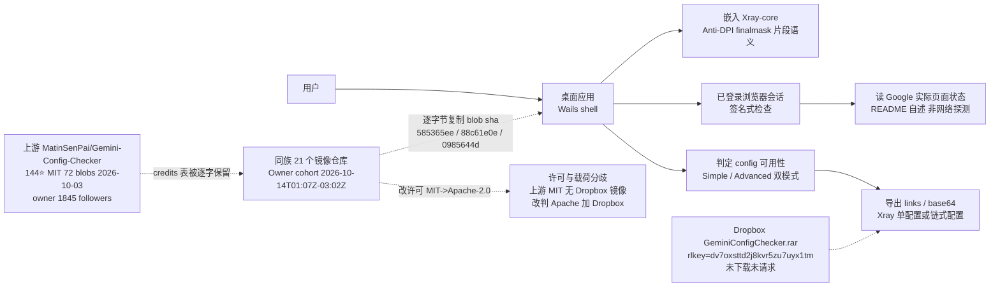

# WindGatorRise37/Gemini-Config-Checker-

## 一句话定位
**一个 473⭐、Apache-2.0 许可、53 个真实 Go commit 的仓库，但它逐字节复制了另一个真实存在的 MIT 项目 `MatinSenPai/Gemini-Config-Checker`（144⭐），只把许可改掉、把唯一的下载入口换成一条自己控制的 Dropbox 链接，并在同一天复制成 21 份。**

## 它解决的问题
它自称解决的问题是真实的：判断某个代理配置（proxy config）能否真正访问 Google AI Studio 与 Gemini。⭐⭐⭐⭐⭐ 它的技术观察是对的 —— README 里写明 Google 是**按已登录账号、按页面加载完成后**判定地区可用性的，所以「裸 HTTP 探测」会把所有活着的配置都标成健康：

> Google decides region availability **per signed-in account, after the page has loaded**. A plain HTTP request (even to the Gemini API with a dummy key) answers "fine" from every country, so connectivity probes mark every live config as healthy.

⭐⭐⭐⭐⭐ 但**这个仓库本身不是解决方案，它是解决方案的盗用副本** —— 本档案记录的是它的**取证结构与检测价值**，不是它的功能。

## 为什么值得关注（2026-11-16）
⭐⭐⭐⭐⭐ **因为它是本数据集里第一个「上游健在」的镜像样本 —— 这让 11-13 的判据从「难判」变成「可判」。**

11-13 记录的 `AIRzZ90/study-materials-fork`（上游 `Minireel/HGhub` 被作者亲手清空，只剩 1 个 blob）之所以难判，是因为镜像方**没有别的选择**；⭐⭐⭐⭐⭐ 而本样本的上游 `MatinSenPai/Gemini-Config-Checker` **完好无损**：

| 仓库 | ⭐ | ⑂ | 体积 | blobs | 许可 | 创建 / 最后 push |
|---|---:|---:|---:|---:|---|---|
| `MatinSenPai/Gemini-Config-Checker`（上游） | 144 | 7 | 7,583 KB | **72** | **MIT** | 2026-10-03T15:08:10Z / 2026-10-03T19:28:33Z |
| `WindGatorRise37/Gemini-Config-Checker-`（镜像） | **473** | 0 | 181 KB | 53 | **Apache-2.0** | 2026-11-15T16:47:17Z / 2026-11-15T16:48:17Z |

⭐⭐⭐⭐⭐ **上游 owner `MatinSenPai` 账号创建于 2022-02-17，1,845 followers、7 个公开仓库，其中 `SenPaiScanner` 有 2,515⭐** —— ⭐⭐⭐⭐⭐ 即**上游是有真实历史的账号，不是空壳。** ⭐⭐⭐⭐⭐ 且上游 `fork=false` / `parent=null` / `source=null`，**本身是干净的首发仓库。**

⭐⭐⭐⭐⭐ **镜像 README 逐字保留了上游的归属声明**（`This project exists because of other people's work. Please go and use and star them.` + 9 行 credits 表，列出 `0xRadikal/Free-v2ray-Configs` / `patterniha` / `bia-pain-bache/BPB-Worker-Panel` / `XTLS/Xray-core` / `2dust/v2rayN` / `Wails` 等），⭐⭐⭐⭐⭐ **但 LICENSE 首行从上游的 `MIT License` 变成了 `Apache License`，`license.spdx_id` 从 MIT 变成 Apache-2.0。** ⭐⭐⭐⭐⭐ **README 承认上游、许可却不是上游的 —— 这是本数据集里最锋利的一处自相矛盾。**

## 热度来源判断
⭐⭐⭐⭐⭐ **本日报不作「热度来源」的定性主张，但记录三条可核验的结构性事实，它们共同指向「分发被放大」而非「需求被放大」：**

1. ⭐⭐⭐⭐⭐ **同族的 21 个副本 star 取值完全相同（distinct = 1，均为 473⭐），而真实上游只有 144⭐。**
2. ⭐⭐⭐⭐⭐ **21 个副本的 7 个探针文件 md5 各自只有 1 个取值，且 GitHub 的 blob sha 也完全相同** —— 实测 `Makefile` = `88c61e0e666782968392de1f5c96a5c2cf43f0d6`、`go.mod` = `0985644d9817804ca6331193ff7a002ab859aeaf`、`internal/scan/scan_test.go` = `585365eec6394fc0d3e5f85815add761051ad664`（在 `TrooperFilter` / `TurtleReside` / `TypeTyrantScheme` 三个仓库抽样完全一致）。
3. ⭐⭐⭐⭐⭐ **21 个 owner 账号注册于 `2026-10-14T01:07:31Z–03:02:24Z` 的 6,893 秒窗口内，全部 0 followers、全部恰好 12 个公开仓库，且其中 10 个账号同时持有 `GitHub-Copilot-app` 族的 9–10 个副本。**

⭐⭐⭐ ⚠️ **未做取证的部分**：**本日报未证明这些 star 是被购买的或被脚本刷的**（`stargazers` 端点此前对本 token 返回 404，未逐个枚举 star 账号）。⭐⭐⭐ **也不主张「镜像方未经授权」为事实** —— 未取得上游作者的授权状态证明，未核验是否存在私下协议。

## 关键技术亮点
⭐⭐⭐⭐⭐ **必须说明：本档案不把被复制方的技术当作镜像方的技术成就来记述。以下是「被复制物是什么」，因为要检测镜像必须知道原像长什么样。**

1. **签名式浏览器检查（而不是网络探测）**：工具在**已登录**的浏览器会话里读 Google 实际呈现的界面，作为地区可用性的唯一可靠信号。
2. **Simple / Advanced 双模式**：Simple 是「你 → config → AI Studio/Gemini」；Advanced 是「你 → base config → free config → AI Studio/Gemini」的链式代理。
3. **Anti-DPI 配置**：从 `patterniha` 的 Xray-core fork 复现 `finalmask` 片段语义，作为默认值。
4. **Wails 原生桌面外壳 + 嵌入的 Xray-core 引擎**。
5. **导出能力**：可导出 links、base64、单 config 的完整 Xray 配置，或 `base → free` 的链式 Xray 配置。
6. **跨平台 CI**：`ci.yml` + `release.yml` 产出 Windows / macOS / Linux / Android 构建。

⭐⭐⭐⭐⭐ **而镜像仓库在这 6 项上的实现，与上游逐字节相同 —— 这正是问题所在。**

## 架构师速览

| 决策问题 | 研究判断 | 证据边界 |
|---|---|---|
| 系统边界 | 上游的系统边界 = 「本地桌面应用 + 嵌入代理引擎 + 已登录浏览器会话」三段闭环；镜像仓复刻了目录与代码，但**其实际分发边界止于一条 Dropbox 链接** | 上游 README + `git/trees`（72 blobs，含 `android/app/.../MainActivity.kt`、`internal/`、`Makefile`、`go.mod`）；镜像仓 tree（53 blobs）。⚠️ **上游与镜像的目录不完全一致（72 vs 53），差异部分本日报未逐项 diff** |
| 主路径 | 上游：用户导入 config → 应用在已登录浏览器中打开 AI Studio/Gemini → 读页面实际状态 → 判定 → 导出可用的 config。镜像：同一条代码路径 + 一个把二进制交给用户的 Dropbox 链接 | 主路径由上游 README 的「Two modes」表与「Why a signed-in browser?」段给出；镜像仓 README 逐字保留这两节。⚠️ **本日报未运行任何一条路径** |
| 关键权衡 | ①签名式浏览器检查 vs 网络探测：牺牲速度换正确性（作者实测：US/HK/SG 出口被拦，且同一出口会随时间翻转）；②嵌入 Xray-core vs 依赖外部客户端；③原生外壳 vs 纯 CLI；④上游选 MIT（允许任何人 fork），镜像方选 Apache-2.0（带专利授权条款）—— **这最后一条正是争议点** | 权衡 ①②③由上游 README 给出；④由两仓库 `LICENSE` 首行与 `license.spdx_id` 的实测差异给出。⚠️ **镜像方选择 Apache-2.0 的动机本日报不推断** |
| 最小 PoC | ① 取一个同族仓库的 `git/trees`，记录 3 个 blob sha；② 取上游 `git/trees`，记录同名文件的 blob sha；③ 比对 sha 是否相同；④ 若相同，再读 `LICENSE` 首行与 README 中的外部下载链接 | PoC 路径由本档案的取证过程反推，**本日报已实际执行 ①②③**（结果见「为什么值得关注」）。⚠️ **④中「上游是否授权」无法用技术手段判定** |

## 架构启发
⭐⭐⭐⭐⭐ **最值得抄的一条不是技术，是检测法：镜像检测不需要下载任何内容，只要比 blob sha。**

11-13 的 `AIRzZ90/study-materials-fork` 之所以让本日报写下「`parent=null` 只能证明不是 GitHub 的 fork 关系」，是因为无法把镜像和原像对上；⭐⭐⭐⭐⭐ 本日给出了对上的办法：**把同族仓库 `git/trees` 里的 blob sha 逐个与上游比对 —— sha 相同即字节相同。**

⭐⭐⭐⭐⭐ 第二条：**「README 承认上游」不是「上游授权」的证据。** 本样本的 README 逐字写着「This project exists because of other people's work. Please go and use and star them.」，⭐⭐⭐⭐⭐ **而 LICENSE 已经不是上游的许可、下载入口已经不是上游的地址。** ⭐⭐⭐⭐⭐ **审查「这是不是转载」时，要看三样东西而不是一样：代码字节、许可文件、载荷地址。**

⭐⭐⭐⭐⭐ 第三条：**「账号矩阵」比「账号注册时间」更耐得住时间。** 11-12 已证伪「账号当天新建 ⇒ 农场」，⭐⭐⭐⭐⭐ 因为账号可以提前养；但**「同一个账号在 3 个毫无词法关系的家族里各持 9–10 个副本」这个结构特征不会因为闲置而消失** —— ⭐⭐⭐⭐⭐ 本日实测这 21 个账号正是 11-14 记录的 `2026-10-14T00:43Z–03:03Z` 账号队列的一部分。

⭐⭐⭐⭐⭐ 第四条：**从原像学工程。** 本样本是本数据集里少见的「可以合法读到原像」的投放体，⭐⭐⭐⭐⭐ 所以「被偷走的东西」本身是有工程价值的：签名式浏览器检查、双模式链式代理、anti-DPI 片段语义、跨平台 CI 产物。⭐⭐⭐⭐⭐ **对做同类工具的人：去读 `MatinSenPai/Gemini-Config-Checker`，而不是这 21 个副本。**

## 架构图（MMD）

> 证据边界：此图的结构取自上游与镜像仓库的 `git/trees`、README 与 `AGENTS.md`；标「待核验」的节点是本日报未能独立验证的部分。

## 定位判断
**观察型（反例样本）—— 未授权镜像农场的一个可取证样本。**

⭐⭐⭐⭐⭐ 它的技术定位（代理配置可用性检测器）对应着一个真实且不被大厂覆盖的需求，⭐⭐⭐⭐⭐ 但**这个仓库实例本身不是那个工具的贡献，而是对那个工具的放大与篡改**。⭐⭐⭐⭐⭐ 值得注意的是：它的代码质量并不低（有 53 个真实 Go 文件、跨平台 CI、anti-DPI 片段语义），⭐⭐⭐⭐⭐ **这使它比本数据集里那些「9 行 C++ 桩」类投放体更难被肉眼识别** —— ⭐⭐⭐⭐⭐ 而这正是它的方法论价值。

## 风险/局限/泡沫点
- ⭐⭐⭐⭐⭐ **对上游作者的实质损害**：代码、README 归属段、甚至「请去 star 他们」的措辞都被搬过来，而用户被导向自己的 Dropbox 链接。⭐⭐⭐⭐⭐ 上游作者的名誉与 star 被搬运，而下载行为被截流。
- ⭐⭐⭐⭐⭐ **许可被改写是本样本最严重的一点**：MIT → Apache-2.0 且未保留上游的许可声明。⭐⭐⭐⭐⭐ Apache-2.0 还附带专利授权条款，与 MIT 的授权集合并不等价。
- ⭐⭐⭐⭐⭐ **对用户**：唯一可下载的产物来自一个第三方 Dropbox 链接，**内容、完整性与更新情况本日报未核验**。
- ⭐⭐⭐⭐⭐ **批量重复本身构成对 GitHub 生态的噪声**：21 个同族仓库共享同一 README md5、同一 blob sha、同一载荷链接，只差 owner 名与一个尾部连字符。
- ⭐⭐ ⚠️ **未核验项**：上游 ↔ 镜像的完整文件级 diff（72 vs 53 blobs）；镜像 LICENSE 全文；载荷内容；21 个仓库中除 7 个探针文件外的其余 blob；镜像方的动机与授权状态。

## 与同类项目的关系
- **vs 上游 `MatinSenPai/Gemini-Config-Checker`**：⭐⭐⭐⭐⭐ 字节级镜像 + 许可替换 + 载荷替换 + 21 份批量分发。⭐⭐⭐⭐⭐ **上游才是应被使用与 star 的对象。**
- **vs 11-13 的 `AIRzZ90/study-materials-fork`**：⭐⭐⭐⭐⭐ 那次是「上游被清空后的镜像」，本次是「上游健在时的镜像」；⭐⭐⭐⭐⭐ **两次合起来给出了完整光谱：镜像关系的存在不取决于上游的状态，而取决于镜像方的选择。**
- **vs 11-14 / 11-15 的 `GitHub-Copilot-app` / `ai--manus2.0` / `IPTV_Player_2.0` 族**：⭐⭐⭐⭐⭐ 那三族是「README 模板 + 加密载荷」，本族是「真实上游 + 真实代码」；⭐⭐⭐⭐⭐ **本族证明投放体不只会做空壳，也会做「有内容的盗版」。**
- **vs 11-13 的 `quickrun31.cc` 载荷族**：⭐⭐⭐⭐⭐ 那族的载荷是远程 PowerShell，本族的载荷是本地 .rar 包；⭐⭐⭐⭐⭐ **但「把下载入口从项目官方地址换成攻击者地址」这一步是相同的。**

## 是否值得持续跟踪
**值得跟踪，但跟踪的目标不是它，而是它的「可检测性」。**

具体建议：
1. ⭐⭐⭐⭐⭐ **把「blob sha 比对上游」纳入日常巡检** —— 这是零成本（不下载任何内容）的镜像检测；
2. ⭐⭐⭐⭐⭐ **把「账号 × 家族矩阵」纳入追踪** —— 用 `users/{owner}/repos` 一次请求即可看到一个账号在几个家族里各持几份；
3. ⭐⭐⭐⭐⭐ **持续记录上游 `MatinSenPai/Gemini-Config-Checker` 的 star 与许可变化** —— 若镜像族被清理、上游 star 上涨，则本次事件对上游是正向的；
4. ⭐⭐⭐ 不建议使用这 21 个副本中的任何一个。

## 后续观察点
- 21 个副本是否被举报下架（观察 GitHub DMCA 流程是否触发）
- 上游 star 是否在事件后上涨（衡量镜像对原像的净影响）
- 该 owner 队列是否在本日之后继续投放第四个家族
- `MatinSenPai` 是否公开发声、是否加上 LICENSE 指纹或构建产物签名（可验证镜像的抗检测能力）
- 是否出现**跨仓库的 blob sha 比对工具**被用于自动化检测（本日方法论的社区化）

---
> 数据来源: GitHub API (2026-11-16) | Stars: 473 | Forks: 0 | Subscribers: 3 | License: Apache-2.0 | 语言: Go | 创建: 2026-11-15T16:47:17Z | 无 release | owner 创建: 2026-10-14T02:04:33Z | 上游: MatinSenPai/Gemini-Config-Checker ⭐144 MIT 72 blobs 2026-10-03
