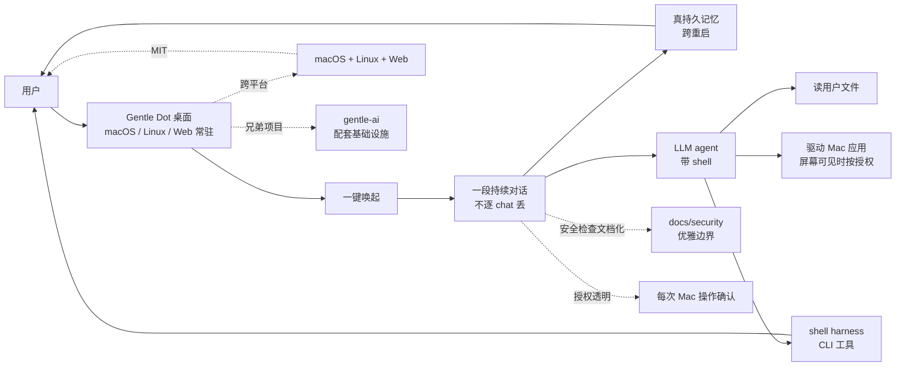

# Gentleman-Programming/gentle-dot

## 一句话定位
Gentle Dot 是「住在你桌面上的个人 AI 助手」——macOS/Linux/Web 跨平台、一键唤起、一段持续对话带真持久记忆、能读你文件并按授权驱动 Mac 应用。

## 它解决的问题
ChatGPT / Claude.ai / Cursor Composer / 各 LLM 网页端都是「浏览器 tab 之间丢上下文」：
- **逐 chat 丢记忆：** 每个新对话从零开始；不记得昨天聊了什么
- **停在页面边缘：** 不能读用户文件、不能驱动 Mac 应用、不能跨 chat 拼接上下文
- **专注 Coding：** Cursor / Claude Code / Codex 强在 IDE/Coding，但日常聊天/笔记/任务管理弱

Gentle Dot 的解决思路是「**桌面常驻 + 真持久记忆 + 一段持续对话 + shell harness**」：
- **桌面常驻 + 一键唤起：** 不需要打开浏览器 tab；按一个键即可
- **真持久记忆：** 跨对话持续记忆（不是逐 chat 丢）
- **可读用户文件 + 可驱动 Mac 应用：** 屏幕可见时按授权（透明授权机制）
- **shell harness：** AI agent 带 shell，能用 CLI

## 为什么值得关注（2026-10-11）
- **Stars:** 121（截至 2026-10-11），3 天累计
- **Forks:** 21，fork/star 17.4%（fork 比例较高——可能用户尝试定制）
- **License:** MIT，商用清晰
- **Language:** TypeScript（Web + 桌面）
- **Size:** 8240 KB（中等——含 Electron 或类似桌面壳）
- **创新点:** 把「桌面常驻 + 真持久记忆 + 一段持续对话 + shell harness + 优雅安全检查」整合到跨平台桌面应用
- **定位：** 桌面 AI 助手的「真记忆 + 一段持续对话」方向的严肃工程化探索

## 热度来源判断
Gentleman-Programming/gentle-dot 的热度是「**桌面 AI 助手 + 真持久记忆 + 屏幕可见时按授权 + shell harness + 优雅安全检查**」的组合。121 个 star + 21 个 fork 在 3 天内——fork/star 17.4% 偏高，反映用户尝试定制（这与"个人助手"项目的特性相符）。热度**真实但偏早期**——但需警惕：早期预览（status badge "early preview"）+ 安全检查「部分仍在 agent 触达范围（some still live within the agent's reach）」+ 可读用户文件 + 可驱动 Mac 应用（shell harness）的安全风险 + 与大型平台（ChatGPT/Claude.ai/Cursor）相比工程深度未观察。

## 关键技术亮点
1. **桌面常驻 + 一键唤起：** 不需打开浏览器 tab；one key away
2. **一段持续对话：** 跨 chat 不丢上下文（不像 ChatGPT 每个 chat 独立）
3. **真持久记忆：** 不是逐 chat 丢；连续记忆
4. **可读用户文件 + 可驱动 Mac 应用：** 屏幕可见时按授权（透明授权机制）
5. **shell harness：** AI agent 带 shell，能用 CLI（不只是 chat）
6. **优雅安全检查：** 提供文档化的安全边界（docs/design.md）
7. **跨平台：** macOS + Linux + Web
8. **docs/install.md + docs/design.md + docs/security：** 完整文档
9. **gentlemanprogramming.com 官网：** 团队官网背书
10. **gentle-ai 兄弟项目：** 配套基础设施
11. **early preview：** 提前进入测试（社区可早期反馈）
12. **MIT：** 商用清晰

## 架构师速览

| 决策问题 | 研究判断 | 证据边界 |
|---|---|---|
| 系统边界 | 桌面 AI 助手，跨平台（macOS/Linux/Web），含持久记忆、文件读取、Mac 应用驱动、shell harness | 仅基于 README 列出的桌面常驻/真记忆/文件读取/Mac 控制/shell harness；具体持久记忆存储位置、权限模型、安全审计细节未在档案中给出 |
| 主路径 | 用户启动 Gentle Dot → 桌面常驻 → 一键唤起 → 一段持续对话 → AI 用持久记忆 + 文件读取 + shell → 按授权驱动 Mac 应用 | 主路径来自 README 描述；具体 Mac 应用驱动实现（Accessibility API / AppleScript / 其他）、shell sandbox 机制、记忆合并策略均待核验 |
| 关键权衡 | 桌面常驻（资源占用）vs Web tab（轻量）+ 真持久记忆（用户掌控）vs 平台锁定 + shell harness（强大）vs 安全风险 + 透明授权（用户每次确认）vs agentic 流畅 + 优雅安全检查（已文档化）vs 完全 sandbox | 档案明示安全检查 + 透明授权 + 优雅文档化三点；具体 Mac 应用驱动的可达性（哪些应用能驱动）、shell sandbox 默认严格度未证实 |
| 最小 PoC | macOS 上安装 Gentle Dot → 启动 → 一键唤起 → 聊一段持续对话 → 让 agent 读一个文件 → 让 agent 跑一个 shell 命令（明确确认授权）→ 关闭重启后确认记忆仍在 | PoC 范围由 README「macOS · Linux · Web」反推；具体哪些应用可驱动、shell sandbox 默认等级、跨平台记忆同步待核验 |

## 架构启发
Gentleman-Programming/gentle-dot 的核心启发是 **「桌面 AI 助手的关键不是 LLM 多强，而是记忆多真 + 授权多透明 + 接入多深」**。当前大多数"AI 助手"是浏览器 tab——每个 chat 独立记忆、停在页面边缘、不能驱动本地应用。Gentle Dot 把"桌面常驻 + 一段持续对话 + 真持久记忆 + shell harness + 屏幕可见时按授权"打包到跨平台桌面应用。这与 OpenAI / Anthropic 官方桌面应用（ChatGPT macOS app、Claude desktop app）形成镜像——但 Gentle Dot 是开源、MIT、可定制、可自部署。**「真记忆 + shell harness + 透明授权」是桌面 AI 助手的差异化组合**——大多数产品只能做到其中 1-2 项。

## 架构图（MMD）

> 证据边界：此图只采用本档案已有可核验描述；"待核验"节点不应视为项目实现事实。

## 定位判断
**工具型项目（桌面 AI 助手 + 真记忆 + shell harness）。** Gentleman-Programming/gentle-dot 不只是工具，更是「**真记忆 + 一段持续对话 + shell harness + 透明授权**」四件套的桌面 AI 助手严肃工程化探索。它把"桌面常驻 + 真持久记忆 + shell harness + 透明授权"打包到跨平台桌面应用。当前定位：「**桌面 AI 助手 + 真记忆 + shell harness + 透明授权**」的开源探索样本。其潜在演进路径：(1) 从 early preview 到稳定版；(2) 集成更多平台（Windows？）；(3) 第三方插件生态（"skill" 市场）；(4) 与 ChatGPT macOS app / Claude desktop app 形成镜像。

## 风险 / 局限 / 泡沫点
- **早期预览：** status badge "early preview"，未观察稳定性
- **安全检查部分仍在 agent 触达范围：** README 自述「Its safety checks are real, but some still live within the agent's reach」
- **可读用户文件 + shell harness：** 用户需明确知晓风险（README WARNING 也明说）
- **macOS 应用驱动的可达性：** 哪些应用能驱动（README 未明示，Accessibility API / AppleScript / 其他未核验）
- **跨平台覆盖：** macOS / Linux / Web 已支持，Windows 未观察
- **Gentleman-Programming 团队：** 不是大公司背书（仅 gentlemanprogramming.com）
- **竞争激烈：** ChatGPT macOS app / Claude desktop app / Raycast AI / 各类 Mac Copilot 都是竞争者
- **记忆合并 / 跨设备同步未明：** 用户换电脑 / 跨平台记忆如何处理

## 与同类项目的关系
- **vs ChatGPT macOS app / Claude desktop app：** 那些是闭源官方；Gentle Dot 是开源 MIT
- **vs Raycast AI：** Raycast 是 macOS 启动器 + AI 增强；Gentle Dot 是专门 AI 助手
- **vs Open WebUI：** Open WebUI 是自托管 web UI；Gentle Dot 是桌面常驻 + shell
- **vs AnythingLLM：** AnythingLLM 是「本地 LLM + RAG」；Gentle Dot 是「真记忆 + shell harness」
- **vs Cursor / Claude Code / Codex：** 那些专注 IDE/Coding；Gentle Dot 是通用桌面助手
- **vs LangChain / LlamaIndex：** 那些是 LLM 框架；Gentle Dot 是现成桌面助手应用

## 是否值得持续跟踪
**值得跟踪（桌面 AI 助手 + 真记忆 + shell harness + 透明授权方向）。** Gentleman-Programming/gentle-dot 代表了「桌面 AI 助手不只是聊天，要能记忆 + shell + 透明授权」方向——无论其本身成败，这一方向与 ChatGPT / Claude.ai / Cursor 形成差异化。建议关注：early preview → stable 进度、Mac 应用驱动实现细节、shell sandbox 严格度、跨平台覆盖扩展（Windows？）。对 macOS / Linux 用户，这是「真记忆 + shell harness」的开源桌面助手；对桌面 AI 助手赛道观察者，这是「真记忆 + 透明授权」范式的开源探索样本。

## 后续观察点
- early preview → stable 的进度
- Mac 应用驱动的具体实现（Accessibility API / AppleScript / 其他）
- shell harness 的 sandbox 严格度（默认？可配置？）
- Windows 平台扩展
- 记忆合并 / 跨设备同步
- 与 OpenAI ChatGPT macOS app / Claude desktop app 的差异化
- Gentleman-Programming 团队的治理可持续性

---
> 数据来源: GitHub Search API + Repository API (2026-10-11) + README 公开摘录 | Stars: 121 | Forks: 21 | License: MIT | 语言: TypeScript | 创建: 2026-10-08
