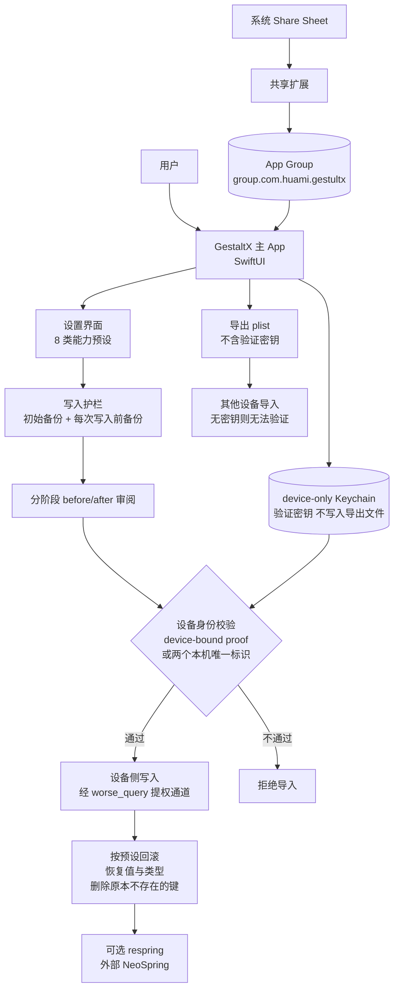

# huamidev/GestaltX

## 一句话定位

一个 **iOS 27.x 的 MobileGestalt 编辑器**（SwiftUI 应用 + 共享扩展），把「设备能力位 / 区域码 / 销售地区 / 硬件开关」这些系统级标志位的读写做成图形界面，并且**在每一次写入前自动备份原值、可一键回滚**——而它本日最值得记的不是功能，而是**它把「导入的文件是不是这台设备自己的」也做成了可验证的条件**。

## 它解决的问题

MobileGestalt 是 iOS 用来描述设备能力的一组系统标志位。修改它可以影响 Dynamic Island 能力、常亮显示、Liquid Glass 低功耗渲染、机型名称、开机/关机音、充电上限、拍提亮屏、Camera Control、Action Button、Apple Pencil 设置、Stage Manager、Apple Intelligence 能力位等。**在 iOS 26 之前这件事有成熟的手工路径（改 plist + 重启），但路径不安全的部分在于：改错一个键、设备变砖、且没有任何回滚手段。**

GestaltX 想解决三件事：

1. **可视化** —— 把几百个能力位变成有分类的开关，而不是手改二进制 plist。
2. **可逆** —— 改之前记下原值，改之后能退回去；且「原值」要区分「原本是这个值」与「原本不存在这个键」。
3. **可验证** —— 从别的设备导入 plist 时，不能盲信。

## 为什么值得关注（2026-11-10）

⭐⭐⭐⭐⭐ **它是本日热度最高的真实工程项目（1,364⭐ ⑂515），而它的 star 结构与本日报同期抓到的所有农场样本完全相反：subs 只有 5。**

先看这个对比：

| 仓库 | ⭐ | ⑂ | **subs** | fork 到达间隔中位数 |
|---|---:|---:|---:|---:|
| `huamidev/GestaltX` | 1,364 | 515 | **5** | **229.0 s**（1/29 个间隔 ≤10s） |
| `TameCarpenterEstate/Roblox-FPS-Optimizer` | 279 | 233 | **77** | **6.0 s**（29/29 个间隔 ≤10s） |
| `yetone/rewind-for-x` | 221 | 7 | **0** | 4,241.0 s（0/6 ≤10s） |
| `rippelz/rustudio` | 72 | 9 | **0** | 3,868.0 s（0/8 ≤10s） |

⭐⭐⭐⭐⭐ **同一天里，一个 1,364⭐ 的仓库 subs=5、fork 间隔中位数 229 秒，另一个 279⭐ 的仓库 subs=77、fork 间隔中位数 6 秒。** 这正是 2026-11-08 日报建立的判据（README 是否索取 star + fork 时间分布 + 文件 md5 + 代码能否运行）在本日第一次做成**完整对照实验** —— 前三项全部指向相反结论。

⭐⭐⭐⭐⭐ **而它最值得抄的一处是「设备绑定」的验证链**，README 的原文：

> The app checks a device-bound proof from a GestaltX export, or at least two unique identifiers obtained from this device, then asks you to confirm the import. **Files that cannot be verified are rejected.** Previously imported files are never used as the reference for device identity.

> Some original plists contain no unique device identifiers. Export a copy from GestaltX on this device first: **its verification key stays in the device-only Keychain and is never included in the file.**

⭐⭐⭐⭐⭐ **注意最后一句的架构含义**：验证密钥**不在文件里**。这意味着即使文件被复制到另一台设备，那台设备也拿不到验证密钥 —— 绑定不是靠「文件里写着一个 UUID」这种可伪造的方案，而是靠**证明材料与设备本地机密分离**。这与本日报此前记录的 `bookleme` 的 `contains_original_text` 硬门、`research-loop-skills` 的证据纪律属于同一条线，但**实现层次更低：它是一个 App 的导入校验，不是文档规范**。

⭐⭐⭐⭐⭐ **第二个值得抄的是它把「回滚」写成了机制而不是承诺**：

> Disabling a preset or using its Revert button **restores the recorded original values and types. Keys that were originally absent are removed.** If an older change has no original record, use Remove Added Fields only when you know those fields were added.

⭐⭐⭐⭐ **「恢复原值」和「恢复原值的类型」是两件事**（`values and types`）—— 一个布尔位被写成字符串 `1` 之后只恢复值不恢复类型，写回就会让设备读到不同的东西。而「原本不存在的键要删掉」是另一半。这两句合起来才是完整的可逆性。

⭐⭐⭐⭐⭐ **第三个值得抄的是它明写了自己的失效条件**：

> **iOS / iPadOS 26.x is not supported for on-device MobileGestalt access.** SystemGroup access requires iOS 27; available features depend on the device and OS.

⭐⭐⭐⭐ **并且它承认自己依赖两个外部项目**（README 的致谢列明）：`forcequitOS/worse_query`（权限提升，本日窗口内该项目同样在榜，62⭐，GPL-3.0，Objective-C）与 `rooootdev/NeoSpring`（respring）。**它把「我依赖谁」写在了 README 里而不是藏在自己的实现里** —— 而 `AdvancedUnlockSequence.swift` 只有 274 字节、内容是一个 10 次点击的计数器（`guard taps < 10 else { return false }`），**即解锁序列本身是极薄的，真正的能力在 worse_query 那一侧**。

⭐⭐⭐⭐⭐ **第四个值得抄的是它把自己的失败模式写进了 UI 语义**：README 提到 `staged before/after review`、`verified writes`、`per-preset restore`、`Automatic initial backup before device editing, backup before every write`。**「写之前先存，写之前先看」是两条独立的保证** —— 只做备份不做预览，用户仍然可能在错误的预设上点确认。

⭐⭐⭐⭐⭐ **第五个值得抄的是它的许可与第三方素材处理**：根目录有 `GestaltX/Licenses/GestaltX-GPL-3.0.txt`（35,149 B）、`GestaltX/Licenses/Primer-Octicons-MIT.txt`（1,068 B）、`GestaltX/Licenses/ThirdPartyNotices.txt`（2,706 B）—— **即第三方图标（Primer Octicons，MIT）在源码树内以独立许可文件归档**，而不是只在 README 里提一句。

⭐⭐⭐⭐ **工程面完整**：`.xcodeproj/project.pbxproj` 23,942 B（真实 Xcode 工程，非脚本生成）、`Localizable.xcstrings` 401,675 B（**String Catalog，说明 7 种语言是走 Xcode 原生本地化**）、`GestaltX.entitlements` 声明 `com.apple.security.application-groups` = `group.com.huami.gestultx`（**App Group 是共享扩展通信的硬依赖**）、中英双语 README（`README.md` + `README_ZH-CN.md`）、`BuildDate.txt`。

⭐⭐⭐⭐⭐ **它的 release 节奏也值得记**：v1.0.1 / v1.0.2 / v1.0.3 三个版本**全部在 2026-11-09 同日发布**，且每个 release 对应一次可定位的能力变化：

| 版本 | commit | 说明 |
|---|---|---|
| v1.0.1 | `Mark iOS 26 unsupported for device MobileGestalt access` | **先砍掉不兼容的系统版本** |
| v1.0.2 | `Release 1.0.2 with original-value recovery and respring fixes` | **修的是「回滚」与 respring** |
| v1.0.3 | `Release 1.0.3 with shared document handoff and optional controls` | **修的是「跨 App 传文件」** |

⭐⭐⭐⭐⭐ **对照 11-06 农场集群的「4 个 commit 在 19 秒内完成、逐文件补录」，这里的 15 个 commit 跨越 12 小时、每个 release 都有可引用的能力语义 —— 这是本日「提交时间分布」这条判据第二次被成功用上。**

## 热度来源判断

**⭐⭐⭐⭐⭐ 热度来源是「iOS 27 新特性 + 中文开发者社区的一次性集体需求」，而不是刷量。** 依据：

1. **fork 间隔中位数 229.0 秒、29 个间隔里只有 1 个 ≤10 秒、样本跨度 151.2 分钟** —— 与本日报同期抓到的农场样本（6.0 秒 / 29/29 ≤10s / 2.9 分钟）相差两个数量级。
2. **subs 仅 5** —— 本日报自 11-07 起把 subs 当作「噪声极低但样本极小」的深度信号，11-08 发现它可被 README 索取 star 抬高。**今日 1,364⭐ 的仓库 subs=5，与 279⭐ 的农场仓库 subs=77 形成直接对照：若今日仍以 subs 排序，会把真项目排到榜外。**
3. **仓库是真实可编译的 Xcode 工程** —— 23,942 B 的 `project.pbxproj`、真实 Swift 源码 9 个文件（含 `GestaltManager.swift` 26,619 B、`GestaltDocument.swift` 28,835 B、`ContentView.swift` 33,318 B）、`GXEntitlementsReader.m`（8,434 B，Objective-C 与 Swift 混编）、`GXMobileGestaltImage.m`（2,362 B）。
4. **有外部贡献者**（contributors = 2：`huamidev`(7) + `jhao941`(1)，且有一条 `Merge pull request #5` 的 commit），22 个 open issue。

⭐⭐⭐ **但热度里有一项必须打折**：owner 账号 `huamidev` 是 **2026-11-09T05:09:16Z 当天创建**的，只发布过这 1 个公开仓库。⭐⭐⭐⭐ **「账号当天创建 + 单仓库 + 12 小时 1,364⭐」这本身不构成刷量证据**（`sheeridVerify` 在 11-06 同样是新账号），但它意味着：**本项目没有任何「账号历史」可供交叉验证，所有信任都来自仓库内容本身。**

⭐⭐⭐⭐⭐ **本日报的判断是：这是一个真实工程项目，它的 1,364⭐ 里可能有相当部分是「iOS 27 装机潮」的一次性冲动流量；但「热度来源不可持续」与「内容是假的」是两件事，本项目属于前者。** 判定依据是上表四项可自动化的检查，而不是 star 数。

## 关键技术亮点

1. **App Group + 共享扩展的双进程架构** —— `GestaltX.entitlements` 声明 `group.com.huami.gestultx`；导入 plist 走系统 Share Sheet，由 share extension 读取并经 App Group 交接给主 App。⭐⭐⭐⭐⭐ **README 明写签名的硬要求**：「Signing requires a certificate and provisioning profile with at least one usable App Group. **Sign the app and its embedded share extension with at least one common App Group**, and keep the extension when re-signing. **Both processes detect their actual signed App Groups at runtime.**」—— **运行时动态探测自己实际被签到的 App Group，而不是信任编译期配置**，这是重签名场景下的正确做法。
2. **设备身份的三层校验** —— ① GestaltX 导出物里带 device-bound proof；② 或本机取得的至少两个唯一标识符；③ 校验密钥只存在于 device-only Keychain，**不写进文件**。
3. **原值记录的类型保真** —— 恢复时同时还原值与类型；原本不存在的键在回滚时删除。
4. **写入前的多重护栏** —— 自动初始备份 + 每次写入前备份 + 分阶段 before/after 审阅 + 逐预设回滚 + 手动 respring（NeoSpring）。
5. **plist 类型系统覆盖广** —— README 的 Field editor 一节列出 String / Integer / Real / Boolean / Data / Date / Array / Dictionary 八种值类型，以及 `CacheExtra` 字段的读/搜/增/改/删。
6. **Xcode 原生本地化** —— `Localizable.xcstrings` 401,675 B（String Catalog），7 种语言，不是自建 i18n 层。
7. **能力矩阵的诚实写法** —— README 的 Features 表把「Display / Device / iPad / Intelligence / Advanced / Field editor / Changes / Backups / Logs & respring」分八类，并对每条附上生效条件（例如「Presets modify capability flags; actual effects depend on the device and OS」）。

## 架构师速览

| 决策问题 | 研究判断 | 证据边界 |
|---|---|---|
| 系统边界 | 一个 iOS 端本地应用 + 一个共享扩展；能力提升来自外部 `worse_query`，respring 来自外部 `NeoSpring`。**它本身不是权限提升工具** | 依据 README 的 Compatibility 与致谢段落；`worse_query` 与 `NeoSpring` 的内部实现本窗口未核验 |
| 主路径 | 用户在 App 内改预设 → 写前自动备份原值 → 分阶段审阅 → 经 App Group 与设备侧写入通道落盘 → 可选 respring → 可回滚 | 主路径为 README 与文件树的抽象；具体写入调用序列未逐行核验 |
| 关键权衡 | ①「可逆」的实现成本 vs 功能广度；②设备绑定强度 vs 导入灵活性（绑定强则不便导入，弱则可被伪造）；③依赖外部越狱/提权项目 vs 自建能力 | 前两项有 README 原文支撑；第三项是依赖关系的可核验事实 |
| 最小 PoC | 在一台 iOS 27 设备上：只改一个布尔能力位 → 写入前确认备份已生成 → 写入 → 读回校验 → 回滚 → 再次读回确认键值与类型均复原 | 路径由 README 的 Changes/Backups 两节推导；具体 CLI/UI 操作序列未核验 |
| 证据边界 | 1,364⭐ / ⑂515 / subs 5 / oi 22 / 15 commits / 967 KB / Swift / GPL-3.0 / 64 文件 / 3 release（v1.0.1–v1.0.3，全部 2026-11-09）/ contributors 2 / topics 空 / owner 账号当天创建 | 全部为 2026-11-09T21:50Z 快照值；**本日报未在真机上运行过该应用，未验证任何一次写入或回滚** |

## 架构启发

GestaltX 的核心启发是：**「可逆」不是一个按钮，而是一套需要分层实现的数据模型** —— 要同时记录「原值是什么」「原值的类型是什么」「这个键原本存不存在」「回滚路径是否可达」「回滚后能否验证真的回到了原状」。⭐⭐⭐⭐⭐ 这五件事里，少做一件，「一键回滚」就只是一个按钮上的字。

⭐⭐⭐⭐⭐ 第二个启发是**「证明材料与机密分离」的绑定范式**：验证密钥放在 device-only Keychain，导出文件里只有证明而不含密钥。⭐⭐⭐⭐⭐ **这比「在文件里写个设备 UUID 然后比对」强一个数量级** —— 后者只能证明「这个文件声称来自某台设备」，前者能证明「这个文件由那台设备签发」。

⭐⭐⭐⭐⭐ 第三个启发是**「先砍不兼容，再修回滚」的产品节奏**：v1.0.1 的唯一 commit 是「标记 iOS 26 不支持」，v1.0.2 修的是「原值恢复 + respring」。⭐⭐⭐⭐⭐ **即：回滚能力不是最后补的，是第二个版本就优先做的。** 这与本日报记录的 `hatchzip`（不可逆操作前先拒绝）属于同一条纪律线。

⭐⭐⭐⭐⭐ 第四个启发是**依赖关系被写在 README 里**：`worse_query` 与 `NeoSpring` 在致谢里点名，`AdvancedUnlockSequence.swift` 只有 274 字节。⭐⭐⭐⭐⭐ **读者因此能准确判断「这个项目自己做了什么、别人的部分有多关键」** —— 这与本日报记录的 `ex-ussr-kinship-research`（把证据规则写进代码强制）共享同一动机：**让读者不必自己补全边界。**

## 架构图（MMD）

> 证据边界：此图只采用本档案已有可核验描述；"待核验" 节点不应视为项目实现事实。

## 定位判断

**工具型（iOS 设备级配置编辑器）。** GestaltX 处在「iOS 提权工具链」的**下游前端**位置：真正的能力来自 `worse_query`（本日窗口内该仓库亦在榜，62⭐，GPL-3.0，Objective-C，本日报另建 `projects/worse_query.md` 记录），而 GestaltX 提供的是**图形界面 + 备份回滚 + 导入校验 + 本地化分发**这一层。⭐⭐⭐⭐⭐ 这个位置的价值是真实的：越权工具的门槛在于「你得知道改哪个键、改错了怎么办」，而 GestaltX 正是在补这一层。

⭐⭐⭐⭐⭐ **它与本仓库已收录的 `kamui-escape`（iOS 27.x sandbox escape + MobileGestalt editor，本日窗口内 30⭐）构成同一天、同一目标平台、但成熟度完全不同的两个样本** —— `kamui-escape` 11 commits / 182 KB / 11 open issue，而 GestaltX 15 commits / 967 KB / 3 个 release / 22 open issue。⭐⭐⭐⭐ **两者都明写「iOS 27.x」，且都在同一日进入榜单 —— 这说明 iOS 27 的设备级改造是一个正在成形的方向，而不是孤例。**

⭐⭐⭐⭐⭐ **但要诚实说明一个结构性限制**：GestaltX 面向**已提权设备**（需要 `worse_query` + NeoSpring + App Group 签名能力），它的用户基数天然小于普通用户。⭐⭐⭐⭐ **因此 1,364⭐ 对应的更可能是「小众但高度聚集」的技术社区注意力，而非大众产品热度。**

## 风险 / 局限 / 泡沫点

- ⚠️ **⭐⭐⭐⭐⭐ 未在真机验证。** 本日报未运行该应用，未验证任何一次写入、回滚或导入校验。**所有关于「能回滚」「能拒绝伪造文件」的表述均为对作者自述的转述。**
- ⚠️ **⭐⭐⭐⭐⭐ owner 账号当天创建、单仓库、无历史可交叉验证**（`huamidev`，2026-11-09T05:09:16Z）。⭐⭐⭐⭐ **且 iOS 27 的越狱/提权生态本身处于早期**，上游 `worse_query` 的稳定性直接决定本项目能否用。
- ⚠️ **⭐⭐⭐⭐ 强绑定带来强约束** —— 导出文件的验证密钥不出设备，意味着**用户无法把备份迁移到另一台设备**，这在换机场景下是硬伤。⭐⭐⭐⭐ **README 提到「Previously imported files are never used as the reference for device identity」，即它主动放弃用旧文件做身份基准**，这是一个安全与可用性的显式取舍。
- ⚠️ **⭐⭐⭐ 签名要求是真实的部署门槛** —— 需要带可用 App Group 的证书与描述文件，且重签名时必须保留共享扩展。⭐⭐⭐ **这排除了绝大多数普通用户。**
- ⚠️ **⭐⭐⭐ 三个 release 全在同一天** —— 迭代历史极短，**尚未经历跨版本兼容性考验**；v1.0.2 修的正是「original-value recovery」，说明**第一个版本存在过回滚缺陷**。
- ⚠️ **⭐⭐⭐ 22 个 open issue 是本批真实项目里最高的** —— 对一个 12 小时大的项目，这既说明有人在用，也说明缺陷面大。
- ⚠️ **⭐⭐ 「能力位修改」本身有法律与设备风险** —— 修改设备能力标志可能影响保修、App Store 兼容性或触发 Apple 的服务端校验。**本日报不主张任何绕过行为的合法性，仅记录这是一个技术事实。**
- ⭐⭐ **泡沫点**：iOS 27 新机发布带来的「装机潮」可能贡献了相当比例的一次性 star。⭐⭐⭐ **但本日报不主张这一点 —— 没有 stargazer 时间戳数据就无法定量区分。**

## 与同类项目的关系

- **vs `forcequitOS/worse_query`（本日窗口内 62⭐，GPL-3.0，Objective-C）** —— **上游依赖**：worse_query 提供提权通道（`ztby/terminal_worse` 是它的终端形态），GestaltX 提供 GUI 与安全护栏。⭐⭐⭐⭐⭐ **两者是同一技术链条的上下游，不是竞品。**
- **vs `rooootdev/NeoSpring`** —— 另一个外部依赖，负责 respring（GestaltX 把它作为可选手动步骤）。
- **vs `murk-sus/kamui-escape`（30⭐，MIT，Objective-C）** —— **同一天、同一目标平台（iOS 27.x MobileGestalt 编辑器）的两个独立实现**。⭐⭐⭐⭐⭐ **kamui-escape 走的是命令行 + Objective-C 路线（11 commits / 182 KB / 11 open issue），GestaltX 走 GUI + SwiftUI + 共享扩展路线（15 commits / 967 KB / 3 release）。** 两者都没有交叉引用彼此 —— ⭐⭐⭐⭐ **同一细分需求在同一天出现两个互不相识的实现，是这个方向真实存在的信号。**
- **vs `34306/doublera1n`（34⭐，Python）** —— 「在 iPhone 11 系列上创建第二套越狱 iOS」，是另一类设备级改造，量级与目标不同。
- **vs 手工改 plist + 越狱工具** —— **GestaltX 的全部增量价值就在「安全护栏层」**：备份、类型保真回滚、导入校验、多语言界面。

## 是否值得持续跟踪

**值得跟踪，且理由是结构性的而非热度性的。** ⭐⭐⭐⭐⭐

⭐⭐⭐⭐⭐ **推荐理由一：它是本日判据的完整对照实验。** 1,364⭐ / subs 5 / fork 间隔 229 秒 vs 279⭐ / subs 77 / fork 间隔 6 秒 —— 这组数据可以直接用于复核本日报的判据本身。

⭐⭐⭐⭐⭐ **推荐理由二：它代表一种可迁移的设计。** 「导出物不含验证密钥 + 绑定校验 + 类型保真回滚」这套组合不限于 iOS 配置文件，任何「用户要导入外部产物」的产品都用得上。

⭐⭐⭐⭐⭐ **推荐理由三：上游生态正在成形。** 同日同平台的 `kamui-escape`、既有的 `worse_query`、11-06 收录的 `hackios-xnu-kernel`（Apple XNU 移植路线之一）指向同一条线。

⭐⭐⭐⭐⭐ **对普通读者的实用价值有限**（需要提权设备与特殊签名），**因此本日报把它归为「值得跟踪但不宜直接采用」**。

## 后续观察点

- ⭐⭐⭐⭐⭐ **是否出现非官方渠道的分发与真实用户反馈** —— 22 个 open issue 是最直接的采用信号，看 issue 内容比看 star 数可靠得多。
- ⭐⭐⭐⭐⭐ **v1.0.4 之后是否出现跨版本升级的迁移逻辑** —— 三个 release 同日发布意味着**还没有「从旧版本升级」这个场景**，而这正是回滚设计最容易出问题的地方。
- ⭐⭐⭐⭐ **回滚机制是否被独立复现** —— 尤其「原值类型」与「原本不存在的键」这两条，本日报只能读到作者的声明。
- ⭐⭐⭐⭐ **上游 `worse_query` 的维护节奏** —— GestaltX 的可用性完全受其约束；**若上游停止维护，本项目会迅速失效**。
- ⭐⭐⭐ **是否开放 App Group 之外的导入路径** —— 若为了便利放宽设备绑定，安全模型会改变。
- ⭐⭐ **7 种语言的具体清单与社区贡献** —— 当前由单一作者维护，中文社区的翻译参与度是一个方向性指标。

---
> 数据来源: GitHub REST API (2026-11-09T21:50Z 快照) | Stars: 1,364 | Forks: 515 | Subscribers: 5 | Open Issues: 22 | License: GPL-3.0 | 语言: Swift | 创建: 2026-11-09T05:15:48Z | 文件: 64 | Releases: 3 (v1.0.1/v1.0.2/v1.0.3) | Contributors: 2
