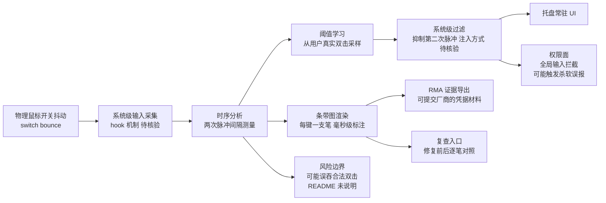

# MajestyPoemFold/ghostclick-mouse-double-click-fix

## 一句话定位
Windows 10/11 上的**鼠标「幽灵点击」（mouse chatter / switch bounce）检测与修复**工具（Rust + Tauri 2）：在走纸记录仪式的条带图上把每一个重复点击画出来，**从用户自己的真实双击中学习去抖阈值**，在系统范围内过滤误触，并把检测结果**导出为可提交给厂商的 RMA 证据**。

## 它解决的问题

「鼠标单击变成了双击」是一个人人遇到过、几乎无人能自行诊断的问题。它的真��不是「鼠标坏了」这么笼统，而是：**机械开关的抖动（chatter）产生了一个极短的第二次脉冲**，操作系统把它当成双击。

⭐⭐⭐⭐⭐ **而绝大多数「双击修复」工具的失败模式是：内置一个固定的去抖时间（比如 30 ms），然后告诉用户「如果你的鼠标更快，请修改这个值」。** 也就是说，**阈值是机器拍的，不是测出来的** —— 而真实的阈值取决于鼠标型号、开关手感、灵敏度设置、桌面上垫的东西、甚至使用者手指的力度。⭐⭐⭐⭐⭐ **ghostclick 的关键一步是反过来：让用户自己双击若干次，从这些真实输入里学出这台设备、这只手、这个灵敏度下的阈值。**

⭐⭐⭐⭐⭐ 第二个被忽视的问题是**「修好了」这个结论没有证据**。用户报告「鼠标有问题」时，厂商需要的是「请提供证据」；而用户手上只有「它坏了」这句话。⭐⭐⭐⭐⭐ **ghostclick 输出的不是「诊断结论」，而是「RMA evidence」—— 一份可提交给厂商退货/换货流程的证据材料。**

⭐⭐⭐⭐⭐ 第三个是**拖放丢帧**（drag and drop drops）：拖动过程中文件突然落地，这与双击误触是**不同的故障**，但用户常把它们混为一谈。ghostclick 把它单列为一项能力。

## 为什么值得关注（2026-11-08）

**⭐⭐⭐⭐⭐ 本日最值得记的是它的输出形态：一张条带图。**

README 首屏的 hero 图 alt 文本就是「a strip of chart recorder paper with a 6 ms ghost click circled in red ink」，描述里写「Finds ghost clicks (mouse chatter, switch bounce) **on a strip chart**」。⭐⭐⭐⭐⭐ **每键一支笔，6 ms 与 11 ms 的幽灵点击被红笔圈出并标注毫秒数** —— **这是一个「记录」，而不是一个「布尔值」**。⭐⭐⭐⭐⭐ **记录的价值在于它可比较**：同一个问题在修复前后可以逐笔对照，而「已修复」这个布尔值什么都证明不了。

⭐⭐⭐⭐⭐ **而本日它之所以值得收录，还有一个方法论上的原因：它是本日「判据被针对」事件的正面参照样本。**

它的 README **没有一句索取 star 的话** —— 没有「⭐ Star the repo if it helped you.」，没有「点个 star 支持我」。⭐⭐⭐⭐⭐ **它的分发路径是把用户导流到 Discord**（`discord.gg/INVITE`，README 里有一个 `btn-discord.png` 徽章）。⭐⭐⭐⭐⭐ **结果是 subs = 0** —— 而同一日的两个 425⭐ 空壳仓库把索取 star 写了两遍，subs 分别是 25 与 35。

⭐⭐⭐⭐⭐ **这个对照把本日报本日最重要的判断坐实了：「subs 低」有两种完全相反的成因 ——「没人真的关注」与「关注被导流到别处」—— 而 ghostclick 是后者。** 它 136⭐、21 个 fork、0 个 subscriber 却仍然分发自己的品牌资产、Discord 社区与下载按钮，**说明它根本不需要用 GitHub 的 watch 数当 KPI**。

⭐⭐⭐⭐⭐ 附带一条：它的仓库形态与同日的农场形成了完全相反的对照 —— **77 个文件**（README / CHANGELOG / CONTRIBUTING / ROADMAP / FAQ / 三份 issue 模板 / CI workflow / `.github/media/` 下 11 张品牌图），对比 85 个空壳仓库的 2 个文件。

## 热度来源判断

136⭐ ⑂21（fork/star 15.4%）、**subs 0、oi 0、contributors 1 人、1 个 release、7 个 topics**。

⭐⭐⭐⭐⭐ **热度来源判断：真实的硬件痛点 + 极低的传播意愿，两者叠加。**

- ⭐⭐⭐⭐⭐ **痛点是真的且高频**：双击误触是鼠标用户最普遍的硬件故障之一，**它有明确的、可复现的、可测量的现象**（条带图上的一个 6 ms 尖峰）。⭐⭐⭐⭐ **这类「人人都有过、但很少有人做成工具」的问题，是最典型的「问题驱动型开源」机会。**
- ⭐⭐⭐⭐ **fork/star 15.4% 属于真人区间**：对照同日农场的 73.6% / 61.2%，15.4% 是完全不同的形态。⭐⭐⭐⭐ **它合理的解释是「fork 去改配置 / 加机型支持 / 打包」**——这类项目天然邀请本地化改造。
- ⭐⭐⭐⭐⭐ **但热度与传播被明显抑制**：一个硬件问题的受众**不会像软件问题那样在 GitHub 上提问**，他们会去 forums、去 Reddit、去厂商客服。⭐⭐⭐⭐⭐ **因此「136⭐ + subs 0 + oi 0」很可能不是「没人用」，而是「用户根本不知道它存在」—— 一个被分发渠道而非热度决定命运的项目。**
- ⭐⭐⭐ **⭐⭐⭐ 的反面风险**：owner 账号创建于 2026-08-15、仅 2 个公开仓库、1 个 release、contributors 1 人。**这是一个很新的个人项目，136⭐ 与「账号两个月大」同时成立，说明爆点可能来自一次集中的传播（一个视频、一篇帖子）而非持续积累。**

## 关键技术亮点

1. **阈值从真实输入中学习，而不是内置常量**
   「learns a debounce threshold **from your real double-clicks**」。⭐⭐⭐⭐⭐ **这是本项目最有价值的机制**：它把「机器拍的参数」换成「这台设备上的实测参数」。⭐⭐⭐⭐ **对照本日报记录的 poki（把「触摸写进去了」与「设备确认了」分成两件事），这是同一纪律的另一种落点 —— 一个管「信号是否被接收」，一个管「阈值是否适用于这台机器」。**

2. **条带图作为一等输出**
   每键一支笔、毫秒级标注、红笔圈注。⭐⭐⭐⭐⭐ **这比任何数值输出都更能让用户判断「这是不是真的在跳」**，而且它天然是一份**可回归的记录**。

3. **系统级过滤 + 托盘常驻**
   「filters them system-wide from the tray」。⭐⭐⭐⭐ **「系统级」意味着它是全局输入过滤器，权限面比一个应用内工具大得多** —— 这是它最强也最需要被审计的一点。

4. **拖放丢帧作为独立能力**
   「catches drag and drop drops」。⭐⭐⭐⭐ **把「拖放中途落地」从双击误触里拆出来单列，是区分「症状」与「故障」的典型做法。**

5. **RMA 证据导出**
   「exports RMA evidence」。⭐⭐⭐⭐⭐ **这是本日所有项目中最值得架构师记的一句**：它不只输出结论，而是**产出一种对第三方有约束力的凭据**。⭐⭐⭐⭐ **本日报近六天记录的「把边界写进输出」（vork 的许可、poki 的验证文档、hermes-voice 的决策契约、phoneuse 的测试矩阵、satmux 的 Limits、solo-to-team 的反例清单）—— 这六个项目都是「说清我不能保证什么」，而 ghostclick 是**「把证据造出来」**，方向更进一步。**

6. **完整的工程面**
   CI workflow（`.github/workflows/`）、三份 issue 模板（bug_report / feature_request / config.yml）、CHANGELOG / ROADMAP / FAQ / CONTRIBUTING（深浅两套主题图）、`.github/media/` 下 11 张品牌资产、`releases/latest/download/app.zip` 直接分发。⭐⭐⭐⭐ **在同期 85 个仓库只有 2 个文件的对照下，这份工程面本身就是最强的信号。**

7. **Rust + Tauri 2 + Windows 10/11 x64**
   ⭐⭐⭐ Tauri 意味着前端是 Web 技术而系统能力由 Rust 提供；**「Written in Rust with Tauri 2」「Windows 10 | 11 x64」的徽章直接写进 README 顶部** —— 平台边界写在第一屏。

## 架构师速览

| 决策问题 | 研究判断 | 证据边界 |
|---|---|---|
| 系统边界 | **Windows 上的全局输入观测与过滤层**：底层输入采集 → 事件时序分析与去抖判定 → 系统级过滤注入 → 托盘 UI；同时把原始时序渲染为条带图并可导出为 RMA 材料 | 依据 README 的功能描述与首屏图示；**输入注入的具体机制（hook 方式、是否使用驱动）未核验** |
| 主路径 | 物理开关抖动 → 两次间隔 < 学习阈值的点击 → 判定为 ghost click → (a) 条带图标注毫秒间隔；(b) 系统级过滤抑制第二次脉冲；(c) 可选导出 RMA 证据 | 主路径为 README 文字的语义抽象；阈值学习算法（采样多少、如何去除合法双击）未核验；过滤是否可能吞掉合法快速双击未核验 |
| 关键权衡 | **①「学习阈值」vs「内置常量」**（前者需采样、后者可预测；前者会误吞合法双击）**②「系统级过滤」vs「应用内提示」**（前者真正解决问题、后者需要用户每次配合）**③「条带图」vs「布尔结论」**（前者可复查、后者省事）**④「Rust 核心 + Tauri 壳」**（前者系统能力与性能、后者 UI 开发效率）**⑤「开源无广告」定位**（无收入，靠信任换装机量） | ①②③④均有 README 直接文本支持；**「学习阈值会不会误吞合法双击」是本档案识别出的最关键未解风险，README 未见相关说明** |
| 最小 PoC | 只验「测量」不做「过滤」：跑 ghostclick 的测试页，用普通鼠标做 (a) 100 次单击（应全部判为单次）、(b) 20 次快速单击（应出现 ghost 标记）、(c) 10 次**故意快速但合法**的双击（**这是最容易出错的用例**）；确认条带图上的毫秒间隔与预期一致后，再开启系统级过滤并重复 (c) | PoC 用例由「学习阈值」这一机制推导；具体测试页路径与指标名未核验 |
| 证据边界 | 全部结论基于 2026-11-08 CST 的 GitHub API 快照与 README 原文；**本日报未在任何真实鼠标上运行该项目，未复现任何一项检测或过滤行为**；输入注入机制、阈值学习算法、RMA 导出格式均未核验 | 无独立复现；oi 0 表示无第三方 issue 可交叉验证；contributors 1 人 |

## 架构启发

⭐⭐⭐⭐⭐ **启发一：参数应该被测出来，而不是被写出来。**

「learns a debounce threshold from your real double-clicks」是一条**可推广的原则**：任何针对「物理世界」的阈值（鼠标抖动、触摸延迟、按键重复率、屏幕刷新时序），**固定常量都是错的，因为真实参数随设备与使用者变化**。⭐⭐⭐⭐⭐ **satmux 的做法与之互补——它测的是「我改不了的下界」（光速），phoneuse 测的是「我依赖的版本」，而 ghostclick 测的是「这台机器的实际行为」。三者合起来是本日报目前见过的「把测量写进产品」的三个不同位置。**

⭐⭐⭐⭐ **启发二：结论要能被复查，输出形态比结论更重要。**

条带图 vs「检测到双击误触」⭐⭐⭐⭐ **前者能回答「有多严重、多久一次、是不是每次都这样、修了以后好了没有」，后者什么都回答不了。** ⭐⭐⭐⭐ 这与本日报记录的 poki `docs/verification.md`（把「写进去了」与「确认了」分开）是同一原则的两种形态 —— **一个管信号语义，一个管时间语义。**

⭐⭐⭐⭐⭐ **启发三：输出应当是对第三方有约束力的凭据，而不只是给人看的说明。**

RMA evidence ⭐⭐⭐⭐ **这一条值得单独拿出来**：大多数工具的输出止于「结论」；**能被提交给第三方并改变对方行为的输出，是一种完全不同的产品形态。** ⭐⭐⭐⭐ 本日报此前记录的 `zero-breach` 的「本地只读 + 不联网 + 声明干净不等于安全」也在同一方向，但 zero-breach 输出的是**边界声明**，ghostclick 输出的是**证据材料**。

⭐⭐⭐⭐ **启发四：「分发渠道」与「平台指标」可以是两回事。**

⭐⭐⭐⭐⭐ ghostclick 同时拥有 Discord 社区、品牌资产与下载按钮，却 subs = 0。⭐⭐⭐⭐ **它证明了「用 GitHub 的 watch 数当健康度指标」在硬件/工具类项目上是错的** —— **而本日两个 425⭐ 空壳仓库用一句 `⭐ Star the repo if it helped you.` 证明了相反的事：watch 数也可以被凭空制造。**

## 架构图（MMD）

> 证据边界：此图只采用本档案已有可核验描述；“待核验”节点不应视为项目实现事实。

## 定位判断

**工具型项目（一个真实硬件故障的完整解决方案）。**

⭐⭐⭐⭐ ghostclick 在「双击修复工具」这个品类里属于**做对了完整性的那一端**：它不只检测，还区分故障类型、学习参数、执行系统级修复、保留可复查的记录、并产出对外有用的证据材料。

⭐⭐⭐⭐⭐ **它同时是一个「分发先于产品」观察的样本**：⭐⭐⭐ **一个 136⭐、subs 0、oi 0 的项目，在同类目里比那些 star 数高得多的工具更接近「能真正解决问题」** —— 这不是矛盾，而是说明 **GitHub star 在硬件品类里的信息量远低于在软件品类里的信息量**。

⭐⭐⭐⭐ **在 2026 年的语境下，它的位置是「Windows 上的输入质量基线工具」** —— 如果 agent 要控制桌面（这正是本仓库多日记录的方向），输入事件的可信度就是一个基础问题。⭐⭐⭐⭐ **但它当前没有朝 agent 方向做任何设计。**

## 风险 / 局限 / 泡沫点

- ⚠️⚠️⚠️ **「学习阈值」可能误吞合法双击**：这是本档案识别出的**最关键未解风险**。⭐⭐⭐⭐ **一个真实的双击是 100–250 ms，而 chatter 抖动可能是 1–20 ms —— 两者差距很大，但学习算法若采样不足或用户双击习惯偏快，阈值就可能落在两者之间。** README 未见关于此的说明。
- ⚠️⚠️⚠️ **系统级输入过滤的稳定性与权限面**：它需要全局拦截输入事件并注入修改后的事件。⭐⭐⭐⭐ **这类实现若涉及驱动或高权限注入，在 Windows 上可能触发杀软误报、在安全软件策略下被阻止**（GitHub 上此类工具的常见命运）。**本日报未核验其实现方式。**
- ⚠️⚠️ **平台限定 Windows**：Windows 10/11 x64，**Linux/macOS 用户完全无法使用**。
- ⚠️⚠️ **单人项目、无发版节奏、账号两个月大**：contributors 1 人、1 个 release、owner 仅 2 个公开仓库。⭐⭐⭐ **136⭐ 与「两个月大的账号」并存，说明热度可能来自一次集中传播；若传播源消失，热度与关注会同步回落。**
- ⚠️ **subs 0 + oi 0 = 零第三方信号**：**既没有深度关注者，也没有任何 issue。** 一个要装驱动级全局过滤的工具零 issue，**更可能是「没人装」而不是「装的人都很满意」**。
- ⚠️ **「无广告 / 免费」= 无收入**：⭐⭐ **没有商业化路径意味着维护完全依赖作者的意愿，而作者只有一个两个月大的账号。**
- ⚠️ **RMA 证据的效力未验证**：⭐⭐ **它能否真的被厂商接受、以及接受后是否真能换货，本日报无从核验。**
- ⚠️ **硬件差异**：不同型号的光微与机械开关抖动特征不同，**「从你的双击学阈值」只对当前这台鼠标有效** —— 换鼠标要重新学。

## 与同类项目的关系

- **vs 鼠标厂商自带的 debounce 设置**（如 Logitech G Hub 的回报率与点击设置）：⭐⭐⭐⭐ **这是最重要的对照**。厂商设置是**全局固定值**，ghostclick 是**按实测学习**；但厂商工具在自家设备上更可靠、且不需要装第三方全局过滤器。⭐⭐⭐⭐ **ghostclick 的实际市场在「用坏了的二线鼠标」与「没有厂商工具的设备」上。**
- **vs 只有检测功能的测试页**（浏览器里的 click tester）：⭐⭐⭐⭐⭐ 浏览器测试页只能测浏览器收到的点击，**而 ghostclick 测的是系统级原始输入**（因此能画出「两个间隔 6 ms 的物理脉冲」）。⭐⭐⭐⭐ **这个差异是根本性的：浏览器看到的已经是驱动层去抖之后的结果。**
- **vs AutoHotkey / Karabiner 之类的按键重映射工具**：⭐⭐⭐⭐ 它们能做去抖，但**要求用户自己知道阈值是多少**；ghostclick 自动学阈值。⭐⭐⭐⭐ **而 ghostclick 没有通用的宏引擎，功能面窄得多 —— 它是一个专用工具不是一个平台。**
- **vs `phoneuse`（本日同批）**：⭐⭐⭐⭐ **两者都是「Windows/Linux 上的硬件交互」，但方向相反**：phoneuse 往手机**发**输入，ghostclick 从鼠标**读**输入并修正它。⭐⭐⭐⭐ **phoneuse 关心的是「怎么把输入送进设备」，ghostclick 关心的是「送进来的输入可不可信」** —— **在 agent 控制桌面的场景里，这两个问题会同时出现。**
- **vs `solstice`（本日同批候选，32⭐，168 文件 Rust/WebGPU）**：⭐⭐⭐⭐⭐ **同为 Rust + 同为本日新建 + 同为单人项目，但 solstice 是「浏览器里的 Nanite/Lumen 渲染器」**，ghostclick 是「一个硬件故障的完整解法」。⭐⭐⭐⭐ **两者的 136 vs 32 的 star 差距，恰好再次说明 star 与工程量无关。**

## 是否值得持续跟踪

**值得跟踪，但理由是「它示范了一种输出形态」而不是「它有多少 star」。** ⭐⭐⭐⭐

⭐⭐⭐⭐⭐ **最值得抄的三件事**：⭐⭐⭐⭐ (a) **阈值从真实输入里学**，而不是内置；(b) **用条带图而不是布尔值作为一等输出**；(c) **导出对第三方有约束力的证据材料**。

⭐⭐⭐⭐ **作为工具本身**，它的定位是真实且少见的，但用户群被「需要知道它存在」这个门槛卡住。⭐⭐⭐⭐ **跟踪它应该盯的是**：(a) 是否出现 issue（零 issue 是最大的未知数）；(b) 是否发布第二个 release 与 changelog（目前只有 1 个）；(c) 「学习阈值误吞合法双击」这一风险是否被公开处理；(d) 是否扩展到 Linux/macOS 或增加 agent 友好接口。

⭐⭐⭐⭐ **本仓库收录它的第二重理由：它是本日「判据被针对」事件最好的正面参照 —— 一个不索取 star、却靠 Discord 与品牌资产分发的项目，与两个把「⭐ Star the repo」写两遍的空壳形成教科书级对照。**

## 后续观察点

1. **合法双击的误吞率**：这是判断它是否真的可用���唯一关键指标。⭐⭐⭐⭐ 关注后续 release 的 changelog 是否提到阈值策略变更。
2. **输入注入机制与杀软兼容**：是否需要驱动、是否被 Defender 误报 —— **这决定它在企业环境里能否用**。
3. **oi 从 0 起变化**：任何一条 issue 都会比 star 更有信息量。
4. **第二个 release 的间隔**：目前 releases 仅 1 个、owner 账号仅两个月大，**若三个月内无新版本，本档案的「持续跟踪」建议应下调为「一次性记录」**。
5. **RMA 导出的实际格式与厂商接受度**：是否有厂商公开承认这类材料。
6. **是否增加对合法双击的显式配置项**（如「我的正常双击最快是多少毫秒」的人工覆盖）—— **若有，说明作者遇到了本档案指出的风险。**
7. **平台扩展**：Linux（evdev/libinput）或 macOS 是否有计划。

---
*首次记录：2026-11-08*
