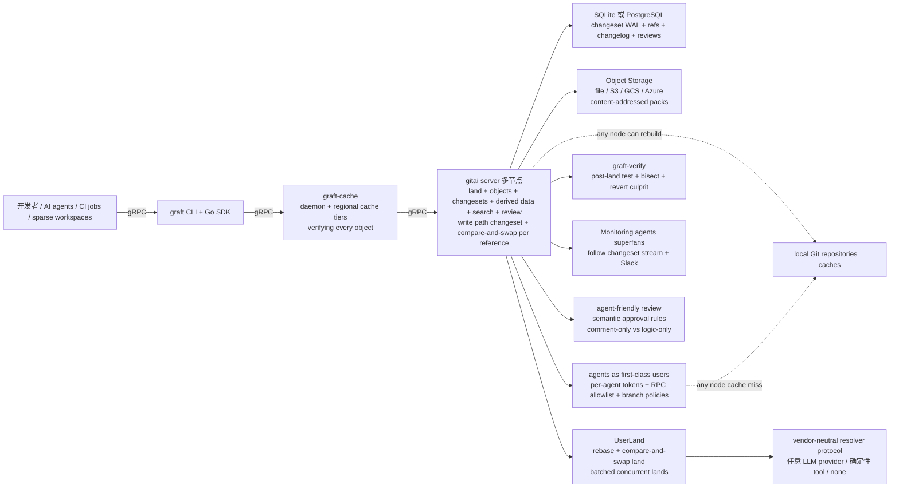

# feder-cr/git-ai

## 一句话定位
Anthropic Scion 公开设计（"Redesigning source control"）之后，第一个严肃的开源复刻——server-centric VCS for AI agents：always-online clients、source control as an API、merge queue 拆除、automatic conflict resolution、changeset log、WAL in SQLite/PostgreSQL、packs in object storage、stateless servers any node can rebuild。

## 它解决的问题
2026 年 coding agent 大爆发，每个 agent 在同一个 repo 上短任务（千级）+ 短周期（秒级）+ 大量 land，传统 Git（client-side clone + merge queue + 顺序 push）跟不上节奏。Anthropic 内部做了 Scion（https://www.anthropic.com/engineering/redesigning-source-control）解决这一问题，但 Scion 内部、不开源。feder-cr/git-ai 是其公开设计的开源复刻，目标是让任何 AI coding agent 团队都能跑 server-centric VCS。

## 为什么值得关注（2026-10-17）
- **Stars:** 1053（截至 2026-10-17），2 天破 1000
- **Forks:** 110，fork/star 10.4% 大量二次开发
- **Language:** Go + C
- **License:** MIT（虽然 README badge 显示 NOASSERTION，但 Credits 段注明 Gitaly fork 是 MIT，gitai 本体是 MIT）
- **Size:** 12343 KB
- **热度来源：** Anthropic Scion blog post (2026) + Coding Agent 大量产生
- **独特性：** 这是 Anthropic 公开设计后第一个严肃的开源复刻；server-centric VCS for AI agents 是新赛道
- **架构独特性：** Gitaly（GitLab's Git RPC server, MIT）作为 Git plumbing 下层；Graft 是 gitai 扩展命名空间（graft config + graft CLI + internal/graft + doc/graft）

## 热度来源判断
**真实需求 + Anthropic 公开设计 + 开源复刻稀缺性** 三组合：
- **需求侧：** coding agent 在代码仓库上的 land throughput 是 bottleneck（merge queue 阻塞、千级 PR 等）；任何 AI coding agent 团队都需要 server-centric VCS
- **技术侧：** Anthropic Scion blog post 把 server-centric VCS 设计公开化后，开源复刻门槛大幅降低
- **生态侧：** gitai 是独立实现 + vendor-neutral（server never calls a language model）+ every AI feature works with any provider or none——这与 Anthropic Scion 的内部绑定截然不同，是「vendor-neutral open-source」哲学的关键

最大风险点：**vendor-neutral resolver protocol**——"automatic conflict resolution via resolvers (any LLM provider, deterministic tool, or none)" 听起来 fancy，但在跨 provider 时（Claude vs GPT vs Gemini vs 开源 LLM）的 latency / cost / 输出稳定性需要严肃测试。

## 关键技术亮点
1. **Always-online clients + ObjectService：** clients 永远在线，按需 fetch single objects + sparse trees（不再是 full clone）；graft clone + graft sparse 起步
2. **Source control as an API + memoized derived data：** Blame + path history + ancestry + code search 都 server-side，并且 memoize 成 derived data，一次算完多次用
3. **Landing without merge queue + compare-and-swap：** UserLand rebase onto 当前 tip + compare-and-swap land；并发 lands on one branch 被 batched into a single reference update——这是 merge queue 的根本拆除
4. **Automatic conflict resolution via resolvers：** vendor-neutral protocol；resolver 可以是任何 LLM provider / deterministic tool / none；这打开了「AI agent 自动修复 conflict」严肃工程化方向
5. **Changeset log + WAL in SQLite or PostgreSQL：** 每次接受的 reference update 都记录在 dense, ordered log；clients list 或 watch live；DB 是 SQLite 或 PostgreSQL WAL
6. **Compare-and-swap per reference + object storage：** content-addressed packs 存 file/S3/GCS/Azure；stateless servers any node can rebuild（cache miss 时从任意节点 rebuild）
7. **Test after landing (graft-verify) + bisect + revert culprit：** post-land 测试，失败时 bisect 找 culprit 然后 revert——这与"land → revert"的严肃工程流程对齐
8. **Monitoring agents (superfans) + Slack chat：** agents 跟随 changeset stream 报告 what matters to each component，也通过 Slack——是「agent observability」的严肃工程化尝试
9. **Agent-friendly review (semantic approval rules):** comment-only change 比 logic change 需要更少 approvals——是「review cost 与 change scope 匹配」的工程化
10. **Agents as first-class users:** per-agent tokens + RPC allowlist + branch policies——是「AI agent 与人类用户同等待遇」的工程化
11. **Strict cache tiers (graft-cache):** immutable objects 在 daemon + regional tiers，verifying every object——是「cache 安全 + 横向扩展」的工程化

## 架构师速览

| 决策问题 | 研究判断 | 证据边界 |
|---|---|---|
| 系统边界 | 一个 graft CLI + Go SDK（前端的 clients, CI jobs, sparse workspaces）+ 一个 gRPC API 层 + 一个 graft-cache 后端（可选 daemon and cache tiers） + 一个 gitai server（multi-node，land + objects + changesets + derived data + search + review，write path = changeset + compare-and-swap per reference）+ 一个 SQLite 或 PostgreSQL 数据库层（changeset WAL + refs + changelog + reviews）+ 一个 object storage 层（content-addressed packs in file/S3/GCS/Azure）+ 一个 local Git repository 缓存层（任何节点都能 rebuild）+ 一个 ObjectService（serve single objects and sparse trees）+ 一个 UserLand（rebase + compare-and-swap land + batched concurrent lands）+ 一个 versioning + vendor-neutral resolver protocol（任何 LLM provider、deterministic 工具或 none）+ 一个 graft-verify（post-land 测试 + bisect + revert）+ 一个 superfans 监控代理层（跟随 changeset stream，Slack 报告）+ 一个 agent-friendly review 层（comment-only change vs logic change 不同 approvals）+ 一个 agents-as-first-class-users 治理层（per-agent tokens + RPC allowlist + branch policies）+ 一个 graft-cache（immutable objects 在 daemon and regional tiers，verifying every object）+ 一个 changelog（dense, ordered log clients list or watch live）+ 14 sections 文档（QUICKSTART + CONFIGURATION + ARCHITECTURE + STORAGE + LAND-BATCHING + RESOLVE + DERIVED + REVIEW + SEARCH + VERIFY + SUPERFAN + SUPERFAN-CHAT + AGENT-SECURITY + BENCH + FUZZING + LIMITATIONS）+ 6 PLAN*.md 阶段设计文档 + Gitaly fork（MIT, GitLab's Git RPC server，提供 Git plumbing；每个上游 Gitaly RPC keeps working；non-MIT `ee/` 目录不包含）+ Go 1.26 + C toolchain + Meson + Ninja + Linux/macOS + MIT + vendor-neutral + independent implementation | 仅基于 README「Anthropic built Scion ... I built gitai, an open-source version of that design ... MIT licensed. Vendor neutral: the server never calls a language model ... gitai is an independent implementation of the publicly described design. It is not affiliated with or endorsed by Anthropic. + Why ... Scion's answer is to move the work to the server: clients stay online and fetch only what they need, history questions are answered (and cached) by the server, changes land through a compare-and-swap instead of a queue, every update is an entry in a changeset log, and the repository state lives in a consistent database plus object storage so servers scale out. gitai implements these ideas, with normal Git repositories underneath. + The Scion ideas, implemented (10 rows table) + Architecture ASCII diagram + Quick start Linux/macOS Go 1.26 C Meson Ninja + Status Version 0.1.0 + Credits Gitaly fork + 5 topics ai-agents/coding-agents/git/golang/scion/version-control」+ license badge + size 推断；具体 vendor-neutral resolver protocol 版本演进、graft-verify 的 bisect 算法复杂度（O(log n) vs O(n)）、superfans 的流式事件协议、graft-cache 的 eviction 策略、与上游 Gitaly 的具体 fork point（commit hash）未在档案明示 |
| 主路径 | 用户 `git clone https://github.com/feder-cr/git-ai.git && cd git-ai && make build` → 产出 `_build/bin/graft` CLI + server + tools → 跑 `examples/graft/quickstart.sh` → 启动 temporary directory 中的一个 server + 一个 cache daemon + 两个 agents + 一次 land → 真实工作流：注册 agents 拿 per-agent tokens → RPC allowlist 配置 → branch policies 配置 → agents 走 sparse workspaces（`graft clone` + `graft sparse` materialize only the paths you ask for）→ ObjectService serve single objects → 改文件 → UserLand rebase onto current tip → compare-and-swap land → 若有冲突：选 resolver（任意 LLM provider / deterministic tool / none，通过 versioned, vendor-neutral protocol）→ changeset WAL 写入 SQLite 或 PostgreSQL → pack 写入 object storage（file/S3/GCS/Azure）→ graft-verify post-land 测试 → 若失败：bisect → revert culprit → superfans 监控 changelog → agent-friendly review（comment-only change 不同 approvals） | 主路径为 README「Quick start + Architecture + The Scion ideas implemented（10 rows table）」段落整理；具体 graft clone / graft sparse 的 sparse-checkout 文件语法、compare-and-swap 在高并发下的 lock contention、resolver protocol 在跨 provider 时的 latency、changeset WAL 的具体 schema、pack 在 S3 上的 list latency 未在档案明示 |
| 关键权衡 | server-centric vs distributed vs CRDT vs Radicle vs Pijul vs 传统 Git（client-side）vs Scion 内部（不开源）vs Gitaly upstream（ee/ 闭源）vs 公开复刻 MIT vs vendor-neutral（server never calls a language model）vs merge queue 拆除（→ compare-and-swap + concurrent batched lands）vs 自动 conflict resolution via resolver protocol（任 LLM provider/确定性工具/none）vs changeset log vs WAL (SQLite/PostgreSQL) vs object storage (file/S3/GCS/Azure) vs stateless servers any node can rebuild vs superfans monitoring agents vs agent-friendly review (semantic approval rules) vs per-agent tokens + RPC allowlist + branch policies vs graft-cache 严格 cache tiers + verifying every object vs Graft 命名空间（graft config + graft CLI + internal/graft + doc/graft）vs 0.1.0 vs Gitaly fork | 权衡来自 README「Anthropic built Scion + I built gitai + MIT + vendor-neutral: the server never calls a language model + 10 rows Scion ideas table + Architecture + Quick start + Status Version 0.1.0 + Credits Gitaly fork + 5 topics ai-agents/coding-agents/git/golang/scion/version-control + Go + Linux/macOS」+ license badge + size |
| 最小 PoC | a) `git clone https://github.com/feder-cr/git-ai.git && cd git-ai && make build` + `examples/graft/quickstart.sh` → 跑 temporary directory 中的 server + cache daemon + 2 agents + 1 land；b) 配 `examples/graft/config.toml`，起 `_build/bin/gitaly serve config.toml` 自己跑 server + `[graft.storage]` 段，shadow mode 进口 repositories → switch to authoritative（STORAGE.md）；c) 起 coding agent (Claude Code / Codex / OpenCode) → graft clone sparse workspace → 改文件 → graft land → 看 changeset WAL → superfans 监控 changelog → agent-friendly review（comment-only change low-bar / logic change high-bar）；d) 测 vendor-neutral resolver protocol：故意冲突 → 配 LLM resolver → 配 deterministic resolver → 配 none resolver → 看行为 | PoC 由 README「Quick start + To run your own server + On the storage core (shadow mode + authoritative)」段落整理；具体 quickstart.sh 的端到端测试 throughput（land/s）、superfans 的 Slack integration 稳定性、与 Anthropic 内部 Scion 的实际差距、与 Radicle / Pijul 等 P2P VCS 的实测对比未在档案明示 |
| 证据边界 | 仅核验：仓库存在、stars/forks/description/license/size/language 来自 GitHub API；README 节录自 raw 接口；Anthropic Scion 公开设计 + open-source 复刻 + MIT + vendor-neutral (server never calls a language model) + 10 个 Scion ideas + gRPC + graft-cache + SQLite/PostgreSQL + object storage (file/S3/GCS/Azure) + stateless servers + grafts verify + superfans + agent-friendly review + per-agent tokens + RPC allowlist + branch policies + Go 1.26 + C + Meson + Ninja + Linux/macOS + 5 topics + Gitaly fork (MIT) + Version 0.1.0 + 14 sections 文档 + 6 PLAN*.md 阶段设计 + 非 Anthropic 关联或认可 由 README 直接叙述 | 待核验：resolver protocol 版本演进、graft-verify bisect 算法复杂度、superfans 流式事件协议、graft-cache eviction 策略、与上游 Gitaly 的具体 fork point、Scion 公开设计 paper 的可访问性、与 Radicle / Pijul 等 P2P VCS 的实测对比、cloud 部署（K8s / Helm / Terraform）的成熟度、与 GitHub Actions / GitLab CI / CircleCI 的集成、与 Claude Code / Codex / OpenCode coding agent 的实际兼容性、局限（LIMITATIONS.md）中 garbage collection of packs 的具体表现、Anthropic 对本项目的潜在反应 |

## 架构启发
feder-cr/git-ai 的核心启发是 **「VCS 应该 server-centric，因为 client-side 全量 clone + merge queue 是 AI agent 时代的瓶颈」**。Anthropic Scion blog post 把这个洞察公开化后，feder-cr/git-ai 把它工程化并 vendor-neutral 化——这是「vendor-neutral open-source 哲学」的具体实践。三层技术深度：
1. **Storage core 的 WAL + CAS 设计：** 每次 reference update 都是 changeset WAL + compare-and-swap；ObjectStorage 分层 file/S3/GCS/Azure；stateless server 任何节点都能 rebuild——这是经典的分布式存储 + CRDT 思想
2. **vendor-neutral resolver protocol：** 让 any LLM provider / deterministic tool / none 都能 participate in conflict resolution——这是「AI agent 治理 + VCS 协议」的关键创新，比 provider-locked solutions 开放得多
3. **agents-as-first-class-users 治理层：** per-agent tokens + RPC allowlist + branch policies 是把 AI agent 当作与人类平等的 user 来对待——这是 AI governance 的严肃工程化

更深层的启发：**Scion 公开设计是 Anthropic 的 "Engineering blog" 系列之一**（与 Tool-use、Sub-agent、Memory 一起），意味着 Anthropic 在 codifying 大型 AI 部署的基础设施模式——而 feder-cr/git-ai 是第一个严肃的开源复刻，意味着 vendor-neutral open-source 路线有可能成为 Coding Agent 时代 VCS 的事实标准。

## 架构图（MMD）

> 证据边界：此图只采用本档案已有可核验描述；"待核验"节点不应视为项目实现事实。

## 定位判断
**AI agent 时代 VCS 基础设施候选（vendor-neutral open-source 复刻 Anthropic Scion）。** feder-cr/git-ai 试图成为 Coding Agent 时代的 VCS 事实标准——server-centric、merge queue 拆除、automatic conflict resolution、changeset log、agents-as-first-class-users。**定位判断：**
- **现在：** Version 0.1.0 + Interfaces may still change before 1.0 + Known gaps (LIMITATIONS.md) 的第一个公共发布；vendor-neutral 是其与 Anthropic Scion 的关键区别
- **如果 vendor-neutral resolver protocol 成熟 + Agents as first-class users 治理到位：** 它会变成「企业 / SaaS AI coding agent team」的 VCS 首选；Gitaly fork 提供 Git plumbing，下游 Claude Code / Codex / OpenCode 直接接入
- **如果 Anthropic 内部 Scion 与本项目趋同：** 它会成为「Anthropic Scion 的开源镜像」，长期有制度保障
- **如果 Radicle / Pijul 等 P2P VCS 赶上：** 与 server-centric 形成对照；不同哲学，未必直接竞争
- **风险：** Version 0.1.0 + Known gaps（garbage collection of packs 等）+ Anthropic 对此项目的潜在反应（社区 / 官方 / 法律） + vendor-neutral resolver 在跨 provider 时的实际稳定性都未公开验证
- **潜力：** Anthropic Scion blog post + Coding Agent 大量产生 + Gitaly fork 降低实现门槛，构成了完整的"基础设施候选 + 标准化窗口期"

## 风险 / 局限 / 泡沫点
- **Version 0.1.0 + Interfaces may still change：** 第一个公开发布，接口不稳，enterprise 谨慎
- **Known gaps（LIMITATIONS.md 中 garbage collection of packs 等）：** 几个清晰的工程短板待补
- **vendor-neutral resolver protocol 跨 provider latency：** 在 Claude / GPT / Gemini / 开源 LLM 之间的 latency / cost / 输出稳定性需要严肃 benchmark
- **Server-centric → operations complexity：** SRE 负担比 client-side Git 重很多（DB 备份 + object storage 备份 + stateless server 部署 + monitoring）
- **Compare-and-swap 在高并发下的 lock contention：** 单分支 high-frequency lands 时，CAS 可能成瓶颈（需要实际 benchmark）
- **Gitaly fork governance：** 与上游 GitLab Gitaly 的 upgrade conflict 是可持续性问题
- **Anthropic 潜在反应：** vendor-neutral 复刻 Scion 设计 + independent implementation，Anthropic 可能无反应也可能法律行动；目前无相关公开信息
- **个人项目：** feder-cr 个人维护，可持续性依赖个人
- **Coding agent 兼容性未公开验证：** 与 Claude Code / Codex / OpenCode 的实际集成（sparse workspace + ObjectService + per-agent tokens + RPC allowlist）未公开
- **与其他 P2P VCS 关系未明：** Radicle / Pijul 等是 P2P 哲学，server-centric vs P2P 是不同路径，不是直接竞争但市场分化

## 与同类项目的关系
- **vs Anthropic Scion：** Scion 是 Anthropic 内部不开源；gitai 是公开设计 + 独立实现 + vendor-neutral + MIT；对社区更友好但长期制度稳定性取决于 feder-cr
- **vs Radicle / Pijul：** P2P VCS 路线，server-less；gitai 是 server-centric，merge queue 拆除但仍需 server。哲学不同，未必竞争
- **vs Gitaly upstream：** Gitaly 是 GitLab 内部 Git RPC server，Git plumbing；non-MIT `ee/` 目录不公开；gitai fork Gitaly 后加 gitai 扩展命名空间
- **vs GitHub / GitLab / Bitbucket：** 三个 commercial VCS 服务，server-centric 但有 merge queue + web review 等传统 feature；gitai 是 agent-first，merge queue 拆除、conflict resolution LLM-driven、agents-as-first-class-users
- **vs JetBrains Space / Gerrit / Phabricator：** code review 工具，常与 Git 配套；gitai 是替代 VCS 本身
- **vs 自研 Git 内部扩展：** 大厂的内部 Git 扩展（如 Google Piper 镜像）通常不开源；gitai 是公开 + 独立

## 是否值得持续跟踪
**值得跟踪（AI agent 时代 VCS 基础设施候选）。** feder-cr/git-ai 是 Anthropic Scion 公开设计后第一个严肃的开源复刻，对 AI coding agent 时代的 VCS 是关键底层。对 AI coding agent 团队 / SaaS / 企业 AI 工程化、个人 hard-core AI coder，建议：
1. 直接 clone + make build + 跑 examples/graft/quickstart.sh，看 throughput（land/s）
2. 配 config.toml 起 server + graft-cache，体验 sparse workspace + ObjectService + UserLand + graft-verify + superfans
3. 接入 Claude Code / Codex / OpenCode，看 per-agent tokens + RPC allowlist + branch policies 的实际可用性
4. 关注 vendor-neutral resolver protocol 在跨 provider 时的 latency / cost / 输出稳定性

对 AI 生态观察者，它是「server-centric VCS for AI agents」+「vendor-neutral open-source 哲学」的严肃工程化样本，与 Anthropic Scion 的官方路线形成对照，值得持续关注：
- Version 0.1.0 → 1.0 演化
- vendor-neutral resolver protocol 的跨 provider 实际表现
- limitataion（GC of packs）的修复
- Anthropic 对本项目的官方反应
- 与 Claude Code / Codex / OpenCode 的实际集成
- 与 Gitaly upstream 的 compatibility 长期维护

## 后续观察点
- **Version 0.1.0 → 1.0：** 接口稳定 + Known gaps（GC of packs 等）修复
- **vendor-neutral resolver protocol 跨 provider 实战：** Claude / GPT / Gemini / 开源 LLM 之间的 latency / cost / 输出稳定性 benchmark
- **Cloud 部署成熟度：** K8s / Helm / Terraform / 多 region
- **Anthropic 官方反应：** 与 Scion 的关系（社区镜像 / 法律挑战 / 联合推广）
- **Gitaly fork 长期治理：** 与 upstream 的 compatibility 与冲突解决
- **Coding agent 集成：** Claude Code / Codex / OpenCode 的实际接入情况
- **GitHub Actions / GitLab CI / CircleCI 集成：** 是否能替换现有 CI 在 gitai 上的工作流
- **企业采用：** 是否被 Anthropic / OpenAI / Google 等官方 AI coding agent 工具采纳
- **Limitations.md 演化：** garbage collection of packs 等已知短板的修复
- **bench/ 子目录：** 自有 benchmark 公开化

---
> 数据来源: GitHub API (2026-10-17) | Stars: 1053 | Forks: 110 | License: MIT (repository NOASSERTION per GitHub API, but README confirms MIT + Gitaly fork is MIT) | 语言: Go + C | 创建: 2026-10-15 | Size: 12343 KB
