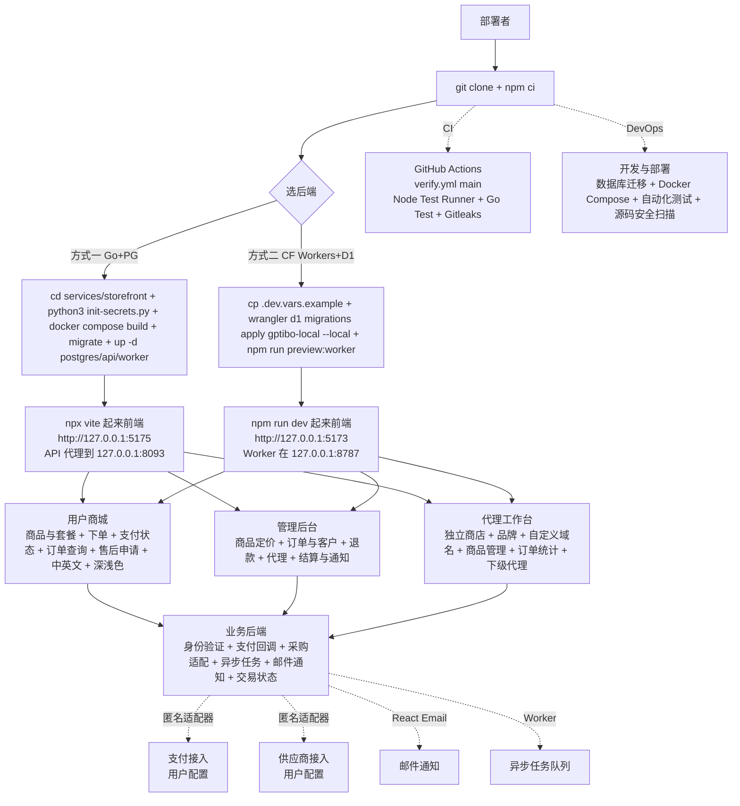

# CoolkHz/gptibo

## 一句话定位
GPTibo 是一个可自托管的数字商品商城系统——用户前台 + 管理后台 + 代理工作台三端合一，支持两套后端任选（Go + PostgreSQL 或 Cloudflare Workers + D1），原站点停运后以 MIT 许可证重开的严肃工程化电商开源替代。

## 它解决的问题
2026 年数字商品（订阅 / 软件 / 课程 / 服务）售卖需求极大，但现状：（1）**Shopify 闭源 + 高月费**——成熟但成本与 vendor-lock 高；（2）**WooCommerce/WordPress 全套包袱**——需要 PHP 服务器 / MySQL / WordPress 安全维护；（3）**Gumroad / Lemon Squeezy 收费抽成**——每笔抽成 10% +，影响利润；（4）**多级代理分销需求**——许多数字商品需要多级代理结算；（5）**支付与供应商对接**——常需匿名适配器以保留自主权。GPTibo 直击痛点：（1）**Self-hosted 自托管**——所有数据 + 资金流用户自主；（2）**5 模块齐全**——用户商城 / 管理后台 / 代理工作台 / 业务后端 / 开发与部署；（3）**两套后端任选**——Go + Gin + PostgreSQL（自托管 server 场景）+ Cloudflare Workers + D1（serverless 场景）；（4）**多级代理 workbench**——独立商店 / 品牌 / 自定义域名 / 商品管理 / 订单统计 / 下级代理管理；（5）**匿名支付/供应商适配器**——支付与供应商接入用匿名适配器，用户配置自己的服务；（6）**原站点停运重开 MIT**——商业 SaaS 失败后用户得到完整的开源代码；（7）**CI verify workflow**——GitHub Actions + verify.yml branch=main + Gitleaks + Node Test Runner + Go Test 完整 CI 栈。

## 为什么值得关注（2026-10-15）
- **Stars:** 722（截至 2026-10-15），2 天 722⭐ ⑂438 fork/star 60.7%，**增长率** 60.7%（fork 占比极高，说明大量用户在 fork 用于二次开发 / 商业化二次利用）
- **Forks:** 438，社区参与度极高（数字商品商城自托管开源场景 fork 多）
- **Size:** 1599 KB（核心代码 + docs）
- **License:** MIT
- **语言:** TypeScript（前端）+ Go（后端任选）+ JavaScript（部分 Cloudflare 模板）+ SQL（migration）
- **活跃度:** created 2026-10-13，pushed_at 2026-10-14，持续高活跃
- **平台:** Docker Compose（Go+PG 部署）+ Cloudflare Workers（D1 部署）+ Web 浏览器（前端）

## 热度来源判断
GPTibo 的热度是 **「Self-hosted 数字商品商城刚需 × 原站点停运重开 MIT × 5 模块（用户商城 / 管理后台 / 代理工作台 / 业务后端 / 开发与部署）× 两套后端任选（Go+PG / CF Workers+D1）× fork/star 60.7% 大量二次开发」** 的组合。原站点停运使开发者得到完整的开源代码，MIT 重新激励二次开发；5 模块 + 双后端任选覆盖了"自托管 server"和"serverless"两类部署场景；匿名支付 / 供应商适配器适合需要资金自主的用户。热度真实且具"自托管 SaaS 严肃工程化"场景的强需求。

## 关键技术亮点
1. **5 模块：** 用户商城（商品与套餐展示、下单、支付状态、订单查询、售后申请、中英文界面、深浅色主题）+ 管理后台（商品定价、订单与客户管理、退款处理、代理管理、结算与通知配置）+ 代理工作台（独立商店、品牌设置、自定义域名、商品管理、订单统计与下级代理管理）+ 业务后端（身份验证、支付回调、采购适配、异步任务、邮件通知与交易状态管理）+ 开发与部署（数据库迁移、Docker Compose、自动化测试、GitHub Actions 与源码安全扫描）
2. **Tech stack：** React 19 + TypeScript + Vite + Tailwind CSS（前端）+ Go + Gin + PostgreSQL（Gin API 与业务 Worker 分进程）/ Cloudflare Workers + D1 + Wrangler（Cloudflare 后端）+ React Email + Node.js 24 + npm + Python 3
3. **Verifiability：** Node.js Test Runner + Go Test + Gitleaks
4. **原站点已停止运营，项目现以 MIT 许可证开放源码：** 商业 SaaS 失败后重开，这是 OSS 生态的良性循环
5. **支付与供应商接入使用匿名适配器，需要配置自己的服务后使用：** 资金流自主
6. **Docker Compose 一栈起：** `docker compose config --quiet && docker compose build api && docker compose up -d --wait postgres && docker compose --profile maintenance run --rm maintenance migrate && docker compose --profile maintenance run --rm maintenance grant-runtime && docker compose up -d --wait api worker`
7. **CI：** GitHub Actions + CI verify workflow + Gitleaks 源码安全扫描
8. **双语：** 中英界面 + 中文主 README
9. **双 shell：** `python3 scripts/init-secrets.py` + Windows `init-secrets.ps1`
10. **深浅色主题：** Light/Dark 一致
11. **代理工作台多级分销：** 独立商店 / 品牌 / 自定义域名 / 商品管理 / 订单统计 / 下级代理管理
12. **业务后端异步任务：** 邮件通知 + 交易状态管理 + 异步任务队列

## 架构师速览

| 决策问题 | 研究判断 | 证据边界 |
|---|---|---|
| 系统边界 | 一个 Self-hosted 数字商品商城系统 + 5 模块（用户商城 / 管理后台 / 代理工作台 / 业务后端 / 开发与部署）+ 两套后端任选（Go + Gin + PostgreSQL 服务 / Cloudflare Workers + D1 + Wrangler）+ 一个前端（React 19 + Vite + Tailwind CSS + TypeScript）+ 一个 CI（GitHub Actions + verify workflow + Gitleaks + Node.js Test Runner + Go Test）+ 一个 Docker Compose（postgres + api + worker + maintenance profile）+ 一个匿名支付/供应商适配器层 + 一个 React Email + 一个 secrets 初始化（`python3 scripts/init-secrets.py` + `init-secrets.ps1` Windows 双 shell）+ 一个 CI badge（actions/workflows/verify.yml branch=main）+ 一个中文主 README + 一个 i18n（中英界面） | 仅基于 README「GPTibo 将商品展示、下单支付、订单交付、售后处理和代理商店管理整合在同一套系统中 + 前端 React + TypeScript + 后端 Go+PG 或 CF Workers+D1 + 原站点已停止运营重开 MIT + 支付/供应商匿名适配器 + 5 模块 + CI verify workflow + Gitleaks + 中英文界面 + 深浅色主题 + Docker Compose」+ license badge + size 推断；具体哪一版商家后台 UI 路径、payment adapter 在 Go 与 CF 两个 runtime 的兼容性、maintenance migration 数据完整性证明、agent workbench 多级代理结算规则未在档案明示 |
| 主路径 | 用户 `git clone https://github.com/CoolkHz/gptibo.git && cd gptibo && npm ci` → 选后端：a) Go+PG：`cd services/storefront && python3 scripts/init-secrets.py && cp .env.example .env && docker compose config --quiet && docker compose build api && docker compose up -d --wait postgres && docker compose --profile maintenance run --rm maintenance migrate && docker compose --profile maintenance run --rm maintenance grant-runtime && docker compose up -d --wait api worker`；另开终端 `npx vite --config services/storefront/vite.config.ts` → 访问 `http://127.0.0.1:5175`（前端）/ API 代理到 `127.0.0.1:8093`。b) CF Workers+D1：仓库根目录 `cp .dev.vars.example .dev.vars && npx wrangler d1 migrations apply gptibo-local --local && npm run preview:worker` → 访问 `http://127.0.0.1:8787`；frontend 热更新另起 `npm run dev` → `http://127.0.0.1:5173` | 主路径为 README「快速开始 + 方式一/方式二 + 页面入口 + Go 后端文档」段落整理；具体 PG vs D1 两套迁移 schema 的等价性、agent workbench 多级代理结算财务一致性、CI verify workflow 当前涵盖哪些检查、`.env.example` 与 `.dev.vars.example` 占位项是否一致未在档案明示 |
| 关键权衡 | Self-hosted vs SaaS Shopify vs WooCommerce WordPress全套包袱 vs Gumroad/Lemon Squeezy 抽成 vs 原站点停运重开 MIT vs Go+PG vs CF Workers+D1 双 runtime vs 匿名支付/供应商适配器 vs agent workbench 多级代理 vs React 19 + Vite + Tailwind vs Node 24 + Docker Compose vs CI verify workflow + Gitleaks | 权衡来自 README「原站点已停止运营重开 MIT + 支付/供应商匿名适配器需要配置 + Go+PG / CF Workers+D1 二选一 + agent workbench 多级代理 + React 19 + Vite + Tailwind + Node 24 + Docker Compose + CI verify + Gitleaks + 中英文 + 深浅色」 |
| 最小 PoC | a) Go+PG：装 Docker Compose + Go 1.26 + Node 24 + Python 3 → `git clone` 后跑 `方式一` 完整 7 步 → 访问 `http://127.0.0.1:5175` 注册一个 admin → 建一个 demo 商品 → 用测试支付后端（匿名适配器 placeholder）下单 → 验订单、后台管理、agent workbench 多级代理；b) CF Workers+D1：`npm run preview:worker` + 装 wrangler → 本地 D1 migrate → 同样路径验证；Windows 用户用 `init-secrets.ps1` 替代 | PoC 由 README「快速开始 + 方式一 + 方式二 + 页面入口 + Go 后端文档」段落整理；具体主版本测试、demo seed data、payment adapter 与 supplier adapter 的 reference 实现、agent workbench webhook 与结算合理性 demo 未在档案明示 |
| 证据边界 | 仅核验：仓库存在、stars/forks/description/license/size/language 来自 GitHub API；README 节录自 raw 接口；5 模块 + 两套后端 + React 19 + Vite + Tailwind + Go+Gin+PG + CF Workers+D1 + 原站点停运重开 MIT + 匿名适配器 + Node 24 + Docker Compose + GitHub Actions + CI verify workflow + Gitleaks + Node Test Runner + Go Test + React Email + 双语界面（中主文档）+ 2 天 722⭐ ⑂438 fork/star 60.7% 由 README 直接叙述 | 待核验：payment adapter & supplier adapter 的 reference 实现完整度、PG 与 D1 两套 migrations schema 等价性证明、maintenance profile 的权限模型、agent workbench 多级代理结算规则、CI verify 工作流当前涵盖的检查项与进入门槛、Windows PowerShell 与 Linux/Mac 两条初始化路径是否完全对齐、社区治理 |

## 架构启发
GPTibo 的核心启发是 **「Self-hosted 数字商品商城 + 原站停运重开 MIT + 5 模块（三端 + 后端 + 部署）+ 两套后端任选 + 匿名支付/供应商适配器」**。当前数字商品售卖平台要么 vendor-lock SaaS（Shopify / Gumroad），要么需要 PHP/WordPress 全套包袱（WooCommerce），要么闭源抽成（10%+），缺一个 Self-hosted + MIT + 现代栈（React 19 + Go / CF Workers）+ 多级代理 workbench + 匿名支付的严肃工程化路径。GPTibo 用 fork/star 60.7% 的数据证明了这条路径的真实需求。这指向 **「数字商品商城是 Self-hosted SaaS 的下一个严肃工程化样本」**。GPTibo 还展示了 **「商业 SaaS 失败后重开 MIT」的良性循环——原站点已停止运营，项目现以 MIT 许可证开放源码，这给所有想做 SaaS 但担心 vendor-lock 的开发者一个安心的退出路径**。

## 架构图（MMD）

> 证据边界：此图只采用本档案已有可核验描述；"待核验"节点不应视为项目实现事实。

## 定位判断
**Self-hosted SaaS 严肃工程化样本（数字商品商城垂直）。** GPTibo 不仅是工具集，更指向「Self-hosted 数字商品商城」这一垂直赛道的严肃工程化路径——5 模块 + 双后端 + 匿名支付 + MIT + CI 完整栈。它填补了"vendor-lock SaaS"和"PHP/WordPress 全套包袱"之间的空白（自托管 + MIT + 现代栈 + 多级代理）。能否成为数字商品商城的默认开源方案，取决于（a）payment adapter & supplier adapter reference 实现的完整度；（b）PG 与 D1 两套 migrations schema 等价性证明；（c）agent workbench 多级代理结算规则的清晰度；（d）CI verify workflow 检查覆盖与门槛；（e）社区治理。

## 风险/局限/泡沫点
- **payment adapter & supplier adapter 的 reference 实现完整度：** 匿名适配器需要用户配置自己的支付 / 供应商服务，但 reference 实现完整度未明确，可能需要用户自行实现
- **PG vs D1 两套 migrations schema 等价性证明：** 方式一和方式二最终数据是否一致未明
- **maintenance profile 的权限模型：** Docker Compose 的 maintenance profile 权限边界未明
- **agent workbench 多级代理结算规则：** 财务一致性、自定义域名 SSL、品牌设置完整度未明
- **CI verify workflow 当前涵盖的检查项与门槛：** Node Test Runner + Go Test + Gitleaks 是 base，maintainability / security / performance / load testing 完整度未明
- **Windows PowerShell 与 Linux/Mac 两条初始化路径对齐：** `init-secrets.py` vs `init-secrets.ps1` 的等价性未明
- **原站点停运的事实：** 原站点商业模式可持续性存疑，二次开发者需自行承担商业化路径设计
- **社区治理：** 是否接受外部 PR / RFC / contribution 流程不明
- **中文主 README：** 英文社区接收度需观察

## 与同类项目的关系
- **vs Shopify（SaaS）：** Shopify 闭源 + 高月费；GPTibo Self-hosted + MIT + 现代栈
- **vs WooCommerce（WordPress）：** WooCommerce PHP + WordPress + MySQL 全套包袱；GPTibo TypeScript + Go/CF + 现代测试栈
- **vs Gumroad / Lemon Squeezy（抽成平台）：** 那些 10%+ 抽成；GPTibo self-hosted 无抽成
- **vs talorys（Cloudflare 个人 AI agent）：** talorys 是个人 AI agent；GPTibo 是数字商品商城系统
- **vs new-term-radar：** new-term-radar 是 AI 新词发现；GPTibo 是数字商品商城
- **vs mailcheap（newsletters for agentic era）：** mailcheap 是 newsletter self-hosted AGPL-3.0；GPTibo 是数字商品商城 self-hosted MIT（不同垂直）
- **vs Medusa / Vendure（开源 headless commerce）：** 那些是 Node.js / TypeScript headless commerce；GPTibo 是 TypeScript + Go/CF + 数字商品商城 + 代理工作台

## 是否值得持续跟踪
**值得跟踪（Self-hosted 数字商品商城严肃工程化候选）。** GPTibo 代表了 2026 年 Self-hosted 数字商品商城 + 原站停运重开 MIT + 5 模块 + 双后端 + 匿名支付的严肃工程化路径。建议关注：（a）payment adapter / supplier adapter reference 实现完整度；（b）PG vs D1 schema 等价性证明；（c）agent workbench 多级代理结算规则；（d）CI verify 检查覆盖与门槛；（e）社区治理。任何需要 Self-hosted 数字商品商城（含多级代理）的团队可 clone 试用；对 Self-hosted SaaS 观察者，它是「商业 SaaS 失败后重开 MIT」良性循环的样本。

## 后续观察点
- payment adapter & supplier adapter 的 reference 实现完整度
- PG vs D1 两套 migrations schema 等价性证明
- agent workbench 多级代理结算规则 + webhook
- CI verify workflow 检查覆盖 / 进入门槛
- Windows PowerShell 与 Linux/Mac 路径对齐
- 与 Medusa / Vendure / Shopify 迁移路径
- 中文社区 + 英文社区贡献
- community contribution 流程 + CLA + 商业化二次利用边界
- 原站点商业模式失败原因（避免二次开发者重蹈覆辙）

---
> 数据来源: GitHub API (2026-10-15) | Stars: 722 | Forks: 438 | License: MIT | 语言: TypeScript + Go + Cloudflare Workers | 创建: 2026-10-13
