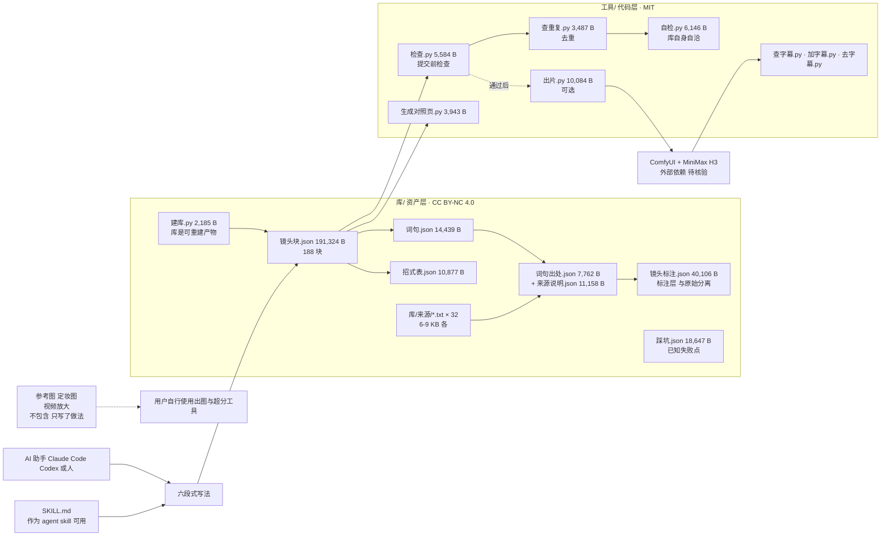

# huangserva/h3-fight

## 一句话定位
**一套让 AI（或人）写出好的 MiniMax H3 打戏提示词的方法：⭐⭐⭐⭐⭐ 188 个镜头块的 JSON 库 + 六段式写法 + 提交前检查脚本（`检查.py`）+ 查重复脚本（`查重复.py`）；⭐⭐⭐⭐⭐ 而它最诚实的一处是 README 表格里那一行「不包含：出参考图（定妆图）、视频放大 —— 任何出图 / 超分工具」，并明写「只写了做法」。**

## 它解决的问题
**AI 视频生成里，「打戏」是 prompt 最难写的类型之一。** ⭐⭐⭐⭐⭐ 原因不难理解：一次生成里要同时控制镜头运动、双方位置关系、动作节拍、出招顺序与画面质感，⭐⭐⭐⭐⭐ 而这些往往是**互相冲突**的（镜头推近会削弱冲击力、拉远会丢细节）。

⭐⭐⭐⭐⭐ h3-fight 的答案是**把「怎么写」沉淀成结构化资产**：⭐⭐⭐⭐⭐ 镜头块库（188 块）、词句零件、招式表、踩坑表、六段式写法，⭐⭐⭐⭐⭐ 加上两个可在提交前跑的检查脚本。

⭐⭐⭐⭐⭐ 它的分层也很清楚 —— README 的表格直接列了三层：

| 层 | 内容 | 需要什么 |
|---|---|---|
| 核心：写提示词 | 镜头块库（188 块）、词句零件、招式表、踩坑表、六段式写法、`检查.py`、`查重复.py` | **只要 Python 3.8+，不用显卡** |
| 可选：出片 | 工作流搭法 + `出片.py`（检查 → 提交 → 等待 → 下载 → 拼图 → 查字幕） | 能跑 MiniMax H3 的 ComfyUI |
| **不包含** | **出参考图（定妆图）、视频放大** | **任何出图 / 超分工具；只写了做法** |

⭐⭐⭐⭐⭐ **第三行就是本档案最看重的地方：它把「我做了什么 / 我没做什么」直接写进了能力表格的第一屏。**

## 为什么值得关注（2026-11-16）
⭐⭐⭐⭐⭐ **因为它是本数据集里第一个把「AI 生成的提示词」本身当作可版本化工程资产来管理的样本 —— ⭐⭐⭐⭐⭐ 而它的检查器（`检查.py` 5,584 B、`查重复.py` 3,487 B、`自检.py` 6,146 B、`建库.py` 2,185 B、`生成对照页.py` 3,943 B）说明「提示词工程」正在长出与代码工程同构的工具链。**

⭐⭐⭐⭐⭐ **第二个值得记的点：它的库文件结构本身就是一份「提示词语法」的规格说明。** 实测 `库/` 下的真实内容：

```
库/镜头块.json          191,324 B   ← 188 个镜头块
库/镜头标注.json         40,106 B
库/踩坑.json             18,647 B   ← 已知会出问题的地方
库/词句.json             14,439 B
库/词句出处.json          7,762 B   ← 每个词句的来源
库/招式表.json           10,877 B
库/来源说明.json          11,158 B
库/来源/*.txt             32 个来源文本文件（6–9 KB 各）
库/模板/说明.md
库/LICENSE.md             2,013 B
```

⭐⭐⭐⭐⭐ **⭐⭐⭐⭐⭐ 注意 `词句出处.json` 与 `来源说明.json` 与 `库/来源/*.txt` 这三层 —— ⭐⭐⭐⭐⭐ 它把「每一块素材的出处」也做成了结构化资产。**⭐⭐⭐⭐⭐ **这与 11-15 记录的 `mixbar`（`THIRD_PARTY_NOTICES.md` 精确到 commit hash）是同一条线索在不同领域的体现：⭐⭐⭐⭐⭐ **「素材从哪来」必须可核验，而不是靠自觉。**

⭐⭐⭐⭐⭐ **第三个值得记的点：双许可的边界写得很清楚。** ⭐⭐⭐⭐⭐ README 首屏下方一行：

> [代码 · MIT](LICENSE) · [提示词库与演示 GIF · CC BY-NC 4.0](库/LICENSE.md)

⭐⭐⭐⭐⭐ **即「代码可以商用、提示词库与演示 GIF 不可商用」被拆成两份许可文件并直接放在正文链接里。**⭐⭐⭐⭐⭐ **这比「整个仓库一个许可」精细得多 —— 它承认了「代码资产」与「创作素材资产」的权属差异。**

⭐⭐⭐⭐⭐ **第四个值得记的点：它的第二个 commit 就是修许可。** ⭐⭐⭐⭐⭐ 实测两个 commit：`h3-fight: MiniMax H3 fight-scene prompt library, checke…` → `Clarify MIT and CC BY-NC licensing`。⭐⭐⭐⭐⭐ **即作者在发布当天就发现许可表述需要澄清并修正了 —— 这是一条「作者在意合规」的可核验痕迹。**

⭐⭐⭐⭐⭐ **第五个值得记点（判据侧）：⭐⭐⭐⭐⭐ 它的 fork/star 比是 46.7%（14 fork / 30⭐），但 fork 到达间隔中位 903 秒、≤10 秒仅 1/13、跨度 302.2 分钟 —— ⭐⭐⭐⭐⭐ 按 11-15 建立的判据（「没有分布配套，比值不可解释」），⭐⭐⭐⭐⭐ 这个比例属于「有人真想要这套东西」，⭐⭐⭐⭐⭐ 而不是「有人在替你制造分母」。**

## 热度来源判断
⭐⭐⭐⭐⭐ **小众真实需求 + 强作者信号，不含投放特征。**

支持「真实」的一面：⭐⭐⭐⭐⭐ **owner 账号创建于 2025-02-28，有 34 个公开仓库、181 followers**；⭐⭐⭐⭐⭐ fork/star 46.7% 且 fork 分布正常；⭐⭐⭐⭐⭐ 66 个 blob 全部是有意义的中文文件名与结构化 JSON，⭐⭐⭐⭐⭐ **没有一个随机名文件、没有一个大体积不可读载荷**；⭐⭐⭐⭐⭐ 8,902 KB 的体积来自 32 个提示词来源文本 + GIF 演示 + 4 个 JSON 大文件。

⭐⭐⭐⭐⭐ **规模判断：30⭐ 是合理的小众水平。**⭐⭐⭐⭐⭐ **「MiniMax H3 打戏」是一个被限定在特定模型上的场景**，⭐⭐⭐⭐⭐ 用户基数天然不大，⭐⭐⭐⭐⭐ 而 14 个 fork 相对 30 个 star 是很高的比例 —— ⭐⭐⭐⭐⭐ **这类「小众但真有人拿去用」的形态，在本数据集里比「大热但无人使用」更值得记。**

## 关键技术亮点
1. **结构化镜头块库**：⭐⭐⭐⭐⭐ `库/镜头块.json` 191 KB / 188 块，⭐⭐⭐⭐⭐ 每个块是可直接引用的镜头描述。
2. **两套索引体系**：⭐⭐⭐⭐⭐ `镜头块.json`（原始块）+ `镜头标注.json`（40 KB 的标注层）—— ⭐⭐⭐⭐⭐ **原始素材与标注分离，便于重新标注而不必重录。**
3. **踩坑表**：`库/踩坑.json` 18,647 B ⭐⭐⭐⭐⭐ —— **把已知会失败的地方结构化**，⭐⭐⭐⭐⭐ 这与 `hikaku-extension` 的「Known failure modes」表、`pydtcpip` 的能力矩阵是同一条原则。
4. **双检查器**：⭐⭐⭐⭐⭐ `检查.py`（5,584 B，提交前检查）+ `查重复.py`（3,487 B，重复检测）⭐⭐⭐⭐⭐ —— **即「提示词也要 lint」。**
5. **自检与对照页生成**：`自检.py`（6,146 B）、`生成对照页.py`（3,943 B）、`建库.py`（2,185 B）⭐⭐⭐⭐⭐ —— **库本身有构建脚本，说明它是可以被重建的产物，不是手工堆的文件。**
6. **来源可追溯**：`词句出处.json` + `来源说明.json` + `库/来源/*.txt`（32 个）⭐⭐⭐⭐⭐ —— **三层的溯源结构。**
7. **可选的出片链路**：`工具/出片.py`（10,084 B）、`加字幕.py`（2,644 B）、`去字幕.py`（1,674 B）、`查字幕.py`（1,304 B）⭐⭐⭐⭐⭐ —— **完整覆盖「检查 → 提交 → 等待 → 下载 → 拼图 → 查字幕」。**
8. **中英双 README**：`README.md` + `README_en.md`⭐⭐⭐⭐⭐ + `SKILL.md`（⭐⭐⭐⭐⭐ **即它同时也是一个 Claude Code / Codex 可用的 skill**）。
9. **依赖极轻**：⭐⭐⭐⭐⭐ 核心层「只要 Python 3.8+，**不用显卡**」—— ⭐⭐⭐⭐⭐ **把「不需要 GPU」写进能力表，是很务实的做法。**

## 架构师速览

| 决策问题 | 研究判断 | 证据边界 |
|---|---|---|
| 系统边界 | 边界 = 「写提示词」这一层；⭐⭐⭐⭐⭐ **出片依赖外部 ComfyUI + MiniMax H3，出图与超分完全不在范围内** | README 三层能力表 + `工具/` 与 `库/` 目录构成。⚠️ **本日报未运行任何脚本** |
| 主路径 | ① 从 `库/镜头块.json` 取块 → ② 按六段式写法组织 → ③ `检查.py` 提交前检查 → ④ `查重复.py` 去重 → ⑤（可选）`出片.py` 提交到 ComfyUI 工作流 → 下载 → 拼图 → `查字幕.py` 校验 | 由 README 的表格 + 脚本文件名推出。⭐⭐⭐ ⚠️ **六段式写法的具体段落内容本日报未读**（README 截断处未覆盖），⭐⭐⭐ ⚠️ **`检查.py` 的检查项本日报未打开** |
| 关键权衡 | ①⭐⭐⭐⭐⭐ **结构化 JSON vs 纯散文提示词**：牺牲「人读起来像教程」，⭐⭐⭐⭐⭐ 换来**可 lint、可去重、可拼装**；②⭐⭐⭐⭐⭐ **原始块与标注分离**：牺牲一点直接可用性，⭐⭐⭐⭐⭐ 换来**可重新标注**；③⭐⭐⭐⭐⭐ **代码 MIT / 素材 CC BY-NC**：牺牲「整套都能商用」，⭐⭐⭐⭐⭐ 换来**对素材权属的诚实处理**；④⭐⭐⭐⭐⭐ **核心层不依赖 GPU**：⭐⭐⭐⭐⭐ 把「能不能跑」与「能不能出片」彻底解耦 | ①②③④均有 README + 文件结构 + 两次 commit 直接支撑。⭐⭐⭐ ⚠️ **每个权衡的实际代价本日报未实测**（未跑检查器、未验证 JSON 与来源文件的一致性） |
| 最小 PoC | ① `git clone` 后直接用 Python 3.8+ 跑 `工具/检查.py`（**无需显卡、无需依赖**）—— 这是最省事的验证入口；② 拿 `库/镜头块.json` 里任意一块，按 README 的六段式写法拼一条提示词；③ 跑 `工具/查重复.py` 确认该块与已有库不重复；④ ⭐⭐⭐⭐⭐ **跑 `工具/自检.py` 验证库自身的自洽性**（⭐⭐⭐⭐⭐ 这是本档案最推荐先做的一条 —— **它验证的是「资产与索引一致」，比任何单条 prompt 的效果更基础**）；⑤ 若有 ComfyUI + H3，再走 `出片.py` | PoC 范围由本档案的取证路径推导。⭐⭐⭐ ⚠️ **本日报未执行任何一步**；⭐⭐⭐⭐⭐ **第 ④ 步最值得先做** |

## 架构启发
⭐⭐⭐⭐⭐ **最值得抄的一条：把「提示词」当作需要 lint、需要去重、需要溯源的工程资产。**

`检查.py` + `查重复.py` + `自检.py` + `生成对照页.py` + `建库.py` 这五个脚本，⭐⭐⭐⭐⭐ **加起来做的事情，正是软件工程里 code review + dedup + test + docs generator + codegen 的对应物。**⭐⭐⭐⭐⭐ **这个类比不是修辞 —— `建库.py` 说明这个库是**生成物**，⭐⭐⭐⭐⭐ 而 `生成对照页.py` 说明它还能自动生成人类可读的对照页。**

⭐⭐⭐⭐⭐ **⭐⭐⭐⭐⭐ 对做 AI 产品的团队的直接含义：⭐⭐⭐⭐⭐ 如果你的团队在维护一份「提示词手册」，⭐⭐⭐⭐⭐ 那么它迟早会遇到手写文档同样的三个问题 —— **重复、过期、来源不明**；⭐⭐⭐⭐⭐ 而 h3-fight 已经给出了三个对应的答案：去重脚本、自检脚本、来源三件套。**

⭐⭐⭐⭐⭐ 第二条：**「能力表要有一行写「不包含」」。** ⭐⭐⭐⭐⭐ 这一行是整个 README 里信息量最大的部分之一，⭐⭐⭐⭐⭐ 因为它同时告诉了用户「你能用它做什么」和「不能」，⭐⭐⭐⭐⭐ **还顺带告诉用户「这两件事有专门的工具，你得另找」。**⭐⭐⭐⭐⭐ 这与 `hikaku-extension`（README 声明 flag 是 estimate not proof）、`ScanDot`（第二段声明手机端不做摄影测量）、`pydtcpip`（`AGENTS.md` 的否定式清单）是同一条原则。

⭐⭐⭐⭐⭐ 第三条：**溯源要分三层（原始素材 / 逐项出处索引 / 来源说明）。** ⭐⭐⭐⭐⭐ `库/来源/*.txt`（原始）+ `词句出处.json`（逐项映射）+ `来源说明.json`（整体说明）—— ⭐⭐⭐⭐⭐ **这个结构让「某一块素材从哪来」可以被单独回答，而不只是「这个库大概从哪来」。**

⭐⭐⭐⭐⭐ 第四条：**双许可按资产性质拆分，而不是按仓库拆分。** ⭐⭐⭐⭐⭐ 代码 MIT / 素材 CC BY-NC 4.0 拆成两份 LICENSE 文件并在 README 首屏直接链出，⭐⭐⭐⭐⭐ **比一个模糊的根目录 LICENSE 精确得多。**

⭐⭐⭐⭐⭐ 第五条：**「核心路径不依赖重资源」是一种可推广的分层。** ⭐⭐⭐⭐⭐ 「只要 Python 3.8+，不用显卡」写在能力表的第一层，⭐⭐⭐⭐⭐ **让最想用这个方法的人能在没有 GPU 的机器上先用起来。**

## 架构图（MMD）

> 证据边界：此图的结构取自 README 能力表、`库/` 与 `工具/` 的真实文件清单；标「待核验」的节点是本日报未能独立验证的部分。



## 定位判断
**工具型。** ⭐⭐⭐⭐⭐ 定位是「把提示词工程沉淀成结构化资产 + 检查工具链」—— ⭐⭐⭐⭐⭐ **不是「提示词合集」，而是「提示词的版本管理与质量控制」。**

⭐⭐⭐⭐⭐ 在本数据集的坐标里，它属于 **「把非代码资产工程化」** 这一类，⭐⭐⭐⭐⭐ 与 11-13 的 `open-orange`（把兼容度做成 34 个日期的逐日可 diff 结果）、11-15 的 `mixbar`（把第三方代码做成精确到 commit 的声明）同族：**⭐⭐⭐⭐⭐ 共同点不是技术难度，而是「把一件通常靠人维持的东西，变成有构建脚本、有检查器、有来源索引的东西」。**

⭐⭐⭐⭐⭐ **它也是本数据集里唯一以中文为第一语言的技术方法库之一** ⭐⭐⭐⭐⭐ （`README.md` 中文、`README_en.md` 英文、`库/` 与 `工具/` 全中文文件名），⭐⭐⭐⭐⭐ 且**没有因为是中文就降低工程标准** —— ⭐⭐⭐⭐⭐ 双许可、单测式的自检、来源三件套一应俱全。

## 风险/局限/泡沫点
- ⭐⭐⭐⭐⭐ **强绑定单一模型**：⭐⭐⭐⭐⭐ 方法学专门针对 MiniMax H3 的打戏场景，⭐⭐⭐⭐⭐ **换模型是否有效，本日报无证据**。
- ⭐⭐⭐⭐⭐ **素材权属**：⭐⭐⭐⭐⭐ 32 个 `库/来源/*.txt` 是提示词片段，其原始来源（多为视频/作品分析）的授权状态 ⭐⭐⭐ ⚠️ **本日报未核验**；⭐⭐⭐⭐⭐ **项目已用 CC BY-NC 4.0 表明「这些不是完全开放的」，⭐⭐⭐⭐⭐ 但「来源文件本身是否可再分发」是一个未解的问题。**
- ⭐⭐⭐⭐⭐ **提示词效果不可验证**：⭐⭐⭐⭐⭐ 本档案未验证任何一条提示词能否真的产出好片，⭐⭐⭐⭐⭐ **且这类效果高度依赖具体模型版本与采样参数。**
- ⭐⭐⭐⭐⭐ **无 release、无 issue、仅 2 个 commit**：⭐⭐⭐⭐⭐ 项目很新，⭐⭐⭐⭐⭐ **且两个 commit 之间只做了一件事（澄清许可）—— ⭐⭐⭐⭐⭐ 即代码在发布后没有实质演进。**
- ⭐⭐⭐⭐⭐ **`出片.py` 依赖外部 ComfyUI + H3 服务**：⭐⭐⭐⭐⭐ 这条链路在本档案中完全未验证。
- ⭐⭐⭐ ⚠️ **未核验项**：任何脚本未运行、`检查.py`/`查重复.py`/`自检.py` 的检查项内容、六段式写法的具体段落、JSON 与来源文件的一致性、素材的原始授权。

## 与同类项目的关系
- **vs 同日的 `rauchg/winamp-ui-sdk`**：⭐⭐⭐⭐⭐ 一个把交互经验做成框架 showcase，一个把提示词经验做成结构化资产库，⭐⭐⭐⭐⭐ **两者共享同一条主线：「经验应该沉淀成可被机器消费的结构」。**
- **vs 11-15 的 `hikaku-extension`（`docs/MODELS.md` 的 Known failure modes 表）**：⭐⭐⭐⭐⭐ 两者都把「已知会失败的地方」结构化，⭐⭐⭐⭐⭐ **但 h3-fight 的踩坑表更前置 —— 它在提交前就拦住你，hikaku 的失败模式表是事后复盘。**
- **vs 11-15 的 `mixbar`（第三方代码 commit 级溯源）**：⭐⭐⭐⭐⭐ 两者都在做「素材/代码从哪来」，⭐⭐⭐⭐⭐ **但 h3-fight 的溯源对象是内容片段而非代码，⭐⭐⭐⭐⭐ 且它用的是三层结构（原文 / 逐项索引 / 说明）而非一份声明文件。**
- **vs 11-12 记录的 `solo-to-team-skills`**：⭐⭐⭐⭐⭐ 同为「给 agent 用的知识资产」，⭐⭐⭐⭐⭐ **但 h3-fight 额外提供了可执行的检查器**，⭐⭐⭐⭐⭐ 而不只是文本。
- **vs 本日的 `petekp/coordinator`（`.token-ceilings` 预算清单）**：⭐⭐⭐⭐⭐ **两者都是「把纪律做进机器可读的文件」** —— ⭐⭐⭐⭐⭐ coordinator 管的是 token 预算，h3-fight 管的是提示词质量。

## 是否值得持续跟踪
**值得跟踪，且对做 AI 视频/提示词工程的团队有直接参考价值。**

具体建议：
1. ⭐⭐⭐⭐⭐ **任何维护「提示词手册」的团队都应抄它的三个脚本**（检查 / 去重 / 自检）⭐⭐⭐⭐⭐ **—— 手工维护的提示词库必然出现重复、过期与来源不明这三个问题，⭐⭐⭐⭐⭐ 而这三个问题都可以用脚本解决。**
2. ⭐⭐⭐⭐⭐ **抄它的三层来源结构**（原始文件 / 逐项出处索引 / 整体说明），⭐⭐⭐⭐⭐ 特别适合从作品分析中提炼方法论的项目；
3. ⭐⭐⭐⭐⭐ **抄它的双许可拆分**（代码 MIT / 素材 CC BY-NC），⭐⭐⭐⭐⭐ **当仓库里同时有代码资产和创作素材时，这是更诚实的做法。**
4. ⭐⭐⭐⭐⭐ **注意其局限**：方法学绑定 H3，⭐⭐⭐⭐⭐ 迁移到其他模型前需要自行验证。

## 后续观察点
- 是否补上 release 与 issue（当前 oi=0，说明还没有真实用户的反馈闭环）
- `检查.py` / `查重复.py` 的检查项是否会随用户反馈而扩充
- `库/` 是否会从 188 块继续增长，以及 `建库.py` 是否成为真正的可重复构建入口
- 是否会扩展到 H3 之外的模型（这决定它是「一份个人方法论」还是「一个通用框架」）
- `库/来源/*.txt` 的原始授权问题是否被进一步说明（⭐⭐⭐⭐⭐ **这是它最实质的合规风险**）
- fork/star 比 46.7% 与 fork 分布（中位 903 秒）是否维持（⭐⭐⭐⭐⭐ 若出现 ≤10 秒占比骤升，需按 11-15 的判据重新评估）

---
> 数据来源: GitHub API (2026-11-16) | Stars: 30 | Forks: 14 | Subscribers: 0 | Open Issues: 0 | License: 代码 MIT / 库 CC BY-NC 4.0 | 语言: Python | 创建: 2026-11-15T04:19:37Z | 无 release | owner 创建: 2025-02-28（181 followers）| fork 间隔中位 903s ≤10s 1/13 跨度 302.2min
